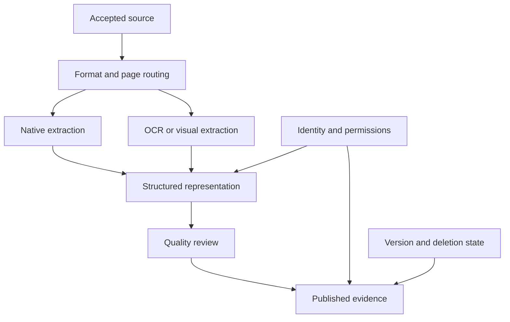

# Study Notes: M06.1.1 — Document Ingestion

**Path:** Core · **Depth:** L2 foundation; L3 through demonstrated project work  
**Module purpose:** Knowledge application  
**Prerequisites:** M03, M05 and M07  
**Completion evidence:** Explain how source content becomes searchable evidence; demonstrate faithful extraction, traceable versions, inherited permissions and removal of derived content.

## Table of Contents

1. [Document Ingestion Fundamentals](#1-document-ingestion-fundamentals)
2. [File Uploads and MIME Detection](#2-file-uploads-and-mime-detection)
3. [PDF Processing](#3-pdf-processing)
4. [HTML, Markdown and Office Documents](#4-html-markdown-and-office-documents)
5. [Images, Tables, Scans and OCR](#5-images-tables-scans-and-ocr)
6. [Cleaning Without Changing Meaning](#6-cleaning-without-changing-meaning)
7. [Metadata, Provenance and Document IDs](#7-metadata-provenance-and-document-ids)
8. [Deduplication, Versioning and Permissions](#8-deduplication-versioning-and-permissions)
9. [Worked Ingestion Lifecycle](#9-worked-ingestion-lifecycle)
10. [Quality Checks and Project Exercise](#10-quality-checks-and-project-exercise)
11. [Overall Concept Map](#11-overall-concept-map)
12. [Glossary and Final Revision Sheet](#12-glossary-and-final-revision-sheet)
13. [Practice and Interview Questions](#13-practice-and-interview-questions)
14. [Sources and Further Reading](#14-sources-and-further-reading)

## 1. Document Ingestion Fundamentals

### Definition

**Document ingestion** is the controlled process of accepting a source, extracting its useful content and structure, attaching trustworthy metadata, and making an approved representation available to later processing stages.

Uploading a PDF is only the beginning. A retrieval system cannot use the visual appearance of the PDF as reliable text without a suitable extraction method. It also needs to know which document the text came from, which revision it represents, who may access it, and whether it has since been replaced or deleted.

A useful distinction is:

| Stage | Main question | Typical result |
|---|---|---|
| Acquisition | What source did we receive? | Original bytes and source identifier |
| Validation | Are we allowed and able to process it? | Accepted, rejected or quarantined state |
| Extraction | What content and structure exist? | Text, blocks, tables, images and locations |
| Normalization | How can we represent these consistently? | Canonical document representation |
| Enrichment | What context must travel with the content? | Version, provenance, permissions and quality flags |
| Publication | Is this representation ready for downstream use? | Approved ingestion record |

Chunking, embedding and indexing follow ingestion. Some implementations place all these jobs inside one service; the conceptual boundaries still matter because they let you diagnose failures.

### Extraction quality is an upper limit on later usefulness

Suppose a manual says, “Do not operate the unit when indicator X is red.” If extraction drops the word “not,” a perfect retriever may return incorrect instructions with a valid-looking citation. The generator did not invent the error; the evidence was corrupted before retrieval.

Similarly, extracting a table as “A B 5 9” loses the relationship between each item and its value. Increasing the number of retrieved chunks cannot reconstruct the missing relationship reliably.

### Source content and derived content

Keep the original source separate from its derivatives:

- **Original:** the uploaded PDF, HTML snapshot or Office document.
- **Extracted:** machine-readable blocks and their locations.
- **Normalized:** cleaned text with a stable internal structure.
- **Derived:** chunks, embeddings, summaries, captions and search records.

A derived summary is not the original source. It should carry a link to the source and a record of the transformation that produced it. This distinction becomes essential when investigating an incorrect answer or deleting a source.

### Key takeaway

**Ingestion should preserve meaning, identity, authority and access conditions together.** A pipeline that extracts readable text but loses these properties is incomplete.

## 2. File Uploads and MIME Detection

**Syllabus coverage: M06.1.1.1 — File and content handling.**

### File uploads

An upload interface should create an ingestion job, not immediately mark a document as searchable. The application needs enough information to associate the file with the correct owner and source collection.

A conceptual upload record might contain:

```json
{
  "upload_id": "upload-42",
  "tenant_id": "tenant-A",
  "source_system": "manuals-portal",
  "source_document_id": "M-104",
  "original_filename": "Maintenance_Manual_Rev4.pdf",
  "submitted_by": "user-17",
  "state": "RECEIVED"
}
```

The server derives the tenant and actor from authenticated context. It should not trust a freely editable request field that says the uploader belongs to another tenant. The original filename is useful display metadata, but it should not become an unrestricted filesystem path.

OWASP recommends layered upload validation, authorization, size limits, generated storage names, controlled storage locations and appropriate file-content checks. It specifically warns that a client-supplied content type is not a trustworthy security decision. These are upload controls; they do not themselves establish that extracted text is factually correct. [Source: OWASP File Upload Cheat Sheet](https://cheatsheetseries.owasp.org/cheatsheets/File_Upload_Cheat_Sheet.html)

### MIME/type detection

A **MIME type** describes a media format, such as `application/pdf` or `text/html`. The filename extension is a hint, not proof. A file named `manual.pdf` can contain different bytes, and several document formats use common archive containers.

Detection can combine:

| Signal | What it contributes | Why it is insufficient alone |
|---|---|---|
| Filename extension | A quick format hint | Files can be renamed |
| Declared content type | Information from the sender | The sender can be wrong or malicious |
| Byte signature | Recognition of characteristic bytes | A container signature may be ambiguous |
| Container inspection | Identification of internal structure | Requires more processing and limits |
| Parser validation | Evidence that the expected format can be read | Successful parsing does not imply safe content |

Apache Tika documents detection based on byte patterns, resource names, supplied metadata and container-aware inspection. Its detector returns a best estimate of media type; identifying a ZIP-like container does not necessarily identify the document stored inside it. [Source: Apache Tika content detection](https://tika.apache.org/3.2.2/detection.html)

### Routing based on content

Once detection and validation succeed, route to an appropriate extractor. Text-based PDFs, scanned PDFs, spreadsheets and web pages require different handling. A single “convert everything to plain text” function can be a prototype, but it should not hide lost tables, unsupported embedded objects or empty pages.

Use an explicit outcome such as `UNSUPPORTED_FORMAT` or `EXTRACTION_REVIEW_REQUIRED`. Returning an empty string and recording success makes later retrieval failures look like model failures.

### Resource limits

An ingestion service should define limits on uploaded bytes, decompressed bytes, page count, image dimensions, parser runtime and extracted output size. These limits protect availability and make operational behavior predictable.

If an archive contains documents, track its children individually. Each child needs a source relationship and access policy; it must not silently become a new public document merely because it was extracted from an accepted archive.

### Key takeaway

**Detect, validate and route before extraction.** A MIME label selects processing behavior; it is not a certificate of safety, quality or authorization.

## 3. PDF Processing

### Why PDFs require special handling

A PDF describes how a page should appear. Its internal text order may differ from the order a person reads. A page may contain several columns, positioned text fragments, scanned images, invisible OCR text, vector diagrams and footnotes.

PyMuPDF’s extraction documentation explains that plain text may follow the order established by the document creator and provides block, word and layout-related extraction options. Sorting can help some layouts, but reading order is still something to inspect, especially in complex pages. [Source: PyMuPDF text extraction](https://pymupdf.readthedocs.io/en/latest/recipes-text.html)

### A page-level decision

Classify each page rather than assuming the whole file has one extraction mode:

1. Does the page have meaningful embedded text?
2. Is the embedded text plausibly complete and in the correct language?
3. Are some regions images that contain additional text?
4. Are important tables, diagrams or annotations missing from text extraction?
5. Does extraction preserve the intended reading order?

A 100-page manual may contain 90 native-text pages and 10 scanned appendices. OCR for every page wastes effort and can introduce duplicate text. Never doing OCR misses the appendices.

### Preserve location information

Useful source locations include page number, section heading, block identifier and bounding box. Store both the PDF page index and, if available, the printed page label. A PDF’s twelfth physical page may be labeled “8” because the cover and contents use different numbering.

A normalized block can be represented as:

```json
{
  "document_id": "tenant-A:M-104",
  "version_id": "v4",
  "block_id": "p12-b6",
  "kind": "paragraph",
  "page_index": 11,
  "page_label": "8",
  "section_path": ["Maintenance", "Inspection"],
  "text": "Inspect indicator X before starting the unit.",
  "bbox": [72, 180, 510, 225],
  "extraction_method": "native_text"
}
```

The values are fictional. The bounding-box coordinate system must be documented by the implementation; do not assume different parsers use identical units or origins.

### Common PDF problems

**Headers and footers:** A repeated title can dominate small chunks. Remove verified boilerplate from the searchable representation while retaining the source.

**Columns:** Interleaving left-column and right-column text can create false sentences. Use layout-aware extraction and inspect representative pages.

**Hyphenation:** A line break may split “maintenance” into two fragments. Join only when the evidence supports that transformation; product identifiers with hyphens must survive.

**Ligatures and unusual encodings:** Text that looks normal on the page may extract incorrectly. Compare source renderings with output when quality flags indicate trouble.

**Footnotes:** Keep the relationship between a statement and its qualifying footnote. A condition such as “except during testing” can change the meaning of a procedure.

**Annotations:** Decide whether comments and markup are official content. A reviewer’s suggestion should not automatically outrank approved instructions.

### Key takeaway

**The page image is evidence of appearance; the extracted representation is evidence for search.** Validate the relationship between them.

## 4. HTML, Markdown and Office Documents

### HTML

HTML supplies useful structure: headings, paragraphs, lists, links, tables, code blocks and landmarks. Extraction should identify the main content and distinguish it from navigation, cookie banners, repeated sidebars and unrelated recommendations.

Preserve a page’s canonical source identity, retrieval time and relevant revision information. A web URL alone does not identify immutable content: the same URL can serve a different manual tomorrow.

Consider an article with a menu containing “Installation,” “Maintenance,” and “Troubleshooting.” If those words are repeated on every page, naive extraction makes every page appear relevant to all three topics. Main-content extraction reduces this noise.

Rendered and static HTML can differ. If content is loaded dynamically, the acquisition strategy must explicitly capture the required content through an authorized method. An empty server response should not be interpreted as an empty article.

HTML also contains active content. Search extraction should not execute arbitrary scripts or blindly follow embedded links. Decide which domains and paths belong to the approved source scope, and retain a record of the captured content.

### Markdown

Markdown usually exposes headings and boundaries clearly, but flattening it can still destroy meaning. Preserve:

- Heading hierarchy and section paths.
- Code fences and their language labels.
- Ordered procedures.
- Links and their targets.
- Tables and footnotes.
- Blockquotes that distinguish cited material from the author’s statements.

For example, the Markdown heading “Deprecated behavior” should remain associated with the paragraphs below it. Without the heading, an obsolete instruction may look current.

A code block containing `delete_all()` is code to describe, not an instruction for the ingestion worker to run. Format recognition helps preserve this distinction, although execution permissions must remain an application control.

### Office documents

“Office documents” includes several structures that require different treatment:

| Format family | Useful structure | Typical extraction risk |
|---|---|---|
| Word-processing documents | Paragraph styles, headings, lists, tables | Losing tracked-change status or table relationships |
| Presentations | Slide titles, text boxes, notes, diagrams | Reading boxes in an arbitrary order |
| Spreadsheets | Sheets, cells, headers, formulas, displayed values | Confusing formulas with their calculated results |

Apache Tika’s supported-format documentation distinguishes format detection from the ability to extract text or metadata. A pipeline should verify the capabilities of its configured parser instead of assuming every detected format yields complete text. [Source: Apache Tika supported formats](https://tika.apache.org/3.2.2/formats.html)

For Word documents, define whether accepted changes, rejected changes or all tracked changes represent the knowledge source. For slides, decide whether speaker notes are authoritative and whether they share the slide deck’s permissions.

For spreadsheets, retain the sheet name, cell range, row and column headers, units and calculation state. A displayed value may be stale if the workbook was not recalculated. A formula such as `=B2*C2` and its cached result answer different questions.

### Key takeaway

**Use each format’s structure before flattening anything.** Structure often contains the conditions that make a statement interpretable.

## 5. Images, Tables, Scans and OCR

### Images

An image may be decorative, a photograph, a screenshot, a technical diagram or a page scan. These roles need different representations.

OCR extracts visible text. A vision model can produce descriptions or identify relationships, but those descriptions are generated interpretations. Store them as derived content with the model/configuration version and original image reference.

A caption saying “damaged valve” should not become an unquestioned source fact if the source image is ambiguous. For high-consequence details, preserve the image for direct review and mark uncertainty in generated descriptions.

### Tables

A table’s meaning is distributed across cells, headers, units, notes and sometimes previous pages. Converting each cell into a disconnected string loses the relationships that a reader relies on.

Fictional source table:

| Equipment variant | Inspection interval | Condition |
|---|---|---|
| Unit A | 30 days | Normal service |
| Unit B | 14 days | Normal service |

A useful searchable serialization is:

```text
Table: Inspection intervals, manual M-104 v4, section 3.2.
Equipment variant: Unit A.
Inspection interval: 30 days.
Condition: Normal service.
```

This is a representation of one row, not an independently authored instruction. Its metadata should point to the original table and row. Include the table title and relevant notes when they qualify the values.

Keep structured table data alongside search text when exact filtering, arithmetic or comparison is needed. A vector search result can identify a relevant table; SQL or structured computation can answer an exact aggregation more reliably than asking a model to reconstruct many cells.

### Scanned documents

A scan stores an image of text. There may be no usable text layer. Some files contain poor OCR left by an earlier system, so the presence of text does not prove its quality.

Important scan problems include rotation, skew, blur, uneven lighting, low contrast, handwriting and mixed languages. Store page-level quality flags instead of one blanket “OCR succeeded” indicator.

### OCR

**Optical character recognition** converts visible text in an image into machine-readable characters. Recognition can be wrong even when the output looks plausible.

Tesseract’s guidance discusses image scaling, binarization, noise, skew, borders, page segmentation and language-related configuration. These settings influence recognition quality; tuning should be evaluated on representative source images rather than assumed to help every document. [Source: Tesseract improving output quality](https://tesseract-ocr.github.io/tessdoc/ImproveQuality.html)

A practical OCR workflow is:

1. Detect pages or regions that need OCR.
2. Prepare images while preserving the originals.
3. Choose the appropriate language and layout configuration.
4. Extract text and available location/confidence information.
5. Check critical fields and suspicious output.
6. Store the OCR result with its configuration and source coordinates.

An OCR confidence value is not a calibrated probability that a business statement is correct. High confidence in the characters still does not establish that the correct row, unit or revision was selected.

### Critical-character errors

For retrieval, errors in names and identifiers are especially damaging. `M-104` misread as `M-1O4` may break exact lookup. An interval of `14` misread as `74` may create a dangerous factual error. Use domain-specific validation where justified, while preserving the original recognized value and the correction history.

Do not silently “correct” all unfamiliar words to common words. An uncommon equipment code may be valid. Uncertainty should lead to a review state or qualified answer, not confident invention.

## 6. Cleaning Without Changing Meaning

**Syllabus coverage: M06.1.1.2 — Data quality and traceability.**

### Definition

**Cleaning** removes processing noise while preserving source meaning. It is different from summarizing, rewriting or “improving” the author’s instructions.

Typical operations include Unicode normalization, line-ending normalization, removal of verified boilerplate, whitespace repair and deduplication of repeated extracted blocks. Each rule should be explicit and versioned.

### Safe and unsafe transformations

| Transformation | Usually useful when verified | Main risk |
|---|---|---|
| Normalize line endings | Consistent storage and comparison | Very low for ordinary prose |
| Collapse repeated spaces | Repair extraction artifacts | Can damage code or aligned tables |
| Remove repeated page footer | Reduce irrelevant retrieval matches | Could remove meaningful revision text |
| Repair line-wrap hyphenation | Reconstruct split words | Could corrupt identifiers |
| Expand abbreviations | Improve interpretability | Could select the wrong meaning |
| Rewrite instructions with a model | Produce readable derivatives | Can alter conditions, negation or facts |

Keep raw extraction and cleaned text separately when feasible. A mapping from cleaned spans to original blocks makes citations and debugging stronger.

### Quality gates

A useful ingestion gate checks content completeness, not just “the parser returned successfully.” Possible checks include missing pages, implausibly short text, repeated character sequences, table row-count changes, broken section hierarchy and lost required identifiers.

These checks are diagnostic signals. A document with very little text may legitimately contain diagrams, so a low character count should trigger inspection or alternative processing rather than automatic rejection in every case.

### Key takeaway

**Cleaning should reduce noise without manufacturing facts.** Preserve enough evidence to explain every consequential transformation.

## 7. Metadata, Provenance and Document IDs

### Metadata extraction

Metadata describes content and its handling. Separate three categories:

1. **Source metadata:** title, source author, approved revision, effective date and source location.
2. **Processing metadata:** parser version, extraction time, OCR configuration and quality status.
3. **Control metadata:** tenant, ACL reference, deletion state and publication status.

Some metadata is extracted from the document itself; other metadata comes from trusted application systems. A PDF field claiming `classification=public` should not override a restricted access policy from the source repository.

### Provenance

**Provenance** explains where an item came from and how it was produced. The W3C PROV family models provenance using entities, activities and agents, giving a useful conceptual vocabulary for recording derivations and responsibility. A RAG implementation can adopt these ideas without requiring a full semantic-web stack. [Source: W3C PROV overview](https://www.w3.org/TR/prov-overview/)

For a retrieved passage, provenance should answer:

- Which original source and revision supplied this text?
- Which extraction and cleaning operations produced it?
- Which chunking and embedding configurations were used?
- Which source location can a reviewer inspect?
- Which later artifacts depend on it?

The last question is what makes source deletion operationally possible.

### Document IDs

Use a stable **logical document ID** for the continuing source, and a separate **version ID** for an immutable revision.

```text
Logical document: tenant-A:M-104
Source revision: v4
Extraction run: extract-2026-10-20-03
Chunk identity: tenant-A:M-104:v4:section-3.2:chunk-02
```

The exact scheme is a design choice. It should prevent collisions and make lineage resolvable. Do not rely on filename alone: users rename files and upload identical filenames to different tenants.

A content hash answers “Are these bytes equal?” It does not answer “Are these the same business document?” Two separate departments can own byte-identical documents with different permissions.

### Minimal lineage record

```json
{
  "document_id": "tenant-A:M-104",
  "version_id": "v4",
  "source_hash": "sha256-of-original-bytes",
  "source_uri": "manuals-portal/M-104",
  "parser_version": "parser-config-7",
  "normalization_version": "cleaning-rules-3",
  "acl_ref": "acl-M-104",
  "acl_version": 12,
  "publication_state": "APPROVED",
  "deleted": false
}
```

This is a conceptual schema. The hash string illustrates the field’s purpose; a real record stores the computed digest.

## 8. Deduplication, Versioning and Permissions

### Deduplication

**Exact deduplication** identifies identical bytes or identical normalized text. **Near-duplicate detection** identifies substantially similar content, such as the same manual with an added cover page.

These decisions have different consequences. Exact byte equality can avoid repeating extraction. Near duplication may justify review, grouping or ranking diversity, but it should not automatically erase a newer revision or a separately governed source.

Use two hashes when useful: one for raw bytes and one for a clearly defined normalized representation. The normalization algorithm must be versioned; changing it changes what “same content” means.

A safe principle is to deduplicate processing without merging access rights. Shared physical storage may be possible, but each logical source still retains its own ownership, revision, retention and permission relationships.

### Versioning

Versioning should distinguish source changes from processing changes:

| Change | Source revision changes? | Derived artifacts may change? |
|---|---|---|
| Manual v3 replaced by v4 | Yes | Yes |
| OCR engine corrected the same scan | No | Yes |
| Chunk size changed | No | Yes |
| Embedding model changed | No | Yes |
| Permission membership changed | No | Authorization state changes |

A current-source policy needs an explicit authority rule. “Newest upload timestamp” may not equal “latest approved manual.” An old revision uploaded today must not automatically replace an approved revision uploaded yesterday.

### Permission metadata

Permissions must follow the content into every representation that can expose information: paragraphs, chunks, tables, captions, summaries, vectors, keyword records and caches.

For a source restricted to ship A, a ship B user must not receive its text, title, existence-revealing metadata or source URL through search results. An instruction telling the model “only use ship A documents” does not enforce this boundary.

Attach a stable policy reference and enough filterable metadata to narrow retrieval safely. Resolve authorization in trusted server code, apply it before evidence reaches an external reranker or generator, and recheck access before emitting the final answer or citation. Policy changes can occur while a request is running.

If a document contains sections with different permissions, whole-document inheritance is insufficient. Either create separately controlled source units or represent chunk-level policies accurately. Parent expansion must not include unauthorized sibling sections.

### Deletion dependency

Deleting the original upload is not enough. The system needs a reverse lineage map from the source to all derived records. A deletion should stop serving the source promptly, then remove or invalidate searchable and cached derivatives according to the declared lifecycle.

Retained audit records and backups need their own controlled policy; they must not remain searchable simply because they are retained. The observable test is whether deleted evidence can still reach an answer, citation, snippet, table or cache response.

## 9. Worked Ingestion Lifecycle

### Scenario

The following example is invented training data, not operational guidance. Tenant A manages fictional manual M-104. Revision v3 states that Unit A has a 45-day inspection interval. Approved revision v4 changes this to 30 days. Tenant B owns a separate manual with the same display filename.

### Step 1 — Receive and identify

The upload service authenticates the actor, obtains tenant A from the server session, records source document M-104 and stores immutable v4 bytes. It compares the bytes with previous uploads to avoid duplicate processing, without merging tenant B’s source identity.

### Step 2 — Validate and extract

The detected format is PDF. Pages 1–8 contain native text; page 9 contains a scanned table. The worker extracts native text where suitable and performs OCR on the scanned region. A quality check flags a suspected `30` versus `3O` character error for review.

### Step 3 — Preserve structure

The normalized representation contains section paths, table titles, row headers, page locations and the approved revision. The table’s inspection interval stays associated with Unit A and its condition.

### Step 4 — Attach controls

The ingestion manifest references the source ACL and policy version. v4 is staged as approved-but-not-yet-published until all required downstream indexes are ready. v3 remains traceable, but ordinary “current manual” retrieval will exclude it after the controlled publication change.

### Step 5 — Publish and verify

Run a question that requires the changed row. Confirm that tenant A receives v4 evidence and the original table location. Run the same request as tenant B and verify that no tenant A evidence reaches retrieval output, reranker input, generator context or citations.

### Step 6 — Test deletion

Delete M-104 through the supported lifecycle. The serving layer first marks it unavailable. The deletion job invalidates all source-derived chunks, search records, embeddings and caches. Then repeat the query, including a previously cached phrasing and a direct citation lookup.

The expected result is an evidence-insufficient response or other authorized evidence, never a stale answer attributed to deleted M-104. This exercise links ingestion design directly to the module’s completion evidence.

## 10. Quality Checks and Project Exercise

### Build a small, difficult ingestion collection

Create or obtain authorized examples of a native PDF, a two-column PDF, a scanned page, an HTML article with navigation, a Markdown document with code, a Word table, a slide with speaker notes and a spreadsheet with units.

For each source, create a small human-checked reference containing important text, source locations, table relationships, approval state and expected permissions. The reference is an evaluation artifact, not the searchable corpus itself.

### Suggested acceptance evidence

| Requirement | Evidence to submit |
|---|---|
| Format handling | Routing log and explicit unsupported-format behavior |
| Content fidelity | Side-by-side source and extraction checks for important fields |
| Tables | Preserved row/column relationships and units |
| Traceability | Source-to-block-to-chunk lineage record |
| Version correctness | Test distinguishing a late upload of v3 from approved v4 |
| Permission propagation | Authorized and unauthorized retrieval traces |
| Deletion | Evidence that caches and derived indexes no longer serve the source |
| Recovery | A failed extraction retried without duplicate active records |

Do not report “100% extraction accuracy” without defining the measured unit. Character accuracy, table-cell accuracy and answer-support completeness measure different things. A single wrong negation can matter more than many harmless punctuation errors.

### Failure diagnosis

If the answer is wrong, inspect the original source first, then extraction, normalization and metadata. Only after confirming those stages should you tune chunking, retrieval or prompting. This order prevents expensive changes to the wrong part of the system.

## 11. Overall Concept Map



The important relationship is that identity, permissions and lifecycle state influence publication alongside content quality. They are not optional annotations added after search is already operating.

## 12. Glossary and Final Revision Sheet

### Glossary

| Term | Meaning |
|---|---|
| Ingestion | Controlled acceptance and preparation of source content |
| MIME type | A media-format label used in content handling |
| Parser | Software that interprets a document format |
| OCR | Recognition of visible characters in images |
| Canonical representation | Consistent internal structure for extracted content |
| Provenance | Record of origin, transformation and responsibility |
| Logical document ID | Stable identity of a continuing business source |
| Version ID | Identity of a particular source revision |
| Content hash | Digest used to compare a defined content representation |
| ACL | Access-control information defining permitted access |
| Boilerplate | Repeated material that may not help the knowledge task |
| Quarantine | A state preventing unapproved content from publication |
| Derived artifact | Content or data produced from a source |
| Reconciliation | Comparing source state with derived-system state |

### Revision checklist

- Keep original bytes and useful source locations.
- Treat the upload filename and declared type as untrusted hints.
- Detect and route at the level needed by mixed-content documents.
- Preserve headings, negation, units, table relationships and revision labels.
- Distinguish OCR output from verified source text.
- Separate source metadata, processing metadata and control metadata.
- Use stable document identity plus explicit version identity.
- Deduplicate computation without merging unrelated permissions.
- Publish only after required quality and lifecycle checks.
- Maintain lineage so updates and deletions reach all derivatives.

**Memory aid:** Receive carefully, extract faithfully, identify precisely, publish deliberately.

## 13. Practice and Interview Questions

### Question-and-answer recall

**1. Why is ingestion more than uploading a file?**  
Uploading transfers bytes. Ingestion also validates the source, extracts usable content, preserves structure and locations, attaches metadata and permissions, and determines whether the result is ready for downstream use.

**2. Why should the original file be retained separately from extracted text?**  
It provides evidence for quality review, allows re-extraction when a parser changes, and lets a reviewer inspect a citation in its original context. The extracted representation can contain errors.

**3. What is the difference between MIME detection and parsing?**  
Detection estimates the format. Parsing interprets that format to extract its content. A detected format may not have a configured parser, and a successful parser may still miss important structure.

**4. When should OCR be used?**  
Use it when required text exists only in images or when an existing text layer is unusable. Make the decision at the page or region level when documents contain mixed content.

**5. Why is table extraction difficult?**  
A cell’s meaning depends on headers, units, notes and neighboring structure. The extracted value alone may not identify its subject or conditions.

**6. How do document identity and content hashes differ?**  
A document ID identifies a business source. A hash identifies equality of a particular byte or normalized representation. Identical content can belong to different sources with different permissions.

**7. What belongs in provenance?**  
Source identity and version, source location, extraction and transformation versions, and links between the source and its derivatives. These records support citations, debugging and deletion.

**8. Why must ACL metadata be propagated?**  
Every derivative can expose the source’s information. A restricted original with an unrestricted chunk, caption or cache entry still causes a leak.

**9. Is an OCR confidence score a guarantee of a correct answer?**  
No. Recognition confidence does not verify the correct row, unit, revision, interpretation or source authority. Important extracted facts need suitable checks.

**10. What does deletion verification need to cover?**  
Serving state, chunks, lexical and vector indexes, summaries, captions, caches, snippets and citation access. Retained records must remain outside ordinary serving paths under their retention controls.

### Multiple-choice questions

#### Easy

**11. A file is named `manual.pdf`. What should the ingestion service conclude?**

A. The file is definitely a safe PDF.  
B. The extension is a useful hint that requires validation.  
C. The file should be executed to identify it.  
D. No metadata is needed.

**Answer: B.** Names can be changed. Content detection and appropriate validation must support the routing decision.

**12. Which item is processing metadata?**

A. The approved source revision.  
B. The manual’s equipment category.  
C. The parser configuration version.  
D. The source author’s name.

**Answer: C.** It describes how the derivative was produced. The other options describe the source itself.

#### Medium

**13. Two tenants upload byte-identical manuals. What is the safest deduplication approach?**

A. Merge their access lists permanently.  
B. Delete one tenant’s logical source.  
C. Reuse computation where appropriate while preserving separate identities and policies.  
D. Make both copies public.

**Answer: C.** Content equality can justify storage or computation reuse, but it does not establish shared ownership or authorization.

**14. A PDF contains good embedded text and one scanned appendix. What should happen?**

A. Ignore the appendix.  
B. OCR all pages without checking for duplicate text.  
C. Route pages or regions according to their content and quality.  
D. Treat the whole file as a spreadsheet.

**Answer: C.** Mixed-content processing preserves the appendix while avoiding unnecessary or duplicate extraction elsewhere.

#### Hard — scenario based

**15. A new upload of revision v3 arrives after approved v4. Which source should answer a current-procedure question?**

A. v3 because its upload timestamp is newer.  
B. Whichever has more pages.  
C. The revision selected by the source’s approval and effective-version policy.  
D. Both revisions merged without explanation.

**Answer: C.** Arrival time is an operational timestamp, not necessarily the source of authority. The policy may keep v4 current and retain v3 for explicitly historical queries.

**16. A source was deleted, but an old answer cache still returns its paragraph. Has deletion succeeded?**

A. Yes, because the original file is gone.  
B. Yes, because the cache is not an index.  
C. No, the serving system still exposes a derivative.  
D. Yes, if the paragraph has a citation.

**Answer: C.** Deletion correctness is about observable availability across derived serving paths, including caches and citations.

### Interview questions with model answers

#### Easy

**17. Explain the ingestion pipeline to a junior developer.**

**Model answer:** I would describe six decisions: receive the authorized source, validate its format and processing limits, extract its content, preserve useful structure and locations, attach identity and policy metadata, and publish it only after checks. Chunking and embedding consume this representation. If those later stages behave incorrectly, the ingestion record lets us inspect whether the source was captured faithfully.

**18. How would you decide between native extraction and OCR?**

**Model answer:** I would inspect each page or region for meaningful embedded text and compare quality signals against representative samples. Native extraction is appropriate when it preserves the required content. OCR is needed for image-only text or unusable text layers. I would avoid duplicating text and retain the method and configuration used for every region.

#### Medium

**19. Design IDs for a versioned enterprise manual.**

**Model answer:** I would use a stable tenant-scoped logical document ID, a separate source revision ID, and distinct processing-version identifiers. Chunks would refer to the immutable source revision and source locations. Content hashes would help detect repeated processing, but they would not replace business identity. A dependency record would connect each revision to its chunks, embeddings and other derivatives.

**20. How would you evaluate table extraction?**

**Model answer:** I would create human-checked examples containing multi-row headers, units, merged cells and notes. I would measure whether each important value remains attached to its correct row, column and condition, then test questions that depend on those relationships. I would also inspect citation locations. Good plain-text character accuracy would not be enough if the table’s semantics were broken.

#### Hard — scenario based

**21. A user from ship B sees a snippet from ship A even though the final answer refuses access. Where would you investigate?**

**Model answer:** I would treat the snippet as an access failure. I would inspect source policy ingestion, chunk inheritance, retrieval filters, cache keys and the search-response serialization path. Authorization must prevent unauthorized evidence from reaching snippets, rerankers and generators, not only control the final wording. I would add a regression test that checks every exposed intermediate and final representation.

**22. The parser changes and previously correct answers become wrong. How would you respond?**

**Model answer:** I would identify the affected extraction version, compare the original source and both representations, and determine whether reading order, negation or table associations changed. I would stop publishing the defective derivatives, regenerate them using a verified configuration, and preserve source identity. The regression suite should include the failing pages so future parser changes are evaluated before rollout.

## 14. Sources and Further Reading

The examples, schemas and project acceptance criteria in this guide are original teaching designs. They are not claims about a particular organization’s policies. Tool-specific behavior should be checked against the version used in a project.

- [Apache Tika: content detection](https://tika.apache.org/3.2.2/detection.html) — format-detection mechanisms and container awareness.
- [Apache Tika: supported document formats](https://tika.apache.org/3.2.2/formats.html) — distinctions between detection and extraction support.
- [PyMuPDF: text extraction recipes](https://pymupdf.readthedocs.io/en/latest/recipes-text.html) — text ordering and layout-related extraction.
- [Tesseract: improving output quality](https://tesseract-ocr.github.io/tessdoc/ImproveQuality.html) — OCR image and configuration considerations.
- [OWASP: File Upload Cheat Sheet](https://cheatsheetseries.owasp.org/cheatsheets/File_Upload_Cheat_Sheet.html) — upload validation and protection principles.
- [W3C: PROV overview](https://www.w3.org/TR/prov-overview/) — provenance concepts and the PROV family.

**Continue with:** [M06.1.2 — Chunking](M06.1.2_Chunking.md).
