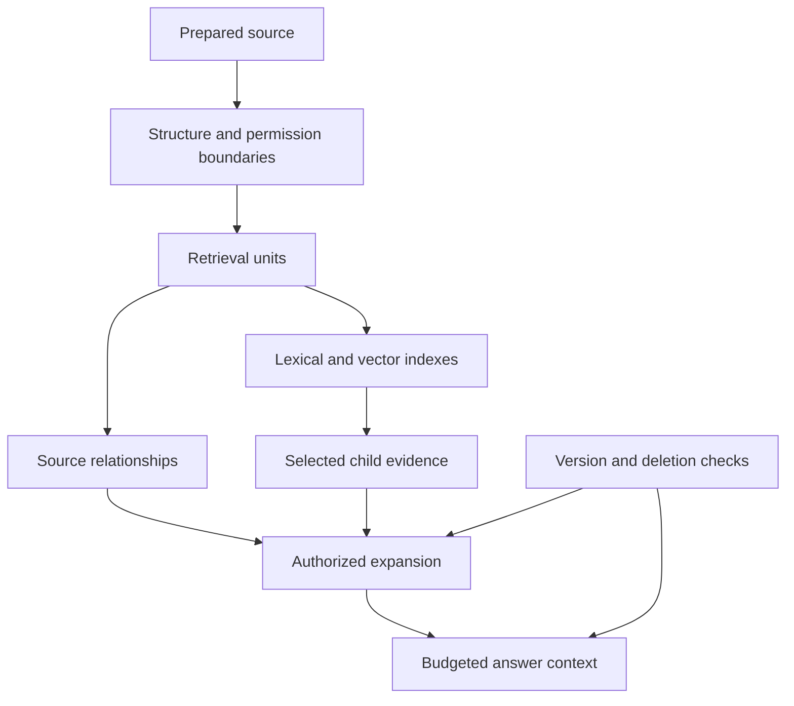

# Study Notes: M06.1.2 — Chunking
**Chunking (M06.1.2)** is the process of slicing large documents into manageable pieces for AI systems without losing the "toppings"—the critical context, meaning, and lineage (source tracking) that prevent an AI from hallucinating.

A common industry myth is that chunking is just a mechanical token-counting game (like applying a "universal" rule of 500 tokens with 20% overlap). In reality, feeding an entire manual to an AI wastes context, while slicing a chunk too small—such as isolating the sentence *"Do this every 30 days"* without naming the machine—destroys the meaning. A well-engineered chunking system balances **three distinct units**: the **Source Unit** (original document), the **Retrieval Unit** (small, precise slice for searching), and the **Answer Context Unit** (expanded context sent to the LLM).

---

## The End-to-End Chunking Lifecycle

Memory Aid: **Find Precisely $\rightarrow$ Expand Deliberately $\rightarrow$ Cite to the Source Span**.

```text
[PHASE 1: Token & Multi-Model Budget Planning] (Before Slicing)
Ingested Document ➔ Analyze Token Budgets across 3 Components (HuggingFace Tokenizers):
  1. Embedding Model (e.g., strict 512-token limit)
  2. Reranker Model (Sorting budget)
  3. Answering LLM (Must fit System Prompt + Chat History + Retrieved Chunks + Output Answer)
                                              │
                                              ▼
[PHASE 2: Boundary Selection & Slicing Strategy] (Creating the Chunks)
Choose Strategy by Document Format (No universal 500-token rule!):
  ├──► Mechanical: Fixed-Size (Half-open intervals + Stride math) OR Sentence-Based (Grammar ≠ Meaning)
  ├──► Content-Aware: Recursive (Section ➔ Paragraph ➔ Sentence fallback) OR Semantic (Embedding shifts)
  └──► Structure-Aware (Best Practice): Preserve Markdown Headers, Code Signatures & Table Column Headers
                                              │
                                              ▼
[PHASE 3: Lineage & Security Enrichment] (The Unseen Rules)
Generated Chunks ➔ Attach Separate JSON Control Metadata (tenant_id, version: v4, strict ACLs)
                 ➔ Map Stable Source Spans (e.g., Paragraph 3, Line 50) & Parent-Child Node Links
                                              │
                                              ▼
[PHASE 4: "Small-to-Big" Retrieval & Controlled Expansion] (Query Time)
User Query ➔ Hard Security Filter FIRST ("Guard outside the building")
           ➔ Search Small Child Unit (e.g., C32 indicator rule) OR Focus Sentence
           ➔ Expand Deliberately:
                ├──► Parent-Child (LlamaIndex): Zoom out to full Parent Section (P3) [Watch for "Lost in the Middle"!]
                ├──► Sentence Window: Radius R=2 (2 before + 1 focus + 2 after = 5 sentences)
                └──► Cross-Doc Reference? ("Follow Policy B") ➔ Trigger fresh Search, NOT structural expansion!
                                              │
                                              ▼
[PHASE 5: Source-Span Deduplication, Evaluation & Unlearning] (Verification & Cleanup)
Expanded Evidence ➔ Deduplicate by Source Span (NOT chunk_id) to prevent Overlap Recall@K inflation
                  ➔ Evaluate 4 Baseline Designs & Manually Inspect Failure Traces
                  ➔ On Source Update/Delete: Immediately purge/overwrite all frozen child chunks & vectors

```

---

### Phase 1: Token & Multi-Model Budget Planning

How it connects: Before cutting a single word, the system must account for how machines count text and how much space each downstream AI model actually has.

1. **Token-Aware Counting:** Tools like **HuggingFace Tokenizers** don't just count words; they break text into model-specific subword tokens where even a single space or comma can change the token count.


2. **Balancing Three Separate Model Budgets:** An AI pipeline usually runs three different models, each with its own strict token ceiling:


* **Embedding Model:** Converts text into searchable vectors (often limited to a strict window, such as `512 tokens`).


* **Reranker:** Scores and sorts candidate results.


* **Final Answering Model (LLM):** Even if a large chunk fits the embedding model, it might choke the answering LLM, which needs enough leftover budget to hold **System Instructions + Chat History + Retrieved Context + Its Own Generated Response**.


---

### Phase 2: Boundary Selection & Slicing Strategies

How it connects: Once token budgets are defined, the engine must decide where to draw the cutting lines. Different document structures require different slicing mechanics.

| Chunking Strategy | How It Works | Core Failure Mode / Risk |
| --- | --- | --- |
| **1. Fixed-Size Chunking** | Cuts mechanically by a hard character, word, or token limit using **half-open intervals** $[start, end)$. *(Example: 24 tokens with `size=10`, `overlap=2` creates slices `[0:10)` = tokens 0–9, `[8:18)` = tokens 8–17, and `[16:24)`)*.

 | **Completely blind:** Slices right through the middle of tables, headings, code functions, or legal exceptions.

 |
| **2. Recursive Chunking** *(e.g., LangChain)* | Looks for natural boundaries top-down: tries **Sections** first $\rightarrow$ **Paragraphs** $\rightarrow$ **Sentences**, only falling back to smaller splits if a block exceeds the size limit.

 | Preserves basic layout, but can still separate a paragraph from its qualifying header if not structure-aware.

 |
| **3. Sentence-Based Chunking** | Splits on grammatical periods/full stops.

 | **1. Punctuation traps:** Splits falsely on `Rev. 4` or `3.5 bar`.

<br>

<br>**2. Grammar $\neq$ Meaning:** If Sentence 1 says *"This applies only to Unit A"* and Sentence 2 says *"Check the indicator every 30 days,"* putting Sentence 2 in its own chunk makes a Unit A exception look like a universal rule for all machines!

 |
| **4. Semantic Chunking** | Embeds every sentence/window into numbers and calculates mathematical similarity between adjacent sentences, splitting whenever similarity drops sharply.

 | **1. Computationally heavy & slow**.

<br>

<br>**2. Business logic trap:** A procedure and its legal exception often use very different wording; semantic chunking sees a mathematical drop and splits them apart when they *must* stay together!

 |
| **5. Structure-Aware Chunking** *(Best Practice)* | Uses format-specific parsers (like LangChain's Markdown Splitter) to keep **Parent Headings** attached to paragraphs, **Function Signatures** with docstrings, and **Table Column Headers** with every row (so a cell saying `150` isn't orphaned from whether it means temperature, pressure, or currency).

 | Requires format-specific parsing rules during ingestion.

 |

#### The Overlap Math & Its Hidden Trap

* **The Stride Formula:** To prevent sentences at the edges of fixed chunks from being cut in half, engineers repeat the edges using **Overlap**:


$$\text{Stride (Step Size)} = \text{Chunk Size} - \text{Overlap}$$


* **Worked Token Bloat Calculation:** Suppose a document has `10,000 tokens`, `Chunk Size = 500`, and `Overlap = 100`.


* $\text{Stride} = 500 - 100 = 400\text{ tokens per step}$.


* This produces roughly **25 windows**, inflating total stored tokens from `10,000` to **`12,400 tokens`** (~`2,400 tokens` of duplicate data).


* **Why Overlap is a Weak Band-Aid:** Overlap cannot fix a broken table header (if the header is in Chunk 1 and the row is in Chunk 2). Worse, if a key fact lands in the overlapped zone of 3 consecutive chunks, the AI thinks it found **3 independent pieces of evidence**, and evaluation metrics like **Recall@K** get artificially inflated because the same half-baked sentence fills the Top 3 results!


---

### Phase 3: Lineage & Security Enrichment (The Unseen Rules)

How it connects: Before chunks are stored in the index, they must be stamped with non-negotiable security metadata and source coordinates.

1. **Why Text Embeddings Cannot Enforce Security:**
* Writing *"TOP SECRET: ONLY FOR MANAGERS"* inside an HR document's text will **not** stop semantic search from showing it to an ordinary employee. Embeddings only understand language and grammar, not permissions.


* **The Security Guard Rule:** *"You station the security guard outside the building, not inside"*. Every chunk must carry a separate, structured **JSON Control Schema** (`tenant_id: "Tenant A"`, `version: "v4"`, and strict `ACL` permissions) indexed separately from the text so hard filters block unauthorized chunks *before* semantic search or context expansion ever runs.


2. **Source Span Mapping:** Every chunk must record its exact **Source Span** (e.g., *Original Document Paragraph 3, Line 50*) so it can be traced, deduplicated, and cited accurately even if chunk IDs change later.


---

### Phase 4: Hierarchical ("Small-to-Big") Retrieval & Context Expansion

How it connects: Small chunks are easy to match precisely during search, but lack enough surrounding context to answer complex questions. Phase 4 bridges this gap at query time.

1. **The Parent-Child Pattern (e.g., LlamaIndex Node Parsers):**
* **Find Precisely (Child Unit):** The search engine queries small, granular **Child Chunks** (e.g., matching a specific `C32` indicator check rule).


* **Expand Deliberately (Parent Unit):** Instead of sending just that tiny rule to the LLM, the system follows the node link to fetch the entire **Parent Section (`P3`)**, giving the AI the full scope, conditions, and exceptions surrounding the rule.


2. **The Sentence Window Variation:**
* Instead of strict document sections, retrieval finds a single **Focus Sentence** containing the direct answer and expands around it by a defined **Radius ($R$)**.


* *Example:* Setting `Radius = 2` grabs the **2 sentences before** + the **1 focus sentence** + the **2 sentences after** = a **5-sentence block** sent to the LLM.


3. **Structural Expansion vs. Secondary Search:**
* **Expansion ("Zooming Out the Camera"):** Works *only* when the needed context has a known structural relationship inside the same document (like grabbing the paragraph above/below or a table's header).


* **Secondary Search:** If *Procedure A* says *"Follow Policy B,"* zooming out the camera won't help because Policy B lives in a completely different document. Linking two separate units requires triggering a fresh database search.


4. **The Expansion Warning ("Lost in the Middle" — Liu et al.):**
* Bigger context is not always better. The famous *"Lost in the Middle"* research paper proves that when LLMs are fed massive, bloated contexts full of irrelevant text, they remember the beginning and the very end, but **forget critical facts buried in the middle**. Furthermore, Parent-Child expansion must never bypass ACL rules to pull in restricted sibling paragraphs!


---

### Phase 5: Deduplication, Baseline Evaluation & "Unlearning"

How it connects: Finally, the expanded evidence must be deduplicated before reaching the LLM, tested against rigorous corpus baselines, and purged cleanly when source documents change.

1. **Deduplicate by Source Span, Not Chunk ID:**
* Because overlapping chunks or multiple child nodes can point to the exact same source text, always deduplicate retrieved evidence using **Source Spans** (original character/line ranges) rather than `chunk_id`. And always cite the original source paragraph, never AI-generated summaries.


2. **Worked Case Study (Manual M-104) & Testing Methodology:**
* *Scenario:* Manual M-104 states **Unit A** requires inspection every **30 days** (which changes after return-to-service), while **Unit B** requires inspection every **14 days**.


* To find the right design for your project, compare four baselines:


1. *Arbitrary small windows* (e.g., fixed 100 tokens—risks severing "Unit A" from "30 days").


2. *One sentence per chunk* (grammatical—risks detaching exceptions).


3. *Entire manual per chunk* (full context, but distracts the model / triggers "Lost in the Middle").


4. *Section-aware Child + Parent* (balances precise lookup with section context).


* **How to Evaluate:** Because changing your chunking strategy wipes out and regenerates all `chunk_id`s, **evaluate against stable Source Spans** (checking whether *Paragraph 3, Line 50* reached the final model). Don't just look at metric scores—manually read **failure traces** to verify that a Parent expansion didn't accidentally pull Unit B's 14-day schedule into a question about Unit A!


3. **Deletion & The Challenge of AI "Unlearning":**
* Chunks are "frozen slices of time" stored in vector memory. When an original document is updated or deleted, every derived child chunk, parent node, and vector embedding must be immediately deleted or overwritten. Otherwise, disconnected, obsolete policy chunks will continue floating in vector memory and resurface as false truths months later.


Would you like to paste your **written Study Notes for M06.1.2 (Chunking)** next so we can align any specific code snippets, formulas, or Q&As into this lifecycle, or would you like to test yourself on this module?

## Table of Contents

1. [Section 1: Foundations of Chunking](#section-1-foundations-of-chunking)
   - [1.1 Chunking Fundamentals](#11-chunking-fundamentals)
   - [1.2 Overall Concept Map](#12-overall-concept-map)
2. [Section 2: Core Chunking Strategies](#section-2-core-chunking-strategies)
   - [2.1 Fixed-Size and Recursive Chunking](#21-fixed-size-and-recursive-chunking)
   - [2.2 Sentence-Based and Semantic Chunking](#22-sentence-based-and-semantic-chunking)
   - [2.3 Token-Aware and Structure-Aware Chunking](#23-token-aware-and-structure-aware-chunking)
3. [Section 3: Advanced and Hierarchical Strategies](#section-3-advanced-and-hierarchical-strategies)
   - [3.1 Parent-Child and Hierarchical Strategies](#31-parent-child-and-hierarchical-strategies)
   - [3.2 Sentence Windows and Small-to-Big Retrieval](#32-sentence-windows-and-small-to-big-retrieval)
4. [Section 4: Chunk Quality and Governance](#section-4-chunk-quality-and-governance)
   - [4.1 Overlap and Boundary Quality](#41-overlap-and-boundary-quality)
   - [4.2 Chunk Metadata, Permissions and Identity](#42-chunk-metadata-permissions-and-identity)
5. [Section 5: Application and Evaluation](#section-5-application-and-evaluation)
   - [5.1 Worked Example and Selection Framework](#51-worked-example-and-selection-framework)
   - [5.2 Project Exercise and Evaluation](#52-project-exercise-and-evaluation)
6. [Section 6: Review, Practice, and References](#section-6-review-practice-and-references)
   - [6.1 Glossary and Final Revision Sheet](#61-glossary-and-final-revision-sheet)
   - [6.2 Practice and Interview Questions](#62-practice-and-interview-questions)
   - [6.3 Sources and Further Reading](#63-sources-and-further-reading)


## 1. Chunking Fundamentals

### Definition

**Chunking** divides prepared source content into units that can be indexed, retrieved and supplied as evidence. A chunk might be a paragraph, a group of sentences, a table row with headers, a section, or a size-limited span.

The design question is not simply “How many tokens should each chunk contain?” It is “What unit makes the required evidence easy to find without losing the conditions needed to interpret it?”

### Why chunk at all?

A whole manual can contain unrelated procedures. One vector representing the entire document may dilute the details of a specific question. Returning the whole manual also consumes context and requires the answering model to locate the relevant passage again.

Very small chunks solve some specificity problems but introduce others. A sentence such as “This must be done every 30 days” is not useful without knowing what “this” refers to, which equipment is covered and whether a qualification appears nearby.

Chunking therefore balances:

| Goal | What helps | What can go wrong |
|---|---|---|
| Retrieval specificity | Smaller, focused units | Missing surrounding meaning |
| Evidence completeness | Larger coherent units | Unrelated material consumes context |
| Accurate citations | Source-aligned boundaries | Arbitrary spans become difficult to inspect |
| Efficient indexing | Fewer, moderate-size units | Excessive compression hides distinctions |
| Safe access | Boundaries aligned with permissions | Expansion can expose restricted neighbors |

### Three units that need not be identical

Distinguish the **source unit**, **retrieval unit** and **answer context unit**.

- The source unit may be a complete section.
- The retrieval unit may be one paragraph within that section.
- The answer context unit may include the paragraph, its heading and a qualifying note.

This separation is the basis of parent-child and small-to-big retrieval. It lets search focus on precise evidence while the answer receives sufficient context.

### No universally best chunk size

Chunk sizes depend on document structure, query types, embedding-model limits, reranker limits, answer-context budget and the granularity of citations. A fixed recommendation such as “always use 500 tokens with 20% overlap” is a starting hypothesis at most.

For example, a code reference may need an entire function signature and docstring. A policy clause may need its exception. A catalog lookup may work best with one product record. Test these patterns using representative questions.

### Key takeaway

**A useful chunk is a retrievable evidence unit with interpretable meaning and reliable lineage.** Length is one constraint, not its complete definition.

## 2. Fixed-Size and Recursive Chunking

**Syllabus coverage: M06.1.2.1 — Chunking strategies.**

### Fixed-size chunking

**Definition:** Split content into windows of a chosen size measured in characters, words or tokens.

The unit must be explicit. A “500-size chunk” is ambiguous. Five hundred characters and five hundred model tokens can produce very different text spans.

For an ordered sequence of 24 token IDs, a size of 10 with overlap 2 gives spans `[0,10)`, `[8,18)` and `[16,24)`. These half-open intervals include the starting position and exclude the ending position.

The following runnable Python example demonstrates window boundaries. It accepts an already-tokenized sequence; it does not pretend that words are model tokens.

```python
def windows(items, size, overlap=0):
    if size <= 0:
        raise ValueError("size must be positive")
    if not 0 <= overlap < size:
        raise ValueError("overlap must be in [0, size)")
    start = 0
    while start < len(items):
        end = min(start + size, len(items))
        yield start, end, items[start:end]
        if end == len(items):
            break
        start = end - overlap

for start, end, token_ids in windows(list(range(24)), 10, 2):
    print(start, end, token_ids)
```

A real implementation must map token spans back to source text and preserve citation offsets. Tokenization can be model-specific, so use the correct tokenizer and document how special tokens are counted.

**Advantages:** Simple, predictable, easy to reproduce and useful as a baseline.

**Limitations:** It can split a sentence, sever a heading from its content, separate a table header from a row, or place a condition in a different chunk from the instruction it qualifies.

### Recursive chunking

**Definition:** Try larger natural boundaries first, then use finer boundaries when a unit exceeds the size limit.

A conceptual hierarchy is section, paragraph, sentence, word and finally a hard limit. The precise order is a configuration choice. “Recursive” describes the fallback process; it does not automatically mean the chunks are semantically optimal.

LangChain’s recursive splitter uses an ordered set of separators and a length function. Its documented default measures characters and tries progressively smaller separators. The documentation also discusses adapting separators for languages without whitespace word boundaries. [Source: LangChain recursive splitting](https://docs.langchain.com/oss/python/integrations/splitters/recursive_text_splitter)

### Example

Suppose a section contains three paragraphs of 180, 170 and 420 tokens, while the chosen chunk budget is 400 tokens.

A structure-preserving strategy might combine the first two paragraphs into one 350-token chunk and split the third at sentence boundaries. It should not exceed the embedding limit just because the paragraph is semantically coherent.

If a single sentence is larger than the limit, the implementation needs an explicit fallback. Record that a hard split occurred so the case can be inspected; silent truncation is worse because it hides missing content.

### Fixed-size versus recursive

| Aspect | Fixed-size | Recursive |
|---|---|---|
| Boundary rule | Position in a sequence | Ordered natural separators |
| Reproducibility | Straightforward | Requires separator and length configuration |
| Structural preservation | Limited | Usually better when source structure is useful |
| Hard-length control | Direct | Needs fallback for oversized units |
| Good baseline use | Establish a simple reference | Practical general-text starting point |

### Key takeaway

**Use a simple baseline you can inspect.** A recursive strategy often makes boundaries easier to interpret, but its benefit must still appear in retrieval and answer tests.

## 3. Sentence-Based and Semantic Chunking

### Sentence-based chunking

**Definition:** Identify sentence boundaries, then use a sentence or a group of sentences as the chunk.

A sentence splitter must handle abbreviations, decimals, numbered lists, quotations and language-specific punctuation. Splitting every period is not sufficient: “Rev. 4” and “3.5 bar” contain periods that are not ordinary sentence endings.

Grouping sentences under a token budget often provides better self-contained evidence than indexing each sentence independently. However, sentence boundaries are grammatical boundaries, not guaranteed boundaries of meaning.

Consider these fictional sentences:

1. “This procedure applies only to Unit A.”
2. “Inspect the indicator every 30 days.”
3. “For Unit B, use the separate schedule in section 5.”

Sentence 2 alone looks like a universal instruction. The group correctly limits its scope.

**When useful:** Prose with clear sentence structure, sentence-window retrieval, short evidence spans and citation-focused applications.

**Main limitation:** Definitions, pronouns, exceptions and ordered steps can depend on neighboring sentences.

### Semantic chunking

**Definition:** Place boundaries using estimated changes in topic or meaning, often by comparing representations of adjacent sentences or groups of sentences.

A generic conceptual procedure is:

1. Split the document into provisional units.
2. Represent each unit or a small local window.
3. Estimate similarity between neighboring units.
4. Mark large changes as possible boundaries.
5. Enforce minimum and maximum sizes.
6. Preserve structural and permission boundaries regardless of the similarity score.

The similarity threshold, percentile rule, smoothing window and embedding model are design decisions. “Semantic chunking” is a family of approaches rather than one standardized algorithm.

### Worked boundary decision

Suppose a document has five paragraphs with topics “equipment identification,” “inspection procedure,” “inspection exceptions,” “invoice terms” and “payment details.” A semantic signal may indicate a strong change between the exceptions and invoice terms.

That can be useful. But the same mechanism may mistakenly separate a procedure from an exception because their wording differs. Structure and evaluation must therefore constrain the semantic signal.

### Advantages and costs

Semantic boundaries can adapt to variable-length topics. They also add computation, configuration and another model dependency to ingestion. If the embedding model used for boundary detection changes, the resulting chunk identities may change even though the source did not.

A semantic strategy should be adopted because it improves a measured task, not because the label sounds more intelligent. Compare it with a structure-aware recursive baseline, including difficult boundary cases and the cost of reprocessing.

### Key takeaway

**Sentence boundaries preserve grammar; semantic boundaries estimate topic changes. Neither automatically preserves every business condition.**

## 4. Token-Aware and Structure-Aware Chunking

### Token-aware chunking

**Definition:** Measure chunk length using the tokenizer appropriate to the consuming model and enforce a token budget.

Tokenization algorithms divide text differently, including into subword units. The same number of words can yield different token counts across languages, identifiers and tokenizers. Hugging Face’s tokenizer overview explains these distinctions and several common tokenization approaches. [Source: Hugging Face tokenization algorithms](https://huggingface.co/docs/transformers/main/en/tokenizer_summary)

There can be multiple budgets:

| Consumer | What counts against the budget |
|---|---|
| Embedding model | Chunk text, required prefix and model-specific formatting |
| Reranker | Query plus passage and required formatting |
| Answering model | Instructions, history, query, all evidence and reserved output |

A chunk that fits the embedding model may be too large for a query-passage reranker. A set of individually valid chunks may overflow the answering model’s total budget.

### Budget example

Assume an illustrative embedding input limit of 512 tokens. If the chosen representation adds a 30-token heading and formatting overhead of 10 tokens, the body budget is at most 472 tokens. These numbers are a training example, not a recommendation for a particular model.

If the provider silently truncates inputs, a chunk can be indexed using only its beginning while the database stores its full text. Retrieval scores then reflect a different passage from the one shown to the model. Detect and prevent this mismatch.

### Structure-aware chunking

**Definition:** Use the document’s explicit structure to define meaningful units and boundaries.

Useful structures include headings, paragraphs, list items, code functions, table rows, slides, form sections and XML or HTML elements.

LangChain documents header-based Markdown splitting that groups content by selected headings and preserves heading information in metadata. It can then apply another splitter within oversized groups. This illustrates how structural and size constraints can be combined. [Source: LangChain Markdown splitting](https://docs.langchain.com/oss/python/integrations/splitters/markdown_header_metadata_splitter)

### Examples by content type

**Procedures:** Keep prerequisites, ordered steps and warnings together when practical. If a long procedure must be split, repeat or retrieve the relevant prerequisite context without falsely presenting it as new source text.

**Tables:** Keep row labels, column headers, units and qualifying notes. A chunk containing “30 days” without its equipment variant is incomplete.

**Code:** Preserve symbol names, signatures and necessary docstrings. A function body without the relevant class or module context may be difficult to understand.

**FAQs:** A question and its answer usually form a useful unit. Separating them may remove the terms that make the answer retrievable.

**Slides:** Slide titles and notes can be related but may have different authority or access rules. Treat those rules explicitly.

### Combining strategies

A strong design can be structure-aware, recursive and token-aware simultaneously:

1. Separate sources and permission domains.
2. Group content by section or record.
3. Preserve semantic units within each group.
4. Split oversized groups recursively.
5. Measure the final representation with the correct tokenizer.

These are complementary properties, not mutually exclusive product categories.

## 5. Parent-Child and Hierarchical Strategies

**Syllabus coverage: M06.1.2.2 — Context-preserving strategies.**

### Parent-child strategy

**Definition:** Search smaller child units, then retrieve a larger associated parent unit to provide context.

The child is optimized for finding a precise match. The parent is optimized for understanding it. A parent might be a paragraph group or a section, not necessarily the entire source document.

Example:

| Item | Content role |
|---|---|
| Parent P3 | “Unit A inspection” section including scope, steps and exceptions |
| Child C31 | Inspection interval paragraph |
| Child C32 | Indicator check paragraph |
| Child C33 | Exception paragraph |

A query about the indicator retrieves C32. The system can then supply P3, or a controlled subset of it, so that the answer sees the scope and exceptions.

### Parent-child implementation decisions

Decide which units are embedded, which are stored only for expansion, how child-to-parent links are versioned, and how repeated children map to a shared parent. If five children from P3 are retrieved, the context assembler should not insert P3 five times.

Expansion must obey the same source revision and authorization requirements as retrieval. A child in v4 must not expand to a cached v3 parent. An authorized child must not grant access to a parent containing restricted sections.

### Hierarchical strategy

**Definition:** Represent content at several levels, such as document, chapter, section, paragraph and sentence, with explicit relationships between levels.

A hierarchy can support broad-to-narrow retrieval, narrow-to-broad expansion, or both. These are different execution strategies over the same structure.

LlamaIndex’s node-parser documentation includes sentence-window and hierarchical representations. Its hierarchical parser creates related nodes at different sizes, while sentence windows preserve nearby context for a sentence-level node. These are concrete implementations of the broader patterns taught here. [Source: LlamaIndex node parser modules](https://developers.llamaindex.ai/python/framework/module_guides/loading/node_parsers/modules/)

### Why a hierarchy is not automatically a summary tree

A hierarchy can contain exact source spans. It need not contain generated summaries. If summaries are added, label them as derived representations and keep their dependencies on the source spans. A summary may omit an exception or introduce an error; it is not interchangeable with the original evidence.

### When expansion helps

Expansion is useful when a precise retrieval unit lacks definitions, antecedents, units or nearby qualifications. It is less useful when it adds unrelated content and consumes the answer budget without improving support.

Set expansion limits and evaluate them. The correct parent level may depend on the query. “What is the interval?” may need a row plus its header; “Explain the complete inspection process” may need the full procedure.

## 6. Sentence Windows and Small-to-Big Retrieval

### Sentence-window strategy

**Definition:** Index a focused sentence and attach or resolve a window of nearby sentences for the answering stage.

For sentence (s_i), a symmetric window of radius (w) can include sentences from (s_{i-w}) through (s_{i+w}), clipped at the relevant source boundary. A radius of 2 means at most five sentences, not two sentences total.

The window should stay within appropriate section, revision and permission boundaries. The next sentence in the file may belong to a different appendix or security domain.

### Window example

A query retrieves “Inspect the indicator every 30 days.” The expanded window includes “This procedure applies only to Unit A” and the following exception. The generator now has evidence for both the interval and its scope.

Store the central sentence identity separately from the expanded context identity. The retrieval trace should explain why the window was selected, and the citation should identify the source spans actually supporting the answer.

### Small-to-big retrieval

**Definition:** Use a small unit to locate evidence, then deliberately increase the context supplied for interpretation. Parent-child retrieval and sentence windows are two forms of this pattern.

Another form retrieves a table row, then adds the table title, headers and footnote. A code-oriented form retrieves a symbol, then adds its signature and containing class context.

### Expansion versus a second search

Expansion follows known source relationships. A second search retrieves other evidence using a query. They can be combined, but they solve different problems.

If the missing context is immediately adjacent, expansion may be sufficient. If a procedure refers to a different document, expansion within the same paragraph cannot supply it; an authorized second retrieval may be necessary.

### More context is not always better

Research in “Lost in the Middle” showed position-sensitive use of relevant information in the tested long-context tasks and models. The result supports evaluating how evidence is assembled, rather than assuming that fitting more text into a context window guarantees better use of it. [Source: Liu et al., Lost in the Middle](https://arxiv.org/abs/2307.03172)

The practical implication for chunking is to measure useful evidence after expansion. A system can have excellent child retrieval and poor answers because the expansion floods the context with irrelevant material.

## 7. Overlap and Boundary Quality

### Chunk overlap

**Definition:** Repeat a portion of the previous chunk in the next chunk so information near a boundary appears in more than one retrieval unit.

Overlap reduces some boundary misses but increases index size, embedding work, duplicate results and repeated context. It does not guarantee that a whole procedure or exception is preserved.

For fixed windows with document length (N), chunk size (C) and overlap (O), where (0 \le O < C\), the stride is:

\[
S = C - O.
\]

If (N > C), the number of windows is:

\[
n = 1 + \left\lceil\frac{N-C}{C-O}\right\rceil.
\]

If (0 < N \le C), there is one window. An empty document should produce no content chunks and an explicit ingestion outcome.

### Worked overlap calculation

For 10,000 tokens, size 500 and overlap 100:

- Stride = 400 tokens.
- Windows = (1 + \lceil9,500/400\rceil = 25\).
- The last window is shorter than 500 tokens.
- Total represented tokens, including repeated overlaps, are 12,400 in this example.

For long documents, the approximate duplication factor approaches (C/(C-O)), which is 1.25 here. The exact total depends on document length and boundary handling.

### Chunk boundary quality

Boundary quality asks whether each chunk can be interpreted correctly and whether required evidence is separated unnecessarily.

Inspect these cases:

| Boundary problem | Example consequence | Possible correction |
|---|---|---|
| Heading separated from body | Equipment variant becomes unclear | Attach heading metadata or expand |
| Condition separated from instruction | Conditional rule looks universal | Group or retrieve both spans |
| Table header separated from row | Value loses unit or subject | Serialize row with headers |
| Code signature separated from body | Parameters become unclear | Structure-aware code grouping |
| Permission boundary crossed | Restricted content leaks | Split at policy boundary first |
| Revision boundary crossed | Old and new facts are merged | Keep versions in separate units |

### Overlap is not independent evidence

If the same sentence appears in three overlapping chunks, it is still one source statement. Counting those chunks as three supporting sources exaggerates evidence strength. Deduplicate by source spans or content identity during assembly and evaluation.

Similarly, retrieving three overlapping chunks from the same section may increase chunk-level Recall@K without improving document-level coverage. Report the evaluation unit explicitly.

## 8. Chunk Metadata, Permissions and Identity

### Useful chunk metadata

```json
{
  "chunk_id": "tenant-A:M-104:v4:sec-3.2:02",
  "document_id": "tenant-A:M-104",
  "version_id": "v4",
  "chunking_config": "structure-token-v2",
  "section_path": ["Maintenance", "Unit A inspection"],
  "source_blocks": ["p8-b4", "p8-b5"],
  "parent_id": "tenant-A:M-104:v4:sec-3.2",
  "previous_id": "tenant-A:M-104:v4:sec-3.2:01",
  "next_id": "tenant-A:M-104:v4:sec-3.2:03",
  "acl_ref": "acl-M-104",
  "acl_version": 12,
  "current": true,
  "deleted": false
}
```

This is an illustrative schema. A real system should avoid metadata that is expensive to maintain or ambiguous. For example, `current` must reflect authoritative source state rather than a worker’s outdated local assumption.

### Metadata in embeddings versus metadata as controls

Some metadata helps semantic retrieval when included in embedding text: title, heading, equipment family and language. Other metadata should be used as control fields: tenant ID, ACL version and deletion state.

Embedding the phrase “restricted to ship A” is not an access-control mechanism. The retriever still needs trusted filters and authorization checks. Likewise, sensitive metadata should not be casually inserted into prompts or logs.

### Deterministic identities and re-chunking

A chunk ID based solely on its position may change meaning when content is inserted earlier in the source. A hash-based ID may remain stable for unchanged text but requires enough source/version context to prevent collisions across unrelated documents.

Choose the scheme according to update needs and preserve explicit relationships. When re-chunking, do not leave old chunks active beside new ones unless a controlled experiment requires separately identified indexes.

### Deletion and expansion

A source deletion must invalidate children, parents, sentence windows and generated summaries. If a child is removed but its cached parent remains accessible, the source is still exposed.

At serving time, verify that every expanded span is authorized and belongs to an allowed source version. Recheck before the final answer or citation is emitted if source state may have changed during the request.

## 9. Worked Example and Selection Framework

### Fictional source

The following content is invented for learning:

```text
Manual M-104, approved revision v4
Section 3.2 — Unit A inspection
This procedure applies only to Unit A in normal service.
Inspect indicator X every 30 days.
If the unit has been stored, complete the return-to-service checklist first.
Record the result in the maintenance log.
Section 3.3 — Unit B inspection
Unit B uses a separate 14-day schedule.
```

Question: “How often should Unit A’s indicator be inspected after storage?”

A complete supported answer needs the 30-day interval, the normal-service scope and the return-to-service prerequisite. The example is not advice for real equipment.

### Compare four designs

| Design | Likely retrieval behavior | Evidence risk |
|---|---|---|
| Arbitrary small windows | May match “30 days” | Can omit storage prerequisite |
| One sentence per chunk | Precise indicator match | Requires expansion for scope |
| Entire manual per chunk | Contains everything | Low specificity and large context |
| Section-aware child plus parent | Finds indicator and expands section | Must enforce version and ACL on parent |

Do not assume the fourth design wins automatically. Evaluate whether the parent remains within budget and whether the retriever still finds the relevant child for realistic wording.

### A practical selection process

Start with a structure-aware recursive baseline with a measured token cap. Create boundary tests for procedures, tables and exceptions. If failures show that small chunks lose context, add controlled parent or window expansion. If failures show unrelated topics sharing chunks, reduce the unit or improve structural boundaries.

Only investigate semantic boundaries when the remaining errors justify them. Changing the embedding model, chunking strategy, retrieval method and prompt simultaneously makes it difficult to know which change caused an improvement.

### Comparing different chunking schemes fairly

Different schemes produce different chunk IDs. Therefore, ground truth should refer to stable source spans, facts or document sections, not only one scheme’s chunk IDs.

For the example, label the interval sentence and prerequisite sentence as required evidence. Each scheme receives credit when its retrieved and assembled context covers those source facts. Also compare token usage and irrelevant content.

## 10. Project Exercise and Evaluation

### Task

Build three chunking configurations over the same authorized collection: a fixed-size baseline, a structure-aware recursive baseline, and a small-to-big variant. Keep embedding and retrieval settings fixed during the first comparison.

Include questions requiring a single fact, a condition plus fact, a table row, a multi-step procedure, an exact identifier and evidence across nearby sentences. Include restricted neighboring sections and a replaced revision.

### What to measure

Measure retrieval coverage, relevance of assembled context, answer correctness, citation accuracy, total evidence tokens, duplicate content and latency. A smaller index is useful only if it still supplies the required evidence.

Review at least several failure traces manually. A metric can tell you performance changed; the trace helps explain whether the cause was a split condition, missing header, truncation or unsafe expansion.

### Acceptance evidence

Submit the chunking configuration, representative chunks with source locations, a comparison table, boundary-error examples, and permission/deletion tests. Demonstrate that repeated runs with the same source and configuration produce a consistent representation.

For L3 depth, justify the chosen boundaries using measured results and document the update consequences. Explain how the system replaces old chunks when the source or chunking configuration changes, and how it prevents mixed versions during serving.

## 11. Overall Concept Map



The map separates finding a small unit from expanding it. Both operations depend on identity, permissions and lifecycle state.

## 12. Glossary and Final Revision Sheet

| Term | Meaning |
|---|---|
| Chunk | A retrievable unit derived from source content |
| Fixed-size | Splitting by a chosen character, word or token count |
| Recursive | Falling back from larger boundaries to smaller ones |
| Sentence-based | Using sentence boundaries to form units |
| Semantic chunking | Estimating boundaries from changes in meaning |
| Token-aware | Measuring length with the relevant model tokenizer |
| Structure-aware | Respecting headings, records, tables or other structure |
| Parent-child | Searching a small unit and resolving its larger context |
| Hierarchical | Representing several related levels of granularity |
| Sentence window | A central sentence plus nearby sentence context |
| Small-to-big | Expanding from precise retrieval to broader evidence |
| Overlap | Repeated content across neighboring chunks |
| Boundary quality | How well splits preserve interpretable evidence |
| Source span | A locatable region in the original representation |

### High-value revision rules

- Specify the chunk-size unit.
- Measure the final representation, including required headings and prefixes.
- Preserve conditions, units, identifiers and source locations.
- Keep retrieval and answer-context units conceptually separate.
- Expand only within authorized, version-consistent boundaries.
- Count repeated source text as repeated text, not independent evidence.
- Use stable source facts to compare different chunking schemes.
- Treat chunking changes as index migrations with deletion consequences.

**Memory aid:** Find precisely, expand deliberately, cite the source span.

## 13. Practice and Interview Questions

### Question-and-answer recall

**1. What is the purpose of chunking?**  
To create evidence units that retrieval can find efficiently and the answering system can interpret correctly, while retaining source identity and access information.

**2. Why can very small chunks fail?**  
They may omit subjects, units, definitions, prerequisites or exceptions. A matching sentence can be relevant but insufficient to support a complete answer.

**3. What does recursive chunking mean?**  
It tries preferred larger boundaries and uses finer boundaries when content exceeds the chosen size limit. It requires explicit separators and fallback rules.

**4. How does semantic chunking differ from sentence splitting?**  
Sentence splitting identifies grammatical boundaries. Semantic chunking estimates changes in topic or meaning, often using representations of neighboring text units.

**5. Why is token-aware measurement important?**  
Models impose token limits, while character and word counts are only rough substitutes. Prefixes, headings and formatting also consume input capacity.

**6. What is parent-child retrieval?**  
It retrieves focused child units and resolves associated larger source units to provide interpretation context. Parent access and revision must be checked separately.

**7. What is a sentence window of radius two?**  
The central sentence plus up to two sentences before and two after it, bounded by relevant source, section and permission limits.

**8. What problem does overlap address?**  
It makes some boundary-adjacent content available in neighboring chunks. It does not automatically preserve long conditions or prevent permission errors.

**9. Why should chunk metadata include source version?**  
The system must distinguish old and current evidence, reproduce citations, prevent mixed-version expansion and remove the right derivatives after changes.

**10. How can chunking schemes be compared fairly?**  
Use the same questions, corpus and retrieval settings, and map evidence to stable source spans or facts rather than one scheme’s chunk IDs. Measure context cost and answer quality as well as retrieval.

### Multiple-choice questions

#### Easy

**11. Which statement is correct?**

A. Five hundred characters always equal five hundred tokens.  
B. Every sentence is a complete evidence unit.  
C. Chunk-size units must be stated explicitly.  
D. Larger chunks always improve retrieval.

**Answer: C.** Characters, words and model tokens are different units. Their relationship varies with language and content.

**12. Which strategy uses document headings and tables as boundaries?**

A. Structure-aware chunking.  
B. Random chunking.  
C. Unrestricted parent expansion.  
D. Score normalization.

**Answer: A.** It uses explicit source organization to keep related material together.

#### Medium

**13. A chunk says “Repeat this every 30 days” but omits the preceding definition. What is the likely problem?**

A. Too much independent evidence.  
B. Missing contextual dependence at the boundary.  
C. Perfect chunk design.  
D. Incorrect vector dimensionality by definition.

**Answer: B.** The missing antecedent prevents the reader from knowing what action the interval describes.

**14. What is the stride for fixed windows of size 400 with overlap 80?**

A. 80.  
B. 320.  
C. 400.  
D. 480.

**Answer: B.** The next window advances by `size − overlap`, so the stride is 320 units.

#### Hard — scenario based

**15. Three retrieved chunks contain the same source sentence because of overlap. How much independent support do they provide?**

A. Three independent sources.  
B. One source statement repeated in three units.  
C. No support at all.  
D. Proof that the statement is universally true.

**Answer: B.** Chunk duplication does not create new independent evidence. Assembly should avoid inflating support or wasting context.

**16. A user can access one paragraph in a mixed-permission section. What should parent expansion do?**

A. Return the whole section automatically.  
B. Ask the model to hide restricted parts after reading them.  
C. Expand only to spans authorized for the user.  
D. Remove all source metadata.

**Answer: C.** Authorization applies to expanded evidence before it reaches the reranker or generator. Access to one child is not access to all siblings.

**17. Chunking method B has higher chunk Recall@10 than method A, but its chunks are ten times larger. What is the best interpretation?**

A. B is definitively better.  
B. A is definitively better.  
C. Compare stable source coverage, irrelevant context and token cost before deciding.  
D. Stop evaluating citations.

**Answer: C.** Chunk-level recall can be affected by granularity. The useful comparison is whether the system supplies sufficient evidence efficiently and produces better supported answers.

### Interview questions with model answers

#### Easy

**18. How would you choose an initial chunking strategy?**

**Model answer:** I would inspect the source formats and likely questions, then establish a reproducible structure-aware recursive baseline with a measured token cap. I would preserve headings, source locations and permissions. I would avoid selecting a size solely from a generic recommendation and would create examples that expose boundary failures.

**19. Explain retrieval units versus context units.**

**Model answer:** The retrieval unit is what the search system scores, such as a paragraph or sentence. The context unit is what the answering system receives, which may add a heading, neighboring sentence or parent section. Separating them allows precise search and complete interpretation, but every expansion must remain authorized and within the context budget.

#### Medium

**20. When would you add overlap?**

**Model answer:** I would add or adjust overlap when error inspection shows relevant facts being separated near boundaries. I would measure the effect on retrieval, duplicates, index size and answer-context tokens. If the problem is a missing section heading or long prerequisite, a structural or parent-child solution may be more effective than simply increasing overlap.

**21. How would you chunk a maintenance table?**

**Model answer:** I would retain the structured table and create search representations that keep each important row attached to its column headers, units, title and applicable notes. Each representation would cite the original table and row. Exact calculations would use structured data where appropriate. I would test questions that distinguish similar equipment variants and conditions.

#### Hard — scenario based

**22. A chunking update makes citations point to the wrong revision. What design issue might explain it?**

**Model answer:** Chunk identities or parent relationships may have been reused without including source revision and chunking version. I would inspect the lineage and active index generation, remove stale mappings, and rebuild consistent source-to-chunk relationships. I would also test current and historical queries separately and ensure publication never mixes incomplete revisions.

**23. A team wants semantic chunking because it sounds more advanced. How would you assess the proposal?**

**Model answer:** I would ask which measured baseline failure it addresses. We would compare it against fixed and structure-aware recursive designs on the same questions and stable source-fact labels. I would include ingestion cost, boundary stability, reprocessing burden, retrieval quality and answer support. Adoption would require a useful improvement that justifies the additional complexity.


Absolutely. Here is the complete Chunking Interview Revision Guide in chat, including all 20 interview questions with polished answers, the 8 doubts we clarified, and your performance assessment.

# M06.1.2 — Chunking: Interview Preparation

## Part 1: Interview Questions and Answers

### Q1. Why shouldn't we use a universal chunk size such as 500 tokens with 20% overlap?

Interview answer:

There is no universally optimal chunk size or overlap percentage because different documents have different structures and information requirements.

For example, a technical manual, a table, and a policy document have different ways of expressing relationships between information. A fixed-size approach may split a heading from its explanation or separate a condition from the rule it modifies.

I would select chunk size and overlap based on document structure, query patterns, the embedding model's input constraints, and retrieval quality. The goal is to create chunks that are independently retrievable without losing important context.

Key concepts: Semantic boundaries, document structure, retrieval quality, token budget.

### Q2. What can go wrong when we split a document without considering meaning?

Interview answer:

When we split a document mechanically, we can separate information that depends on each other.

For example, a document might contain:

- Equipment: Emergency Generator
- Instruction: Inspect every 30 days.
- Exception: The emergency inspection schedule applies during maintenance shutdowns.

A mechanical split could separate the instruction from the equipment name or its exception. The retrieved chunk might then contain an incomplete instruction.

This creates context loss and can lead to incorrect or unsupported answers from the RAG system.

Key concepts: Context loss, semantic relationships, incomplete retrieval.

### Q3. What information could be lost if a chunk contains only “Inspect every 30 days”?

Interview answer:

The instruction is incomplete because it does not identify what needs to be inspected.

We may lose the equipment name, the applicable unit, the section heading, the conditions, and any exceptions.

The sentence contains an interval, but without its surrounding context, the retrieval system cannot reliably determine which equipment or situation that interval applies to.

Important distinction: This is context loss, not stale data. Stale data means the source information has become outdated or has been replaced.

### Q4. How would you balance chunks that are too large and chunks that are too small in a real RAG application?

Interview answer:

I would separate the process into three concepts: the source unit, the retrieval unit, and the answer-context unit.

The source unit represents the original document structure, such as a section or subsection. The retrieval unit is a smaller chunk designed to retrieve relevant information precisely. The answer-context unit contains enough surrounding information for the language model to understand the retrieved content.

I could use a parent-child retrieval strategy: retrieve a small child chunk first, then expand it with its relevant parent section or neighboring sentences.

I would also enforce token limits, remove duplicate source passages, and ensure that expanded context belongs to the correct document version and authorization scope.

This provides a balance between retrieval precision and sufficient context.

Key concepts: Parent-child retrieval, context expansion, token limits, deduplication, authorization.

### Q5. What would you do if a retrieved child chunk did not contain enough context to answer a question?

Interview answer:

I would not ask the language model to guess the missing information.

Instead, I would expand the retrieved child chunk using its known parent section or an appropriate surrounding sentence window. This helps recover the heading, scope, definitions, or conditions that may have been excluded from the smaller retrieval chunk.

For information located in another document, I would perform a separate authorized retrieval operation rather than assuming that the parent section contains it.

I would also verify that the expanded content belongs to the same document revision and respects the user's access permissions.

Key concepts: Parent expansion, secondary retrieval, document lineage, access control.

### Q6. How should tables and safety exceptions be handled during chunking?

Interview answer:

Tables should be chunked while preserving their relationships and structure.

I would retain the table title, column headers, row labels, units, and relevant footnotes. If I split a large table into smaller chunks, I would repeat the necessary headers so that each chunk remains understandable independently.

Safety conditions and exceptions should remain connected to the rules they modify. Separating a safety exception from its corresponding instruction could result in an incomplete or misleading answer.

I would avoid putting an entire large table or manual into one chunk because that can reduce retrieval precision.

Key concepts: Structure-aware chunking, table headers, row-based chunking, safety conditions.

### Q7. Explain the precision-versus-context trade-off in chunking.

Interview answer:

Large chunks provide more surrounding context, but they may contain irrelevant information that reduces retrieval precision.

Small chunks can improve retrieval precision because they focus on specific information. However, they may lose important relationships, conditions, or explanations.

The objective is not simply to make chunks smaller or larger. It is to create retrieval units that are precise while retaining the context necessary to interpret them correctly.

A parent-child strategy can help achieve this by retrieving small chunks and expanding them when additional context is required.

Key concepts: Precision, context, retrieval relevance, context expansion.

### Q8. Suppose the retrieval system returns information from Unit A and Unit B together. How would you handle it?

Interview answer:

First, I would inspect the metadata and structural context associated with each retrieved passage.

I would identify the document, section, equipment, unit, and revision associated with each instruction. Then I would separate the evidence according to its actual scope rather than combining the instructions.

If the question specifically concerns Unit B, I would prioritize evidence that explicitly applies to Unit B.

I would also check the surrounding parent sections to confirm that the retrieved instruction has not lost its scope.

Key concepts: Metadata, scope identification, structural hierarchy, evidence validation.

### Q9. What are the disadvantages of using too much overlap?

Interview answer:

Excessive overlap creates repeated information across multiple chunks.

This can increase index size, storage requirements, embedding costs, and retrieval redundancy. It may also cause the same fact to appear repeatedly in the retrieved context.

The language model could then mistakenly interpret repeated copies of the same source fact as multiple independent pieces of evidence.

I would use overlap only where it helps preserve context across chunk boundaries. During retrieval, I would also deduplicate passages using their original source spans rather than relying only on chunk IDs.

Key concepts: Duplicate retrieval, index bloat, false evidence inflation, source-span deduplication.

### Q10. How would you chunk a maintenance table safely?

Interview answer:

I would generally use a row-oriented strategy, while preserving the table's structure.

Each chunk should retain the table title, relevant column headers, row labels, units, and applicable footnotes.

For example, if the table contains equipment names and inspection intervals, I would ensure each inspection interval remains connected to the correct equipment.

If a table is split across multiple chunks, I would repeat the necessary headers and relevant context so that each chunk can be interpreted independently.

Safety conditions and exceptions would be retained with the rows they modify.

Key concepts: Row-oriented chunking, inherited headers, units, footnotes, scope preservation.

### Q11. What is the risk of isolating a 30-day inspection interval from its equipment name?

Interview answer:

The main risk is that the interval becomes ambiguous.

The RAG system may retrieve the instruction but fail to identify which equipment it applies to. It might then associate the interval with the wrong equipment or provide an answer without sufficient evidence.

To prevent this, I would preserve the heading, equipment name, and applicable scope alongside the inspection instruction.

### Q12. If Unit B has a 14-day inspection schedule, what should a properly chunked retrieval system return?

Interview answer:

For a question about Unit B, the system should return the 14-day inspection schedule together with the context establishing that the schedule applies specifically to Unit B.

The result should ideally include the relevant section or parent context and a source reference so that the answer can be verified.

It should not return an unrelated Unit A schedule or combine the two intervals.

Key concepts: Scope-specific retrieval, source references, contextual evidence.

### Q13. What is the difference between fixed-size chunking and recursive chunking?

Interview answer:

Fixed-size chunking divides text according to a predetermined character, word, or token limit. It may use overlap to preserve some context between adjacent chunks.

Recursive chunking attempts to split content using a hierarchy of natural separators.

For example, it may first try section boundaries, then paragraphs, then sentences. If a section is too large, it moves to a smaller separator until the content fits the configured size limit.

The main difference is that fixed-size chunking relies primarily on predetermined boundaries, whereas recursive chunking attempts to preserve natural document structure.

Key concepts: Fixed boundaries, separator hierarchy, natural structure, fallback splitting.

### Q14. What does implementation complexity mean in recursive chunking?

Interview answer:

Recursive chunking requires decisions beyond simply selecting a chunk size.

We need to configure the separator hierarchy, define the length measurement, handle paragraphs or sentences that exceed the limit, and preserve document structure.

We may also need to retain metadata such as headings, source offsets, and document hierarchy.

For example, a long paragraph may not fit within the configured limit. The algorithm needs a fallback strategy to split it further without losing important structural information.

Therefore, the complexity mainly comes from designing and configuring the splitting procedure correctly.

Key concepts: Separator hierarchy, fallback logic, length function, source offsets, metadata.

### Q15. What is the difference between sentence-based chunking and semantic chunking?

Interview answer:

Sentence-based chunking uses grammatical and punctuation boundaries to divide text into sentences or groups of sentences.

Semantic chunking attempts to identify changes in meaning or topic. It can use embeddings to compare neighboring sentences or text windows and determine when the content changes significantly.

For example, two sentences may belong to different paragraphs but discuss the same subject. Conversely, two consecutive sentences may have different meanings even though there is no obvious punctuation boundary.

Sentence-based chunking focuses on linguistic structure, while semantic chunking focuses on meaning.

Key concepts: Sentence boundaries, embeddings, semantic similarity, topic changes.

### Q16. What is one major limitation of semantic chunking?

Interview answer:

A major limitation is that identifying meaningful context boundaries is not always straightforward.

Two sentences may appear semantically different but still belong to the same rule, explanation, or condition. For example, a sentence describing a safety exception may use different terminology from the instruction it modifies.

Semantic chunking can accidentally separate them.

It also requires embedding computations and configuration decisions, such as selecting similarity thresholds or comparison windows.

Therefore, I would not rely on semantic similarity alone. I would also consider document hierarchy and structural relationships.

Key concepts: Boundary detection, similarity thresholds, embedding cost, exception preservation.

### Q17. How would you evaluate whether one chunking strategy is better than another?

Interview answer:

I would compare different chunking strategies using the same source corpus and a representative set of questions.

I would measure retrieval coverage, context relevance, answer correctness, faithfulness to the retrieved evidence, citation accuracy, token usage, and latency.

I would also manually inspect failure cases to understand why a strategy performed poorly.

For example, I would check whether relevant information was missed, whether unrelated context was retrieved, or whether an important condition was separated from its instruction.

I would compare the underlying source passages and facts rather than relying only on chunk IDs because different chunking strategies generate different chunk boundaries and identifiers.

Key concepts: Retrieval evaluation, answer correctness, faithfulness, citation accuracy, latency.

### Q18. Why is token-aware chunking important instead of using only word or character counts?

Interview answer:

Language models operate within token-based input limits rather than simple word or character limits.

A word does not necessarily correspond to one token. Depending on the tokenizer, words, punctuation, numbers, and special characters may be divided into multiple tokens.

Therefore, two chunks with the same number of words can have different token counts.

I would use the tokenizer associated with the target model to estimate chunk size accurately and avoid exceeding model input limits.

Key concepts: Tokenization, subword tokens, model input constraints.

### Q19. Why must we consider separate token budgets for embedding, reranking, and answer generation?

Interview answer:

Different stages of a RAG pipeline use different models, and each model has its own input constraints.

Embedding model: The chunk, together with any required prefixes or metadata, must fit within the embedding model's input limit.

Reranking model: The query and candidate passage are processed together, so their combined token count must fit within the reranker's input limit.

Answer-generation model: The system prompt, conversation history, user query, retrieved context, and reserved output tokens must fit within the language model's context window.

A chunk that fits the embedding model may still be too large for the reranking model. Similarly, individually valid retrieved chunks may collectively exceed the answer-generation budget.

Therefore, I would manage token limits separately at each stage.

Key concepts: Embedding budget, reranking budget, answer-context budget, context window.

### Q20. A chunk contains 30 tokens of heading, 470 tokens of content, and 20 tokens of formatting. The embedding limit is 512 tokens. Does the chunk fit?

Interview answer:

No. The total token count is:

\\[ 30 + 470 + 20 = 520 \\]

The embedding model's limit is 512 tokens.

Therefore, the chunk exceeds the limit by:

\\[ 520 - 512 = 8 \\]

I would need to reduce the chunk or adjust its content while preserving the important context.

I would also consider any additional model-specific prefixes or formatting that contribute to the final token count.

# Part 2: The 8 Doubts We Clarified

These are the concepts that needed additional explanation during the interview session.

### D1. Is context loss the same as stale data?

No.

| Context loss                                                       | Stale data                                                                                 |
| ------------------------------------------------------------------ | ------------------------------------------------------------------------------------------ |
| Information is separated from the context needed to understand it. | Information is outdated or no longer valid.                                                |
| Caused by poor chunk boundaries or retrieval.                      | Caused by source updates, replacements, or deletion not being reflected in derived data.   |
| Addressed through structure-aware chunking and context expansion.  | Addressed through document versioning and updating or removing derived chunks and vectors. |

Remember: Separating “Inspect every 30 days” from the equipment name is context loss, not stale data.

### D2. How do we practically balance chunks that are too large and too small?

Think about three separate units:

| Unit                | Purpose                                                   |
| ------------------- | --------------------------------------------------------- |
| Source unit         | Preserves the original document structure.                |
| Retrieval unit      | Provides precise search results.                          |
| Answer-context unit | Supplies enough context for the LLM to answer accurately. |

A useful approach is to retrieve a small child chunk and then expand it with the relevant parent section or surrounding sentences.

This avoids forcing every retrieval chunk to contain the entire explanation.

### D3. What exactly does parent expansion recover?

Parent expansion can recover information such as:

- The heading that identifies the subject.
- The equipment or unit to which an instruction applies.
- Conditions and exceptions.
- Definitions and surrounding explanations.
- Relationships between a child instruction and its parent section.

It does not automatically retrieve unrelated information from another document. That requires a separate authorized retrieval operation.

### D4. Does recursive chunking always create the largest possible chunks?

No.

Recursive chunking does not mean making every chunk as large as possible.

It follows a separator hierarchy and attempts to preserve natural boundaries while respecting a configured size limit.

For example, suppose a document section contains 336 tokens and the configured maximum is 400 tokens. It may remain one chunk.

But if the configured maximum is 100 tokens, the algorithm may need to split the content further, preferably at paragraph or sentence boundaries.

It does not necessarily split the content into exactly 100, 100, 100, and 36 tokens. The actual boundaries depend on the available separators.

### D5. What does complexity in recursive chunking actually mean?

It refers mainly to the implementation and configuration decisions:

1. Selecting the separator hierarchy.
2. Defining the length measurement.
3. Handling content that exceeds the limit.
4. Preserving heading and section relationships.
5. Retaining metadata and source offsets.

It does not necessarily mean that recursive chunking is computationally very expensive.

### D6. What is the limitation of semantic chunking?

Semantic chunking tries to detect changes in meaning, but meaning boundaries are not always obvious.

A safety exception can use different wording from the rule it modifies. A semantic comparison might separate them even though they belong together.

It also introduces embedding computation and threshold configuration.

The important point is that semantic similarity must be considered alongside document structure and logical dependencies.

### D7. Why can't we rely on word count?

Because words and tokens are not equivalent.

A tokenizer may split one word into multiple tokens, and punctuation or special formatting may also contribute to token count.

The same number of words can therefore produce different token counts.

Use the tokenizer associated with the target model when enforcing token limits.

### D8. Why do embedding, reranking, and answer generation need separate token budgets?

Because they process different inputs:

- Embedding: A chunk is converted into a vector.
- Reranking: A query and candidate passage are evaluated together.
- Answer generation: The system prompt, conversation history, query, retrieved context, and reserved output are combined.

Each stage has its own model and input constraints. Passing the embedding-stage limit does not guarantee that the content will fit in later stages.

# Part 3: Important Concepts to Remember

| Concept                  | Interview recall line                                                           |
| ------------------------ | ------------------------------------------------------------------------------- |
| Chunking                 | Dividing documents into manageable pieces while preserving meaning and context. |
| Fixed-size chunking      | Splits text according to a predetermined size.                                  |
| Recursive chunking       | Uses a hierarchy of natural separators and fallback splitting.                  |
| Sentence-based chunking  | Splits using sentence boundaries.                                               |
| Semantic chunking        | Uses meaning or semantic similarity to detect boundaries.                       |
| Overlap                  | Repeats some content between adjacent chunks to preserve boundary context.      |
| Parent-child retrieval   | Retrieves a small chunk and expands it using its parent context.                |
| Structure-aware chunking | Preserves headings, tables, labels, units, and document hierarchy.              |
| Context loss             | Important information becomes separated from the information it explains.       |
| Stale data               | Indexed information no longer matches the current source.                       |
| Token-aware chunking     | Measures chunk size using the target model's tokenizer.                         |
| Deduplication            | Removes repeated evidence, ideally by comparing original source spans.          |

# Part 4: Your Interview Performance

Based on the session's recorded answers and assessments:

# 6.7 / 10

Average across 7 scored responses

Assisted answers and questions for which you requested the explanation were not counted as independently demonstrated answers.

| Assessment area         | Score   |
| ----------------------- | ------- |
| Knowledge               | 3.5 / 5 |
| Explanation             | 3.5 / 5 |
| Practical application   | 2.5 / 5 |
| Problem-solving         | 2.5 / 5 |
| Interview communication | 3.0 / 5 |

Developing — needs more practice

## What you did well

You showed a good understanding of why semantic boundaries matter and why a universal chunk size is not appropriate. You also identified an important issue with excessive overlap: the same fact may appear repeatedly and be mistaken for multiple pieces of evidence.

You were able to reason through practical cases involving inspection schedules, units, and retrieval context.

## What needs improvement

Your main improvement areas are:

1. Explain the underlying mechanism: Don't stop at saying that a strategy loses context. Explain exactly which relationship is lost and how that affects retrieval or the generated answer.
2. Use precise terminology: Distinguish context loss, stale data, duplicate evidence, and retrieval failure.
3. Strengthen implementation reasoning: Be able to explain parent-child retrieval, recursive separators, token budgets, and source-span deduplication.
4. Improve independent answers: Practice delivering a structured answer before looking at the model answer.

## Recommended interview answer structure

Use this sequence when answering technical questions:

Definition → How it works → Why it matters → Practical example → Trade-off or limitation

For example, when asked about semantic chunking:

- Define it.
- Explain how semantic boundaries are detected.
- Explain why it helps preserve related meaning.
- Give an example involving an instruction and an exception.
- Mention embedding cost and the possibility of separating dependent information.

This makes your response sound like an engineer explaining a design decision rather than someone recalling a definition.

My recommendation: Revise these 20 questions, then repeat the interview without looking at the answers. Focus especially on Q4, Q9, Q13–Q19, because those test your ability to explain implementation decisions and trade-offs rather than simply define chunking.


# M06.1.2 — Additional Chunking Interview Questions and Answers

These questions extend the first 20. I have included both conceptual questions and real-world RAG scenarios, with answers written in a way you can use directly in a technical interview.

The scenario section focuses on how you would make engineering decisions, investigate retrieval problems, and prevent incorrect answers.

# Part 5: Additional Conceptual Questions

### Q21. What factors would you consider before selecting a chunking strategy?

Interview answer:

Before selecting a chunking strategy, I would examine the document type, its structure, the nature of the information, and the expected user queries.

For example, a technical manual may require heading-aware and structure-aware chunking, while a large collection of ordinary paragraphs may work with recursive or semantic chunking.

I would also consider the embedding model's token limit, the expected retrieval precision, the need for surrounding context, and the computational cost.

I would choose the strategy based on retrieval performance rather than assuming one strategy works for every document.

### Q22. What is the difference between a chunk size and an overlap size?

Interview answer:

Chunk size determines the maximum amount of content included in an individual chunk.

Overlap determines how much content is repeated between neighboring chunks.

For example, suppose the chunk size is 500 tokens and the overlap is 50 tokens. Adjacent chunks share approximately 50 tokens of content.

Chunk size controls how much information each retrieval unit contains, whereas overlap helps preserve context around chunk boundaries.

However, excessive overlap can create duplicate content and increase storage and retrieval costs.

### Q23. How would you decide the appropriate overlap percentage?

Interview answer:

I would not select an overlap percentage without evaluating the document structure and retrieval behavior.

For documents where important information frequently crosses sentence or paragraph boundaries, a small overlap may help preserve continuity.

For well-structured documents where each section contains complete information, less overlap may be sufficient.

I would test different overlap values against representative queries and measure retrieval relevance, duplication, context completeness, and token usage.

The objective is to preserve boundary context without unnecessarily repeating information.

### Q24. Why is preserving document hierarchy important during chunking?

Interview answer:

Document hierarchy provides context about the relationship between different pieces of information.

For example, a heading may identify the equipment, procedure, or department to which the following paragraphs apply.

If the heading is separated from its content, the resulting chunk may become ambiguous.

I would preserve relationships such as document, chapter, section, subsection, and paragraph. When necessary, I would also include the relevant parent heading in the child chunk's metadata or text representation.

This helps the retrieval system understand not only what the content says but also where it belongs.

### Q25. What metadata would you associate with each chunk?

Interview answer:

I would associate metadata that helps identify the source, context, ownership, and version of the content.

Depending on the application, this could include:

- Document ID and document name.
- Chunk ID and parent section ID.
- Page number and section heading.
- Document version.
- Tenant or company ID.
- Access-control information.
- Source offsets or original content location.

This metadata helps with filtering, traceability, parent-child retrieval, version management, and access control.

I would ensure that metadata used for authorization is validated by the backend and is not trusted merely because it appears in retrieved text.

### Q26. Why is source traceability important in a RAG application?

Interview answer:

Source traceability allows the system to identify exactly where retrieved information originated.

When the language model generates an answer, we should be able to connect its supporting evidence to the original document, section, or page.

Without traceability, it becomes difficult to verify whether the answer is supported by the source.

I would preserve document identifiers, version information, page numbers, and source locations during ingestion and chunking.

This also helps with debugging, auditing, and maintaining trust in generated answers.

### Q27. What should happen when a paragraph is larger than the configured chunk size?

Interview answer:

I would first attempt to split the paragraph using smaller natural boundaries, such as sentences.

If a sentence is still too large, I would use a lower-level fallback strategy while preserving as much meaning as possible.

I would avoid blindly cutting the content at an arbitrary character position because that can separate important conditions or relationships.

I would also retain the parent heading and relevant metadata so that the smaller pieces remain understandable.

### Q28. Can the same document require different chunking strategies for different sections?

Interview answer:

Yes. A document can contain different content structures, so using one strategy for the entire document may not be appropriate.

For example, a technical manual may contain:

- Paragraphs that can use recursive chunking.
- Tables that require row-aware chunking.
- Procedures that should preserve step sequences.
- Headings that should remain connected to their content.
- Code examples that should preserve logical blocks.

I would identify the content type and apply an appropriate chunking method to each section.

This produces more meaningful retrieval units than applying one mechanical strategy everywhere.

### Q29. What is the difference between retrieval context and answer-generation context?

Interview answer:

Retrieval context is the information used to identify relevant documents or chunks for a query.

Answer-generation context is the information ultimately provided to the language model so it can generate an answer.

The retrieval system may identify a small child chunk because it closely matches the query. However, the language model may need the parent section or surrounding sentences to understand the full meaning.

Therefore, I would allow the retrieval stage to prioritize precision and the answer-generation stage to receive enough validated context.

Both stages should respect their respective token limits.

### Q30. Why should chunking be evaluated using actual queries rather than only inspecting chunk boundaries?

Interview answer:

A chunk can look well-structured but still perform poorly during retrieval.

For example, a chunk may preserve paragraphs and headings but fail to retrieve the correct information for a particular question.

I would evaluate chunking using representative user queries and examine whether the correct information is retrieved, whether the context is sufficient, and whether the final answer is supported by the source.

I would also measure retrieval relevance, answer correctness, citation quality, token usage, and latency.

The final objective is not to create visually attractive chunks. It is to improve the quality of information retrieval and generated answers.

# Part 6: Advanced Conceptual Questions

### Q31. What is the relationship between chunking, embedding, and retrieval?

Interview answer:

These are three connected stages in a RAG pipeline.

Chunking divides the original document into smaller, manageable pieces while preserving important context.

Embedding converts each chunk into a numerical vector representing its semantic information.

Retrieval uses those vectors, often alongside lexical search, to identify chunks relevant to a user's query.

The quality of chunking directly affects the quality of the information available for retrieval. Poorly designed chunks can produce incomplete or ambiguous retrieval results, even when the embedding model is functioning correctly.

### Q32. Does increasing the chunk size always improve retrieval?

Interview answer:

No. Increasing chunk size can provide more context, but it can also introduce irrelevant information.

For example, a chunk containing an entire chapter may include the answer to a question, but it may also contain several unrelated procedures and explanations.

This can reduce retrieval precision and increase the amount of context passed to the language model.

I would select a chunk size that provides enough information to understand the relevant fact without introducing unnecessary content.

### Q33. Can a chunk be semantically correct but still be unsuitable for retrieval?

Interview answer:

Yes. A chunk may contain a complete and meaningful paragraph but still lack important information required for retrieval.

For example, a paragraph may say, "The inspection must be completed every 30 days," but the equipment name may exist only in the preceding heading.

The paragraph is grammatically meaningful, but it is not independently clear about the subject of the instruction.

I would preserve the relevant heading or parent context so the retrieval system can identify the correct subject.

### Q34. What would you do when the source document contains repeated or duplicated content?

Interview answer:

I would first distinguish legitimate repetition from accidental duplication.

Some documents intentionally repeat safety instructions or important policies in multiple sections. Those repetitions may have different scopes and should not automatically be removed.

For accidental duplicates, I could identify identical or overlapping source passages and avoid storing unnecessary duplicate chunks.

During retrieval, I would also deduplicate repeated evidence while retaining references to the original source locations.

The important point is to avoid removing content merely because the wording is similar. Its document context and scope must also be considered.

### Q35. How should document updates be handled when the original document has already been chunked and embedded?

Interview answer:

When a source document changes, its previously generated chunks and embeddings may no longer represent the current content.

I would track document versions and associate each chunk with its source document and revision.

When an update occurs, I would reprocess the affected content and update the corresponding chunks and vectors. Content that has been deleted or replaced should no longer remain available as active evidence.

I would also ensure that retrieval uses the current authorized version rather than mixing information from different revisions.

This prevents the RAG system from answering using outdated source information.

# Part 7: Real-World Scenario-Based Interview Questions

These scenarios are designed to test your ability to apply chunking concepts in an actual RAG application.

## Scenario 1 — Heading and content are separated

Interviewer:

You are processing a technical manual. The document contains:

```
Emergency Generator

Inspect the generator every 30 days.
Check the fuel level every 7 days.
```

Your chunking process produces:

```
Chunk 1:
Emergency Generator

Chunk 2:
Inspect the generator every 30 days.
Check the fuel level every 7 days.
```

What is the problem, and how would you fix it?

Interview answer:

The problem is that the heading has been separated from the instructions it describes.

Although the second chunk contains complete sentences, it has lost some of its document hierarchy and contextual information.

I would use structure-aware or heading-aware chunking to preserve the relationship between the heading and its content.

For example, I could include the heading in the chunk text or retain it as inherited metadata.

The resulting chunk would clearly identify that both instructions relate to the Emergency Generator.

## Scenario 2 — Safety exception is retrieved separately

Interviewer:

A manual contains:

```
General inspection:
Inspect the equipment every 30 days.

Exception:
During maintenance shutdown, inspect the equipment every 7 days.
```

Your chunking process puts the general rule and exception into different chunks.

A user asks, "What is the inspection frequency during maintenance shutdown?"

How would you prevent an incorrect answer?

Interview answer:

I would preserve the relationship between the general instruction and its exception.

The exception modifies the general inspection rule, so it should not be treated as an unrelated instruction.

I could keep the rule and exception together in one chunk if they fit within the configured limit. Otherwise, I would preserve their relationship through parent-section metadata or parent-child retrieval.

When retrieving the answer, I would verify that the 7-day schedule applies specifically to maintenance shutdowns.

I would not return the general 30-day interval without checking the applicable condition.

## Scenario 3 — The same fact appears in multiple retrieved chunks

Interviewer:

You use 30% overlap while generating chunks. During retrieval, the system returns five chunks, but three of them contain the same inspection instruction.

What problems could this create, and how would you handle it?

Interview answer:

Excessive overlap can cause the same information to appear in multiple retrieved chunks.

This creates redundant context, increases token consumption, and may make repeated copies of one source fact appear like independent supporting evidence.

I would inspect the original source locations and deduplicate overlapping passages using their source spans.

I would also evaluate whether the selected overlap percentage is actually improving retrieval.

The goal is to preserve information around boundaries without unnecessarily repeating the same content.

## Scenario 4 — Two document versions contain different instructions

Interviewer:

Your knowledge base contains two versions of a maintenance manual.

Version 1 says:

```
Inspect every 30 days.
```

Version 2 says:

```
Inspect every 15 days.
```

The retrieval system returns both chunks.

How would you handle this?

Interview answer:

I would first inspect the document version metadata and identify which revision is currently valid.

I would ensure that the retrieval process filters or prioritizes the current authorized version according to the document's version-management rules.

Obsolete chunks should be updated, deactivated, or removed from active retrieval when the source is replaced.

I would not simply combine the two inspection intervals or allow the language model to choose one without evidence.

If the current version cannot be established, I would report the conflict and request verification.

## Scenario 5 — The chunk fits the embedding model but fails during reranking

Interviewer:

Your chunk contains 450 tokens and fits within the embedding model's input limit.

However, your reranking model receives the user query and candidate passage together, and the combined input exceeds its limit.

What would you do?

Interview answer:

I would treat the embedding and reranking stages as separate token-budget constraints.

The chunk may fit within the embedding model's limit, but the reranker also needs to process the query and potentially additional formatting or prefixes.

I would calculate the combined token count and reduce or prepare the candidate passage appropriately before reranking.

I would ensure that the reduction does not remove the specific information needed to evaluate relevance.

I would also reserve enough capacity for the query and any model-specific formatting.

## Scenario 6 — A large parent section consumes too many answer tokens

Interviewer:

You retrieve a small child chunk successfully. However, expanding it to the full parent section produces 4,000 tokens, while your answer-generation budget allows only 2,000 tokens for retrieved context.

How would you solve this?

Interview answer:

I would avoid automatically including the entire parent section.

Instead, I would identify the specific contextual information required to understand the child chunk.

I could retrieve a smaller surrounding sentence window or expand to the relevant subsection rather than the complete parent section.

I would prioritize content that establishes the subject, conditions, exceptions, and supporting explanation.

I would also remove duplicate passages and enforce the answer-generation token budget.

This provides sufficient context without unnecessarily consuming the available context window.

## Scenario 7 — A table has been split, but the retrieved row has no headers

Interviewer:

A maintenance table contains:

| Equipment   | Inspection interval |
| ----------- | ------------------- |
| Generator A | 30 days             |
| Generator B | 15 days             |
| Pump C      | 7 days              |

Your chunking algorithm creates a chunk containing only:

```
Generator B
15 days
```

The user asks, "How often should Generator B be inspected?"

What is wrong, and how would you improve it?

Interview answer:

The retrieved chunk has lost the table's column context.

Although it contains the equipment name and interval, it no longer explicitly explains that the value represents an inspection frequency.

I would preserve the table title and relevant column headers when splitting tables into smaller chunks.

For example, the chunk could contain:

```
Table: Equipment Inspection Schedule

Equipment: Generator B
Inspection interval: 15 days
```

This makes the retrieved information easier to interpret independently.

## Scenario 8 — A long procedure gets split in the middle of a step

Interviewer:

A procedure contains ten numbered steps. Your chunking process splits Step 4 into two different chunks.

The first chunk contains the action, while the second contains its condition and warning.

How would you approach this?

Interview answer:

I would identify that the procedure contains ordered and logically dependent instructions.

I would preserve complete steps wherever possible instead of treating the procedure as ordinary continuous text.

If a step is too large to fit within the configured chunk limit, I would split it using meaningful internal boundaries while preserving the relationship between the action, condition, and warning.

I would also retain the step number and parent procedure heading so that the instruction's sequence and scope remain clear.

## Scenario 9 — The retrieval system returns the correct topic but the wrong unit

Interviewer:

A user asks:

"What is the inspection schedule for Unit B?"

The document contains:

```
Unit A:
Inspect every 30 days.

Unit B:
Inspect every 14 days.
```

Your retrieval system returns the Unit A instruction because both chunks contain similar inspection terminology.

How would you resolve this?

Interview answer:

I would inspect both the chunking structure and the retrieval filtering process.

The chunks should clearly associate each inspection instruction with its corresponding unit.

I would preserve unit identifiers in the chunk content and metadata. Where applicable, I would use metadata filtering to narrow retrieval to Unit B.

After retrieval, I would verify that the evidence explicitly identifies Unit B before generating the answer.

The system should return the 14-day schedule along with the context and source reference establishing its applicability to Unit B.

## Scenario 10 — A PDF contains important page-level context

Interviewer:

You are processing a 200-page PDF manual. A procedure starts at the bottom of page 20 and continues onto page 21.

Your PDF extraction process splits content at page boundaries.

How would you prevent the resulting chunks from losing context?

Interview answer:

I would preserve page-level metadata but would not assume that a page boundary represents a meaningful semantic boundary.

I would extract the content while retaining page numbers and section information, then use the document structure to determine appropriate chunk boundaries.

If a procedure continues across pages, I would maintain its continuity and ensure that the resulting chunks preserve the relationship between the preceding and following content.

I would also retain source-page references so that retrieved information can be traced back to the original PDF.

## Scenario 11 — One instruction refers to another section

Interviewer:

A document contains:

```
Section 2:
Follow the standard inspection procedure described in Section 8.

Section 8:
Inspect the equipment every 15 days.
```

A user asks, "What is the inspection frequency mentioned in Section 2?"

Would parent-child expansion alone solve this?

Interview answer:

No. Parent-child expansion follows a known structural relationship, such as a child chunk and its parent section.

However, Section 2 and Section 8 are separate sections connected by a cross-reference.

I would need to identify that reference and perform an additional retrieval operation targeting Section 8.

I would then verify that the retrieved procedure is the one referenced by Section 2.

This is important because not every relationship in a document is represented by a simple parent-child hierarchy.

## Scenario 12 — Two companies have documents with identical content

Interviewer:

Your RAG application serves multiple companies. Two companies upload manuals with the same title and similar content.

A user from Company A asks a question, but retrieval returns a chunk belonging to Company B.

What would you do?

Interview answer:

I would treat this as an authorization and tenant-isolation issue, not simply a chunking problem.

During ingestion, every document and its chunks should be associated with trusted ownership metadata, such as the company or tenant ID.

During retrieval, the backend should enforce the user's authorized tenant scope before returning candidate chunks.

I would not rely on matching document titles or content to determine ownership.

I would also verify that parent expansion, secondary retrieval, and source citations preserve the same authorization boundaries.

This prevents information from one company from being exposed to another company.

# Part 8: Advanced Troubleshooting Scenarios

These questions are slightly more difficult because they test how you investigate a production RAG issue.

### Q36. Your chunks look correct, but the RAG system still produces inaccurate answers. What would you investigate?

Interview answer:

I would investigate the complete retrieval pipeline instead of assuming that chunking is the only problem.

First, I would verify whether the correct chunks are being generated and stored. Then I would inspect the embedding model, query processing, retrieval filters, ranking, and context construction.

I would check whether the correct source information is retrieved, whether relevant context is missing, and whether the generated answer is supported by the retrieved evidence.

I would also inspect document versions, metadata, duplicate retrieval results, and token truncation.

This would help identify whether the problem originates in ingestion, chunking, retrieval, or answer generation.

### Q37. Your semantic chunking strategy performs worse than recursive chunking. Why might that happen?

Interview answer:

Semantic chunking is not automatically better than recursive chunking.

Semantic similarity may incorrectly separate sentences that are logically connected but use different terminology. This is especially problematic for instructions, conditions, and exceptions.

Semantic chunking also introduces embedding computations and configuration decisions that may not improve retrieval for every document type.

For structured technical documents, recursive or structure-aware chunking may perform better because it preserves section and paragraph relationships.

I would compare both strategies using the same corpus and representative queries rather than assuming semantic chunking will always produce better results.

### Q38. How would you identify whether poor answer quality is caused by chunking or retrieval?

Interview answer:

I would inspect the pipeline at different stages.

First, I would examine the generated chunks to determine whether the relevant information and its context were preserved during ingestion.

Next, I would check whether the query retrieves the correct chunks.

If the correct information is absent from the generated chunks, the problem is likely related to extraction or chunking.

If the correct chunks exist but are not retrieved, I would investigate query processing, embeddings, search, filtering, and ranking.

If the correct evidence reaches the language model but the answer is still inaccurate, I would investigate context construction and answer generation.

This stage-by-stage investigation helps isolate the actual source of the problem.

### Q39. Your chunks exceed the target size even after recursive splitting. What could be happening?

Interview answer:

I would inspect the recursive splitting configuration and the content being processed.

A long paragraph or sentence may not contain the expected separators. In that case, the algorithm needs a fallback splitting method.

I would also verify which length function is being used and whether it measures tokens, characters, or another unit.

Finally, I would verify the actual token count using the target model's tokenizer because a character-based or word-based limit does not guarantee compliance with a token limit.

### Q40. How would you decide whether to split a document at a paragraph boundary or a sentence boundary?

Interview answer:

I would consider whether the paragraph expresses one complete idea or contains multiple independent topics.

If the paragraph is coherent and fits within the configured token limit, I would generally preserve it as one unit.

If it is too large or contains multiple distinct ideas, I would consider splitting it at sentence boundaries.

However, I would also check whether the sentences depend on each other. Conditions, exceptions, definitions, and referenced instructions should remain connected to the information they modify.

The decision should preserve meaning rather than simply produce equal-sized chunks.

# Part 9: Quick Interview Challenge

Use these as rapid-fire questions. Try answering each one aloud in 30–60 seconds.

| No. | Question                                            | What the interviewer is testing |
| --- | --------------------------------------------------- | ------------------------------- |
| 1   | Is smaller chunk size always better?                | Precision vs. context           |
| 2   | Why can overlap hurt retrieval?                     | Redundancy and token usage      |
| 3   | Why is a heading important in a chunk?              | Document hierarchy              |
| 4   | When would you prefer recursive chunking?           | Structure preservation          |
| 5   | When would you prefer semantic chunking?            | Meaning-based boundaries        |
| 6   | Why should table headers be repeated?               | Independent interpretation      |
| 7   | How do you handle a long paragraph?                 | Recursive fallback              |
| 8   | What does parent-child retrieval solve?             | Context recovery                |
| 9   | Why should chunk metadata include a version?        | Source consistency              |
| 10  | Why is source traceability necessary?               | Evidence verification           |
| 11  | Why are token limits different across models?       | Pipeline budgets                |
| 12  | What if relevant information is in another section? | Cross-reference retrieval       |
| 13  | How do you prevent duplicate evidence?              | Source-span deduplication       |
| 14  | How do you investigate incorrect RAG answers?       | Pipeline troubleshooting        |
| 15  | How do you know a chunking strategy is better?      | Evaluation methodology          |

# Part 10: Five Points You Should Be Able to Explain Without Memorizing

These are the five central engineering ideas behind the questions.

1\. Chunking is about preserving meaning, not just controlling size.

A technically valid chunk can still be unusable if it loses the subject, condition, or exception.

2\. Retrieval precision and answer context are separate concerns.

Retrieve a focused child chunk, then expand it with only the context required to interpret it.

3\. Document structure must survive chunking.

Preserve headings, tables, row relationships, procedural steps, and source references.

4\. Every model stage has its own token constraint.

Embedding, reranking, and answer generation must each have an appropriate token budget.

5\. Evaluate the complete RAG behavior.

Good-looking chunks are not enough. Test retrieval relevance, answer correctness, faithfulness, citations, latency, and token consumption.

## How to practice these questions

I recommend dividing this additional set into three rounds:

| Round   | Questions      | Focus                           |
| ------- | -------------- | ------------------------------- |
| Round 1 | Q21–Q35        | Conceptual understanding        |
| Round 2 | Scenarios 1–12 | Practical engineering decisions |
| Round 3 | Q36–Q40        | Production troubleshooting      |

One important interview tip: Don't memorize every answer word for word. Understand the problem, explain your approach, give an example, and mention the trade-off. That demonstrates engineering judgment much better than reciting definitions.
## 14. Sources and Further Reading

Examples, calculations and project procedures are original teaching material. The named tools illustrate patterns; this guide does not require one particular framework.

- [LangChain: recursive text splitting](https://docs.langchain.com/oss/python/integrations/splitters/recursive_text_splitter).
- [LangChain: Markdown header splitting](https://docs.langchain.com/oss/python/integrations/splitters/markdown_header_metadata_splitter).
- [LlamaIndex: node parser modules](https://developers.llamaindex.ai/python/framework/module_guides/loading/node_parsers/modules/).
- [Hugging Face: tokenization algorithms](https://huggingface.co/docs/transformers/main/en/tokenizer_summary).
- [Liu et al.: Lost in the Middle](https://arxiv.org/abs/2307.03172).

**Previous:** [M06.1.1 — Document Ingestion](M06.1.1_Document_Ingestion.md).  
**Continue with:** [M06.1.3 — Embeddings](M06.1.3_Embeddings.md).
