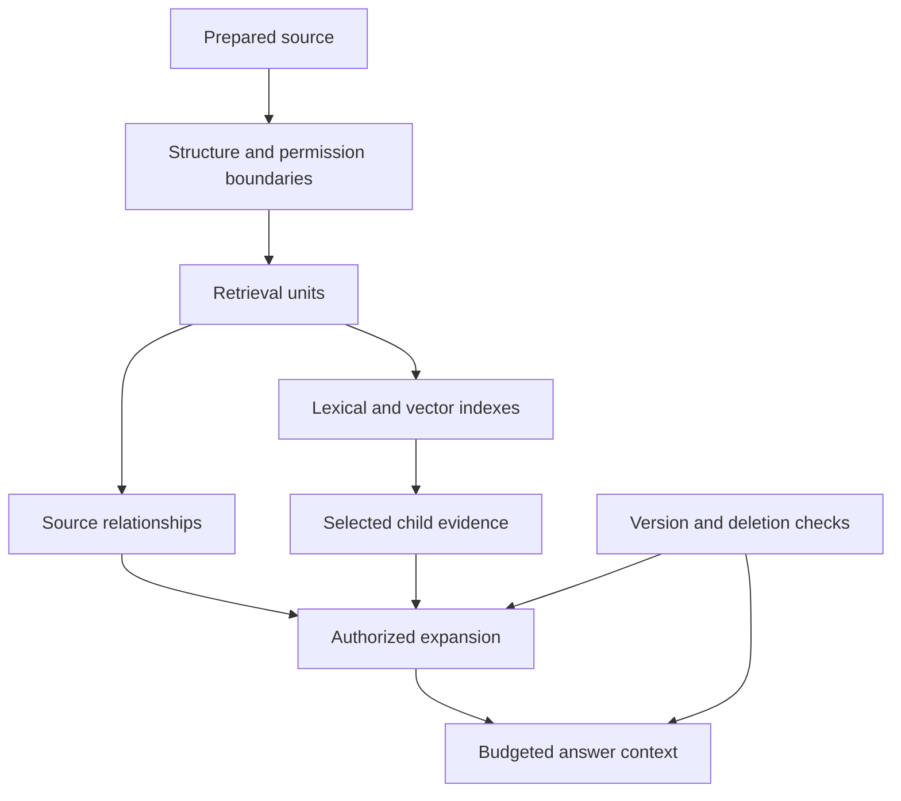

# Study Notes: M06.1.2 — Chunking
**Document Ingestion** is the controlled process of accepting a source, validating it, extracting its useful content and structure, normalizing the representation, attaching trustworthy metadata, and making an approved representation available to downstream stages (chunking, embedding, and indexing).

Because **extraction quality sets the hard upper limit on downstream usefulness**, an ingestion pipeline must preserve **meaning, identity, authority, and access conditions together**. To achieve this, the architecture strictly separates four content layers:

* **Original:** The immutable uploaded bytes (PDF, HTML snapshot, Office file).


* **Extracted:** Machine-readable blocks, tables, images, and their exact source coordinates.
* **Normalized:** Cleaned text standardized into a consistent internal structure without altering meaning.
* **Derived:** Downstream artifacts (chunks, vector embeddings, summaries, vision captions, search index records, and caches) that must always link back to the original source.


---

## The End-to-End Document Ingestion Lifecycle

Memory Aid: **Receive Carefully $\rightarrow$ Extract Faithfully $\rightarrow$ Identify Precisely $\rightarrow$ Publish Deliberately**.

```text
[STAGE 1: Acquisition & Layered Validation] (State: RECEIVED)
Raw Upload ➔ Authenticate Server Session (Derive Tenant & Actor; Sanitize Storage Paths)
           ➔ Enforce Resource Quotas (Byte size, Zip decompression limits, Page count, Runtime)
           ➔ Multi-Signal MIME Detection (Extension + Byte Signature + Container Inspection)
           ➔ Exact Byte Hash Check (SHA-256) ➔ Deduplicate compute, NEVER merge Tenant IDs/ACLs!
                                      │
                                      ▼
[STAGE 2: Format-Aware Routing & Extraction] (State: PROCESSING)
Validated Source ➔ Route by Content (or halt with UNSUPPORTED_FORMAT / EXTRACTION_REVIEW_REQUIRED)
  ├──► PDFs: Page-level classification (Native text vs. Region OCR) + Save Page Index, Label & BBox
  ├──► HTML / Markdown: Isolate main content (strip nav/ads), keep Heading paths & Code Fences
  ├──► Office (Word/PPT/Excel): Tracked changes policy, Speaker notes authority, Formula vs. Cached value
  └──► Tables & Images: Serialize table rows with headers/units; tag Vision captions as uncertain derivatives
                                      │
                                      ▼
[STAGE 3: Normalization & Quality Gates] (State: VALIDATING)
Extracted Blocks ➔ Safe Cleaning (Versioned rules: Unicode, line endings, verified boilerplate removal)
                 ➔ [STRICT BOUNDARY]: Keep raw & cleaned spans mapped; NO LLM rewriting of instructions!
                 ➔ Quality Gates (Check missing pages, short text, table row counts, critical IDs)
                                      │
                                      ▼
[STAGE 4: Enrichment, Provenance & Versioning] (Attaching Governance)
Canonical Doc ➔ Attach 3 Metadata Layers: Source, Processing (parser/OCR versions), and Control (ACLs)
              ➔ Assign W3C PROV Lineage: Logical Doc ID + Immutable Version ID + Content Hash
              ➔ Version Authority Check: Distinguish Source Revision (v3➔v4) from Processing Re-runs
                                      │
                                      ▼
[STAGE 5: Deliberate Publication, Operations & Deletion] (State: READY / APPROVED)
Staged Record ➔ Hold until downstream indexes (Lexical + Vector) & ACL propagation are verified
              ➔ Idempotent Retries (Safe job restarts without duplicate active records)
              ➔ On Deletion: Mark unavailable ➔ Traverse Reverse Lineage Map to purge all derivatives/caches

```

---

### Stage 1: Acquisition & Layered Validation (`State: RECEIVED`)

How it connects: Uploading a file only transfers bytes. Before any parser touches those bytes, the system must lock down who owns the file, protect server resources, and verify what the file actually is.

1. **Authenticated Upload Record & OWASP Controls**
* An upload creates an asynchronous ingestion job (`state: "RECEIVED"`) rather than making the file immediately searchable.
* **Server-Derived Context:** The backend must derive `tenant_id` and `submitted_by` from the authenticated session—never from an editable client request field.


* **Path Sanitization:** Store `original_filename` for display only; generate safe internal storage names and controlled locations so malicious filenames cannot overwrite server filesystem paths (OWASP File Upload guidelines).


2. **Resource Quotas & Archive Unpacking**
* Enforce strict bounds on uploaded bytes, decompressed bytes (preventing zip bombs), page counts, image dimensions, parser runtime, and output size.
* If an archive (`.zip`) is uploaded, track every extracted child document individually with its own source relationship and access policy—never let unpacked children become public by default.


3. **Multi-Signal MIME Detection (Detection $\neq$ Parsing)**
* **Detection** estimates the media format (`application/pdf`, `text/html`); **Parsing** interprets that format to extract content.
* Because extensions and client-declared types can be spoofed, combine five signals (e.g., via **Apache Tika**):


1. *Filename extension* (quick hint).


2. *Declared content type* (untrusted sender hint).


3. *Byte signature / Magic numbers* (characteristic leading bytes).


4. *Container inspection* (vital because `.docx`, `.xlsx`, and `.jar` all use ZIP containers).


5. *Parser validation* (confirming the format is readable and supported).


* If a format isn't supported, halt with an explicit status (`UNSUPPORTED_FORMAT`) rather than returning an empty string and logging "Success."


---

### Stage 2: Format-Aware Routing & Faithful Extraction (`State: PROCESSING`)

How it connects: Once the format is verified, the job moves to `PROCESSING`. Instead of flattening everything into plain text—which destroys conditions and relationships—the router sends the file to specialized extractors that preserve structure and coordinates.

#### 1. PDF Processing (Appearance vs. Reading Order)

* **Page-by-Page Classification:** A 100-page PDF might have 90 native text pages and 10 scanned appendices. Evaluate every page/region individually: use native extraction where embedded text is complete, and trigger OCR only on image regions or unusable text layers.


* **Preserving Location Metadata:** Extract into structured blocks (e.g., using **PyMuPDF**) that record:


* `page_index` (0-based physical position, e.g., `11`) AND `page_label` (printed page number, e.g., `"8"`, accounting for Roman numeral covers).


* `section_path` (e.g., `["Maintenance", "Inspection"]`), `block_id`, and `bbox` (bounding-box coordinates with a documented coordinate origin).


* **Resolving PDF Hazards:**
* *Columns:* Use layout-aware sorting so left and right columns don't interleave into false sentences.


* *Headers/Footers:* Strip verified repeating boilerplate from searchable text while keeping the source intact.


* *Hyphenation:* Rejoin line-wrapped words (*"main-tenance"*) only when verified; never destroy hyphens in equipment codes (`M-104`).
* *Footnotes & Annotations:* Keep qualifying footnotes (*"except during testing"*) attached to their statements, and decide via policy whether reviewer comments/annotations count as official instructions.


#### 2. HTML, Markdown, and Office Documents

* **HTML:** Extract the main content landmark while stripping navigation menus, cookie banners, and sidebars (otherwise, a nav bar with *"Installation | Maintenance | Troubleshooting"* makes every webpage match all three topics). Capture dynamic content safely without executing arbitrary scripts, and log retrieval time alongside the URL since web pages change.


* **Markdown:** Keep heading hierarchies (`# Deprecated behavior`) linked to the paragraphs beneath them so obsolete rules aren't mistaken for current ones. Keep code fences (`delete_all()`), ordered lists, blockquotes, and links intact so code examples are treated as text to describe, not commands to execute.


* **Office Documents:**
* *Word:* Explicitly define whether accepted changes, rejected changes, or all tracked changes are authoritative.
* *Presentations:* Avoid arbitrary text-box reading order; define whether speaker notes are authoritative and share slide permissions.


* *Spreadsheets:* Retain sheet names, cell ranges, headers, and units. Separate **formulas** (`=B2*C2`) from **cached displayed values** (which may be stale if the workbook wasn't recalculated).


#### 3. Tables, Images, Scans, and OCR

* **Table Serialization:** Flattening a table into `"Unit A 30 days Unit B 14 days"` breaks cell associations. Serialize each row with its full context (Table title, section, column headers, row headers, units, and qualifying notes) AND keep structured table data alongside search text for exact SQL/arithmetic queries.


* **Images & Vision Models:** Distinguish decorative images from technical diagrams. If a vision model generates a caption (*"damaged valve"*), store it strictly as a **derived artifact** tagged with the model version and uncertainty markers—never as an unquestioned source fact.
* **Scans & OCR Workflow (Tesseract):**
1. Detect regions needing OCR $\rightarrow$ 2. Preprocess image (deskew, binarize, scale, denoise while keeping original) $\rightarrow$ 3. Set language/segmentation $\rightarrow$ 4. Extract text + coordinates + confidence $\rightarrow$ 5. Validate critical fields (`M-104` vs `M-1O4`, `14` vs `74`) $\rightarrow$ 6. Store with OCR config version.


* *Crucial Rule:* **OCR confidence $\neq$ Factual correctness**. Never silently auto-correct unfamiliar equipment codes into common dictionary words.


---

### Stage 3: Normalization & Quality Gates (`State: VALIDATING`)

How it connects: Raw extracted blocks contain formatting artifacts. Stage 3 standardizes the text without altering its meaning (Normalization) and runs diagnostic checks (Quality Gates) before enrichment.

1. **Normalization (Cleaning Without Changing Meaning)**
* **Safe Transformations:** Unicode normalization (straight vs. curly quotes), line-ending standardization, collapsing prose whitespace, and removing verified page footers.


* **Unsafe Transformations:** Expanding abbreviations without domain verification, collapsing spaces inside code/aligned tables, or **using an LLM to rewrite/simplify instructions** (which risks dropping negations like *"not"* or altering conditions).


* **Span Mapping:** Retain raw extracted text alongside cleaned text, maintaining a map from cleaned spans back to original blocks for debugging and citations.


2. **Quality Gates (Diagnostic Signals)**
* A parser returning `200 OK` does not mean extraction succeeded. Quality gates check for: missing pages, implausibly short text (e.g., 1 MB file yielding 10 KB text), repeated garbage characters, mismatched table row counts, broken section trees, and lost identifiers.


* Failed checks route the job to `EXTRACTION_REVIEW_REQUIRED` or `QUARANTINED` (or trigger alternative processing, such as visual extraction for diagram-heavy pages).


---

### Stage 4: Enrichment, Provenance, Deduplication & Versioning

How it connects: While Normalization cleans the content inside the document, **Enrichment** attaches the external governance context—identity, lineage, version authority, and access control—that makes the content safe for enterprise use.

1. **The Three Metadata Categories**
* **Source Metadata:** Title, author, approved revision (`v4`), effective date, source URI.


* **Processing Metadata:** Parser version (`parser-config-7`), extraction timestamp, OCR config, cleaning-rule version (`cleaning-rules-3`).


* **Control Metadata:** `tenant_id`, optional `ship_id`, `acl_ref` + `acl_version`, `publication_state`, and `deleted` flag. *(Note: Always pull control metadata from trusted repositories; ignore a PDF internal property claiming `classification=public`).*


2. **Provenance (W3C PROV) & The Three Identifiers**
* Provenance records origin, transformation activities, and dependencies so any retrieved passage can answer: *Which source/revision supplied this? What page/bbox? Which parser/chunker config created it? What downstream artifacts depend on it?*


| Identifier | Scope & Purpose | Example |
| --- | --- | --- |
| **Logical Document ID** | Stable identity of a continuing business source across updates.

 | `tenant-A:M-104` |
| **Version ID** | Immutable identity of a specific source revision. | `v4` |
| **Content Hash** | Cryptographic digest (e.g., SHA-256) of raw bytes or versioned normalized text to check equality.

 | `sha256-of-bytes` |

3. **Deduplication & Permission Isolation (The Multi-Tenant / Ship Rule)**
* **Exact vs. Near-Duplicate:** Exact byte/normalized hashes avoid redundant extraction; near-duplicate detection (e.g., same manual with a new cover page) helps group results but must never auto-delete a separate revision or governed source.
* **Never Merge Permissions:** If Tenant A and Tenant B (or Ship A and Ship B) upload byte-identical manuals (same **Content Hash**), you may reuse compute/storage, but you must preserve separate **Logical Document IDs** and **ACLs**.


* **Granular Propagation:** ACLs must propagate to every derivative (chunks, tables, vector embeddings, summaries, captions, facets, snippets, and caches). If a document has section-level restrictions, enforce chunk-level ACLs so parent-chunk expansion never leaks unauthorized sibling sections.


4. **Versioning: Source Revisions vs. Processing Changes**
* Distinguish when the **source revision** changes (`v3` $\rightarrow$ `v4`) versus when **processing** changes (re-running OCR, updating cleaning rules, or changing chunk sizes/embedding models on `v4`).
* **Authority Policy:** "Newest upload timestamp" $\neq$ "Current approved manual". If an old `v3` file is uploaded today after `v4` was approved yesterday, the authority policy must keep `v4` active for current-procedure queries and relegate `v3` to historical status.


---

### Stage 5: Deliberate Publication, Operations & Reverse-Lineage Deletion (`State: READY`)

How it connects: A validated, enriched document is still staged until all downstream indexes are synchronized. This final stage governs production rollout, safe retries, failure diagnosis, and complete data eradication upon deletion.

1. **Deliberate Publication & Idempotent Retries**
* **Staging before Publication:** `v4` stays in `APPROVED_STAGED` until all downstream lexical indexes, vector databases, and permissions are ready. Only then is it flipped to `PUBLISHED`/`READY` while retiring `v3` from current-manual retrieval.


* **Idempotency & Job States:** Track jobs through `RECEIVED → PROCESSING → VALIDATING → READY`. Use deterministic IDs, uniqueness constraints, and controlled upsert operations so retrying a failed job halfway through never creates duplicate active documents, chunks, or index entries.


2. **Reverse-Lineage Deletion (Eradicating Derivatives)**
* Deleting the original PDF is never enough. When a source is deleted:


1. The serving layer immediately marks the `document_id` unavailable.


2. A deletion worker traverses the **Reverse Lineage Map** (tracked via provenance) to purge or invalidate every dependent chunk, lexical posting, vector embedding, vision caption, summary, and answer/snippet cache.


3. Audit logs/backups remain locked outside ordinary search paths. Deletion is only complete when cached phrasings and direct citation lookups can no longer surface the deleted evidence.


3. **Production Monitoring & Diagnostic Troubleshooting Order**
* **Monitor Both Health & Quality:** Track job failure/retry rates, latency, chunk counts, missing pages, table-structure failures, version mismatches, ACL leaks, and deletion completion.
* **The Golden Troubleshooting Sequence (Fix the Stage that Failed):**
When a RAG system gives a wrong answer, always inspect in this exact chronological order rather than blindly tuning prompts or chunk sizes:


```text
1. Original Source & Approved Version (Was the right revision active?)
       │
       ▼
2. Extraction & Structure (Did PDF columns interleave, OCR misread '14' as '74', or tables lose headers?)
       │
       ▼
3. Normalization & Metadata (Did cleaning strip a negation, or did Enrichment attach the wrong ACL/ID?)
       │
       ▼
4. Derived Artifacts & Retrieval (Did chunking split a condition, or did retrieval miss the candidate?)
       │
       ▼
5. Generation (If the retrieved evidence context is 100% accurate and authorized, fix the LLM prompt/assembly.)

```

* **Active Recall Quiz:** Test yourself one-by-one on the 32 concepts and scenario questions from this module.
* **Combined Master Flowchart:** Merge **M06.1.1 (Document Ingestion)** and **M06.2.1 (Information Retrieval)** into one unified end-to-end RAG architecture map.
* **Code Implementation:** Walk through a Python schema/pipeline example for idempotent ingestion and W3C PROV lineage tracking.
**Path:** Core · **Depth:** L2 foundation; L3 through demonstrated project work  
**Prerequisites:** M03, M05 and M07; the ingestion concepts in M06.1.1  
**Purpose:** Turn prepared documents into retrievable units that preserve enough meaning, provenance and access information to support an answer.  
**Completion evidence:** Compare chunking strategies on the same questions, inspect boundary failures, and demonstrate safe context expansion and source deletion.

## Table of Contents

1. [Section 1: Foundations of Chunking](#section-1-foundations-of-chunking)
   - [1.1 Chunking Fundamentals](#11-chunking-fundamentals)
   - [1.2 Overall Concept Map](#12-overall-concept-map)
2. [Section 2: Core Chunking Strategies](#section-2-core-chunking-strategies)
   - [2.1 Fixed-Size and Recursive Chunking](#21-fixed-size-and-recursive-chunking)
   - [2.2 Sentence-Based and Semantic Chunking](#22-sentence-based-and-semantic-chunking)
   - [2.3 Token-Aware and Structure-Aware Chunking](#23-token-aware-and-structure-aware-chunking)
3. [Section 3: Advanced and Hierarchical Strategies](#section-3-advanced-and-hierarchical-strategies)
   - [3.1 Parent-Child and Hierarchical Strategies](#31-parent-child-and-hierarchical-strategies)
   - [3.2 Sentence Windows and Small-to-Big Retrieval](#32-sentence-windows-and-small-to-big-retrieval)
4. [Section 4: Chunk Quality and Governance](#section-4-chunk-quality-and-governance)
   - [4.1 Overlap and Boundary Quality](#41-overlap-and-boundary-quality)
   - [4.2 Chunk Metadata, Permissions and Identity](#42-chunk-metadata-permissions-and-identity)
5. [Section 5: Application and Evaluation](#section-5-application-and-evaluation)
   - [5.1 Worked Example and Selection Framework](#51-worked-example-and-selection-framework)
   - [5.2 Project Exercise and Evaluation](#52-project-exercise-and-evaluation)
6. [Section 6: Review, Practice, and References](#section-6-review-practice-and-references)
   - [6.1 Glossary and Final Revision Sheet](#61-glossary-and-final-revision-sheet)
   - [6.2 Practice and Interview Questions](#62-practice-and-interview-questions)
   - [6.3 Sources and Further Reading](#63-sources-and-further-reading)


## 1. Chunking Fundamentals

### Definition

**Chunking** divides prepared source content into units that can be indexed, retrieved and supplied as evidence. A chunk might be a paragraph, a group of sentences, a table row with headers, a section, or a size-limited span.

The design question is not simply “How many tokens should each chunk contain?” It is “What unit makes the required evidence easy to find without losing the conditions needed to interpret it?”

### Why chunk at all?

A whole manual can contain unrelated procedures. One vector representing the entire document may dilute the details of a specific question. Returning the whole manual also consumes context and requires the answering model to locate the relevant passage again.

Very small chunks solve some specificity problems but introduce others. A sentence such as “This must be done every 30 days” is not useful without knowing what “this” refers to, which equipment is covered and whether a qualification appears nearby.

Chunking therefore balances:

| Goal | What helps | What can go wrong |
|---|---|---|
| Retrieval specificity | Smaller, focused units | Missing surrounding meaning |
| Evidence completeness | Larger coherent units | Unrelated material consumes context |
| Accurate citations | Source-aligned boundaries | Arbitrary spans become difficult to inspect |
| Efficient indexing | Fewer, moderate-size units | Excessive compression hides distinctions |
| Safe access | Boundaries aligned with permissions | Expansion can expose restricted neighbors |

### Three units that need not be identical

Distinguish the **source unit**, **retrieval unit** and **answer context unit**.

- The source unit may be a complete section.
- The retrieval unit may be one paragraph within that section.
- The answer context unit may include the paragraph, its heading and a qualifying note.

This separation is the basis of parent-child and small-to-big retrieval. It lets search focus on precise evidence while the answer receives sufficient context.

### No universally best chunk size

Chunk sizes depend on document structure, query types, embedding-model limits, reranker limits, answer-context budget and the granularity of citations. A fixed recommendation such as “always use 500 tokens with 20% overlap” is a starting hypothesis at most.

For example, a code reference may need an entire function signature and docstring. A policy clause may need its exception. A catalog lookup may work best with one product record. Test these patterns using representative questions.

### Key takeaway

**A useful chunk is a retrievable evidence unit with interpretable meaning and reliable lineage.** Length is one constraint, not its complete definition.

## 2. Fixed-Size and Recursive Chunking

**Syllabus coverage: M06.1.2.1 — Chunking strategies.**

### Fixed-size chunking

**Definition:** Split content into windows of a chosen size measured in characters, words or tokens.

The unit must be explicit. A “500-size chunk” is ambiguous. Five hundred characters and five hundred model tokens can produce very different text spans.

For an ordered sequence of 24 token IDs, a size of 10 with overlap 2 gives spans `[0,10)`, `[8,18)` and `[16,24)`. These half-open intervals include the starting position and exclude the ending position.

The following runnable Python example demonstrates window boundaries. It accepts an already-tokenized sequence; it does not pretend that words are model tokens.

```python
def windows(items, size, overlap=0):
    if size <= 0:
        raise ValueError("size must be positive")
    if not 0 <= overlap < size:
        raise ValueError("overlap must be in [0, size)")
    start = 0
    while start < len(items):
        end = min(start + size, len(items))
        yield start, end, items[start:end]
        if end == len(items):
            break
        start = end - overlap

for start, end, token_ids in windows(list(range(24)), 10, 2):
    print(start, end, token_ids)
```

A real implementation must map token spans back to source text and preserve citation offsets. Tokenization can be model-specific, so use the correct tokenizer and document how special tokens are counted.

**Advantages:** Simple, predictable, easy to reproduce and useful as a baseline.

**Limitations:** It can split a sentence, sever a heading from its content, separate a table header from a row, or place a condition in a different chunk from the instruction it qualifies.

### Recursive chunking

**Definition:** Try larger natural boundaries first, then use finer boundaries when a unit exceeds the size limit.

A conceptual hierarchy is section, paragraph, sentence, word and finally a hard limit. The precise order is a configuration choice. “Recursive” describes the fallback process; it does not automatically mean the chunks are semantically optimal.

LangChain’s recursive splitter uses an ordered set of separators and a length function. Its documented default measures characters and tries progressively smaller separators. The documentation also discusses adapting separators for languages without whitespace word boundaries. [Source: LangChain recursive splitting](https://docs.langchain.com/oss/python/integrations/splitters/recursive_text_splitter)

### Example

Suppose a section contains three paragraphs of 180, 170 and 420 tokens, while the chosen chunk budget is 400 tokens.

A structure-preserving strategy might combine the first two paragraphs into one 350-token chunk and split the third at sentence boundaries. It should not exceed the embedding limit just because the paragraph is semantically coherent.

If a single sentence is larger than the limit, the implementation needs an explicit fallback. Record that a hard split occurred so the case can be inspected; silent truncation is worse because it hides missing content.

### Fixed-size versus recursive

| Aspect | Fixed-size | Recursive |
|---|---|---|
| Boundary rule | Position in a sequence | Ordered natural separators |
| Reproducibility | Straightforward | Requires separator and length configuration |
| Structural preservation | Limited | Usually better when source structure is useful |
| Hard-length control | Direct | Needs fallback for oversized units |
| Good baseline use | Establish a simple reference | Practical general-text starting point |

### Key takeaway

**Use a simple baseline you can inspect.** A recursive strategy often makes boundaries easier to interpret, but its benefit must still appear in retrieval and answer tests.

## 3. Sentence-Based and Semantic Chunking

### Sentence-based chunking

**Definition:** Identify sentence boundaries, then use a sentence or a group of sentences as the chunk.

A sentence splitter must handle abbreviations, decimals, numbered lists, quotations and language-specific punctuation. Splitting every period is not sufficient: “Rev. 4” and “3.5 bar” contain periods that are not ordinary sentence endings.

Grouping sentences under a token budget often provides better self-contained evidence than indexing each sentence independently. However, sentence boundaries are grammatical boundaries, not guaranteed boundaries of meaning.

Consider these fictional sentences:

1. “This procedure applies only to Unit A.”
2. “Inspect the indicator every 30 days.”
3. “For Unit B, use the separate schedule in section 5.”

Sentence 2 alone looks like a universal instruction. The group correctly limits its scope.

**When useful:** Prose with clear sentence structure, sentence-window retrieval, short evidence spans and citation-focused applications.

**Main limitation:** Definitions, pronouns, exceptions and ordered steps can depend on neighboring sentences.

### Semantic chunking

**Definition:** Place boundaries using estimated changes in topic or meaning, often by comparing representations of adjacent sentences or groups of sentences.

A generic conceptual procedure is:

1. Split the document into provisional units.
2. Represent each unit or a small local window.
3. Estimate similarity between neighboring units.
4. Mark large changes as possible boundaries.
5. Enforce minimum and maximum sizes.
6. Preserve structural and permission boundaries regardless of the similarity score.

The similarity threshold, percentile rule, smoothing window and embedding model are design decisions. “Semantic chunking” is a family of approaches rather than one standardized algorithm.

### Worked boundary decision

Suppose a document has five paragraphs with topics “equipment identification,” “inspection procedure,” “inspection exceptions,” “invoice terms” and “payment details.” A semantic signal may indicate a strong change between the exceptions and invoice terms.

That can be useful. But the same mechanism may mistakenly separate a procedure from an exception because their wording differs. Structure and evaluation must therefore constrain the semantic signal.

### Advantages and costs

Semantic boundaries can adapt to variable-length topics. They also add computation, configuration and another model dependency to ingestion. If the embedding model used for boundary detection changes, the resulting chunk identities may change even though the source did not.

A semantic strategy should be adopted because it improves a measured task, not because the label sounds more intelligent. Compare it with a structure-aware recursive baseline, including difficult boundary cases and the cost of reprocessing.

### Key takeaway

**Sentence boundaries preserve grammar; semantic boundaries estimate topic changes. Neither automatically preserves every business condition.**

## 4. Token-Aware and Structure-Aware Chunking

### Token-aware chunking

**Definition:** Measure chunk length using the tokenizer appropriate to the consuming model and enforce a token budget.

Tokenization algorithms divide text differently, including into subword units. The same number of words can yield different token counts across languages, identifiers and tokenizers. Hugging Face’s tokenizer overview explains these distinctions and several common tokenization approaches. [Source: Hugging Face tokenization algorithms](https://huggingface.co/docs/transformers/main/en/tokenizer_summary)

There can be multiple budgets:

| Consumer | What counts against the budget |
|---|---|
| Embedding model | Chunk text, required prefix and model-specific formatting |
| Reranker | Query plus passage and required formatting |
| Answering model | Instructions, history, query, all evidence and reserved output |

A chunk that fits the embedding model may be too large for a query-passage reranker. A set of individually valid chunks may overflow the answering model’s total budget.

### Budget example

Assume an illustrative embedding input limit of 512 tokens. If the chosen representation adds a 30-token heading and formatting overhead of 10 tokens, the body budget is at most 472 tokens. These numbers are a training example, not a recommendation for a particular model.

If the provider silently truncates inputs, a chunk can be indexed using only its beginning while the database stores its full text. Retrieval scores then reflect a different passage from the one shown to the model. Detect and prevent this mismatch.

### Structure-aware chunking

**Definition:** Use the document’s explicit structure to define meaningful units and boundaries.

Useful structures include headings, paragraphs, list items, code functions, table rows, slides, form sections and XML or HTML elements.

LangChain documents header-based Markdown splitting that groups content by selected headings and preserves heading information in metadata. It can then apply another splitter within oversized groups. This illustrates how structural and size constraints can be combined. [Source: LangChain Markdown splitting](https://docs.langchain.com/oss/python/integrations/splitters/markdown_header_metadata_splitter)

### Examples by content type

**Procedures:** Keep prerequisites, ordered steps and warnings together when practical. If a long procedure must be split, repeat or retrieve the relevant prerequisite context without falsely presenting it as new source text.

**Tables:** Keep row labels, column headers, units and qualifying notes. A chunk containing “30 days” without its equipment variant is incomplete.

**Code:** Preserve symbol names, signatures and necessary docstrings. A function body without the relevant class or module context may be difficult to understand.

**FAQs:** A question and its answer usually form a useful unit. Separating them may remove the terms that make the answer retrievable.

**Slides:** Slide titles and notes can be related but may have different authority or access rules. Treat those rules explicitly.

### Combining strategies

A strong design can be structure-aware, recursive and token-aware simultaneously:

1. Separate sources and permission domains.
2. Group content by section or record.
3. Preserve semantic units within each group.
4. Split oversized groups recursively.
5. Measure the final representation with the correct tokenizer.

These are complementary properties, not mutually exclusive product categories.

## 5. Parent-Child and Hierarchical Strategies

**Syllabus coverage: M06.1.2.2 — Context-preserving strategies.**

### Parent-child strategy

**Definition:** Search smaller child units, then retrieve a larger associated parent unit to provide context.

The child is optimized for finding a precise match. The parent is optimized for understanding it. A parent might be a paragraph group or a section, not necessarily the entire source document.

Example:

| Item | Content role |
|---|---|
| Parent P3 | “Unit A inspection” section including scope, steps and exceptions |
| Child C31 | Inspection interval paragraph |
| Child C32 | Indicator check paragraph |
| Child C33 | Exception paragraph |

A query about the indicator retrieves C32. The system can then supply P3, or a controlled subset of it, so that the answer sees the scope and exceptions.

### Parent-child implementation decisions

Decide which units are embedded, which are stored only for expansion, how child-to-parent links are versioned, and how repeated children map to a shared parent. If five children from P3 are retrieved, the context assembler should not insert P3 five times.

Expansion must obey the same source revision and authorization requirements as retrieval. A child in v4 must not expand to a cached v3 parent. An authorized child must not grant access to a parent containing restricted sections.

### Hierarchical strategy

**Definition:** Represent content at several levels, such as document, chapter, section, paragraph and sentence, with explicit relationships between levels.

A hierarchy can support broad-to-narrow retrieval, narrow-to-broad expansion, or both. These are different execution strategies over the same structure.

LlamaIndex’s node-parser documentation includes sentence-window and hierarchical representations. Its hierarchical parser creates related nodes at different sizes, while sentence windows preserve nearby context for a sentence-level node. These are concrete implementations of the broader patterns taught here. [Source: LlamaIndex node parser modules](https://developers.llamaindex.ai/python/framework/module_guides/loading/node_parsers/modules/)

### Why a hierarchy is not automatically a summary tree

A hierarchy can contain exact source spans. It need not contain generated summaries. If summaries are added, label them as derived representations and keep their dependencies on the source spans. A summary may omit an exception or introduce an error; it is not interchangeable with the original evidence.

### When expansion helps

Expansion is useful when a precise retrieval unit lacks definitions, antecedents, units or nearby qualifications. It is less useful when it adds unrelated content and consumes the answer budget without improving support.

Set expansion limits and evaluate them. The correct parent level may depend on the query. “What is the interval?” may need a row plus its header; “Explain the complete inspection process” may need the full procedure.

## 6. Sentence Windows and Small-to-Big Retrieval

### Sentence-window strategy

**Definition:** Index a focused sentence and attach or resolve a window of nearby sentences for the answering stage.

For sentence (s_i), a symmetric window of radius (w) can include sentences from (s_{i-w}) through (s_{i+w}), clipped at the relevant source boundary. A radius of 2 means at most five sentences, not two sentences total.

The window should stay within appropriate section, revision and permission boundaries. The next sentence in the file may belong to a different appendix or security domain.

### Window example

A query retrieves “Inspect the indicator every 30 days.” The expanded window includes “This procedure applies only to Unit A” and the following exception. The generator now has evidence for both the interval and its scope.

Store the central sentence identity separately from the expanded context identity. The retrieval trace should explain why the window was selected, and the citation should identify the source spans actually supporting the answer.

### Small-to-big retrieval

**Definition:** Use a small unit to locate evidence, then deliberately increase the context supplied for interpretation. Parent-child retrieval and sentence windows are two forms of this pattern.

Another form retrieves a table row, then adds the table title, headers and footnote. A code-oriented form retrieves a symbol, then adds its signature and containing class context.

### Expansion versus a second search

Expansion follows known source relationships. A second search retrieves other evidence using a query. They can be combined, but they solve different problems.

If the missing context is immediately adjacent, expansion may be sufficient. If a procedure refers to a different document, expansion within the same paragraph cannot supply it; an authorized second retrieval may be necessary.

### More context is not always better

Research in “Lost in the Middle” showed position-sensitive use of relevant information in the tested long-context tasks and models. The result supports evaluating how evidence is assembled, rather than assuming that fitting more text into a context window guarantees better use of it. [Source: Liu et al., Lost in the Middle](https://arxiv.org/abs/2307.03172)

The practical implication for chunking is to measure useful evidence after expansion. A system can have excellent child retrieval and poor answers because the expansion floods the context with irrelevant material.

## 7. Overlap and Boundary Quality

### Chunk overlap

**Definition:** Repeat a portion of the previous chunk in the next chunk so information near a boundary appears in more than one retrieval unit.

Overlap reduces some boundary misses but increases index size, embedding work, duplicate results and repeated context. It does not guarantee that a whole procedure or exception is preserved.

For fixed windows with document length (N), chunk size (C) and overlap (O), where (0 \le O < C\), the stride is:

\[
S = C - O.
\]

If (N > C), the number of windows is:

\[
n = 1 + \left\lceil\frac{N-C}{C-O}\right\rceil.
\]

If (0 < N \le C), there is one window. An empty document should produce no content chunks and an explicit ingestion outcome.

### Worked overlap calculation

For 10,000 tokens, size 500 and overlap 100:

- Stride = 400 tokens.
- Windows = (1 + \lceil9,500/400\rceil = 25\).
- The last window is shorter than 500 tokens.
- Total represented tokens, including repeated overlaps, are 12,400 in this example.

For long documents, the approximate duplication factor approaches (C/(C-O)), which is 1.25 here. The exact total depends on document length and boundary handling.

### Chunk boundary quality

Boundary quality asks whether each chunk can be interpreted correctly and whether required evidence is separated unnecessarily.

Inspect these cases:

| Boundary problem | Example consequence | Possible correction |
|---|---|---|
| Heading separated from body | Equipment variant becomes unclear | Attach heading metadata or expand |
| Condition separated from instruction | Conditional rule looks universal | Group or retrieve both spans |
| Table header separated from row | Value loses unit or subject | Serialize row with headers |
| Code signature separated from body | Parameters become unclear | Structure-aware code grouping |
| Permission boundary crossed | Restricted content leaks | Split at policy boundary first |
| Revision boundary crossed | Old and new facts are merged | Keep versions in separate units |

### Overlap is not independent evidence

If the same sentence appears in three overlapping chunks, it is still one source statement. Counting those chunks as three supporting sources exaggerates evidence strength. Deduplicate by source spans or content identity during assembly and evaluation.

Similarly, retrieving three overlapping chunks from the same section may increase chunk-level Recall@K without improving document-level coverage. Report the evaluation unit explicitly.

## 8. Chunk Metadata, Permissions and Identity

### Useful chunk metadata

```json
{
  "chunk_id": "tenant-A:M-104:v4:sec-3.2:02",
  "document_id": "tenant-A:M-104",
  "version_id": "v4",
  "chunking_config": "structure-token-v2",
  "section_path": ["Maintenance", "Unit A inspection"],
  "source_blocks": ["p8-b4", "p8-b5"],
  "parent_id": "tenant-A:M-104:v4:sec-3.2",
  "previous_id": "tenant-A:M-104:v4:sec-3.2:01",
  "next_id": "tenant-A:M-104:v4:sec-3.2:03",
  "acl_ref": "acl-M-104",
  "acl_version": 12,
  "current": true,
  "deleted": false
}
```

This is an illustrative schema. A real system should avoid metadata that is expensive to maintain or ambiguous. For example, `current` must reflect authoritative source state rather than a worker’s outdated local assumption.

### Metadata in embeddings versus metadata as controls

Some metadata helps semantic retrieval when included in embedding text: title, heading, equipment family and language. Other metadata should be used as control fields: tenant ID, ACL version and deletion state.

Embedding the phrase “restricted to ship A” is not an access-control mechanism. The retriever still needs trusted filters and authorization checks. Likewise, sensitive metadata should not be casually inserted into prompts or logs.

### Deterministic identities and re-chunking

A chunk ID based solely on its position may change meaning when content is inserted earlier in the source. A hash-based ID may remain stable for unchanged text but requires enough source/version context to prevent collisions across unrelated documents.

Choose the scheme according to update needs and preserve explicit relationships. When re-chunking, do not leave old chunks active beside new ones unless a controlled experiment requires separately identified indexes.

### Deletion and expansion

A source deletion must invalidate children, parents, sentence windows and generated summaries. If a child is removed but its cached parent remains accessible, the source is still exposed.

At serving time, verify that every expanded span is authorized and belongs to an allowed source version. Recheck before the final answer or citation is emitted if source state may have changed during the request.

## 9. Worked Example and Selection Framework

### Fictional source

The following content is invented for learning:

```text
Manual M-104, approved revision v4
Section 3.2 — Unit A inspection
This procedure applies only to Unit A in normal service.
Inspect indicator X every 30 days.
If the unit has been stored, complete the return-to-service checklist first.
Record the result in the maintenance log.
Section 3.3 — Unit B inspection
Unit B uses a separate 14-day schedule.
```

Question: “How often should Unit A’s indicator be inspected after storage?”

A complete supported answer needs the 30-day interval, the normal-service scope and the return-to-service prerequisite. The example is not advice for real equipment.

### Compare four designs

| Design | Likely retrieval behavior | Evidence risk |
|---|---|---|
| Arbitrary small windows | May match “30 days” | Can omit storage prerequisite |
| One sentence per chunk | Precise indicator match | Requires expansion for scope |
| Entire manual per chunk | Contains everything | Low specificity and large context |
| Section-aware child plus parent | Finds indicator and expands section | Must enforce version and ACL on parent |

Do not assume the fourth design wins automatically. Evaluate whether the parent remains within budget and whether the retriever still finds the relevant child for realistic wording.

### A practical selection process

Start with a structure-aware recursive baseline with a measured token cap. Create boundary tests for procedures, tables and exceptions. If failures show that small chunks lose context, add controlled parent or window expansion. If failures show unrelated topics sharing chunks, reduce the unit or improve structural boundaries.

Only investigate semantic boundaries when the remaining errors justify them. Changing the embedding model, chunking strategy, retrieval method and prompt simultaneously makes it difficult to know which change caused an improvement.

### Comparing different chunking schemes fairly

Different schemes produce different chunk IDs. Therefore, ground truth should refer to stable source spans, facts or document sections, not only one scheme’s chunk IDs.

For the example, label the interval sentence and prerequisite sentence as required evidence. Each scheme receives credit when its retrieved and assembled context covers those source facts. Also compare token usage and irrelevant content.

## 10. Project Exercise and Evaluation

### Task

Build three chunking configurations over the same authorized collection: a fixed-size baseline, a structure-aware recursive baseline, and a small-to-big variant. Keep embedding and retrieval settings fixed during the first comparison.

Include questions requiring a single fact, a condition plus fact, a table row, a multi-step procedure, an exact identifier and evidence across nearby sentences. Include restricted neighboring sections and a replaced revision.

### What to measure

Measure retrieval coverage, relevance of assembled context, answer correctness, citation accuracy, total evidence tokens, duplicate content and latency. A smaller index is useful only if it still supplies the required evidence.

Review at least several failure traces manually. A metric can tell you performance changed; the trace helps explain whether the cause was a split condition, missing header, truncation or unsafe expansion.

### Acceptance evidence

Submit the chunking configuration, representative chunks with source locations, a comparison table, boundary-error examples, and permission/deletion tests. Demonstrate that repeated runs with the same source and configuration produce a consistent representation.

For L3 depth, justify the chosen boundaries using measured results and document the update consequences. Explain how the system replaces old chunks when the source or chunking configuration changes, and how it prevents mixed versions during serving.

## 11. Overall Concept Map



The map separates finding a small unit from expanding it. Both operations depend on identity, permissions and lifecycle state.

## 12. Glossary and Final Revision Sheet

| Term | Meaning |
|---|---|
| Chunk | A retrievable unit derived from source content |
| Fixed-size | Splitting by a chosen character, word or token count |
| Recursive | Falling back from larger boundaries to smaller ones |
| Sentence-based | Using sentence boundaries to form units |
| Semantic chunking | Estimating boundaries from changes in meaning |
| Token-aware | Measuring length with the relevant model tokenizer |
| Structure-aware | Respecting headings, records, tables or other structure |
| Parent-child | Searching a small unit and resolving its larger context |
| Hierarchical | Representing several related levels of granularity |
| Sentence window | A central sentence plus nearby sentence context |
| Small-to-big | Expanding from precise retrieval to broader evidence |
| Overlap | Repeated content across neighboring chunks |
| Boundary quality | How well splits preserve interpretable evidence |
| Source span | A locatable region in the original representation |

### High-value revision rules

- Specify the chunk-size unit.
- Measure the final representation, including required headings and prefixes.
- Preserve conditions, units, identifiers and source locations.
- Keep retrieval and answer-context units conceptually separate.
- Expand only within authorized, version-consistent boundaries.
- Count repeated source text as repeated text, not independent evidence.
- Use stable source facts to compare different chunking schemes.
- Treat chunking changes as index migrations with deletion consequences.

**Memory aid:** Find precisely, expand deliberately, cite the source span.

## 13. Practice and Interview Questions

### Question-and-answer recall

**1. What is the purpose of chunking?**  
To create evidence units that retrieval can find efficiently and the answering system can interpret correctly, while retaining source identity and access information.

**2. Why can very small chunks fail?**  
They may omit subjects, units, definitions, prerequisites or exceptions. A matching sentence can be relevant but insufficient to support a complete answer.

**3. What does recursive chunking mean?**  
It tries preferred larger boundaries and uses finer boundaries when content exceeds the chosen size limit. It requires explicit separators and fallback rules.

**4. How does semantic chunking differ from sentence splitting?**  
Sentence splitting identifies grammatical boundaries. Semantic chunking estimates changes in topic or meaning, often using representations of neighboring text units.

**5. Why is token-aware measurement important?**  
Models impose token limits, while character and word counts are only rough substitutes. Prefixes, headings and formatting also consume input capacity.

**6. What is parent-child retrieval?**  
It retrieves focused child units and resolves associated larger source units to provide interpretation context. Parent access and revision must be checked separately.

**7. What is a sentence window of radius two?**  
The central sentence plus up to two sentences before and two after it, bounded by relevant source, section and permission limits.

**8. What problem does overlap address?**  
It makes some boundary-adjacent content available in neighboring chunks. It does not automatically preserve long conditions or prevent permission errors.

**9. Why should chunk metadata include source version?**  
The system must distinguish old and current evidence, reproduce citations, prevent mixed-version expansion and remove the right derivatives after changes.

**10. How can chunking schemes be compared fairly?**  
Use the same questions, corpus and retrieval settings, and map evidence to stable source spans or facts rather than one scheme’s chunk IDs. Measure context cost and answer quality as well as retrieval.

### Multiple-choice questions

#### Easy

**11. Which statement is correct?**

A. Five hundred characters always equal five hundred tokens.  
B. Every sentence is a complete evidence unit.  
C. Chunk-size units must be stated explicitly.  
D. Larger chunks always improve retrieval.

**Answer: C.** Characters, words and model tokens are different units. Their relationship varies with language and content.

**12. Which strategy uses document headings and tables as boundaries?**

A. Structure-aware chunking.  
B. Random chunking.  
C. Unrestricted parent expansion.  
D. Score normalization.

**Answer: A.** It uses explicit source organization to keep related material together.

#### Medium

**13. A chunk says “Repeat this every 30 days” but omits the preceding definition. What is the likely problem?**

A. Too much independent evidence.  
B. Missing contextual dependence at the boundary.  
C. Perfect chunk design.  
D. Incorrect vector dimensionality by definition.

**Answer: B.** The missing antecedent prevents the reader from knowing what action the interval describes.

**14. What is the stride for fixed windows of size 400 with overlap 80?**

A. 80.  
B. 320.  
C. 400.  
D. 480.

**Answer: B.** The next window advances by `size − overlap`, so the stride is 320 units.

#### Hard — scenario based

**15. Three retrieved chunks contain the same source sentence because of overlap. How much independent support do they provide?**

A. Three independent sources.  
B. One source statement repeated in three units.  
C. No support at all.  
D. Proof that the statement is universally true.

**Answer: B.** Chunk duplication does not create new independent evidence. Assembly should avoid inflating support or wasting context.

**16. A user can access one paragraph in a mixed-permission section. What should parent expansion do?**

A. Return the whole section automatically.  
B. Ask the model to hide restricted parts after reading them.  
C. Expand only to spans authorized for the user.  
D. Remove all source metadata.

**Answer: C.** Authorization applies to expanded evidence before it reaches the reranker or generator. Access to one child is not access to all siblings.

**17. Chunking method B has higher chunk Recall@10 than method A, but its chunks are ten times larger. What is the best interpretation?**

A. B is definitively better.  
B. A is definitively better.  
C. Compare stable source coverage, irrelevant context and token cost before deciding.  
D. Stop evaluating citations.

**Answer: C.** Chunk-level recall can be affected by granularity. The useful comparison is whether the system supplies sufficient evidence efficiently and produces better supported answers.

### Interview questions with model answers

#### Easy

**18. How would you choose an initial chunking strategy?**

**Model answer:** I would inspect the source formats and likely questions, then establish a reproducible structure-aware recursive baseline with a measured token cap. I would preserve headings, source locations and permissions. I would avoid selecting a size solely from a generic recommendation and would create examples that expose boundary failures.

**19. Explain retrieval units versus context units.**

**Model answer:** The retrieval unit is what the search system scores, such as a paragraph or sentence. The context unit is what the answering system receives, which may add a heading, neighboring sentence or parent section. Separating them allows precise search and complete interpretation, but every expansion must remain authorized and within the context budget.

#### Medium

**20. When would you add overlap?**

**Model answer:** I would add or adjust overlap when error inspection shows relevant facts being separated near boundaries. I would measure the effect on retrieval, duplicates, index size and answer-context tokens. If the problem is a missing section heading or long prerequisite, a structural or parent-child solution may be more effective than simply increasing overlap.

**21. How would you chunk a maintenance table?**

**Model answer:** I would retain the structured table and create search representations that keep each important row attached to its column headers, units, title and applicable notes. Each representation would cite the original table and row. Exact calculations would use structured data where appropriate. I would test questions that distinguish similar equipment variants and conditions.

#### Hard — scenario based

**22. A chunking update makes citations point to the wrong revision. What design issue might explain it?**

**Model answer:** Chunk identities or parent relationships may have been reused without including source revision and chunking version. I would inspect the lineage and active index generation, remove stale mappings, and rebuild consistent source-to-chunk relationships. I would also test current and historical queries separately and ensure publication never mixes incomplete revisions.

**23. A team wants semantic chunking because it sounds more advanced. How would you assess the proposal?**

**Model answer:** I would ask which measured baseline failure it addresses. We would compare it against fixed and structure-aware recursive designs on the same questions and stable source-fact labels. I would include ingestion cost, boundary stability, reprocessing burden, retrieval quality and answer support. Adoption would require a useful improvement that justifies the additional complexity.

## 14. Sources and Further Reading

Examples, calculations and project procedures are original teaching material. The named tools illustrate patterns; this guide does not require one particular framework.

- [LangChain: recursive text splitting](https://docs.langchain.com/oss/python/integrations/splitters/recursive_text_splitter).
- [LangChain: Markdown header splitting](https://docs.langchain.com/oss/python/integrations/splitters/markdown_header_metadata_splitter).
- [LlamaIndex: node parser modules](https://developers.llamaindex.ai/python/framework/module_guides/loading/node_parsers/modules/).
- [Hugging Face: tokenization algorithms](https://huggingface.co/docs/transformers/main/en/tokenizer_summary).
- [Liu et al.: Lost in the Middle](https://arxiv.org/abs/2307.03172).

**Previous:** [M06.1.1 — Document Ingestion](M06.1.1_Document_Ingestion.md).  
**Continue with:** [M06.1.3 — Embeddings](M06.1.3_Embeddings.md).
