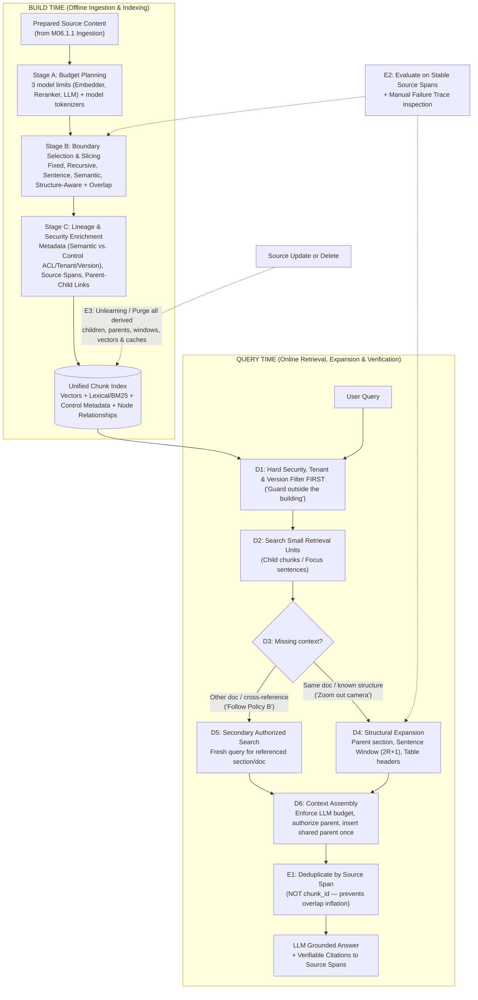
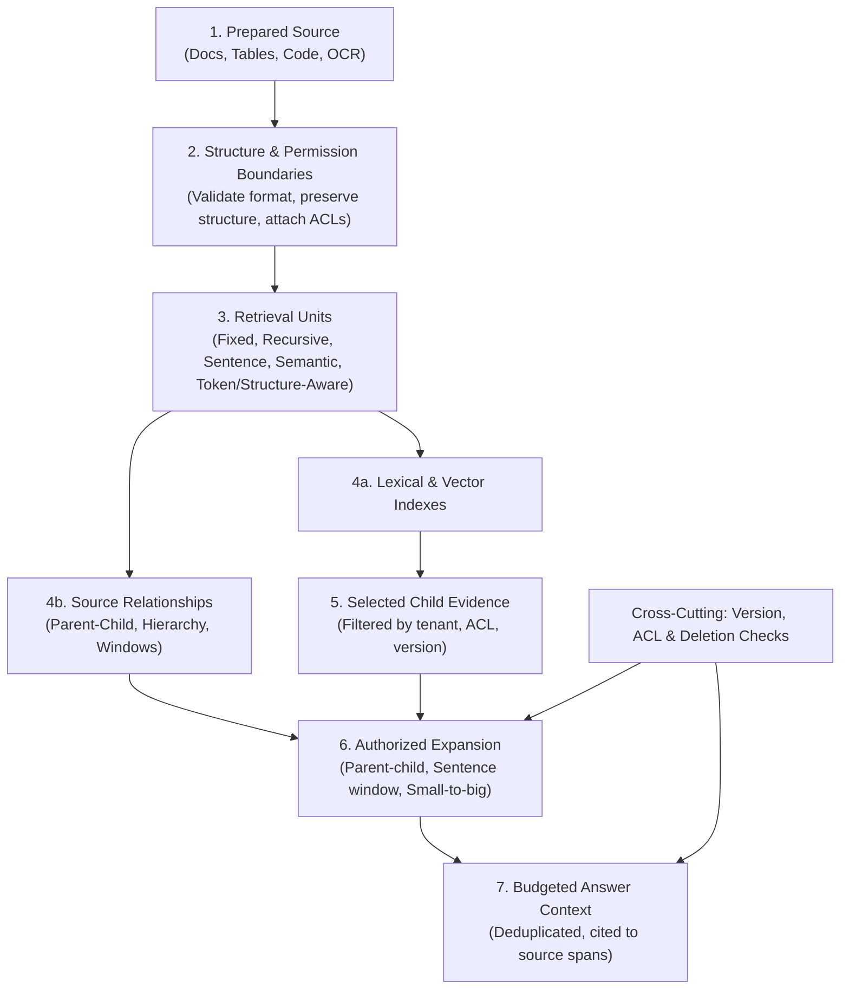
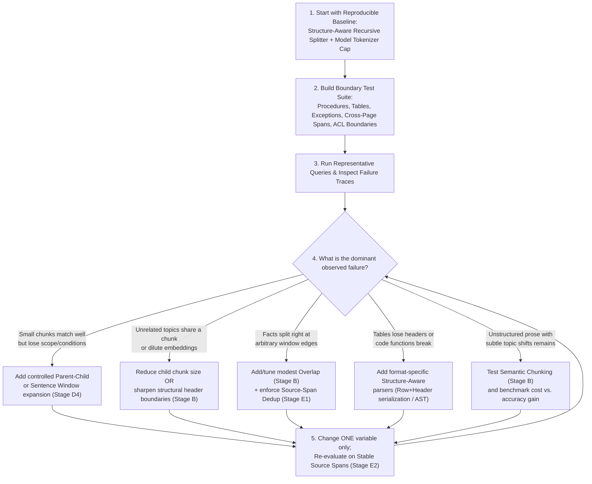

# M06.1.2 — Chunking: Combined Master Study & Interview Guide

> **Core Memory Aid:** **Find precisely $\rightarrow$ Expand deliberately $\rightarrow$ Cite the source span.**
>
> **Purpose of this combined guide:** This version uses the second file as its technical backbone and integrates the first file’s stage-by-stage teaching checkpoints, question explanations, scenarios, clarified doubts, revision routine and performance tracking. The complete consolidated syllabus and interview bank remains at the end for reference.

## Document Roadmap

Each lifecycle stage is followed by a stage-specific practice checkpoint; the complete question bank is retained at the end.

# M06.1.2 — Chunking: Combined Master Study & Interview Guide

## Table of Contents

> Each lifecycle stage is followed by a stage-specific practice checkpoint; the complete question bank is retained at the end.

1. **Part 1 — The Core Insight & Foundations** *(Syllabus Section 1)*
   - The Pizza & Toppings analogy
   - Why we chunk
   - The 3 distinct units
   - The two lifecycles: Build Time vs. Query Time
   - Why there is no universal chunk size

2. **Part 2 — Big-Picture Architecture & Syllabus Mapping** *(Syllabus Section 11)*
   - Unified Build-to-Query Mermaid flowchart
   - ASCII lifecycle pipeline
   - Concept Map
   - Where every syllabus section lives

3. **Part 3 — Stage A: Token & Multi-Model Budget Planning** *(Syllabus Section 4A)*
   - Subword tokenization
   - The 3 separate model budgets: Embedder, Reranker, Answering LLM
   - Silent truncation
   - Budget math

4. **Part 4 — Stage B: Boundary Selection, Slicing Strategies & Overlap Math** *(Syllabus Sections 2, 3, 4B, 7)*
   - Fixed-size, Recursive, Sentence-based, Semantic, and Structure-aware chunking
   - Combining strategies
   - Overlap stride math
   - Boundary quality failure modes

5. **Part 5 — Stage C: Lineage, Metadata & Security Enrichment** *(Syllabus Sections 5A, 5B, 8)*
   - Embedding metadata vs. control metadata ("Security Guard Outside the Building")
   - Deterministic IDs
   - Source spans
   - Building the Parent-Child / Hierarchical graph

6. **Part 6 — Stage D: Query-Time Retrieval, Small-to-Big Expansion & Assembly** *(Syllabus Sections 5, 6)*
   - D1–D6 execution pipeline
   - Parent-Child retrieval
   - Sentence Window (radius R)
   - Expansion vs. Secondary Search
   - "Lost in the Middle"
   - Worked D1–D6 query trace
   - `assemble()` reference implementation

7. **Part 7 — Stage E: Deduplication, Evaluation & Lifecycle "Unlearning"** *(Syllabus Sections 7, 8D, 9, 10)*
   - Source-span deduplication
   - Recall@K inflation
   - Manual M-104 worked case study (4 baselines)
   - L3 Project Exercise & Evaluation metrics
   - Index migration / AI "unlearning"

8. **Part 8 — Handoffs, Cross-Cutting Concerns, Decision Flows & Diagnostics**
   - Stage-to-stage handoff table
   - Cross-cutting matrix
   - Strategy selection decision flowchart
   - Failure-to-stage diagnostic table
   - The 8 Clarified Doubts (D1–D8)

9. **Part 9 — Advanced Extensions & Previously Missing Gaps Filled**
   - Lexical (BM25) + Vector hybrid chunking
   - Numerical parent-sizing rules
   - PDF/OCR page-break continuity
   - Contextual Retrieval & Late Chunking
   - Zero-downtime index migration playbooks

10. **Part 10 — Glossary, High-Value Revision Sheet & Repo Structure** *(Syllabus Sections 12, 14)*
    - 14 core terms
    - 8 high-value rules
    - 12 one-line interview recall statements
    - 5 central engineering principles
    - Recommended repository layout
    - Verified primary sources

11. **Part 11 — Complete Practice & Interview Question Bank** *(Syllabus Section 13 + Full Interview Prep)*
    - All 23 Syllabus Practice Questions: Recall, MCQs, Model Answers
    - All 40 Interview Questions (Q1–Q40) grouped by lifecycle stage
    - All 12 Real-World Engineering Scenarios (Scenarios 1–12)
    - The 15 Rapid-Fire Challenge Questions


## Start Here: How to Study This Guide

This guide is designed for both **connected learning** and **technical interview preparation**. Follow the lifecycle in order rather than jumping between isolated chunking techniques.

1. **Build the mental model:** Read the Foundations and architecture chapters. Be able to explain the source unit, retrieval unit and answer-context unit.
2. **Learn one lifecycle stage at a time:** For each stage, study the technical chapter, review its Stage Card, then complete the stage checkpoint immediately afterward.
3. **Trace the whole system:** Work through the Manual M-104 example and explain how a query moves from budget planning through source-span citation and lifecycle maintenance.
4. **Revise and test:** Use the glossary, high-value rules and recall lines. Finish with the complete question bank and real-world scenarios.

### A repeatable study session

- Read the stage's purpose, inputs, outputs and failure modes first.
- Study the detailed explanation and worked example.
- Close the notes and explain the stage in your own words.
- Attempt the checkpoint questions before revealing the model answers.
- Record weak concepts and revisit them during the final revision round.

**Completion test for every stage:** You should be able to define the stage, explain its mechanism, identify its inputs and outputs, diagnose one failure, and justify one engineering trade-off.

---

# Part 1: The Core Insight & Foundations (Syllabus Section 1)

## 1.1 Definition & The "Pizza and Toppings" Analogy

**Chunking** divides prepared source content into manageable units that can be indexed, retrieved, and supplied as evidence to a language model while retaining interpretable meaning, source identity (lineage), and access-control information. A chunk might be a paragraph, a group of sentences, a table row serialized with its headers, a complete section, or a size-limited token span.

* **The Pizza & Toppings Analogy (from Audio Deep-Dive):** Feeding an entire 200-page technical manual to an AI all at once is like asking someone to swallow a whole large pizza in a single bite—practically impossible. You must slice it into manageable pieces (**chunks**). However, if you slice the pizza carelessly so that all the **toppings** fall off, the slice loses its flavor and value. In RAG systems, **the toppings are the context, qualifying conditions, and source lineage** (headings, equipment names, units, safety exceptions). If your slicing drops the toppings, the AI will hallucinate.
* **The Core Design Question:** Chunking is **not** *"How many tokens should each piece contain?"* (or applying a mythical universal rule of `500 tokens with 20% overlap`). The true engineering question is: *"What unit makes the required evidence easy to find without losing the conditions needed to interpret it?"*

## 1.2 Why Chunk at All? (The Specificity vs. Completeness Trade-Off)

* **If chunks are too large (e.g., an entire manual):** A single document can contain dozens of unrelated procedures. Compressing the whole document into one embedding vector dilutes the specific details needed to answer a focused question. Furthermore, returning an entire manual wastes the LLM's context window, increases latency and cost, and forces the answering model to hunt for the relevant needle all over again (triggering the *"Lost in the Middle"* phenomenon).
* **If chunks are too small (e.g., an isolated sentence):** Very small chunks match narrow queries well but lose surrounding meaning. A chunk containing only the sentence *"This must be done every 30 days"* (or *"Inspect every 30 days"*) is useless and dangerous without knowing what *"this"* refers to, which equipment variant is covered (Unit A vs. Unit B), and whether a maintenance or storage exception appears nearby.

| Design Goal | What Helps | What Can Go Wrong |
| :--- | :--- | :--- |
| **Retrieval specificity** | Smaller, focused units | Missing surrounding meaning (lost antecedents, subjects, or conditions) |
| **Evidence completeness** | Larger coherent units | Unrelated material consumes context budget and dilutes embeddings |
| **Accurate citations** | Source-aligned boundaries | Arbitrary character/token spans become difficult for humans to inspect |
| **Efficient indexing** | Fewer, moderate-size units | Excessive compression hides critical distinctions between rules |
| **Safe access** | Boundaries aligned with permissions | Context expansion can accidentally expose restricted neighboring sections |

## 1.3 The Three Distinct Units (The Unified Skeleton)

Everything in chunking—strategies, overlap, metadata, parent-child links, deduplication, and evaluation—exists to design **three distinct units** and the controlled path between them:

| Unit | Architectural Role | Typical Granularity / Size | Where It Lives | Example (Manual M-104) |
| :--- | :--- | :--- | :--- | :--- |
| **1. Source Unit** | Preserves original document structure and authoritative lineage | Large (complete section, table, or code function/class) | **Ingestion** (Source store / Document DB) | Complete Section 3.2 (*Unit A inspection*) |
| **2. Retrieval Unit** | What the vector/lexical search engine scores for precision | Small, focused, precise (single paragraph, focus sentence, or table row) | **Index** (Vector + Keyword store) | Child paragraph `C32` (*Indicator check interval*) |
| **3. Answer-Context Unit** | What the answering LLM actually reads to generate a grounded response | Medium, deliberately expanded (paragraph + heading + qualifying exception) | **Query Time** (Assembled prompt context) | Parent section `P3` (or `C32` + Section Heading + Storage Exception `C33`) |

* **Why Separating the Three Units Matters:** Separating the **Retrieval Unit** from the **Answer-Context Unit** is the foundation of **Parent-Child** and **Small-to-Big** retrieval. It allows the search index to score small, razor-sharp evidence without forcing the LLM to answer from an incomplete fragment.

## 1.4 Two Lifecycles Meet in the Middle

A production chunking architecture is split into two distinct operational timelines that meet at the Index:

1. **Build Time (Offline / Ingestion):**
   * **Stage A (Budget Planning):** Measure with target model tokenizers across all 3 downstream model ceilings (Embedding, Reranker, Answering LLM).
   * **Stage B (Boundary & Slicing):** Cut documents using format-appropriate boundaries (Fixed, Recursive, Sentence, Semantic, Structure-Aware) and controlled overlap.
   * **Stage C (Enrichment):** Stamp each chunk with deterministic IDs, separated semantic vs. control metadata (ACLs, tenant, version), stable source spans, and parent-child/window node links.
2. **Query Time (Online / Serving):**
   * **Stage D (Retrieval & Controlled Expansion):** Apply hard security/version filters *first* (D1), search small retrieval units (D2), decide whether missing context is structural or cross-document (D3), expand structurally via parent/window (D4) or trigger a secondary authorized search (D5), and assemble within the LLM token budget (D6).
   * **Stage E (Verify & Maintain):** Deduplicate by source span (E1), evaluate against stable source spans and manual failure traces (E2), and purge/invalidate all derived chunks, parents, and vectors on source update or deletion (E3).

> **Crucial Syllabus Clarification:** **Parent-Child** and **Sentence Window** strategies span *both* lifecycles. You construct the node hierarchy and links at **Build Time (Stage C)**, and you traverse those links to expand context at **Query Time (Stage D4)**. Confusing build-time node creation with query-time context expansion is the #1 source of confusion in RAG design.

## 1.5 Why There Is No Universally Best Chunk Size

A fixed recommendation such as *"always use 500 tokens with 20% overlap"* is at most a naive starting hypothesis. Optimal chunk design depends on document structure, query patterns, embedding-model input limits, reranker limits, answer-context token budgets, and required citation granularity:

* **Code reference:** Needs an entire function signature, docstring, and containing class context so parameter types and behavior remain clear.
* **Policy or legal clause:** Needs the primary rule kept together with its qualifying condition or safety exception.
* **Catalog lookup:** Works best when one self-contained product record equals one chunk.
* **Technical manual:** Requires section-aware hierarchies and serialized table headers on every row.

**Key Takeaway (Section 1):** *A useful chunk is a retrievable evidence unit with interpretable meaning and reliable lineage. Length is one constraint, not its complete definition.*

---

### Practice for this stage: Foundations

Stage checkpoint: attempt each question aloud before reading the model answer. Structure your response as Definition → Mechanism → Why it matters → Example → Trade-off.

#### Syllabus questions and multiple-choice questions

##### SQ1. What is the purpose of chunking?
To create evidence units that retrieval can find efficiently and the answering system can interpret correctly, while retaining source identity and access information.

##### SQ2. Why can very small chunks fail?
They may omit subjects, units, definitions, prerequisites or exceptions. A matching sentence can be relevant but insufficient to support a complete answer.

##### SQ18. How would you choose an initial chunking strategy?

**Model answer:** I would inspect the source formats and likely questions, then establish a reproducible structure-aware recursive baseline with a measured token cap. I would preserve headings, source locations and permissions. I would avoid selecting a size solely from a generic recommendation and would create examples that expose boundary failures.

##### SQ19. Explain retrieval units versus context units.

**Model answer:** The retrieval unit is what the search system scores, such as a paragraph or sentence. The context unit is what the answering system receives, which may add a heading, neighboring sentence or parent section. Separating them allows precise search and complete interpretation, but every expansion must remain authorized and within the context budget.

#### Interview guide questions (Q)

##### Q1. Why shouldn't we use a universal chunk size such as 500 tokens with 20% overlap?

Interview answer:

There is no universally optimal chunk size or overlap percentage because different documents have different structures and information requirements.

For example, a technical manual, a table, and a policy document have different ways of expressing relationships between information. A fixed-size approach may split a heading from its explanation or separate a condition from the rule it modifies.

I would select chunk size and overlap based on document structure, query patterns, the embedding model's input constraints, and retrieval quality. The goal is to create chunks that are independently retrievable without losing important context.

Key concepts: Semantic boundaries, document structure, retrieval quality, token budget.

##### Q3. What information could be lost if a chunk contains only “Inspect every 30 days”?

Interview answer:

The instruction is incomplete because it does not identify what needs to be inspected.

We may lose the equipment name, the applicable unit, the section heading, the conditions, and any exceptions.

The sentence contains an interval, but without its surrounding context, the retrieval system cannot reliably determine which equipment or situation that interval applies to.

Important distinction: This is context loss, not stale data. Stale data means the source information has become outdated or has been replaced.

##### Q4. How would you balance chunks that are too large and chunks that are too small in a real RAG application?

Interview answer:

I would separate the process into three concepts: the source unit, the retrieval unit, and the answer-context unit.

The source unit represents the original document structure, such as a section or subsection. The retrieval unit is a smaller chunk designed to retrieve relevant information precisely. The answer-context unit contains enough surrounding information for the language model to understand the retrieved content.

I could use a parent-child retrieval strategy: retrieve a small child chunk first, then expand it with its relevant parent section or neighboring sentences.

I would also enforce token limits, remove duplicate source passages, and ensure that expanded context belongs to the correct document version and authorization scope.

This provides a balance between retrieval precision and sufficient context.

Key concepts: Parent-child retrieval, context expansion, token limits, deduplication, authorization.

##### Q7. Explain the precision-versus-context trade-off in chunking.

Interview answer:

Large chunks provide more surrounding context, but they may contain irrelevant information that reduces retrieval precision.

Small chunks can improve retrieval precision because they focus on specific information. However, they may lose important relationships, conditions, or explanations.

The objective is not simply to make chunks smaller or larger. It is to create retrieval units that are precise while retaining the context necessary to interpret them correctly.

A parent-child strategy can help achieve this by retrieving small chunks and expanding them when additional context is required.

Key concepts: Precision, context, retrieval relevance, context expansion.

##### Q11. What is the risk of isolating a 30-day inspection interval from its equipment name?

Interview answer:

The main risk is that the interval becomes ambiguous.

The RAG system may retrieve the instruction but fail to identify which equipment it applies to. It might then associate the interval with the wrong equipment or provide an answer without sufficient evidence.

To prevent this, I would preserve the heading, equipment name, and applicable scope alongside the inspection instruction.

##### Q21. What factors would you consider before selecting a chunking strategy?

Interview answer:

Before selecting a chunking strategy, I would examine the document type, its structure, the nature of the information, and the expected user queries.

For example, a technical manual may require heading-aware and structure-aware chunking, while a large collection of ordinary paragraphs may work with recursive or semantic chunking.

I would also consider the embedding model's token limit, the expected retrieval precision, the need for surrounding context, and the computational cost.

I would choose the strategy based on retrieval performance rather than assuming one strategy works for every document.

##### Q31. What is the relationship between chunking, embedding, and retrieval?

Interview answer:

These are three connected stages in a RAG pipeline.

Chunking divides the original document into smaller, manageable pieces while preserving important context.

Embedding converts each chunk into a numerical vector representing its semantic information.

Retrieval uses those vectors, often alongside lexical search, to identify chunks relevant to a user's query.

The quality of chunking directly affects the quality of the information available for retrieval. Poorly designed chunks can produce incomplete or ambiguous retrieval results, even when the embedding model is functioning correctly.

##### Q32. Does increasing the chunk size always improve retrieval?

Interview answer:

No. Increasing chunk size can provide more context, but it can also introduce irrelevant information.

For example, a chunk containing an entire chapter may include the answer to a question, but it may also contain several unrelated procedures and explanations.

This can reduce retrieval precision and increase the amount of context passed to the language model.

I would select a chunk size that provides enough information to understand the relevant fact without introducing unnecessary content.

##### Q33. Can a chunk be semantically correct but still be unsuitable for retrieval?

Interview answer:

Yes. A chunk may contain a complete and meaningful paragraph but still lack important information required for retrieval.

For example, a paragraph may say, "The inspection must be completed every 30 days," but the equipment name may exist only in the preceding heading.

The paragraph is grammatically meaningful, but it is not independently clear about the subject of the instruction.

I would preserve the relevant heading or parent context so the retrieval system can identify the correct subject.

#### Doubts we clarified

##### Doubt 1. Is context loss the same as stale data?

No.

| Context loss                                                       | Stale data                                                                                 |
| ------------------------------------------------------------------ | ------------------------------------------------------------------------------------------ |
| Information is separated from the context needed to understand it. | Information is outdated or no longer valid.                                                |
| Caused by poor chunk boundaries or retrieval.                      | Caused by source updates, replacements, or deletion not being reflected in derived data.   |
| Addressed through structure-aware chunking and context expansion.  | Addressed through document versioning and updating or removing derived chunks and vectors. |

Remember: Separating “Inspect every 30 days” from the equipment name is context loss, not stale data.

##### Doubt 2. How do we practically balance chunks that are too large and too small?

Think about three separate units:

| Unit                | Purpose                                                   |
| ------------------- | --------------------------------------------------------- |
| Source unit         | Preserves the original document structure.                |
| Retrieval unit      | Provides precise search results.                          |
| Answer-context unit | Supplies enough context for the LLM to answer accurately. |

A useful approach is to retrieve a small child chunk and then expand it with the relevant parent section or surrounding sentences.

This avoids forcing every retrieval chunk to contain the entire explanation.


---


---

# Part 2: Big-Picture Architecture & Syllabus Mapping (Syllabus Section 11)

## 2.1 Unified Build-Time & Query-Time Flowchart (Stages A–E)



## 2.2 Overall Concept Map (Syllabus Section 11)

The syllabus concept map emphasizes that **finding a small unit** and **expanding it** are separate operations, and both are governed continuously by identity, permissions, and lifecycle state:



## 2.3 Where Every Piece of Material Lives in the Unified Lifecycle

Use this mapping table to connect the **14-Section Syllabus**, the **5-Phase Study Notes**, and the **Unified Stages (A–E)**:

| Syllabus Section | Syllabus Topic | 5-Phase Study Note Equivalent | Unified Lifecycle Stage |
| :--- | :--- | :--- | :--- |
| **1.1** | Chunking Fundamentals (Definition, 3 units, no universal size) | Intro & Core Myth | **Foundations** (Whole Model) |
| **1.2 / 11** | Overall Concept Map | End-to-End Lifecycle Flowchart | **Architecture Overview** |
| **2.1** | Fixed-Size and Recursive Chunking | Phase 2: Boundary Selection | **Stage B:** Boundary Selection & Slicing |
| **2.2 / 3** | Sentence-Based and Semantic Chunking | Phase 2: Boundary Selection | **Stage B:** Boundary Selection & Slicing |
| **2.3 / 4A** | Token-Aware Chunking (3 consumer budgets) | Phase 1: Token & Multi-Model Budget Planning | **Stage A:** Budget Planning |
| **2.3 / 4B** | Structure-Aware Chunking (Best practice + combining) | Phase 2: Boundary Selection | **Stage B:** Boundary Selection & Slicing |
| **3.1 / 5** | Parent-Child and Hierarchical Strategies (Building links) | Phase 3 & Phase 4 | **Stage C** (Build links) & **Stage D4** (Expand) |
| **3.2 / 6** | Sentence Windows, Small-to-Big, Expansion vs. 2nd Search | Phase 4: Small-to-Big Retrieval | **Stage D:** Query-Time Retrieval & Expansion |
| **4.1 / 7** | Overlap Math ($S = C - O$) and Boundary Quality | Phase 2 (Math) & Phase 5 (Dedup) | **Stage B** (Slicing) & **Stage E1** (Dedup) |
| **4.2 / 8** | Metadata, Permissions, Deterministic IDs, Deletion | Phase 3 (Security) & Phase 5 (Unlearning) | **Stage C** (Metadata), **D1** (Filter), **E3** (Delete) |
| **5.1 / 9** | Worked Example (Manual M-104) & Selection Framework | Phase 5: Worked Case Study | **Stage E2** & **Part 8 Decision Flow** |
| **5.2 / 10** | Project Exercise and Evaluation (L3 metrics & traces) | Phase 5: Evaluation | **Stage E2:** Evaluate on Stable Spans |
| **6.1 / 12** | Glossary and Final Revision Sheet | Core Blueprint & Memory Aid | **Part 10:** Review Layer |
| **6.2 / 13** | Practice and Interview Questions (23 Qs + 40 Qs + 12 Scenarios) | Interview Prep Guide | **Part 11:** Complete Question Bank |
| **6.3 / 14** | Sources and Further Reading | Official Documentation Links | **Part 10.6:** Verified References |

---

# Part 3: Stage A — Token & Multi-Model Budget Planning (Syllabus Section 4A)

## 3.1 Stage A Card

* **Purpose:** Know the exact token size ceilings across every downstream model before cutting a single word.
* **Key Decisions:** Which model-specific tokenizer to use, what overhead counts against each stage's budget, and how many tokens to reserve for the LLM's generated output.
* **Core Techniques:** Model-specific subword tokenization ([Hugging Face Tokenizers](https://huggingface.co/docs/transformers/main/en/tokenizer_summary)), explicit prefix/heading accounting, and separate budget enforcement for Embedding, Reranking, and Generation.
* **Failure Modes:**
  1. **Counting words/characters instead of tokens:** Words and characters do not map 1:1 to model tokens; punctuation, spaces, identifiers, and non-English scripts split into variable subword tokens.
  2. **Silent embedding truncation:** If a chunk + prefix exceeds the embedding model's limit (e.g., `520 > 512`) and the API silently truncates the tail, the vector index only represents the beginning of the chunk while the database stores the full text—causing retrieval scores to mismatch the displayed passage.
  3. **Reranker overflow:** A 450-token chunk fits a 512-token embedding model, but fails in the reranker because the reranker must process `Query + Passage + Special Formatting` together.
  4. **Answering LLM overflow:** Individually valid chunks collectively overflow the LLM when combined with `System Prompt + Conversation History + User Query + Reserved Output Tokens`.

## 3.2 Balancing the Three Consumer Budgets

| Pipeline Consumer | What Counts Against Its Input Budget | Engineering Constraint |
| :--- | :--- | :--- |
| **1. Embedding Model** | `Chunk body text + Injected Heading/Prefix + Model-specific formatting tokens (e.g., [CLS], [SEP])` | Often has a strict hard ceiling (e.g., `512 tokens`). Exceeding it causes hard errors or silent tail truncation. |
| **2. Reranker Model** | `User Query + Candidate Passage + Cross-encoder formatting tokens` | Processes query and chunk jointly. Candidate chunks must leave room for long user queries. |
| **3. Answering Model (LLM)** | `System Instructions + Chat History + User Query + All Assembled Evidence Chunks + Reserved Output Budget` | Must leave enough headroom for the model's reasoning and generated response, while avoiding context bloat (*"Lost in the Middle"*). |

## 3.3 Worked Embedding Budget Calculation (Syllabus Section 4 & Interview Q20)

* **Example A (Calculating Maximum Body Budget):** Assume an embedding model has a strict input limit of `512 tokens`. If your representation prepends a `30-token` section heading and requires `10 tokens` of model-specific formatting overhead:
  $$\text{Maximum Body Budget} = 512 - 30 - 10 = 472\text{ tokens}$$
* **Example B (Checking Whether a Candidate Chunk Fits — Interview Q20):** Suppose a chunk has `30 tokens` of heading, `470 tokens` of content, and `20 tokens` of formatting against a `512-token` embedding ceiling:
  $$\text{Total Tokens} = 30 + 470 + 20 = 520\text{ tokens}$$
  Since $520 > 512$, the chunk **does not fit** (it exceeds the limit by $520 - 512 = 8\text{ tokens}$). You must split or trim the body while preserving critical context—never let the provider silently truncate those last 8 tokens.

---

### Practice for this stage: Stage A Budgets

Stage checkpoint: attempt each question aloud before reading the model answer. Structure your response as Definition → Mechanism → Why it matters → Example → Trade-off.

#### Syllabus questions and multiple-choice questions

##### SQ5. Why is token-aware measurement important?
Models impose token limits, while character and word counts are only rough substitutes. Prefixes, headings and formatting also consume input capacity.

#### Interview guide questions (Q)

##### Q18. Why is token-aware chunking important instead of using only word or character counts?

Interview answer:

Language models operate within token-based input limits rather than simple word or character limits.

A word does not necessarily correspond to one token. Depending on the tokenizer, words, punctuation, numbers, and special characters may be divided into multiple tokens.

Therefore, two chunks with the same number of words can have different token counts.

I would use the tokenizer associated with the target model to estimate chunk size accurately and avoid exceeding model input limits.

Key concepts: Tokenization, subword tokens, model input constraints.

##### Q19. Why must we consider separate token budgets for embedding, reranking, and answer generation?

Interview answer:

Different stages of a RAG pipeline use different models, and each model has its own input constraints.

Embedding model: The chunk, together with any required prefixes or metadata, must fit within the embedding model's input limit.

Reranking model: The query and candidate passage are processed together, so their combined token count must fit within the reranker's input limit.

Answer-generation model: The system prompt, conversation history, user query, retrieved context, and reserved output tokens must fit within the language model's context window.

A chunk that fits the embedding model may still be too large for the reranking model. Similarly, individually valid retrieved chunks may collectively exceed the answer-generation budget.

Therefore, I would manage token limits separately at each stage.

Key concepts: Embedding budget, reranking budget, answer-context budget, context window.

##### Q20. A chunk contains 30 tokens of heading, 470 tokens of content, and 20 tokens of formatting. The embedding limit is 512 tokens. Does the chunk fit?

Interview answer:

No. The total token count is:

$$30 + 470 + 20 = 520$$

The embedding model's limit is 512 tokens.

Therefore, the chunk exceeds the limit by:

$$520 - 512 = 8$$

I would need to reduce the chunk or adjust its content while preserving the important context.

I would also consider any additional model-specific prefixes or formatting that contribute to the final token count.

#### Real-world scenarios

##### Scenario 5: The chunk fits the embedding model but fails during reranking

Interviewer:

Your chunk contains 450 tokens and fits within the embedding model's input limit.

However, your reranking model receives the user query and candidate passage together, and the combined input exceeds its limit.

What would you do?

Interview answer:

I would treat the embedding and reranking stages as separate token-budget constraints.

The chunk may fit within the embedding model's limit, but the reranker also needs to process the query and potentially additional formatting or prefixes.

I would calculate the combined token count and reduce or prepare the candidate passage appropriately before reranking.

I would ensure that the reduction does not remove the specific information needed to evaluate relevance.

I would also reserve enough capacity for the query and any model-specific formatting.

#### Doubts we clarified

##### Doubt 7. Why can't we rely on word count?

Because words and tokens are not equivalent.

A tokenizer may split one word into multiple tokens, and punctuation or special formatting may also contribute to token count.

The same number of words can therefore produce different token counts.

Use the tokenizer associated with the target model when enforcing token limits.

##### Doubt 8. Why do embedding, reranking, and answer generation need separate token budgets?

Because they process different inputs:

- Embedding: A chunk is converted into a vector.
- Reranking: A query and candidate passage are evaluated together.
- Answer generation: The system prompt, conversation history, query, retrieved context, and reserved output are combined.

Each stage has its own model and input constraints. Passing the embedding-stage limit does not guarantee that the content will fit in later stages.


---


---

# Part 4: Stage B — Boundary Selection, Slicing Strategies & Overlap Math (Syllabus Sections 2, 3, 4B, 7)

## 4.1 Stage B Card

* **Purpose:** Decide where to draw the cutting lines so each retrieval unit preserves coherent meaning and structure.
* **Key Decisions:** Which slicing strategy to apply per content type, explicit measurement unit (tokens vs. characters vs. words), overlap size ($O$), separator hierarchy, and explicit fallback behavior when a single unit exceeds the hard budget.
* **Failure Modes:** Heading separated from body; condition/exception separated from instruction; table header separated from row (`150` without unit or column label); code signature separated from function body; false sentence splits on abbreviations (`Rev. 4`, `3.5 bar`); semantic splitter severing a rule from its differently worded exception; unlogged hard splits.

## 4.2 Comprehensive Comparison of the 5 Core Chunking Strategies

| Strategy | Definition & Mechanism | Advantages & Best Use Cases | Main Risks & Failure Modes |
| :--- | :--- | :--- | :--- |
| **1. Fixed-Size Chunking** | Splits sequence mechanically into windows of fixed length $C$ (measured explicitly in tokens, words, or characters) using half-open intervals $[start, end)$ and stride $S = C - O$. | Simple, deterministic, fast, easy to reproduce; ideal as an initial baseline reference. | **Completely blind to structure:** Cuts straight through sentences, headings, tables, code functions, and legal exceptions. |
| **2. Recursive Chunking** *(e.g., [LangChain RecursiveTextSplitter](https://docs.langchain.com/oss/python/integrations/splitters/recursive_text_splitter))* | Attempts larger natural separators top-down (**Section $\rightarrow$ Paragraph $\rightarrow$ Sentence $\rightarrow$ Word $\rightarrow$ Hard Limit**), falling back to the next smaller separator only when a block exceeds the token cap. | Practical general-text default; preserves paragraphs and sections when they fit the budget; adaptable to non-whitespace languages. | "Recursive" describes the fallback mechanic, not guaranteed semantic completeness—can still separate a paragraph from its qualifying parent heading if not header-aware. Requires explicit fallback logging for oversized sentences. |
| **3. Sentence-Based Chunking** | Identifies grammatical sentence boundaries and groups one or more sentences under a token budget. Must handle abbreviations (`Rev. 4`), decimals (`3.5 bar`), lists, and quotes. | Clean grammatical spans; ideal for **Sentence-Window retrieval**, short factual evidence, and citation-focused apps. | **Grammar $\neq$ Meaning:** Pronouns (*"Repeat this every 30 days"*), scopes (*"Applies only to Unit A"*), and exceptions often live in adjacent sentences. Isolating Sentence 2 turns a scoped rule into a false universal rule. |
| **4. Semantic Chunking** | Splits document into provisional units (sentences/windows), embeds each unit, computes similarity between adjacent units, and cuts where similarity drops sharply (via threshold or percentile rule). | Adapts dynamically to variable-length topics in unstructured prose without clear headings. | **1. High ingestion cost & latency** (requires embedding every sentence).<br>**2. Model dependency:** Changing the boundary embedding model changes chunk IDs.<br>**3. Business logic trap:** A procedure and its safety exception often use very different vocabulary, causing a similarity drop that splits them apart! |
| **5. Structure-Aware Chunking** *(Best Practice — e.g., [LangChain Markdown Header Splitter](https://docs.langchain.com/oss/python/integrations/splitters/markdown_header_metadata_splitter))* | Uses format-specific parsers (Markdown, HTML/XML, AST for code, table parsers) to align boundaries with explicit document structure and attach parent headers as metadata. | **Gold standard for technical docs:** Keeps headings with body, table headers with rows, code signatures with bodies, and FAQ questions with answers. | Requires format-specific parsing rules during ingestion and a recursive fallback when a single structural block exceeds the token budget. |

## 4.3 Deep-Dive Worked Examples for Stage B Strategies

### A. Fixed-Size Half-Open Intervals & Runnable Python Reference (Syllabus Section 2)

A "500-size chunk" is ambiguous unless the unit (characters, words, or model tokens) is stated explicitly. For an ordered sequence of `24 token IDs` with `size = 10` and `overlap = 2`, half-open intervals $[start, end)$ include `start` and exclude `end`:
* **Window 1:** `[0, 10)` $\rightarrow$ token indices `0` through `9` (10 tokens)
* **Window 2:** `[8, 18)` $\rightarrow$ token indices `8` through `17` (10 tokens; tokens `8, 9` overlap with Window 1)
* **Window 3:** `[16, 24)` $\rightarrow$ token indices `16` through `23` (8 tokens; tokens `16, 17` overlap with Window 2)

```python
def windows(items, size, overlap=0):
    """Yields (start, end, slice) using half-open intervals [start, end) over an already-tokenized sequence."""
    if size <= 0:
        raise ValueError("size must be positive")
    if not 0 <= overlap < size:
        raise ValueError("overlap must be in [0, size)")
    start = 0
    while start < len(items):
        end = min(start + size, len(items))
        yield start, end, items[start:end]
        if end == len(items):
            break
        start = end - overlap

# Demonstration: 24 token IDs, size=10, overlap=2 -> [0, 10), [8, 18), [16, 24)
for start, end, token_ids in windows(list(range(24)), 10, 2):
    print(f"[{start}, {end}) -> {token_ids}")
```

*Engineering Note:* A production implementation must map token spans back to character/line offsets in the source text for citation lineage and use the consuming model's exact tokenizer.

### B. Recursive Chunking Worked Budget Example (Syllabus Section 2)

Suppose a section contains three paragraphs of **180 tokens**, **170 tokens**, and **420 tokens**, and your target chunk budget is **400 tokens**:
1. **Paragraphs 1 + 2:** Combined length is $180 + 170 = 350\text{ tokens} \le 400$. A structure-preserving recursive splitter packs both into **Chunk 1 (350 tokens)**.
2. **Paragraph 3 (420 tokens):** Exceeds the 400-token ceiling. Even if the paragraph is semantically coherent, it **must not** exceed the model's hard limit. The splitter falls back to the next level in the hierarchy (**sentence boundaries**) to divide Paragraph 3 into chunks $\le 400\text{ tokens}$.
3. **Oversized Sentence Fallback:** If a single sentence exceeds 400 tokens, the implementation must trigger an explicit hard split and **log/record that a hard split occurred** for human inspection—never silently truncate.

### C. Sentence-Based Scope Trap (Syllabus Section 3)

Consider three consecutive sentences in a manual:
1. *"This procedure applies only to Unit A."*
2. *"Inspect the indicator every 30 days."*
3. *"For Unit B, use the separate schedule in section 5."*

If Sentence 2 is indexed alone without Sentence 1, it looks like a universal rule for all machines. Grouping related sentences under a token budget—or expanding via a Sentence Window—preserves the scope.

### D. Semantic Chunking Worked Boundary Decision (Syllabus Section 3)

Suppose a document contains five sequential paragraphs:
1. `Paragraph 1:` Equipment identification
2. `Paragraph 2:` Inspection procedure
3. `Paragraph 3:` Inspection exceptions
4. `Paragraph 4:` Invoice terms
5. `Paragraph 5:` Payment details

* **Where Semantic Chunking Succeeds:** It detects a sharp drop in embedding similarity between **Paragraph 3 (Inspection exceptions)** and **Paragraph 4 (Invoice terms)** and places a clean topic boundary there.
* **Where Semantic Chunking Fails:** Because **Paragraph 2 (Inspection procedure)** uses operational verbs (*"check gauge, record pressure"*) and **Paragraph 3 (Inspection exceptions)** uses conditional/shutdown terminology (*"during cold storage or seasonal decommission..."*), their embeddings may also show low cosine similarity. An unconstrained semantic splitter will sever the exception from the procedure it modifies! Therefore, structural rules must always constrain semantic signals.

### E. Structure-Aware Rules by Content Type (Syllabus Section 4B)

* **Procedures:** Keep prerequisites, ordered numbered steps, conditions, and safety warnings together whenever practical. If a long 10-step procedure must be split, repeat or link the parent procedure heading, prerequisite context, and step numbers so Step 4's action is never severed from Step 4's warning (Scenario 8).
* **Tables:** Retain the table title, column headers, row labels, measurement units, and qualifying footnotes on every row/chunk. A cell containing `150` or `30 days` without its column header and equipment name is unusable (Q6, Q10, Scenario 7).
* **Code:** Use AST/syntax-aware splitting to preserve symbol names, function signatures, docstrings, and containing class/module context.
* **FAQs:** Keep the question and its answer together in a single unit; separating them strips the exact query terms that make the answer retrievable.
* **Slides & PDFs across pages:** Treat slide titles and speaker notes with explicit authority/access rules (speaker notes may have different permissions than public slides). When a PDF procedure starts at the bottom of Page 20 and continues onto Page 21, **do not treat page breaks as semantic boundaries**—maintain structural continuity across pages while recording `[p20, p21]` in source-page metadata (Scenario 10).

### F. Recommended 5-Step Strategy Combination Order (Syllabus Section 4B)

Token-aware, structure-aware, and recursive chunking are **complementary properties**, not mutually exclusive choices. Apply them in this exact order:
1. **Separate sources and permission domains first** (never merge different tenants, ACLs, or revisions into one chunk).
2. **Group content by structural section or record** (headings, table rows, code functions, FAQ pairs).
3. **Preserve semantic units within each group** (keep conditions and exceptions attached to their rules).
4. **Split oversized groups recursively** (Paragraph $\rightarrow$ Sentence $\rightarrow$ Word $\rightarrow$ logged hard fallback).
5. **Measure the final representation (including prepended headers and formatting prefixes) with the consuming model's exact tokenizer.**

## 4.4 Overlap Math, Token Bloat & Boundary Quality (Syllabus Section 7)

### A. Stride and Window Count Formulas

For fixed-size windows over a document of length $N$, chunk size $C$, and overlap $O$ (where $0 \le O < C$):

$$\text{Stride } (S) = C - O$$

$$\text{Number of Windows } (n) = \begin{cases} 0 & \text{if } N = 0 \text{ (emit explicit empty ingestion outcome)} \\ 1 & \text{if } 0 < N \le C \\ 1 + \left\lceil \dfrac{N - C}{C - O} \right\rceil & \text{if } N > C \end{cases}$$

$$\text{Asymptotic Duplication Factor (for long documents)} \approx \frac{C}{C - O}$$

* **Quick Example (Syllabus MCQ 14):** If chunk size $C = 400$ and overlap $O = 80$, the stride is $S = 400 - 80 = 320\text{ units}$.
* **Worked Token Bloat Calculation (Syllabus Section 7):**
  * Given: Document length $N = 10,000\text{ tokens}$, Chunk Size $C = 500\text{ tokens}$, Overlap $O = 100\text{ tokens}$.
  * **Stride:** $S = 500 - 100 = 400\text{ tokens}$.
  * **Window Count:** $n = 1 + \lceil (10,000 - 500) / 400 \rceil = 1 + \lceil 9,500 / 400 \rceil = 1 + \lceil 23.75 \rceil = 1 + 24 = 25\text{ windows}$.
  * **Last Window Size:** Window 25 starts at token $24 \times 400 = 9,600$ and ends at $10,000$, so it is $400\text{ tokens}$ long (shorter than 500).
  * **Total Stored Tokens:** $24 \times 500 + 400 = 12,400\text{ tokens}$ (an extra **2,400 duplicate tokens** stored and embedded, matching the duplication factor $\frac{500}{500 - 100} = 1.25$).

### B. Why Overlap Is a Weak Band-Aid

1. **Cannot fix distant structural dependencies:** If a table's column header is at the top of a 2,000-token table (Chunk 1) and a row is in Chunk 4, a 100-token overlap will never connect the row to its header.
2. **False independent evidence ("One Proof Peeking Through Three Windows"):** If a critical sentence lands in the overlap zone of 3 consecutive chunks, the retriever may return all 3 chunks. Without source-span deduplication, the LLM treats 1 source statement as 3 independent pieces of corroborating evidence.
3. **Artificially inflates chunk-level `Recall@K`:** Retrieving 3 overlapping chunks from the same paragraph fills 3 slots in your Top-K results, making chunk-level Recall@K look high while starving the context window of other needed sections.

### C. Boundary Quality Diagnostic Table (Syllabus Section 7B)

| Boundary Problem | Example Consequence | Engineering Correction |
| :--- | :--- | :--- |
| **Heading separated from body** | Equipment variant (*Unit A* vs. *Unit B*) becomes unclear | Prepend inherited heading metadata or use Parent-Child expansion |
| **Condition separated from instruction** | Conditional rule (*"during shutdown"*) looks universal | Group rule + exception together, or link via shared parent section |
| **Table header separated from row** | Value (`150` or `30 days`) loses its unit, column meaning, or subject | Serialize each row with table title, column headers, units, and footnotes |
| **Code signature separated from body** | Parameter types and return contract become unclear | Use AST / structure-aware code grouping |
| **Permission boundary crossed** | Restricted content leaks to unauthorized users during chunking/expansion | Split strictly at policy/ACL boundaries *before* running text splitters |
| **Revision boundary crossed** | Old (`v3`) and current (`v4`) facts are merged into one evidence unit | Keep versions in separate units; stamp `version_id` on every chunk and link |

---

### Practice for this stage: Stage B Boundaries

Stage checkpoint: attempt each question aloud before reading the model answer. Structure your response as Definition → Mechanism → Why it matters → Example → Trade-off.

#### Syllabus questions and multiple-choice questions

##### SQ3. What does recursive chunking mean?
It tries preferred larger boundaries and uses finer boundaries when content exceeds the chosen size limit. It requires explicit separators and fallback rules.

##### SQ4. How does semantic chunking differ from sentence splitting?
Sentence splitting identifies grammatical boundaries. Semantic chunking estimates changes in topic or meaning, often using representations of neighboring text units.

##### SQ8. What problem does overlap address?
It makes some boundary-adjacent content available in neighboring chunks. It does not automatically preserve long conditions or prevent permission errors.

##### Syl-MCQ11. Which statement is correct?

A. Five hundred characters always equal five hundred tokens.  
B. Every sentence is a complete evidence unit.  
C. Chunk-size units must be stated explicitly.  
D. Larger chunks always improve retrieval.

**Answer: C.** Characters, words and model tokens are different units. Their relationship varies with language and content.

##### Syl-MCQ12. Which strategy uses document headings and tables as boundaries?

A. Structure-aware chunking.  
B. Random chunking.  
C. Unrestricted parent expansion.  
D. Score normalization.

**Answer: A.** It uses explicit source organization to keep related material together.

##### Syl-MCQ13. A chunk says “Repeat this every 30 days” but omits the preceding definition. What is the likely problem?

A. Too much independent evidence.  
B. Missing contextual dependence at the boundary.  
C. Perfect chunk design.  
D. Incorrect vector dimensionality by definition.

**Answer: B.** The missing antecedent prevents the reader from knowing what action the interval describes.

##### Syl-MCQ14. What is the stride for fixed windows of size 400 with overlap 80?

A. 80.  
B. 320.  
C. 400.  
D. 480.

**Answer: B.** The next window advances by `size − overlap`, so the stride is 320 units.

##### SQ20. When would you add overlap?

**Model answer:** I would add or adjust overlap when error inspection shows relevant facts being separated near boundaries. I would measure the effect on retrieval, duplicates, index size and answer-context tokens. If the problem is a missing section heading or long prerequisite, a structural or parent-child solution may be more effective than simply increasing overlap.

##### SQ21. How would you chunk a maintenance table?

**Model answer:** I would retain the structured table and create search representations that keep each important row attached to its column headers, units, title and applicable notes. Each representation would cite the original table and row. Exact calculations would use structured data where appropriate. I would test questions that distinguish similar equipment variants and conditions.

#### Interview guide questions (Q)

##### Q2. What can go wrong when we split a document without considering meaning?

Interview answer:

When we split a document mechanically, we can separate information that depends on each other.

For example, a document might contain:

- Equipment: Emergency Generator
- Instruction: Inspect every 30 days.
- Exception: The emergency inspection schedule applies during maintenance shutdowns.

A mechanical split could separate the instruction from the equipment name or its exception. The retrieved chunk might then contain an incomplete instruction.

This creates context loss and can lead to incorrect or unsupported answers from the RAG system.

Key concepts: Context loss, semantic relationships, incomplete retrieval.

##### Q6. How should tables and safety exceptions be handled during chunking?

Interview answer:

Tables should be chunked while preserving their relationships and structure.

I would retain the table title, column headers, row labels, units, and relevant footnotes. If I split a large table into smaller chunks, I would repeat the necessary headers so that each chunk remains understandable independently.

Safety conditions and exceptions should remain connected to the rules they modify. Separating a safety exception from its corresponding instruction could result in an incomplete or misleading answer.

I would avoid putting an entire large table or manual into one chunk because that can reduce retrieval precision.

Key concepts: Structure-aware chunking, table headers, row-based chunking, safety conditions.

##### Q10. How would you chunk a maintenance table safely?

Interview answer:

I would generally use a row-oriented strategy, while preserving the table's structure.

Each chunk should retain the table title, relevant column headers, row labels, units, and applicable footnotes.

For example, if the table contains equipment names and inspection intervals, I would ensure each inspection interval remains connected to the correct equipment.

If a table is split across multiple chunks, I would repeat the necessary headers and relevant context so that each chunk can be interpreted independently.

Safety conditions and exceptions would be retained with the rows they modify.

Key concepts: Row-oriented chunking, inherited headers, units, footnotes, scope preservation.

##### Q13. What is the difference between fixed-size chunking and recursive chunking?

Interview answer:

Fixed-size chunking divides text according to a predetermined character, word, or token limit. It may use overlap to preserve some context between adjacent chunks.

Recursive chunking attempts to split content using a hierarchy of natural separators.

For example, it may first try section boundaries, then paragraphs, then sentences. If a section is too large, it moves to a smaller separator until the content fits the configured size limit.

The main difference is that fixed-size chunking relies primarily on predetermined boundaries, whereas recursive chunking attempts to preserve natural document structure.

Key concepts: Fixed boundaries, separator hierarchy, natural structure, fallback splitting.

##### Q14. What does implementation complexity mean in recursive chunking?

Interview answer:

Recursive chunking requires decisions beyond simply selecting a chunk size.

We need to configure the separator hierarchy, define the length measurement, handle paragraphs or sentences that exceed the limit, and preserve document structure.

We may also need to retain metadata such as headings, source offsets, and document hierarchy.

For example, a long paragraph may not fit within the configured limit. The algorithm needs a fallback strategy to split it further without losing important structural information.

Therefore, the complexity mainly comes from designing and configuring the splitting procedure correctly.

Key concepts: Separator hierarchy, fallback logic, length function, source offsets, metadata.

##### Q15. What is the difference between sentence-based chunking and semantic chunking?

Interview answer:

Sentence-based chunking uses grammatical and punctuation boundaries to divide text into sentences or groups of sentences.

Semantic chunking attempts to identify changes in meaning or topic. It can use embeddings to compare neighboring sentences or text windows and determine when the content changes significantly.

For example, two sentences may belong to different paragraphs but discuss the same subject. Conversely, two consecutive sentences may have different meanings even though there is no obvious punctuation boundary.

Sentence-based chunking focuses on linguistic structure, while semantic chunking focuses on meaning.

Key concepts: Sentence boundaries, embeddings, semantic similarity, topic changes.

##### Q16. What is one major limitation of semantic chunking?

Interview answer:

A major limitation is that identifying meaningful context boundaries is not always straightforward.

Two sentences may appear semantically different but still belong to the same rule, explanation, or condition. For example, a sentence describing a safety exception may use different terminology from the instruction it modifies.

Semantic chunking can accidentally separate them.

It also requires embedding computations and configuration decisions, such as selecting similarity thresholds or comparison windows.

Therefore, I would not rely on semantic similarity alone. I would also consider document hierarchy and structural relationships.

Key concepts: Boundary detection, similarity thresholds, embedding cost, exception preservation.

##### Q22. What is the difference between a chunk size and an overlap size?

Interview answer:

Chunk size determines the maximum amount of content included in an individual chunk.

Overlap determines how much content is repeated between neighboring chunks.

For example, suppose the chunk size is 500 tokens and the overlap is 50 tokens. Adjacent chunks share approximately 50 tokens of content.

Chunk size controls how much information each retrieval unit contains, whereas overlap helps preserve context around chunk boundaries.

However, excessive overlap can create duplicate content and increase storage and retrieval costs.

##### Q23. How would you decide the appropriate overlap percentage?

Interview answer:

I would not select an overlap percentage without evaluating the document structure and retrieval behavior.

For documents where important information frequently crosses sentence or paragraph boundaries, a small overlap may help preserve continuity.

For well-structured documents where each section contains complete information, less overlap may be sufficient.

I would test different overlap values against representative queries and measure retrieval relevance, duplication, context completeness, and token usage.

The objective is to preserve boundary context without unnecessarily repeating information.

##### Q24. Why is preserving document hierarchy important during chunking?

Interview answer:

Document hierarchy provides context about the relationship between different pieces of information.

For example, a heading may identify the equipment, procedure, or department to which the following paragraphs apply.

If the heading is separated from its content, the resulting chunk may become ambiguous.

I would preserve relationships such as document, chapter, section, subsection, and paragraph. When necessary, I would also include the relevant parent heading in the child chunk's metadata or text representation.

This helps the retrieval system understand not only what the content says but also where it belongs.

##### Q27. What should happen when a paragraph is larger than the configured chunk size?

Interview answer:

I would first attempt to split the paragraph using smaller natural boundaries, such as sentences.

If a sentence is still too large, I would use a lower-level fallback strategy while preserving as much meaning as possible.

I would avoid blindly cutting the content at an arbitrary character position because that can separate important conditions or relationships.

I would also retain the parent heading and relevant metadata so that the smaller pieces remain understandable.

##### Q28. Can the same document require different chunking strategies for different sections?

Interview answer:

Yes. A document can contain different content structures, so using one strategy for the entire document may not be appropriate.

For example, a technical manual may contain:

- Paragraphs that can use recursive chunking.
- Tables that require row-aware chunking.
- Procedures that should preserve step sequences.
- Headings that should remain connected to their content.
- Code examples that should preserve logical blocks.

I would identify the content type and apply an appropriate chunking method to each section.

This produces more meaningful retrieval units than applying one mechanical strategy everywhere.

##### Q37. Your semantic chunking strategy performs worse than recursive chunking. Why might that happen?

Interview answer:

Semantic chunking is not automatically better than recursive chunking.

Semantic similarity may incorrectly separate sentences that are logically connected but use different terminology. This is especially problematic for instructions, conditions, and exceptions.

Semantic chunking also introduces embedding computations and configuration decisions that may not improve retrieval for every document type.

For structured technical documents, recursive or structure-aware chunking may perform better because it preserves section and paragraph relationships.

I would compare both strategies using the same corpus and representative queries rather than assuming semantic chunking will always produce better results.

##### Q39. Your chunks exceed the target size even after recursive splitting. What could be happening?

Interview answer:

I would inspect the recursive splitting configuration and the content being processed.

A long paragraph or sentence may not contain the expected separators. In that case, the algorithm needs a fallback splitting method.

I would also verify which length function is being used and whether it measures tokens, characters, or another unit.

Finally, I would verify the actual token count using the target model's tokenizer because a character-based or word-based limit does not guarantee compliance with a token limit.

##### Q40. How would you decide whether to split a document at a paragraph boundary or a sentence boundary?

Interview answer:

I would consider whether the paragraph expresses one complete idea or contains multiple independent topics.

If the paragraph is coherent and fits within the configured token limit, I would generally preserve it as one unit.

If it is too large or contains multiple distinct ideas, I would consider splitting it at sentence boundaries.

However, I would also check whether the sentences depend on each other. Conditions, exceptions, definitions, and referenced instructions should remain connected to the information they modify.

The decision should preserve meaning rather than simply produce equal-sized chunks.

#### Real-world scenarios

##### Scenario 1: Heading and content are separated

Interviewer:

You are processing a technical manual. The document contains:

```
Emergency Generator

Inspect the generator every 30 days.
Check the fuel level every 7 days.
```

Your chunking process produces:

```
Chunk 1:
Emergency Generator

Chunk 2:
Inspect the generator every 30 days.
Check the fuel level every 7 days.
```

What is the problem, and how would you fix it?

Interview answer:

The problem is that the heading has been separated from the instructions it describes.

Although the second chunk contains complete sentences, it has lost some of its document hierarchy and contextual information.

I would use structure-aware or heading-aware chunking to preserve the relationship between the heading and its content.

For example, I could include the heading in the chunk text or retain it as inherited metadata.

The resulting chunk would clearly identify that both instructions relate to the Emergency Generator.

##### Scenario 2: Safety exception is retrieved separately

Interviewer:

A manual contains:

```
General inspection:
Inspect the equipment every 30 days.

Exception:
During maintenance shutdown, inspect the equipment every 7 days.
```

Your chunking process puts the general rule and exception into different chunks.

A user asks, "What is the inspection frequency during maintenance shutdown?"

How would you prevent an incorrect answer?

Interview answer:

I would preserve the relationship between the general instruction and its exception.

The exception modifies the general inspection rule, so it should not be treated as an unrelated instruction.

I could keep the rule and exception together in one chunk if they fit within the configured limit. Otherwise, I would preserve their relationship through parent-section metadata or parent-child retrieval.

When retrieving the answer, I would verify that the 7-day schedule applies specifically to maintenance shutdowns.

I would not return the general 30-day interval without checking the applicable condition.

##### Scenario 7: A table has been split, but the retrieved row has no headers

Interviewer:

A maintenance table contains:

| Equipment   | Inspection interval |
| ----------- | ------------------- |
| Generator A | 30 days             |
| Generator B | 15 days             |
| Pump C      | 7 days              |

Your chunking algorithm creates a chunk containing only:

```
Generator B
15 days
```

The user asks, "How often should Generator B be inspected?"

What is wrong, and how would you improve it?

Interview answer:

The retrieved chunk has lost the table's column context.

Although it contains the equipment name and interval, it no longer explicitly explains that the value represents an inspection frequency.

I would preserve the table title and relevant column headers when splitting tables into smaller chunks.

For example, the chunk could contain:

```
Table: Equipment Inspection Schedule

Equipment: Generator B
Inspection interval: 15 days
```

This makes the retrieved information easier to interpret independently.

##### Scenario 8: A long procedure gets split in the middle of a step

Interviewer:

A procedure contains ten numbered steps. Your chunking process splits Step 4 into two different chunks.

The first chunk contains the action, while the second contains its condition and warning.

How would you approach this?

Interview answer:

I would identify that the procedure contains ordered and logically dependent instructions.

I would preserve complete steps wherever possible instead of treating the procedure as ordinary continuous text.

If a step is too large to fit within the configured chunk limit, I would split it using meaningful internal boundaries while preserving the relationship between the action, condition, and warning.

I would also retain the step number and parent procedure heading so that the instruction's sequence and scope remain clear.

##### Scenario 10: A PDF contains important page-level context

Interviewer:

You are processing a 200-page PDF manual. A procedure starts at the bottom of page 20 and continues onto page 21.

Your PDF extraction process splits content at page boundaries.

How would you prevent the resulting chunks from losing context?

Interview answer:

I would preserve page-level metadata but would not assume that a page boundary represents a meaningful semantic boundary.

I would extract the content while retaining page numbers and section information, then use the document structure to determine appropriate chunk boundaries.

If a procedure continues across pages, I would maintain its continuity and ensure that the resulting chunks preserve the relationship between the preceding and following content.

I would also retain source-page references so that retrieved information can be traced back to the original PDF.

#### Doubts we clarified

##### Doubt 4. Does recursive chunking always create the largest possible chunks?

No.

Recursive chunking does not mean making every chunk as large as possible.

It follows a separator hierarchy and attempts to preserve natural boundaries while respecting a configured size limit.

For example, suppose a document section contains 336 tokens and the configured maximum is 400 tokens. It may remain one chunk.

But if the configured maximum is 100 tokens, the algorithm may need to split the content further, preferably at paragraph or sentence boundaries.

It does not necessarily split the content into exactly 100, 100, 100, and 36 tokens. The actual boundaries depend on the available separators.

##### Doubt 5. What does complexity in recursive chunking actually mean?

It refers mainly to the implementation and configuration decisions:

1. Selecting the separator hierarchy.
2. Defining the length measurement.
3. Handling content that exceeds the limit.
4. Preserving heading and section relationships.
5. Retaining metadata and source offsets.

It does not necessarily mean that recursive chunking is computationally very expensive.

##### Doubt 6. What is the limitation of semantic chunking?

Semantic chunking tries to detect changes in meaning, but meaning boundaries are not always obvious.

A safety exception can use different wording from the rule it modifies. A semantic comparison might separate them even though they belong together.

It also introduces embedding computation and threshold configuration.

The important point is that semantic similarity must be considered alongside document structure and logical dependencies.


---


---

# Part 5: Stage C — Lineage, Metadata & Security Enrichment (Syllabus Sections 5A, 5B, 8)

## 5.1 Stage C Card

* **Purpose:** Stamp every generated chunk with a deterministic identity, strict access-control/version metadata, exact original source coordinates (**source spans**), and structural node relationships (**parent-child** and **prev/next** links).
* **Key Decisions:** Deterministic ID scheme (hash-based vs. position-based), separating metadata that goes *into* the embedding text from metadata kept strictly as *control fields*, and designing the hierarchical node graph.
* **Failure Modes:**
  1. Putting `"TOP SECRET"` or `"Restricted to Ship A"` inside the embedded text and expecting vector search to enforce permissions.
  2. Using purely position-based chunk IDs (`doc:01`, `doc:02`) that silently shift meaning when a paragraph is inserted at the top of the document.
  3. Unversioned parent links where a `v4` child expands to a stale cached `v3` parent.
  4. Relying on a stale local worker's `current: true` flag instead of authoritative source state.

## 5.2 Canonical Chunk Metadata JSON Schema (Syllabus Section 8A)

Every chunk stored in the index should carry a structured control payload alongside its text and vector:

```json
{
  "chunk_id": "tenant-A:M-104:v4:sec-3.2:02",
  "document_id": "tenant-A:M-104",
  "version_id": "v4",
  "chunking_config": "structure-token-v2",
  "section_path": ["Maintenance", "Unit A inspection"],
  "source_blocks": ["p8-b4", "p8-b5"],
  "source_span": {"page": 8, "paragraph": 3, "line_start": 50, "line_end": 65},
  "parent_id": "tenant-A:M-104:v4:sec-3.2",
  "previous_id": "tenant-A:M-104:v4:sec-3.2:01",
  "next_id": "tenant-A:M-104:v4:sec-3.2:03",
  "acl_ref": "acl-M-104",
  "acl_version": 12,
  "current": true,
  "deleted": false
}
```

## 5.3 Semantic Embedding Metadata vs. Control Metadata ("Security Guard Outside the Building")

> **The Security Guard Rule:** *You station the security guard outside the building, not inside.* Embeddings only understand linguistic similarity and grammar—they do **not** enforce security or permissions. Writing `"TOP SECRET: ONLY FOR MANAGERS"` or `"Restricted to Tenant A"` inside the chunk text will **not** prevent semantic search from returning that chunk to an unauthorized employee. Furthermore, sensitive control metadata should never be casually dumped into LLM prompts or application logs.

| Include in Embedding Text (Helps Semantic & Lexical Search) | Keep Strictly as Separate Control Fields (Never for Semantic Search) |
| :--- | :--- |
| Document title | `tenant_id` / company ownership ID |
| Section & subsection headings (`section_path`) | `acl_ref`, `acl_version`, and user/group permission lists |
| Equipment family / unit identifier (e.g., `Unit A`, `Generator B`) | `version_id` (`v4`) and `chunking_config` (`structure-token-v2`) |
| Key content labels / table title & column headers | Lifecycle state flags (`current: true`, `deleted: false`) |
| Document language (when helpful for multilingual routing) | Internal system IDs (`chunk_id`, `parent_id`, `source_blocks`) |

## 5.4 Deterministic Identities, Source Spans & Re-Chunking (Syllabus Section 8C)

1. **Position-Based vs. Content-Hash IDs:**
   * A **position-based ID** (e.g., `chunk_05`) shifts meaning whenever a single sentence is inserted earlier in the document.
   * A **content-hash ID** stays stable for unchanged text, **provided** the hash input includes sufficient lineage context (`tenant_id + document_id + version_id + section_path + chunking_config + normalized_text`) to prevent collisions across identical paragraphs in different manuals or companies (Scenario 12).
2. **Source Span vs. Chunk ID:**
   * A `chunk_id` is an ephemeral artifact of a specific chunking configuration (`structure-token-v2`). If you change your chunk size from 400 to 300 tokens, every `chunk_id` changes.
   * A **Source Span** (e.g., `source_blocks: ["p8-b4", "p8-b5"]` or `Page 8, Paragraph 3, Lines 50–65`) points to the immutable physical location in the canonical source document. It survives re-chunking and serves as the **single source of truth** for deduplication (Stage E1), citation verification, and cross-strategy evaluation (Stage E2).

## 5.5 Building Parent-Child & Hierarchical Graphs at Build Time (Syllabus Section 5)

At **Stage C (Build Time)**, you construct the multi-level nodes and record their explicit links so **Stage D (Query Time)** can traverse them:

* **Parent-Child Architecture:**
  * **Child Nodes (Embedded & Indexed for Search):** Small, granular retrieval units (e.g., `C31`: Inspection interval paragraph; `C32`: Indicator check paragraph; `C33`: Exception paragraph).
  * **Parent Node (Stored in Document Store for Expansion):** Larger surrounding section `P3` (*Section 3.2 — Unit A inspection*, containing scope, steps, and all exceptions). Every child stores `parent_id: "tenant-A:M-104:v4:sec-3.2"`.
* **Full Hierarchical Representation (e.g., [LlamaIndex HierarchicalNodeParser](https://developers.llamaindex.ai/python/framework/module_guides/loading/node_parsers/modules/)):**
  * Represents a document at multiple connected granularities: `Document -> Chapter -> Section -> Paragraph -> Sentence` (or multi-size token windows like `2048 -> 512 -> 128`).
  * Supports **narrow-to-broad expansion** (search sentence/paragraph, expand to section) and **broad-to-narrow routing** (filter chapter/section first, then search child nodes inside it).
* **Why a Hierarchy Is NOT Automatically a Summary Tree:**
  * A structural hierarchy contains **exact source spans**.
  * If you add LLM-generated summaries as parent nodes, you **must** label them explicitly as *derived representations* and track their source-span dependencies. A generated summary can accidentally omit a safety exception or introduce a hallucination—it is **never** interchangeable with original source evidence and must never be cited as raw source text.

---

### Practice for this stage: Stage C Lineage and Security

Stage checkpoint: attempt each question aloud before reading the model answer. Structure your response as Definition → Mechanism → Why it matters → Example → Trade-off.

#### Syllabus questions and multiple-choice questions

##### SQ9. Why should chunk metadata include source version?
The system must distinguish old and current evidence, reproduce citations, prevent mixed-version expansion and remove the right derivatives after changes.

##### SQ22. A chunking update makes citations point to the wrong revision. What design issue might explain it?

**Model answer:** Chunk identities or parent relationships may have been reused without including source revision and chunking version. I would inspect the lineage and active index generation, remove stale mappings, and rebuild consistent source-to-chunk relationships. I would also test current and historical queries separately and ensure publication never mixes incomplete revisions.

#### Interview guide questions (Q)

##### Q25. What metadata would you associate with each chunk?

Interview answer:

I would associate metadata that helps identify the source, context, ownership, and version of the content.

Depending on the application, this could include:

- Document ID and document name.
- Chunk ID and parent section ID.
- Page number and section heading.
- Document version.
- Tenant or company ID.
- Access-control information.
- Source offsets or original content location.

This metadata helps with filtering, traceability, parent-child retrieval, version management, and access control.

I would ensure that metadata used for authorization is validated by the backend and is not trusted merely because it appears in retrieved text.

##### Q26. Why is source traceability important in a RAG application?

Interview answer:

Source traceability allows the system to identify exactly where retrieved information originated.

When the language model generates an answer, we should be able to connect its supporting evidence to the original document, section, or page.

Without traceability, it becomes difficult to verify whether the answer is supported by the source.

I would preserve document identifiers, version information, page numbers, and source locations during ingestion and chunking.

This also helps with debugging, auditing, and maintaining trust in generated answers.

#### Real-world scenarios

##### Scenario 12: Two companies have documents with identical content

Interviewer:

Your RAG application serves multiple companies. Two companies upload manuals with the same title and similar content.

A user from Company A asks a question, but retrieval returns a chunk belonging to Company B.

What would you do?

Interview answer:

I would treat this as an authorization and tenant-isolation issue, not simply a chunking problem.

During ingestion, every document and its chunks should be associated with trusted ownership metadata, such as the company or tenant ID.

During retrieval, the backend should enforce the user's authorized tenant scope before returning candidate chunks.

I would not rely on matching document titles or content to determine ownership.

I would also verify that parent expansion, secondary retrieval, and source citations preserve the same authorization boundaries.

This prevents information from one company from being exposed to another company.


---


---

# Part 6: Stage D — Query-Time Retrieval, Small-to-Big Expansion & Assembly (Syllabus Sections 5, 6)

## 6.1 Stage D Card

* **Purpose:** Find precise evidence using small retrieval units, expand deliberately to include necessary interpretation context, stay strictly within authorization and version boundaries, and pack the final context within the answering LLM's token budget.
* **The 6-Step Query-Time Pipeline (D1–D6):**

| Step | Action | Architectural Rule |
| :--- | :--- | :--- |
| **D1: Hard Pre-Filter** | Filter index by `tenant_id`, `acl`, `version_id` (`current=True`), and `deleted=False` *before* vector/lexical scoring. | *"Station the security guard outside the building."* Never rely on prompt instructions or embeddings to hide restricted data. |
| **D2: Search Small Units** | Run hybrid (vector + lexical/BM25) search over granular Child chunks or Focus Sentences. | Optimizes retrieval specificity so narrow facts (`C32` indicator rule) aren't diluted by long chapters. |
| **D3: Diagnose Context Need** | Inspect retrieved child: is missing context *structural* (same doc/section) or *cross-referenced* (another section/doc)? | Determines whether to use **D4 (Expansion)** or **D5 (Secondary Search)**. |
| **D4: Structural Expansion** | Follow known build-time links ("zoom out the camera"): fetch Parent section (`P3`), Sentence Window ($s_{i-w}\dots s_{i+w}$), Table headers/footnotes, or Code class signature. | **Must re-verify ACL and `version_id` on every expanded span!** Access to one child paragraph never grants access to restricted sibling paragraphs in the same parent section (Syllabus MCQ 16). |
| **D5: Secondary Search** | If the chunk says *"Follow Policy B"* or *"See Section 8"*, trigger a fresh authorized query for that target. | Structural expansion only knows local hierarchy; cross-references require a second retrieval pass (Scenario 11). |
| **D6: Budgeted Assembly** | Assemble expanded units within the LLM context budget; **insert a shared parent only once** even if 5 of its children matched. | Avoid context flooding and the *"Lost in the Middle"* degradation ([Liu et al., 2023](https://arxiv.org/abs/2307.03172)). |

## 6.2 Small-to-Big Retrieval Patterns (Syllabus Sections 5 & 6)

**Small-to-big retrieval** is the umbrella design pattern: *use a small unit to locate evidence precisely, then deliberately supply a larger unit for interpretation*. Its four main concrete forms are:

1. **Parent-Child Expansion (Text Sections):**
   * *Search:* Child `C32` (*"Inspect indicator X every 30 days."*).
   * *Expand:* Parent `P3` (*Section 3.2 — Unit A inspection*, which adds the scope *"applies only to Unit A in normal service"* and the storage prerequisite *"complete the return-to-service checklist first"*).
   * *Shared Parent Deduplication:* If a query matches `C31`, `C32`, and `C33` (all children of `P3`), the context assembler inserts `P3` **once**, never three times.
2. **Sentence-Window Retrieval (Radius $w$ or $R$):**
   * *Definition:* Index each individual sentence $s_i$ as the retrieval unit. At query time, expand $s_i$ into a symmetric window of radius $w$ (or $R$) spanning sentences $s_{i-w}$ through $s_{i+w}$:
     $$\text{Window Size} \le 2w + 1\text{ sentences}$$
   * *Worked Radius Example:* A **radius of $w = 2$** means at most **5 sentences total** ($2\text{ sentences before} + 1\text{ focus sentence} + 2\text{ sentences after}$), **not** 2 sentences total!
   * *Boundary Clipping:* The sentence window **must** be clipped at section, revision, and permission boundaries—if sentence $s_{i+1}$ crosses into a restricted appendix or a different equipment unit's section, clip the window so it does not leak or contaminate context.
   * *Separate Traceability:* Store the central focus sentence ID ($s_i$) separately from the expanded window ID in retrieval logs so you know *why* the window was selected and *which* exact spans support the final citation.
3. **Table Small-to-Big:**
   * *Search:* Individual table row (`Generator B | 15 days`).
   * *Expand:* Attach Table Title (*Equipment Inspection Schedule*), Column Headers (`Equipment | Inspection Interval`), Units, and applicable Footnotes.
4. **Code Small-to-Big:**
   * *Search:* Specific symbol or function body match.
   * *Expand:* Attach function signature, docstring, type definitions, and containing class/module context.

## 6.3 Structural Expansion (D4) vs. Secondary Search (D5)

| Dimension | Structural Expansion (D4 — "Zooming Out the Camera") | Secondary Search (D5 — "Looking Up Another File") |
| :--- | :--- | :--- |
| **Mechanism** | Traverses deterministic, pre-computed links (`parent_id`, `prev_id`/`next_id`, table schema) created at Build Time. | Executes a new query against the search index using extracted entity/section references. |
| **When to Use** | Missing context is immediately adjacent or structurally enclosing (e.g., parent heading, scope sentence above, exception sentence below, table column header). | Text contains an explicit cross-reference to another section or external document (e.g., *"Follow Policy B"* or *"Use standard procedure in Section 8"* — Scenario 11). |
| **Why the Other Fails** | A second search is unnecessary overhead when the parent ID is already known. | Zooming out to the parent of Section 2 will **never** fetch Section 8 or Policy B! |

## 6.4 Why More Context Is Not Always Better ("Lost in the Middle")

Research by [Liu et al. ("Lost in the Middle: How Language Models Use Long Contexts")](https://arxiv.org/abs/2307.03172) demonstrated that LLMs exhibit a strong U-shaped performance curve over long contexts: they reliably attend to information at the **very beginning (primacy)** and **very end (recency)** of the prompt, but performance drops sharply when key facts are buried in the **middle** of a bloated context window.

* **Practical Engineering Rule (Scenario 6):** Never blindly expand to an entire 4,000-token chapter when your answer-context budget is 2,000 tokens. Set strict expansion limits, expand to the smallest sufficient structural level (e.g., subsection or radius-2 sentence window for *"What is the interval?"*, versus full procedure for *"Explain the complete inspection process"*), and order the highest-confidence evidence near the boundaries of the prompt.

## 6.5 Worked End-to-End Query Trace Through D1–D6 (Filling Syllabus Gap #6)

Let's trace a real user query step-by-step through **Stage D1–D6** and **E1**:

* **User Context:** `user = {tenant_id: "tenant-A", groups: ["maintenance-tech"], clearance: "standard"}`
* **User Query:** *"How often should Unit A's indicator X be inspected after the unit has been in storage?"*
* **LLM Answer Budget:** `budget_tokens = 1,500`

1. **Step D1 (Hard Pre-Filter):** Before vector similarity runs, the index applies a hard metadata filter:
   `tenant_id == "tenant-A" AND acl IN ["public", "maintenance-tech"] AND current == True AND deleted == False`.
   *Result:* Chunks from `tenant-B` (Scenario 12), obsolete revision `v3` (`15-day` or old rules, Scenario 4), and manager-only HR/financial sections are blocked at the door.
2. **Step D2 (Search Small Retrieval Units):** Hybrid search scores child chunks and returns Top-3 hits:
   * `Hit 1:` `tenant-A:M-104:v4:sec-3.2:02` (Child `C32`: *"Inspect indicator X every 30 days."*, `parent_id = P3`, `source_span = p8:lines 53-54`)
   * `Hit 2:` `tenant-A:M-104:v4:sec-3.2:03` (Child `C33`: *"If the unit has been stored, complete the return-to-service checklist first."*, `parent_id = P3`, `source_span = p8:lines 55-58`)
   * `Hit 3:` `tenant-A:M-104:v4:sec-3.2:02_overlap` (An overlapping window containing lines `52-56`, `source_span = p8:lines 52-56`)
3. **Step D3 (Context Diagnosis):** Child `C32` has the `30 days` interval, and `C33` has the storage rule, but `C32` alone lacks the scope (*"applies only to Unit A in normal service"*). Both point to `parent_id = P3` (`tenant-A:M-104:v4:sec-3.2`) in the same document. If `C33` also says *"See Checklist CL-9 in Manual M-200"*, that cross-reference triggers **D5**.
4. **Step D4 (Structural Expansion):**
   * For `Hit 1 (C32)`: Expand `parent_id -> P3` (`120 tokens`, `source_span = p8:lines 50-65`). Check permissions: `user.can_read(P3) == True` and `P3.version_id == "v4"`.
   * For `Hit 2 (C33)`: Its `parent_id` is also `P3`, which is already in the `parents` set—**skip duplicate parent insertion**!
5. **Step D5 (Secondary Search — if needed):** Execute an authorized query for `"Checklist CL-9"` filtered by `tenant-A` and `current == True`, retrieving `M-200:v2:sec-1.1` (`200 tokens`).
6. **Step D6 & E1 (Budgeted Assembly & Source-Span Deduplication):**
   * `P3` (`p8:lines 50-65`, `120 tokens`) is added to context (`used = 120 / 1500`).
   * `Hit 3` (`p8:lines 52-56`) is checked against `seen_spans`: its span `[52, 56]` is already fully covered by `P3`'s span `[50, 65]` $\rightarrow$ **deduplicated and dropped (E1)**!
   * `M-200:v2:sec-1.1` (`200 tokens`) is added (`used = 320 / 1500`).
7. **Final Output to LLM:** Clean, non-duplicated 320-token context containing all 3 required facts (30-day interval, Unit A normal-service scope, return-to-service checklist prerequisite), producing a grounded answer cited to `[Manual M-104 v4, Sec 3.2, p.8 lines 50–65]`.

## 6.6 Reference Python Implementation: Query-Time Context Assembly (Unified Model Section 9)

```python
def assemble(query, user, index, budget_tokens):
    """
    Query-time assembly:
    1. D1 + D2: Hard security/version filter FIRST, then search small units.
    2. D4: Expand to parent once per parent_id, verifying ACL and version match.
    3. E1: Deduplicate by stable source_span (not chunk_id).
    4. D6: Enforce answering LLM token budget.
    """
    hits = index.search(query, filters={
        "tenant_id": user.tenant_id,
        "acl": user.groups,
        "current": True,
        "deleted": False,
    })                                            # D1 + D2
    seen_spans, parents, context, used = set(), set(), [], 0
    for h in hits:
        unit = h.parent if h.parent_id and h.parent_id not in parents else h
        if h.parent_id:
            parents.add(h.parent_id)              # Insert each shared parent at most once
        if not user.can_read(unit) or unit.version_id != h.version_id:
            continue                              # Authorize and version-check expanded unit
        if unit.source_span in seen_spans:
            continue                              # E1: Deduplicate by source_span, not chunk_id
        if used + unit.tokens > budget_tokens:
            break                                 # D6: Enforce LLM answer-context token budget
        seen_spans.add(unit.source_span)
        context.append(unit)
        used += unit.tokens
    return context
```

---

### Practice for this stage: Stage D Query Time

Stage checkpoint: attempt each question aloud before reading the model answer. Structure your response as Definition → Mechanism → Why it matters → Example → Trade-off.

#### Syllabus questions and multiple-choice questions

##### SQ6. What is parent-child retrieval?
It retrieves focused child units and resolves associated larger source units to provide interpretation context. Parent access and revision must be checked separately.

##### SQ7. What is a sentence window of radius two?
The central sentence plus up to two sentences before and two after it, bounded by relevant source, section and permission limits.

##### Syl-MCQ16. A user can access one paragraph in a mixed-permission section. What should parent expansion do?

A. Return the whole section automatically.  
B. Ask the model to hide restricted parts after reading them.  
C. Expand only to spans authorized for the user.  
D. Remove all source metadata.

**Answer: C.** Authorization applies to expanded evidence before it reaches the reranker or generator. Access to one child is not access to all siblings.

#### Interview guide questions (Q)

##### Q5. What would you do if a retrieved child chunk did not contain enough context to answer a question?

Interview answer:

I would not ask the language model to guess the missing information.

Instead, I would expand the retrieved child chunk using its known parent section or an appropriate surrounding sentence window. This helps recover the heading, scope, definitions, or conditions that may have been excluded from the smaller retrieval chunk.

For information located in another document, I would perform a separate authorized retrieval operation rather than assuming that the parent section contains it.

I would also verify that the expanded content belongs to the same document revision and respects the user's access permissions.

Key concepts: Parent expansion, secondary retrieval, document lineage, access control.

##### Q8. Suppose the retrieval system returns information from Unit A and Unit B together. How would you handle it?

Interview answer:

First, I would inspect the metadata and structural context associated with each retrieved passage.

I would identify the document, section, equipment, unit, and revision associated with each instruction. Then I would separate the evidence according to its actual scope rather than combining the instructions.

If the question specifically concerns Unit B, I would prioritize evidence that explicitly applies to Unit B.

I would also check the surrounding parent sections to confirm that the retrieved instruction has not lost its scope.

Key concepts: Metadata, scope identification, structural hierarchy, evidence validation.

##### Q12. If Unit B has a 14-day inspection schedule, what should a properly chunked retrieval system return?

Interview answer:

For a question about Unit B, the system should return the 14-day inspection schedule together with the context establishing that the schedule applies specifically to Unit B.

The result should ideally include the relevant section or parent context and a source reference so that the answer can be verified.

It should not return an unrelated Unit A schedule or combine the two intervals.

Key concepts: Scope-specific retrieval, source references, contextual evidence.

##### Q29. What is the difference between retrieval context and answer-generation context?

Interview answer:

Retrieval context is the information used to identify relevant documents or chunks for a query.

Answer-generation context is the information ultimately provided to the language model so it can generate an answer.

The retrieval system may identify a small child chunk because it closely matches the query. However, the language model may need the parent section or surrounding sentences to understand the full meaning.

Therefore, I would allow the retrieval stage to prioritize precision and the answer-generation stage to receive enough validated context.

Both stages should respect their respective token limits.

#### Real-world scenarios

##### Scenario 6: A large parent section consumes too many answer tokens

Interviewer:

You retrieve a small child chunk successfully. However, expanding it to the full parent section produces 4,000 tokens, while your answer-generation budget allows only 2,000 tokens for retrieved context.

How would you solve this?

Interview answer:

I would avoid automatically including the entire parent section.

Instead, I would identify the specific contextual information required to understand the child chunk.

I could retrieve a smaller surrounding sentence window or expand to the relevant subsection rather than the complete parent section.

I would prioritize content that establishes the subject, conditions, exceptions, and supporting explanation.

I would also remove duplicate passages and enforce the answer-generation token budget.

This provides sufficient context without unnecessarily consuming the available context window.

##### Scenario 9: The retrieval system returns the correct topic but the wrong unit

Interviewer:

A user asks:

"What is the inspection schedule for Unit B?"

The document contains:

```
Unit A:
Inspect every 30 days.

Unit B:
Inspect every 14 days.
```

Your retrieval system returns the Unit A instruction because both chunks contain similar inspection terminology.

How would you resolve this?

Interview answer:

I would inspect both the chunking structure and the retrieval filtering process.

The chunks should clearly associate each inspection instruction with its corresponding unit.

I would preserve unit identifiers in the chunk content and metadata. Where applicable, I would use metadata filtering to narrow retrieval to Unit B.

After retrieval, I would verify that the evidence explicitly identifies Unit B before generating the answer.

The system should return the 14-day schedule along with the context and source reference establishing its applicability to Unit B.

##### Scenario 11: One instruction refers to another section

Interviewer:

A document contains:

```
Section 2:
Follow the standard inspection procedure described in Section 8.

Section 8:
Inspect the equipment every 15 days.
```

A user asks, "What is the inspection frequency mentioned in Section 2?"

Would parent-child expansion alone solve this?

Interview answer:

No. Parent-child expansion follows a known structural relationship, such as a child chunk and its parent section.

However, Section 2 and Section 8 are separate sections connected by a cross-reference.

I would need to identify that reference and perform an additional retrieval operation targeting Section 8.

I would then verify that the retrieved procedure is the one referenced by Section 2.

This is important because not every relationship in a document is represented by a simple parent-child hierarchy.

#### Doubts we clarified

##### Doubt 3. What exactly does parent expansion recover?

Parent expansion can recover information such as:

- The heading that identifies the subject.
- The equipment or unit to which an instruction applies.
- Conditions and exceptions.
- Definitions and surrounding explanations.
- Relationships between a child instruction and its parent section.

It does not automatically retrieve unrelated information from another document. That requires a separate authorized retrieval operation.


---


---

# Part 7: Stage E — Deduplication, Evaluation & Lifecycle "Unlearning" (Syllabus Sections 7, 8D, 9, 10)

## 7.1 Stage E Card

* **Purpose:** Ensure assembled evidence is free of overlap duplicates (E1), objectively benchmark competing chunking designs using stable source spans and manual failure trace reviews (E2), and cleanly purge all derived artifacts when source documents change or are deleted (E3).
* **Sub-stages:**
  * **E1 (Source-Span Deduplication):** Collapse overlapping or child-parent redundant spans by `source_span` (`doc_id + version_id + char/line range`), never by `chunk_id`.
  * **E2 (Fair Evaluation):** Compare chunking configurations on a fixed question set and fixed embedding/retrieval settings using ground-truth **source facts/spans**, supplemented by manual inspection of failure traces.
  * **E3 (Lifecycle Maintenance & "Unlearning"):** Treat source updates, deletions, and re-chunking as coordinated index migrations that invalidate children, parents, windows, summaries, vectors, and caches simultaneously.

## 7.2 Worked Case Study: Manual M-104 (Syllabus Section 9)

### A. Fictional Source Text

```text
Manual M-104, approved revision v4
Section 3.2 — Unit A inspection
This procedure applies only to Unit A in normal service.
Inspect indicator X every 30 days.
If the unit has been stored, complete the return-to-service checklist first.
Record the result in the maintenance log.
Section 3.3 — Unit B inspection
Unit B uses a separate 14-day schedule.
```

* **Test Question:** *"How often should Unit A's indicator be inspected after storage?"*
* **Required Ground-Truth Source Evidence (3 Facts):**
  1. **Interval (Main Fact):** `30-day` inspection interval (*"Inspect indicator X every 30 days."*).
  2. **Scope (Context):** Applies only to `Unit A in normal service` (and does **not** confuse it with Unit B's `14-day` schedule).
  3. **Prerequisite (Condition):** *"If the unit has been stored, complete the return-to-service checklist first."*

### B. Comparing Four Baseline Chunking Designs on Manual M-104

| Design Configuration | How It Works | Likely Retrieval Behavior | Evidence & Answer Risk | Engineering Verdict |
| :--- | :--- | :--- | :--- | :--- |
| **1. Arbitrary Small Windows** | Fixed small token spans (e.g., 50–100 tokens) | Matches *"30 days"* or *"indicator X"* | Can sever the 30-day interval from the Unit A scope or the storage prerequisite. | Simple baseline, but high risk of context loss at boundaries. |
| **2. One Sentence per Chunk** | Grammatical sentence splitting | Precise match on *"Inspect indicator X every 30 days."* | Isolated sentence omits both scope (Sentence 1) and storage condition (Sentence 3) unless expanded. | Great for retrieval precision, **only** if paired with Sentence Window or Parent expansion. |
| **3. Entire Manual per Chunk** | Whole document indexed as one unit | Contains all facts in one giant block | Low vector search specificity; floods LLM context; risks *"Lost in the Middle"* and high token cost. | Impractical for real manuals. |
| **4. Section-Aware Child + Parent** | Search small child sentences/paragraphs; expand to Parent Section 3.2 | Finds indicator child (`C32`) and expands exclusively to Section 3.2 (`P3`) | Must enforce `version_id` (`v4`) and ACLs on `P3`, and verify `P3` fits within the LLM token budget. | Strongest architectural balance—**but must still be validated empirically** on your corpus. |

## 7.3 Fair Evaluation & Project Exercise Methodology (Syllabus Sections 9 & 10)

### A. Why You Must Evaluate on Stable Source Spans (Not Chunk IDs)

When you compare **Method A** (e.g., 200-token fixed windows) against **Method B** (e.g., structure-aware recursive chunks), both methods generate completely different chunk boundaries and `chunk_id`s. Furthermore, if Method B uses chunks that are $10\times$ larger than Method A, Method B may show a higher chunk-level `Recall@10` simply because each chunk swallows an entire chapter (Syllabus MCQ 17)!

* **The Fair Comparison Rule:** Define ground truth as **stable source spans or required atomic facts** (e.g., `Manual M-104, Sec 3.2, Sentence 2 [interval] + Sentence 3 [storage prerequisite]`). Credit a chunking method only when its retrieved and assembled context delivers all required source facts within the token budget.

### B. The 7 Quantitative Metrics + Manual Trace Inspection (Syllabus Section 10)

When benchmarking three required configurations (**1. Fixed-Size Baseline**, **2. Structure-Aware Recursive Baseline**, **3. Small-to-Big Variant** with fixed embedding and retrieval settings), measure:

1. **Retrieval Coverage:** Did the required ground-truth source spans reach the assembled context?
2. **Relevance of Assembled Context (Signal-to-Noise):** How much irrelevant sibling text was pulled in alongside the answer?
3. **Answer Correctness & Faithfulness:** Did the LLM produce the right answer strictly supported by the evidence?
4. **Citation Accuracy:** Does the emitted citation point to the exact document, version (`v4`), section, and source span?
5. **Total Evidence Tokens (Context Cost):** How many tokens were consumed in the answering prompt?
6. **Duplicate Content Rate:** How many overlapping or repeated tokens appeared before/after deduplication?
7. **End-to-End Latency & Ingestion Cost:** What is the build-time processing cost and query-time expansion latency?
8. **Manual Failure Trace Inspection (Mandatory):** Metrics tell you *that* performance changed; reading failure traces tells you *why* (e.g., whether an error came from a split condition, a missing table header, silent embedding truncation, or parent expansion pulling Unit B's 14-day schedule into a Unit A answer).

### C. Required Question Types & L3 Acceptance Criteria (Syllabus Section 10)

* **Required Evaluation Question Set (8 Categories):**
  1. Single isolated fact (*"What is the normal indicator interval?"*)
  2. Condition + fact (*"How often should it be inspected after storage?"*)
  3. Table row lookup requiring column header + unit
  4. Multi-step ordered procedure
  5. Exact alphanumeric identifier (`M-104`, `C32`, `Rev. 4`)
  6. Evidence spanning nearby sentences
  7. Query adjacent to a restricted section (testing ACL leak prevention during expansion)
  8. Query targeting a replaced revision (`v3` vs. approved `v4`)
* **L3 Engineering Depth Requirements:** Submit the reproducible chunking config, representative chunks with source offsets, the quantitative comparison table, concrete boundary-error traces, and permission/deletion test results. Justify boundaries with measured data and document the index migration playbook ensuring zero mixed revisions during serving.

## 7.4 Deletion, Re-Chunking & The Challenge of AI "Unlearning" (Syllabus Section 8D)

* **Chunks as "Frozen Slices of Time":** Once a document is sliced and embedded, its chunks sit in vector memory as frozen snapshots. Unlike humans who naturally forget outdated rules when learning a new policy, a vector database will happily keep serving obsolete chunks forever unless explicitly purged.
* **What Must Be Purged on Source Update or Delete:**
  When a source document is updated (`v3 -> v4`) or deleted, the ingestion pipeline must immediately invalidate and remove **every derived representation**:
  1. Child chunks and their vector/BM25 index entries
  2. Parent section nodes in the document store
  3. Pre-computed sentence windows
  4. Derived LLM summaries
  5. Query and expansion caches
* **Why Partial Deletion Fails:** If a restricted or deleted child chunk is removed from the vector index, but its cached **Parent Node (`P3`)** remains intact in the document store, another child (`C31`) in the same section will trigger parent expansion to `P3` and **re-expose the deleted or restricted content**!
* **Serving-Time Recheck:** Verify at query time that every expanded span is currently authorized and belongs to the active source version (`v4`), and recheck before emitting the final answer/citation if source permissions or deletion states can change mid-flight.

---

### Practice for this stage: Stage E Verify and Maintain

Stage checkpoint: attempt each question aloud before reading the model answer. Structure your response as Definition → Mechanism → Why it matters → Example → Trade-off.

#### Syllabus questions and multiple-choice questions

##### SQ10. How can chunking schemes be compared fairly?
Use the same questions, corpus and retrieval settings, and map evidence to stable source spans or facts rather than one scheme’s chunk IDs. Measure context cost and answer quality as well as retrieval.

##### Syl-MCQ15. Three retrieved chunks contain the same source sentence because of overlap. How much independent support do they provide?

A. Three independent sources.  
B. One source statement repeated in three units.  
C. No support at all.  
D. Proof that the statement is universally true.

**Answer: B.** Chunk duplication does not create new independent evidence. Assembly should avoid inflating support or wasting context.

##### Syl-MCQ17. Chunking method B has higher chunk Recall@10 than method A, but its chunks are ten times larger. What is the best interpretation?

A. B is definitively better.  
B. A is definitively better.  
C. Compare stable source coverage, irrelevant context and token cost before deciding.  
D. Stop evaluating citations.

**Answer: C.** Chunk-level recall can be affected by granularity. The useful comparison is whether the system supplies sufficient evidence efficiently and produces better supported answers.

##### SQ23. A team wants semantic chunking because it sounds more advanced. How would you assess the proposal?

**Model answer:** I would ask which measured baseline failure it addresses. We would compare it against fixed and structure-aware recursive designs on the same questions and stable source-fact labels. I would include ingestion cost, boundary stability, reprocessing burden, retrieval quality and answer support. Adoption would require a useful improvement that justifies the additional complexity.

#### Interview guide questions (Q)

##### Q9. What are the disadvantages of using too much overlap?

Interview answer:

Excessive overlap creates repeated information across multiple chunks.

This can increase index size, storage requirements, embedding costs, and retrieval redundancy. It may also cause the same fact to appear repeatedly in the retrieved context.

The language model could then mistakenly interpret repeated copies of the same source fact as multiple independent pieces of evidence.

I would use overlap only where it helps preserve context across chunk boundaries. During retrieval, I would also deduplicate passages using their original source spans rather than relying only on chunk IDs.

Key concepts: Duplicate retrieval, index bloat, false evidence inflation, source-span deduplication.

##### Q17. How would you evaluate whether one chunking strategy is better than another?

Interview answer:

I would compare different chunking strategies using the same source corpus and a representative set of questions.

I would measure retrieval coverage, context relevance, answer correctness, faithfulness to the retrieved evidence, citation accuracy, token usage, and latency.

I would also manually inspect failure cases to understand why a strategy performed poorly.

For example, I would check whether relevant information was missed, whether unrelated context was retrieved, or whether an important condition was separated from its instruction.

I would compare the underlying source passages and facts rather than relying only on chunk IDs because different chunking strategies generate different chunk boundaries and identifiers.

Key concepts: Retrieval evaluation, answer correctness, faithfulness, citation accuracy, latency.

##### Q30. Why should chunking be evaluated using actual queries rather than only inspecting chunk boundaries?

Interview answer:

A chunk can look well-structured but still perform poorly during retrieval.

For example, a chunk may preserve paragraphs and headings but fail to retrieve the correct information for a particular question.

I would evaluate chunking using representative user queries and examine whether the correct information is retrieved, whether the context is sufficient, and whether the final answer is supported by the source.

I would also measure retrieval relevance, answer correctness, citation quality, token usage, and latency.

The final objective is not to create visually attractive chunks. It is to improve the quality of information retrieval and generated answers.

##### Q34. What would you do when the source document contains repeated or duplicated content?

Interview answer:

I would first distinguish legitimate repetition from accidental duplication.

Some documents intentionally repeat safety instructions or important policies in multiple sections. Those repetitions may have different scopes and should not automatically be removed.

For accidental duplicates, I could identify identical or overlapping source passages and avoid storing unnecessary duplicate chunks.

During retrieval, I would also deduplicate repeated evidence while retaining references to the original source locations.

The important point is to avoid removing content merely because the wording is similar. Its document context and scope must also be considered.

##### Q35. How should document updates be handled when the original document has already been chunked and embedded?

Interview answer:

When a source document changes, its previously generated chunks and embeddings may no longer represent the current content.

I would track document versions and associate each chunk with its source document and revision.

When an update occurs, I would reprocess the affected content and update the corresponding chunks and vectors. Content that has been deleted or replaced should no longer remain available as active evidence.

I would also ensure that retrieval uses the current authorized version rather than mixing information from different revisions.

This prevents the RAG system from answering using outdated source information.

#### Real-world scenarios

##### Scenario 3: The same fact appears in multiple retrieved chunks

Interviewer:

You use 30% overlap while generating chunks. During retrieval, the system returns five chunks, but three of them contain the same inspection instruction.

What problems could this create, and how would you handle it?

Interview answer:

Excessive overlap can cause the same information to appear in multiple retrieved chunks.

This creates redundant context, increases token consumption, and may make repeated copies of one source fact appear like independent supporting evidence.

I would inspect the original source locations and deduplicate overlapping passages using their source spans.

I would also evaluate whether the selected overlap percentage is actually improving retrieval.

The goal is to preserve information around boundaries without unnecessarily repeating the same content.

##### Scenario 4: Two document versions contain different instructions

Interviewer:

Your knowledge base contains two versions of a maintenance manual.

Version 1 says:

```
Inspect every 30 days.
```

Version 2 says:

```
Inspect every 15 days.
```

The retrieval system returns both chunks.

How would you handle this?

Interview answer:

I would first inspect the document version metadata and identify which revision is currently valid.

I would ensure that the retrieval process filters or prioritizes the current authorized version according to the document's version-management rules.

Obsolete chunks should be updated, deactivated, or removed from active retrieval when the source is replaced.

I would not simply combine the two inspection intervals or allow the language model to choose one without evidence.

If the current version cannot be established, I would report the conflict and request verification.


---


---

# Part 8: Handoffs, Cross-Cutting Concerns, Decision Flows & Diagnostics

## 8.1 Stage-to-Stage Handoffs Table (Where Pipelines Break)

Most production RAG debugging consists of identifying which handoff between stages broke:

| From Stage | To Stage | What Is Handed Over | Typical Production Break / Bug |
| :--- | :--- | :--- | :--- |
| **Ingestion (`M06.1.1`)** | **Stage A / B** | Clean canonical text with preserved structural markers and page offsets | PDF/OCR extraction strips Markdown headers or splits tables across page breaks |
| **Stage A (Budget)** | **Stage B (Slicing)** | Tokenizer function and net body token cap (e.g., `512 - 30 - 10 = 472`) | Splitter counts characters or words instead of subword tokens |
| **Stage B (Slicing)** | **Stage C (Enrich)** | Raw chunk spans with preserved boundaries | Context split across chunks (rule separated from exception; table row without header) |
| **Stage C (Enrich)** | **Index** | Chunk text + vector + control metadata JSON + `source_span` + `parent_id` | Missing or unvalidated `tenant_id`, `acl`, or `version_id`; position IDs shift on insert |
| **Index** | **Embeddings (`M06.1.3`)** | Final formatted string (`heading + body`) sent to embedding model | Silent tail truncation when `heading + body + formatting > 512` |
| **Index** | **Stage D1 / D2** | Filtered, ranked child retrieval units | Missing pre-filter leaks other tenant's doc; wrong unit retrieved (Unit A vs. Unit B) |
| **Stage D2 (Search)** | **Stage D4 / D5** | Matched child chunk + its structural metadata links | Cross-document reference (*"Follow Policy B"*) treated as parent expansion instead of 2nd search |
| **Stage D4 / D5** | **Stage D6 / E1** | Expanded candidate evidence spans | Unchecked parent expansion leaks restricted sibling paragraph or pulls stale `v3` parent |
| **Stage D6 / E1** | **Answering LLM** | Budgeted, source-span-deduplicated, authorized context window | Context overflow, overlap duplicates inflate confidence, or *"Lost in the Middle"* |
| **Answering LLM** | **User** | Grounded answer + citations mapped to `source_span` | Citation points to wrong revision or cites a derived summary instead of original source span |

## 8.2 Cross-Cutting Concerns Matrix

These four concerns touch every stage from A to E—treat them as continuous architectural columns rather than isolated topics:

| Cross-Cutting Concern | Stage A: Budget | Stage B: Boundaries | Stage C: Enrichment | Stage D: Retrieval & Expansion | Stage E: Verify & Maintain |
| :--- | :--- | :--- | :--- | :--- | :--- |
| **1. Identity & Versioning** | Include version prefix overhead if embedded | Keep different revisions in separate chunks | Stamp deterministic `chunk_id`, `version_id`, `chunking_config`, `source_span` | Enforce `current=True` and verify `parent.version_id == child.version_id` | Atomic index migration on re-chunking; purge obsolete `v3` chunks & parents |
| **2. Permissions & Access Control** | Never count ACL tags as semantic text | Split strictly at permission/policy boundaries first | Store `tenant_id`, `acl_ref`, `acl_version` in separate control fields | **D1:** Hard filter *before* search; **D4:** Authorize every expanded parent/window span | Run automated permission-leak and deletion regression tests |
| **3. Token Budgets** | Define 3 separate ceilings (Embedder, Reranker, LLM) | Enforce token cap via recursive fallback + model tokenizer | Track token count of each child and parent node in metadata | **D5/Rerank:** Fit `query + passage`; **D6:** Pack within LLM context budget | Measure total evidence tokens and latency per query |
| **4. Evaluation & Quality** | Detect silent embedding truncation | Build boundary unit tests (tables, procedures, exceptions) | Verify 100% round-trip mapping from `chunk_id` to `source_span` | Log central focus unit vs. expanded unit in retrieval traces | Deduplicate by `source_span` (E1); evaluate against stable source spans & manual traces (E2) |

## 8.3 Strategy Selection Decision Flowchart

> **Golden Rule of RAG Experimentation:** Change **one variable at a time** (chunking strategy, embedding model, retrieval algorithm, or prompt) and re-evaluate against stable source spans.



## 8.4 Failure-to-Stage Diagnostic Troubleshooting Table

Use this table during production troubleshooting and scenario interviews (Q36, Q38) to isolate the exact broken stage:

| Observed Production Symptom | Likely Broken Stage(s) | First Engineering Check & Fix |
| :--- | :--- | :--- |
| **Answer applies Unit A's 30-day rule to Unit B** | **Stage B** (scope split) or **Stage D2/D4** | Check if `Unit A`/`Unit B` heading is preserved in chunk text/metadata; add metadata filter or parent check. |
| **Safety or storage exception is ignored in the answer** | **Stage B** or **Stage D4** | Check if the exception was split into a separate chunk (especially by semantic or sentence splitting); group together or link via parent section. |
| **Retrieved chunk says `150` or `30 days` with no unit or subject** | **Stage B** (Table / Sentence boundary) | Serialize table title, column headers, row label, and measurement units with every row chunk; include parent heading. |
| **Correct chunk exists in DB, but is never retrieved** | **Stage D2** (Retrieval / Ranking) | Inspect query preprocessing, embedding alignment, overly restrictive metadata filters, or add hybrid BM25 lexical search for exact identifiers. |
| **Correct chunk is retrieved, but LLM still answers wrong** | **Stage D6 / Answering LLM** | Check for context window overflow, *"Lost in the Middle"* burying, or conflicting sibling instructions pulled in during parent expansion. |
| **Top-3 search results are nearly identical copies of one sentence** | **Stage B** (Excessive overlap) & **Stage E1** | Reduce overlap % and deduplicate retrieved hits by `source_span` instead of `chunk_id`. |
| **Restricted manager content appears in an employee's answer** | **Stage C / D1 / D4** | Move ACLs out of text into indexed control metadata; enforce D1 pre-filter before search; authorize every expanded parent/window span in D4. |
| **Deleted or outdated (`v3`) policy resurfaces in answers** | **Stage E3** (Unlearning / Lifecycle) | Purge all derived child chunks, cached parent sections, sentence windows, summaries, and vectors; enforce `current=True` filter. |
| **Citation points to the wrong document revision** | **Stage C / E3** | Ensure `chunk_id` and `parent_id` encode `version_id` and `chunking_config`; never mix index generations during re-chunking. |
| **Chunk retrieval score seems unrelated to the displayed chunk text** | **Stage A** (Token Budget) | Check for **silent embedding truncation** (e.g., 520 tokens sent to a 512-token embedding model, indexing only the first 512 tokens). |
| **Chunks still exceed target size after recursive splitting** | **Stage A / B** | Verify the length function uses the target model's tokenizer (not character/word count) and add a fallback splitter for long sentences without punctuation. |
| **Procedure says *"See Section 8"*, and parent expansion fails to find it** | **Stage D3 / D5** | Parent expansion only resolves local structural hierarchy; add a secondary authorized search (D5) for cross-references. |

## 8.5 The 8 Core Doubts Clarified (Doubts D1–D8)

### D1. Four Often-Confused Failure Concepts: Context Loss vs. Stale Data vs. Duplicate Evidence vs. Retrieval Failure

| Failure Concept | Precise Definition | Root Cause Stage | Engineering Fix |
| :--- | :--- | :--- | :--- |
| **1. Context Loss** | A valid current fact is separated from the surrounding information needed to interpret it (e.g., *"Inspect every 30 days"* without equipment name or exception). | **Stage B** (poor boundaries) or **Stage D4** (missing expansion) | Structure-aware chunking, prepended headings, and Parent-Child / Sentence-Window expansion. |
| **2. Stale Data** | Indexed information is outdated because the source document was updated (`v3 -> v4`) or deleted, but old chunks remain active. | **Stage E3** (missing lifecycle purge / version filter) | Version metadata (`version_id`, `current`), hard pre-filters (D1), and purging all derived chunks/parents/vectors on update. |
| **3. Duplicate Evidence** | The exact same source statement appears multiple times in retrieved context (making 1 fact look like 3 independent proofs and inflating `Recall@K`). | **Stage B** (overlap) & **Stage E1** (dedup by `chunk_id` instead of `source_span`) | Deduplicate assembled evidence by **Source Span** and insert shared parents only once. |
| **4. Retrieval Failure** | Well-formed, current chunks exist in the index, but the search engine fails to surface them for the user's query. | **Stage D2** (embedding mismatch, vocabulary gap, bad filters) | Hybrid search (Vector + BM25 lexical), query expansion, reranking, and tuning child chunk granularity. |

### D2. How Do We Practically Balance Chunks That Are Too Large vs. Too Small?
Separate the **Source Unit** (original section), **Retrieval Unit** (small, focused child paragraph/sentence for high-precision search), and **Answer-Context Unit** (deliberately expanded parent section or sentence window for complete LLM interpretation), while enforcing token budgets, ACLs, and source-span deduplication.

### D3. What Exactly Does Parent Expansion Recover—and What Can It NOT Recover?
* **Recovers (Intra-Document Structural Context):** The section heading identifying the subject/equipment, scope statements, conditions, safety exceptions, local definitions, and table headers.
* **Cannot Recover (Cross-Reference Context):** Unrelated information in another document or distant cross-referenced section (*"Follow Policy B"* or *"See Section 8"*). That requires a **Secondary Authorized Search (Stage D5)**.

### D4. Does Recursive Chunking Always Create the Largest Possible Chunks?
**No.** Recursive chunking follows an ordered hierarchy of natural separators (`Section -> Paragraph -> Sentence -> Word`) under a configured maximum limit. If a section is 336 tokens and the cap is 400 tokens, it stays one 336-token chunk. If the cap is 100 tokens, it splits at paragraph or sentence boundaries—producing natural-sized pieces (e.g., 85, 92, 78, 81 tokens) rather than mechanical `100, 100, 100, 36` cuts.

### D5. What Does "Implementation Complexity" in Recursive Chunking Actually Mean?
It does **not** mean high CPU/GPU compute cost (unlike semantic chunking). It refers to the **engineering and configuration decisions**:
1. Defining the right separator hierarchy for the document format and language.
2. Configuring a token-accurate length function (using the target model's tokenizer).
3. Designing fallback rules when a single paragraph or sentence exceeds the cap.
4. Preserving inherited parent headings and structural relationships.
5. Accurately tracking character/line `source_span` offsets across recursive splits.

### D6. What Is the Core Limitation of Semantic Chunking?
Semantic similarity measures vocabulary/topic closeness, **not logical or business dependency**. A safety exception (*"During cold shutdown, drain all valves..."*) often uses completely different wording from the routine rule it modifies (*"Inspect pressure gauge every 30 days"*). Semantic chunking sees a mathematical similarity drop and splits them apart, whereas structure-aware chunking keeps them together under the same heading.

### D7. Why Can't We Rely on Word or Character Counts?
Language models enforce strict **token** limits. Depending on the subword tokenizer (BPE, WordPiece, Unigram), a single technical identifier, number, punctuation mark, or non-Latin word can split into multiple tokens. Two passages with 300 words can have vastly different token counts. Always measure using the consuming model's tokenizer.

### D8. Why Do Embedding, Reranking, and Answer Generation Need Separate Token Budgets?
Because each stage processes a **different composite input** with a different model ceiling:
* **Embedder:** `Chunk + Heading Prefix + Formatting` (e.g., $\le 512$ tokens).
* **Reranker:** `User Query + Candidate Passage + Formatting` evaluated jointly.
* **Answering LLM:** `System Prompt + History + Query + All Expanded Chunks + Reserved Output Tokens`.

---

### Practice: cross-stage troubleshooting: Cross-stage troubleshooting

Stage checkpoint: answer both questions aloud, then compare your reasoning with the model answers.

#### Interview guide questions (Q)

##### Q36. Your chunks look correct, but the RAG system still produces inaccurate answers. What would you investigate?

Interview answer:

I would investigate the complete retrieval pipeline instead of assuming that chunking is the only problem.

First, I would verify whether the correct chunks are being generated and stored. Then I would inspect the embedding model, query processing, retrieval filters, ranking, and context construction.

I would check whether the correct source information is retrieved, whether relevant context is missing, and whether the generated answer is supported by the retrieved evidence.

I would also inspect document versions, metadata, duplicate retrieval results, and token truncation.

This would help identify whether the problem originates in ingestion, chunking, retrieval, or answer generation.

##### Q38. How would you identify whether poor answer quality is caused by chunking or retrieval?

Interview answer:

I would inspect the pipeline at different stages.

First, I would examine the generated chunks to determine whether the relevant information and its context were preserved during ingestion.

Next, I would check whether the query retrieves the correct chunks.

If the correct information is absent from the generated chunks, the problem is likely related to extraction or chunking.

If the correct chunks exist but are not retrieved, I would investigate query processing, embeddings, search, filtering, and ranking.

If the correct evidence reaches the language model but the answer is still inaccurate, I would investigate context construction and answer generation.

This stage-by-stage investigation helps isolate the actual source of the problem.


---

# Part 9: Advanced Extensions & Previously Missing Gaps Filled

Your Unified Mental Model identified six specific gaps in the original study notes. Here are the complete engineering rules for each gap so your notes are 100% comprehensive:

## 9.1 Gap 1: Hybrid Indexing — How Chunk Text Serves Both Lexical (BM25) and Vector Search

As shown in the Syllabus Concept Map (Section 11), retrieval units feed **both** a **Lexical Index (BM25 / keyword)** and a **Vector Index (dense embeddings)**:
* **Why Vector Search Alone Fails on Technical Manuals:** Dense embeddings capture semantic paraphrases well, but often struggle with exact alphanumeric part numbers, error codes, or manual IDs (`M-104`, `C32`, `Rev. 4`, `3.5 bar`).
* **How Chunk Design Serves Both:**
  1. Prepending the **Section Path and Equipment Identifier** (`Manual M-104 | Section 3.2 | Unit A`) to the chunk text boosts both semantic context (for embeddings) and exact term matching (for BM25).
  2. Keeping child chunks focused (100–300 tokens) prevents BM25 length-normalization penalties where a long 2,000-token chunk dilutes the term frequency of a rare part number.
  3. Both indexes must share the exact same `chunk_id` and control metadata so **Stage D1 hard security/version filters** apply identically to lexical and vector hits before Reciprocal Rank Fusion (RRF) or reranking.

## 9.2 Gap 2: General Numerical Rule for Choosing Parent Size vs. Answer Budget (Scenario 6 Rule)

In Scenario 6, expanding a child chunk pulls a `4,000-token` parent when the total answer-context budget is only `2,000 tokens`. Use this quantitative sizing rule when designing hierarchies:

$$\text{Max Safe Parent Size } (P_{\max}) \le \frac{\text{Total LLM Evidence Budget } (B_{\text{evidence}})}{k_{\text{distinct}}}$$

where $B_{\text{evidence}}$ is the token budget reserved for retrieved evidence (after subtracting system prompt, chat history, query, and output reserve) and $k_{\text{distinct}}$ is the minimum number of distinct sections/documents needed to answer a multi-hop query (typically $k_{\text{distinct}} \in [2, 4]$):
* **Rule of Thumb:**
  * **Child Retrieval Unit:** `100–300 tokens` (1–3 paragraphs or 1 focus sentence).
  * **Parent Expansion Unit:** `400–1,000 tokens` (a coherent subsection, never an entire 4,000-token chapter).
  * **Fallback When a Parent Exceeds $P_{\max}$:** Use a **3-tier hierarchy** (`Chapter [4000] -> Subsection [800] -> Child Paragraph [200]`) and expand only to the **Subsection** level, or dynamically fall back to a **Sentence Window ($R = 2$ or $3$)** around the matched child chunk so you never blow the 2,000-token evidence budget.

## 9.3 Gap 3: Chunking Multimodal, OCR, and Multi-Page PDF Documents (Scenario 10 Expanded)

1. **Page Breaks Are Layout Artifacts, Not Semantic Boundaries:** When extracting a 200-page PDF where a procedure or table starts at the bottom of Page 20 and continues at the top of Page 21, strip running headers/footers/page numbers first, stitch the continuous text stream across pages, and chunk by **logical structure** (headings, numbered steps, table rows) while storing `"pages": [20, 21]` in `source_span` metadata.
2. **OCR Noise & Table Serialization:** OCR output often corrupts table borders. Convert extracted tables into structured Markdown or explicit `Key: Value` row serializations (repeating the table title and column headers on every row chunk) and keep a link to the cropped page bounding-box image (`bbox`) so the UI or multimodal LLM can inspect the original visual table when needed.

## 9.4 Gap 4: Modern Extensions — Contextual Retrieval (Stage C) & Late Chunking (Stage B/C)

Where do modern industry techniques fit in our Unified Mental Model?
1. **Contextual Retrieval (Anthropic Pattern — Fits in Stage C Enrichment):**
   * *Problem:* A child chunk says *"Inspect indicator X every 30 days"*, lacking document/section context.
   * *Mechanism:* At build time (Stage C), an LLM or structural parser generates a concise 20–50 token situational prefix (e.g., *"[Context: Manual M-104 v4, Section 3.2 covering routine maintenance of Unit A in normal service.]"*) and prepends it to the chunk **before** both dense embedding and BM25 indexing.
   * *Trade-off:* Increases ingestion compute and consumes ~30–50 tokens of the Stage A embedding budget, so you can often get 80% of the benefit for free using deterministic **Structure-Aware Header Prepending** (`Section Path + Title`).
2. **Late Chunking (Jina AI Pattern — Fits between Stage B and Stage C):**
   * *Mechanism:* Instead of slicing text first and embedding each isolated chunk independently, pass a long document window (e.g., 4,000–8,000 tokens) through a long-context transformer's token-level layers *first* so every token representation attends to surrounding pronouns and headings; then pool the token embeddings by chunk boundaries afterward.
   * *Caveat:* Never allow late-chunking windows to cross **permission/ACL boundaries** (Stage B Rule 1), or restricted context will leak into neighboring chunk vectors!

## 9.5 Gap 5: Zero-Downtime Index Migration Playbook (Re-Chunking at Scale — Stage E3)

When you update your chunking strategy (`chunking_config: "v1"` $\rightarrow$ `"v2"`) or re-index a large corpus, follow a **Blue-Green / Shadow Index Migration Playbook**:
1. **Never Mix Chunking Configurations in Active Serving:** Mixing `v1` and `v2` chunks in the same unfiltered query inflates duplicate evidence and corrupts citations.
2. **Shadow Build:** Ingest and chunk the corpus into a new index namespace (or stamp `chunking_config: "structure-token-v2"` on all new records while keeping them dark).
3. **Parity & Regression Gate (Stage E2):** Run automated boundary, source-span coverage, ACL-leak, and deletion tests against the shadow index.
4. **Atomic Pointer Flip:** Switch the serving router (or default filter `chunking_config == "structure-token-v2"`) atomically in a single transaction.
5. **Garbage Collection & Cache Purge:** Purge all old `v1` child chunks, parent nodes, vectors, and query caches once the pointer flip is verified.

---

# Part 10: Glossary, High-Value Revision Sheet & Repo Structure (Syllabus Sections 12, 14)

## 10.1 Official Syllabus Glossary (14 Core Terms)

| Term | Syllabus Definition | Lifecycle Stage |
| :--- | :--- | :--- |
| **Chunk** | A retrievable unit derived from source content. | Whole Model |
| **Fixed-size** | Splitting by a chosen character, word, or token count. | Stage B |
| **Recursive** | Falling back from larger natural boundaries to smaller ones when a unit exceeds the size limit. | Stage B |
| **Sentence-based** | Using grammatical sentence boundaries to form units. | Stage B |
| **Semantic chunking** | Estimating boundaries from changes in topic or meaning (often using embeddings of adjacent units). | Stage B |
| **Token-aware** | Measuring length with the relevant consuming model's tokenizer and enforcing a token budget. | Stage A |
| **Structure-aware** | Respecting headings, records, tables, code blocks, or other explicit document structure. | Stage B |
| **Parent-child** | Searching a small child unit for precision and resolving its larger parent unit for interpretation context. | Stage C & D4 |
| **Hierarchical** | Representing content at several related levels of granularity (document, chapter, section, paragraph, sentence). | Stage C & D4 |
| **Sentence window** | Indexing a central focus sentence plus a symmetric window ($s_{i-w}\dots s_{i+w}$) of nearby sentence context. | Stage C & D4 |
| **Small-to-big** | Expanding deliberately from a precise retrieval unit to broader evidence for answer generation. | Stage D4 |
| **Overlap** | Repeated content across neighboring chunks to reduce boundary misses ($S = C - O$). | Stage B & E1 |
| **Boundary quality** | How well chunk splits preserve self-contained, interpretable evidence without severing conditions. | Stage B & E2 |
| **Source span** | A stable, locatable region in the original source representation (survives re-chunking). | Stage C, D6, E1, E2 |

## 10.2 The 8 High-Value Revision Rules (Syllabus Section 12B)

1. **Specify the chunk-size unit explicitly** (always state whether a number refers to characters, words, or model-specific tokens).
2. **Measure the final representation, including required headings and prefixes** (check the total token count against the consuming model's limit to prevent silent truncation).
3. **Preserve conditions, units, identifiers, and source locations** (never isolate a number or interval from its equipment name, table header, or safety exception).
4. **Keep retrieval units and answer-context units conceptually separate** (use small units for precise search and larger units for complete understanding).
5. **Expand only within authorized, version-consistent boundaries** (enforce ACL permissions and verify `parent.version_id == child.version_id` during expansion).
6. **Count repeated source text as repeated text, not independent evidence** (deduplicate overlapping passages by `source_span` during assembly and evaluation).
7. **Use stable source facts/spans to compare different chunking schemes** (never evaluate across strategies using ephemeral `chunk_id`s).
8. **Treat chunking changes as index migrations with deletion consequences** (replace old chunks, parents, vectors, and caches atomically; never serve mixed revisions).

## 10.3 One-Line Interview Recall Table (Part 3 of Interview Prep)

| Concept | Crisp Interview Recall Line |
| :--- | :--- |
| **Chunking** | Dividing documents into manageable pieces while preserving meaning, context, permissions, and source lineage. |
| **Fixed-size chunking** | Splits text mechanically according to a predetermined character, word, or token limit using half-open intervals. |
| **Recursive chunking** | Uses an ordered hierarchy of natural separators (`Section -> Paragraph -> Sentence`) with fallback splitting when units exceed the cap. |
| **Sentence-based chunking** | Splits using grammatical sentence boundaries while handling abbreviations/decimals (`Rev. 4`, `3.5 bar`), though grammar $\neq$ meaning. |
| **Semantic chunking** | Uses embedding similarity between adjacent sentences/windows to detect topic shifts, constrained by structural rules. |
| **Overlap** | Repeats boundary content between adjacent chunks ($S = C - O$) to preserve edge continuity, at the cost of index bloat and duplicates. |
| **Parent-child retrieval** | Retrieves a small child chunk for precision and expands to its associated parent section for full context. |
| **Structure-aware chunking** | Preserves explicit document hierarchy—attaching headings to paragraphs, column headers to table rows, and signatures to code. |
| **Context loss** | Current information becomes separated from the heading, scope, unit, or exception needed to interpret it correctly. |
| **Stale data** | Indexed chunks or vectors no longer match the current source revision because updates/deletions were not propagated. |
| **Token-aware chunking** | Measures chunk size (including prefixes and formatting) using the target model's tokenizer across Embedder, Reranker, and LLM budgets. |
| **Deduplication** | Removes repeated evidence at query time by comparing original `source_span` coordinates rather than `chunk_id`s. |

## 10.4 Five Central Engineering Ideas (Explain Without Memorizing)

1. **Chunking is about preserving meaning and lineage, not just controlling size:** A technically valid 500-token chunk is unusable if it loses the subject, unit, condition, or safety exception.
2. **Retrieval precision and answer context are separate concerns:** Retrieve a focused child chunk (Retrieval Unit), then expand deliberately with only the surrounding context required to interpret it (Answer-Context Unit).
3. **Document structure and security boundaries must survive chunking:** Preserve headings, table column headers, procedural step sequences, and cross-references—and enforce hard ACL/tenant/version filters outside the embedding model.
4. **Every model stage has its own token budget:** Embedding (`Chunk + Prefix`), Reranking (`Query + Passage`), and Answer Generation (`Prompt + History + Query + Context + Output`) must each be budgeted separately.
5. **Evaluate end-to-end RAG behavior on stable source spans:** Visually attractive chunks and high chunk-level `Recall@K` can be misleading; measure source-fact coverage, answer faithfulness, citation accuracy, duplicate rate, and latency, and inspect failure traces manually.

## 10.5 Recommended Repository File Structure

When organizing your study repository into modular files, use this structure:

```text
M06.1.2_Chunking/
├── 00_Unified_Master_Notes.md      <- This complete master document
├── 01_Foundations.md               <- 3 units, pizza analogy, trade-offs, no universal size
├── 02_Stage_A_Budget_and_Tokens.md <- 3 consumer budgets, tokenizers, truncation math
├── 03_Stage_B_Boundaries_Overlap.md<- Fixed, recursive, sentence, semantic, structure-aware, stride math
├── 04_Stage_C_Enrichment_ACL.md    <- JSON metadata, semantic vs. control fields, IDs, source spans
├── 05_Stage_D_Retrieval_Expand.md  <- D1-D6 pipeline, parent-child, sentence window, 2nd search, assemble()
├── 06_Stage_E_Eval_Unlearning.md   <- Source-span dedup, Recall@K trap, L3 evaluation, deletion/migration
├── 07_Worked_Example_M104.md       <- Manual M-104 v4 case study and 4-baseline comparison
├── 08_Interview_QA_Bank.md         <- All 23 syllabus Qs + 40 interview Qs + 12 scenarios mapped by stage
└── assets/                         <- Flowchart PDFs, concept map, and audio deep-dive
```

## 10.6 Verified Primary Sources & Further Reading (Syllabus Section 14)

* **LangChain Recursive Text Splitting:** [LangChain RecursiveCharacterTextSplitter Documentation](https://docs.langchain.com/oss/python/integrations/splitters/recursive_text_splitter) — Ordered separator hierarchies, character/token length functions, and handling languages without whitespace boundaries.
* **LangChain Markdown Header Splitting:** [LangChain MarkdownHeaderTextSplitter Documentation](https://docs.langchain.com/oss/python/integrations/splitters/markdown_header_metadata_splitter) — Grouping content by explicit Markdown headings and preserving structural paths in chunk metadata.
* **LlamaIndex Node Parser Modules:** [LlamaIndex Node Parsers Guide](https://developers.llamaindex.ai/python/framework/module_guides/loading/node_parsers/modules/) — Concrete implementations of `HierarchicalNodeParser` and `SentenceWindowNodeParser` for small-to-big retrieval.
* **Hugging Face Tokenization Algorithms:** [Hugging Face Tokenizer Summary](https://huggingface.co/docs/transformers/main/en/tokenizer_summary) — Subword tokenization mechanics (BPE, WordPiece, Unigram) and why word counts differ from model token counts.
* **Long-Context Attention & Assembly ("Lost in the Middle"):** [Liu et al. (2023), "Lost in the Middle: How Language Models Use Long Contexts" (arXiv:2307.03172)](https://arxiv.org/abs/2307.03172) — Empirical proof of U-shaped position sensitivity in long-context LLMs and why flooding context via unconstrained expansion degrades answer quality.

---

## Study Routine and Reusable Interview Performance Tracker

### Three-round revision plan

| Round | Material | Focus |
|---|---|---|
| 1 | Conceptual interview questions (Q21–Q35) | Explain concepts and trade-offs without reading notes |
| 2 | Real-world Scenarios 1–12 | Make practical engineering decisions and justify them |
| 3 | Production troubleshooting (Q36–Q40) | Isolate failures across ingestion, chunking, retrieval, assembly and generation |

Do not memorize answers word for word. Explain the mechanism, identify the consequence, give a concrete example, and state the trade-off.

### Reusable scoring rubric

Score each area from 1 to 5 after an independently answered practice question. Use the same rubric across sessions so progress is comparable.

| Assessment area | Score (1–5) | Evidence / next action |
|---|---:|---|
| Knowledge and terminology | — | — |
| Explanation of mechanisms | — | — |
| Practical application | — | — |
| Problem-solving and trade-offs | — | — |
| Interview communication | — | — |

**Session date:** —  
**Questions attempted:** —  
**Questions answered independently:** —  
**Strongest area:** —  
**Priority improvement:** —  
**Next revision target:** —

### Five-part interview answer structure

Use this sequence for conceptual and scenario questions:

1. **Definition:** State what the concept or problem is.
2. **How it works:** Explain the underlying mechanism.
3. **Why it matters:** Connect it to retrieval precision, answer faithfulness, security or lineage.
4. **Practical example:** Use a concrete case, such as Manual M-104's Unit A 30-day interval and Unit B 14-day schedule.
5. **Trade-off or limitation:** State the cost, risk or boundary condition.

# Part 11: Complete Practice & Interview Question Bank (Mapped by Lifecycle Stage)

> **Recommended Interview Answer Structure (The 5-Part Engineer Formula):**
> Whenever an interviewer asks a conceptual or scenario question, structure your spoken response in this exact sequence:
> 1. **Definition:** State concisely what the concept or problem is.
> 2. **How It Works (Mechanism):** Explain the underlying technical mechanics (separators, embeddings, node links, filters, or token budgets).
> 3. **Why It Matters:** Connect it to retrieval precision, answer faithfulness, security, or citation lineage.
> 4. **Practical Example:** Anchor it with a concrete case (*e.g., Manual M-104 Unit A 30-day rule vs. Unit B 14-day rule, or a table cell saying `150`*).
> 5. **Trade-Off or Limitation:** State the engineering cost, risk, or boundary condition (e.g., index bloat, *"Lost in the Middle"*, embedding cost, or ACL checks on expansion).

## 11.1 Stage-by-Stage Index of All Questions in This Bank

| Lifecycle Stage | Syllabus Questions (Section 13) | Interview Q&As (Q1–Q40) | Real-World Scenarios (1–12) |
| :--- | :--- | :--- | :--- |
| **Foundations (3 Units & Trade-Offs)** | Syl-Q1, Syl-Q2, Syl-MCQ11, Syl-Q19 | Q1, Q3, Q4, Q7, Q21, Q31, Q32, Q33 | — |
| **Stage A: Token & Model Budgets** | Syl-Q5 | Q18, Q19, Q20, Q39 | Scenario 5 |
| **Stage B: Boundaries & Slicing** | Syl-Q3, Syl-Q4, Syl-Q8, Syl-MCQ12, Syl-MCQ13, Syl-MCQ14, Syl-Q18, Syl-Q20, Syl-Q21, Syl-Q23 | Q2, Q6, Q10, Q13, Q14, Q15, Q16, Q22, Q23, Q24, Q27, Q28, Q37, Q40 | Scenarios 1, 2, 7, 8, 10 |
| **Stage C: Enrichment, IDs & ACLs** | Syl-Q9, Syl-Q22 | Q25, Q26 | Scenario 12 |
| **Stage D: Retrieval & Expansion** | Syl-Q6, Syl-Q7, Syl-MCQ16 | Q5, Q8, Q11, Q12, Q29 | Scenarios 6, 9, 11 |
| **Stage E: Dedup, Eval & Unlearning** | Syl-Q10, Syl-MCQ15, Syl-MCQ17 | Q9, Q17, Q30, Q34, Q35 | Scenarios 3, 4 |
| **Cross-Stage Troubleshooting** | — | Q36, Q38 | All Scenarios (Diagnostic Table) |

---

## 11.2 Syllabus Section 13 Practice Questions (Recall, MCQs & Model Answers)

### A. Question-and-Answer Recall (Syl-Q1 to Syl-Q10)

* **Syl-Q1. What is the purpose of chunking?**
  To create evidence units that retrieval can find efficiently and the answering system can interpret correctly, while retaining source identity and access information.
* **Syl-Q2. Why can very small chunks fail?**
  They may omit subjects, units, definitions, prerequisites, or exceptions. A matching sentence can be relevant but insufficient to support a complete answer.
* **Syl-Q3. What does recursive chunking mean?**
  It tries preferred larger natural boundaries first (e.g., sections, paragraphs) and uses finer boundaries (sentences, words, hard limit) when content exceeds the chosen size limit. It requires explicit separators and fallback rules.
* **Syl-Q4. How does semantic chunking differ from sentence splitting?**
  Sentence splitting identifies grammatical boundaries. Semantic chunking estimates changes in topic or meaning, often using vector representations of neighboring text units.
* **Syl-Q5. Why is token-aware measurement important?**
  Models impose token limits, while character and word counts are only rough substitutes. Prefixes, headings, and formatting also consume input capacity.
* **Syl-Q6. What is parent-child retrieval?**
  It retrieves focused child units and resolves associated larger source units (parents) to provide interpretation context. Parent access permissions and source revision must be checked separately.
* **Syl-Q7. What is a sentence window of radius two?**
  The central focus sentence plus up to two sentences before and two sentences after it (at most 5 sentences total), bounded by relevant source, section, revision, and permission limits.
* **Syl-Q8. What problem does overlap address?**
  It makes some boundary-adjacent content available in neighboring chunks. However, it does not automatically preserve long conditions, fix broken table headers, or prevent permission errors.
* **Syl-Q9. Why should chunk metadata include source version?**
  The system must distinguish old and current evidence, reproduce citations accurately, prevent mixed-version expansion (e.g., a `v4` child expanding to a `v3` parent), and remove the right derivatives after source changes.
* **Syl-Q10. How can chunking schemes be compared fairly?**
  Use the same questions, corpus, and retrieval settings, and map evidence to stable source spans or facts rather than one scheme's ephemeral `chunk_id`s. Measure context token cost and answer quality as well as retrieval.

### B. Syllabus Multiple-Choice Questions (Syl-MCQ11 to Syl-MCQ17)

* **Syl-MCQ11 (Easy). Which statement is correct?**
  * A. Five hundred characters always equal five hundred tokens.
  * B. Every sentence is a complete evidence unit.
  * C. Chunk-size units must be stated explicitly.
  * D. Larger chunks always improve retrieval.
  * **Answer: C.** Characters, words, and model tokens are different units whose relationship varies with language, identifiers, and tokenizer.
* **Syl-MCQ12 (Easy). Which strategy uses document headings and tables as boundaries?**
  * A. Structure-aware chunking.
  * B. Random chunking.
  * C. Unrestricted parent expansion.
  * D. Score normalization.
  * **Answer: A.** It uses explicit source organization to keep related material together.
* **Syl-MCQ13 (Medium). A chunk says "Repeat this every 30 days" but omits the preceding definition. What is the likely problem?**
  * A. Too much independent evidence.
  * B. Missing contextual dependence at the boundary.
  * C. Perfect chunk design.
  * D. Incorrect vector dimensionality by definition.
  * **Answer: B.** The missing antecedent prevents the reader or LLM from knowing what action or equipment the interval describes.
* **Syl-MCQ14 (Medium). What is the stride for fixed windows of size 400 with overlap 80?**
  * A. 80
  * B. 320
  * C. 400
  * D. 480
  * **Answer: B.** The next window advances by $\text{size} - \text{overlap} = 400 - 80 = 320$ units.
* **Syl-MCQ15 (Hard — Scenario). Three retrieved chunks contain the same source sentence because of overlap. How much independent support do they provide?**
  * A. Three independent sources.
  * B. One source statement repeated in three units.
  * C. No support at all.
  * D. Proof that the statement is universally true.
  * **Answer: B.** Chunk duplication does not create new independent evidence. Context assembly must deduplicate by source span to avoid inflating support or wasting context tokens.
* **Syl-MCQ16 (Hard — Scenario). A user can access one paragraph in a mixed-permission section. What should parent expansion do?**
  * A. Return the whole section automatically.
  * B. Ask the model to hide restricted parts after reading them.
  * C. Expand only to spans authorized for the user.
  * D. Remove all source metadata.
  * **Answer: C.** Authorization applies to expanded evidence *before* it reaches the reranker or generator. Access to one child is never access to restricted siblings.
* **Syl-MCQ17 (Hard — Scenario). Chunking method B has higher chunk Recall@10 than method A, but its chunks are ten times larger. What is the best interpretation?**
  * A. B is definitively better.
  * B. A is definitively better.
  * C. Compare stable source coverage, irrelevant context, and token cost before deciding.
  * D. Stop evaluating citations.
  * **Answer: C.** Chunk-level recall is sensitive to chunk granularity. The true engineering test is whether the system supplies sufficient source facts efficiently and produces better-supported answers.

### C. Syllabus Interview Questions with Model Answers (Syl-Q18 to Syl-Q23)

* **Syl-Q18 (Easy). How would you choose an initial chunking strategy?**
  * **Model Answer:** I would inspect the source formats and likely user questions, then establish a reproducible **structure-aware recursive baseline** with a measured **token cap**. I would preserve headings, source locations (`source_span`), and permissions, avoid picking a generic size blindly, and build boundary test cases (tables, procedures, exceptions) that expose failure modes early.
* **Syl-Q19 (Easy). Explain retrieval units versus context units.**
  * **Model Answer:** The **retrieval unit** is what the search index scores (such as a focused paragraph or sentence). The **answer-context unit** is what the answering LLM receives, which may add a section heading, neighboring sentence window, or parent section. Separating them allows high-precision search and complete interpretation, provided every expansion stays authorized, version-consistent, and within the context token budget.
* **Syl-Q20 (Medium). When would you add overlap?**
  * **Model Answer:** I would add or tune overlap when failure trace inspection shows relevant facts being split right near fixed window boundaries. I would measure the impact on retrieval coverage, duplicate rate, index size, and answer-context tokens, while deduplicating by `source_span`. If the real issue is a missing section heading, table header, or long prerequisite, a structure-aware or parent-child design is far more effective than increasing overlap.
* **Syl-Q21 (Medium). How would you chunk a maintenance table?**
  * **Model Answer:** I would retain the structured table and create row-oriented search representations that keep each important row attached to its table title, column headers, row labels, measurement units, and applicable footnotes. Each chunk would cite the original table and row span. Exact numerical aggregations would query structured data where appropriate, and I would test queries distinguishing similar equipment variants and conditions.
* **Syl-Q22 (Hard — Scenario). A chunking update makes citations point to the wrong revision. What design issue might explain it?**
  * **Model Answer:** Chunk identities (`chunk_id`) or parent relationships (`parent_id`) were likely reused without encoding the `version_id` and `chunking_config`, or old chunks were left active alongside new ones. I would inspect lineage metadata and active index generations, purge stale mappings, rebuild deterministic versioned relationships, test current vs. historical queries separately, and enforce atomic index publication so revisions never mix.
* **Syl-Q23 (Hard — Scenario). A team wants semantic chunking because it sounds more advanced. How would you assess the proposal?**
  * **Model Answer:** I would ask which specific measured baseline failure it solves. We would benchmark it against fixed and structure-aware recursive baselines on the exact same questions and stable source-fact labels—evaluating ingestion compute cost, boundary stability across model updates, reprocessing burden, retrieval coverage, and answer faithfulness (especially checking if it splits rules from differently worded exceptions). We would adopt it only if measured improvements justify the added complexity.

---

## 11.3 Complete 40 Interview Questions (Q1–Q40) Grouped by Lifecycle Stage

### Group 1: Foundations (The 3 Units, Context Loss & Precision vs. Context Trade-Off)

#### Q1. Why shouldn't we use a universal chunk size such as 500 tokens with 20% overlap?
* **Interview Answer:** There is no universally optimal chunk size or overlap percentage because different documents have different structures and information requirements. A technical manual, a maintenance table, a code file, and a legal policy express relationships differently; a mechanical 500-token split may sever a heading from its explanation or separate a safety condition from the rule it modifies. I select chunk size, boundaries, and overlap empirically based on document structure, query patterns, the embedding and reranker token limits, and measured answer quality so chunks remain independently retrievable without losing critical context.
* **Key Concepts:** Semantic boundaries, document structure, retrieval quality, multi-model token budgets.

#### Q3. What information could be lost if a chunk contains only "Inspect every 30 days"?
* **Interview Answer:** The instruction is incomplete because its antecedent and scope are missing. We lose the equipment name, the specific unit variant (`Unit A` vs. `Unit B`), the parent section heading, the operating conditions (*"in normal service"*), and any prerequisites or safety exceptions (*"after storage, complete return-to-service checklist"*). Without surrounding context, the RAG system cannot know what equipment or situation the 30-day interval applies to.
* **Crucial Distinction:** This is **context loss** (caused by bad chunk boundaries/missing expansion), **not stale data** (which means the source document was updated or replaced).

#### Q4. How would you balance chunks that are too large and chunks that are too small in a real RAG application?
* **Interview Answer:** I separate the architecture into three distinct units: the **source unit** (original section/structure), the **retrieval unit** (small, focused child chunk for precise search scoring), and the **answer-context unit** (expanded context supplied to the LLM). Using a **parent-child** or **sentence-window** strategy, the index searches small retrieval units and deliberately expands them to their parent section or neighboring sentences at query time. I also enforce stage-specific token budgets, deduplicate by `source_span`, and verify that expanded context matches the user's ACL permissions and current `version_id`.
* **Key Concepts:** 3 units (Source, Retrieval, Answer-Context), parent-child retrieval, token budgets, source-span deduplication, authorization.

#### Q7. Explain the precision-versus-context trade-off in chunking.
* **Interview Answer:** Large chunks retain more surrounding context, but include unrelated topics that dilute embedding vectors, reduce retrieval precision, and waste the LLM's context window. Small chunks improve retrieval precision because their vectors focus on a single specific statement, but they risk losing conditions, pronouns, headings, or exceptions. The engineering goal is not picking one extreme size, but decoupling search precision from interpretation context via **small-to-big (parent-child or window) retrieval**.
* **Key Concepts:** Retrieval specificity vs. evidence completeness, embedding dilution, small-to-big expansion.

#### Q21. What factors would you consider before selecting a chunking strategy?
* **Interview Answer:** I examine: (1) **Document format and structure** (prose vs. Markdown headers, tables, procedures, code, or OCR PDFs); (2) **Expected query types** (single-fact lookup, multi-step procedures, exact identifiers, or conditional rules); (3) **Downstream token budgets** across the embedding model, reranker, and answering LLM; (4) **Citation and security granularity** (source-span traceability and mixed-permission sections); and (5) **Ingestion compute and re-indexing cost**. I start with a structure-aware recursive baseline and iterate based on measured failure traces.

#### Q31. What is the relationship between chunking, embedding, and retrieval?
* **Interview Answer:** They form a tightly coupled chain in the RAG pipeline: **Chunking** defines the boundaries, context, and metadata of each evidence unit; **Embedding** compresses each chunk's text into a dense vector representation (alongside BM25 lexical indexing); and **Retrieval** scores those vectors and keywords against the user query under hard metadata filters. If chunking severs a rule from its condition or exceeds the embedding model's token limit (causing silent truncation), even the best embedding model and retriever will return incomplete or misleading evidence.

#### Q32. Does increasing the chunk size always improve retrieval?
* **Interview Answer:** No. While larger chunks capture more local context, making chunks too large mixes multiple unrelated topics into a single vector—reducing retrieval precision—and floods the LLM prompt with irrelevant text, increasing token cost, latency, and the risk of the *"Lost in the Middle"* effect where the LLM misses facts buried in the center of a long passage.

#### Q33. Can a chunk be semantically correct (grammatically complete) but still be unsuitable for retrieval?
* **Interview Answer:** Yes. A paragraph saying *"The inspection must be completed every 30 days and logged by the supervisor"* is grammatically complete and semantically coherent, yet completely unsuitable as a standalone retrieval unit if the equipment name (*"Emergency Generator"*) only appears in the section heading above it. Without prepending the inherited heading or linking to the parent section, neither the retriever nor the LLM can reliably connect the rule to the right machine.

---

### Group 2: Stage A — Token & Multi-Model Budgets

#### Q18. Why is token-aware chunking important instead of using only word or character counts?
* **Interview Answer:** Language models, rerankers, and embedding models enforce strict **subword token** limits, not word or character limits. Depending on the model's tokenizer, a single word, technical identifier, number, punctuation mark, or non-Latin phrase may split into multiple subword tokens. Two chunks with identical word counts can have very different token counts. Measuring with the target model's exact tokenizer prevents unexpected context overflows and silent tail truncation.
* **Key Concepts:** Subword tokenization, model-specific tokenizers, silent truncation prevention.

#### Q19. Why must we consider separate token budgets for embedding, reranking, and answer generation?
* **Interview Answer:** Each stage of a RAG pipeline runs a different model over a different composite input:
  1. **Embedding stage:** Must fit `Chunk Text + Prepended Heading/Prefix + Formatting Tokens` within the embedder's ceiling (e.g., 512 tokens).
  2. **Reranking stage:** Evaluates `User Query + Candidate Passage + Formatting` together in a cross-encoder; a chunk that barely fits the embedder may overflow the reranker once a long user query is added.
  3. **Answer-generation stage:** Must fit `System Prompt + Conversation History + User Query + All Assembled Chunks + Reserved Output Tokens` within the LLM's effective context window.
  Therefore, budgets must be enforced independently at all three stages.

#### Q20. A chunk contains 30 tokens of heading, 470 tokens of content, and 20 tokens of formatting. The embedding limit is 512 tokens. Does the chunk fit?
* **Interview Answer:** No. The total token count is $30 + 470 + 20 = 520\text{ tokens}$, which exceeds the 512-token embedding limit by $520 - 512 = 8\text{ tokens}$. If sent as-is, the API will either throw an error or silently truncate the last 8 tokens (causing a mismatch between the indexed vector and stored text). I would reduce the body budget to at most $512 - 30 - 20 = 462\text{ tokens}$ (plus any model-specific prefix overhead) while keeping the 30-token heading intact.

#### Q39. Your chunks exceed the target size even after recursive splitting. What could be happening?
* **Interview Answer:** Three common causes explain this:
  1. **Wrong length function unit:** The recursive splitter is configured to measure *characters* or *words* (LangChain's default `len` counts characters), whereas you are checking the output in *model tokens*.
  2. **Missing separator fallback:** A long paragraph or run-on OCR/log line lacks the expected `\n\n`, `\n`, or `. ` separators, and no final token-level fallback splitter is configured.
  3. **Unaccounted metadata injection:** Section headings or prefixes were prepended *after* recursive splitting, pushing a 490-token body over the 512-token cap.

---

### Group 3: Stage B — Boundary Selection, Slicing Strategies & Overlap

#### Q2. What can go wrong when we split a document without considering meaning?
* **Interview Answer:** Mechanical splitting severs logically dependent information across chunk boundaries. For example, if a manual lists `Equipment: Emergency Generator`, `Instruction: Inspect every 30 days`, and `Exception: Inspect every 7 days during maintenance shutdowns`, a blind cut can separate the instruction from the equipment name or its safety exception. The RAG system then retrieves an incomplete fragment (**context loss**) and generates an inaccurate or unsafe answer.

#### Q6. How should tables and safety exceptions be handled during chunking?
* **Interview Answer:** Both require **structure-aware chunking**:
  * **Tables:** Never split a table into raw text lines that orphan rows from headers. Keep the table title, column headers, row labels, measurement units, and relevant footnotes attached to every chunk (or serialize each row with its column headers).
  * **Safety Exceptions:** Keep safety warnings, prerequisites, and exceptions grouped in the same chunk as the rule they modify—or explicitly linked via a shared parent section—so the model never states a general rule without its safety qualification.

#### Q10. How would you chunk a maintenance table safely?
* **Interview Answer:** I use a **row-oriented structure-aware strategy**. Each chunk represents one logical equipment record (or a small group of related rows) serialized with the **table title, column headers, row labels, measurement units, and applicable footnotes** (e.g., `Table: Equipment Inspection Schedule | Equipment: Generator B | Inspection Interval: 15 days | Note: Complete checklist CL-2 first`). Every chunk retains a `source_span` pointing to the exact table and row in the source document.

#### Q13. What is the difference between fixed-size chunking and recursive chunking?
* **Interview Answer:** **Fixed-size chunking** slices text mechanically at predetermined character, word, or token intervals $[start, end)$ (optionally with overlap), ignoring document structure. **Recursive chunking** uses an ordered hierarchy of natural separators—trying large structural breaks first (`Section -> Paragraph -> Sentence -> Word`) and only falling back to finer separators when a block exceeds the configured token budget. Fixed-size is a simple baseline; recursive preserves natural layout much better for general text.

#### Q14. What does implementation complexity mean in recursive chunking?
* **Interview Answer:** It refers to **configuration and engineering design decisions**, not heavy CPU/GPU runtime cost. Specifically, you must: (1) choose an appropriate separator hierarchy for the document format and language; (2) supply a token-accurate length function; (3) implement fallback logic for oversized sentences/paragraphs and log hard splits; (4) preserve inherited headings in metadata; and (5) maintain exact character/line `source_span` offsets across recursive cuts.

#### Q15. What is the difference between sentence-based chunking and semantic chunking?
* **Interview Answer:** **Sentence-based chunking** divides text along grammatical boundaries (periods, question marks) while handling punctuation traps like `Rev. 4` or `3.5 bar`. **Semantic chunking** divides text where *meaning or topic* shifts—by embedding sentences/windows, measuring similarity between adjacent units, and placing boundaries where similarity drops sharply. Sentence splitting follows grammar; semantic chunking estimates topic changes.

#### Q16. What is one major limitation of semantic chunking?
* **Interview Answer:** Its biggest limitation is the **business logic trap**: two consecutive sentences can be logically inseparable yet use very different vocabulary. For example, a routine inspection instruction and its emergency shutdown exception often have low embedding similarity, causing semantic chunking to split them into separate chunks! In addition, semantic chunking adds high ingestion compute cost (embedding every sentence), threshold-tuning complexity, and boundary instability if the embedding model changes.

#### Q22. What is the difference between a chunk size and an overlap size?
* **Interview Answer:** **Chunk size ($C$)** defines the maximum capacity of an individual retrieval unit (e.g., 500 tokens). **Overlap size ($O$)** defines how many tokens at the tail of Chunk $k$ are repeated at the start of Chunk $k+1$ (e.g., 100 tokens), advancing the window by a **stride** of $S = C - O = 400$ tokens. Chunk size governs unit granularity; overlap preserves local continuity right across a boundary cut.

#### Q23. How would you decide the appropriate overlap percentage?
* **Interview Answer:** I do not pick an arbitrary percentage like 20% blindly. In well-structured documents where structure-aware or parent-child chunking keeps sections intact, minimal or zero overlap may be needed. In continuous prose where ideas cross fixed boundaries, I test small overlap values (e.g., 10%–15%) on representative queries, measuring whether boundary errors decrease enough to justify the resulting token bloat ($\frac{C}{C-O}$) and duplicate retrieval rate.

#### Q24. Why is preserving document hierarchy important during chunking?
* **Interview Answer:** Document hierarchy (`Document -> Chapter -> Section -> Subsection -> Paragraph`) defines the **scope and authority** of every statement inside it. A heading often contains the only mention of the equipment model, department, or operating mode that governs the next ten paragraphs. Preserving `section_path` in both the chunk text/metadata and parent-child node links ensures the retriever and LLM know *where* a statement belongs and *what* it applies to.

#### Q27. What should happen when a paragraph is larger than the configured chunk size?
* **Interview Answer:** The splitter should recursively fall back to smaller natural boundaries—splitting the oversized paragraph at **sentence boundaries** first, and if a single sentence still exceeds the token limit, falling back to clause/word boundaries with an **explicit logged hard-split flag**. Crucially, every resulting sub-chunk must inherit the parent heading, metadata, and exact `source_span` offsets so context is not lost across the split.

#### Q28. Can the same document require different chunking strategies for different sections?
* **Interview Answer:** Yes—real enterprise documents are multi-format hybrids. Within a single technical manual:
  * **Explanatory prose sections** work well with header-aware recursive chunking.
  * **Maintenance schedules (tables)** require row-plus-header serialization.
  * **Numbered troubleshooting procedures** require step-preserving chunking with prerequisites attached.
  * **Embedded code or config blocks** require syntax/AST-aware splitting.
  Routing each structural block type to a specialized parser produces far higher retrieval quality than forcing one splitter across the entire file.

#### Q37. Your semantic chunking strategy performs worse than recursive chunking. Why might that happen?
* **Interview Answer:** In structured technical or policy documents, **semantic chunking often severs rules from their exceptions or conditions** because an exception uses different terminology from the main instruction, creating a drop in cosine similarity. Poorly tuned similarity thresholds can also produce erratic chunk sizes (tiny fragments mixed with oversized blocks). Recursive + structure-aware chunking respects the author's explicit headings and paragraph groupings, which align much better with business logic.

#### Q40. How would you decide whether to split a document at a paragraph boundary or a sentence boundary?
* **Interview Answer:** I look at coherence, token budget, and retrieval strategy:
  * If a paragraph expresses a single self-contained concept (rule + scope + condition) and fits within the child token budget (e.g., 150–300 tokens), I keep the **paragraph boundary**.
  * If the paragraph exceeds the token limit, mixes multiple distinct topics, or we are building a **Sentence-Window** index where each focus sentence expands to $\pm R$ neighboring sentences at query time, I split at **sentence boundaries** while preserving links to the surrounding paragraph/section.

---

### Group 4: Stage C — Lineage, Metadata & Security Enrichment

#### Q25. What metadata would you associate with each chunk?
* **Interview Answer:** I separate metadata into **semantic context** (prepended to text: document title, `section_path` headings, equipment/unit name, table headers) and **structured control metadata** (indexed separately in JSON):
  * `chunk_id`, `document_id`, and `parent_id` / `previous_id` / `next_id`
  * `version_id` (`v4`) and `chunking_config` (`structure-token-v2`)
  * `source_span` / `source_blocks` (page, paragraph, character/line offsets)
  * `tenant_id` (company ownership) and `acl_ref` / `acl_version` (permissions)
  * Authoritative lifecycle flags (`current: true`, `deleted: false`).
  All authorization metadata is validated and enforced by the backend before retrieval—never trusted from prompt text.

#### Q26. Why is source traceability important in a RAG application?
* **Interview Answer:** Source traceability (`document_id + version_id + section_path + source_span`) enables four mission-critical capabilities:
  1. **Verifiable citations:** Users and auditors can inspect the exact original page and lines supporting an AI answer.
  2. **Source-span deduplication (Stage E1):** Collapsing overlapping chunks that point to the same source text.
  3. **Fair evaluation (Stage E2):** Benchmarking different chunking strategies against immutable source facts.
  4. **Targeted unlearning (Stage E3) & debugging:** Tracing bad answers or purging all derivatives when a specific source document changes.

---

### Group 5: Stage D — Query-Time Retrieval, Expansion & Assembly

#### Q5. What would you do if a retrieved child chunk did not contain enough context to answer a question?
* **Interview Answer:** I never ask the LLM to guess or extrapolate missing context. Instead, at **Stage D3/D4**, if the missing context is structural (such as the equipment heading, scope, or adjacent exception inside the same section), I use **Parent-Child expansion** or a **Sentence Window** to retrieve the surrounding parent section (`P3`), verifying that the parent matches the child's `version_id` and the user's ACL permissions. If the missing context lives in a cross-referenced section or external document (*"Follow Policy B"*), I trigger a **Secondary Authorized Search (Stage D5)**.

#### Q8. Suppose the retrieval system returns information from Unit A and Unit B together. How would you handle it?
* **Interview Answer:** First, I inspect the structural metadata (`section_path`, equipment tag, `parent_id`, and `version_id`) on each retrieved chunk to separate evidence strictly by scope rather than letting the LLM blend them. If the user's query asks about **Unit B**, I apply metadata filtering or reranking to prioritize chunks explicitly scoped to Unit B (`Section 3.3 — 14-day schedule`) and verify via parent context that no Unit A (`30-day`) instruction is misattributed to Unit B.

#### Q11. What is the risk of isolating a 30-day inspection interval from its equipment name?
* **Interview Answer:** The interval becomes an ungrounded, ambiguous fragment. When a user asks about *Unit B* (which requires a 14-day inspection), semantic search might retrieve the isolated *"Inspect every 30 days"* chunk from *Unit A* because the wording matches *"inspection interval"*. The LLM may then falsely apply Unit A's 30-day schedule to Unit B, creating a serious operational or safety hazard. Prepending the equipment heading (`Unit A`) and preserving parent links eliminates this ambiguity.

#### Q12. If Unit B has a 14-day inspection schedule, what should a properly chunked retrieval system return?
* **Interview Answer:** For a query about Unit B, the system should return the **14-day inspection schedule** together with the explicit structural context (`Section 3.3 — Unit B inspection`), any applicable conditions/exceptions for Unit B, and a verifiable `source_span` citation (`Manual M-104, v4, Sec 3.3`). It must exclude or clearly distinguish Unit A's 30-day schedule.

#### Q29. What is the difference between retrieval context and answer-generation context?
* **Interview Answer:** **Retrieval context ( the Retrieval Unit)** is the compact text representation scored by the vector and lexical indexes to find a precise match (e.g., a 100-token child paragraph or single focus sentence). **Answer-generation context (the Answer-Context Unit)** is the expanded, deduplicated, and token-budgeted passage actually passed to the LLM prompt (e.g., the 600-token parent section or 5-sentence window containing the heading, scope, rule, and exception).

---

### Group 6: Stage E — Deduplication, Evaluation & Unlearning

#### Q9. What are the disadvantages of using too much overlap?
* **Interview Answer:** Excessive overlap causes four major problems:
  1. **Index & compute bloat:** Increases total chunks and embedding/storage cost by roughly $\frac{C}{C-O}$.
  2. **Retrieval redundancy:** Multiple overlapping chunks containing the exact same sentence fill up the Top-K search slots, crowding out other relevant sections.
  3. **False evidence inflation:** The LLM may see the same statement repeated 3 times and treat it as 3 independent sources of proof.
  4. **Artificial `Recall@K` inflation:** Chunk-level evaluation metrics look artificially high without improving actual document coverage.
  I use minimal targeted overlap and always deduplicate by **source span** at query time.

#### Q17. How would you evaluate whether one chunking strategy is better than another?
* **Interview Answer:** I hold the corpus, representative question set (covering single facts, conditions, tables, procedures, cross-references, ACL boundaries, and updated revisions), embedding model, and retrieval settings constant, and change **one chunking variable at a time**. Because `chunk_id`s change across strategies, I evaluate against **stable ground-truth source spans and atomic facts**—measuring source-fact coverage, context relevance, answer correctness/faithfulness, citation accuracy, duplicate rate, total evidence tokens, and latency, plus **manual inspection of failure traces**.

#### Q30. Why should chunking be evaluated using actual queries rather than only inspecting chunk boundaries?
* **Interview Answer:** Chunks that look clean to a human reader can still fail at query time—for example, if a paragraph lacks the equipment name from its parent heading, if parent expansion overflows the LLM budget and triggers *"Lost in the Middle"*, or if vocabulary mismatches hurt vector similarity. End-to-end evaluation with realistic user queries tests the entire path from **Retrieval Unit $\rightarrow$ Expansion $\rightarrow$ Deduplicated Answer Context $\rightarrow$ Cited LLM Answer**.

#### Q34. What would you do when the source document contains repeated or duplicated content?
* **Interview Answer:** I distinguish **legitimate domain repetition** from **accidental or overlap duplication**:
  * If a manual intentionally repeats a safety warning inside both *Section 3 (Unit A)* and *Section 5 (Unit B)*, each instance has a **different structural scope and `source_span`** and must be preserved for its respective unit.
  * If duplication comes from chunk overlap, boilerplate headers/footers, or duplicate file uploads, I strip boilerplate during ingestion and deduplicate retrieved evidence at query time using canonical `source_span` coordinates and content hashes.

#### Q35. How should document updates be handled when the original document has already been chunked and embedded?
* **Interview Answer:** Chunks are frozen snapshots of a specific revision. When a source document is updated (`v3 -> v4`) or deleted, I treat it as a coordinated **lifecycle ("unlearning") operation (Stage E3)**:
  1. Stamp all new chunks and parent nodes with `version_id: "v4"` and `current: true`.
  2. Atomically deactivate or purge all derived artifacts from `v3`—including child chunks, vector embeddings, BM25 entries, parent sections, sentence windows, derived summaries, and caches.
  3. Enforce `current == True` and `parent.version_id == child.version_id` at query time so obsolete rules never resurface or mix with current rules.

---

### Group 7: Cross-Stage Production Troubleshooting

#### Q36. Your chunks look correct, but the RAG system still produces inaccurate answers. What would you investigate?
* **Interview Answer:** I debug handoff-by-handoff across the unified pipeline (using the Stage Diagnostic Table):
  1. **Stage A (Budget):** Did silent embedding truncation cut off the end of the chunk during indexing?
  2. **Stage C / D1 (Metadata & Filters):** Are stale revisions (`v3`) or wrong-unit chunks slipping through because metadata filters are missing?
  3. **Stage D2 (Retrieval & Ranking):** Are the right chunks failing to rank in Top-K due to embedding mismatch or missing BM25 hybrid search for exact IDs?
  4. **Stage D3–D5 (Expansion vs. 2nd Search):** Did the chunk need a cross-referenced section (*"See Section 8"*) that parent expansion couldn't fetch?
  5. **Stage D6 / E1 (Assembly & LLM):** Did unconstrained parent expansion flood the prompt (*"Lost in the Middle"*), or did overlap duplicates crowd out key facts?

#### Q38. How would you identify whether poor answer quality is caused by chunking or retrieval?
* **Interview Answer:** I isolate the stages using three sequential checks on failure traces:
  1. **Inspect the Index (Chunking Check — Stages A/B/C):** Search the database directly for the ground-truth `source_span`. If the chunk severed the equipment name from the interval, split a table row from its header, or truncated tokens, **chunking/ingestion is broken**.
  2. **Inspect Retrieved Hits (Retrieval Check — Stage D1/D2):** If the index contains well-formed, self-contained chunks, check whether they appear in the retriever's Top-K hits. If not, **retrieval/filtering/ranking is broken**.
  3. **Inspect Assembled Prompt (Expansion/Generation Check — Stage D4/D6/LLM):** If the right child chunk was retrieved in D2, but the final answer is still wrong, check whether **expansion (D4)** pulled in conflicting sibling units, blew the token budget (D6), or the **LLM prompt** failed to attend to the evidence.

---

## 11.4 All 12 Real-World Engineering Scenarios (Scenarios 1–12)

### Scenario 1 — Heading and Content Are Separated (Stage B)
* **Problem:** A manual has heading `Emergency Generator` followed by `Inspect the generator every 30 days. Check the fuel level every 7 days.` The splitter puts `Emergency Generator` alone in Chunk 1 and the two instructions in Chunk 2.
* **Solution:** Fix in **Stage B/C** using **structure-aware / header-aware chunking** (e.g., `MarkdownHeaderTextSplitter`). Keep the heading attached to its body text and record `section_path: ["Emergency Generator"]` in metadata so Chunk 2 explicitly states that both intervals belong to the Emergency Generator.

### Scenario 2 — Safety Exception Is Retrieved Separately (Stage B & D4)
* **Problem:** `General inspection: Inspect every 30 days` and `Exception: During maintenance shutdown, inspect every 7 days` are placed in separate chunks. A user asks: *"What is the inspection frequency during maintenance shutdown?"*
* **Solution:** Fix in **Stage B** (preserve rule + exception in one coherent structural unit if within token budget) and **Stage C/D4** (link both children `C31` and `C33` to the same parent section `P3`). When either child matches, parent expansion supplies both the general rule and the 7-day shutdown exception so the LLM verifies the condition before answering.

### Scenario 3 — The Same Fact Appears in Multiple Retrieved Chunks (Stage B & E1)
* **Problem:** With 30% overlap, retrieval returns 5 chunks, 3 of which contain the exact same inspection instruction.
* **Solution:** This causes context bloat, false independent-evidence confidence, and artificial `Recall@K` inflation. Fix in **Stage E1** by deduplicating retrieved hits using their canonical **`source_span`** (character/line offsets) rather than `chunk_id`, and tune down the **Stage B** overlap percentage if structure-aware boundaries make 30% overlap unnecessary.

### Scenario 4 — Two Document Versions Contain Different Instructions (Stage C, D1 & E3)
* **Problem:** Knowledge base contains `Version 1: Inspect every 30 days` and `Version 2: Inspect every 15 days`. Retrieval returns both.
* **Solution:** Fix in **Stage C** (stamp `version_id` and authoritative `current: true/false` on every chunk), **Stage D1** (enforce a hard pre-search filter `current == True`), and **Stage E3** (deactivate or purge obsolete `Version 1` chunks, parents, and vectors upon `Version 2` ingestion). Never let the LLM guess between conflicting versions; if version authority is ambiguous in metadata, surface the conflict and request verification.

### Scenario 5 — Chunk Fits the Embedding Model but Fails During Reranking (Stage A)
* **Problem:** A 450-token chunk fits the 512-token embedding model, but fails in the reranker when combined with the user query.
* **Solution:** Enforce separate **Stage A token budgets** for Embedding and Reranking. Reserve explicit token headroom in the reranker budget for the maximum expected user query length plus cross-encoder formatting tokens (`Query + Passage + Formatting <= Reranker_Limit`), or size child retrieval chunks smaller (e.g., 250–350 tokens) so they effortlessly clear both the embedder and reranker ceilings.

### Scenario 6 — A Large Parent Section Consumes Too Many Answer Tokens (Stage D4 & D6)
* **Problem:** A small child chunk matches accurately, but expanding to its full parent section yields `4,000 tokens`, whereas the answering LLM's evidence budget is only `2,000 tokens`.
* **Solution:** Never blindly insert an oversized parent. Fix in **Stage C/D4/D6** by: (1) using a multi-level hierarchy (`Chapter [4000] -> Subsection [800] -> Child [200]`) where expansion targets the **Subsection** level ($\le \frac{\text{Budget}}{k_{\text{distinct}}}$); or (2) falling back dynamically to a **Sentence Window ($R=2$ or $3$)** around the matched child chunk that captures the heading, scope, and local exceptions while staying strictly under the 2,000-token cap.

### Scenario 7 — A Split Table Row Loses Its Column Headers (Stage B & D4)
* **Problem:** A table (`Equipment | Inspection interval`) is split so a chunk contains only `Generator B \n 15 days` without explaining what `15 days` means.
* **Solution:** Fix in **Stage B** using **structure-aware row serialization**: repeat the table title, column headers, units, and footnotes in every row chunk (`Table: Equipment Inspection Schedule | Equipment: Generator B | Inspection interval: 15 days`), or use **Stage D4 table small-to-big expansion** to attach the table schema and footnotes at query time.

### Scenario 8 — A Long Procedure Is Split in the Middle of a Step (Stage B)
* **Problem:** A 10-step procedure splits Step 4 across two chunks: Chunk 1 gets the action, and Chunk 2 gets Step 4's condition and safety warning.
* **Solution:** Treat numbered procedures as structured atomic sequences in **Stage B**. Keep complete steps (action + condition + warning) together whenever they fit the token cap. If a single step exceeds the budget and must be split at internal sub-clauses, repeat the **Parent Procedure Title, Step Number (`Step 4 cont.`), and Safety Warning** across the sub-chunks and link them via `parent_id` so the action is never retrieved without its warning.

### Scenario 9 — Retrieval Returns the Correct Topic but the Wrong Unit (Stage B, C & D1/D2)
* **Problem:** User asks *"What is the inspection schedule for Unit B?"* Manual has `Unit A: 30 days` and `Unit B: 14 days`. Retriever returns Unit A because both share inspection vocabulary.
* **Solution:** Fix across three stages:
  1. **Stage B/C:** Prepend the explicit unit heading (`Unit A` vs. `Unit B`) into each chunk's text and store `"equipment_unit": "Unit B"` in structured metadata.
  2. **Stage D1/D2:** Extract entity filter `equipment_unit == "Unit B"` (or use hybrid BM25 + vector search so exact matches on `"Unit B"` boost Section 3.3).
  3. **Stage D6:** Verify that assembled context explicitly matches `Unit B` before generating the answer.

### Scenario 10 — A PDF Procedure Crosses Page 20 onto Page 21 (Ingestion & Stage B)
* **Problem:** A 200-page PDF manual splits a continuous procedure at the physical page break between Page 20 and Page 21.
* **Solution:** Page boundaries are layout artifacts, not semantic boundaries. Strip page headers/footers during extraction, stitch continuous sections across page breaks **before** running **Stage B** structure-aware chunking, and record `"source_pages": [20, 21]` in **Stage C** `source_span` metadata so citations still point accurately to pages 20–21 of the PDF.

### Scenario 11 — Section 2 Refers to Section 8 ("Follow Standard Procedure in Section 8") (Stage D3 & D5)
* **Problem:** `Section 2` says *"Follow the standard inspection procedure described in Section 8."* `Section 8` says *"Inspect every 15 days."* User asks: *"What is the inspection frequency mentioned in Section 2?"* Does parent-child expansion alone solve this?
* **Solution:** **No.** Parent-child expansion (**Stage D4**) only traverses local structural containment (child $\rightarrow$ parent `Section 2`). `Section 8` is a separate structural branch connected by a **cross-reference**. At **Stage D3**, the system must detect the cross-reference to `Section 8` and trigger a **Secondary Authorized Search (Stage D5)** (or follow an explicit cross-reference graph edge) targeting `Section 8` within the same `document_id` and `version_id`.

### Scenario 12 — Two Companies Upload Manuals with Identical Titles and Content (Stage C & D1)
* **Problem:** Multi-tenant RAG app serves Company A and Company B, which both upload manuals with the same title and similar text. A Company A user gets a chunk from Company B.
* **Solution:** This is a critical **multi-tenant authorization bug (Stage C & D1)**. Never rely on document titles or text embeddings for tenant isolation:
  1. **Stage B/C:** Stamp every document, chunk, parent node, and deterministic `chunk_id` with backend-verified `tenant_id: "company-A"` in separate control metadata.
  2. **Stage D1:** Enforce a mandatory hard filter `tenant_id == authenticated_user.tenant_id` *before* vector/lexical search, parent expansion (D4), secondary search (D5), or citation rendering ever executes.

---

## 11.5 Part 9 Rapid-Fire Interview Challenge (15 Questions with 30-Second Crisp Answers)

Use this table for rapid oral warm-ups before an interview:

| # | Rapid-Fire Question | What It Tests | 30-Second Crisp Engineering Answer |
| :--- | :--- | :--- | :--- |
| **1** | **Is smaller chunk size always better?** | Precision vs. context (Foundations) | **No.** Smaller chunks improve vector match specificity, but isolating a fragment like *"Inspect every 30 days"* strips the equipment name, scope, and exceptions (**context loss**). Decouple retrieval size from context size using Small-to-Big expansion. |
| **2** | **Why can overlap hurt retrieval?** | Redundancy & token usage (Stage B / E1) | Excessive overlap bloats the index by $\frac{C}{C-O}$, wastes LLM tokens, makes 1 repeated sentence look like 3 independent proofs, and artificially inflates chunk-level `Recall@K` while crowding out diverse evidence. |
| **3** | **Why is a heading important in a chunk?** | Document hierarchy (Stage B / C) | Headings often hold the only mention of the subject, equipment variant (`Unit A`), or operating scope governing all paragraphs beneath them. Separating a heading makes child paragraphs ambiguous. |
| **4** | **When would you prefer recursive chunking?** | Structure preservation (Stage B) | As the **default general-text baseline** when documents have natural paragraph/sentence structure and must obey a strict token cap via top-down fallback (`Section -> Paragraph -> Sentence -> Word`). |
| **5** | **When would you prefer semantic chunking?** | Meaning-based boundaries (Stage B) | Only on **unstructured prose or transcripts** lacking explicit headings where topic shifts are subtle—and only after benchmarking proves its accuracy gain justifies the extra embedding compute and threshold complexity. |
| **6** | **Why should table headers be repeated?** | Independent interpretation (Stage B) | A raw table row like `Generator B | 15 days` or `150` loses the column meaning and units once split. Repeating the table title, column headers, units, and footnotes on every row chunk keeps each row self-interpretable. |
| **7** | **How do you handle a long paragraph?** | Recursive fallback (Stage B) | Split recursively at **sentence boundaries** (and clause/word fallback with a logged hard-split flag if a single sentence exceeds the token cap) while prepending the inherited section heading and metadata to every piece. |
| **8** | **What does parent-child retrieval solve?** | Context recovery (Stage C / D4) | It resolves the **specificity-vs-completeness trade-off**: small child chunks provide razor-sharp search matching, while expanding to the parent section recovers the heading, scope, and exceptions for the LLM. |
| **9** | **Why should chunk metadata include a version?** | Source consistency (Stage C / D1 / E3) | To filter out obsolete policies (`v3` vs. `v4`), prevent a `v4` child from expanding to a stale cached `v3` parent, reproduce exact citations, and cleanly purge outdated derivatives upon update. |
| **10** | **Why is source traceability necessary?** | Evidence verification (Stage C / E1 / E2) | Recording `document_id + version_id + source_span` allows verifiable user citations, accurate source-span deduplication, fair cross-strategy evaluation, and targeted deletion/debugging. |
| **11** | **Why are token limits different across models?** | Pipeline budgets (Stage A) | Because **Embedders** (`Chunk + Prefix`), **Rerankers** (`Query + Passage`), and **Answering LLMs** (`System + History + Query + All Chunks + Output`) use different models and process different composite inputs. |
| **12** | **What if relevant information is in another section?** | Cross-reference retrieval (Stage D3 / D5) | Parent-child expansion only zooms out within the current section hierarchy. If Section 2 says *"See Section 8"* or *"Follow Policy B"*, trigger a **Secondary Authorized Search (Stage D5)** for that target. |
| **13** | **How do you prevent duplicate evidence?** | Source-span deduplication (Stage E1) | Deduplicate retrieved and expanded passages by their canonical **`source_span`** (original character/line coordinates) rather than `chunk_id`, and insert shared parent sections at most once. |
| **14** | **How do you investigate incorrect RAG answers?** | Pipeline troubleshooting (Diagnostics) | Check stage by stage: (1) Does the chunk in the index preserve context without silent truncation? (2) Did D1/D2 retrieve it? (3) Did D4/D6 expand and assemble it without ACL leaks, conflicting siblings, or *"Lost in the Middle"*? |
| **15** | **How do you know a chunking strategy is better?** | Evaluation methodology (Stage E2) | Hold queries, corpus, embeddings, and retrieval constant; change **one variable at a time**; evaluate against **stable source spans/facts** (coverage, faithfulness, citation accuracy, duplicate rate, tokens, latency); and inspect failure traces manually. |


---

# Appendix A — Additional Material Preserved from the First Master Notes

> This appendix restores first-file material that was not included in the initial combined draft. It is kept separate where it would otherwise duplicate the more detailed technical chapters or consolidated question bank.

## A1. Infographic-specific architecture map

The original infographic version of the concept map adds seven columns: **Source content** (PDF/DOCX/HTML, tables, code and OCR images), **Ingestion and preparation**, **Chunking**, **Chunk index**, **Retrieval**, **Expansion**, and **Answer generation**. It also uses four cross-cutting bands: **Identity and versioning**, **Permissions and access control**, **Lifecycle state**, and **Evaluation and quality**.

## A2. Manual M-104: Full Lifecycle Walkthrough (Stages A–E)

### 8.3 Trace one query through every stage

Design used: **structure-aware recursive + section-aware child/parent**.

| Stage | What happens for the M-104 question |
|---|---|
| **A** | Embedding limit 512; each child (single paragraph) is ~20 to 60 tokens, parent P3 is ~120 tokens. All fit embedder, reranker and answer budget (e.g. 2,000 tokens of evidence) |
| **B** | Structure-aware split at section headings 3.2 and 3.3. Section 3.2 body is under the cap, so it becomes parent P3; its four lines become children C31 to C34. "Unit B uses a separate 14-day schedule" is in a different section, so it is a different parent (P4) |
| **C** | Each child gets `tenant_id`, `document_id=M-104`, `version_id=v4`, `section_path`, `acl_ref`, `source_blocks`, `parent_id=P3`. Parent links are versioned to v4 |
| **D1** | Filter: tenant OK, ACL OK, `version=v4`, `current=true`, `deleted=false`. v3 chunks (if any) are excluded **before** search |
| **D2** | Vector (plus keyword for exact tokens like "indicator X") search returns child C32 "Inspect indicator X every 30 days" |
| **D3** | Missing context (scope, storage prerequisite) is **structural** (same section), so expansion, not second search |
| **D4** | Expand to parent P3 (authorized, same version). P3 contains scope, interval, prerequisite, logging step |
| **D5** | Not needed. If the text had said "see Section 8", a second authorized search would run here |
| **D6** | Insert P3 once; token count 120 within budget |
| **E1** | Dedup by source span: if C31 and C33 were also retrieved, they point inside P3's span and are not counted as extra evidence |
| **LLM** | Answers "30 days, for Unit A in normal service; after storage, complete the return-to-service checklist first" and cites the source spans for the three required pieces. It does **not** pull in Unit B's 14 days |
| **E2** | Required evidence spans 1, 2, 3 all reached the model (coverage 3/3); manual trace confirms Unit B was excluded |
| **E3** | If v5 is published, all v4 children, parent P3, vectors and caches are purged or marked non-current atomically; no mixed versions |

### 8.4 Selection process

1. Start with a **structure-aware recursive baseline** with a measured token cap.
2. Create **boundary tests** for procedures, tables, exceptions.
3. If small chunks lose context, add **controlled parent or window expansion**.
4. If unrelated topics share chunks, **reduce the unit or improve structural boundaries**.
5. Consider **semantic** boundaries only if the remaining errors justify them.
6. Change **one variable at a time** (chunking, embeddings, retrieval, prompt).

**Key considerations:** parent size stays within the context budget; enforce the same version and ACL rules on parent expansion; make sure the retriever still finds the relevant child for realistic queries; measure both retrieval quality and final answer correctness.

**Key takeaway (Section 9):** there is no single best chunking design. Choose and tune the strategy based on evidence needs, evaluate with real questions, and enforce version and permission controls.


---

## A3. Additional Quick-Recall Interview Questions

### 9.5 Rapid-fire challenge (Quick Interview Challenge)

Use these as rapid-fire questions. Try answering each one aloud in 30–60 seconds.

| No. | Question                                            | What the interviewer is testing |
| --- | --------------------------------------------------- | ------------------------------- |
| 1   | Is smaller chunk size always better?                | Precision vs. context           |
| 2   | Why can overlap hurt retrieval?                     | Redundancy and token usage      |
| 3   | Why is a heading important in a chunk?              | Document hierarchy              |
| 4   | When would you prefer recursive chunking?           | Structure preservation          |
| 5   | When would you prefer semantic chunking?            | Meaning-based boundaries        |
| 6   | Why should table headers be repeated?               | Independent interpretation      |
| 7   | How do you handle a long paragraph?                 | Recursive fallback              |
| 8   | What does parent-child retrieval solve?             | Context recovery                |
| 9   | Why should chunk metadata include a version?        | Source consistency              |
| 10  | Why is source traceability necessary?               | Evidence verification           |
| 11  | Why are token limits different across models?       | Pipeline budgets                |
| 12  | What if relevant information is in another section? | Cross-reference retrieval       |
| 13  | How do you prevent duplicate evidence?              | Source-span deduplication       |
| 14  | How do you investigate incorrect RAG answers?       | Pipeline troubleshooting        |
| 15  | How do you know a chunking strategy is better?      | Evaluation methodology          |

## A4. One-Minute Chunking Interview Answer

### 10.7 A one-minute worked answer (to rehearse)

> "Chunking creates three units: a source unit, a small retrieval unit, and a larger answer-context unit. I start with a structure-aware recursive baseline measured with the right tokenizer for each stage's budget. I stamp each chunk with tenant, version, ACL and source spans, and link children to parents. At query time I filter by tenant and version first, search small units, expand to the parent or a sentence window only when the missing context is structural, and run a second search for cross-references. I deduplicate by source span, evaluate designs on stable source facts, and when a source changes I purge every derived chunk and vector so old policy cannot resurface."

---

## A5. Historical Interview Feedback from the First Master Notes

> **Historical snapshot:** The following score and feedback were present in the original first file. They are preserved as historical session feedback, not as a current assessment or a new score. Use the blank reusable tracker in the main guide for future sessions.

### 9.7 Your interview performance tracker

Based on the session's recorded answers and assessments:

#### 6.7 / 10

Average across 7 scored responses

Assisted answers and questions for which you requested the explanation were not counted as independently demonstrated answers.

| Assessment area         | Score   |
| ----------------------- | ------- |
| Knowledge               | 3.5 / 5 |
| Explanation             | 3.5 / 5 |
| Practical application   | 2.5 / 5 |
| Problem-solving         | 2.5 / 5 |
| Interview communication | 3.0 / 5 |

Developing — needs more practice

##### What you did well

You showed a good understanding of why semantic boundaries matter and why a universal chunk size is not appropriate. You also identified an important issue with excessive overlap: the same fact may appear repeatedly and be mistaken for multiple pieces of evidence.

You were able to reason through practical cases involving inspection schedules, units, and retrieval context.

##### What needs improvement

Your main improvement areas are:

1. Explain the underlying mechanism: Don't stop at saying that a strategy loses context. Explain exactly which relationship is lost and how that affects retrieval or the generated answer.
2. Use precise terminology: Distinguish context loss, stale data, duplicate evidence, and retrieval failure.
3. Strengthen implementation reasoning: Be able to explain parent-child retrieval, recursive separators, token budgets, and source-span deduplication.
4. Improve independent answers: Practice delivering a structured answer before looking at the model answer.

##### Recommended interview answer structure

Use this sequence when answering technical questions:

Definition → How it works → Why it matters → Practical example → Trade-off or limitation

For example, when asked about semantic chunking:

- Define it.
- Explain how semantic boundaries are detected.
- Explain why it helps preserve related meaning.
- Give an example involving an instruction and an exception.
- Mention embedding cost and the possibility of separating dependent information.

This makes your response sound like an engineer explaining a design decision rather than someone recalling a definition.

My recommendation: Revise these 20 questions, then repeat the interview without looking at the answers. Focus especially on Q4, Q9, Q13–Q19, because those test your ability to explain implementation decisions and trade-offs rather than simply define chunking.

**Answer template for any technical question:** Definition, How it works, Why it matters, Practical example, Trade-off or limitation.

---

## A6. Original Editing Notes from the First Master Notes

### Editing log: what changed while merging

- **De-duplicated** the lifecycle (Phase 1 to 5) and syllabus (Sections 1 to 12) into one stage chapter each; every fact and worked number was kept.
- **Question numbering fixed:** syllabus questions are `SQ1` to `SQ23`; interview-guide questions stay `Q1` to `Q40`. Doubts renamed `Doubt 1` to `Doubt 8` (originally D1 to D8) to avoid clashing with Step D1 to D6.
- **Moved Q39** (chunks exceed target after recursive split) from Stage A to Stage B, because the cause is separators and the length function; it points to Stage A for tokenizer checks.
- **Corrected claims:** "Lost in the Middle proves ..." was softened to the syllabus wording (position-sensitive use in the tested tasks and models).
- **Cleaned formatting:** broken LaTeX in Section 7 and Q20 rewritten; stray prompts from copied chat ("Would you like to paste ...", "Absolutely. Here is the complete ...") removed.
- **Moved** the interview score block into a tracker (Part 9.7) because it is session feedback, not chunking content.
- **Added** the gap fills in Part 10 (marked [Added]).
- **Infographic typo noted:** "Citber-focused" should read "Citation-focused".
- **Continue with:** M06.1.3 Embeddings. **Previous:** M06.1.1 Document Ingestion.

---

## Source Integration Notes

- The detailed architecture, technical explanations, formulas, code examples, worked evaluation case, advanced extensions and consolidated question bank are retained from the **Unified Master Notes**.
- The **Master Notes** contribute the stage-by-stage checkpoints, their model answers, scenario walkthroughs, clarified doubts, learning/revision workflow, full A–E M-104 walkthrough, additional quick-recall questions, one-minute interview answer, historical feedback snapshot, infographic mapping details, and original editing notes.
- Repeated practice questions are intentional: the stage checkpoints support learning immediately after each topic, while the final question bank provides a consolidated interview-preparation reference.
- The performance tracker in the main guide is a blank reusable template. The historical score and feedback from the first file are separately preserved in Appendix A5 and clearly labelled as historical.
