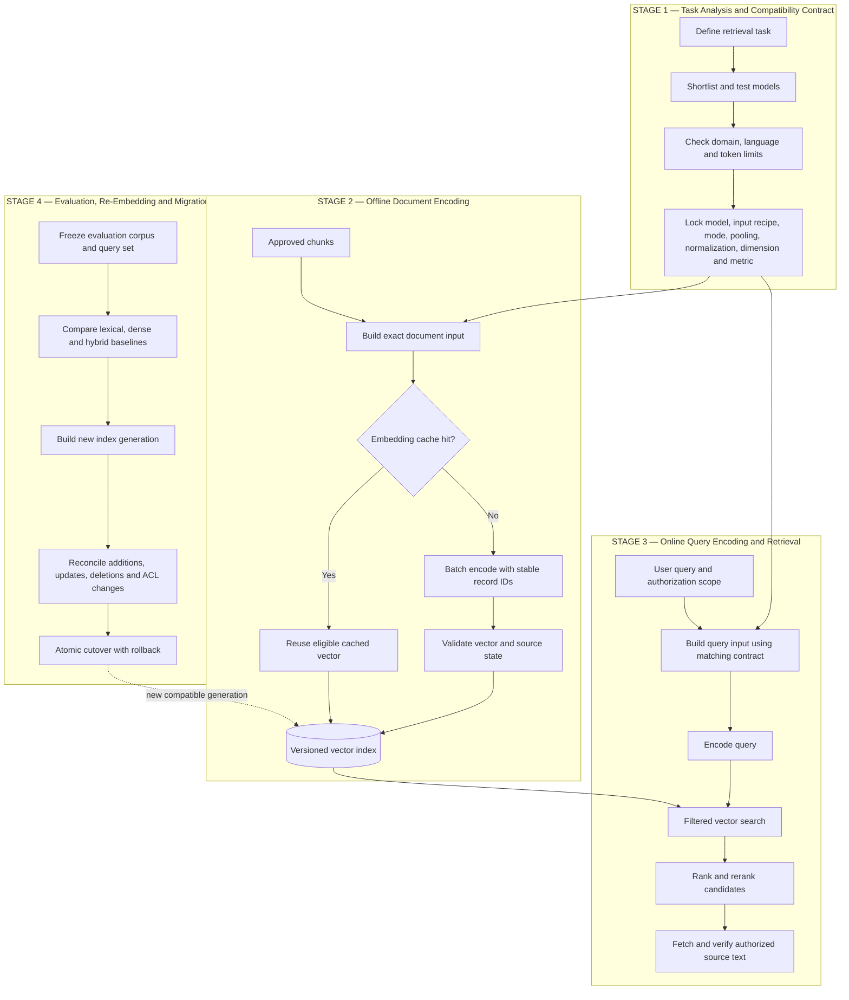
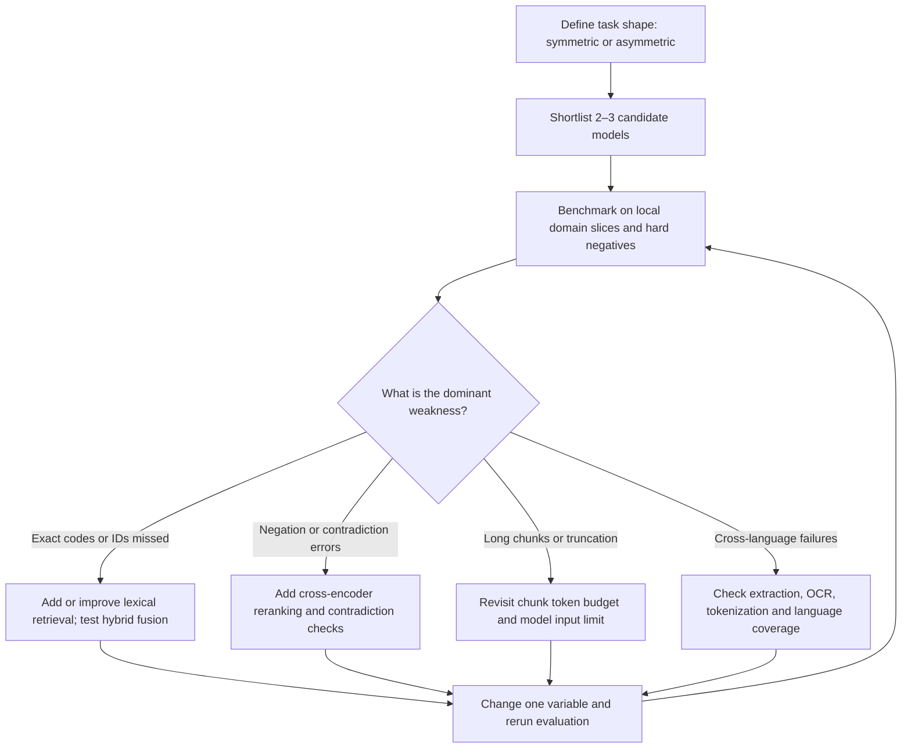
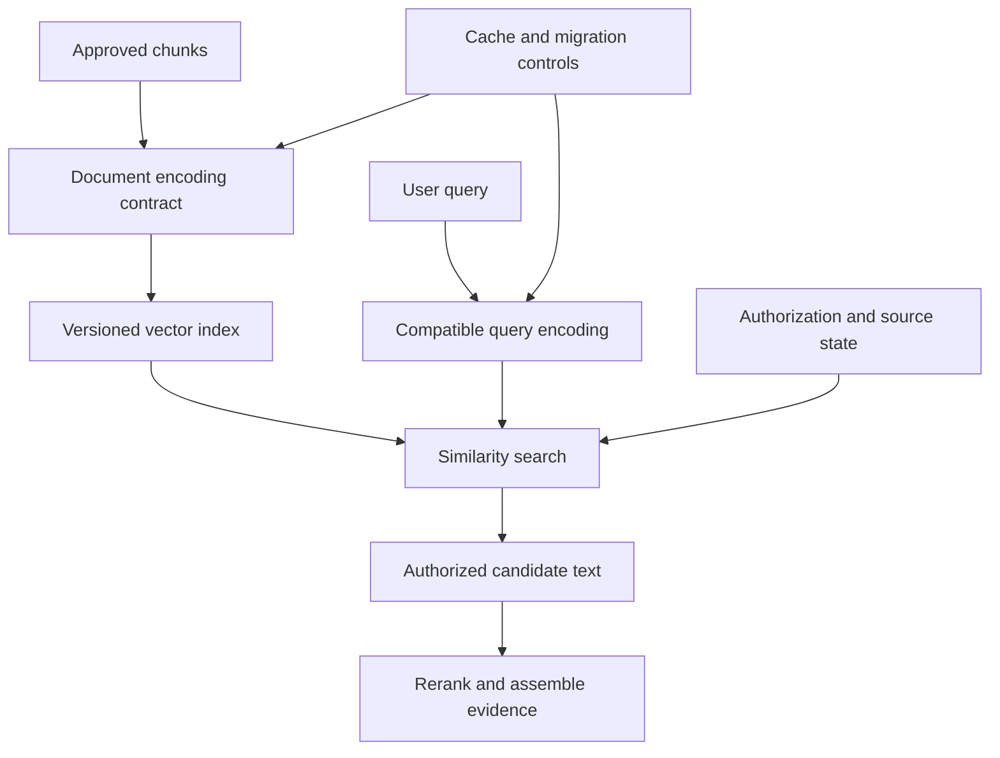

# M06.1.3 — Embeddings
## Full Reorganized Study Guide

---

## Table of Contents

- [Part 0 — Document Metadata & Orientation](#part-0-document-metadata-orientation)
    - [0.1 Path, Depth & Prerequisites](#01-path-depth-prerequisites)
    - [0.2 Purpose & Completion Evidence](#02-purpose-completion-evidence)
    - [0.3 Memory Aid](#03-memory-aid)
    - [0.4 How This Guide Is Organized](#04-how-this-guide-is-organized)
- [Part 1 — Core Concepts & Boundaries](#part-1-core-concepts-boundaries)
  - [1.1 Core Idea: What Is an Embedding?](#11-core-idea-what-is-an-embedding)
    - [1.1.1 Definition & Notation](#111-definition-notation)
    - [1.1.2 Why Embeddings Are Useful](#112-why-embeddings-are-useful)
    - [1.1.3 Conceptual Example (Toy Vectors)](#113-conceptual-example-toy-vectors)
    - [1.1.4 Embeddings Are Not an Answer Database](#114-embeddings-are-not-an-answer-database)
    - [1.1.5 Embeddings Are Not Anonymized](#115-embeddings-are-not-anonymized)
    - [1.1.6 Research Roots (Bi-encoder vs Cross-encoder)](#116-research-roots-bi-encoder-vs-cross-encoder)
    - [1.1.7 Key Takeaway](#117-key-takeaway)
  - [1.2 The Three Boundaries to Keep Clear](#12-the-three-boundaries-to-keep-clear)
    - [1.2.1 Similarity ≠ Relevance](#121-similarity-relevance)
    - [1.2.2 Score ≠ Probability](#122-score-probability)
    - [1.2.3 Vector ≠ Source of Truth or Security Boundary](#123-vector-source-of-truth-or-security-boundary)
  - [1.3 Dense vs Sparse Representations](#13-dense-vs-sparse-representations)
    - [1.3.1 Dense Representations](#131-dense-representations)
    - [1.3.2 Traditional Sparse (BM25 / TF-IDF)](#132-traditional-sparse-bm25-tf-idf)
    - [1.3.3 Learned Sparse](#133-learned-sparse)
    - [1.3.4 Hybrid Retrieval](#134-hybrid-retrieval)
    - [1.3.5 Comparison Table](#135-comparison-table)
  - [1.4 Similarity, Relevance & Scores](#14-similarity-relevance-scores)
    - [1.4.1 What Similarity Means](#141-what-similarity-means)
    - [1.4.2 Similarity vs Relevance](#142-similarity-vs-relevance)
    - [1.4.3 Scores Are Not Probabilities](#143-scores-are-not-probabilities)
- [Part 2 — End-to-End Embedding Lifecycle](#part-2-end-to-end-embedding-lifecycle)
  - [2.1 Lifecycle Overview (Flowchart)](#21-lifecycle-overview-flowchart)
  - [2.2 Important Distinction: Stage 2 vs Stage 3 vs Cache Layers](#22-important-distinction-stage-2-vs-stage-3-vs-cache-layers)
  - [2.3 Lifecycle Stage Cards](#23-lifecycle-stage-cards)
    - [2.3.1 Stage 0 — Foundations](#231-stage-0-foundations)
    - [2.3.2 Stage 1 — Task Analysis, Model Selection and Compatibility Contract](#232-stage-1-task-analysis-model-selection-and-compatibility-contract)
    - [2.3.3 Stage 2 — Offline Document Encoding, Caching and Validation](#233-stage-2-offline-document-encoding-caching-and-validation)
    - [2.3.4 Stage 3 — Online Query Encoding and Comparison](#234-stage-3-online-query-encoding-and-comparison)
    - [2.3.5 Stage 4 — Evaluation, Re-Embedding and Migration](#235-stage-4-evaluation-re-embedding-and-migration)
  - [2.4 Stage Handoffs Table](#24-stage-handoffs-table)
  - [2.5 Cross-Cutting Controls](#25-cross-cutting-controls)
    - [2.5.1 Identity & Versioning](#251-identity-versioning)
    - [2.5.2 Permissions (Security)](#252-permissions-security)
    - [2.5.3 Contract Integrity (Rules)](#253-contract-integrity-rules)
    - [2.5.4 Cost & Performance](#254-cost-performance)
    - [2.5.5 The 5 Failure Classes](#255-the-5-failure-classes)
  - [2.6 Model Selection Decision Flow (Flowchart)](#26-model-selection-decision-flow-flowchart)
  - [2.7 Failure-to-Stage Diagnostic Table](#27-failure-to-stage-diagnostic-table)
    - [2.7.1 Search Quality & Ranking Issues](#271-search-quality-ranking-issues)
    - [2.7.2 System & Configuration Errors](#272-system-configuration-errors)
    - [2.7.3 Security & Permissions](#273-security-permissions)
    - [2.7.4 Migrations & Updates](#274-migrations-updates)
- [Part 3 — Mathematical Foundations](#part-3-mathematical-foundations)
  - [3.1 Cosine Similarity](#31-cosine-similarity)
    - [3.1.1 Definition & Formula](#311-definition-formula)
    - [3.1.2 Worked Calculation](#312-worked-calculation)
    - [3.1.3 Zero Vectors](#313-zero-vectors)
    - [3.1.4 L2 Normalization](#314-l2-normalization)
    - [3.1.5 Key Takeaway](#315-key-takeaway)
  - [3.2 Dot Product](#32-dot-product)
    - [3.2.1 Definition](#321-definition)
    - [3.2.2 Worked Comparison](#322-worked-comparison)
    - [3.2.3 Magnitude Matters](#323-magnitude-matters)
  - [3.3 Euclidean Distance](#33-euclidean-distance)
    - [3.3.1 Definition](#331-definition)
    - [3.3.2 Worked Comparison](#332-worked-comparison)
    - [3.3.3 Sorting Direction Warning](#333-sorting-direction-warning)
  - [3.4 Equivalence for Unit Vectors](#34-equivalence-for-unit-vectors)
  - [3.5 Runnable Python Example](#35-runnable-python-example)
  - [3.6 Safe Math Rules](#36-safe-math-rules)
- [Part 4 — Dimensionality & Storage](#part-4-dimensionality-storage)
  - [4.1 What Is a Dimension?](#41-what-is-a-dimension)
  - [4.2 Matching Shapes ≠ Matching Meaning](#42-matching-shapes-matching-meaning)
  - [4.3 Storage Calculation (Formula & Example)](#43-storage-calculation-formula-example)
  - [4.4 Larger Isn't Always Better](#44-larger-isnt-always-better)
  - [4.5 Reducing Dimensions Safely](#45-reducing-dimensions-safely)
- [Part 5 — Model Selection](#part-5-model-selection)
  - [5.1 Start with the Retrieval Task](#51-start-with-the-retrieval-task)
    - [5.1.1 Symmetric vs Asymmetric Retrieval](#511-symmetric-vs-asymmetric-retrieval)
  - [5.2 Selection Dimensions (Table)](#52-selection-dimensions-table)
  - [5.3 Domain Fit](#53-domain-fit)
  - [5.4 Language & Text Quality](#54-language-text-quality)
  - [5.5 Benchmarks (MTEB, BEIR)](#55-benchmarks-mteb-beir)
  - [5.6 Hard Negatives](#56-hard-negatives)
  - [5.7 Key Takeaway](#57-key-takeaway)
- [Part 6 — Query–Document Compatibility](#part-6-querydocument-compatibility)
  - [6.1 The Compatibility Contract](#61-the-compatibility-contract)
  - [6.2 Prefixes and Task Modes](#62-prefixes-and-task-modes)
  - [6.3 The Silent Failure (Model Mismatch)](#63-the-silent-failure-model-mismatch)
  - [6.4 Text Assembly Rules](#64-text-assembly-rules)
  - [6.5 Permission Is Separate](#65-permission-is-separate)
- [Part 7 — Batch Generation & Validation](#part-7-batch-generation-validation)
  - [7.1 Batching Fundamentals](#71-batching-fundamentals)
  - [7.2 Offline vs Online Work](#72-offline-vs-online-work)
  - [7.3 Preserve Input–Output Identity (The ID Mapping Trap)](#73-preserve-inputoutput-identity-the-id-mapping-trap)
  - [7.4 The 7-Point Validation Firewall](#74-the-7-point-validation-firewall)
  - [7.5 Handling Partial Failures & Retries](#75-handling-partial-failures-retries)
- [Part 8 — Embedding Caching](#part-8-embedding-caching)
  - [8.1 Definition & Core Concept](#81-definition-core-concept)
  - [8.2 The Cache Key](#82-the-cache-key)
  - [8.3 Why Text Alone Is Insufficient](#83-why-text-alone-is-insufficient)
  - [8.4 Tenant-Safe Cache Design](#84-tenant-safe-cache-design)
    - [8.4.1 Compound Cache Keys](#841-compound-cache-keys)
    - [8.4.2 Namespace Segregation](#842-namespace-segregation)
    - [8.4.3 Verify After Hit](#843-verify-after-hit)
    - [8.4.4 Prevent Timing Side-Channels](#844-prevent-timing-side-channels)
  - [8.5 Cache Invalidation](#85-cache-invalidation)
    - [8.5.1 Versioned Keys (Lazy Eviction)](#851-versioned-keys-lazy-eviction)
    - [8.5.2 Tag-Based Purging (Redis Sets + Lua)](#852-tag-based-purging-redis-sets-lua)
    - [8.5.3 Hierarchical Cascading](#853-hierarchical-cascading)
    - [8.5.4 Hard TTL](#854-hard-ttl)
  - [8.6 Query Privacy](#86-query-privacy)
- [Part 9 — Re-Embedding & Migration](#part-9-re-embedding-migration)
  - [9.1 When to Re-Embed (Trigger Table)](#91-when-to-re-embed-trigger-table)
  - [9.2 Safe Migration Pattern](#92-safe-migration-pattern)
  - [9.3 Updates During Migration](#93-updates-during-migration)
  - [9.4 Re-Embedding Strategy](#94-re-embedding-strategy)
  - [9.5 The Resurrection Trap (Zombie Documents)](#95-the-resurrection-trap-zombie-documents)
  - [9.6 Key Takeaway](#96-key-takeaway)
- [Part 10 — Worked Example & Project Exercise (M-104)](#part-10-worked-example-project-exercise-m-104)
  - [10.1 Scenario](#101-scenario)
  - [10.2 Step 1 — Define Evidence Labels](#102-step-1-define-evidence-labels)
  - [10.3 Step 2 — Freeze Corpus & Chunking](#103-step-2-freeze-corpus-chunking)
  - [10.4 Step 3 — Establish Baselines](#104-step-3-establish-baselines)
  - [10.5 Step 4 — Add Main-Pipeline Reranker](#105-step-4-add-main-pipeline-reranker)
  - [10.6 Step 5 — Test Lifecycle Correctness](#106-step-5-test-lifecycle-correctness)
  - [10.7 Acceptance Evidence](#107-acceptance-evidence)
  - [10.8 L3 Depth Requirements](#108-l3-depth-requirements)
- [Part 11 — Concept Map & Revision](#part-11-concept-map-revision)
  - [11.1 Overall Concept Map (Flowchart)](#111-overall-concept-map-flowchart)
  - [11.2 Glossary (14 Terms)](#112-glossary-14-terms)
  - [11.3 Revision Sheet (10 Rules)](#113-revision-sheet-10-rules)
  - [11.4 Memory Aid](#114-memory-aid)
- [Part 12 — Practice & Interview Questions](#part-12-practice-interview-questions)
  - [12.1 Question-and-Answer Recall (Q1–Q10)](#121-question-and-answer-recall-q1q10)
  - [12.2 Multiple-Choice Questions](#122-multiple-choice-questions)
    - [12.2.1 Easy (Q11–Q12)](#1221-easy-q11q12)
    - [12.2.2 Medium (Q13–Q14)](#1222-medium-q13q14)
    - [12.2.3 Hard — Scenario Based (Q15–Q17)](#1223-hard-scenario-based-q15q17)
  - [12.3 Interview Questions with Model Answers](#123-interview-questions-with-model-answers)
    - [12.3.1 Easy (Q18–Q19)](#1231-easy-q18q19)
    - [12.3.2 Medium (Q20–Q21)](#1232-medium-q20q21)
    - [12.3.3 Hard — Scenario Based (Q22–Q23)](#1233-hard-scenario-based-q22q23)
  - [12.4 Extended Section-Wise Question Bank *(added)*](#124-extended-section-wise-question-bank-added)
    - [12.4.1 Part 1 — Core Concepts & Boundaries](#1241-part-1-core-concepts-boundaries)
    - [12.4.2 Part 2 — Lifecycle](#1242-part-2-lifecycle)
    - [12.4.3 Part 3 — Mathematical Foundations](#1243-part-3-mathematical-foundations)
    - [12.4.4 Part 4 — Dimensionality & Storage](#1244-part-4-dimensionality-storage)
    - [12.4.5 Part 5 — Model Selection](#1245-part-5-model-selection)
    - [12.4.6 Part 6 — Compatibility](#1246-part-6-compatibility)
    - [12.4.7 Part 7 — Batch Generation & Validation](#1247-part-7-batch-generation-validation)
    - [12.4.8 Part 8 — Embedding Caching](#1248-part-8-embedding-caching)
    - [12.4.9 Part 9 — Re-Embedding & Migration](#1249-part-9-re-embedding-migration)
    - [12.4.10 Part 10 — Worked Example (M-104)](#12410-part-10-worked-example-m-104)
- [Part 13 — Senior & Staff-Level Production Scenarios](#part-13-senior-staff-level-production-scenarios)
  - [13.1 Scenario 1 — False Answer Despite Strong Retrieval Scores *(Stage 0 / Stage 3)*](#131-scenario-1-false-answer-despite-strong-retrieval-scores-stage-0-stage-3)
  - [13.2 Scenario 2 — Fast & Accurate Modes Share One Index *(Stage 1 / Stage 3)*](#132-scenario-2-fast-accurate-modes-share-one-index-stage-1-stage-3)
  - [13.3 Scenario 3 — Zero-Vector Rejects from Page Footers *(Chunking / Stage 2)*](#133-scenario-3-zero-vector-rejects-from-page-footers-chunking-stage-2)
  - [13.4 Scenario 4 — One Confidence Threshold Across Three Pipelines *(Stage 3)*](#134-scenario-4-one-confidence-threshold-across-three-pipelines-stage-3)
  - [13.5 Scenario 5 — Reconciliation Finds Body & ACL Changes *(Stage 4)*](#135-scenario-5-reconciliation-finds-body-acl-changes-stage-4)
  - [13.6 Scenario 6 — Latency Spike, Shifted Scores & Access Complaints *(Staff-level, cross-lifecycle)*](#136-scenario-6-latency-spike-shifted-scores-access-complaints-staff-level-cross-lifecycle)
  - [13.7 Additional Real-World Scenario *(added)*](#137-additional-real-world-scenario-added)
- [Part 14 — References & Advanced Topics](#part-14-references-advanced-topics)
  - [14.1 Sources & Further Reading](#141-sources-further-reading)
  - [14.2 Advanced Topics Not Covered in Depth](#142-advanced-topics-not-covered-in-depth)
    - [14.2.1 Vector Quantization (int8 / binary)](#1421-vector-quantization-int8-binary)
    - [14.2.2 Matryoshka Representation Learning](#1422-matryoshka-representation-learning)
    - [14.2.3 Hybrid Fusion Mechanics (RRF)](#1423-hybrid-fusion-mechanics-rrf)
    - [14.2.4 Complete End-to-End Trace](#1424-complete-end-to-end-trace)
  - [Diagnostic Table Sub-Categorization *(reference)*](#diagnostic-table-sub-categorization-reference)
  - [Cross-Reference: Lifecycle Stage → Parts *(reference)*](#cross-reference-lifecycle-stage-parts-reference)

---

# Part 0 — Document Metadata & Orientation

### 0.1 Path, Depth & Prerequisites

- **Path:** Core
- **Depth:** L2 foundation; L3 through demonstrated project work
- **Prerequisites:** M03, M05 and M07; ingestion and chunking from M06.1.1–M06.1.2

### 0.2 Purpose & Completion Evidence

**Purpose:** Understand dense representations and build a reproducible embedding pipeline for retrieval.

**Completion evidence:** Explain similarity calculations, compare embedding models on a fixed retrieval dataset, and demonstrate safe caching, versioning and re-embedding.

### 0.3 Memory Aid

> **Same contract, valid vectors, measured retrieval, traceable updates.**

### 0.4 How This Guide Is Organized

This guide follows the sequence: **Foundation → Lifecycle → Math → Engineering → Evaluation → Scenarios → References.** Each part builds on the one before it — foundational boundaries first, then the end-to-end lifecycle architecture, then the mathematics that power comparison, then the engineering details (model choice, compatibility, batching, caching, migration), then a worked exercise, then revision aids, then practice questions, then senior-level production scenarios, then references.

**Section-to-Source Mapping**

| Part | Content Source | Notes |
|---|---|---|
| Part 0 | Full notes header + Short notes header | Orientation info |
| Part 1 | Full notes §1, §2; Short notes §1–2 | Core concepts + dense/sparse |
| Part 2 | Full notes Lifecycle → Diagnostic; Short notes Lifecycle → Diagnostic | Architecture + diagnostics |
| Part 3 | Full notes §3–4; Short notes §3–4 | Math formulas + code |
| Part 4 | Full notes §5; Short notes §5 | Storage math |
| Part 5 | Full notes §6; Short notes §6 | Model selection |
| Part 6 | Full notes §7; Short notes §7 | Compatibility contract |
| Part 7 | Full notes §8; Short notes §8 | Batch + validation |
| Part 8 | Full notes §9; Short notes §9 | Caching (incl. Redis tag pattern) |
| Part 9 | Full notes §10; Short notes §10 | Migration |
| Part 10 | Full notes §11; Short notes §11 | M-104 exercise |
| Part 11 | Full notes §12–13; Short notes §12–13 | Concept map + glossary |
| Part 12 | Full notes §14 (expanded) | Q&A, MCQs, interviews |
| Part 13 | Full notes §15; Short notes §15 | Production scenarios |
| Part 14 | Full notes §16 + Advanced Topics | References + extensions |

---

# Part 1 — Core Concepts & Boundaries

## 1.1 Core Idea: What Is an Embedding?

### 1.1.1 Definition & Notation

An **embedding** represents an item as a vector: an ordered list of numbers. For text retrieval, an embedding model maps a query or document passage into a representation that can be compared with other compatible representations.

A simplified notation is:

\[
f(\text{text}) = [x_1,x_2,\ldots,x_d] \in \mathbb{R}^{d}.
\]

Here, \(d\) is the dimensionality. Real models can use different functions or modes for queries and documents.

An embedding is a learned numeric representation of an item such as a word, sentence or passage. A dense embedding maps text to a fixed-dimensional vector. Retrieval systems may also use sparse representations or combine sparse and dense retrieval — these are complementary representation and ranking approaches, not simply successive generations of search technology.

### 1.1.2 Why Embeddings Are Useful

A keyword search depends strongly on matching indexed terms. A query about "reducing equipment downtime" may be relevant to a passage about "preventive maintenance improving availability," even when exact wording differs. A retrieval-trained embedding model may place these texts near each other.

The word "may" matters. Embeddings are learned representations, not guaranteed semantic truth. They can miss specialized meanings, confuse near-identical identifiers, and rank a contradictory sentence as similar because it discusses the same subject.

Think of a dense semantic space like a city's map: texts with related meanings may occupy nearby regions even when they use different wording. For example, "Inspect Unit A's indicator" and "Check the indicator on Unit A" may be represented as similar.

### 1.1.3 Conceptual Example (Toy Vectors)

The following vectors are invented to illustrate the idea:

| Text | Toy vector |
|---|---|
| "Inspect Unit A's indicator" | `[0.8, 0.6]` |
| "Check the indicator on Unit A" | `[0.79, 0.61]` |
| "Download the invoice" | `[-0.4, 0.9]` |

These numbers were not produced by a model, and the coordinates do not correspond to named concepts. They simply let us reason about similarity mathematically.

### 1.1.4 Embeddings Are Not an Answer Database

An embedding normally does not store a human-readable answer. A retrieval system uses it to select candidate source passages, then fetches the text and provenance. The source remains necessary for citations, verification, permissions and updates.

### 1.1.5 Embeddings Are Not Anonymized

Embeddings should not be treated as anonymized or harmless merely because they are numeric. They are derived from source content and should inherit its handling and access requirements. A vector is an index representation, not the source of truth or a security boundary. Keep the original source and provenance for verification, citations, updates and permissions — numeric transformation does not remove the source's confidentiality or access requirements.

### 1.1.6 Research Roots (Bi-encoder vs Cross-encoder)

Sentence-BERT introduced a sentence-embedding approach designed to support efficient comparison of sentence representations, while Dense Passage Retrieval used a dual-encoder framework for question-to-passage retrieval. Both illustrate the **bi-encoder** pattern: query and document representations can be computed separately and compared efficiently. A **cross-encoder** is the contrasting pattern that processes a query-passage pair jointly to produce a pair-specific score. Benchmark results should not be assumed to transfer unchanged to a new organization's corpus. [Sources: Sentence-BERT](https://arxiv.org/abs/1908.10084), [Dense Passage Retrieval](https://arxiv.org/abs/2004.04906)

### 1.1.7 Key Takeaway

> **Embeddings make similarity searchable. They do not establish correctness, authority or permission.**

---

## 1.2 The Three Boundaries to Keep Clear

Engineers must keep three boundaries clear:

### 1.2.1 Similarity ≠ Relevance

"Start Unit A" and "Do NOT start Unit A" share topic and vocabulary. A dense model may rank them close even though their operational meanings conflict. Retrieval needs suitable reranking, evidence checks and contradiction handling where the task requires it.

### 1.2.2 Score ≠ Probability

A score of `0.82` does not mean that the answer is 82% true or 82% relevant. Its interpretation depends on the model, metric, corpus and task.

### 1.2.3 Vector ≠ Source of Truth or Security Boundary

A vector is an index representation, not the source of truth or a security boundary. Keep the original source and provenance for verification, citations, updates and permissions. Numeric transformation does not remove the source's confidentiality or access requirements.

---

## 1.3 Dense vs Sparse Representations

**Syllabus coverage: M06.1.3.1 — Representation fundamentals.**

An embedding model can produce a **dense vector**, but dense vectors are not the only way to represent text for retrieval. Dense and sparse describe the structure of a representation, not a simple old-versus-new technology split.

### 1.3.1 Dense Representations

Dense representations use a fixed number of learned coordinates, with many coordinates usually nonzero. Their features are distributed across the vector rather than corresponding one-to-one with human-readable words. Retrieval-trained dense models can capture useful semantic relationships and paraphrases, but they do not guarantee that two passages are relevant or that their operational meanings agree.

### 1.3.2 Traditional Sparse (BM25 / TF-IDF)

Traditional sparse lexical representations use a large vocabulary-related coordinate space, with most coordinates zero for any one document. Methods such as TF-IDF and BM25 give weight to terms that occur in the query and document. Tokenization, normalization, stemming, synonyms or query expansion can improve matching, but a purely term-driven setup may miss a paraphrase when the query and document use different terms.

### 1.3.3 Learned Sparse

Learned sparse representations remain sparse, but a model learns which terms or vocabulary dimensions to activate and how strongly to weight them. Some approaches can expand beyond the exact words in the source, so sparse retrieval is not always limited to literal keyword overlap.

### 1.3.4 Hybrid Retrieval

Hybrid retrieval combines complementary signals, commonly dense semantic matching with sparse lexical matching. This can help when a corpus needs both paraphrase recall and precise matching for codes, names or identifiers. The benefit must be measured on the target corpus.

### 1.3.5 Comparison Table

| Property | Dense representation | Traditional sparse lexical representation | Learned sparse representation |
|---|---|---|---|
| Coordinates | Fixed-size learned features | Vocabulary-related terms | Learned term or vocabulary features |
| Typical nonzero pattern | Many coordinates active | Small subset active | Small subset active |
| Useful strength | Semantic and paraphrase matching | Exact terms, names and identifiers | Learned lexical matching and, in some systems, semantic term expansion |
| Common comparison | Cosine, dot product or distance | Term-weighted scoring such as BM25 | Sparse scoring using learned weights |
| Important risk | Similar topic mistaken for relevant or correct evidence | A paraphrase may be missed when wording differs | Quality depends on the learned expansion, vocabulary and task |

These are broad characteristics, not universal performance guarantees. A sparse method can be learned, and a dense method can still fail on domain-specific terminology. Choose based on measured retrieval behavior rather than the label alone.

---

## 1.4 Similarity, Relevance & Scores

### 1.4.1 What Similarity Means

Similarity is defined by the model's training and the comparison function. Two texts can be similar because they are paraphrases, answer the same question, discuss the same topic or share some other learned relationship.

Consider:

- "Unit A may be operated while indicator X is red."
- "Unit A must not be operated while indicator X is red."

They share nearly all their words and topic. A similarity model may rank them close even though their operational meanings conflict. Retrieval must therefore be followed by evidence interpretation and, where appropriate, contradiction checks.

### 1.4.2 Similarity vs Relevance

**Similarity** is a property of representations under a chosen metric. **Relevance** is whether a source helps satisfy a specific information need.

A historical manual can be highly similar to a current-procedure question but irrelevant under a current-version requirement. A confidential answer can be semantically relevant but unauthorized. Filters, authority rules and reranking address requirements that vector proximity alone cannot enforce.

### 1.4.3 Scores Are Not Probabilities

A cosine score of 0.82 does not mean "82% probability that this passage answers the question." Its meaning depends on the model, corpus, query distribution and preprocessing.

Thresholds should be calibrated on labeled examples for a defined task. Reusing the same threshold after changing the model is an untested assumption, even when both models use cosine similarity.

---

# Part 2 — End-to-End Embedding Lifecycle

Embeddings involve two connected paths: **offline document indexing** and **online query retrieval**. A migration or evaluation cycle maintains the compatibility between them.

## 2.1 Lifecycle Overview (Flowchart)



## 2.2 Important Distinction: Stage 2 vs Stage 3 vs Cache Layers

Stage 2 is primarily the offline document-embedding path. Stage 3 is the online query path. An embedding cache can be used in either path, but a cache of retrieved results or generated answers is a different cache layer and has separate invalidation and authorization concerns.

## 2.3 Lifecycle Stage Cards

### 2.3.1 Stage 0 — Foundations

- **Purpose:** Establish what embeddings can and cannot tell the system before choosing a model.
- **Key ideas:** Dense versus sparse representations; similarity versus relevance; scores versus probabilities; vectors as pointers to source evidence rather than replacements for it; permissions remain external controls.
- **Typical failure modes:** Treating a high score as proof; deleting source text after vectorization; assuming a numeric vector is anonymous; relying on a model to obey an embedded `[CONFIDENTIAL]` label.

### 2.3.2 Stage 1 — Task Analysis, Model Selection and Compatibility Contract

- **Purpose:** Choose a suitable model and define the complete representation contract before encoding.
- **Key decisions:** Symmetric versus asymmetric retrieval; domain and language fit; input token limit; pinned model revision; query/document prefixes; exact text-assembly recipe; tokenizer and truncation policy; pooling, normalization, output dimension and metric; deployment boundary, throughput and cost.
- **Typical failure modes:** Replacing a model with another same-dimensional but incompatible model; silently changing title/body assembly; truncating long inputs; slicing dimensions without model support; choosing by leaderboard score without local testing.

### 2.3.3 Stage 2 — Offline Document Encoding, Caching and Validation

- **Purpose:** Convert approved chunks into vectors efficiently without corrupting identity, scope or source state.
- **Key decisions:** Batch by both token budget and item count; map each result to its stable input ID; define the cache key from every representation-affecting setting; make writes idempotent; distinguish retryable from permanent input errors.
- **Seven-point validation firewall:** (1) output is associated with the correct input ID; (2) expected result count is present; (3) dimension matches the index schema; (4) all coordinates are finite; (5) norm is valid for the chosen metric; (6) model/configuration identity is recorded; and (7) source remains active and eligible for publication.
- **Typical failure modes:** Async ID misalignment; cross-tenant cache leakage; retries that duplicate successful writes; an invalid chunk poisoning a whole batch; stale vectors after the text recipe changes.

### 2.3.4 Stage 3 — Online Query Encoding and Comparison

- **Purpose:** Encode the query under a compatible contract and retrieve candidates using the configured comparison method.
- **Key decisions:** Use the correct query mode or prefix; ensure query/document preprocessing and normalization are compatible; confirm whether the index returns a similarity or a distance; enforce tenant, ACL, source-version and status constraints as part of retrieval before unauthorized source text is exposed; pass candidates to reranking and evidence verification.
- **Metrics:** Cosine similarity compares direction; raw dot product includes magnitude; Euclidean distance measures straight-line separation. For the same unit-normalized vectors, the three induce the same exact ranking.
- **Typical failure modes:** Sorting distance in descending order; comparing incompatible encoders; zero-vector/NaN results; applying an uncalibrated universal threshold; allowing a semantically similar but unauthorized or obsolete source into the answer context.

### 2.3.5 Stage 4 — Evaluation, Re-Embedding and Migration

- **Purpose:** Keep retrieval quality, index currency and query/index compatibility intact as data or models change.
- **Key decisions:** Freeze corpus, chunking, reranker and query set during model comparisons; re-embed when the embedded input or representation contract changes; update metadata when only control fields such as ACLs change; reconcile source updates and deletions during migration.
- **Four-step migration:** Build a new generation from a checkpoint → evaluate it → reconcile changes that occurred during the build (including deletions and ACL changes) → atomically switch the query encoder and index together, with rollback ready.
- **Typical failure modes:** Confounded benchmarks; resurrected "zombie" documents from stale snapshots; mixed old/new vector spaces during rolling deployment; body updates treated as metadata-only changes.

## 2.4 Stage Handoffs Table

| From | To | What is handed over | Typical break |
|---|---|---|---|
| Chunking (M06.1.2) | Stage 1 | Approved chunk text, source ID and source span | Unstable boundaries or inconsistent chunk text |
| Stage 1 | Stage 2 | Versioned compatibility contract and exact input recipe | Contract is not stored or checked |
| Stage 2 | Vector index | Validated vector, record ID, source version and config ID | Wrong ID association or failed validation |
| Vector index | Stage 3 | Eligible vectors and filterable control metadata | ACL or version constraint is missing or stale |
| Stage 3 | Reranker / answer assembly | Ranked candidate IDs and source references | Similarity is mistaken for relevance or proof |
| Stage 4 evaluation | Stage 1 | Comparative evidence about model/task fit | Benchmark changes multiple variables at once |
| Stage 4 migration | Next index generation | Reconciled, compatible new generation | Mid-migration changes are not replayed |

## 2.5 Cross-Cutting Controls

| Concern | Stage 1 | Stage 2 | Stage 3 | Stage 4 |
|---|---|---|---|---|
| Identity and versioning | Pin model and recipe | Store config ID with cache and vector | Assert query/index compatibility | Track generation and source checkpoints |
| Permissions | Define tenant and source scope | Recheck source eligibility; scope private caches | Enforce current ACL and status filters | Replay ACL changes and deletions |
| Contract integrity | Define all representation settings | Include them in cache identity and writes | Use compatible query encoding | Cut over encoder and index as a pair |
| Cost and performance | Estimate storage and serving constraints | Batch by tokens and items | Protect query latency | Measure re-embedding and migration cost |

### 2.5.1 Identity & Versioning
See row above — pin model/recipe (Stage 1), store config ID (Stage 2), assert compatibility (Stage 3), track generations (Stage 4).

### 2.5.2 Permissions (Security)
See row above — define scope (Stage 1), recheck eligibility (Stage 2), enforce current filters (Stage 3), replay ACL/deletions (Stage 4).

### 2.5.3 Contract Integrity (Rules)
See row above — define settings (Stage 1), include in cache/writes (Stage 2), compatible encoding (Stage 3), cut over as a pair (Stage 4).

### 2.5.4 Cost & Performance
See row above — estimate constraints (Stage 1), batch efficiently (Stage 2), protect latency (Stage 3), measure migration cost (Stage 4).

### 2.5.5 The 5 Failure Classes

Keep these failure classes distinct:

- **Compatibility failure:** Query and document vectors no longer belong to compatible spaces.
- **Relevance failure:** Similarity is high, but the passage does not answer the question or conflicts with it.
- **Authorization failure:** A relevant passage is returned to a user who is not permitted to see it.
- **Currency failure:** A deleted, superseded or updated source is represented incorrectly in the active index.
- **Cache isolation failure:** A cache key or cache interface crosses a tenant or privacy boundary.

## 2.6 Model Selection Decision Flow (Flowchart)



Use benchmark leaderboards to shortlist candidates, not to declare a universal winner. Change one variable at a time — model, chunking, reranker or index configuration — so the result has an interpretable cause.

## 2.7 Failure-to-Stage Diagnostic Table

### 2.7.1 Search Quality & Ranking Issues

| Symptom | Likely stage | First check |
|---|---|---|
| High score but wrong or opposite meaning | Stage 0 / Stage 3 | Is the system confusing similarity with relevance? Is reranking or contradiction checking required? |
| Queries about the end of long chunks fail | Stage 1 / chunking | Are inputs being truncated at the model's token limit? |
| Results appear shuffled or unrelated | Stage 2 | Are vectors mapped by stable record ID rather than async completion order? |
| Results rank backwards after a metric change | Stage 3 | Is distance sorted ascending and similarity sorted descending? |
| Similarity thresholds behave inconsistently | Stage 3 | Did model, query/document normalization or metric change? Is the threshold calibrated for this task? |
| Zero vectors cluster around boilerplate chunks | Chunking / Stage 2 | Are low-information headers and footers being filtered upstream? |

### 2.7.2 System & Configuration Errors

| Symptom | Likely stage | First check |
|---|---|---|
| Retrieval breaks after a model swap but returns no errors | Stage 1 / Stage 3 | Does the query service assert the index's embedding configuration ID? |
| Incremental updates rank differently from bulk ingestion | Stage 1 / Stage 2 | Is the title, section path and body assembled identically? |
| NaN or invalid values appear near the top of results | Stage 2 / Stage 3 | Are non-finite and zero-norm vectors rejected before indexing? |
| Cache hit rate drops sharply without an application deploy | Stage 1 / Stage 2 | Did input text, model revision, tokenizer, preprocessing, cache scope or TTL change? |

### 2.7.3 Security & Permissions

| Symptom | Likely stage | First check |
|---|---|---|
| Cache hits reveal another tenant's private content or existence | Stage 2 | Is tenant or approved sharing scope part of the cache key and access path? |
| Revoked ACL access still returns content | Stage 2 / Stage 3 / Stage 4 | Were current policy metadata, filters and affected caches updated? |

### 2.7.4 Migrations & Updates

| Symptom | Likely stage | First check |
|---|---|---|
| A "better model" claim comes from one benchmark run | Stage 4 | Were corpus, chunking, reranker and evaluation set held fixed? |
| A deleted document reappears after migration | Stage 4 | Were deletions replayed and source state reconciled before cutover? |
| Only part of traffic degrades during a deployment | Stage 4 | Are some query encoders being paired with the wrong index generation? |

---

# Part 3 — Mathematical Foundations

## 3.1 Cosine Similarity

### 3.1.1 Definition & Formula

For nonzero vectors \(a\) and \(b\), cosine similarity is:

\[
\operatorname{cos}(a,b)=\frac{a\cdot b}{\|a\|_2\|b\|_2}.
\]

The dot product is:

\[
a\cdot b=\sum_{i=1}^{d}a_i b_i,
\]

and the Euclidean norm is:

\[
\|a\|_2=\sqrt{\sum_{i=1}^{d}a_i^2}.
\]

Cosine compares direction while removing the effect of vector length. Its mathematical range is from -1 to 1, although a particular model's observed scores may occupy a narrower range.

### 3.1.2 Worked Calculation

Let the query vector be \(q=[1,0]\), candidate A be \([0.8,0.6]\), and candidate B be \([0.6,0.8]\).

All three vectors have length 1. Therefore:

\[
\operatorname{cos}(q,A)=0.8,\qquad
\operatorname{cos}(q,B)=0.6.
\]

A ranks above B under cosine similarity.

Now let C be \([8,6]\), which points in the same direction as A but has length 10. Its dot product with q is 8, so:

\[
\operatorname{cos}(q,C)=\frac{8}{1\times10}=0.8.
\]

A and C tie under cosine because scaling a nonzero vector by a positive factor does not change its direction.

### 3.1.3 Zero Vectors

Cosine similarity is undefined for a zero vector because the denominator is zero. An embedding pipeline should reject or explicitly handle zero vectors instead of silently generating `NaN` scores.

A zero vector can indicate a failed transformation or an intentionally defined special case. Whatever the reason, the retrieval system needs a declared policy.

### 3.1.4 L2 Normalization

L2 normalization replaces a nonzero vector \(a\) with:

\[
\hat{a}=\frac{a}{\|a\|_2}.
\]

For normalized vectors, cosine similarity equals their dot product. This equivalence can simplify indexing, but only when both the document and query pipeline use the intended normalization consistently.

Sentence Transformers exposes several similarity choices, including cosine, dot product and distance-based options. The configuration should match how the chosen model is intended to be used. [Source: Sentence Transformers semantic textual similarity](https://www.sbert.net/docs/sentence_transformer/usage/semantic_textual_similarity.html)

### 3.1.5 Key Takeaway

> **Cosine measures direction, not confidence.** Verify nonzero vectors and consistent normalization.

---

## 3.2 Dot Product

### 3.2.1 Definition

The dot product sums coordinate-wise products. It is affected by both direction and magnitude:

\[
a\cdot b=\|a\|_2\|b\|_2\operatorname{cos}(a,b).
\]

### 3.2.2 Worked Comparison

For the previous example:

| Candidate | Vector | Dot product with `[1,0]` |
|---|---|---:|
| A | `[0.8,0.6]` | 0.8 |
| B | `[0.6,0.8]` | 0.6 |
| C | `[8,6]` | 8.0 |

C ranks first under raw dot product, despite having the same direction as A.

### 3.2.3 Magnitude Matters

This is not inherently wrong: some models are trained for inner-product retrieval and may use vector magnitude meaningfully. The error is choosing a comparison function without checking the model's contract.

---

## 3.3 Euclidean Distance

### 3.3.1 Definition

Euclidean distance measures straight-line separation:

\[
\operatorname{dist}(a,b)=\sqrt{\sum_i(a_i-b_i)^2}.
\]

Lower distance means closer vectors.

### 3.3.2 Worked Comparison

For the same query:

- Distance to A is approximately 0.632.
- Distance to B is approximately 0.894.
- Distance to C is approximately 9.220.

A is nearest; C is far away because of its magnitude.

### 3.3.3 Sorting Direction Warning

Some vector systems return squared distance, negative distance or a transformed score. Always check whether larger or smaller values are better before sorting or applying a threshold.

---

## 3.4 Equivalence for Unit Vectors

For normalized vectors:

\[
\|\hat{a}-\hat{b}\|_2^2=2-2(\hat{a}\cdot\hat{b}).
\]

Therefore, maximizing cosine similarity, maximizing dot product and minimizing Euclidean distance give the same exact ranking for the same normalized vectors. Approximate indexes and quantization can still introduce differences in actual retrieved results.

---

## 3.5 Runnable Python Example

This Python uses only the standard library and intentionally works with toy vectors.

```python
from math import fsum, isfinite, sqrt


def cosine(a, b):
    if not a or len(a) != len(b):
        raise ValueError("vectors must have equal, nonzero dimensions")
    if not all(isfinite(x) for x in (*a, *b)):
        raise ValueError("vectors must contain finite values")
    norm_a = sqrt(fsum(x * x for x in a))
    norm_b = sqrt(fsum(x * x for x in b))
    if norm_a == 0 or norm_b == 0:
        raise ValueError("cosine is undefined for zero vectors")
    return fsum(x * y for x, y in zip(a, b)) / (norm_a * norm_b)


query = [1.0, 0.0]
candidates = {
    "A": [0.8, 0.6],
    "B": [0.6, 0.8],
    "C": [8.0, 6.0],
}
ranked = sorted(
    ((name, cosine(query, vector)) for name, vector in candidates.items()),
    key=lambda item: (-item[1], item[0]),
)
for name, score in ranked:
    print(name, round(score, 3))
```

Expected order is A and C tied at 0.8, then B at 0.6; the secondary name ordering makes the tie deterministic.

## 3.6 Safe Math Rules

- Reject zero vectors before computing cosine similarity.
- Always check whether a score is a similarity (maximize) or a distance (minimize) before sorting.
- Only treat cosine, dot product and Euclidean distance as rank-equivalent when vectors are unit-normalized.
- Normalize consistently across both the document and query pipelines, never just one side.
- Treat all coordinates as needing a finite-value check before indexing.

---

# Part 4 — Dimensionality & Storage

## 4.1 What Is a Dimension?

Dimensionality is the number of coordinates in each vector. It is part of the embedding model's output contract and the vector index's schema.

## 4.2 Matching Shapes ≠ Matching Meaning

Two models producing 768 numbers do not necessarily produce compatible spaces. Equal shape only means the vectors fit the same-sized array. It does not mean coordinate 1 or any distance relationship has the same learned meaning.

## 4.3 Storage Calculation (Formula & Example)

Ignoring metadata and index overhead, storage for \(N\) vectors of dimension \(d\) with \(b\) bytes per coordinate is:

\[
\text{bytes}=N\times d\times b.
\]

For one million 768-dimensional float32 vectors:

\[
1{,}000{,}000\times768\times4=3{,}072{,}000{,}000\text{ bytes}.
\]

That is 3.072 GB in decimal units, approximately 2.86 GiB in binary units. The actual database requires additional storage for graph or other index structures, identifiers, metadata, replicas and operational headroom.

## 4.4 Larger Isn't Always Better

A larger vector can represent more information in principle, but retrieval quality depends on training, data, architecture and task fit. A larger model can still perform poorly on specialized abbreviations or a language absent from its effective training distribution.

Evaluate quality per unit of storage, latency and cost. If a smaller representation meets the task's quality requirement, its operational advantages can matter.

## 4.5 Reducing Dimensions Safely

Do not arbitrarily remove coordinates from an embedding and assume quality will be preserved. Some models explicitly support shortened representations or are trained to make prefixes useful; others are not. Projection methods also change the representation and require evaluation and compatible query processing.

Dimension changes normally require a new index schema or collection, depending on the storage system. They should be treated as a migration rather than a casual configuration edit.

---

# Part 5 — Model Selection

**Syllabus coverage: M06.1.3.2 — Embedding engineering.**

## 5.1 Start with the Retrieval Task

Model choice should reflect the actual relationship between query and document. Question-to-passage search, similar-question matching, code search and multilingual retrieval can require different behavior.

### 5.1.1 Symmetric vs Asymmetric Retrieval

Sentence Transformers distinguishes symmetric semantic search, where queries and documents have similar form, from asymmetric search such as short questions matched to longer answer passages. This distinction is useful when choosing a model and evaluation dataset. [Source: Sentence Transformers semantic search](https://www.sbert.net/examples/sentence_transformer/applications/semantic-search/README.html)

## 5.2 Selection Dimensions (Table)

| Dimension | Question to ask |
|---|---|
| Retrieval training | Was the model trained for the relationship this task needs? |
| Domain fit | Does it distinguish the relevant terminology and identifiers? |
| Language fit | Does it support the required query and document languages? |
| Input limit | Can the chosen chunk representation fit without truncation? |
| Output contract | What dimension, metric and normalization are expected? |
| Deployment | Can authorized content be processed in the approved environment? |
| Throughput | Can it keep up with ingestion and query demand? |
| Cost | What is the total cost of initial embedding, queries and updates? |
| Reproducibility | Can the exact model revision and preprocessing be pinned? |

## 5.3 Domain Fit

A general model may recognize "pump" but fail to distinguish several nearly identical model codes. It may interpret "port" as a harbor when the corpus discusses network ports. These are reasons to evaluate domain queries, not automatic reasons to fine-tune.

First compare a lexical baseline, a suitable dense model and hybrid retrieval. If lexical search already finds exact identifiers well, hybrid retrieval may solve the observed problem without retraining the embedding model.

## 5.4 Language & Text Quality

Multilingual support is not a binary property. Evaluate same-language retrieval, cross-language retrieval, mixed-language text, transliterated names and specialized vocabulary separately.

A multilingual model might match an English question to a Hindi passage, but the application also needs appropriate extraction, tokenization, source interpretation and answer-language handling. Better embeddings cannot repair missing OCR content in the target language.

## 5.5 Benchmarks (MTEB, BEIR)

MTEB evaluates embeddings across different task types, while BEIR emphasizes heterogeneous retrieval evaluation. These research benchmarks show why evaluation should cover more than one convenient dataset. A published average is evidence about those benchmark conditions, not a guarantee for a private corpus. [Sources: MTEB](https://arxiv.org/abs/2210.07316), [BEIR](https://arxiv.org/abs/2104.08663)

Use benchmarks to shortlist candidates, then compare them on your own authorized and versioned evaluation set.

## 5.6 Hard Negatives

Include hard negatives: passages about the right equipment but the wrong revision, similar model numbers and opposite conditions.

## 5.7 Key Takeaway

> **Choose the representation using the questions it must answer and the constraints under which it must run.**

---

# Part 6 — Query–Document Compatibility

## 6.1 The Compatibility Contract

Query and document vectors must belong to compatible representation spaces. Compatibility includes:

- Model family and pinned revision.
- Query versus document mode.
- Required instruction or prefix.
- Tokenization and truncation policy.
- Pooling and normalization.
- Output dimensionality.
- Similarity function.

The query and document encoders do not have to be identical networks. They can be separately parameterized encoders trained to work together. What matters is the joint retrieval contract.

## 6.2 Prefixes and Task Modes

Some models require different input prefixes for queries and passages. For example, the model-author card for `intfloat/e5-base-v2` specifies query and passage prefixes and documents its expected usage. This is a model-specific requirement; copying it to every embedding model would be incorrect. [Source: E5 model card](https://huggingface.co/intfloat/e5-base-v2)

The original E5 paper describes contrastive pretraining for text embeddings. Its central idea is relevant to understanding learned representation compatibility, but a deployed model's own card remains the source for exact input conventions. [Source: Text Embeddings by Weakly-Supervised Contrastive Pre-training](https://arxiv.org/abs/2212.03533)

## 6.3 The Silent Failure (Model Mismatch)

A team embeds documents with model A, changes the query service to model B, and keeps the old index because both models output the same dimension. The system returns results, so the deployment appears healthy, but the scores no longer reflect the intended learned relationship.

This is a silent correctness failure. Store an embedding configuration ID with the index and verify that the query service uses a compatible configuration before serving.

## 6.4 Text Assembly Rules

Suppose documents were embedded as title plus section path plus body, but a later code path embeds only the body for updates. The index now contains two representation conventions under one label.

Similarly, changing lowercasing or Unicode normalization can alter identifiers. Record the exact input-building procedure, not just the model name.

## 6.5 Permission Is Separate

Embedding compatibility does not establish authorization. Query routing and document filters must still enforce tenant and source permissions. An unauthorized passage with a perfect similarity score remains unauthorized.

---

# Part 7 — Batch Generation & Validation

## 7.1 Batching Fundamentals

**Batching** processes several inputs in one operation to improve throughput or reduce per-request overhead. The appropriate batch size depends on token lengths, hardware or service limits, and latency requirements.

Batch by total input tokens as well as item count. A batch of 100 short labels and a batch of 100 long passages impose different demands.

## 7.2 Offline vs Online Work

Document embedding is usually performed in the offline ingestion/update pipeline. Query embedding is performed when the user asks a question, unless an eligible cache entry can be reused.

These paths have different service objectives. Bulk document embedding can prioritize throughput, while query embedding is directly on the user's latency path.

## 7.3 Preserve Input–Output Identity (The ID Mapping Trap)

Each submitted input needs a stable record ID. Map the returned vector to that ID using the documented response ordering or explicit response indices. Never assume an asynchronous completion order equals the original input order.

A wrong association can make retrieval return a source paragraph unrelated to its vector. The data may look syntactically valid while semantic correctness is broken.

## 7.4 The 7-Point Validation Firewall

Before accepting a vector, check:

1. The response belongs to the requested input.
2. The expected vector count is present.
3. The dimension matches the index schema.
4. All coordinates are finite numbers.
5. The norm is valid for the intended metric.
6. The model/configuration identity is recorded.
7. The source is still eligible for publication.

If a source is deleted while a long embedding job is running, the completed vector must not reactivate it. Recheck source state before publication.

## 7.5 Handling Partial Failures & Retries

A batch can partially fail. Retry only unresolved items according to the service contract, retain successful results, and make writes idempotent using source and configuration identity.

Do not let retries create duplicate active vectors. Also distinguish transient failures from permanent input failures such as unsupported length or malformed text. Repeating an invalid request indefinitely wastes resources and hides a data-quality issue.

---

# Part 8 — Embedding Caching

## 8.1 Definition & Core Concept

An embedding cache reuses a previously computed vector for an identical embedding request. It saves repeated computation; it is different from caching retrieved results or final answers.

## 8.2 The Cache Key

A conceptual cache key depends on the exact embedding input and all settings that affect its representation:

```text
cache_key = hash(
    approved_cache_scope,
    model_revision,
    input_mode,
    input_text,
    tokenizer_and_preprocessing_version,
    pooling_and_normalization,
    output_dimension
)
```

This is pseudocode, not a standardized API. Serialize key components unambiguously before hashing.

## 8.3 Why Text Alone Is Insufficient

The same paragraph encoded with a different model or query/document mode can produce a different vector. Reusing a cached old vector after a model change silently mixes spaces.

If the embedded input includes a heading, a heading change can require a different vector even when the paragraph body is unchanged. The cache should reflect the actual input, not an approximate document identity.

## 8.4 Tenant-Safe Cache Design

A conservative design scopes private-content caches by tenant or an explicitly approved sharing boundary. Avoid APIs or logs that let one tenant infer whether another tenant has embedded a specific private string.

Even if a vector is reused internally, serving the associated source still requires current authorization. A cache hit is not permission to return the source text or title.

Tenant-safe caching requires embedding the user's security boundaries directly into the cache architecture so that one tenant's queries can never trigger a cache hit on another tenant's private data.

### 8.4.1 Compound Cache Keys

Never use just the raw text or the query vector as the cache key. Construct a composite key that inextricably links the data to the tenant. For example, your key format should look like: `hash(tenant_id + ":" + user_clearance_level + ":" + model_version + ":" + input_text)`.

### 8.4.2 Namespace Segregation

If using an in-memory datastore (like Redis), segregate tenant data using dedicated namespaces or logical databases. This prevents accidental cross-tenant key collisions and allows you to instantly purge a single tenant's entire cache when they update their documents, without clearing the cache for other companies.

### 8.4.3 Verify After Hit

A cache hit is just a shortcut to the data, not a permission slip (trust but verify). Once the cache returns a document ID or a vector, you must still run that ID through your primary database's access control layer (such as Row-Level Security in PostgreSQL or a strict `tenant_id` filter in your ORM) before actually displaying the text to the user.

### 8.4.4 Prevent Timing Side-Channels

If a global shared cache returns a result in 10ms but a miss takes 500ms, a malicious user could time their queries to guess what other companies are searching for. Isolating caches strictly by tenant ensures a user only experiences fast cache hits for data their own organization has previously processed.

## 8.5 Cache Invalidation

Invalidate or stop serving entries when the relevant model contract changes, when corrupted inputs are corrected, or when policy requires derived data removal. Track which source-derived entries depend on a deleted document.

Efficient cache invalidation relies on tagging and versioning rather than manually hunting down individual keys across your server.

### 8.5.1 Versioned Keys (Lazy Eviction)

Append a document version number directly to your cache keys (e.g., `tenantA:doc12:v2`). When a document updates, simply increment the database version to `v3`. The old cached data is instantly bypassed and ignored, allowing your system to quietly clean it up in the background without causing a performance spike.

### 8.5.2 Tag-Based Purging (Redis Sets + Lua)

Assign metadata tags to every cached search result containing the IDs of the documents it references. If a document is deleted, command your cache to instantly drop all entries carrying that specific document tag.

Redis does not have native "tag" support out of the box, but you can build a highly efficient tag-based invalidation system using **Redis Sets** to act as a reverse index.

- **Step 1: Save the Data and the Tag (The Write).** When you cache a search result, save the data as a standard string. Immediately after, add that specific cache key to a Redis Set named after the document ID (the tag).
  ```text
  SET cache:tenantA:queryXYZ "result_data"
  SADD tag:doc123 "cache:tenantA:queryXYZ"
  ```
- **Step 2: Retrieve the Tagged Keys (The Read).** When a user updates or deletes `doc123`, ask Redis for all the cache keys stored inside that specific tag Set.
  ```text
  SMEMBERS tag:doc123   (returns "cache:tenantA:queryXYZ")
  ```
- **Step 3: Execute the Purge (The Delete).** Delete all the cache keys you just retrieved. Finally, delete the tag Set itself so you do not leave orphaned data in your memory.
  ```text
  DEL cache:tenantA:queryXYZ
  DEL tag:doc123
  ```
- **Step 4: Make it Atomic.** To prevent race conditions (like a new cache key being added to the tag Set at the exact millisecond you are trying to delete it), wrap the `SMEMBERS` and `DEL` commands inside a single **Redis Lua script**. Redis executes Lua scripts atomically, guaranteeing that no other operations interrupt the purge.

### 8.5.3 Hierarchical Cascading

Tie child text chunks to their parent nodes. If a parent section is modified or deleted, automatically trigger a cascade that wipes out all associated child chunks, AI-generated summaries, and linked pre-computed windows.

### 8.5.4 Hard TTL

Never let a cache entry live indefinitely. Assign a strict expiration timer (like 12 or 24 hours) as a fail-safe to guarantee that any orphaned or missed stale data eventually purges itself.

## 8.6 Query Privacy

Query embedding caches may contain sensitive user questions. Give them a retention and access policy, and avoid logging raw queries unnecessarily. The fact that a cache stores vectors rather than prose does not remove the need for control.

---

# Part 9 — Re-Embedding & Migration

## 9.1 When to Re-Embed (Trigger Table)

| Change | Usually requires new vectors? | Reason |
|---|---|---|
| Source body changes | Yes, for affected inputs | The represented text changed |
| Included heading changes | Yes | The actual embedding input changed |
| Embedding model revision changes | Yes | The learned space may change |
| Normalization or pooling changes | Often yes | The representation contract changed |
| Output dimension changes | Yes | The index schema and vectors change |
| ACL membership changes only | Usually not | Update control metadata and caches instead |
| Citation display label changes only | Usually not | The vector input may be unchanged |

"Usually" depends on the exact pipeline. If an ACL label was improperly included in embedding text, a policy change can also alter that text, but access should still be enforced as a control field.

## 9.2 Safe Migration Pattern

Build the new embedding configuration in a separate index generation. Keep the source IDs and versions traceable. Evaluate retrieval against the existing configuration on the same questions, including security and deletion tests.

When the candidate is ready, switch the query service and index together using an explicit compatibility identifier. Maintain a rollback option that restores a consistent pair, not merely one component.

## 9.3 Updates During Migration

A migration can take time. Source documents may be added, revised or deleted while the new index is building. Track changes from a defined source checkpoint and reconcile them before publication.

A source deleted after the initial snapshot must also be absent from the new index. Otherwise, switching to the new generation resurrects deleted evidence.

## 9.4 Re-Embedding Strategy

For a content-only update, recompute only affected embedding inputs when their identity and boundaries are stable. If chunking changes substantially, more of the source may need regeneration.

For a model migration, the entire relevant vector population generally needs the new compatible representation. Mixing old and new vectors in one ordinary similarity search is not a safe shortcut.

## 9.5 The Resurrection Trap (Zombie Documents)

A source deleted after the initial snapshot must also be absent from the new index; otherwise, switching to the new generation resurrects deleted evidence as "zombie" documents. Deletions and ACL changes that occur during the build window must be reconciled before cutover, not assumed away.

## 9.6 Key Takeaway

> **An embedding change is a data migration with serving consequences.** Version the representation, not just the source.

---

# Part 10 — Worked Example & Project Exercise (M-104)

## 10.1 Scenario

The following is fictional training data. An enterprise assistant searches manual M-104 v4 for tenant A. Queries include "When do I check the indicator?", "M-104 Unit A interval," and a Hindi-language paraphrase. A similar v3 manual and a tenant B document act as hard negatives.

## 10.2 Step 1 — Define Evidence Labels

For each query, label the source spans that answer it, the required current revision and the user's authorization scope. Include cases where no authorized evidence exists. Do not label merely similar paragraphs as relevant.

## 10.3 Step 2 — Freeze Corpus & Chunking

Create an immutable evaluation snapshot. Keep text extraction, chunk boundaries and metadata constant while comparing embedding models. Otherwise, the comparison confounds multiple changes.

## 10.4 Step 3 — Establish Baselines

Compare lexical retrieval, dense retrieval with model A, dense retrieval with model B, and hybrid retrieval. Use an exact vector search on a manageable sample to separate embedding quality from ANN approximation errors.

Measure Recall@K, rank-sensitive quality such as MRR or nDCG where suitable, query latency and total vector storage. Also inspect exact identifiers, paraphrases, languages and revision-sensitive slices separately.

## 10.5 Step 4 — Add Main-Pipeline Reranker

Rerank authorized candidates using a fixed reranker configuration and evaluate the final evidence selection. This reveals whether one embedding model supplies better candidate coverage even when first-stage ranking is imperfect.

## 10.6 Step 5 — Test Lifecycle Correctness

Change M-104 from v3 to v4 and verify that affected inputs are updated. Change a user's ACL membership and confirm the source becomes inaccessible without needing to reinterpret the vector. Delete the source and test both fresh queries and cached queries.

## 10.7 Acceptance Evidence

Submit a model/configuration manifest, dataset description, baseline comparison, failure examples, vector validation report, cache-key design and migration/deletion trace. Explain why the selected model is appropriate for this corpus rather than claiming it is universally best.

## 10.8 L3 Depth Requirements

For L3 depth, demonstrate a migration while updates occur and show that query and document spaces remain compatible throughout the publication process.

---

# Part 11 — Concept Map & Revision

## 11.1 Overall Concept Map (Flowchart)



Query and document encoding meet through a compatibility contract. Source policy and version state continue to govern which candidate text may be used.

## 11.2 Glossary (14 Terms)

| Term | Meaning |
|---|---|
| Embedding | Numeric representation of an item |
| Dense vector | A fixed-size learned representation with many active coordinates |
| Dimension | Number of coordinates in a vector |
| Similarity | Closeness under a specified comparison function |
| Cosine similarity | Directional comparison normalized by vector lengths |
| Dot product | Sum of coordinate-wise products |
| Euclidean distance | Straight-line distance between vectors |
| L2 normalization | Rescaling a nonzero vector to unit length |
| Bi-encoder | Architecture encoding query and document independently |
| Compatible space | Representations designed to be compared meaningfully |
| Batch embedding | Processing multiple embedding inputs together |
| Embedding cache | Reuse of vectors for identical encoding requests |
| Re-embedding | Regenerating representations after relevant changes |
| Index generation | A separately identifiable version of indexed data |

## 11.3 Revision Sheet (10 Rules)

- Cosine removes magnitude; raw dot product does not.
- Distance is usually minimized; similarity is usually maximized.
- For unit vectors, cosine, dot product and Euclidean distance induce equivalent exact rankings.
- Equal dimensionality does not imply compatible models.
- A score is not a calibrated probability of relevance.
- The exact input representation and model revision belong in cache keys.
- Batch output must remain associated with the correct source input.
- ACL changes require current policy enforcement even when vectors stay unchanged.
- Re-embedding must not reactivate deleted sources.
- Evaluate lexical, dense and hybrid baselines before adding complexity.

## 11.4 Memory Aid

> **Same contract, valid vectors, measured retrieval, traceable updates.**

---

# Part 12 — Practice & Interview Questions

## 12.1 Question-and-Answer Recall (Q1–Q10)

**1. What is an embedding?**
An ordered numeric representation produced from an item such as text, designed so that a chosen comparison function reflects useful learned relationships.

**2. How do dense and traditional sparse representations differ?**
Dense vectors use distributed learned features in a fixed-size space. Traditional sparse lexical vectors use vocabulary-related coordinates with mostly zero values for a given document.

**3. What does cosine similarity compare?**
The direction of nonzero vectors after dividing their dot product by their lengths. It does not measure confidence in the truth of a source.

**4. Why does raw dot product differ from cosine?**
It retains the effect of vector magnitude. Two vectors pointing in the same direction can have different dot-product scores if their lengths differ.

**5. When are cosine and Euclidean rankings equivalent?**
For the same unit-normalized vectors under exact comparison, because squared Euclidean distance equals two minus twice the dot product.

**6. Why are two 768-dimensional models not automatically compatible?**
They can learn entirely different coordinate spaces. Matching array shape is not evidence that distances between their outputs are meaningful.

**7. Why should model choice include language-specific tests?**
Multilingual capability varies by language, direction of retrieval, specialized vocabulary and source quality. Aggregate benchmarks can hide weak slices.

**8. What must an embedding cache key contain?**
The exact encoding input plus model revision, task mode, preprocessing, dimension and other settings that affect the result, within an appropriate privacy scope.

**9. Does an ACL-only change always require re-embedding?**
No. If the embedded text is unchanged, update policy metadata and invalidate affected serving caches. Authorization must still use the current policy.

**10. Why build a separate index generation for a model migration?**
It preserves compatibility, permits comparison and rollback, and prevents queries from being compared against mixed representation spaces.

---

## 12.2 Multiple-Choice Questions

### 12.2.1 Easy (Q11–Q12)

**11. A cosine score is 0.9. What can you conclude?**

A. The answer is 90% correct.
B. The source is authorized.
C. The vectors have high directional similarity under the chosen model.
D. The document is current.

**Answer: C.** Similarity does not establish correctness, authority, version or authorization.

**12. What is a 384-dimensional embedding?**

A. A document containing 384 words.
B. A vector containing 384 coordinates.
C. A guaranteed 384-token answer.
D. A database with 384 sources.

**Answer: B.** Dimensionality describes representation shape, not document length or source count.

### 12.2.2 Medium (Q13–Q14)

**13. For a unit query `[1,0]`, which vector has the same cosine similarity as `[0.8,0.6]`?**

A. `[8,6]`.
B. `[0,1]`.
C. `[-0.8,-0.6]`.
D. `[0,0]`.

**Answer: A.** Positive scaling preserves direction. The zero vector has undefined cosine similarity.

**14. Documents use model A and queries use unrelated model B with the same dimension. What is the problem?**

A. Nothing; shape is enough.
B. The learned spaces may be incompatible.
C. Only the citation font changes.
D. The vectors become lexical postings automatically.

**Answer: B.** The system can return numerical scores without those scores representing meaningful retrieval relevance.

### 12.2.3 Hard — Scenario Based (Q15–Q17)

**15. A heading is included in embedding input and later changes while body text stays the same. Should the cache necessarily reuse the old vector?**

A. Yes, because the body is unchanged.
B. Yes, because headings never matter.
C. No; the actual encoding input changed.
D. Only if the source is a PDF.

**Answer: C.** Cache identity must represent the exact input, including any included metadata.

**16. A source is deleted during an embedding job. What should publication do?**

A. Publish the result because computation succeeded.
B. Recheck source state and prevent reactivation.
C. Remove the source ID so it cannot be traced.
D. Change the vector dimension.

**Answer: B.** Successful computation does not override the current source lifecycle state.

**17. Dense retrieval improves paraphrase queries but fails exact model-code queries. What is a sensible next comparison?**

A. Remove all exact identifiers.
B. Compare lexical and hybrid retrieval on those slices.
C. Assume more dimensions will fix it.
D. Stop using evaluation labels.

**Answer: B.** Complementary lexical retrieval may supply candidates that the dense model misses. The decision should be measured.

---

## 12.3 Interview Questions with Model Answers

### 12.3.1 Easy (Q18–Q19)

**18. Explain embeddings without using machine-learning jargon.**

**Model answer:** An embedding turns a piece of text into a list of numbers that a search system can compare quickly. Texts that the model considers related often receive nearby representations. The system uses that closeness to find candidate passages, then reads the actual sources. The numbers do not themselves prove that a passage is correct or permitted for the user.

**19. How would you choose a similarity function?**

**Model answer:** I would check the model's intended retrieval setup, including normalization and query/document modes, then configure the index accordingly. I would verify whether returned values are similarities or distances and test ranking on known examples. I would not switch between raw dot product and cosine casually because vector magnitude may change the ranking.

### 12.3.2 Medium (Q20–Q21)

**20. How would you evaluate two embedding models?**

**Model answer:** I would hold the corpus, extraction, chunking, permissions and evaluation questions fixed. I would use compatible query and document encoding for each model, compare retrieval metrics and difficult query slices, and measure latency, cost and storage. On a manageable sample I would use exact vector search to avoid confusing embedding quality with ANN approximation. I would also compare lexical and hybrid baselines.

**21. What makes batch embedding reliable?**

**Model answer:** Stable input IDs, explicit mapping of outputs back to inputs, validation of dimensions and finite values, recorded configuration identity, and idempotent writes. I would handle partial failures without duplicating successful items and recheck source state before publication. A batch completing successfully is insufficient if its vectors are attached to the wrong chunks.

### 12.3.3 Hard — Scenario Based (Q22–Q23)

**22. A model migration works in staging but brings back deleted documents in production. What likely failed?**

**Model answer:** The new index was probably built from an old source snapshot without replaying deletions or reconciling current source state before cutover. I would prevent those sources from serving immediately, apply lifecycle changes to the new generation, and verify caches and citations. Future migrations would track a source checkpoint and reconcile updates and deletions before switching the compatible query/index pair.

**23. A team proposes using the same cosine threshold for every embedding model. How would you respond?**

**Model answer:** I would explain that score distributions depend on the model and task, so an identical numeric threshold can mean different things. We would calibrate acceptance or abstention behavior using labeled relevant and irrelevant examples for each configuration. I would also avoid relying on a similarity threshold alone for source authority, authorization or answer correctness.

---

## 12.4 Extended Section-Wise Question Bank *(added)*

This section adds further practice beyond the original recall/MCQ/interview sets, organized by the part of the guide each question belongs to, and tagged by difficulty.

### 12.4.1 Part 1 — Core Concepts & Boundaries

**Easy**
- Q: What is the difference between similarity and relevance? **A:** Similarity is a property of representations under a metric; relevance is whether a source actually satisfies the information need — a high score can still be irrelevant or even contradictory.
- Q: Can two contradictory sentences receive a high similarity score? **A:** Yes — "Start Unit A" and "Do NOT start Unit A" share vocabulary and topic, so a dense model may rank them close despite opposite operational meaning.

**Medium**
- Q: Why is "learned sparse retrieval" not simply "old-style keyword search"? **A:** A learned sparse model learns which vocabulary dimensions to activate and how strongly, and some variants can expand beyond literal query terms, unlike fixed-weighting methods like BM25.
- Q: Give one reason a vector should never replace the source document in storage. **A:** The vector cannot support citation, provenance verification, future updates, or permission enforcement — those all require the original source.

**Hard / Scenario**
- Q: A support bot cites a passage with cosine score 0.95 as definitive proof of a policy. Legal flags this. What's the core misunderstanding being made? **A:** Treating a similarity score as a calibrated probability of correctness/relevance (Boundary 2) instead of as a directional closeness measure whose meaning depends on model, metric and corpus.

### 12.4.2 Part 2 — Lifecycle

**Easy**
- Q: Which stage encodes the user's query at request time? **A:** Stage 3 — Online Query Encoding and Comparison.
- Q: Which stage is responsible for freezing the evaluation corpus before comparing models? **A:** Stage 4 — Evaluation, Re-Embedding and Migration.

**Medium**
- Q: A retrieval system has no errors, but relevance quietly degrades after a deploy. Which cross-cutting control was most likely skipped? **A:** Identity and versioning — the query service probably didn't assert the index's embedding configuration ID (Stage 1/3 compatibility check).
- Q: Name the five failure classes used to triage lifecycle incidents. **A:** Compatibility failure, relevance failure, authorization failure, currency failure, cache isolation failure.

**Hard / Scenario**
- Q: During an incident, latency is up, scores look shifted, some content is missing, and other content is over-exposed. Using the diagnostic table, what is the safe triage order? **A:** First check whether the deployment changed the active index generation or query encoder (compatibility); then verify the Stage 1 contract; then Stage 3 ranking/authorization; then Stage 2 cache/validation for leakage; then Stage 4 reconciliation/rollout state — containing any access exposure immediately rather than waiting on relevance metrics.

### 12.4.3 Part 3 — Mathematical Foundations

**Easy**
- Q: Is cosine similarity defined for a zero vector? **A:** No — the denominator (the product of norms) is zero, so it's undefined; the system must reject or explicitly handle zero vectors.

**Medium**
- Q: Vector C = [8,6] and vector A = [0.8,0.6] point in the same direction. Will they rank the same under dot product? **A:** No — dot product is sensitive to magnitude, so C (length 10) will score higher against a unit query than A (length 1), even though cosine similarity ties them.

**Hard / Scenario**
- Q: An index switches its distance metric from cosine to raw Euclidean distance, but the ranking code still sorts descending. What breaks, and why? **A:** The ranking inverts — Euclidean distance should be sorted ascending (smaller = closer), so sorting descending surfaces the farthest, least relevant vectors first.

### 12.4.4 Part 4 — Dimensionality & Storage

**Easy**
- Q: What determines the storage required for a vector index (ignoring overhead)? **A:** Number of vectors × dimension × bytes per coordinate.

**Medium**
- Q: Two models both output 1024-dimensional vectors. Can their vectors be compared directly? **A:** Not necessarily — matching dimensionality only means the arrays are the same shape; the learned coordinate spaces may be entirely incompatible.

**Hard / Scenario**
- Q: A team truncates every vector from 1536 to 512 dimensions to save storage, without checking the model's documentation. What's the risk? **A:** Unless the model is explicitly trained to support shortened representations (e.g., Matryoshka-style training) or truncation-aware prefixes, slicing dimensions arbitrarily degrades or invalidates the representation — this should be treated as a migration requiring evaluation, not a free optimization.

### 12.4.5 Part 5 — Model Selection

**Easy**
- Q: What's the difference between symmetric and asymmetric retrieval? **A:** Symmetric retrieval compares texts of similar form (e.g., question-to-question); asymmetric retrieval compares different forms (e.g., short question to long passage).

**Medium**
- Q: A benchmark leaderboard shows Model X with the highest average MTEB score. Is that sufficient to select it for a legal-document corpus? **A:** No — leaderboard averages reflect benchmark conditions, not a private corpus; Model X should be shortlisted, then evaluated on the organization's own domain slices and hard negatives.

**Hard / Scenario**
- Q: A multilingual model matches English questions to Hindi passages well in testing, but production answers are wrong. What should be checked before blaming the embedding model? **A:** Upstream extraction, OCR quality, tokenization, and language-specific source interpretation — better embeddings cannot repair missing or corrupted OCR content in the target language.

### 12.4.6 Part 6 — Compatibility

**Easy**
- Q: Name three things that must match between a query encoder and a document encoder for valid comparison. **A:** Any three of: model family/pinned revision, query vs. document mode, required prefix, tokenization/truncation policy, pooling/normalization, output dimensionality, similarity function.

**Medium**
- Q: Why is "same dimension" an insufficient reason to swap the query model while keeping the old document index? **A:** Dimension is just array shape; it says nothing about whether the two models learned compatible spaces — swapping silently breaks the retrieval contract while still returning results.

**Hard / Scenario**
- Q: A team changes document text assembly from "title + section path + body" to "body only" for updated records, but leaves originally-ingested records untouched. What's the resulting problem? **A:** The index now mixes two different representation conventions under one label — updated and original records are no longer comparable on equal footing, producing inconsistent ranking behavior between old and new content.

### 12.4.7 Part 7 — Batch Generation & Validation

**Easy**
- Q: Why can't you assume async batch completion order equals submission order? **A:** Asynchronous processing can reorder completions; without explicit ID mapping, a vector can be silently attached to the wrong source text.

**Medium**
- Q: List three of the seven validation-firewall checks. **A:** Any three of: correct input ID association, expected count present, dimension matches schema, coordinates finite, valid norm for the metric, model/config identity recorded, source still eligible for publication.

**Hard / Scenario**
- Q: A batch job partially fails; the retry logic resubmits the entire batch, including already-succeeded items. What goes wrong, and how should it be fixed? **A:** Duplicate active vectors can be written for already-succeeded items; writes should be idempotent using source + configuration identity, and only unresolved items should be retried.

### 12.4.8 Part 8 — Embedding Caching

**Easy**
- Q: Why is text alone an insufficient cache key? **A:** The same text under a different model, mode, or preprocessing version produces a different vector — the cache key must capture every representation-affecting setting, not just the text.

**Medium**
- Q: What does "verify after hit" mean in tenant-safe cache design? **A:** A cache hit is only a shortcut to data, not a permission slip — the returned ID/vector must still pass through the primary access-control layer before the source text is shown to the user.

**Hard / Scenario**
- Q: A shared cache returns hits in 10ms and misses in 500ms. A user is probing response times across many queries. What risk does this create, and how is it mitigated? **A:** This is a timing side-channel — timing differences can let a user infer whether another tenant has cached (and therefore likely searched for) a specific private string; strict per-tenant cache isolation removes the timing signal across tenant boundaries.

### 12.4.9 Part 9 — Re-Embedding & Migration

**Easy**
- Q: Does changing a document's ACL membership alone usually require re-embedding? **A:** Usually not — update the control metadata and invalidate affected serving caches; the embedded text itself is typically unchanged.

**Medium**
- Q: What is a "zombie document," and how does it arise? **A:** A deleted source that reappears after a migration because the new index was built from a snapshot taken before the deletion, and the deletion was never reconciled/replayed before cutover.

**Hard / Scenario**
- Q: During a 48-hour migration build, a document's body is edited twice and its ACL is changed once. How should the new generation treat it? **A:** Diff the change types — the body edits require re-embedding the final current text under the new generation's contract; the ACL change is a metadata update and should be applied as current policy, not trigger re-embedding on its own; both must be reconciled before cutover so no stale body or revoked permission is published.

### 12.4.10 Part 10 — Worked Example (M-104)

**Easy**
- Q: In the M-104 exercise, why must the corpus and chunking be frozen before comparing embedding models? **A:** So the comparison isolates the effect of the embedding model alone; changing corpus or chunking alongside the model would confound the results.

**Medium**
- Q: Why use exact (non-approximate) vector search on a sample during baseline evaluation? **A:** To separate embedding-model quality from ANN (approximate nearest neighbor) index approximation error, so poor results aren't wrongly blamed on the model.

**Hard / Scenario**
- Q: For L3 depth in the M-104 exercise, what must be demonstrated beyond simply building a new index? **A:** A migration carried out while live updates occur, with evidence that query and document spaces remain compatible throughout publication — not just a static before/after comparison.

---

# Part 13 — Senior & Staff-Level Production Scenarios

These scenarios extend the recall and interview questions with cross-stage engineering decisions. Try answering each one before reading the model answer. Each case is tied to the lifecycle stage where the investigation should begin, while recognizing that production failures can cross stage boundaries.

## 13.1 Scenario 1 — False Answer Despite Strong Retrieval Scores *(Stage 0 / Stage 3)*

**Question:** Your retrieval system has excellent Recall@50 and a strong reranker, yet a red-team tester gets the assistant to assert something false with high confidence, citing a real-looking passage. Where would you begin the investigation?

**Model answer:** Start with the distinction between similarity, relevance and truth. Trace the answer back to the exact source span and check whether a high retrieval or reranker score is being treated as a correctness guarantee. Verify that the passage actually supports the generated claim, inspect negation and conditional language, and check whether source revision and authority rules were applied. Strong candidate recall does not replace evidence verification or contradiction checks.

## 13.2 Scenario 2 — Fast & Accurate Modes Share One Index *(Stage 1 / Stage 3)*

**Question:** Product wants "fast mode" and "accurate mode" backed by two different embedding models, but proposes storing both models' vectors in one vector index because they have the same output dimension. Evaluate the design.

**Model answer:** Equal dimensionality does not make two unrelated embedding spaces compatible. A query vector from one model must not be compared against document vectors from another unless the encoders were explicitly trained as a compatible pair. Safe options are separate model-specific index generations with a matching query encoder for each, or one embedding model with different downstream candidate-pool sizes and reranking settings for fast versus accurate behavior. The latter is usually simpler to operate. Keep the configuration identity explicit in routing and observability.

## 13.3 Scenario 3 — Zero-Vector Rejects from Page Footers *(Chunking / Stage 2)*

**Question:** The validation firewall rejects about 2% of vectors as zero-norm. Investigation shows they all come from low-information chunks such as "Page 3 of 45" and repeated document footers. How should the team fix this?

**Model answer:** Keep the validation firewall; it is correctly preventing invalid vectors from entering the index. Fix the root cause upstream in the chunking/content-quality stage by filtering boilerplate and near-empty retrieval units before encoding. Do not weaken the zero-norm check simply to make the batch pass. Add a regression test so the same boilerplate is not reintroduced by a later extraction or chunking change.

## 13.4 Scenario 4 — One Confidence Threshold Across Three Pipelines *(Stage 3)*

**Question:** Three retrieval pipelines use different embedding models and metrics. A team proposes one shared "minimum confidence" threshold to suppress weak answers. What would you recommend?

**Model answer:** Do not apply one raw embedding-score threshold across different models or metric families. The score ranges and ranking semantics may differ, and distance values may run in the opposite direction from similarities. Calibrate each pipeline against labeled relevant and hard-negative examples for its task. Where a common reranker or answer-quality stage is used, validate that its outputs are meaningfully comparable before sharing a threshold. Authorization, source currency and factual support must remain separate checks rather than being inferred from a score.

## 13.5 Scenario 5 — Reconciliation Finds Body & ACL Changes *(Stage 4)*

**Question:** During a model migration, the reconciliation step finds documents that were updated during the build window. Some updates changed body text and ACL membership. How should the new generation handle them?

**Model answer:** Diff the type of change rather than treating every update identically. A body-text change alters the represented input and requires re-embedding under the new generation's contract. An ACL-only change is a control-metadata update and should not trigger re-embedding when the embedded input is unchanged. When both change, regenerate the vector for the new body and publish it with the current ACL metadata. A pure deletion must be absent from the new generation. Recheck source state before cutover so no stale version or revoked permission is reactivated.

## 13.6 Scenario 6 — Latency Spike, Shifted Scores & Access Complaints *(Staff-level, cross-lifecycle)*

**Question:** Immediately after a deployment, search latency rises sharply, scores look different from the previous day, some users cannot find expected content, and other users report seeing content they should not access. Outline a safe triage order.

**Model answer:** First confirm whether the deployment changed the active index generation or query encoder; a partial migration can pair incompatible versions or expose stale index state. Next verify the Stage 1 contract — model revision, query/document mode, prefixes, text recipe, normalization, dimension and metric. Then inspect Stage 3 ranking behavior, including similarity-versus-distance sort direction and current authorization filters. Investigate Stage 2 cache scope, vector validation and source eligibility for cross-tenant leakage or stale entries. Finally, inspect Stage 4 reconciliation and rollout state for missed deletions, ACL updates or mixed generations. Contain any access-control exposure immediately; do not wait for relevance metrics to finish before blocking unauthorized results. Use logs and configuration IDs to isolate the first point where the deployed system diverged from the previous known-good generation.

## 13.7 Additional Real-World Scenario *(added)*

**Scenario 7 — Query Latency Regression After "Harmless" Cache TTL Change *(Stage 2 / Stage 8 caching)***

**Question:** An on-call engineer raises the embedding cache's hard TTL from 24 hours to 30 days "to save compute," without changing any model or content. A week later, support tickets report stale search results for documents that were edited days ago. What happened, and what is the correct fix?

**Model answer:** The TTL is a fail-safe against orphaned stale entries, not the primary invalidation mechanism — correctness should come from versioned keys, tag-based purging on edit/delete, and hierarchical cascading from parent to child chunks. If those paths were not reliably firing (e.g., a tag-purge call silently failing, or an edit path that doesn't bump the version suffix), extending the TTL simply let already-stale entries survive far longer before the fail-safe caught them. The fix is to restore proper active invalidation (versioned keys incremented on every content change, tag-based purge executed atomically on edit/delete) and treat the TTL purely as a backstop — not as the main correctness guarantee — keeping it short enough that failures surface quickly rather than silently for weeks.

---

# Part 14 — References & Advanced Topics

## 14.1 Sources & Further Reading

The vector examples, storage calculations and engineering scenarios are original teaching material. They should be reproduced and extended with actual model outputs in project work.

- [Reimers and Gurevych: Sentence-BERT](https://arxiv.org/abs/1908.10084)
- [Karpukhin et al.: Dense Passage Retrieval](https://arxiv.org/abs/2004.04906)
- [Sentence Transformers: semantic search](https://www.sbert.net/examples/sentence_transformer/applications/semantic-search/README.html)
- [Sentence Transformers: semantic textual similarity](https://www.sbert.net/docs/sentence_transformer/usage/semantic_textual_similarity.html)
- [Wang et al.: Text Embeddings by Weakly-Supervised Contrastive Pre-training](https://arxiv.org/abs/2212.03533)
- [E5 model-author card](https://huggingface.co/intfloat/e5-base-v2)
- [Muennighoff et al.: MTEB](https://arxiv.org/abs/2210.07316)
- [Thakur et al.: BEIR](https://arxiv.org/abs/2104.08663)

**Previous:** [M06.1.2 — Chunking](M06.1.2_Chunking.md)
**Continue with:** [M06.2.1 — Retrieval and Information Retrieval Fundamentals](M06.2.1_Retrieval_and_Information_Retrieval_Fundamentals.md)

## 14.2 Advanced Topics Not Covered in Depth

The current notes establish the core embedding lifecycle. These related topics are mentioned or implied but need their own focused explanations and experiments before they can be considered fully covered:

### 14.2.1 Vector Quantization (int8 / binary)

Storage and latency benefits versus retrieval-quality loss, including how to evaluate the trade-off.

### 14.2.2 Matryoshka Representation Learning

How models are trained to support shorter vector prefixes and how to verify that a specific model supports dimension truncation.

### 14.2.3 Hybrid Fusion Mechanics (RRF)

How sparse and dense candidate lists can be combined, including Reciprocal Rank Fusion (RRF), and how to evaluate fusion parameters.

### 14.2.4 Complete End-to-End Trace

Follow one query from chunk/source preparation through query encoding, filtered retrieval, reranking, evidence verification and a safe index migration.

Treat these as extension topics rather than assumed knowledge in the current guide.

---

## Diagnostic Table Sub-Categorization *(reference)*

The **Failure-to-Stage Diagnostic Table** (Part 2.7) is organized into four categories:

| Category | Symptoms Covered |
|---|---|
| 2.7.1 Search Quality & Ranking | High score but opposite meaning · Missing facts at end of long chunks · Best results at bottom · Thresholds stop working · Useless junk clusters |
| 2.7.2 System & Configuration Errors | Search breaks after model swap · Results shuffled · New updates rank differently · NaN/invalid values · Cache stops working |
| 2.7.3 Security & Permissions | Seeing another tenant's data · Restricted/revoked data still shows |
| 2.7.4 Migrations & Updates | Deleted documents come back · "Better" model performs worse · Only part of traffic degrades |

## Cross-Reference: Lifecycle Stage → Parts *(reference)*

| Stage | Primary Sections | Supporting Parts |
|---|---|---|
| Stage 0 — Foundations | 2.3.1 | Part 1 (all) |
| Stage 1 — Contract | 2.3.2 | Part 5 (model selection), Part 6 (compatibility) |
| Stage 2 — Offline Encoding | 2.3.3 | Part 4 (storage), Part 7 (batch/validation), Part 8 (caching) |
| Stage 3 — Online Query | 2.3.4 | Part 3 (math), Part 6 (compatibility) |
| Stage 4 — Migration | 2.3.5 | Part 9 (re-embedding), Part 10 (worked example) |
| Cross-cutting | 2.5 | Parts 6, 8, 9 |

---

*End of reorganized guide — all original content preserved and remapped to the Master Table of Contents, with an expanded section-wise, level-wise and scenario-based question bank added in Part 12.4 and Part 13.7.*
