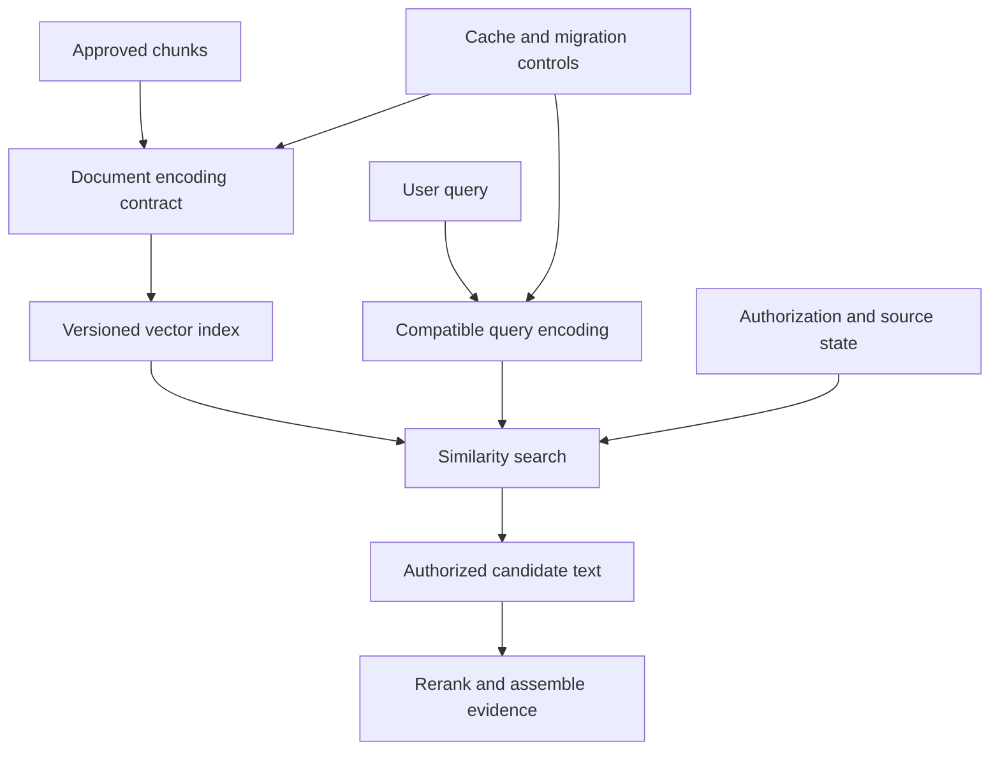

# Study Notes: M06.1.3 — Embeddings

**Path:** Core · **Depth:** L2 foundation; L3 through demonstrated project work  
**Prerequisites:** M03, M05 and M07; ingestion and chunking from M06.1.1–M06.1.2  
**Purpose:** Understand dense representations and build a reproducible embedding pipeline for retrieval.  
**Completion evidence:** Explain similarity calculations, compare embedding models on a fixed retrieval dataset, and demonstrate safe caching, versioning and re-embedding.

## Table of Contents

1. [Embedding Fundamentals](#1-embedding-fundamentals)
2. [Dense Representations and Similarity](#2-dense-representations-and-similarity)
3. [Cosine Similarity](#3-cosine-similarity)
4. [Dot Product and Euclidean Distance](#4-dot-product-and-euclidean-distance)
5. [Dimensionality and Storage](#5-dimensionality-and-storage)
6. [Choosing an Embedding Model](#6-choosing-an-embedding-model)
7. [Query and Document Compatibility](#7-query-and-document-compatibility)
8. [Batch Generation and Validation](#8-batch-generation-and-validation)
9. [Embedding Caching](#9-embedding-caching)
10. [Re-Embedding and Migration](#10-re-embedding-and-migration)
11. [Worked Example and Project Exercise](#11-worked-example-and-project-exercise)
12. [Overall Concept Map](#12-overall-concept-map)
13. [Glossary and Final Revision Sheet](#13-glossary-and-final-revision-sheet)
14. [Practice and Interview Questions](#14-practice-and-interview-questions)
15. [Sources and Further Reading](#15-sources-and-further-reading)

## 1. Embedding Fundamentals

### Definition

An **embedding** represents an item as a vector: an ordered list of numbers. For text retrieval, an embedding model maps a query or document passage into a representation that can be compared with other compatible representations.

A simplified notation is:

\[
f(\text{text}) = [x_1,x_2,\ldots,x_d] \in \mathbb{R}^{d}.
\]

Here, (d) is the dimensionality. Real models can use different functions or modes for queries and documents, as explained later.

### Why embeddings are useful

A keyword search depends strongly on matching indexed terms. A query about “reducing equipment downtime” may be relevant to a passage about “preventive maintenance improving availability,” even when exact wording differs. A retrieval-trained embedding model may place these texts near each other.

The word “may” matters. Embeddings are learned representations, not guaranteed semantic truth. They can miss specialized meanings, confuse near-identical identifiers and rank a contradictory sentence as similar because it discusses the same subject.

### A conceptual example

The following vectors are invented to illustrate the idea:

| Text | Toy vector |
|---|---|
| “Inspect Unit A’s indicator” | `[0.8, 0.6]` |
| “Check the indicator on Unit A” | `[0.79, 0.61]` |
| “Download the invoice” | `[-0.4, 0.9]` |

These numbers were not produced by a model, and the coordinates do not correspond to named concepts. They simply let us reason about similarity mathematically.

### Embeddings are not an answer database

An embedding normally does not store a human-readable answer. A retrieval system uses it to select candidate source passages, then fetches the text and provenance. The source remains necessary for citations, verification, permissions and updates.

Nor should embeddings be treated as anonymized or harmless merely because they are numeric. They are derived from source content and should inherit its handling and access requirements.

### Foundation from research

Sentence-BERT introduced a sentence-embedding approach designed to support efficient comparison of sentence representations, while Dense Passage Retrieval used a dual-encoder framework for question-to-passage retrieval. These works illustrate the distinction between producing reusable vectors and scoring each query-passage pair jointly. Their benchmark results should not be assumed to transfer unchanged to a new organization’s corpus. [Sources: Sentence-BERT](https://arxiv.org/abs/1908.10084), [Dense Passage Retrieval](https://arxiv.org/abs/2004.04906)

### Key takeaway

**Embeddings make similarity searchable. They do not establish correctness, authority or permission.**

## 2. Dense Representations and Similarity

**Syllabus coverage: M06.1.3.1 — Representation fundamentals.**

### Dense representations

A dense vector usually has a relatively modest fixed number of dimensions, with many coordinates carrying nonzero values. Its features are learned and distributed across the vector.

A sparse lexical representation usually has a much larger vocabulary-based coordinate space, with most coordinates zero for a given document. A coordinate can often be associated with a term. Learned sparse models also exist; sparse does not necessarily mean untrained or purely frequency-based.

| Property | Dense representation | Traditional sparse lexical representation |
|---|---|---|
| Coordinates | Learned distributed features | Vocabulary terms |
| Typical nonzero pattern | Most dimensions used | Small subset of terms used |
| Useful strength | Semantic or paraphrase matching | Exact wording and identifiers |
| Common comparison | Cosine, dot product or distance | Term-weighted scoring such as BM25 |
| Important risk | Similar topic mistaken for correct answer | Relevant paraphrase missed |

These are broad characteristics, not universal performance guarantees.

### What does similarity mean?

Similarity is defined by the model’s training and the comparison function. Two texts can be similar because they are paraphrases, answer the same question, discuss the same topic or share some other learned relationship.

Consider:

- “Unit A may be operated while indicator X is red.”
- “Unit A must not be operated while indicator X is red.”

They share nearly all their words and topic. A similarity model may rank them close even though their operational meanings conflict. Retrieval must therefore be followed by evidence interpretation and, where appropriate, contradiction checks.

### Similarity versus relevance

**Similarity** is a property of representations under a chosen metric. **Relevance** is whether a source helps satisfy a specific information need.

A historical manual can be highly similar to a current-procedure question but irrelevant under a current-version requirement. A confidential answer can be semantically relevant but unauthorized. Filters, authority rules and reranking address requirements that vector proximity alone cannot enforce.

### Similarity scores are not probabilities

A cosine score of 0.82 does not mean “82% probability that this passage answers the question.” Its meaning depends on the model, corpus, query distribution and preprocessing.

Thresholds should be calibrated on labeled examples for a defined task. Reusing the same threshold after changing the model is an untested assumption, even when both models use cosine similarity.

## 3. Cosine Similarity

### Definition

For nonzero vectors (a) and (b), cosine similarity is:

\[
\operatorname{cos}(a,b)=\frac{a\cdot b}{\|a\|_2\|b\|_2}.
\]

The dot product is:

\[
a\cdot b=\sum_{i=1}^{d}a_i b_i,
\]

and the Euclidean norm is:

\[
\|a\|_2=\sqrt{\sum_{i=1}^{d}a_i^2}.
\]

Cosine compares direction while removing the effect of vector length. Its mathematical range is from -1 to 1, although a particular model’s observed scores may occupy a narrower range.

### Worked calculation

Let the query vector be (q=[1,0]), candidate A be ([0.8,0.6]), and candidate B be ([0.6,0.8]).

All three vectors have length 1. Therefore:

\[
\operatorname{cos}(q,A)=0.8,\qquad
\operatorname{cos}(q,B)=0.6.
\]

A ranks above B under cosine similarity.

Now let C be ([8,6]), which points in the same direction as A but has length 10. Its dot product with q is 8, so:

\[
\operatorname{cos}(q,C)=\frac{8}{1\times10}=0.8.
\]

A and C tie under cosine because scaling a nonzero vector by a positive factor does not change its direction.

### Zero vectors

Cosine similarity is undefined for a zero vector because the denominator is zero. An embedding pipeline should reject or explicitly handle zero vectors instead of silently generating `NaN` scores.

A zero vector can indicate a failed transformation or an intentionally defined special case. Whatever the reason, the retrieval system needs a declared policy.

### Normalization

L2 normalization replaces a nonzero vector (a) with:

\[
\hat{a}=\frac{a}{\|a\|_2}.
\]

For normalized vectors, cosine similarity equals their dot product. This equivalence can simplify indexing, but only when both the document and query pipeline use the intended normalization consistently.

Sentence Transformers exposes several similarity choices, including cosine, dot product and distance-based options. The configuration should match how the chosen model is intended to be used. [Source: Sentence Transformers semantic textual similarity](https://www.sbert.net/docs/sentence_transformer/usage/semantic_textual_similarity.html)

### Key takeaway

**Cosine measures direction, not confidence.** Verify nonzero vectors and consistent normalization.

## 4. Dot Product and Euclidean Distance

### Dot product

The dot product sums coordinate-wise products. It is affected by both direction and magnitude:

\[
a\cdot b=\|a\|_2\|b\|_2\operatorname{cos}(a,b).
\]

For the previous example:

| Candidate | Vector | Dot product with `[1,0]` |
|---|---|---:|
| A | `[0.8,0.6]` | 0.8 |
| B | `[0.6,0.8]` | 0.6 |
| C | `[8,6]` | 8.0 |

C ranks first under raw dot product, despite having the same direction as A. This is not inherently wrong: some models are trained for inner-product retrieval and may use vector magnitude meaningfully. The error is choosing a comparison function without checking the model’s contract.

### Euclidean distance

Euclidean distance measures straight-line separation:

\[
\operatorname{dist}(a,b)=\sqrt{\sum_i(a_i-b_i)^2}.
\]

Lower distance means closer vectors. For the same query:

- Distance to A is approximately 0.632.
- Distance to B is approximately 0.894.
- Distance to C is approximately 9.220.

A is nearest; C is far away because of its magnitude.

Some vector systems return squared distance, negative distance or a transformed score. Always check whether larger or smaller values are better before sorting or applying a threshold.

### Equivalence for unit vectors

For normalized vectors:

\[
\|\hat{a}-\hat{b}\|_2^2=2-2(\hat{a}\cdot\hat{b}).
\]

Therefore, maximizing cosine similarity, maximizing dot product and minimizing Euclidean distance give the same exact ranking for the same normalized vectors. Approximate indexes and quantization can still introduce differences in actual retrieved results.

### Runnable similarity example

This Python uses only the standard library and intentionally works with toy vectors.

```python
from math import fsum, isfinite, sqrt


def cosine(a, b):
    if not a or len(a) != len(b):
        raise ValueError("vectors must have equal, nonzero dimensions")
    if not all(isfinite(x) for x in (*a, *b)):
        raise ValueError("vectors must contain finite values")
    norm_a = sqrt(fsum(x * x for x in a))
    norm_b = sqrt(fsum(x * x for x in b))
    if norm_a == 0 or norm_b == 0:
        raise ValueError("cosine is undefined for zero vectors")
    return fsum(x * y for x, y in zip(a, b)) / (norm_a * norm_b)


query = [1.0, 0.0]
candidates = {
    "A": [0.8, 0.6],
    "B": [0.6, 0.8],
    "C": [8.0, 6.0],
}
ranked = sorted(
    ((name, cosine(query, vector)) for name, vector in candidates.items()),
    key=lambda item: (-item[1], item[0]),
)
for name, score in ranked:
    print(name, round(score, 3))
```

Expected order is A and C tied at 0.8, then B at 0.6; the secondary name ordering makes the tie deterministic.

## 5. Dimensionality and Storage

### Embedding dimensionality

Dimensionality is the number of coordinates in each vector. It is part of the embedding model’s output contract and the vector index’s schema.

Two models producing 768 numbers do not necessarily produce compatible spaces. Equal shape only means the vectors fit the same-sized array. It does not mean coordinate 1 or any distance relationship has the same learned meaning.

### Storage calculation

Ignoring metadata and index overhead, storage for (N) vectors of dimension (d) with (b) bytes per coordinate is:

\[
\text{bytes}=N\times d\times b.
\]

For one million 768-dimensional float32 vectors:

\[
1{,}000{,}000\times768\times4=3{,}072{,}000{,}000\text{ bytes}.
\]

That is 3.072 GB in decimal units, approximately 2.86 GiB in binary units. The actual database requires additional storage for graph or other index structures, identifiers, metadata, replicas and operational headroom.

### Larger is not automatically better

A larger vector can represent more information in principle, but retrieval quality depends on training, data, architecture and task fit. A larger model can still perform poorly on specialized abbreviations or a language absent from its effective training distribution.

Evaluate quality per unit of storage, latency and cost. If a smaller representation meets the task’s quality requirement, its operational advantages can matter.

### Reducing dimensions

Do not arbitrarily remove coordinates from an embedding and assume quality will be preserved. Some models explicitly support shortened representations or are trained to make prefixes useful; others are not. Projection methods also change the representation and require evaluation and compatible query processing.

Dimension changes normally require a new index schema or collection, depending on the storage system. They should be treated as a migration rather than a casual configuration edit.

## 6. Choosing an Embedding Model

**Syllabus coverage: M06.1.3.2 — Embedding engineering.**

### Start with the retrieval task

Model choice should reflect the actual relationship between query and document. Question-to-passage search, similar-question matching, code search and multilingual retrieval can require different behavior.

Sentence Transformers distinguishes symmetric semantic search, where queries and documents have similar form, from asymmetric search such as short questions matched to longer answer passages. This distinction is useful when choosing a model and evaluation dataset. [Source: Sentence Transformers semantic search](https://www.sbert.net/examples/sentence_transformer/applications/semantic-search/README.html)

### Selection dimensions

| Dimension | Question to ask |
|---|---|
| Retrieval training | Was the model trained for the relationship this task needs? |
| Domain fit | Does it distinguish the relevant terminology and identifiers? |
| Language fit | Does it support the required query and document languages? |
| Input limit | Can the chosen chunk representation fit without truncation? |
| Output contract | What dimension, metric and normalization are expected? |
| Deployment | Can authorized content be processed in the approved environment? |
| Throughput | Can it keep up with ingestion and query demand? |
| Cost | What is the total cost of initial embedding, queries and updates? |
| Reproducibility | Can the exact model revision and preprocessing be pinned? |

### Domain fit

A general model may recognize “pump” but fail to distinguish several nearly identical model codes. It may interpret “port” as a harbor when the corpus discusses network ports. These are reasons to evaluate domain queries, not automatic reasons to fine-tune.

First compare a lexical baseline, a suitable dense model and hybrid retrieval. If lexical search already finds exact identifiers well, hybrid retrieval may solve the observed problem without retraining the embedding model.

### Language fit

Multilingual support is not a binary property. Evaluate same-language retrieval, cross-language retrieval, mixed-language text, transliterated names and specialized vocabulary separately.

A multilingual model might match an English question to a Hindi passage, but the application also needs appropriate extraction, tokenization, source interpretation and answer-language handling. Better embeddings cannot repair missing OCR content in the target language.

### Benchmarks and local evaluation

MTEB evaluates embeddings across different task types, while BEIR emphasizes heterogeneous retrieval evaluation. These research benchmarks show why evaluation should cover more than one convenient dataset. A published average is evidence about those benchmark conditions, not a guarantee for a private corpus. [Sources: MTEB](https://arxiv.org/abs/2210.07316), [BEIR](https://arxiv.org/abs/2104.08663)

Use benchmarks to shortlist candidates, then compare them on your own authorized and versioned evaluation set. Include hard negatives: passages about the right equipment but the wrong revision, similar model numbers and opposite conditions.

### Key takeaway

**Choose the representation using the questions it must answer and the constraints under which it must run.**

## 7. Query and Document Compatibility

### The compatibility contract

Query and document vectors must belong to compatible representation spaces. Compatibility includes:

- Model family and pinned revision.
- Query versus document mode.
- Required instruction or prefix.
- Tokenization and truncation policy.
- Pooling and normalization.
- Output dimensionality.
- Similarity function.

The query and document encoders do not have to be identical networks. They can be separately parameterized encoders trained to work together. What matters is the joint retrieval contract.

### Prefixes and task modes

Some models require different input prefixes for queries and passages. For example, the model-author card for `intfloat/e5-base-v2` specifies query and passage prefixes and documents its expected usage. This is a model-specific requirement; copying it to every embedding model would be incorrect. [Source: E5 model card](https://huggingface.co/intfloat/e5-base-v2)

The original E5 paper describes contrastive pretraining for text embeddings. Its central idea is relevant to understanding learned representation compatibility, but a deployed model’s own card remains the source for exact input conventions. [Source: Text Embeddings by Weakly-Supervised Contrastive Pre-training](https://arxiv.org/abs/2212.03533)

### A common failure

A team embeds documents with model A, changes the query service to model B, and keeps the old index because both models output the same dimension. The system returns results, so the deployment appears healthy, but the scores no longer reflect the intended learned relationship.

This is a silent correctness failure. Store an embedding configuration ID with the index and verify that the query service uses a compatible configuration before serving.

### Text compatibility also matters

Suppose documents were embedded as title plus section path plus body, but a later code path embeds only the body for updates. The index now contains two representation conventions under one label.

Similarly, changing lowercasing or Unicode normalization can alter identifiers. Record the exact input-building procedure, not just the model name.

### Permission is separate

Embedding compatibility does not establish authorization. Query routing and document filters must still enforce tenant and source permissions. An unauthorized passage with a perfect similarity score remains unauthorized.

## 8. Batch Generation and Validation

### Batch generation

**Batching** processes several inputs in one operation to improve throughput or reduce per-request overhead. The appropriate batch size depends on token lengths, hardware or service limits, and latency requirements.

Batch by total input tokens as well as item count. A batch of 100 short labels and a batch of 100 long passages impose different demands.

### Preserve input-output identity

Each submitted input needs a stable record ID. Map the returned vector to that ID using the documented response ordering or explicit response indices. Never assume an asynchronous completion order equals the original input order.

A wrong association can make retrieval return a source paragraph unrelated to its vector. The data may look syntactically valid while semantic correctness is broken.

### Validation checklist

Before accepting a vector, check:

1. The response belongs to the requested input.
2. The expected vector count is present.
3. The dimension matches the index schema.
4. All coordinates are finite numbers.
5. The norm is valid for the intended metric.
6. The model/configuration identity is recorded.
7. The source is still eligible for publication.

If a source is deleted while a long embedding job is running, the completed vector must not reactivate it. Recheck source state before publication.

### Partial failures and retries

A batch can partially fail. Retry only unresolved items according to the service contract, retain successful results, and make writes idempotent using source and configuration identity.

Do not let retries create duplicate active vectors. Also distinguish transient failures from permanent input failures such as unsupported length or malformed text. Repeating an invalid request indefinitely wastes resources and hides a data-quality issue.

### Offline versus online work

Document embedding is usually performed in the offline ingestion/update pipeline. Query embedding is performed when the user asks a question, unless an eligible cache entry can be reused.

These paths have different service objectives. Bulk document embedding can prioritize throughput, while query embedding is directly on the user’s latency path.

## 9. Embedding Caching

### Definition

An embedding cache reuses a previously computed vector for an identical embedding request. It saves repeated computation; it is different from caching retrieved results or final answers.

A conceptual cache key depends on the exact embedding input and all settings that affect its representation:

```text
cache_key = hash(
    approved_cache_scope,
    model_revision,
    input_mode,
    input_text,
    tokenizer_and_preprocessing_version,
    pooling_and_normalization,
    output_dimension
)
```

This is pseudocode, not a standardized API. Serialize key components unambiguously before hashing.

### Why text alone is insufficient

The same paragraph encoded with a different model or query/document mode can produce a different vector. Reusing a cached old vector after a model change silently mixes spaces.

If the embedded input includes a heading, a heading change can require a different vector even when the paragraph body is unchanged. The cache should reflect the actual input, not an approximate document identity.

### Tenant-safe cache design

A conservative design scopes private-content caches by tenant or an explicitly approved sharing boundary. Avoid APIs or logs that let one tenant infer whether another tenant has embedded a specific private string.

Even if a vector is reused internally, serving the associated source still requires current authorization. A cache hit is not permission to return the source text or title.

### Cache invalidation

Invalidate or stop serving entries when the relevant model contract changes, when corrupted inputs are corrected, or when policy requires derived data removal. Track which source-derived entries depend on a deleted document.

Query embedding caches may contain sensitive user questions. Give them a retention and access policy, and avoid logging raw queries unnecessarily. The fact that a cache stores vectors rather than prose does not remove the need for control.

## 10. Re-Embedding and Migration

### What triggers re-embedding?

| Change | Usually requires new vectors? | Reason |
|---|---|---|
| Source body changes | Yes, for affected inputs | The represented text changed |
| Included heading changes | Yes | The actual embedding input changed |
| Embedding model revision changes | Yes | The learned space may change |
| Normalization or pooling changes | Often yes | The representation contract changed |
| Output dimension changes | Yes | The index schema and vectors change |
| ACL membership changes only | Usually not | Update control metadata and caches instead |
| Citation display label changes only | Usually not | The vector input may be unchanged |

“Usually” depends on the exact pipeline. If an ACL label was improperly included in embedding text, a policy change can also alter that text, but access should still be enforced as a control field.

### A safe migration pattern

Build the new embedding configuration in a separate index generation. Keep the source IDs and versions traceable. Evaluate retrieval against the existing configuration on the same questions, including security and deletion tests.

When the candidate is ready, switch the query service and index together using an explicit compatibility identifier. Maintain a rollback option that restores a consistent pair, not merely one component.

### Updates during migration

A migration can take time. Source documents may be added, revised or deleted while the new index is building. Track changes from a defined source checkpoint and reconcile them before publication.

A source deleted after the initial snapshot must also be absent from the new index. Otherwise, switching to the new generation resurrects deleted evidence.

### Re-embedding strategy

For a content-only update, recompute only affected embedding inputs when their identity and boundaries are stable. If chunking changes substantially, more of the source may need regeneration.

For a model migration, the entire relevant vector population generally needs the new compatible representation. Mixing old and new vectors in one ordinary similarity search is not a safe shortcut.

### Key takeaway

**An embedding change is a data migration with serving consequences.** Version the representation, not just the source.

## 11. Worked Example and Project Exercise

### Scenario

The following is fictional training data. An enterprise assistant searches manual M-104 v4 for tenant A. Queries include “When do I check the indicator?”, “M-104 Unit A interval,” and a Hindi-language paraphrase. A similar v3 manual and a tenant B document act as hard negatives.

### Step 1 — Define evidence labels

For each query, label the source spans that answer it, the required current revision and the user’s authorization scope. Include cases where no authorized evidence exists. Do not label merely similar paragraphs as relevant.

### Step 2 — Freeze the corpus and chunking

Create an immutable evaluation snapshot. Keep text extraction, chunk boundaries and metadata constant while comparing embedding models. Otherwise, the comparison confounds multiple changes.

### Step 3 — Establish baselines

Compare lexical retrieval, dense retrieval with model A, dense retrieval with model B, and hybrid retrieval. Use an exact vector search on a manageable sample to separate embedding quality from ANN approximation errors.

Measure Recall@K, rank-sensitive quality such as MRR or nDCG where suitable, query latency and total vector storage. Also inspect exact identifiers, paraphrases, languages and revision-sensitive slices separately.

### Step 4 — Add the main-pipeline reranker

Rerank authorized candidates using a fixed reranker configuration and evaluate the final evidence selection. This reveals whether one embedding model supplies better candidate coverage even when first-stage ranking is imperfect.

### Step 5 — Test lifecycle correctness

Change M-104 from v3 to v4 and verify that affected inputs are updated. Change a user’s ACL membership and confirm the source becomes inaccessible without needing to reinterpret the vector. Delete the source and test both fresh queries and cached queries.

### Acceptance evidence

Submit a model/configuration manifest, dataset description, baseline comparison, failure examples, vector validation report, cache-key design and migration/deletion trace. Explain why the selected model is appropriate for this corpus rather than claiming it is universally best.

For L3 depth, demonstrate a migration while updates occur and show that query and document spaces remain compatible throughout the publication process.

## 12. Overall Concept Map



Query and document encoding meet through a compatibility contract. Source policy and version state continue to govern which candidate text may be used.

## 13. Glossary and Final Revision Sheet

| Term | Meaning |
|---|---|
| Embedding | Numeric representation of an item |
| Dense vector | A fixed-size learned representation with many active coordinates |
| Dimension | Number of coordinates in a vector |
| Similarity | Closeness under a specified comparison function |
| Cosine similarity | Directional comparison normalized by vector lengths |
| Dot product | Sum of coordinate-wise products |
| Euclidean distance | Straight-line distance between vectors |
| L2 normalization | Rescaling a nonzero vector to unit length |
| Bi-encoder | Architecture encoding query and document independently |
| Compatible space | Representations designed to be compared meaningfully |
| Batch embedding | Processing multiple embedding inputs together |
| Embedding cache | Reuse of vectors for identical encoding requests |
| Re-embedding | Regenerating representations after relevant changes |
| Index generation | A separately identifiable version of indexed data |

### Revision sheet

- Cosine removes magnitude; raw dot product does not.
- Distance is usually minimized; similarity is usually maximized.
- For unit vectors, cosine, dot product and Euclidean distance induce equivalent exact rankings.
- Equal dimensionality does not imply compatible models.
- A score is not a calibrated probability of relevance.
- The exact input representation and model revision belong in cache keys.
- Batch output must remain associated with the correct source input.
- ACL changes require current policy enforcement even when vectors stay unchanged.
- Re-embedding must not reactivate deleted sources.
- Evaluate lexical, dense and hybrid baselines before adding complexity.

**Memory aid:** Same contract, valid vectors, measured retrieval, traceable updates.

## 14. Practice and Interview Questions

### Question-and-answer recall

**1. What is an embedding?**  
An ordered numeric representation produced from an item such as text, designed so that a chosen comparison function reflects useful learned relationships.

**2. How do dense and traditional sparse representations differ?**  
Dense vectors use distributed learned features in a fixed-size space. Traditional sparse lexical vectors use vocabulary-related coordinates with mostly zero values for a given document.

**3. What does cosine similarity compare?**  
The direction of nonzero vectors after dividing their dot product by their lengths. It does not measure confidence in the truth of a source.

**4. Why does raw dot product differ from cosine?**  
It retains the effect of vector magnitude. Two vectors pointing in the same direction can have different dot-product scores if their lengths differ.

**5. When are cosine and Euclidean rankings equivalent?**  
For the same unit-normalized vectors under exact comparison, because squared Euclidean distance equals two minus twice the dot product.

**6. Why are two 768-dimensional models not automatically compatible?**  
They can learn entirely different coordinate spaces. Matching array shape is not evidence that distances between their outputs are meaningful.

**7. Why should model choice include language-specific tests?**  
Multilingual capability varies by language, direction of retrieval, specialized vocabulary and source quality. Aggregate benchmarks can hide weak slices.

**8. What must an embedding cache key contain?**  
The exact encoding input plus model revision, task mode, preprocessing, dimension and other settings that affect the result, within an appropriate privacy scope.

**9. Does an ACL-only change always require re-embedding?**  
No. If the embedded text is unchanged, update policy metadata and invalidate affected serving caches. Authorization must still use the current policy.

**10. Why build a separate index generation for a model migration?**  
It preserves compatibility, permits comparison and rollback, and prevents queries from being compared against mixed representation spaces.

### Multiple-choice questions

#### Easy

**11. A cosine score is 0.9. What can you conclude?**

A. The answer is 90% correct.  
B. The source is authorized.  
C. The vectors have high directional similarity under the chosen model.  
D. The document is current.

**Answer: C.** Similarity does not establish correctness, authority, version or authorization.

**12. What is a 384-dimensional embedding?**

A. A document containing 384 words.  
B. A vector containing 384 coordinates.  
C. A guaranteed 384-token answer.  
D. A database with 384 sources.

**Answer: B.** Dimensionality describes representation shape, not document length or source count.

#### Medium

**13. For a unit query `[1,0]`, which vector has the same cosine similarity as `[0.8,0.6]`?**

A. `[8,6]`.  
B. `[0,1]`.  
C. `[-0.8,-0.6]`.  
D. `[0,0]`.

**Answer: A.** Positive scaling preserves direction. The zero vector has undefined cosine similarity.

**14. Documents use model A and queries use unrelated model B with the same dimension. What is the problem?**

A. Nothing; shape is enough.  
B. The learned spaces may be incompatible.  
C. Only the citation font changes.  
D. The vectors become lexical postings automatically.

**Answer: B.** The system can return numerical scores without those scores representing meaningful retrieval relevance.

#### Hard — scenario based

**15. A heading is included in embedding input and later changes while body text stays the same. Should the cache necessarily reuse the old vector?**

A. Yes, because the body is unchanged.  
B. Yes, because headings never matter.  
C. No; the actual encoding input changed.  
D. Only if the source is a PDF.

**Answer: C.** Cache identity must represent the exact input, including any included metadata.

**16. A source is deleted during an embedding job. What should publication do?**

A. Publish the result because computation succeeded.  
B. Recheck source state and prevent reactivation.  
C. Remove the source ID so it cannot be traced.  
D. Change the vector dimension.

**Answer: B.** Successful computation does not override the current source lifecycle state.

**17. Dense retrieval improves paraphrase queries but fails exact model-code queries. What is a sensible next comparison?**

A. Remove all exact identifiers.  
B. Compare lexical and hybrid retrieval on those slices.  
C. Assume more dimensions will fix it.  
D. Stop using evaluation labels.

**Answer: B.** Complementary lexical retrieval may supply candidates that the dense model misses. The decision should be measured.

### Interview questions with model answers

#### Easy

**18. Explain embeddings without using machine-learning jargon.**

**Model answer:** An embedding turns a piece of text into a list of numbers that a search system can compare quickly. Texts that the model considers related often receive nearby representations. The system uses that closeness to find candidate passages, then reads the actual sources. The numbers do not themselves prove that a passage is correct or permitted for the user.

**19. How would you choose a similarity function?**

**Model answer:** I would check the model’s intended retrieval setup, including normalization and query/document modes, then configure the index accordingly. I would verify whether returned values are similarities or distances and test ranking on known examples. I would not switch between raw dot product and cosine casually because vector magnitude may change the ranking.

#### Medium

**20. How would you evaluate two embedding models?**

**Model answer:** I would hold the corpus, extraction, chunking, permissions and evaluation questions fixed. I would use compatible query and document encoding for each model, compare retrieval metrics and difficult query slices, and measure latency, cost and storage. On a manageable sample I would use exact vector search to avoid confusing embedding quality with ANN approximation. I would also compare lexical and hybrid baselines.

**21. What makes batch embedding reliable?**

**Model answer:** Stable input IDs, explicit mapping of outputs back to inputs, validation of dimensions and finite values, recorded configuration identity, and idempotent writes. I would handle partial failures without duplicating successful items and recheck source state before publication. A batch completing successfully is insufficient if its vectors are attached to the wrong chunks.

#### Hard — scenario based

**22. A model migration works in staging but brings back deleted documents in production. What likely failed?**

**Model answer:** The new index was probably built from an old source snapshot without replaying deletions or reconciling current source state before cutover. I would prevent those sources from serving immediately, apply lifecycle changes to the new generation, and verify caches and citations. Future migrations would track a source checkpoint and reconcile updates and deletions before switching the compatible query/index pair.

**23. A team proposes using the same cosine threshold for every embedding model. How would you respond?**

**Model answer:** I would explain that score distributions depend on the model and task, so an identical numeric threshold can mean different things. We would calibrate acceptance or abstention behavior using labeled relevant and irrelevant examples for each configuration. I would also avoid relying on a similarity threshold alone for source authority, authorization or answer correctness.

## 15. Sources and Further Reading

The vector examples, storage calculations and engineering scenarios are original teaching material. They should be reproduced and extended with actual model outputs in project work.

- [Reimers and Gurevych: Sentence-BERT](https://arxiv.org/abs/1908.10084).
- [Karpukhin et al.: Dense Passage Retrieval](https://arxiv.org/abs/2004.04906).
- [Sentence Transformers: semantic search](https://www.sbert.net/examples/sentence_transformer/applications/semantic-search/README.html).
- [Sentence Transformers: semantic textual similarity](https://www.sbert.net/docs/sentence_transformer/usage/semantic_textual_similarity.html).
- [Wang et al.: Text Embeddings by Weakly-Supervised Contrastive Pre-training](https://arxiv.org/abs/2212.03533).
- [E5 model-author card](https://huggingface.co/intfloat/e5-base-v2).
- [Muennighoff et al.: MTEB](https://arxiv.org/abs/2210.07316).
- [Thakur et al.: BEIR](https://arxiv.org/abs/2104.08663).

**Previous:** [M06.1.2 — Chunking](M06.1.2_Chunking.md).  
**Continue with:** [M06.2.1 — Retrieval and Information Retrieval Fundamentals](M06.2.1_Retrieval_and_Information_Retrieval_Fundamentals.md).
