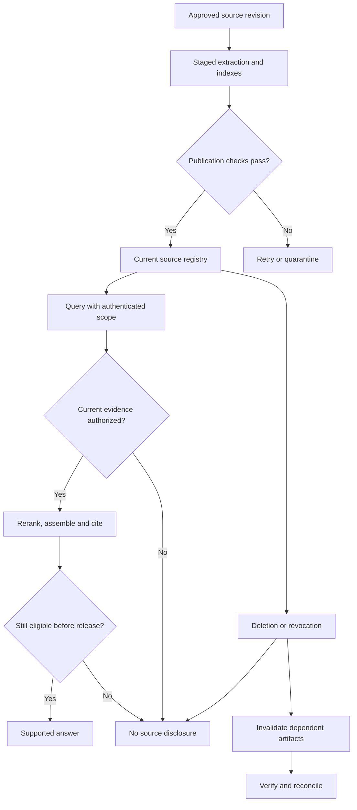

# Study Notes: M06.10.1 — Permission-Aware Document Answer

**Module:** M06 — Embeddings, Search & RAG  
**Path:** Core  
**Depth:** L2 foundation; L3 through demonstrated project work  
**Prerequisites:** M03, M05, M07; apply the preparation, retrieval, evaluation, security and operations material from M06.  
**Purpose:** Work through a revised manual from ingestion to an authorized cited answer, then verify permission changes and source deletion.

**Completion evidence:** Compare retrieval baselines; cite evidence; verify permissions and source deletion.

> This entire manual scenario is fictional. The text concerns an invented workshop documentation procedure and is not an operating instruction or maritime regulation.

## Table of Contents

1. [The Scenario and Learning Objectives](#1-the-scenario-and-learning-objectives)
2. [Source, Version and Permission Model](#2-source-version-and-permission-model)
3. [Ingest the Revised Manual](#3-ingest-the-revised-manual)
4. [Publish Consistent Retrieval Data](#4-publish-consistent-retrieval-data)
5. [Retrieve Only Authorized Evidence](#5-retrieve-only-authorized-evidence)
6. [Compare Lexical, Dense and Hybrid Baselines](#6-compare-lexical-dense-and-hybrid-baselines)
7. [Assemble, Answer and Validate Citations](#7-assemble-answer-and-validate-citations)
8. [Runnable Permission and Version Demonstration](#8-runnable-permission-and-version-demonstration)
9. [Permission Changes and In-Flight Requests](#9-permission-changes-and-in-flight-requests)
10. [Delete the Source and Verify Removal](#10-delete-the-source-and-verify-removal)
11. [Failure Recovery and Audit Evidence](#11-failure-recovery-and-audit-evidence)
12. [Overall Concept Map](#12-overall-concept-map)
13. [Glossary and Final Revision Sheet](#13-glossary-and-final-revision-sheet)
14. [Practice and Interview Questions](#14-practice-and-interview-questions)
15. [L3 Project and Acceptance Checklist](#15-l3-project-and-acceptance-checklist)
16. [Primary Sources and Further Reading](#16-primary-sources-and-further-reading)

## 1. The Scenario and Learning Objectives

### Business scenario

A fictional organization maintains workshop manuals for two vessels, Ship A and Ship B, inside tenant A. A separate organization is tenant B.

Manual M-104 is available to the Ship A group. Revision 3 is currently active. An approved revision 4 arrives with a changed approval role.

The original fictional paragraph says:

```text
Revision 3, section 6.2:
The technician approves the workshop preparation record.
```

The revised paragraph says:

```text
Revision 4, section 6.2:
The maintenance supervisor approves the workshop preparation record.
```

The application must answer:

```text
Who approves the workshop preparation record under the current M-104?
```

For an authorized Ship A user, the answer should cite revision 4 and identify the maintenance supervisor. A Ship B user without permission should not obtain the paragraph, its private metadata or a cached answer based on it.

### What makes this a complete RAG example?

Producing the correct sentence once is only part of the task. A complete implementation must show that:

- The correct source revision was ingested.
- The searchable representation retains identity and permissions.
- The retrieval baseline behaves as measured.
- The generator receives only eligible evidence.
- Citations resolve to the exact source used.
- Permission changes affect subsequent use.
- Deletion stops the source from contributing to answers.
- Failed workers or rollbacks cannot silently restore removed evidence.

### The evidence chain

The original source produces extracted spans. Spans produce chunks. Chunks produce search representations. Retrieved evidence produces answer claims and citations.

Each transformation should retain enough lineage to locate its origin. W3C PROV provides a general model of provenance involving entities, activities and agents; a RAG implementation can apply that idea without adopting every part of the standard. [Source: W3C PROV Overview](https://www.w3.org/TR/prov-overview/).

## 2. Source, Version and Permission Model

### Stable identity

Use a composite identity such as:

```text
Source:  (tenant_id, document_id)
Version: (tenant_id, document_id, version)
Chunk:   (tenant_id, document_id, version, chunk_id)
```

Tenant A and tenant B may both have a document named M-104. The display name alone is not a globally unique key.

A storage URL can change without changing the document's logical identity. Store the source locator separately.

### Source record

```json
{
  "tenant_id": "A",
  "document_id": "M-104",
  "title": "Workshop Preparation Manual",
  "active_version": 4,
  "status": "active",
  "source_epoch": 12,
  "allowed_groups": ["ship-A"],
  "approved_at": "2026-10-20T08:00:00Z",
  "source_uri": "internal-document-reference"
}
```

This is a conceptual example. The source epoch is a monotonically increasing change counter used to invalidate stale references. It is not a replacement for the business document version.

### Chunk record

```json
{
  "tenant_id": "A",
  "document_id": "M-104",
  "document_version": 4,
  "chunk_id": "section-6.2-paragraph-1",
  "section": "6.2",
  "text": "The maintenance supervisor approves the workshop preparation record.",
  "source_locator": "section 6.2, paragraph 1",
  "content_hash": "example-digest",
  "acl_reference": "A:M-104",
  "chunk_allowed_groups": null,
  "derived_from": ["A:M-104:v4"]
}
```

A null chunk-specific restriction means “inherit the document policy” in this example. It does not mean public access. An explicitly empty allowed-group set means deny in the runnable fixture.

Document-level access and an additional chunk restriction are both required when the chunk has stricter permissions.

### Authenticated principal

The server obtains the user and tenant identity from a verified session or token. Current group membership comes from the trusted authorization system.

The user may ask about Ship B in ordinary text. That does not add Ship B to their allowed scope.

OWASP distinguishes authentication from authorization and recommends server-side, deny-by-default checks on requests and resources. This example applies those principles to retrieval and citations. [Source: OWASP Authorization](https://cheatsheetseries.owasp.org/cheatsheets/Authorization_Cheat_Sheet.html).

### Permission matrix

| Principal | Tenant | Groups | May view tenant A M-104? |
|---|---|---|---|
| Alice | A | ship-A | Yes |
| Bob | A | ship-B | No |
| Eve | B | ship-A | No |
| Supervisor | A | ship-A, supervisors | Yes, including any supervisor-only chunks |

The same group name in another tenant does not grant access. Both tenant identity and policy membership matter.

## 3. Ingest the Revised Manual

### Step 1 — Validate the upload and source event

Accept the revision through an authorized source-management route. Check type and content, file size, parser limits and source identity. Confirm that the event represents an approved revision rather than an arbitrary attachment.

An uploaded filename containing “FINAL” is not an approval record.

### Step 2 — Extract content

For a digital PDF, extract text with layout and page information. For scanned pages, use OCR and inspect sample output. For tables, preserve headers, rows, units and footnotes.

The fixture uses short plain text so the lifecycle is easy to see. The same identity and permission rules apply to extracted PDF, HTML or Office content.

### Step 3 — Preserve meaning while cleaning

Remove irrelevant repeated page furniture if it is genuinely noise. Keep section numbers, model identifiers, qualifications, negations and approval roles.

A cleaner that removes “supervisor” because it looks like a repeated header would destroy the very fact the answer needs.

### Step 4 — Detect changes

Compare content hashes and section mappings between revisions. Identify the changed paragraph, unchanged sections, removed sections and metadata changes.

Do not treat an unchanged text hash as proof that no update is needed. Permissions, approval state, source locator or applicability can change without altering the paragraph.

### Step 5 — Create chunks and representations

Use structure-aware boundaries around meaningful sections. Store stable source/version links with every chunk.

Generate document embeddings using the selected model and its required document format. Build lexical entries from the same text and metadata. Preserve the embedding model revision and preprocessing configuration.

If only one paragraph changes, reprocess the affected content when the chunking and embedding configuration allow reliable reuse. If boundaries or the embedding model change, a broader rebuild may be required.

### Step 6 — Validate the staged revision

Check chunk counts, empty extraction, source locators, permission references and representative questions before publication.

Use an exact fixture question: “Who approves the workshop preparation record?” The expected evidence must point to section 6.2 of v4, not to the old approval role.

## 4. Publish Consistent Retrieval Data

### Staging versus serving

Stage v4's text, lexical entries and vectors without making a partial revision visible as current. Once the required components are ready, update the serving manifest to v4.

The application should be able to say which revision a request used. Mixing v3 lexical results with v4 vector results can produce contradictory context.

### Atomic publication scope

An atomic pointer or alias change inside one store does not automatically make changes across every independent system atomic.

For a multi-store design, use a publication manifest and serving-time eligibility checks. If a required store is unavailable, define whether to wait, serve a clearly allowed older snapshot, use an approved fallback or return an availability message. Do not label incomplete new data as fully current.

### Reliable event delivery

A transactional outbox records an event alongside the authoritative source change so downstream workers can process it reliably. Consumers still need idempotency because deliveries may repeat. AWS documents this pattern and its consistency motivation. [Source: AWS transactional outbox](https://docs.aws.amazon.com/prescriptive-guidance/latest/cloud-design-patterns/transactional-outbox.html).

For this project, events might include source ID, version, event ID, mutation sequence, content hash and operation type.

### Prevent stale publication

A worker preparing v3 must not publish after v4 becomes current. A worker preparing any version must not reactivate a deleted source.

Before publication, compare the worker's expected source state with the current registry. Reject obsolete work. The exact compare-and-set or transactional mechanism belongs to the chosen storage system.

### Historical access

Superseded revisions can remain stored for authorized audits. Default current-answer retrieval should exclude them. A historical-comparison route must explicitly authorize and label the requested versions.

## 5. Retrieve Only Authorized Evidence

### Offline and online responsibilities

Offline work prepares approved sources: ingest, extract, clean, chunk, embed and index. Online work authenticates the request, identifies its information need, retrieves eligible candidates, reranks, assembles evidence and answers.

Authorization is relevant to both phases. Permission metadata must be preserved offline, and current access decisions must be enforced online.

### A safe conceptual online flow

```text
1. Authenticate the session and resolve current user scope.
2. Preserve the user's exact document/model constraints.
3. Search eligible source partitions and metadata filters.
4. Validate candidate IDs against current source and access state.
5. Materialize only the permitted current evidence.
6. Rerank the eligible candidates.
7. Expand or compress evidence within the same authorization boundary.
8. Generate claims and citations from registered evidence IDs.
9. Revalidate current eligibility before releasing the answer.
```

This is workflow pseudocode, not a vendor-specific API.

### Where the boundary belongs

The retrieval service is a trusted component that may operate on protected indexes. Rejected evidence must not leave that boundary for an unauthorized user, external reranker, model context or general log.

Source restrictions should be applied during retrieval where supported. An authoritative check should also guard materialization because index metadata may lag behind current source or policy state.

Filtering after generation is too late. The restricted content has already reached the model.

### Filtered ANN and candidate quality

A filter can leave few eligible neighbors among approximate search results. Applying a correct access check does not guarantee adequate retrieval recall.

Evaluate filtered ANN against exact search on the same eligible corpus. Depending on the engine and workload, increase the candidate budget, adjust search settings or use an authorized exact-search fallback.

Do not relax access controls to improve recall.

### Distinguish user filters from security filters

A user may choose “PDF only” as a convenience filter. The system may enforce “tenant A, Ship A permitted documents” as a security filter.

A generated query rewrite can modify convenience terms under defined rules. It must not remove the security scope.

### Denial behavior

If the source is unavailable to Bob, return a neutral message such as:

```text
I do not have accessible evidence to answer that question.
```

Whether to name a denied source depends on the product's disclosure policy. Do not reveal that a restricted document exists merely to explain why access was denied.

## 6. Compare Lexical, Dense and Hybrid Baselines

### Define the eligible evidence

For the ranking illustration, imagine four current, authorized spans in M-104 v4:

| Evidence | Section | Content role |
|---|---|---|
| C1 | 6.2 | Approval role |
| C2 | 1.1 | Workshop applicability |
| C3 | 2.1 | Equipment model table |
| C4 | 9.1 | Record formatting instructions |

Old v3 spans and another tenant's documents are excluded before this comparison.

The following rankings are deliberately invented to teach evaluation arithmetic. They are not outputs from trained retrieval models.

### Three questions and candidate results

| Question | Gold evidence | Lexical top 2 | Dense top 2 | Hybrid top 2 |
|---|---|---|---|---|
| Q1: Who approves the record? | C1 | C4, C1 | C1, C4 | C1, C4 |
| Q2: Where is the P-20 model listing? | C3 | C3, C4 | C4, C2 | C3, C4 |
| Q3: What scope applies and who approves? | C2, C1 | C2, C4 | C1, C2 | C2, C1 |

Recall@2 equals the fraction of required eligible evidence items present in the two results.

### Calculate recall

| Question | Lexical Recall@2 | Dense Recall@2 | Hybrid Recall@2 |
|---|---:|---:|---:|
| Q1 | 1/1 = 1.0 | 1/1 = 1.0 | 1/1 = 1.0 |
| Q2 | 1/1 = 1.0 | 0/1 = 0.0 | 1/1 = 1.0 |
| Q3 | 1/2 = 0.5 | 2/2 = 1.0 | 2/2 = 1.0 |
| Macro average | 0.8333 | 0.6667 | 1.0000 |

The hybrid branch covers all required evidence in this tiny illustration. Real results must be measured over a representative evaluation set.

### Hit Rate and MRR

At cutoff 2, lexical retrieval has a hit for every question, so Hit Rate@2 is 1.0 even though Q3 lacks one necessary source. This illustrates why one-hit metrics cannot establish complete multi-source coverage.

Lexical reciprocal ranks are 1/2, 1 and 1, averaging 0.8333. Dense reciprocal ranks are 1, 0 and 1, averaging 0.6667. Hybrid reciprocal ranks are all 1.

The MRR convention here assigns zero when no relevant result appears within the evaluated top two.

### Add basic reranking

Reranking can move C1 above C4 for lexical Q1. It cannot recover C3 from dense Q2's two-candidate set or C1 from lexical Q3's set.

Keep this distinction visible in the evidence report:

- Candidate recall asks whether needed material was found.
- Reranking asks whether found material is ordered well.
- Context coverage asks whether all necessary material survives selection.
- Answer evaluation asks whether claims are correct and supported.

Run comparable rerankers and context budgets across candidate strategies when comparing final answer quality. Retain no-reranker ablations separately.

### L3 evidence requirement

Replace the invented ranking table with logged results from a real lexical configuration, a compatible embedding model, a defined hybrid fusion rule and a basic reranker. Record the exact corpus, models and settings.

A learner should not report this illustrative table as their own measured project result.

## 7. Assemble, Answer and Validate Citations

### Context assembly

For the simple approval question, the model may need only the v4 approval paragraph and enough heading context to establish scope.

For Q3, include both the applicability paragraph and the approval paragraph. Deduplicate overlapping material, preserve conditions and reserve an output budget.

Every context item should have an application-generated evidence ID, source version and locator. Treat source text as untrusted task data, not as system instructions.

### Desired answer

For authorized Alice, the fictional answer is:

```text
The maintenance supervisor approves the workshop preparation record.

Source: Workshop Preparation Manual M-104, revision 4,
section 6.2, paragraph 1.
```

The answer contains one factual claim with one supporting source. It does not invent a deadline, a second approval role or a procedure absent from the paragraph.

### Citation registry

The application maps a known evidence ID to a source location. The model selects valid IDs; it should not invent URLs or document revisions.

An example registry entry is:

```json
{
  "evidence_id": "A:M-104:v4:6.2:p1",
  "document_id": "M-104",
  "document_version": 4,
  "locator": "section 6.2, paragraph 1",
  "source_epoch": 12,
  "access_check_required": true
}
```

Opening the citation must enforce access again. An unrestricted static download URL can defeat an otherwise correct answer pipeline.

### Claim validation

Check source support, scope, version and citation identity. A citation to v3 would be an error for this current-procedure question even if the old paragraph was quoted accurately.

If the answer says “the maintenance supervisor approves it within 24 hours,” split that into role and deadline claims. The fictional paragraph supports the role only. Remove the deadline.

A model-based validator can assist with support judgments. Deterministic checks should enforce known IDs, versions and access regardless of the validator's opinion.

### Contradictions

When comparing v3 and v4 historically, the two approval roles are a documented change. When answering the current question, the active v4 governs the fixture.

If two current sources truly conflict for the same scope, report the unresolved conflict with permitted evidence. Do not invent a compromise rule.

## 8. Runnable Permission and Version Demonstration

### What this program demonstrates

The Python program below is a complete, executable **standard-library teaching model** for:

- Composite tenant/document identity.
- Document and stricter chunk permissions.
- Current source revision checks.
- Source and membership change counters.
- Revalidation of cached evidence references.
- Serving denial before background cleanup.
- Rejection of a stale worker after deletion.

It runs with Python 3.9 or newer. The included assertions were executed successfully when preparing these notes.

The program deliberately enumerates eligible references rather than implementing BM25, trained embeddings or neural reranking. Those belong to the retrieval experiment described above. Its source fixture is smaller than the four-span ranking illustration.

Administrative methods represent trusted source-management operations. In a real server, they need their own authorization and transactional implementation.

```python
from dataclasses import dataclass, replace
from typing import Optional

SourceKey = tuple[str, str]
ChunkKey = tuple[str, str, int, str]


@dataclass(frozen=True)
class Principal:
    # Constructed by trusted authentication code, never from arbitrary input.
    tenant_id: str
    user_id: str


@dataclass(frozen=True)
class Source:
    active_version: int
    allowed_groups: frozenset[str]
    epoch: int
    deleted: bool = False


@dataclass(frozen=True)
class Chunk:
    key: ChunkKey
    text: str
    extra_allowed_groups: Optional[frozenset[str]] = None

    @property
    def source_key(self) -> SourceKey:
        return self.key[0], self.key[1]


@dataclass(frozen=True)
class EvidenceRef:
    key: ChunkKey
    source_epoch: int
    membership_epoch: int


class KnowledgeStore:
    """Single-process, sequential teaching model, not a production service."""

    def __init__(self):
        self.sources: dict[SourceKey, Source] = {}
        self.chunks: dict[ChunkKey, Chunk] = {}
        self.memberships: dict[
            tuple[str, str], tuple[frozenset[str], int]
        ] = {}

    def membership(self, principal):
        return self.memberships.get(
            (principal.tenant_id, principal.user_id),
            (frozenset(), 0),
        )

    def set_membership(self, principal, groups):
        # Trusted administrative mutation in this fixture.
        _, epoch = self.membership(principal)
        self.memberships[(principal.tenant_id, principal.user_id)] = (
            frozenset(groups), epoch + 1
        )

    def publish(self, source_key, version, sections, groups, expected_epoch):
        # Trusted ingestion worker operation.
        old = self.sources.get(source_key)
        actual_epoch = old.epoch if old else 0
        if actual_epoch != expected_epoch:
            raise ValueError("Obsolete publication attempt")
        if old and old.deleted:
            raise ValueError("Deleted source cannot be republished here")
        if old and version <= old.active_version:
            raise ValueError("Revision must advance")
        if version < 1 or not sections:
            raise ValueError("Invalid staged revision")

        staged = {}
        for section_id, text, extra_groups in sections:
            key = (*source_key, version, section_id)
            if key in staged or not text.strip():
                raise ValueError("Invalid section")
            staged[key] = Chunk(
                key, text,
                None if extra_groups is None else frozenset(extra_groups),
            )

        # All validation happens before the staged data becomes active.
        self.chunks.update(staged)
        self.sources[source_key] = Source(
            version, frozenset(groups), actual_epoch + 1
        )

    def can_read(self, principal, chunk):
        source = self.sources.get(chunk.source_key)
        groups, _ = self.membership(principal)
        if source is None or source.deleted:
            return False
        if chunk.key[0] != principal.tenant_id:
            return False
        if chunk.key[2] != source.active_version:
            return False
        if not groups.intersection(source.allowed_groups):
            return False
        extra = chunk.extra_allowed_groups
        return extra is None or bool(groups.intersection(extra))

    def eligible_refs(self, principal):
        # A real search engine applies equivalent scope while retrieving.
        # This fixture enumerates eligible references; it does not rank them.
        _, membership_epoch = self.membership(principal)
        return [
            EvidenceRef(
                chunk.key,
                self.sources[chunk.source_key].epoch,
                membership_epoch,
            )
            for chunk in self.chunks.values()
            if self.can_read(principal, chunk)
        ]

    def resolve(self, principal, ref):
        # Call again before using a cached reference or releasing evidence.
        chunk = self.chunks.get(ref.key)
        if chunk is None or not self.can_read(principal, chunk):
            raise PermissionError("Evidence unavailable")
        source = self.sources[chunk.source_key]
        _, membership_epoch = self.membership(principal)
        if (
            source.epoch != ref.source_epoch
            or membership_epoch != ref.membership_epoch
        ):
            raise PermissionError("Evidence unavailable")
        return {
            "evidence_id": ":".join(map(str, chunk.key)),
            "document_version": chunk.key[2],
            "source_locator": f"section {chunk.key[3]}",
            "text": chunk.text,
        }

    def change_document_acl(self, source_key, groups):
        old = self.sources[source_key]
        if old.deleted:
            raise ValueError("Source deleted")
        self.sources[source_key] = replace(
            old, allowed_groups=frozenset(groups), epoch=old.epoch + 1
        )

    def delete(self, source_key):
        old = self.sources[source_key]
        if not old.deleted:
            # Serving denial takes effect before cleanup.
            self.sources[source_key] = replace(
                old, deleted=True, epoch=old.epoch + 1
            )

    def purge_chunks(self, source_key):
        if not self.sources[source_key].deleted:
            raise ValueError("Deny serving before purging")
        keys = [key for key in self.chunks if key[:2] == source_key]
        for key in keys:
            del self.chunks[key]
        return len(keys)


def expect_unavailable(action):
    try:
        action()
    except PermissionError:
        return
    raise AssertionError("Restricted or obsolete evidence was returned")


store = KnowledgeStore()
alice = Principal("A", "alice")
bob = Principal("A", "bob")
eve = Principal("B", "eve")
store.set_membership(alice, {"ship-A"})
store.set_membership(bob, {"ship-B"})
store.set_membership(eve, {"ship-A"})

key_a = ("A", "M-104")
key_b = ("B", "M-104")

store.publish(
    key_a, 3,
    [("6.2", "The technician approves the workshop preparation record.", None)],
    {"ship-A"}, expected_epoch=0,
)
old_ref = store.eligible_refs(alice)[0]
assert "technician" in store.resolve(alice, old_ref)["text"]
assert store.eligible_refs(bob) == []
assert store.eligible_refs(eve) == []

# Same document label, separate tenant identity.
store.publish(
    key_b, 4,
    [("6.2", "Tenant B has a separate workshop approval policy.", None)],
    {"ship-A"}, expected_epoch=0,
)

store.publish(
    key_a, 4,
    [
        ("6.2", "The maintenance supervisor approves the workshop preparation record.", None),
        ("7.1", "Additional internal supervisor guidance.", {"supervisors"}),
    ],
    {"ship-A"}, expected_epoch=1,
)
refs = store.eligible_refs(alice)
assert len(refs) == 1  # The extra-restricted section is not included.
current_ref = refs[0]
assert store.resolve(alice, current_ref)["document_version"] == 4
expect_unavailable(lambda: store.resolve(alice, old_ref))
expect_unavailable(lambda: store.resolve(bob, current_ref))
expect_unavailable(lambda: store.resolve(eve, current_ref))

# Even a guessed valid reference from tenant B must fail for Alice.
other_ref = store.eligible_refs(eve)[0]
expect_unavailable(lambda: store.resolve(alice, other_ref))

# Membership changes invalidate references already in a cache.
cached_ref = current_ref
store.set_membership(alice, set())
assert store.eligible_refs(alice) == []
expect_unavailable(lambda: store.resolve(alice, cached_ref))
store.set_membership(alice, {"ship-A"})
expect_unavailable(lambda: store.resolve(alice, cached_ref))
fresh_ref = store.eligible_refs(alice)[0]
assert "supervisor" in store.resolve(alice, fresh_ref)["text"]

# Document ACL changes also invalidate old references.
store.change_document_acl(key_a, {"ship-B"})
expect_unavailable(lambda: store.resolve(alice, fresh_ref))
assert len(store.eligible_refs(bob)) == 1
store.change_document_acl(key_a, {"ship-A"})
assert store.eligible_refs(bob) == []

before_delete = store.eligible_refs(alice)[0]
epoch_before_delete = store.sources[key_a].epoch
store.delete(key_a)
assert store.eligible_refs(alice) == []
expect_unavailable(lambda: store.resolve(alice, before_delete))
assert any(key[:2] == key_a for key in store.chunks)  # Not yet purged.

try:
    store.publish(
        key_a, 5, [("6.2", "Obsolete worker result.", None)],
        {"ship-A"}, expected_epoch=epoch_before_delete,
    )
except ValueError:
    pass
else:
    raise AssertionError("A stale worker resurrected the deleted source")

assert store.purge_chunks(key_a) == 3
assert not any(key[:2] == key_a for key in store.chunks)
assert len(store.eligible_refs(eve)) == 1  # Tenant B is unaffected.
print("Lifecycle assertions passed.")

```

### Expected output

```text
Lifecycle assertions passed.
```

### How to read the program

**Principal:** Contains identity established by trusted authentication. It does not trust a tenant ID supplied in ordinary user text.

**Membership state:** Is read from the store when access is checked. Removing a user from a group changes the membership epoch, invalidating earlier references.

**Source state:** Contains the active version, document ACL, mutation epoch and deletion flag.

**Evidence reference:** Identifies a chunk and the source/membership epochs under which it was selected. Possessing a reference does not bypass current authorization.

**Resolve:** Checks current eligibility and epochs before returning text or citation metadata. This models the guard required before downstream use and when serving cached references.

**Delete:** Changes serving eligibility first. The subsequent purge removes the in-memory chunk records. An old worker cannot publish using a pre-deletion epoch.

### Deliberate limits of the executable model

The program runs sequentially in one process. It does not implement durable storage, distributed locking, event delivery, network streaming, model calls, physical storage compaction or backup retention.

Production code must implement the required concurrency guarantee. A successful check and a later network write are separate events unless the serving design binds them through an appropriate transaction, lease or invalidation mechanism. Recheck before emission and define how revocation races are handled.

The model also does not claim that deleting an index entry erases content already delivered to a user or external processor. That requires separate retention and lifecycle arrangements.

## 9. Permission Changes and In-Flight Requests

### Source changes and membership changes are different

The document ACL can change, and a user's group membership can change. Either can invalidate an earlier decision.

A cache key containing only tenant ID and query text is insufficient when two people in the same tenant have different access.

A safer design binds cached output to relevant identity/scope, source dependencies, current permission state, index generation and other configuration that affects validity. Before returning the cached answer, validate its dependencies against current policy.

### Why the program uses two epochs

The source epoch changes after a revision, document ACL change or deletion. The membership epoch changes after a user's groups change.

An old reference is rejected even if its text still exists in memory. The reference says what state it was selected under; current state decides whether it can be used now.

This is conservative. Some applications may validate more selectively to preserve cache hits, but that optimization must retain the same access and freshness guarantees.

### In-flight example

1. Alice retrieves the v4 approval paragraph while authorized.
2. A draft answer is generated.
3. An administrator removes Alice from the Ship A group.
4. The application tries to return the draft.

A final access check should prevent releasing an answer derived from the revoked source. If the service streams answers, it must define how revocation is coordinated with already-started streams.

Already-transmitted bytes cannot be recalled by changing an ACL afterward. The system's guarantee should state when a revocation becomes effective, how outstanding requests are handled, and which components receive invalidation.

### Safe operational policies

Possible implementation mechanisms include current-policy checks, policy-version tokens, short authorization leases, cancellation signals and emission gates. Their suitability depends on the system.

The key requirement is a defined, tested relationship between policy changes and use of evidence. A check at the beginning of a long request is not a complete description.

### Parent and neighboring context

If a child chunk is authorized, do not assume every parent or neighboring sentence is authorized. Apply the same policy to expanded material.

A supervisor-only appendix must remain hidden from Alice even when it shares a manual with the section she may read. The runnable fixture demonstrates this additional chunk restriction.

### External processing rights

Permission to let a user read a document does not automatically mean that every external model or tool is an approved processor for it. Keep processing destinations within the application's established policy.

This matters before sending candidates to a hosted reranker as well as before answer generation.

## 10. Delete the Source and Verify Removal

### Deletion is a lifecycle event

Deleting a PDF from an upload screen does not prove that its extracted text, embeddings, lexical entries or cached answers have disappeared.

A complete deletion design identifies every derived artifact and determines how it stops serving and when it is physically removed.

### Phase 1 — Deny serving

Update the authoritative source state to deleted, advance its mutation sequence, and invalidate relevant access/cache decisions.

Requests should stop receiving evidence from that source even while background cleanup is unfinished. The runnable program demonstrates this by retaining chunk objects temporarily while denying access.

### Phase 2 — Remove derived artifacts

Use source lineage to identify dependent data.

| Location | Required action |
|---|---|
| Raw source object | Remove or move to the explicitly permitted retention state |
| Extracted text and OCR output | Delete or isolate according to the source lifecycle |
| Lexical index | Remove entries and verify search visibility |
| Vector index | Delete all vectors for the source and versions in scope |
| Retrieval cache | Evict source-dependent entries |
| Answer cache | Invalidate answers that depend on the removed source |
| Parent/child mappings | Remove dangling references |
| Generated summaries | Delete or rebuild affected summaries from remaining permitted sources |
| Knowledge graph | Remove unsupported edges and recompute dependent summaries |
| Citation service | Deny old links and cached previews |
| Replicas and exports | Propagate the deletion state and check serving behavior |
| Logs and backups | Apply documented access and retention policy; do not claim instant physical erasure |

Removing a fact's contribution from this source does not mean that the same fact cannot appear in a separate, independently authorized source. Test lineage and source identity, not just whether a common sentence can ever be produced.

### Phase 3 — Prevent resurrection

A delayed ingestion job may still contain the old text. A retry may attempt to write vectors again. An old index snapshot may be restored.

Require current source state and monotonic event ordering before publication. Retain sufficient tombstone information to reject obsolete work. A restore operation, if supported, should be explicit and authorized rather than an accidental side effect of retry.

### Phase 4 — Verify

Use several checks, because one search query is weak deletion evidence.

1. Lookup by exact source and chunk IDs.
2. Search exact distinctive phrases.
3. Search semantic paraphrases of the deleted material.
4. Repeat a previously cached question.
5. Open an old citation.
6. Query relevant replicas or serving partitions.
7. Trigger a delayed old update event.
8. Restore an older retrieval configuration while retaining current denial state.
9. Inspect derived summaries and graph dependencies.
10. Reconcile the source registry with active index manifests.

A distinctive synthetic canary phrase can help a test identify source-dependent copies. It does not replace ID-based reconciliation.

### Logical deletion versus physical reclamation

An index may stop returning a deleted record before storage compaction reclaims its bytes. These are different milestones.

Report them separately: “no longer eligible or served” and “physical cleanup completed under the storage system's lifecycle.” Do not claim immediate erasure from backups if the system retains them under a defined policy.

### Example deletion report

| Check | Expected result | Evidence to retain |
|---|---|---|
| Current retrieval | No deleted-source evidence | Returned IDs and source state |
| Cached answer | Invalidated or recomputed without source | Dependency validation outcome |
| Old citation | Denied without private preview | Access result |
| Delayed worker | Rejected | Event ID and mutation sequence |
| Active indexes | No live source entries | Reconciliation result |
| Derived summaries | Removed or rebuilt | Updated lineage manifest |
| Unrelated tenant B document | Still available to its authorized users | Separate tenant test |

These are integration checks to run against a real implementation. The in-memory program covers only its explicitly described state and reference behavior.

## 11. Failure Recovery and Audit Evidence

### Failed revision ingestion

If OCR or embedding fails for v4, do not publish a partial current revision. Keep the source in an explicit pending/failed state and retry safely.

Whether v3 may continue serving depends on the product's policy. A superseded safety-critical source may need to be withdrawn immediately; another document may permit a last-approved snapshot. Define this rather than silently guessing.

### Duplicate events

A repeated ingestion event should not create duplicate chunks. Use stable operation identities and idempotent writes, or detect a completed operation and return its previous result.

The demonstration rejects non-advancing publications; a production event consumer should additionally distinguish a harmless retry of a completed event from obsolete conflicting work.

### Cross-store partial failure

If vector updates succeed but lexical updates fail, retain staged data until the required publication conditions are met. A reconciliation job should find and repair differences between the registry and indexes.

If the source has been deleted while a repair job is running, the repair must honor the deletion rather than recreating old entries.

### Audit trace

Keep enough protected information to reconstruct:

- Authenticated principal and relevant scope version.
- Query identifier and selected route.
- Source manifest and model/configuration versions.
- Candidate and selected evidence IDs.
- Access decision outcomes.
- Citation-to-claim mappings.
- Update or deletion event sequence.
- Error, retry and stopping reasons.

Avoid copying entire private documents into broadly accessible logs. Treat trace identifiers and source titles according to their sensitivity.

### Evidence of a good answer

A reviewer should be able to start at the answer's claim, follow its citation to the exact v4 paragraph, and confirm that Alice was permitted to use that evidence at the defined release point.

A trace containing only “LLM call succeeded” does not provide that proof.

## 12. Overall Concept Map



## 13. Glossary and Final Revision Sheet

### Glossary

| Term | Meaning |
|---|---|
| Principal | Authenticated identity requesting access |
| Tenant | Organizational isolation boundary |
| Document ACL | Rules controlling document access |
| Chunk restriction | Additional access rule for part of a source |
| Source version | Business revision of the document |
| Source epoch | Change counter for validity-sensitive source state |
| Membership epoch | Change counter for a user's group state |
| Evidence reference | Pointer to source material selected under a known state |
| Materialization | Loading source content for use |
| Serving manifest | Definition of source/index state eligible to answer |
| Staged revision | Prepared data not yet published as active |
| Tombstone | Deletion state retained to block use or resurrection |
| Idempotency | Repeating an operation without duplicate effects |
| Reconciliation | Comparing source and derived state to detect divergence |
| Citation registry | Mapping between evidence IDs and source locations |
| Deletion lineage | Dependencies identifying artifacts derived from a source |
| In-flight request | Request still processing while state changes |
| Emission gate | Check or mechanism controlling final release of output |

### Revision sheet

- Identity includes tenant, document, revision and chunk.
- Permissions come from trusted current policy.
- Active source state governs default current answers.
- Search aids and relevance scores do not grant access.
- Rerank only permitted candidates.
- Preserve source conditions during context assembly.
- Cite the exact source used for each claim.
- Recheck cached references and final output dependencies.
- Deny deleted sources before cleanup completes.
- Stop stale jobs and rollbacks from restoring removed evidence.
- Verify indexes, caches, citations and derived summaries.
- State what was tested and what remains a production integration requirement.

## 14. Practice and Interview Questions

### Question-and-Answer Recall

**1. Why include the tenant in the document key?**  
Different organizations may use the same document ID or title. Tenant identity prevents their records from being treated as the same source.

**2. Why is a document version different from a source epoch?**  
The document version tracks the business revision. The epoch can also change when permissions or deletion state changes, even if document text does not.

**3. Why cannot a Ship B user read every document in tenant A?**  
Tenant membership is only one boundary. Document and group permissions can impose narrower scope inside the tenant.

**4. What should happen to v3 after v4 is published?**  
Default current-answer retrieval should use v4. Historical v3 may remain available only through an explicitly authorized and labeled historical route.

**5. Why does the fixture recheck references?**  
A reference may have been selected before a revision, permission change or deletion. Its existence is not proof of current eligibility.

**6. What does reranking do in this example?**  
It improves ordering within the eligible candidate set. It cannot recover relevant evidence absent from that set.

**7. Why is one matching source insufficient for Q3?**  
Q3 needs both applicability and approval evidence. A hit on only one component does not establish complete support.

**8. What is the first deletion milestone?**  
The source becomes ineligible to serve. Physical cleanup can occur later under the defined lifecycle.

**9. Why retain a tombstone?**  
It prevents delayed workers, retries or restored indexes from treating a deleted source as active again.

**10. What does the runnable program prove?**  
It demonstrates the specified sequential in-memory access, version, reference and deletion checks. It does not prove a distributed production deployment's behavior.

### Multiple-Choice Questions

#### Easy

**11. Which is the correct source identity for a multi-tenant application?**

A. Document title alone  
B. A composite identity including tenant and document ID  
C. The first word of the file  
D. A model's guessed identifier

**Answer: B.** The tenant component prevents collisions between organizational source spaces.

**12. Alice has group ship-A in tenant A. Eve has group ship-A in tenant B. May Eve use Alice's document?**

A. Yes, because the group strings match  
B. Yes, if the question is similar  
C. No, because tenant identity and source policy must both match  
D. The generator should decide

**Answer: C.** Equal labels across tenants do not establish shared authorization.

**13. Which revision should answer a current-procedure question after v4 is approved and published?**

A. Whichever has the highest embedding score, including old v3  
B. The current applicable v4  
C. A mixture of all versions  
D. A generated compromise

**Answer: B.** Relevance ranking operates inside the eligible current-source scope.

#### Medium

**14. A correct passage is absent from the candidate set. What can reranking alone do?**

A. Retrieve it from an unknown source automatically  
B. Reorder existing candidates, but not recover the missing passage  
C. Change the user's permissions  
D. Recreate the source document

**Answer: B.** Improve candidate generation or diagnose indexing/filtering to address the miss.

**15. Why is an old cached evidence reference invalid after membership changes?**

A. Text can never be cached  
B. The prior access decision may no longer apply  
C. Every query becomes meaningless  
D. The embedding dimension necessarily changes

**Answer: B.** Membership is part of current authorization. A stale reference must be revalidated.

**16. Which deletion sequence is appropriate?**

A. Wait for compaction, then consider denying access  
B. Deny serving, clean dependent artifacts, and verify removal  
C. Delete only the filename  
D. Hide the source from the UI but leave answers unchanged

**Answer: B.** Serving denial should not depend on completion of background physical cleanup.

#### Hard — Scenario-Based

**17. The current paragraph supports an approval role but no deadline. The answer adds “within 24 hours.” What should happen?**

A. Keep the deadline because it sounds reasonable  
B. Cite the paragraph and assume it supports everything  
C. Remove the unsupported deadline or obtain separate valid evidence  
D. Increase the retrieval score manually

**Answer: C.** Citation support must be assessed at the claim level.

**18. A v3 indexing worker finishes after the source was deleted. What prevents resurrection?**

A. Trust that workers run in order  
B. Check current source state and mutation sequence before publication  
C. Rename the worker  
D. Allow the write because the embedding is valid

**Answer: B.** A valid vector does not establish that its source remains eligible.

**19. All deleted-source vectors are gone, but a cached answer still quotes the document. Has source deletion been fully handled?**

A. Yes, vectors are the only derived data  
B. No, the cached answer is a remaining source-dependent artifact  
C. Yes, if the answer is correct  
D. Only the citation color needs to change

**Answer: B.** The deletion path must account for cached and derived content, not just vector storage.

### Interview Questions

#### Easy

**20. Walk through the revised-manual pipeline.**

**Model answer:** I would validate the source revision, extract and check its content, create versioned chunks with permission metadata, and stage lexical and vector representations. After publication checks pass, I would mark the new revision active. At query time I would authenticate the user, retrieve and rerank only eligible evidence, assemble the required context, generate a supported answer and validate its citations.

**21. Explain authentication and authorization using this example.**

**Model answer:** Authentication identifies Alice. Authorization decides whether Alice may use tenant A's M-104 and any restricted section inside it. Knowing Alice's identity or the document ID does not by itself grant access.

#### Medium

**22. How would you handle same-tenant users with different access?**

**Model answer:** I would resolve current group or attribute-based scope from trusted policy and enforce it at document and chunk boundaries. Cache keys and dependencies would reflect that scope. I would test Alice and Bob with identical queries to ensure Bob cannot receive Alice's evidence, titles, citations or cached answer.

**23. How would you prove a citation is correct?**

**Model answer:** I would resolve its ID to the actual retrieved source span, verify that the span supports the nearby claim, confirm the document's revision and applicability, and check current access. A working URL alone is not enough.

**24. How would you diagnose a lower retrieval recall after adding ACL filters?**

**Model answer:** I would first confirm that the gold set contains only eligible evidence. I would compare filtered approximate results with exact search over the same authorized corpus, inspect candidate starvation and metadata lag, and tune the search or fallback strategy without widening permissions.

#### Hard — Scenario-Based

**25. A source is revoked while an answer is being generated. What is required?**

**Model answer:** I would define the revocation guarantee, invalidate relevant cached state, and recheck source and policy dependencies before release. The implementation must coordinate in-flight requests or streams appropriately. Content already transmitted cannot be recalled, so the release boundary and processing rights must be explicit.

**26. How would you demonstrate that deletion is complete enough for the application's contract?**

**Model answer:** I would verify serving denial immediately, then trace cleanup across raw text, OCR, lexical/vector entries, caches, citations, summaries, graph dependencies and replicas. I would test old IDs, distinctive phrases, semantic queries, delayed workers and rollback. I would report physical cleanup and backup retention separately rather than claiming unverified instant erasure.

**27. A restored index contains previously deleted documents. How should the service behave?**

**Model answer:** The restored index must still be checked against the current source registry and tombstones. Deleted content remains ineligible even if its vector is present. I would reconcile and remove the stale entries and verify that restoration cannot roll back the current access policy.

## 15. L3 Project and Acceptance Checklist

### Build the real demonstration

Use a small, permitted corpus containing:

- Two tenants.
- Two different access groups inside one tenant.
- A manual with v3 and v4.
- At least one additionally restricted chunk.
- A scanned page or table.
- Exact-term, paraphrase and multi-source questions.
- An unanswerable question.
- A deleted source with a distinctive test phrase.

The fictional program is a starting explanation of lifecycle behavior. L3 evidence requires an actual retrieval implementation and reproducible results.

### Required project artifacts

| Artifact | What it must show |
|---|---|
| Source manifest | Tenant, document, revision, ACL, state and provenance |
| Ingestion report | Extraction checks and staged/published state |
| Baseline report | Lexical, dense and hybrid results using the same evaluation scope |
| Reranking comparison | Candidate recall and post-rerank ordering |
| Evidence trace | Source IDs that reached the context |
| Answer/citation record | Claims supported by exact current sources |
| Permission tests | Same-tenant and cross-tenant rejection |
| Revision test | Current queries use v4 while historical access is explicit |
| Deletion report | Serving denial and cleanup of derived dependencies |
| Recovery test | Duplicate/delayed events and rollback do not resurrect the source |

### Acceptance test matrix

| Test | Action | Expected outcome |
|---|---|---|
| Current answer | Alice asks the approval question | v4 supervisor answer with correct citation |
| Same-tenant denial | Bob asks the identical question | No restricted source or metadata |
| Cross-tenant denial | Eve uses tenant A's known document ID | Access rejected |
| Chunk restriction | Alice requests supervisor-only appendix | Restricted span excluded |
| Historical comparison | Authorized reviewer asks v3 versus v4 | Both versions clearly labeled |
| Membership revocation | Remove Alice's group, reuse cached query | Old evidence invalidated |
| Source ACL change | Move access to another group | Current policy governs all routes |
| Source deletion | Delete M-104 and repeat searches | Deleted source stops contributing |
| Citation reuse | Open old citation after revocation | Access enforced without preview leak |
| Stale worker | Deliver pre-deletion indexing event | Publication rejected |
| Rollback | Restore prior retrieval configuration | Current deny state still enforced |
| Unrelated source | Query tenant B's independent M-104 | Authorized tenant B behavior preserved |

### How to present completion evidence

Show a before/after record, not only screenshots of a correct answer. Include the source revision, relevant access state, retrieved IDs, context IDs, claim-to-citation mapping and test outcome.

State which components were tested locally and which were tested against real services. Record limitations precisely.

### Final revision statement

A permission-aware answer is successful when the **right user** receives the **right supported claim** from the **right current source**, and the system stops using that source when its permission or lifecycle state changes.

## 16. Primary Sources and Further Reading

- [OWASP — Authorization Cheat Sheet](https://cheatsheetseries.owasp.org/cheatsheets/Authorization_Cheat_Sheet.html): authorization principles underlying the example.
- [W3C — PROV Overview](https://www.w3.org/TR/prov-overview/): source and transformation provenance concepts.
- [AWS — Transactional outbox pattern](https://docs.aws.amazon.com/prescriptive-guidance/latest/cloud-design-patterns/transactional-outbox.html): reliable source-change event design.
- [M06.1.1 — Document Ingestion](M06.1.1_Document_Ingestion.md): extraction, file handling and traceability.
- [M06.4.2 — RAG Evaluation](M06.4.2_RAG_Evaluation.md): retrieval and answer metrics.
- [M06.5.2 — RAG Security](M06.5.2_RAG_Security.md): access boundaries and content threats.
- [M06.6.1 — Incremental Indexing](M06.6.1_Incremental_Indexing.md): updates, deletion and reconciliation.
- [M06.8.1 — Candidate Refinement](M06.8.1_Candidate_Refinement.md): baseline and reranking comparison.
- [M06.9.1 — Evidence-Based Adoption](M06.9.1_Evidence_Based_Adoption.md): evaluating optional improvements.

**Return to:** [M06 Reading Index](README.md).

