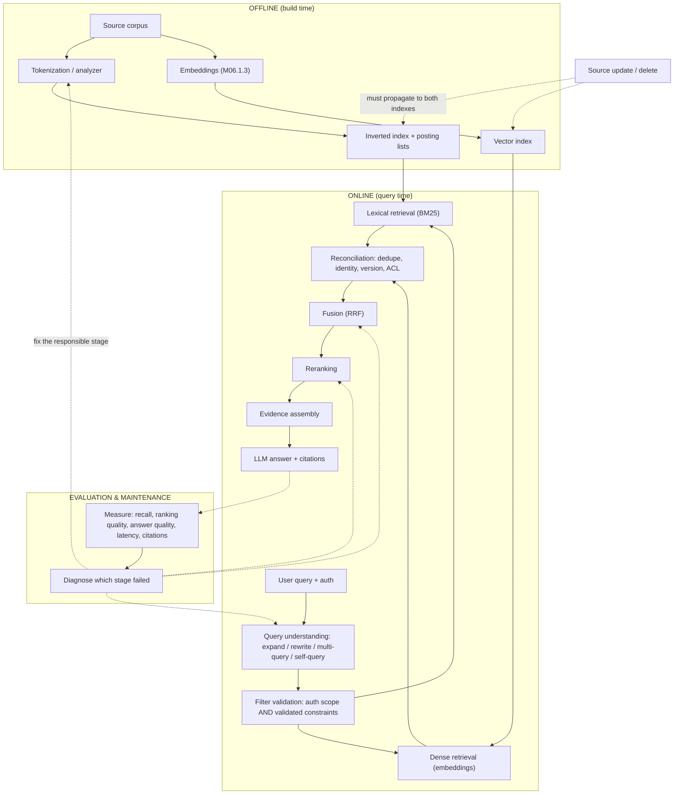
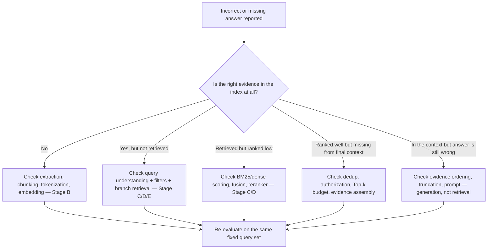
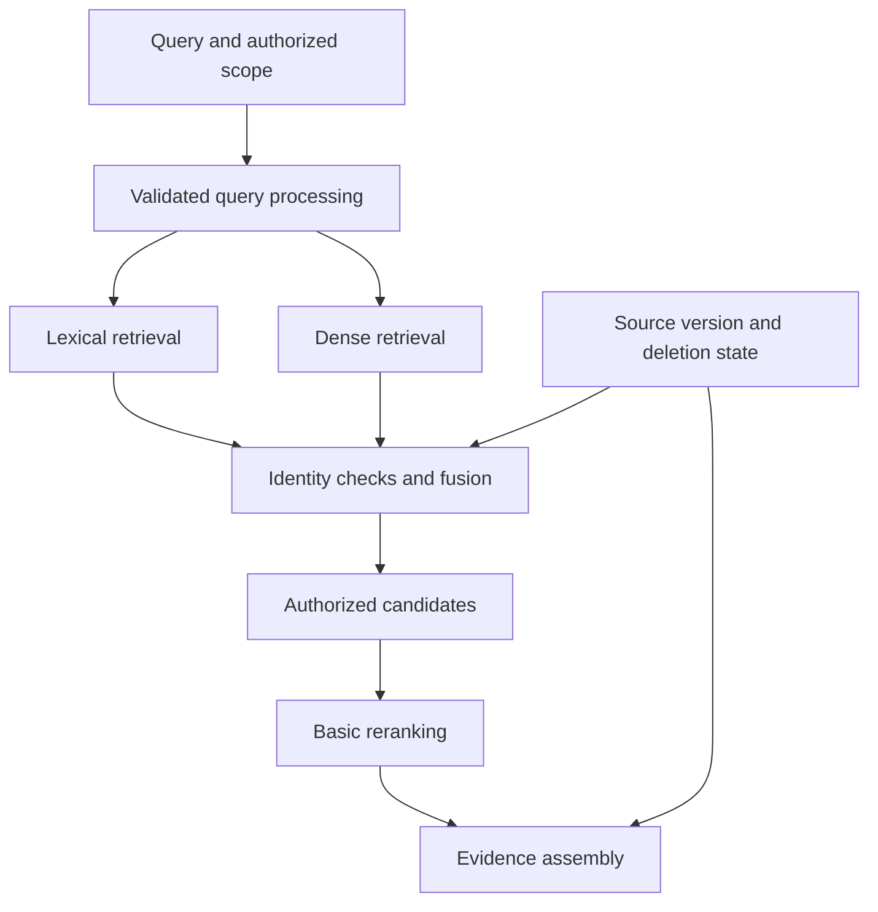

# M06.2.1 — Retrieval and Information Retrieval Fundamentals

**Unified study guide: Note 2 as the technical foundation + selected Note 1 additions**  
**Path:** Core · **Depth:** L2 foundation; L3 through demonstrated project work  
**Prerequisites:** M03, M05 and M07; ingestion, chunking and embeddings from M06.1  
**Purpose:** Understand how search produces useful candidates and how lexical, dense and hybrid approaches complement each other.  
**Completion evidence:** Compare retrieval baselines on the same queries, explain ranking behavior, preserve permissions and source versions, diagnose retrieval failures by stage, and cite the evidence used.

## How to use this guide

- **Learn the detailed concepts first:** Part II preserves Note 2's explanations, worked examples, formulas, code, project exercise and references.
- **Use the lifecycle model to connect the concepts:** Part I adds the build-time/query-time flow, stage cards, handoffs and cross-cutting controls from Note 1.
- **Practise immediately after learning:** New concept, interview and junior-to-senior questions are placed after the relevant topics. The original Note 2 practice bank remains intact near the end.
- **Diagnose before tuning:** Use the troubleshooting flow and failure table to identify the earliest stage where correct evidence was lost.

## Table of Contents

### Part I — Retrieval Mental Model

- I.1 [Core Insight](#1-core-insight)
- I.2 [Big-Picture Build-Time and Query-Time Flow](#2-big-picture-flow)
- I.3 [Stage Cards](#3-stage-cards)
- I.4 [Handoffs Between Stages](#4-handoffs-between-stages)
- I.5 [Cross-Cutting Concerns](#5-cross-cutting-concerns)
- I.6 [Troubleshooting Decision Flow](#6-troubleshooting-decision-flow)
- I.7 [Failure-to-Stage Diagnostic Table](#7-failure-to-stage-diagnostic-table)

### Part II — Detailed Study Notes

## Section 1: Foundations of Information Retrieval

- 1.1 [Information Retrieval Fundamentals](#1-information-retrieval-fundamentals)
- 1.2 [Overall Concept Map](#14-overall-concept-map)

## Section 2: Lexical Indexing and Text Processing

- 2.1 [Inverted Indexes and Posting Lists](#2-inverted-indexes-and-posting-lists)
- 2.2 [Tokenization and Linguistic Processing](#3-tokenization-and-linguistic-processing)

## Section 3: Lexical Search and Ranking

- 3.1 [Boolean, Phrase and Fuzzy Search](#4-boolean-phrase-and-fuzzy-search)
- 3.2 [TF-IDF and BM25](#5-tf-idf-and-bm25)
- 3.3 [Field Boosting, Facets and Filters](#6-field-boosting-facets-and-filters)
- 3.4 [First-Stage Retrieval and Top-k](#7-first-stage-retrieval-and-top-k)

## Section 4: Dense, Sparse and Hybrid Retrieval

- 4.1 [Dense, Sparse and Hybrid Search](#8-dense-sparse-and-hybrid-search)
- 4.2 [Search and Vector Index Combinations](#9-search-and-vector-index-combinations)
- 4.3 [Reciprocal Rank Fusion](#10-reciprocal-rank-fusion)

## Section 5: Query Understanding and Transformation

- 5.1 [Query Expansion, Rewriting and Multi-Query Retrieval](#11-query-expansion-rewriting-and-multi-query-retrieval)
- 5.2 [Self-Querying and Controlled Filters](#12-self-querying-and-controlled-filters)

## Section 6: Application and Evaluation

- 6.1 [Worked Baseline Comparison and Project Exercise](#13-worked-baseline-comparison-and-project-exercise)
- 6.2 [Troubleshooting Decision Flow](#6-troubleshooting-decision-flow)
- 6.3 [Failure-to-Stage Diagnostic Table](#7-failure-to-stage-diagnostic-table)

## Section 7: Review, Practice, and References

- 7.1 [Glossary and Final Revision Sheet](#15-glossary-and-final-revision-sheet)
- 7.2 [Practice and Interview Questions](#16-practice-and-interview-questions)
- 7.3 [Section-Wise Synthesis Questions](#17-section-wise-synthesis-questions)
- 7.4 [Cross-Lifecycle Scenario](#18-cross-lifecycle-scenario)
- 7.5 [Topics for a Future Extension](#19-topics-for-a-future-extension)
- 7.6 [Sources and Further Reading](#20-sources-and-further-reading)
- 7.7 [Recommended Learning Order](#appendix-a-recommended-learning-order)
- 7.8 [Suggested File Structure](#appendix-b-suggested-file-structure)
---

# Part I — Retrieval mental model

## 1. Core insight

Retrieval is **not** "search for similar text." It's the design of a pipeline that finds **eligible, relevant evidence** — where eligibility (authorization, version, lifecycle state) is enforced independently of relevance (how well something matches the query), and no downstream stage can fix a failure that happened upstream.

Three things must never be conflated:

| Concept | What it answers | Lives at |
|---|---|---|
| **Matching** | Does the text contain/resemble the query? | Lexical + dense retrieval |
| **Relevance** | Does this actually answer the question? | Ranking, reranking |
| **Eligibility** | Is the user allowed to see this, and is it current? | Filters, enforced at every branch |

Everything else (indexing, ranking formulas, hybrid fusion, query rewriting, evaluation) exists to serve one path:

**Find what's eligible, rank what's relevant, never let a downstream stage paper over an upstream miss.**

Two lifecycles, same shape as Chunking and Embeddings:

- **Build time (offline):** tokenize, build inverted index, build vector index.
- **Query time (online):** authenticate, understand the query, filter, retrieve (lexical + dense), fuse, rerank, assemble evidence.

A reranker cannot recover a document the first-stage retriever never found. RRF cannot fix a wrong candidate. Evaluation is the stage that tells you *which* earlier stage actually broke.

---

## 2. Big-picture flow



---


## 3. Stage cards

### Stage A: Foundations

- **Purpose:** install the core distinctions before any technique.
- **Key ideas:** corpus/query/index/relevance-judgment; matching ≠ relevance; retrieval ≠ generation; candidate generation vs reranking.
- **Failure modes:** assuming keyword overlap proves relevance; blaming the LLM/prompt for a retrieval failure; expecting a reranker to recover an unretrieved document.

### Stage B: Lexical indexing & text processing

- **Purpose:** turn raw text into a structure that can be searched efficiently and correctly.
- **Key decisions:** tokenizer/analyzer behavior; stemming vs lemmatization vs neither; stop-word handling (especially negation words); exact-match fields for identifiers vs analyzed fields for prose.
- **Failure modes:** query/document analyzer mismatch; identifier collapse (M-104 vs M-140); stripping "not"/"without" and inverting an instruction's meaning; chunking changes silently shifting document-granularity statistics.

### Stage C: Lexical search & ranking

- **Purpose:** decide what counts as a match and how matches should be ordered.
- **Key decisions:** Boolean vs phrase vs fuzzy matching; TF-IDF/BM25 as the ranking baseline; field boosting weights; which conditions are filters (mandatory) vs boosts (preference); Top-k budget at each handoff point.
- **Failure modes:** fuzzy-matching two different identifiers into each other; treating a security condition as a boost instead of a filter; facet counts leaking the existence of unauthorized documents; over-strong title boost burying the real evidence.

### Stage D: Dense, sparse & hybrid retrieval

- **Purpose:** add semantic matching alongside exact-term matching, and combine both safely.
- **Key decisions:** when hybrid is worth the extra cost/latency; one combined engine vs separate lexical + vector engines; how to fuse ranked lists (RRF) without miscalibrated score addition; how to keep both indexes in sync.
- **Failure modes:** index drift (lexical has v4, vector still has v3); a deleted source surviving in one branch; both branches independently returning the same wrong document (fusion can't fix shared error); adding BM25 and cosine scores directly.

### Stage E: Query understanding & transformation

- **Purpose:** turn what the user typed into what the system should actually search for, without changing their intent or their authorization.
- **Key decisions:** expansion vs rewriting vs multi-query vs self-querying; how many reformulations are worth the latency; what self-querying is allowed to propose vs what only the trusted backend may decide.
- **Failure modes:** query drift (expanding "port" into networking instead of harbor); a rewrite silently dropping negation or flipping a date condition; an LLM-proposed filter requesting another tenant's data; unbounded multi-query generation.

### Stage F: Application & evaluation

- **Purpose:** prove the system actually works, and find out which stage is responsible when it doesn't.
- **Key decisions:** what counts as a fair baseline (properly tuned BM25, not a weakened one); representative query categories (exact ID, paraphrase, phrase, typo, structured, cross-tenant); which metric answers which question (Hit@k = coverage, nDCG@k = ranking quality, latency, citation accuracy).
- **Failure modes:** a rising average hiding a regression on a critical query category; confounding multiple changes (model + chunking + reranker) in one benchmark; stopping the investigation at "retrieval looked fine" without checking evidence assembly and generation.

### Stage G: Revision & cross-section synthesis

- **Purpose:** hold the terminology and the dependency chain in one place so you can answer "how does X relate to Y" questions, which is what distinguishes a senior answer from a definition-recital.
- **Key relationships to keep straight:** tokenization → BM25 inputs; chunking → lexical ranking statistics; embeddings → dense retrieval; RRF → combines ranks, not source authority; reranking → cannot recover candidates never retrieved.

---


## 4. Handoffs between stages

| From | To | What is handed over | Typical break |
|---|---|---|---|
| Chunking (M06.1.2) | B | Approved chunk text + source span | Chunk boundaries shift document-length statistics |
| B | C | Tokenized, analyzed index | Query/document analyzer mismatch |
| C / D | Reconciliation | Raw candidates from each branch | Incompatible score scales combined naively |
| Reconciliation | Fusion (RRF) | Deduplicated, eligibility-checked candidates | Stale version or deleted source not filtered first |
| Fusion | Reranking | Fused ranked list | Candidate missing because it was never retrieved upstream |
| Reranking | Evidence assembly | Reordered, smaller candidate set | Budget/truncation drops the right passage |
| Evidence assembly | LLM | Final context + citations | Correct evidence passed, but misinterpreted by generation |
| E (query understanding) | C/D | Expanded/rewritten/filtered query | Rewrite changes intent (drift, dropped negation) |
| F (evaluation) | any stage | Diagnosis of which stage failed | Fix applied to the wrong stage (e.g., reprompting instead of fixing retrieval) |

---


## 5. Cross-cutting concerns

| Concern | B | C | D | E | F |
|---|---|---|---|---|---|
| Authorization | — | filters, not boosts | enforced per branch + after fusion | backend validates, model never decides | test authorized & unauthorized queries |
| Identity/versioning | stable chunk IDs | — | stable IDs across lexical+vector | preserved through rewrites | version-change regression tests |
| Matching vs relevance | tokenizer choices | Boolean/BM25 ≠ understanding | dense similarity ≠ relevance either | rewrite preserves intent, not just terms | separate coverage vs ranking vs answer metrics |
| Candidate budget | — | Top-k at each stage | branch budgets, fusion window | multi-query budget | measure recall vs latency tradeoff |

Related distinction often confused: **filter vs boost** (C) vs **similarity vs relevance** (A/D) vs **candidate recall vs ranking quality vs answer quality** (F) vs **expansion/rewrite changing intent** (E, "query drift").

---


## 6. Troubleshooting decision flow



Rule, same as Chunking and Embeddings: change one variable, re-evaluate, don't fix the prompt first.

---


## 7. Failure-to-stage diagnostic table

| Symptom | Likely stage | First check |
|---|---|---|
| Document has all the keywords but doesn't answer the question | A/C | Matching vs relevance — check context, version, equipment match |
| Exact ID search returns a different, similar-looking ID | B/C | Analyzer/fuzzy matching on identifier fields |
| "Not"/"without" condition seems ignored | B | Stop-word list, negation handling |
| BM25 ranking shifts after re-chunking, content unchanged | B/C | Document-length statistics, avgdl, corpus stats |
| Dense retrieval finds paraphrase, misses exact code | D | Hybrid needed — lexical branch for codes |
| Lexical and vector index disagree on current revision | D | Index synchronization, version propagation |
| Deleted document still returned | D/F | Deletion state not propagated to all branches |
| Facet shows a count the user can't actually open | C | Facets computed outside authorized result universe |
| Query rewrite flips a date/negation condition | E | Rewrite validation against original intent |
| LLM-proposed filter requests another tenant's data | E | Backend not validating/rejecting unsupported filter scope |
| Hit@20 high, nDCG@5 low | F | Candidates found but ranked/fused/reranked poorly |
| Overall average improves, one query category gets much worse | F | Category-level evaluation needed, not just aggregate |
| Retrieval trace looks correct, answer still wrong | F/generation | Evidence assembly ordering, truncation, or LLM interpretation |
| Increasing Top-k "fixes" nothing | C | Root cause is upstream (indexing/filters), not candidate volume |

---


# Part II — Detailed study notes

## 1. Information Retrieval Fundamentals

### Definition

**Information retrieval**, or IR, finds items that are useful for an information need. The user expresses that need through a query, and the system selects and often ranks documents, passages, records or other evidence.

A retrieval system has at least four important objects:

| Object | Meaning |
|---|---|
| Corpus | The collection being searched |
| Query | The representation of the user’s information need |
| Index | A structure that makes search practical |
| Relevance judgment | A decision about whether an item helps answer the need |

### Matching is not the same as relevance

A document containing every query word can still be the wrong source. It might discuss a different equipment model, an obsolete revision or a condition the user did not ask about.

Conversely, a useful passage may not contain the user’s wording. “Preventive maintenance” may answer a question about “avoiding unexpected breakdowns.” Different retrieval methods recognize different forms of matching.

### Retrieval and generation

Retrieval selects evidence. Generation turns evidence and instructions into an answer. A fluent answer cannot establish that retrieval succeeded, and a relevant retrieved passage does not guarantee that the generator uses it correctly.

This is why evaluation separates candidate coverage, ranking quality, context assembly, answer quality and citations. Fix the stage that failed instead of treating every incorrect answer as a prompting problem.

### Candidate generation versus reranking

First-stage retrieval searches a large corpus relatively efficiently and produces a candidate set. A reranker then applies a more detailed relevance assessment to that smaller set.

Basic reranking belongs in the main practical pipeline. It should not be postponed until every advanced RAG technique has been explored. However, it cannot recover a necessary passage that was absent from the candidate set.

### Key takeaway

**Retrieval should find the right eligible evidence, not merely similar text.** Eligibility includes authorization, current source state and task-specific constraints.

---

### NEW — Concept & Normal Recall

**A1.** What four objects are central to a well-evaluated IR system, and which one is most often skipped in a quick RAG build?

*Answer:* Corpus, query, index, and relevance judgment. Relevance judgment — an actual basis for deciding whether a retrieved item is useful — is the one most often skipped; teams build the corpus, index and query path, then never define what "relevant" means for evaluation, so they can't measure whether retrieval is working.

**A2.** Why is "candidate generation vs reranking" described as a one-way dependency rather than two independent stages?

*Answer:* Because reranking only operates on what candidate generation already found — it can reorder but never add. If candidate generation misses the right passage, no amount of reranking sophistication recovers it; the ceiling on final quality is set at the candidate generation stage.

### NEW — Interview

**A3 [Interview]:** A stakeholder says "our RAG answers are wrong, let's just use a smarter/bigger LLM." How do you respond before agreeing or disagreeing?

*Answer:* I'd ask to see the retrieval trace first — whether the correct evidence was retrieved and ranked, since a bigger LLM cannot generate a correct answer from evidence that was never retrieved or was buried below the cutoff. Only once retrieval is confirmed correct does it make sense to investigate the generation model itself.

### NEW — Scenario (Junior → Senior)

**A4 [Junior Scenario]:** A new teammate assumes that if a search box "finds documents," the system is doing information retrieval correctly by definition. What's missing from that view?

*Answer:* Finding documents is necessary but not sufficient — IR also requires that what's found is actually relevant to the specific information need, not just structurally matched. A search box that reliably returns the wrong revision or wrong equipment model is "finding documents" while failing at IR's actual job.

**A5 [Mid-Level Scenario]:** Your team reports "retrieval accuracy is 95%," measured as the fraction of queries where at least one returned document contains the query keywords. Why would a senior reviewer be skeptical of this number?

*Answer:* That metric measures matching, not relevance or correctness — it says nothing about whether the right revision, the right equipment, or the right conditions were retrieved. A document can score 100% on keyword presence and still be the wrong source. The metric needs to be redefined around relevance judgments, not keyword presence.

**A6 [Senior Situational]:** Leadership wants a single "RAG quality score" that the whole team optimizes against. Using the Foundations concepts, explain why collapsing retrieval and generation into one number is risky.

*Answer:* A single blended score can't tell you whether a drop came from retrieval (wrong/missing evidence) or generation (misusing correct evidence) — exactly the retrieval-vs-generation distinction this section establishes. Teams optimizing a blended metric can "fix" generation symptoms (reprompting) that are actually retrieval failures, making the system look better on the metric while the underlying retrieval problem persists untouched.


---

## 2. Inverted Indexes and Posting Lists

**Syllabus coverage: M06.2.1.1 — Classical search concepts.**

### Inverted index

An **inverted index** maps each indexed term to the documents or passages containing it. Instead of scanning every document for a word, the system looks up that word’s entries.

The Stanford IR textbook describes the dictionary-and-postings structure and its construction from tokenized, normalized documents. The conceptual change is from “document to words” to “word to documents.” [Source: Introduction to Information Retrieval, inverted index construction](https://nlp.stanford.edu/IR-book/html/htmledition/a-first-take-at-building-an-inverted-index-1.html)

### Posting lists

A **posting list** contains the document IDs associated with a term. A posting may also store term frequency, positions, field information or other data used in scoring and matching.

Fictional corpus:

| ID | Text |
|---|---|
| D1 | unit-a indicator inspection |
| D2 | unit-b inspection schedule |
| D3 | invoice payment schedule |

Selected posting lists:

| Term | Documents |
|---|---|
| inspection | D1, D2 |
| schedule | D2, D3 |
| indicator | D1 |
| invoice | D3 |

For **inspection AND schedule**, the system intersects two lists and returns D2. For **indicator OR invoice**, it unions the relevant lists and returns D1 and D3.

### Why document granularity matters

In a RAG corpus, an indexed “document” may actually be a chunk. Its length and term statistics therefore reflect the chunking design. Re-chunking can change lexical rankings even when the original source wording is unchanged.

Keep stable source identity alongside index-local document IDs. Search-engine IDs help the engine find records; source IDs and versions help the application verify authority, permissions and citations.

### Key takeaway

**Posting lists make exact-term search efficient, and their stored information determines which matching operations are possible.**

## 3. Tokenization and Linguistic Processing

### Tokenization

Tokenization divides text into units for indexing and querying. The analyzer may also normalize case, punctuation and word forms. Query processing must be compatible with index processing.

The Stanford text explains that tokenization choices affect which queries can match, especially for punctuation, hyphenation, identifiers and language-specific conventions. This makes tokenization a retrieval design decision, not merely text cleanup. [Source: Stanford IR textbook, tokenization](https://nlp.stanford.edu/IR-book/html/htmledition/tokenization-1.html)

### Domain examples

A manual search may need to distinguish M-104, M-140 and M104. A software corpus may need to preserve C++, C# and method names. Removing punctuation indiscriminately can collapse meaningful distinctions.

A practical design can store multiple fields: a full-text field with linguistic analysis and an exact keyword field for identifiers. The query can use each according to its purpose.

### Stop-word handling awareness

Stop words are common terms that some systems remove or treat specially. Examples in English include articles and prepositions. Removing them can reduce index noise, but it can also damage phrases or meaning.

Words such as “not,” “without,” “before” and “after” may be critical in procedures. A generic stop-word list should not be applied blindly to every domain. Modern systems can retain common terms when they are useful; stop-word removal is a choice, not an unavoidable IR stage.

### Stemming awareness

**Stemming** uses rules or algorithms to reduce related word forms to a shared stem. The result need not be a valid dictionary word. It can improve recall when “inspect,” “inspection” and “inspecting” should match, but aggressive conflation can also merge distinct terms.

### Lemmatization awareness

**Lemmatization** aims to reduce words to their dictionary base form, often using linguistic information. It can be more sensitive to grammatical context and language than simple stemming.

The Stanford textbook distinguishes these approaches and explains their role in grouping morphological variants. Their usefulness remains task-dependent; neither should be assumed to improve every query. [Source: Stanford IR textbook, stemming and lemmatization](https://nlp.stanford.edu/IR-book/html/htmledition/stemming-and-lemmatization-1.html)

### Practical analyzer tests

Build a small test table containing exact codes, plurals, hyphenated names, abbreviations, negation, mixed case and relevant languages. Record expected indexed terms and matching behavior.

If a user searches Unit-A and receives only Unit-B, inspect analyzer output and field selection before blaming the ranking formula.

---

### NEW — Concept & Normal Recall

**B1.** What's the difference between a forward index and the document-granularity issue described for RAG corpora?

*Answer:* A forward index maps each document to its terms (the opposite direction from an inverted index), while the document-granularity issue is about what counts as "a document" in the first place — in a RAG system the indexed unit is usually a chunk, not a whole source document, so its length and term statistics reflect chunking decisions, not the original document's true statistics.

**B2.** Why does a posting list storing term *positions* unlock capabilities that a posting list storing only term *presence* cannot?

*Answer:* Positions are what make phrase and proximity search possible — without them, the index can tell you a document contains all the words in a phrase, but not whether they appear in the required order or close together, which is exactly the gap that lets "return the invoice" and "service schedule" falsely satisfy a search for "return to service."

### NEW — Interview

**B3 [Interview]:** You're setting up search for a new technical corpus. What's the first analyzer decision you'd make, before choosing stemming or lemmatization?

*Answer:* Whether identifiers (part numbers, equipment codes) need a separate exact-match field from the analyzed prose field — this decision shapes everything downstream (stemming/lemmatization choices only apply to the prose field, never to identifiers), so getting it backwards means every later tuning decision has to be redone.

### NEW — Scenario (Junior → Senior)

**B4 [Junior Scenario]:** A user reports that searching "inspections" (plural) returns zero results, even though many documents say "inspection" (singular). What's the likely cause?

*Answer:* The analyzer likely isn't applying stemming or lemmatization, so "inspections" and "inspection" are indexed as two completely distinct tokens. Adding appropriate word-form normalization to the analyzer (applied consistently at both index and query time) should fix this.

**B5 [Mid-Level Scenario]:** After switching from stemming to lemmatization, search for "running" (the gerund, as in "running a procedure") stops matching documents that say "ran" and "runs." Why might this regression happen, and is lemmatization automatically "better" here?

*Answer:* Lemmatization's dictionary-based reduction can be more conservative or language/context-sensitive than stemming's rule-based conflation, so it may not group variants that the simpler stemmer happened to group correctly. Neither method is automatically better — this is exactly why Section B stresses testing representative domain terms (plurals, verb forms, hyphenation) before committing to one approach.

**B6 [Senior Situational]:** Your corpus mixes English procedural text with embedded structured identifiers in multiple formats (M-104, M104, M_104 used inconsistently by different authors over the years). Analyzer changes keep "fixing" one format while breaking another. What's the actual architectural fix?

*Answer:* Stop trying to find one analyzer configuration that handles all three formats — instead, normalize identifiers to one canonical form at ingestion time (before indexing), store that canonical form in an exact-match keyword field, and keep the original text for display/citation. This moves the fix from "clever analyzer" to "data normalization," which is more maintainable and testable than chasing analyzer edge cases indefinitely.


---

## 4. Boolean, Phrase and Fuzzy Search

### Boolean retrieval

Boolean retrieval combines conditions using operators such as AND, OR and NOT. It asks whether a record satisfies a logical expression, not necessarily how strongly it should rank.

Examples:

```text
inspection AND indicator
maintenance OR servicing
inspection AND NOT archived
```

In an application, archived status should usually be a trusted metadata field rather than just a word excluded from body text. A document can contain the sentence “This procedure is not archived” while its lifecycle state says otherwise.

### Phrase search

Phrase search looks for a sequence of terms in the specified order, with behavior governed by the analyzer and any permitted positional gap or slop.

A positional index records where terms occur so the engine can test phrase and proximity conditions. This is different from merely checking that all words appear somewhere in the same document. [Source: Stanford IR textbook, positional indexes](https://nlp.stanford.edu/IR-book/html/htmledition/positional-indexes-1.html)

For example, “return to service” should differ from a document containing “return the invoice” and “service schedule” in separate sections. Exact source quotations and specialized multi-word terms can benefit from phrase search.

### Fuzzy and typo-tolerant matching awareness

Fuzzy matching allows small spelling differences, often measured using edit distance. It can help when a user types “inspeciton” instead of “inspection.”

Elasticsearch’s fuzzy-query documentation describes term matching through edit-distance expansions and exposes controls that bound those expansions. Its implementation details are product-specific, but the general tradeoff is broader matching versus additional work and possible false positives. [Source: Elasticsearch fuzzy query](https://www.elastic.co/docs/reference/query-languages/query-dsl/query-dsl-fuzzy-query)

### Why identifiers need care

M-104 and M-140 may be different manuals, not typos. Automatically correcting one to the other can return a plausible but wrong procedure.

Use exact matching for identifiers when the query clearly specifies one. If no result exists, a controlled suggestion can ask whether the user meant another identifier. Do not silently replace a critical code simply because it is one edit away.

### Comparison

| Method | Useful for | Typical failure |
|---|---|---|
| Boolean | Mandatory term combinations | Relevant paraphrases omitted |
| Phrase | Exact expressions and ordered terms | Analyzer changes alter matching |
| Fuzzy | Ordinary spelling mistakes | Similar identifiers conflated |
| Semantic | Different wording with related meaning | Exact conditions or codes confused |

## 5. TF-IDF and BM25

### Term frequency

**Term frequency**, or TF, measures how often a term occurs in a document. Repetition can indicate relevance, but its benefit should not grow without limit. A long document repeating “inspection” 100 times is not necessarily more useful than a precise paragraph using it twice.

### Inverse document frequency

**Document frequency**, \(df(t)\), is the number of indexed documents containing term \(t\). **Inverse document frequency**, or IDF, gives greater weight to terms that occur in fewer documents.

A simple unsmoothed form is:

\[
\operatorname{IDF}(t)=\log\frac{N}{df(t)},
\]

where \(N\) is the number of indexed documents. Implementations use different smoothing conventions. The key intuition is that a term appearing everywhere carries less discriminating information. [Source: Stanford IR textbook, inverse document frequency](https://nlp.stanford.edu/IR-book/html/htmledition/inverse-document-frequency-1.html)

### TF-IDF

TF-IDF combines within-document frequency with across-corpus rarity. A simple formulation is:

\[
w(t,d)=\operatorname{TF}(t,d)\operatorname{IDF}(t).
\]

The exact TF transform, normalization and query scoring method vary. Treat TF-IDF as a family of weighting schemes rather than one universal implementation.

### BM25

BM25 is a lexical ranking function that combines term rarity, saturating term frequency and document-length normalization. A common form is:

\[
\operatorname{BM25}(q,d)=
\sum_{t\in q}\operatorname{IDF}(t)
\frac{f(t,d)(k_1+1)}{
f(t,d)+k_1\left(1-b+b\frac{|d|}{\operatorname{avgdl}}\right)}.
\]

Here:

- \(f(t,d)\) is the term frequency in the document.
- \(|d|\) is document length under the index’s analysis.
- \(\operatorname{avgdl}\) is average indexed-document length.
- \(k_1\) controls the saturation behavior of term frequency.
- \(b\) controls the amount of length normalization.

The Stanford textbook develops BM25 from probabilistic retrieval, including frequency and length effects. Lucene documents a positive IDF variant of \(\log(1+(N-df+0.5)/(df+0.5))\). Exact scoring details differ by implementation, so reproduce the deployed engine’s behavior when precision matters. [Sources: Stanford IR textbook, BM25](https://nlp.stanford.edu/IR-book/html/htmledition/okapi-bm25-a-non-binary-model-1.html), [Lucene BM25Similarity](https://lucene.apache.org/core/9_9_1/core/org/apache/lucene/search/similarities/BM25Similarity.html)

### Worked BM25 calculation

For an invented one-term query, let \(N=100\), \(df=5\), \(k_1=1.2\), \(b=0.75\), and document length equal average length.

Using the positive IDF form:

\[
\operatorname{IDF}=\log\left(1+\frac{95.5}{5.5}\right)\approx2.9104.
\]

If the term occurs once, the frequency factor is 1, so its contribution is approximately 2.9104.

If it occurs three times, the factor is:

\[
\frac{3\times2.2}{3+1.2}=1.5714.
\]

The contribution is approximately 4.5734. Tripling the occurrences does not triple the score, illustrating saturation. These parameter values are illustrative, not an instruction to use one setting for every corpus.

### Practical limitations

BM25 does not directly understand whether a passage answers the question, contains a contradiction, has been superseded or belongs to the user’s tenant. It also depends on analyzer behavior and collection statistics.

Nevertheless, it is a valuable baseline, especially for precise terminology, names, codes and rare phrases. A dense retriever should demonstrate improvement over a properly configured lexical baseline rather than over a deliberately weak keyword search.

## 6. Field Boosting, Facets and Filters

### Field boosting

Field boosting gives different relevance weight to matches in different fields. A match in a document title or equipment-code field may deserve more influence than a match in a long body or repeated footer.

For an invented manual search, a scoring design might prioritize exact equipment-code matches, then title matches, then section headings, then body terms. The weights must be evaluated; an overly strong title boost can suppress the only body passage containing an answer.

A boost changes ranking. It is not a hard eligibility rule. A sufficiently strong match elsewhere may still outrank a boosted result depending on the scoring design.

### Faceted search

Facets summarize a result set by structured attributes such as document type, equipment family, language or revision status. Users can use them to narrow the search interactively.

Facet counts can reveal information. If an unauthorized document contributes to a count or category label, the interface may expose its existence even when its text is hidden. Compute facets over the authorized result universe.

### Metadata filters

Filters enforce conditions such as tenant, permission scope, approved status, effective date or equipment model. Elasticsearch explicitly distinguishes scored query context from binary filter context, a useful conceptual separation for search design. [Source: Elasticsearch query and filter context](https://www.elastic.co/docs/reference/query-languages/query-dsl/query-filter-context)

### Hard versus soft requirements

| Requirement | Better conceptual treatment |
|---|---|
| User belongs to tenant A | Mandatory server-derived security constraint |
| Source is not deleted | Mandatory lifecycle constraint |
| Query asks for approved current manual | Authority/version eligibility rule |
| Title contains the topic | Ranking signal |
| User prefers concise sources | Possible ranking or assembly preference |

Never replace a mandatory tenant filter with a boost for the tenant name. A security boundary cannot depend on which result obtains the highest score.

### Filter correctness and recall

A filter can reduce recall if metadata is wrong or the constraint is overly restrictive. “After 2024” is not the same as “effective during 2024.” Source-created time, publication time and effective time must not be confused.

When no results appear, inspect the eligible corpus and filter interpretation before expanding the query or relaxing important controls. Security constraints must not be dropped to make the result list look fuller.

## 7. First-Stage Retrieval and Top-k

**Syllabus coverage: M06.2.1.2 — First-stage retrieval.**

### Top-k

Top-k retrieval returns up to \(k\) highest-ranked eligible candidates. The parameter controls candidate count; it is not a guarantee of quality or sufficient evidence.

Distinguish several counts:

- Candidates requested from each retrieval branch.
- Candidates retained after fusion and deduplication.
- Candidates sent to the reranker.
- Evidence units selected for the answer.

For example, retrieving 50 lexical and 50 dense candidates does not mean sending 100 passages to the answering model. After union, authorization, deduplication and reranking, perhaps five evidence units fit the final task. The numbers are illustrative.

### Recall and precision tradeoff

A larger candidate pool can increase the chance of including required evidence, but it also increases downstream work and may introduce more difficult distractors. A small pool can be efficient while missing the answer entirely.

Tune candidate count using retrieval coverage, reranker quality, latency and evidence-token cost. The right budget may vary by query type.

### Filtering and approximate search

Some search systems can apply filters during candidate generation; others may filter a retrieved pool afterward. Post-filtering can leave too few authorized candidates if many high-scoring items were ineligible.

Whatever the engine’s mechanics, do not expose unauthorized content to external rerankers, models or users. If the eligible pool is too small, retrieve more within the allowed scope or use a safer fallback. Do not remove the authorization requirement.

### Key takeaway

**Candidate recall sets a ceiling on what reranking can achieve.** The candidate budget should be measured, not guessed.

---

### NEW — Concept & Normal Recall

**C1.** Why does BM25's term-frequency saturation matter specifically for technical/safety documents, beyond general ranking quality?

*Answer:* Without saturation, a document that repeats a keyword many times (even accidentally, like a poorly written boilerplate section) could outrank a precise, correct passage that mentions the term only once or twice — saturation keeps repetition from being gamed or accidentally dominating ranking, which matters more when the "loser" document might be the one with the actually correct, concise answer.

**C2.** Give one example where a metadata filter and a field boost look similar on the surface but must never be implemented the same way.

*Answer:* "Approved documents only" sounds like it could be a boost (rank approved documents higher) or a filter (exclude non-approved documents entirely) — but if it's a compliance/safety requirement, it must be a hard filter; implementing it as a boost means an unapproved document can still surface and be acted on, just ranked lower, which defeats the purpose of the requirement.

### NEW — Interview

**C3 [Interview]:** How would you explain to a non-technical stakeholder why "just add more Top-k" doesn't fix a retrieval quality complaint?

*Answer:* Increasing Top-k only widens how many candidates are considered — it does nothing to fix a broken analyzer, a missing document in the index, or a scoring formula that ranks the wrong thing highly; if the real evidence was never indexed or never matched the query at all, a larger candidate pool just returns more of the same wrong results, plus added latency and cost.

### NEW — Scenario (Junior → Senior)

**C4 [Junior Scenario]:** A junior developer uses fuzzy search by default on every field, including equipment ID fields, to "be more forgiving with user typos." What's the risk, and what's the better default?

*Answer:* Fuzzy matching on equipment IDs can silently substitute a different real equipment code for a typo (M-104 vs M-140 is one edit apart), returning a plausible-looking but wrong procedure with no indication anything was substituted. The better default is exact matching on identifier fields, with a separate, clearly-labeled "did you mean X?" suggestion mechanism rather than silent substitution.

**C5 [Mid-Level Scenario]:** Two near-identical queries — "inspection schedule" and "schedule inspection" — return very different top results in your Boolean-only search system. Why might this happen, and would phrase search fix it?

*Answer:* A pure Boolean AND search treats term order as irrelevant, so both queries should actually return the same candidate set — if results differ significantly, something else is likely at play (different analyzer behavior per query path, or additional scoring factors like query-term-order matching that Boolean search alone shouldn't apply). Phrase search would deliberately make the two queries behave differently (since it does care about order), so it's the wrong fix here — the real issue is diagnosing why "Boolean-only" search isn't actually order-insensitive in practice.

**C6 [Senior Situational]:** Your search system passes a correctness audit (all mandatory filters verified as hard restrictions, not boosts) but a penetration test still finds that the number of facet categories shown changes depending on which user is logged in — and an attacker uses this to infer that a confidential project exists. What does this reveal about your filter/boost model, and how do you fix it?

*Answer:* It reveals that filters were correctly enforced on the final *document* results but not on the aggregation layer (facets) built on top of the unfiltered or partially-filtered candidate set — the facet count itself became an unintended information-disclosure channel. The fix is to compute facets strictly from the same authorized result universe that final results come from, never from a broader pre-filter pool, and to test facets specifically (not just document-level results) for authorization leaks during security review.


---

## 8. Dense, Sparse and Hybrid Search

### Dense search

Dense search compares compatible query and document embeddings using a similarity or distance function. It can retrieve related wording without exact term overlap.

Dense Passage Retrieval provides a primary research example of learned dual-encoder passage retrieval. Its results demonstrate the possibility of effective dense candidate generation under the evaluated conditions, not the universal superiority of dense search for every source collection. [Source: Dense Passage Retrieval](https://arxiv.org/abs/2004.04906)

Dense search can struggle with exact identifiers, numerical distinctions, domain shift and contradictory statements. It still needs metadata filters and source validation.

### Sparse search

Sparse search uses representations with relatively few active dimensions. Traditional term-based methods such as TF-IDF and BM25 are central examples; learned sparse encoders are another family.

Do not use “sparse” as a synonym for “simple.” A learned sparse system can use neural models to generate term weights or expansions. The important distinction concerns representation and retrieval behavior.

### Hybrid search

Hybrid search combines complementary retrieval signals, commonly lexical and dense retrieval. One branch may find a rare equipment code while the other finds a relevant paraphrase.

Hybrid retrieval can improve coverage when its branches make different errors. It can also add latency, duplicate candidates and noise. If both branches consistently retrieve the same wrong material, combining them does not fix the underlying problem.

### Comparison

| Query type | Lexical hypothesis | Dense hypothesis | Hybrid opportunity |
|---|---|---|---|
| Exact manual code | Often strong | May confuse close codes | Preserve exact-code candidate |
| Natural paraphrase | May miss terminology | May capture meaning | Add semantically related passage |
| Negated condition | Matches shared wording | May rank contradiction highly | Needs reranking and evidence checks |
| Current revision | Cannot infer lifecycle alone | Cannot infer lifecycle alone | Shared authority filter required |
| Cross-language query | Depends on language handling | Depends on model fit | Combine approved language strategies |

These are hypotheses to test, not a replacement for evaluation.

## 9. Search and Vector Index Combinations

### One system or separate systems

A platform may hold lexical and vector indexes in one search engine, or combine a search engine with a separate vector database. Either design can support hybrid retrieval if identity and control metadata remain consistent.

| Design | Potential advantage | Main integration responsibility |
|---|---|---|
| Combined engine | Shared query and operational surface | Verify filtering and ranking behavior |
| Separate engines | Specialized capabilities and scaling | Synchronize IDs, versions, ACLs and deletion |
| Small in-memory baseline | Transparent experiments | Limited production scale and durability |

Do not select architecture from the word “vector database” alone. Determine what the system needs to store, filter, update, audit and serve.

### Consistency problem

If the lexical index contains manual v4 but the vector index still contains v3, fusion can mix contradictory evidence. If a source is deleted from only one branch, hybrid search can resurrect it through the other.

Use stable source IDs, immutable revision identities and explicit index-generation information. Apply eligibility checks after branch results are combined as well as within each branch’s authorized search scope.

### A useful result contract

Each branch should return enough information to reconcile candidates:

```json
{
  "chunk_id": "tenant-A:M-104:v4:section-3.2:02",
  "document_id": "tenant-A:M-104",
  "version_id": "v4",
  "retrieval_branch": "lexical",
  "rank": 3,
  "raw_score": 7.4,
  "index_generation": "manuals-2026-10-20"
}
```

This schema is conceptual. The raw score’s meaning belongs to the named branch and configuration. Do not compare it directly with an unrelated vector score.

## 10. Reciprocal Rank Fusion

**Syllabus coverage: M06.2.1.3 — Fusion and query improvement.**

### Definition

**Reciprocal Rank Fusion**, or RRF, combines ranked lists using positions instead of requiring raw score calibration.

A common form is:

\[
\operatorname{RRF}(d)=\sum_{j}\frac{1}{c+r_j(d)},
\]

where \(r_j(d)\) is the one-based rank of candidate \(d\) in list \(j\), and \(c\) is a positive rank constant. A candidate absent from a list contributes zero for that list.

Elasticsearch documents this method for combining result sets with different relevance indicators. The rank constant and the window of results retained from each branch affect the merged output. [Source: Elasticsearch reciprocal rank fusion](https://www.elastic.co/docs/reference/elasticsearch/rest-apis/reciprocal-rank-fusion)

### Worked example

Use an illustrative rank constant of 60:

| Candidate | Lexical rank | Dense rank | RRF score |
|---|---:|---:|---:|
| A | 1 | 3 | 0.032266 |
| B | 2 | 1 | 0.032522 |
| C | 3 | Absent | 0.015873 |
| D | Absent | 2 | 0.016129 |

The fused order is B, A, D, C. B benefits from ranking near the top of both branches.

### Runnable RRF example

```python
from collections import defaultdict


def rrf(ranked_lists, rank_constant=60):
    if rank_constant <= 0:
        raise ValueError("rank_constant must be positive")
    scores = defaultdict(float)
    for ranked_ids in ranked_lists:
        seen = set()
        unique_ids = []
        for item_id in ranked_ids:
            if item_id not in seen:
                seen.add(item_id)
                unique_ids.append(item_id)
        for rank, item_id in enumerate(unique_ids, start=1):
            scores[item_id] += 1.0 / (rank_constant + rank)
    return sorted(scores.items(), key=lambda item: (-item[1], item[0]))


print(rrf([["A", "B", "C"], ["B", "D", "A"]]))
```

This standard-library example assumes the lists already contain eligible candidates from a consistent source snapshot. Production code must enforce those assumptions.

### RRF versus score addition

A BM25 score of 12 and a cosine score of 0.8 are not on a shared scale. Adding them directly gives the larger numeric scale undue influence. RRF avoids this particular problem by using ranks.

RRF also discards score-gap information. A branch’s first result barely beating its second is treated through ranks, just like a much larger gap. Weighted or score-calibrated fusion may be useful, but should be tested against a simple rank-fusion baseline.

### Two different k-like parameters

The retrieval candidate count and RRF rank constant are different concepts. Calling both k in code can create confusion. Prefer names such as candidate_limit and rank_constant.

---

### NEW — Concept & Normal Recall

**D1.** Why is "sparse" not a synonym for "simple keyword matching," and why does this distinction matter when evaluating a vendor's "sparse retrieval" claim?

*Answer:* Sparse only describes the representation shape (few active dimensions), not the method behind it — learned sparse retrieval models use neural networks to generate term weights and expansions, so they can capture some semantic behavior traditional TF-IDF/BM25 cannot. A vendor claiming "sparse retrieval" could mean either classic lexical scoring or a learned neural sparse model, and these have very different capabilities, so the claim alone doesn't tell you enough to evaluate it.

**D2.** What's the practical difference between "hybrid retrieval failed to find the answer" and "hybrid retrieval found the answer but ranked it low"?

*Answer:* The first is a candidate-generation/coverage problem — the document never entered the pool from either branch, which fusion and reranking cannot fix. The second is a ranking/fusion problem — the document is present but under-ranked, which reranking or RRF tuning can potentially address. Diagnosing which one you have determines whether you investigate indexing/retrieval or ranking/fusion.

### NEW — Interview

**D3 [Interview]:** In one or two sentences, why can't Reciprocal Rank Fusion "fix" a document that's outdated or that belongs to the wrong tenant?

*Answer:* RRF only combines the *positions* candidates hold in each branch's ranked list — it has no concept of source authority, version correctness, or permissions, so a wrongly-eligible or stale candidate that makes it into both branches' lists will simply get fused into a strong combined rank, not filtered out. Eligibility has to be enforced before or alongside fusion, never left to fusion to resolve.

### NEW — Scenario (Junior → Senior)

**D4 [Junior Scenario]:** A junior engineer notices the dense retrieval branch alone performs worse than BM25 alone on their evaluation set, and concludes "dense retrieval isn't ready, let's drop it." Is that the right conclusion?

*Answer:* Not necessarily — the right test is whether dense retrieval contributes *complementary* correct candidates that BM25 misses, even if its standalone score is lower; a branch with a lower overall score can still meaningfully improve hybrid recall if its errors don't overlap with BM25's errors. The decision should be based on hybrid performance and the specific query categories where dense helps, not on standalone ranking alone.

**D5 [Mid-Level Scenario]:** Your hybrid system shows good overall Hit@20, but a closer look shows the lexical branch alone already achieves nearly the same Hit@20, and the dense branch's unique contributions are rarely in the final top results after fusion. What would you investigate before declaring hybrid retrieval unnecessary?

*Answer:* Check whether the dense branch's correct-but-unique candidates are being under-ranked by the fusion method (e.g., an RRF rank_constant poorly tuned for the dense branch's typical rank positions) rather than assuming dense retrieval adds nothing — a fusion tuning problem can look identical to "dense retrieval isn't contributing" until you isolate fusion from retrieval. Only after ruling out fusion tuning would dropping dense retrieval be justified.

**D6 [Senior Situational]:** You're asked to design index consistency checks for a system where the lexical index updates within seconds of a source change, but the vector index re-embeds in a nightly batch job. What specific risk does this asymmetric update cadence create, and how do you mitigate it without forcing real-time re-embedding?

*Answer:* For up to 24 hours, the two branches can disagree about a document's current state (a same-day update or deletion is reflected lexically but not yet in the vector index), so hybrid search can surface a stale vector-branch candidate alongside a current lexical-branch one, or resurrect a just-deleted document through the vector branch. Mitigate this without real-time re-embedding by adding a lightweight, fast-propagating "current/deleted" control-metadata flag (separate from the heavy re-embedding pipeline) that's checked by *both* branches at query time regardless of how stale their underlying vector actually is — eligibility state propagates fast even when the vector itself updates slowly.


---

## 11. Query Expansion, Rewriting and Multi-Query Retrieval

### Query expansion

Expansion adds related terms or controlled aliases to improve recall. For example, a domain dictionary might map “PMS” to “planned maintenance system” when that meaning is appropriate to the collection.

Uncontrolled expansion can create query drift. “Port inspection” might be expanded toward computer networking even when the user means a harbor. Preserve the original query and record the expansion source.

### Query rewriting

Rewriting reformulates a query into a more useful search form while preserving the information need. It may resolve conversational references, remove irrelevant phrasing or make an implicit subject explicit.

Conversation:

```text
User: Open the Unit A inspection manual.
User: What changed in the latest revision?
```

A rewrite might make the second question searchable as “Changes in the latest approved revision of the Unit A inspection manual.” It must not invent a revision number or convert “latest approved” into “latest uploaded.”

### Multi-query retrieval

Multi-query retrieval searches several formulations and merges their candidate sets. One query might emphasize the equipment name, another the procedural wording and another a controlled synonym.

Possible benefit: improved coverage when one wording fails. Costs include additional retrieval calls, duplicate evidence and more opportunities for drift.

Set a query budget, preserve the original query as a branch when useful, and deduplicate candidates by stable identity. A model generating ten almost identical rewrites has increased cost without necessarily adding useful evidence.

### Original intent as a constraint

For exact identifiers, dates, negation and comparison scope, validate that rewrites preserve important constraints. “Before storage” and “after storage” are different information needs.

Query text from the user or an external source must not be allowed to remove the server’s authorization filters. An expanded query changes relevance search, not who the user is allowed to access.

### Key takeaway

**Query improvement should broaden useful matching while preserving intent and control boundaries.**

## 12. Self-Querying and Controlled Filters

### Definition

**Self-querying** uses a model or parser to translate a natural-language request into a semantic search query plus structured metadata constraints.

Example user request:

```text
Find approved English manuals for Unit A published after January 2025.
```

A conceptual parsed result could be:

```json
{
  "search_text": "Unit A manuals",
  "filters": {
    "language": "en",
    "status": "approved",
    "publication_date_after": "2025-01-31"
  }
}
```

The date interpretation must be defined by the application; ambiguous requests may need clarification. This example illustrates why a parser output is a proposal that requires validation.

### Separate user constraints from security constraints

The model can propose fields such as document type or date range. It must not determine the authenticated tenant or grant itself access to another collection.

A trusted server combines allowed user filters with mandatory controls:

```text
effective_filter = authorized_scope AND validated_user_constraints
```

This is conceptual logic, not a SQL string to concatenate. Use typed query construction and parameterized operations where relevant.

### Validation rules

Allow only known fields and operators. Validate types, ranges and enumerated values. Reject unsupported fields rather than silently ignoring them. Set limits on expensive queries and record how the natural-language request became a structured query.

If the parsed constraints conflict, an empty result may be correct. The system should explain the issue or seek clarification without dropping mandatory restrictions.

### Self-querying versus routing

Self-querying builds a search request. Routing chooses which source or retrieval method should handle it, such as SQL for a count or lexical search for an exact code. A complete system can use both, but each needs its own validation and evaluation.

---

### NEW — Concept & Normal Recall

**E1.** What's the structural difference between what query expansion is allowed to change and what query rewriting is allowed to change?

*Answer:* Expansion only *adds* alternative terms alongside the original query (the original intent stays intact, additional matching surface is layered on), while rewriting *replaces* the query's formulation entirely — which means rewriting carries a higher risk of silently losing or inverting a constraint (like negation or a date condition), since there's no original-wording fallback once the rewrite happens, unless the original is deliberately retained as a parallel branch.

**E2.** Why is "self-querying" described as producing a *proposal* rather than a final search request?

*Answer:* Because the component generating the structured filter (often a model) is treated as untrusted input — exactly like user input — so its output must pass through the same validation and authorization logic as anything else before it's allowed to actually execute against the index, rather than being trusted and run directly.

### NEW — Interview

**E3 [Interview]:** What's the one-sentence rule for where tenant/permission scope is allowed to come from in a self-querying system?

*Answer:* Tenant and permission scope must come only from trusted, server-side authentication — never from the model's parsed output or the user's natural-language request — and the backend combines that mandatory scope with the model's proposed (validated) constraints using an AND, never an OR that could expand access.

### NEW — Scenario (Junior → Senior)

**E4 [Junior Scenario]:** A user asks "what about the older one?" as a follow-up to a previous question about a specific manual. The system searches for "older one" literally and returns nothing useful. What's missing?

*Answer:* Query rewriting — the follow-up needs to be resolved against conversation history to make the implicit reference explicit (e.g., "the previous revision of [the manual named earlier]") before it's searched, rather than being searched as literal text that has no meaning on its own.

**E5 [Mid-Level Scenario]:** Your team adds query expansion using an LLM-generated synonym list refreshed weekly. Three weeks in, search quality for one specific technical term quietly degrades, and nobody can pinpoint when or why. What logging/process gap does this reveal?

*Answer:* Without logging each expansion applied (what term, what alias, which source/version of the synonym list), there's no way to correlate a quality regression with a specific weekly refresh — the fix is to log original query, expansion applied, and synonym-list version on every request, so a regression can be bisected to the exact refresh that introduced a bad alias, rather than debugging blind.

**E6 [Senior Situational]:** Product wants self-querying to support a "search across all tenants I have ANY relationship with" feature for a small set of power users with elevated cross-tenant roles. How do you extend the effective-filter model (`authorized_scope AND validated_user_constraints`) to support this without weakening the security guarantee for normal users?

*Answer:* The `authorized_scope` term itself must be derived per-user from trusted role data — for a power user, their trusted authorization record legitimately expands to multiple tenants, so `authorized_scope` becomes "the set of tenants this authenticated user's role grants," which is still server-derived and still ANDed with validated constraints. The model and the user-facing request never get to request cross-tenant access directly; the elevated scope has to already exist as a fact about that authenticated identity before the query ever runs, preserving the same AND-not-OR security model for every user tier.


---

## 13. Worked Baseline Comparison and Project Exercise

### Fictional corpus

Use manual M-104 v4 for tenant A, a superseded v3 copy, a separate tenant B manual, a troubleshooting guide and a structured equipment catalog. These are invented training sources.

Create queries with different needs:

| Query | Main retrieval challenge |
|---|---|
| “M-104 Unit A indicator interval” | Exact identity and current revision |
| “How can I reduce unexpected downtime?” | Paraphrase and broad intent |
| “Return to service procedure” | Phrase and procedural context |
| “Inspeciton schedule for Unit A” | Ordinary typo plus exact identifier |
| “How many approved manuals cover Unit A?” | Structured counting, not only ranked search |
| Same query from tenant B | Authorization boundary |

### Establish the baseline matrix

Compare lexical retrieval, dense retrieval and hybrid retrieval over the same authorized corpus snapshot and source-span judgments. Apply the same candidate budgets where that comparison is meaningful, and report total branch work where hybrid makes extra calls.

Then compare each with the same basic reranker. Keep generator and context assembly fixed while measuring the retrieval change.

### Illustrative results, not measured claims

The following table demonstrates how to report a result. It is not a benchmark or a recommendation:

| Method | Required-evidence Hit@20 | nDCG@5 after reranking | p95 retrieval-plus-rerank latency |
|---|---:|---:|---:|
| Lexical | 0.78 | 0.70 | 120 ms |
| Dense | 0.82 | 0.73 | 150 ms |
| Hybrid | 0.90 | 0.80 | 190 ms |

In a real project, include sample size, relevance definition, query slices, confidence or uncertainty assessment and measured environment. A mean score can hide a severe regression on exact identifiers or restricted-source queries.

### Diagnose before adopting

If dense search misses exact codes, inspect its candidates and compare hybrid behavior. If all methods miss the same paragraph, inspect extraction and chunking. If relevant candidates are retrieved but not selected, inspect reranking. If the context is correct but the answer is wrong, inspect evidence use.

### Required project evidence

Submit the corpus/version manifest, analyzer configuration, embedding contract, filters, branch budgets, fusion settings, relevance labels and retrieval traces. Show an authorized query, an unauthorized query, a revision change and a source deletion.

After deletion, verify every branch and cache. A deleted source absent from BM25 but present in the vector branch is still a failure.

---

### NEW — Concept & Normal Recall

**F1.** Why does the material insist on *not* deliberately weakening the BM25 baseline when comparing it to dense or hybrid retrieval?

*Answer:* A deliberately under-tuned baseline makes any alternative look artificially superior, which can justify adopting a more complex (costlier, higher-latency) system based on a comparison that wouldn't hold up against a properly configured baseline — the whole point of a baseline is to represent the best reasonable version of the simpler approach, so the comparison reflects a genuine trade-off rather than a strawman.

**F2.** What's the difference between what Hit@20 tells you and what nDCG@5 tells you, and why do you need both?

*Answer:* Hit@20 answers "did the evidence make it into a reasonably large candidate pool at all" (coverage), while nDCG@5 answers "was the evidence placed usefully near the top once pool size is small" (ranking quality) — a system can have perfect coverage and terrible ranking (buries the answer at position 18) or vice versa, so either metric alone hides a different class of problem.

### NEW — Interview

**F3 [Interview]:** You're given an A/B test showing a new retrieval config improves the average relevance score by 8%. What's the first follow-up question you ask before approving the rollout?

*Answer:* "Does the 8% average improvement hold up when broken out by query category, especially exact-identifier and permission-sensitive queries?" — an aggregate improvement can mask a regression in a smaller but critical query category, and that's exactly the failure mode this section repeatedly warns about.

### NEW — Scenario (Junior → Senior)

**F4 [Junior Scenario]:** A junior engineer builds an evaluation set using only the five queries the team happens to remember failing last month. What's wrong with this evaluation set, and what should it include instead?

*Answer:* Five remembered failures aren't representative — they're a convenience sample biased toward whatever was recently salient, likely missing entire query categories (exact identifiers, paraphrase, typos, structured/count queries, permission-sensitive queries) that could be silently broken. The evaluation set should be deliberately constructed to cover each representative category, as the baseline-comparison guidance describes, not assembled from memory.

**F5 [Mid-Level Scenario]:** Your evaluation shows hybrid retrieval beats lexical-only on every metric, but production users report that hybrid "feels slower and sometimes gives weirder answers" despite the metrics looking better. How do you reconcile this?

*Answer:* The offline evaluation metrics may not capture everything users experience — check whether latency (including p95, not just average) was actually measured and reported alongside relevance metrics, and whether "weirder answers" traces back to a query category underrepresented in the eval set (e.g., dense retrieval introducing a plausible-but-wrong semantic match that a pure lexical match would have avoided). Metrics and user perception diverging is itself a signal that the evaluation set or metric choice has a gap.

**F6 [Senior Situational]:** You inherit a retrieval system with no historical evaluation data and a backlog of vague "search feels off" complaints. Walk through how you'd build an evaluation practice from zero, in priority order.

*Answer:* First, construct a representative query set spanning the categories this section lists (exact ID, paraphrase, phrase, typo, structured/count, cross-tenant) using real logged queries where possible rather than invented ones. Second, establish relevance judgments at the passage/source-span level (not just document level) for each query, since that's what later lets you measure Hit@k and nDCG@k meaningfully. Third, run the current system as the new baseline and capture candidate coverage, ranking quality, latency and citation accuracy separately. Only after this baseline exists does any specific complaint become diagnosable — otherwise every fix is a guess with no way to confirm it actually helped.


---

## 14. Overall Concept Map



Retrieval branches supply candidates. Shared identity and lifecycle checks make their combination coherent and safe.

## 15. Glossary and Final Revision Sheet

| Term | Meaning |
|---|---|
| Corpus | Collection being searched |
| Inverted index | Mapping from terms to matching documents |
| Posting list | Records associated with an indexed term |
| Analyzer | Tokenization and normalization process |
| Stop word | Common term handled specially by a search system |
| Stemming | Rule-based conflation of word forms |
| Lemmatization | Mapping to a linguistic base form |
| Boolean retrieval | Matching logical combinations of conditions |
| Phrase search | Matching an ordered sequence of analyzed terms |
| Fuzzy matching | Allowing bounded term-edit differences |
| TF | Frequency of a term within a document |
| IDF | Weight based on a term’s rarity across documents |
| BM25 | Lexical ranking with frequency saturation and length normalization |
| Field boost | Increased ranking influence for a field |
| Facet | Structured category used to summarize or narrow results |
| Top-k | A bounded highest-ranked candidate set |
| Hybrid retrieval | Combination of complementary retrieval signals |
| RRF | Rank-based fusion of result lists |
| Query drift | Change in meaning introduced during query processing |
| Self-querying | Producing search text and structured constraints from language |

### Revision sheet

- Keep exact identifiers searchable.
- Test analyzer behavior before tuning ranking weights.
- Use filters for mandatory conditions and scores for relevance preferences.
- Distinguish candidate count from final context count.
- Compare lexical, dense and hybrid retrieval on the same evidence labels.
- Never add unrelated raw scores without a justified calibration method.
- Record query rewrites and preserve critical constraints.
- Apply authorization to all branches, facets, snippets and expanded evidence.
- Keep versions and deletions consistent across search and vector indexes.
- Use reranking after candidate generation, then evaluate the final evidence.

## 16. Practice and Interview Questions

### Question-and-answer recall

**1. What is an inverted index?**  
A structure mapping terms to the documents or chunks that contain them, usually with additional data such as frequency or positions.

**2. What information can a posting contain?**  
A document ID and, depending on the index, term frequency, positions, field information or other scoring data.

**3. Why should query and document analysis be compatible?**  
Different tokenization or normalization can prevent identical intended terms from matching. Compatibility is particularly important for codes, punctuation and languages.

**4. How do stemming and lemmatization differ?**  
Stemming applies conflation rules and can produce nonwords. Lemmatization aims at a dictionary base form, often using linguistic context.

**5. What distinguishes phrase search from an AND query?**  
Phrase search constrains term order and positions. An AND query may match terms located anywhere in the same indexed unit.

**6. What does IDF represent?**  
How discriminating a term is across the corpus, with rarer terms generally receiving greater weight under the chosen formula.

**7. What does BM25 add to simple term counting?**  
Term rarity, diminishing returns from repetition and document-length normalization, with implementation-specific details.

**8. Why is a filter different from a field boost?**  
A filter decides eligibility. A boost influences ranking among matching candidates and cannot substitute for a mandatory security rule.

**9. Why compare lexical and dense retrieval?**  
They recognize different matching signals and can have complementary failure patterns. Their relative value depends on the actual corpus and queries.

**10. What problem does RRF address?**  
It combines ranked lists without requiring their raw relevance scores to share a calibrated numeric scale.

**11. What is query drift?**  
An expansion or rewrite changes the original information need, such as confusing a harbor with a network port or reversing a time condition.

**12. Why must self-querying be validated?**  
A model can generate unsupported fields, wrong types or incorrect constraints. Trusted application code must enforce the allowed schema and mandatory authorization scope.

### Multiple-choice questions

#### Easy

**13. Which posting-list operation supports A AND B?**

A. Intersection.  
B. Random sampling.  
C. Vector normalization.  
D. Unrestricted concatenation.

**Answer: A.** A matching document must appear in both lists.

**14. Which query needs positional information for precise phrase matching?**

A. inspection OR invoice.  
B. “return to service”.  
C. tenant_id = A.  
D. deleted = false.

**Answer: B.** The term sequence and positions distinguish the phrase from unrelated occurrences.

#### Medium

**15. What happens when a BM25 term’s frequency increases?**

A. Its contribution must grow linearly forever.  
B. Its contribution typically shows diminishing returns.  
C. The source automatically becomes authorized.  
D. The document revision changes.

**Answer: B.** Term-frequency saturation limits the benefit of repeated occurrences.

**16. Why should BM25 12.0 and cosine 0.8 not be added casually?**

A. Both are probabilities.  
B. Their numeric scales have different meanings.  
C. Ranks cannot be combined.  
D. Dense search cannot return numbers.

**Answer: B.** Uncalibrated score addition can let one scale dominate. Rank fusion is one baseline alternative.

#### Hard — scenario based

**17. A tenant-A boost is applied, but tenant-B documents remain eligible. Is tenant isolation enforced?**

A. Yes, because tenant A probably ranks first.  
B. Yes, if the boost is large enough.  
C. No, mandatory authorization must exclude unauthorized evidence.  
D. Only when the query is short.

**Answer: C.** Ranking preference is not an access-control boundary.

**18. A dense branch still returns a deleted manual while the lexical branch does not. What should happen?**

A. Fusion should average away the problem.  
B. Shared source-state checks should reject it and deletion should be reconciled.  
C. The citation should hide the version.  
D. The manual should be treated as public.

**Answer: B.** Every serving branch must respect current lifecycle state. A ranking algorithm cannot repair an authorization or deletion error.

**19. A query rewrite changes “after storage” to “before storage.” What is the failure?**

A. Successful stemming.  
B. Useful field boosting.  
C. Query drift that changes the requested condition.  
D. Correct facet generation.

**Answer: C.** Rewrites must preserve material intent, especially conditions and temporal relationships.

### Interview questions with model answers

#### Easy

**20. Explain lexical, dense and hybrid retrieval.**

**Model answer:** Lexical retrieval uses indexed term evidence, which is useful for exact wording and identifiers. Dense retrieval compares learned query and passage representations, which can help with paraphrases. Hybrid retrieval combines their candidate signals. I would compare them on a fixed dataset and use source filters and a basic reranker rather than assuming one approach is always best.

**21. Why is tokenization important in an enterprise search system?**

**Model answer:** It determines what can match. If the analyzer removes meaningful punctuation or splits equipment codes inconsistently, correct documents may be missed or different identifiers may collapse together. I would test domain examples and maintain exact fields for identifiers alongside analyzed text where appropriate.

#### Medium

**22. How would you combine search-engine and vector-database results?**

**Model answer:** Both branches would use the same trusted tenant and source constraints and return stable chunk, document and version IDs. I would reconcile eligibility, deduplicate and apply a defined fusion method such as RRF. Then I would rerank authorized candidates and assemble evidence. Updates and deletions would be tracked across both indexes so hybrid search cannot return stale or removed sources.

**23. How would you tune top-k?**

**Model answer:** I would distinguish branch candidate counts, reranker input count and final evidence count. I would measure required-evidence coverage as candidate counts increase, along with latency and reranker quality. The goal is enough candidate recall to support the task without unnecessary downstream work. I would inspect query slices rather than selecting one number from a generic rule.

#### Hard — scenario based

**24. Search quality drops after adding synonym expansion. What would you inspect?**

**Model answer:** I would compare original and expanded queries for failures, looking for ambiguous domain terms, lost identifiers and changed conditions. I would check whether expansions add unique relevant candidates or only noise. I would preserve the original query branch, restrict aliases to verified domain mappings where useful, and adopt the change only after it improves held-out retrieval and answer outcomes.

**25. A model generates a filter requesting another tenant’s manuals. How should the system respond?**

**Model answer:** The model’s filter is untrusted structured output. The server should validate allowed fields and combine permitted user constraints with the authenticated user’s mandatory access scope. It must reject or neutralize an attempted scope expansion, without sending unauthorized evidence to a reranker or model. I would add tests for this case, including snippets, facets, caches and citations.

---

## 17. Section-wise synthesis questions

### Concept & Normal Recall

**G1.** Of all the "X cannot fix Y" relationships in this material (reranking can't recover unretrieved candidates, RRF can't fix wrong candidates, hybrid can't fix a shared wrong answer, fusion can't fix stale versions), what's the common underlying principle?

*Answer:* Every downstream stage operates only on what it receives from the stage before it — none of them have visibility into, or the ability to correct, errors in the *source data or earlier decisions* that produced their input. This is the retrieval-pipeline version of "garbage in, garbage out," and it's why diagnosing a failure always means walking backward through the pipeline to find where the correct evidence was first lost or never available, rather than tuning the last stage repeatedly.

### NEW — Interview

**G2 [Interview]:** If you had to teach someone the single most valuable skill from this entire module in one sentence, what would it be?

*Answer:* Given an incorrect retrieval result, identify exactly which lifecycle stage is responsible (indexing, filtering, candidate generation, fusion, reranking, evidence assembly, or generation) rather than reaching for a generic fix like reprompting, raising Top-k, or switching retrieval methods — this is explicitly called out as the most important interview skill in your own checklist, and every section's scenario questions are practice for exactly this.

### NEW — Scenario (Junior → Senior)

**G3 [Staff Scenario]:** Design a single "retrieval incident response checklist" (not a troubleshooting flowchart, but an ordered list of the first five things to pull up) that a new on-call engineer could follow for *any* "search returned something wrong" report, using only concepts from this module.

*Answer:* (1) Pull the retrieval trace for the exact failing query — what did each branch return, in what order, before and after fusion/reranking. (2) Confirm whether the correct evidence exists in both indexes at all, and whether its metadata (version, deletion state, tenant) is correct — this separates an indexing problem from a ranking problem immediately. (3) Check whether any query transformation (expansion/rewrite/self-query) ran on this query and compare the transformed query to the original for drift. (4) Check whether authorization filters were applied as hard filters, not boosts, and whether they ran before or after fusion. (5) If evidence was present, correctly ranked, and correctly assembled, only then look at the generation step. This ordering mirrors the module's repeated insistence on diagnosing upstream before downstream.


---

## 18. Cross-lifecycle scenario

**X1 [Staff Scenario]:** A single incident ticket reads: "Over the past week, search for archived-but-technically-still-referenced manuals sometimes works and sometimes doesn't, for the same exact query from the same user." Walk through your investigation using concepts from Sections B through F.

*Answer:* The repeated-query pattern makes a stage-dependent issue plausible, but authorization should not be ruled out until the trusted effective scope and policy version are compared across runs. Next, inspect whether an approximate-search mechanism or candidate-budget boundary in either branch changes which borderline candidates are returned; whether multi-query or expansion steps produce different reformulations; and whether asynchronous index or metadata propagation leaves the manual's archived/current state inconsistent across replicas. Compare traces from successful and unsuccessful runs, including query transformations, per-branch candidates, source-state metadata, authorization scope, index generation and fusion/reranking output. The investigation should identify the first stage where the traces diverge rather than assuming one cause from the symptom alone.

**Source coverage note:** Note 1 refers to a separate set of 25 integrated junior-to-staff scenarios, but the supplied file contains only a parenthetical list of their topics, not the full questions and answers. Those missing items have not been reconstructed or invented. The complete 25-question practice bank from Note 2 and the fully supplied X1 scenario from Note 1 are retained here.


---

## 19. Topics for a future extension

The source notes identify the following areas as not yet developed:
- Routing failure modes specifically (as opposed to self-querying filter validation) — e.g., a query correctly built but sent to the wrong retrieval system entirely.
- Approximate nearest-neighbor (ANN) search's own failure modes (recall loss from HNSW/IVF approximation) — referenced in your Embeddings doc (M06.1.3, Stage 4) but not connected explicitly to retrieval evaluation here.
- Cross-lingual retrieval specifics beyond the brief OCR/language mention in the Embeddings cross-lifecycle question — retrieval-specific challenges (query language ≠ corpus language) aren't developed here.
- A dedicated worked trace of one query through the entire online pipeline (Q1→ANS in the big-picture flow), mirroring the "worked trace" gap already flagged in both the Chunking and Embeddings mental models — this would be a good capstone artifact once all three modules are complete.

---

## 20. Sources and Further Reading

All corpus examples, calculations and illustrative metric values are teaching constructions. Replace them with measured results for project evidence.

- [Stanford IR textbook: inverted index construction](https://nlp.stanford.edu/IR-book/html/htmledition/a-first-take-at-building-an-inverted-index-1.html).
- [Stanford IR textbook: tokenization](https://nlp.stanford.edu/IR-book/html/htmledition/tokenization-1.html).
- [Stanford IR textbook: stemming and lemmatization](https://nlp.stanford.edu/IR-book/html/htmledition/stemming-and-lemmatization-1.html).
- [Stanford IR textbook: positional indexes](https://nlp.stanford.edu/IR-book/html/htmledition/positional-indexes-1.html).
- [Stanford IR textbook: inverse document frequency](https://nlp.stanford.edu/IR-book/html/htmledition/inverse-document-frequency-1.html).
- [Stanford IR textbook: BM25](https://nlp.stanford.edu/IR-book/html/htmledition/okapi-bm25-a-non-binary-model-1.html).
- [Lucene: BM25Similarity](https://lucene.apache.org/core/9_9_1/core/org/apache/lucene/search/similarities/BM25Similarity.html).
- [Elasticsearch: fuzzy query](https://www.elastic.co/docs/reference/query-languages/query-dsl/query-dsl-fuzzy-query).
- [Elasticsearch: query and filter context](https://www.elastic.co/docs/reference/query-languages/query-dsl/query-filter-context).
- [Elasticsearch: reciprocal rank fusion](https://www.elastic.co/docs/reference/elasticsearch/rest-apis/reciprocal-rank-fusion).
- [Karpukhin et al.: Dense Passage Retrieval](https://arxiv.org/abs/2004.04906).

**Related practice:** [M06.8.1 — Candidate Refinement](M06.8.1_Candidate_Refinement.md).


---

## Appendix A — Recommended learning order

Study Sections 1–7 first (foundations, indexing, lexical processing and ranking), then Sections 8–12 (dense/sparse/hybrid retrieval and query understanding), and finally Sections 13–19 (evaluation, synthesis, practice and advanced diagnosis). This follows the dependency chain from preparing searchable data to retrieving, ranking, assembling and evaluating evidence.

## Appendix B — Suggested file structure

```text
M06.2.1_Retrieval/
├── 00_Mental_Model.md
├── 01_Foundations.md
├── 02_Lexical_Indexing.md
├── 03_Lexical_Search_Ranking.md
├── 04_Dense_Sparse_Hybrid.md
├── 05_Query_Understanding.md
├── 06_Application_Evaluation.md
├── 07_Revision_Glossary.md
├── 08_Cross_Lifecycle_QA.md
├── 09_Final_Checklist.md
└── assets/
```

**Memory aid:** Find what's eligible, rank what's relevant, and never let a downstream stage paper over an upstream miss.
