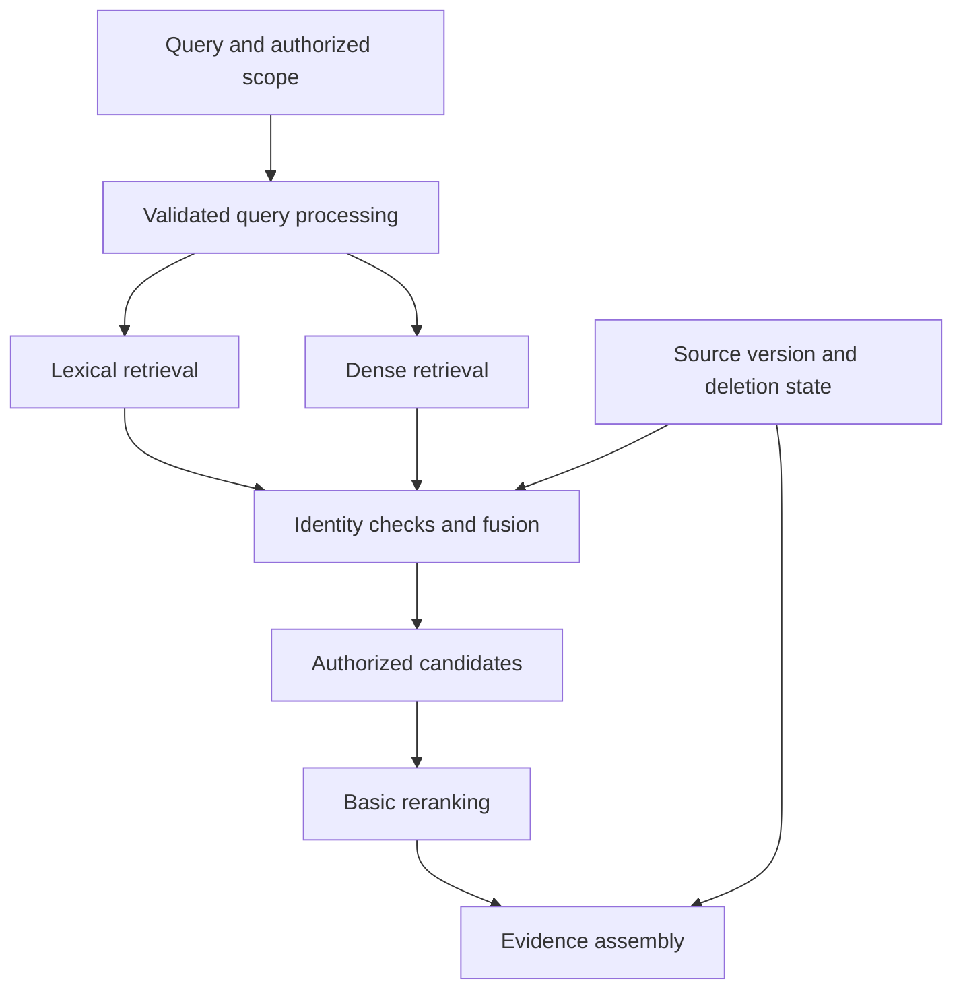

# Study Notes: M06.2.1 — Retrieval and Information Retrieval Fundamentals

**Path:** Core · **Depth:** L2 foundation; L3 through demonstrated project work  
**Prerequisites:** M03, M05 and M07; ingestion, chunking and embeddings from M06.1  
**Purpose:** Understand how search produces useful candidates and how lexical, dense and hybrid approaches complement each other.  
**Completion evidence:** Compare retrieval baselines on the same queries, explain ranking behavior, preserve permissions and source versions, and cite the evidence used.

# Table of Contents

## Section 1: Foundations of Information Retrieval

- 1.1 Information Retrieval Fundamentals
- 1.2 Overall Concept Map

## Section 2: Lexical Indexing and Text Processing

- 2.1 Inverted Indexes and Posting Lists
- 2.2 Tokenization and Linguistic Processing

## Section 3: Lexical Search and Ranking

- 3.1 Boolean, Phrase and Fuzzy Search
- 3.2 TF-IDF and BM25
- 3.3 Field Boosting, Facets and Filters
- 3.4 First-Stage Retrieval and Top-k

## Section 4: Dense, Sparse and Hybrid Retrieval

- 4.1 Dense, Sparse and Hybrid Search
- 4.2 Search and Vector Index Combinations
- 4.3 Reciprocal Rank Fusion

## Section 5: Query Understanding and Transformation

- 5.1 Query Expansion, Rewriting and Multi-Query Retrieval
- 5.2 Self-Querying and Controlled Filters

## Section 6: Application and Evaluation

- 6.1 Worked Baseline Comparison and Project Exercise

## Section 7: Review, Practice, and References

- 7.1 Glossary and Final Revision Sheet
- 7.2 Practice and Interview Questions
- 7.3 Sources and Further Reading

## 1. Information Retrieval Fundamentals

### Definition

**Information retrieval**, or IR, finds items that are useful for an information need. The user expresses that need through a query, and the system selects and often ranks documents, passages, records or other evidence.

A retrieval system has at least four important objects:

| Object | Meaning |
|---|---|
| Corpus | The collection being searched |
| Query | The representation of the user’s information need |
| Index | A structure that makes search practical |
| Relevance judgment | A decision about whether an item helps answer the need |

### Matching is not the same as relevance

A document containing every query word can still be the wrong source. It might discuss a different equipment model, an obsolete revision or a condition the user did not ask about.

Conversely, a useful passage may not contain the user’s wording. “Preventive maintenance” may answer a question about “avoiding unexpected breakdowns.” Different retrieval methods recognize different forms of matching.

### Retrieval and generation

Retrieval selects evidence. Generation turns evidence and instructions into an answer. A fluent answer cannot establish that retrieval succeeded, and a relevant retrieved passage does not guarantee that the generator uses it correctly.

This is why evaluation separates candidate coverage, ranking quality, context assembly, answer quality and citations. Fix the stage that failed instead of treating every incorrect answer as a prompting problem.

### Candidate generation versus reranking

First-stage retrieval searches a large corpus relatively efficiently and produces a candidate set. A reranker then applies a more detailed relevance assessment to that smaller set.

Basic reranking belongs in the main practical pipeline. It should not be postponed until every advanced RAG technique has been explored. However, it cannot recover a necessary passage that was absent from the candidate set.

### Key takeaway

**Retrieval should find the right eligible evidence, not merely similar text.** Eligibility includes authorization, current source state and task-specific constraints.

## 2. Inverted Indexes and Posting Lists

**Syllabus coverage: M06.2.1.1 — Classical search concepts.**

### Inverted index

An **inverted index** maps each indexed term to the documents or passages containing it. Instead of scanning every document for a word, the system looks up that word’s entries.

The Stanford IR textbook describes the dictionary-and-postings structure and its construction from tokenized, normalized documents. The conceptual change is from “document to words” to “word to documents.” [Source: Introduction to Information Retrieval, inverted index construction](https://nlp.stanford.edu/IR-book/html/htmledition/a-first-take-at-building-an-inverted-index-1.html)

### Posting lists

A **posting list** contains the document IDs associated with a term. A posting may also store term frequency, positions, field information or other data used in scoring and matching.

Fictional corpus:

| ID | Text |
|---|---|
| D1 | unit-a indicator inspection |
| D2 | unit-b inspection schedule |
| D3 | invoice payment schedule |

Selected posting lists:

| Term | Documents |
|---|---|
| inspection | D1, D2 |
| schedule | D2, D3 |
| indicator | D1 |
| invoice | D3 |

For **inspection AND schedule**, the system intersects two lists and returns D2. For **indicator OR invoice**, it unions the relevant lists and returns D1 and D3.

### Why document granularity matters

In a RAG corpus, an indexed “document” may actually be a chunk. Its length and term statistics therefore reflect the chunking design. Re-chunking can change lexical rankings even when the original source wording is unchanged.

Keep stable source identity alongside index-local document IDs. Search-engine IDs help the engine find records; source IDs and versions help the application verify authority, permissions and citations.

### Key takeaway

**Posting lists make exact-term search efficient, and their stored information determines which matching operations are possible.**

## 3. Tokenization and Linguistic Processing

### Tokenization

Tokenization divides text into units for indexing and querying. The analyzer may also normalize case, punctuation and word forms. Query processing must be compatible with index processing.

The Stanford text explains that tokenization choices affect which queries can match, especially for punctuation, hyphenation, identifiers and language-specific conventions. This makes tokenization a retrieval design decision, not merely text cleanup. [Source: Stanford IR textbook, tokenization](https://nlp.stanford.edu/IR-book/html/htmledition/tokenization-1.html)

### Domain examples

A manual search may need to distinguish M-104, M-140 and M104. A software corpus may need to preserve C++, C# and method names. Removing punctuation indiscriminately can collapse meaningful distinctions.

A practical design can store multiple fields: a full-text field with linguistic analysis and an exact keyword field for identifiers. The query can use each according to its purpose.

### Stop-word handling awareness

Stop words are common terms that some systems remove or treat specially. Examples in English include articles and prepositions. Removing them can reduce index noise, but it can also damage phrases or meaning.

Words such as “not,” “without,” “before” and “after” may be critical in procedures. A generic stop-word list should not be applied blindly to every domain. Modern systems can retain common terms when they are useful; stop-word removal is a choice, not an unavoidable IR stage.

### Stemming awareness

**Stemming** uses rules or algorithms to reduce related word forms to a shared stem. The result need not be a valid dictionary word. It can improve recall when “inspect,” “inspection” and “inspecting” should match, but aggressive conflation can also merge distinct terms.

### Lemmatization awareness

**Lemmatization** aims to reduce words to their dictionary base form, often using linguistic information. It can be more sensitive to grammatical context and language than simple stemming.

The Stanford textbook distinguishes these approaches and explains their role in grouping morphological variants. Their usefulness remains task-dependent; neither should be assumed to improve every query. [Source: Stanford IR textbook, stemming and lemmatization](https://nlp.stanford.edu/IR-book/html/htmledition/stemming-and-lemmatization-1.html)

### Practical analyzer tests

Build a small test table containing exact codes, plurals, hyphenated names, abbreviations, negation, mixed case and relevant languages. Record expected indexed terms and matching behavior.

If a user searches Unit-A and receives only Unit-B, inspect analyzer output and field selection before blaming the ranking formula.

## 4. Boolean, Phrase and Fuzzy Search

### Boolean retrieval

Boolean retrieval combines conditions using operators such as AND, OR and NOT. It asks whether a record satisfies a logical expression, not necessarily how strongly it should rank.

Examples:

```text
inspection AND indicator
maintenance OR servicing
inspection AND NOT archived
```

In an application, archived status should usually be a trusted metadata field rather than just a word excluded from body text. A document can contain the sentence “This procedure is not archived” while its lifecycle state says otherwise.

### Phrase search

Phrase search looks for a sequence of terms in the specified order, with behavior governed by the analyzer and any permitted positional gap or slop.

A positional index records where terms occur so the engine can test phrase and proximity conditions. This is different from merely checking that all words appear somewhere in the same document. [Source: Stanford IR textbook, positional indexes](https://nlp.stanford.edu/IR-book/html/htmledition/positional-indexes-1.html)

For example, “return to service” should differ from a document containing “return the invoice” and “service schedule” in separate sections. Exact source quotations and specialized multi-word terms can benefit from phrase search.

### Fuzzy and typo-tolerant matching awareness

Fuzzy matching allows small spelling differences, often measured using edit distance. It can help when a user types “inspeciton” instead of “inspection.”

Elasticsearch’s fuzzy-query documentation describes term matching through edit-distance expansions and exposes controls that bound those expansions. Its implementation details are product-specific, but the general tradeoff is broader matching versus additional work and possible false positives. [Source: Elasticsearch fuzzy query](https://www.elastic.co/docs/reference/query-languages/query-dsl/query-dsl-fuzzy-query)

### Why identifiers need care

M-104 and M-140 may be different manuals, not typos. Automatically correcting one to the other can return a plausible but wrong procedure.

Use exact matching for identifiers when the query clearly specifies one. If no result exists, a controlled suggestion can ask whether the user meant another identifier. Do not silently replace a critical code simply because it is one edit away.

### Comparison

| Method | Useful for | Typical failure |
|---|---|---|
| Boolean | Mandatory term combinations | Relevant paraphrases omitted |
| Phrase | Exact expressions and ordered terms | Analyzer changes alter matching |
| Fuzzy | Ordinary spelling mistakes | Similar identifiers conflated |
| Semantic | Different wording with related meaning | Exact conditions or codes confused |

## 5. TF-IDF and BM25

### Term frequency

**Term frequency**, or TF, measures how often a term occurs in a document. Repetition can indicate relevance, but its benefit should not grow without limit. A long document repeating “inspection” 100 times is not necessarily more useful than a precise paragraph using it twice.

### Inverse document frequency

**Document frequency**, \(df(t)\), is the number of indexed documents containing term \(t\). **Inverse document frequency**, or IDF, gives greater weight to terms that occur in fewer documents.

A simple unsmoothed form is:

\[
\operatorname{IDF}(t)=\log\frac{N}{df(t)},
\]

where \(N\) is the number of indexed documents. Implementations use different smoothing conventions. The key intuition is that a term appearing everywhere carries less discriminating information. [Source: Stanford IR textbook, inverse document frequency](https://nlp.stanford.edu/IR-book/html/htmledition/inverse-document-frequency-1.html)

### TF-IDF

TF-IDF combines within-document frequency with across-corpus rarity. A simple formulation is:

\[
w(t,d)=\operatorname{TF}(t,d)\operatorname{IDF}(t).
\]

The exact TF transform, normalization and query scoring method vary. Treat TF-IDF as a family of weighting schemes rather than one universal implementation.

### BM25

BM25 is a lexical ranking function that combines term rarity, saturating term frequency and document-length normalization. A common form is:

\[
\operatorname{BM25}(q,d)=
\sum_{t\in q}\operatorname{IDF}(t)
\frac{f(t,d)(k_1+1)}{
f(t,d)+k_1\left(1-b+b\frac{|d|}{\operatorname{avgdl}}\right)}.
\]

Here:

- \(f(t,d)\) is the term frequency in the document.
- \(|d|\) is document length under the index’s analysis.
- \(\operatorname{avgdl}\) is average indexed-document length.
- \(k_1\) controls the saturation behavior of term frequency.
- \(b\) controls the amount of length normalization.

The Stanford textbook develops BM25 from probabilistic retrieval, including frequency and length effects. Lucene documents a positive IDF variant of \(\log(1+(N-df+0.5)/(df+0.5))\). Exact scoring details differ by implementation, so reproduce the deployed engine’s behavior when precision matters. [Sources: Stanford IR textbook, BM25](https://nlp.stanford.edu/IR-book/html/htmledition/okapi-bm25-a-non-binary-model-1.html), [Lucene BM25Similarity](https://lucene.apache.org/core/9_9_1/core/org/apache/lucene/search/similarities/BM25Similarity.html)

### Worked BM25 calculation

For an invented one-term query, let \(N=100\), \(df=5\), \(k_1=1.2\), \(b=0.75\), and document length equal average length.

Using the positive IDF form:

\[
\operatorname{IDF}=\log\left(1+\frac{95.5}{5.5}\right)\approx2.9104.
\]

If the term occurs once, the frequency factor is 1, so its contribution is approximately 2.9104.

If it occurs three times, the factor is:

\[
\frac{3\times2.2}{3+1.2}=1.5714.
\]

The contribution is approximately 4.5734. Tripling the occurrences does not triple the score, illustrating saturation. These parameter values are illustrative, not an instruction to use one setting for every corpus.

### Practical limitations

BM25 does not directly understand whether a passage answers the question, contains a contradiction, has been superseded or belongs to the user’s tenant. It also depends on analyzer behavior and collection statistics.

Nevertheless, it is a valuable baseline, especially for precise terminology, names, codes and rare phrases. A dense retriever should demonstrate improvement over a properly configured lexical baseline rather than over a deliberately weak keyword search.

## 6. Field Boosting, Facets and Filters

### Field boosting

Field boosting gives different relevance weight to matches in different fields. A match in a document title or equipment-code field may deserve more influence than a match in a long body or repeated footer.

For an invented manual search, a scoring design might prioritize exact equipment-code matches, then title matches, then section headings, then body terms. The weights must be evaluated; an overly strong title boost can suppress the only body passage containing an answer.

A boost changes ranking. It is not a hard eligibility rule. A sufficiently strong match elsewhere may still outrank a boosted result depending on the scoring design.

### Faceted search

Facets summarize a result set by structured attributes such as document type, equipment family, language or revision status. Users can use them to narrow the search interactively.

Facet counts can reveal information. If an unauthorized document contributes to a count or category label, the interface may expose its existence even when its text is hidden. Compute facets over the authorized result universe.

### Metadata filters

Filters enforce conditions such as tenant, permission scope, approved status, effective date or equipment model. Elasticsearch explicitly distinguishes scored query context from binary filter context, a useful conceptual separation for search design. [Source: Elasticsearch query and filter context](https://www.elastic.co/docs/reference/query-languages/query-dsl/query-filter-context)

### Hard versus soft requirements

| Requirement | Better conceptual treatment |
|---|---|
| User belongs to tenant A | Mandatory server-derived security constraint |
| Source is not deleted | Mandatory lifecycle constraint |
| Query asks for approved current manual | Authority/version eligibility rule |
| Title contains the topic | Ranking signal |
| User prefers concise sources | Possible ranking or assembly preference |

Never replace a mandatory tenant filter with a boost for the tenant name. A security boundary cannot depend on which result obtains the highest score.

### Filter correctness and recall

A filter can reduce recall if metadata is wrong or the constraint is overly restrictive. “After 2024” is not the same as “effective during 2024.” Source-created time, publication time and effective time must not be confused.

When no results appear, inspect the eligible corpus and filter interpretation before expanding the query or relaxing important controls. Security constraints must not be dropped to make the result list look fuller.

## 7. First-Stage Retrieval and Top-k

**Syllabus coverage: M06.2.1.2 — First-stage retrieval.**

### Top-k

Top-k retrieval returns up to \(k\) highest-ranked eligible candidates. The parameter controls candidate count; it is not a guarantee of quality or sufficient evidence.

Distinguish several counts:

- Candidates requested from each retrieval branch.
- Candidates retained after fusion and deduplication.
- Candidates sent to the reranker.
- Evidence units selected for the answer.

For example, retrieving 50 lexical and 50 dense candidates does not mean sending 100 passages to the answering model. After union, authorization, deduplication and reranking, perhaps five evidence units fit the final task. The numbers are illustrative.

### Recall and precision tradeoff

A larger candidate pool can increase the chance of including required evidence, but it also increases downstream work and may introduce more difficult distractors. A small pool can be efficient while missing the answer entirely.

Tune candidate count using retrieval coverage, reranker quality, latency and evidence-token cost. The right budget may vary by query type.

### Filtering and approximate search

Some search systems can apply filters during candidate generation; others may filter a retrieved pool afterward. Post-filtering can leave too few authorized candidates if many high-scoring items were ineligible.

Whatever the engine’s mechanics, do not expose unauthorized content to external rerankers, models or users. If the eligible pool is too small, retrieve more within the allowed scope or use a safer fallback. Do not remove the authorization requirement.

### Key takeaway

**Candidate recall sets a ceiling on what reranking can achieve.** The candidate budget should be measured, not guessed.

## 8. Dense, Sparse and Hybrid Search

### Dense search

Dense search compares compatible query and document embeddings using a similarity or distance function. It can retrieve related wording without exact term overlap.

Dense Passage Retrieval provides a primary research example of learned dual-encoder passage retrieval. Its results demonstrate the possibility of effective dense candidate generation under the evaluated conditions, not the universal superiority of dense search for every source collection. [Source: Dense Passage Retrieval](https://arxiv.org/abs/2004.04906)

Dense search can struggle with exact identifiers, numerical distinctions, domain shift and contradictory statements. It still needs metadata filters and source validation.

### Sparse search

Sparse search uses representations with relatively few active dimensions. Traditional term-based methods such as TF-IDF and BM25 are central examples; learned sparse encoders are another family.

Do not use “sparse” as a synonym for “simple.” A learned sparse system can use neural models to generate term weights or expansions. The important distinction concerns representation and retrieval behavior.

### Hybrid search

Hybrid search combines complementary retrieval signals, commonly lexical and dense retrieval. One branch may find a rare equipment code while the other finds a relevant paraphrase.

Hybrid retrieval can improve coverage when its branches make different errors. It can also add latency, duplicate candidates and noise. If both branches consistently retrieve the same wrong material, combining them does not fix the underlying problem.

### Comparison

| Query type | Lexical hypothesis | Dense hypothesis | Hybrid opportunity |
|---|---|---|---|
| Exact manual code | Often strong | May confuse close codes | Preserve exact-code candidate |
| Natural paraphrase | May miss terminology | May capture meaning | Add semantically related passage |
| Negated condition | Matches shared wording | May rank contradiction highly | Needs reranking and evidence checks |
| Current revision | Cannot infer lifecycle alone | Cannot infer lifecycle alone | Shared authority filter required |
| Cross-language query | Depends on language handling | Depends on model fit | Combine approved language strategies |

These are hypotheses to test, not a replacement for evaluation.

## 9. Search and Vector Index Combinations

### One system or separate systems

A platform may hold lexical and vector indexes in one search engine, or combine a search engine with a separate vector database. Either design can support hybrid retrieval if identity and control metadata remain consistent.

| Design | Potential advantage | Main integration responsibility |
|---|---|---|
| Combined engine | Shared query and operational surface | Verify filtering and ranking behavior |
| Separate engines | Specialized capabilities and scaling | Synchronize IDs, versions, ACLs and deletion |
| Small in-memory baseline | Transparent experiments | Limited production scale and durability |

Do not select architecture from the word “vector database” alone. Determine what the system needs to store, filter, update, audit and serve.

### Consistency problem

If the lexical index contains manual v4 but the vector index still contains v3, fusion can mix contradictory evidence. If a source is deleted from only one branch, hybrid search can resurrect it through the other.

Use stable source IDs, immutable revision identities and explicit index-generation information. Apply eligibility checks after branch results are combined as well as within each branch’s authorized search scope.

### A useful result contract

Each branch should return enough information to reconcile candidates:

```json
{
  "chunk_id": "tenant-A:M-104:v4:section-3.2:02",
  "document_id": "tenant-A:M-104",
  "version_id": "v4",
  "retrieval_branch": "lexical",
  "rank": 3,
  "raw_score": 7.4,
  "index_generation": "manuals-2026-10-20"
}
```

This schema is conceptual. The raw score’s meaning belongs to the named branch and configuration. Do not compare it directly with an unrelated vector score.

## 10. Reciprocal Rank Fusion

**Syllabus coverage: M06.2.1.3 — Fusion and query improvement.**

### Definition

**Reciprocal Rank Fusion**, or RRF, combines ranked lists using positions instead of requiring raw score calibration.

A common form is:

\[
\operatorname{RRF}(d)=\sum_{j}\frac{1}{c+r_j(d)},
\]

where \(r_j(d)\) is the one-based rank of candidate \(d\) in list \(j\), and \(c\) is a positive rank constant. A candidate absent from a list contributes zero for that list.

Elasticsearch documents this method for combining result sets with different relevance indicators. The rank constant and the window of results retained from each branch affect the merged output. [Source: Elasticsearch reciprocal rank fusion](https://www.elastic.co/docs/reference/elasticsearch/rest-apis/reciprocal-rank-fusion)

### Worked example

Use an illustrative rank constant of 60:

| Candidate | Lexical rank | Dense rank | RRF score |
|---|---:|---:|---:|
| A | 1 | 3 | 0.032266 |
| B | 2 | 1 | 0.032522 |
| C | 3 | Absent | 0.015873 |
| D | Absent | 2 | 0.016129 |

The fused order is B, A, D, C. B benefits from ranking near the top of both branches.

### Runnable RRF example

```python
from collections import defaultdict


def rrf(ranked_lists, rank_constant=60):
    if rank_constant <= 0:
        raise ValueError("rank_constant must be positive")
    scores = defaultdict(float)
    for ranked_ids in ranked_lists:
        seen = set()
        unique_ids = []
        for item_id in ranked_ids:
            if item_id not in seen:
                seen.add(item_id)
                unique_ids.append(item_id)
        for rank, item_id in enumerate(unique_ids, start=1):
            scores[item_id] += 1.0 / (rank_constant + rank)
    return sorted(scores.items(), key=lambda item: (-item[1], item[0]))


print(rrf([["A", "B", "C"], ["B", "D", "A"]]))
```

This standard-library example assumes the lists already contain eligible candidates from a consistent source snapshot. Production code must enforce those assumptions.

### RRF versus score addition

A BM25 score of 12 and a cosine score of 0.8 are not on a shared scale. Adding them directly gives the larger numeric scale undue influence. RRF avoids this particular problem by using ranks.

RRF also discards score-gap information. A branch’s first result barely beating its second is treated through ranks, just like a much larger gap. Weighted or score-calibrated fusion may be useful, but should be tested against a simple rank-fusion baseline.

### Two different k-like parameters

The retrieval candidate count and RRF rank constant are different concepts. Calling both k in code can create confusion. Prefer names such as candidate_limit and rank_constant.

## 11. Query Expansion, Rewriting and Multi-Query Retrieval

### Query expansion

Expansion adds related terms or controlled aliases to improve recall. For example, a domain dictionary might map “PMS” to “planned maintenance system” when that meaning is appropriate to the collection.

Uncontrolled expansion can create query drift. “Port inspection” might be expanded toward computer networking even when the user means a harbor. Preserve the original query and record the expansion source.

### Query rewriting

Rewriting reformulates a query into a more useful search form while preserving the information need. It may resolve conversational references, remove irrelevant phrasing or make an implicit subject explicit.

Conversation:

```text
User: Open the Unit A inspection manual.
User: What changed in the latest revision?
```

A rewrite might make the second question searchable as “Changes in the latest approved revision of the Unit A inspection manual.” It must not invent a revision number or convert “latest approved” into “latest uploaded.”

### Multi-query retrieval

Multi-query retrieval searches several formulations and merges their candidate sets. One query might emphasize the equipment name, another the procedural wording and another a controlled synonym.

Possible benefit: improved coverage when one wording fails. Costs include additional retrieval calls, duplicate evidence and more opportunities for drift.

Set a query budget, preserve the original query as a branch when useful, and deduplicate candidates by stable identity. A model generating ten almost identical rewrites has increased cost without necessarily adding useful evidence.

### Original intent as a constraint

For exact identifiers, dates, negation and comparison scope, validate that rewrites preserve important constraints. “Before storage” and “after storage” are different information needs.

Query text from the user or an external source must not be allowed to remove the server’s authorization filters. An expanded query changes relevance search, not who the user is allowed to access.

### Key takeaway

**Query improvement should broaden useful matching while preserving intent and control boundaries.**

## 12. Self-Querying and Controlled Filters

### Definition

**Self-querying** uses a model or parser to translate a natural-language request into a semantic search query plus structured metadata constraints.

Example user request:

```text
Find approved English manuals for Unit A published after January 2025.
```

A conceptual parsed result could be:

```json
{
  "search_text": "Unit A manuals",
  "filters": {
    "language": "en",
    "status": "approved",
    "publication_date_after": "2025-01-31"
  }
}
```

The date interpretation must be defined by the application; ambiguous requests may need clarification. This example illustrates why a parser output is a proposal that requires validation.

### Separate user constraints from security constraints

The model can propose fields such as document type or date range. It must not determine the authenticated tenant or grant itself access to another collection.

A trusted server combines allowed user filters with mandatory controls:

```text
effective_filter = authorized_scope AND validated_user_constraints
```

This is conceptual logic, not a SQL string to concatenate. Use typed query construction and parameterized operations where relevant.

### Validation rules

Allow only known fields and operators. Validate types, ranges and enumerated values. Reject unsupported fields rather than silently ignoring them. Set limits on expensive queries and record how the natural-language request became a structured query.

If the parsed constraints conflict, an empty result may be correct. The system should explain the issue or seek clarification without dropping mandatory restrictions.

### Self-querying versus routing

Self-querying builds a search request. Routing chooses which source or retrieval method should handle it, such as SQL for a count or lexical search for an exact code. A complete system can use both, but each needs its own validation and evaluation.

## 13. Worked Baseline Comparison and Project Exercise

### Fictional corpus

Use manual M-104 v4 for tenant A, a superseded v3 copy, a separate tenant B manual, a troubleshooting guide and a structured equipment catalog. These are invented training sources.

Create queries with different needs:

| Query | Main retrieval challenge |
|---|---|
| “M-104 Unit A indicator interval” | Exact identity and current revision |
| “How can I reduce unexpected downtime?” | Paraphrase and broad intent |
| “Return to service procedure” | Phrase and procedural context |
| “Inspeciton schedule for Unit A” | Ordinary typo plus exact identifier |
| “How many approved manuals cover Unit A?” | Structured counting, not only ranked search |
| Same query from tenant B | Authorization boundary |

### Establish the baseline matrix

Compare lexical retrieval, dense retrieval and hybrid retrieval over the same authorized corpus snapshot and source-span judgments. Apply the same candidate budgets where that comparison is meaningful, and report total branch work where hybrid makes extra calls.

Then compare each with the same basic reranker. Keep generator and context assembly fixed while measuring the retrieval change.

### Illustrative results, not measured claims

The following table demonstrates how to report a result. It is not a benchmark or a recommendation:

| Method | Required-evidence Hit@20 | nDCG@5 after reranking | p95 retrieval-plus-rerank latency |
|---|---:|---:|---:|
| Lexical | 0.78 | 0.70 | 120 ms |
| Dense | 0.82 | 0.73 | 150 ms |
| Hybrid | 0.90 | 0.80 | 190 ms |

In a real project, include sample size, relevance definition, query slices, confidence or uncertainty assessment and measured environment. A mean score can hide a severe regression on exact identifiers or restricted-source queries.

### Diagnose before adopting

If dense search misses exact codes, inspect its candidates and compare hybrid behavior. If all methods miss the same paragraph, inspect extraction and chunking. If relevant candidates are retrieved but not selected, inspect reranking. If the context is correct but the answer is wrong, inspect evidence use.

### Required project evidence

Submit the corpus/version manifest, analyzer configuration, embedding contract, filters, branch budgets, fusion settings, relevance labels and retrieval traces. Show an authorized query, an unauthorized query, a revision change and a source deletion.

After deletion, verify every branch and cache. A deleted source absent from BM25 but present in the vector branch is still a failure.

## 14. Overall Concept Map



Retrieval branches supply candidates. Shared identity and lifecycle checks make their combination coherent and safe.

## 15. Glossary and Final Revision Sheet

| Term | Meaning |
|---|---|
| Corpus | Collection being searched |
| Inverted index | Mapping from terms to matching documents |
| Posting list | Records associated with an indexed term |
| Analyzer | Tokenization and normalization process |
| Stop word | Common term handled specially by a search system |
| Stemming | Rule-based conflation of word forms |
| Lemmatization | Mapping to a linguistic base form |
| Boolean retrieval | Matching logical combinations of conditions |
| Phrase search | Matching an ordered sequence of analyzed terms |
| Fuzzy matching | Allowing bounded term-edit differences |
| TF | Frequency of a term within a document |
| IDF | Weight based on a term’s rarity across documents |
| BM25 | Lexical ranking with frequency saturation and length normalization |
| Field boost | Increased ranking influence for a field |
| Facet | Structured category used to summarize or narrow results |
| Top-k | A bounded highest-ranked candidate set |
| Hybrid retrieval | Combination of complementary retrieval signals |
| RRF | Rank-based fusion of result lists |
| Query drift | Change in meaning introduced during query processing |
| Self-querying | Producing search text and structured constraints from language |

### Revision sheet

- Keep exact identifiers searchable.
- Test analyzer behavior before tuning ranking weights.
- Use filters for mandatory conditions and scores for relevance preferences.
- Distinguish candidate count from final context count.
- Compare lexical, dense and hybrid retrieval on the same evidence labels.
- Never add unrelated raw scores without a justified calibration method.
- Record query rewrites and preserve critical constraints.
- Apply authorization to all branches, facets, snippets and expanded evidence.
- Keep versions and deletions consistent across search and vector indexes.
- Use reranking after candidate generation, then evaluate the final evidence.

## 16. Practice and Interview Questions

### Question-and-answer recall

**1. What is an inverted index?**  
A structure mapping terms to the documents or chunks that contain them, usually with additional data such as frequency or positions.

**2. What information can a posting contain?**  
A document ID and, depending on the index, term frequency, positions, field information or other scoring data.

**3. Why should query and document analysis be compatible?**  
Different tokenization or normalization can prevent identical intended terms from matching. Compatibility is particularly important for codes, punctuation and languages.

**4. How do stemming and lemmatization differ?**  
Stemming applies conflation rules and can produce nonwords. Lemmatization aims at a dictionary base form, often using linguistic context.

**5. What distinguishes phrase search from an AND query?**  
Phrase search constrains term order and positions. An AND query may match terms located anywhere in the same indexed unit.

**6. What does IDF represent?**  
How discriminating a term is across the corpus, with rarer terms generally receiving greater weight under the chosen formula.

**7. What does BM25 add to simple term counting?**  
Term rarity, diminishing returns from repetition and document-length normalization, with implementation-specific details.

**8. Why is a filter different from a field boost?**  
A filter decides eligibility. A boost influences ranking among matching candidates and cannot substitute for a mandatory security rule.

**9. Why compare lexical and dense retrieval?**  
They recognize different matching signals and can have complementary failure patterns. Their relative value depends on the actual corpus and queries.

**10. What problem does RRF address?**  
It combines ranked lists without requiring their raw relevance scores to share a calibrated numeric scale.

**11. What is query drift?**  
An expansion or rewrite changes the original information need, such as confusing a harbor with a network port or reversing a time condition.

**12. Why must self-querying be validated?**  
A model can generate unsupported fields, wrong types or incorrect constraints. Trusted application code must enforce the allowed schema and mandatory authorization scope.

### Multiple-choice questions

#### Easy

**13. Which posting-list operation supports A AND B?**

A. Intersection.  
B. Random sampling.  
C. Vector normalization.  
D. Unrestricted concatenation.

**Answer: A.** A matching document must appear in both lists.

**14. Which query needs positional information for precise phrase matching?**

A. inspection OR invoice.  
B. “return to service”.  
C. tenant_id = A.  
D. deleted = false.

**Answer: B.** The term sequence and positions distinguish the phrase from unrelated occurrences.

#### Medium

**15. What happens when a BM25 term’s frequency increases?**

A. Its contribution must grow linearly forever.  
B. Its contribution typically shows diminishing returns.  
C. The source automatically becomes authorized.  
D. The document revision changes.

**Answer: B.** Term-frequency saturation limits the benefit of repeated occurrences.

**16. Why should BM25 12.0 and cosine 0.8 not be added casually?**

A. Both are probabilities.  
B. Their numeric scales have different meanings.  
C. Ranks cannot be combined.  
D. Dense search cannot return numbers.

**Answer: B.** Uncalibrated score addition can let one scale dominate. Rank fusion is one baseline alternative.

#### Hard — scenario based

**17. A tenant-A boost is applied, but tenant-B documents remain eligible. Is tenant isolation enforced?**

A. Yes, because tenant A probably ranks first.  
B. Yes, if the boost is large enough.  
C. No, mandatory authorization must exclude unauthorized evidence.  
D. Only when the query is short.

**Answer: C.** Ranking preference is not an access-control boundary.

**18. A dense branch still returns a deleted manual while the lexical branch does not. What should happen?**

A. Fusion should average away the problem.  
B. Shared source-state checks should reject it and deletion should be reconciled.  
C. The citation should hide the version.  
D. The manual should be treated as public.

**Answer: B.** Every serving branch must respect current lifecycle state. A ranking algorithm cannot repair an authorization or deletion error.

**19. A query rewrite changes “after storage” to “before storage.” What is the failure?**

A. Successful stemming.  
B. Useful field boosting.  
C. Query drift that changes the requested condition.  
D. Correct facet generation.

**Answer: C.** Rewrites must preserve material intent, especially conditions and temporal relationships.

### Interview questions with model answers

#### Easy

**20. Explain lexical, dense and hybrid retrieval.**

**Model answer:** Lexical retrieval uses indexed term evidence, which is useful for exact wording and identifiers. Dense retrieval compares learned query and passage representations, which can help with paraphrases. Hybrid retrieval combines their candidate signals. I would compare them on a fixed dataset and use source filters and a basic reranker rather than assuming one approach is always best.

**21. Why is tokenization important in an enterprise search system?**

**Model answer:** It determines what can match. If the analyzer removes meaningful punctuation or splits equipment codes inconsistently, correct documents may be missed or different identifiers may collapse together. I would test domain examples and maintain exact fields for identifiers alongside analyzed text where appropriate.

#### Medium

**22. How would you combine search-engine and vector-database results?**

**Model answer:** Both branches would use the same trusted tenant and source constraints and return stable chunk, document and version IDs. I would reconcile eligibility, deduplicate and apply a defined fusion method such as RRF. Then I would rerank authorized candidates and assemble evidence. Updates and deletions would be tracked across both indexes so hybrid search cannot return stale or removed sources.

**23. How would you tune top-k?**

**Model answer:** I would distinguish branch candidate counts, reranker input count and final evidence count. I would measure required-evidence coverage as candidate counts increase, along with latency and reranker quality. The goal is enough candidate recall to support the task without unnecessary downstream work. I would inspect query slices rather than selecting one number from a generic rule.

#### Hard — scenario based

**24. Search quality drops after adding synonym expansion. What would you inspect?**

**Model answer:** I would compare original and expanded queries for failures, looking for ambiguous domain terms, lost identifiers and changed conditions. I would check whether expansions add unique relevant candidates or only noise. I would preserve the original query branch, restrict aliases to verified domain mappings where useful, and adopt the change only after it improves held-out retrieval and answer outcomes.

**25. A model generates a filter requesting another tenant’s manuals. How should the system respond?**

**Model answer:** The model’s filter is untrusted structured output. The server should validate allowed fields and combine permitted user constraints with the authenticated user’s mandatory access scope. It must reject or neutralize an attempted scope expansion, without sending unauthorized evidence to a reranker or model. I would add tests for this case, including snippets, facets, caches and citations.

## 17. Sources and Further Reading

All corpus examples, calculations and illustrative metric values are teaching constructions. Replace them with measured results for project evidence.

- [Stanford IR textbook: inverted index construction](https://nlp.stanford.edu/IR-book/html/htmledition/a-first-take-at-building-an-inverted-index-1.html).
- [Stanford IR textbook: tokenization](https://nlp.stanford.edu/IR-book/html/htmledition/tokenization-1.html).
- [Stanford IR textbook: stemming and lemmatization](https://nlp.stanford.edu/IR-book/html/htmledition/stemming-and-lemmatization-1.html).
- [Stanford IR textbook: positional indexes](https://nlp.stanford.edu/IR-book/html/htmledition/positional-indexes-1.html).
- [Stanford IR textbook: inverse document frequency](https://nlp.stanford.edu/IR-book/html/htmledition/inverse-document-frequency-1.html).
- [Stanford IR textbook: BM25](https://nlp.stanford.edu/IR-book/html/htmledition/okapi-bm25-a-non-binary-model-1.html).
- [Lucene: BM25Similarity](https://lucene.apache.org/core/9_9_1/core/org/apache/lucene/search/similarities/BM25Similarity.html).
- [Elasticsearch: fuzzy query](https://www.elastic.co/docs/reference/query-languages/query-dsl/query-dsl-fuzzy-query).
- [Elasticsearch: query and filter context](https://www.elastic.co/docs/reference/query-languages/query-dsl/query-filter-context).
- [Elasticsearch: reciprocal rank fusion](https://www.elastic.co/docs/reference/elasticsearch/rest-apis/reciprocal-rank-fusion).
- [Karpukhin et al.: Dense Passage Retrieval](https://arxiv.org/abs/2004.04906).

**Related practice:** [M06.8.1 — Candidate Refinement](M06.8.1_Candidate_Refinement.md).

