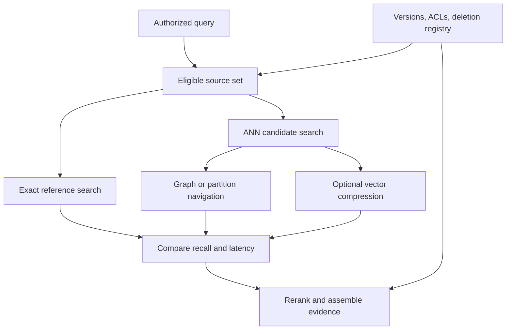

# Study Notes: M06.2.2 — Vector Databases and Approximate Nearest Neighbor Search

**Path:** Core  
**Depth:** L2 foundation; L3 through demonstrated project work  
**Prerequisites:** M03, M05, M07; study [Embeddings](M06.1.3_Embeddings.md) first.  
**Purpose:** Understand how vector search retrieves candidates, how indexes change speed and recall, and how storage choices affect correctness, permissions, updates, and deletion.

All manual identifiers, measurements, timings, and business examples below are invented teaching examples. They are not product benchmarks or operating instructions.

## Table of Contents

1. [Vector Storage Fundamentals](#1-vector-storage-fundamentals)
2. [M06.2.2.1 — Exact Search, ANN, and Candidate Generation](#2-m06221--exact-search-ann-and-candidate-generation)
3. [M06.2.2.2 — HNSW](#3-m06222--hnsw)
4. [IVF and IVFFlat](#4-ivf-and-ivfflat)
5. [Product and Scalar Quantization](#5-product-and-scalar-quantization)
6. [Index Construction and Tuning](#6-index-construction-and-tuning)
7. [M06.2.2.3 — Filtering and Production Storage](#7-m06223--filtering-and-production-storage)
8. [Sharding, Replication, and Scaling](#8-sharding-replication-and-scaling)
9. [Updates, Deletes, Tombstones, and Compaction](#9-updates-deletes-tombstones-and-compaction)
10. [Worked Case Study and Project Exercise](#10-worked-case-study-and-project-exercise)
11. [Concept Map](#11-concept-map)
12. [Glossary and Final Revision Sheet](#12-glossary-and-final-revision-sheet)
13. [Practice and Interview Questions](#13-practice-and-interview-questions)
14. [References](#14-references)

## 1. Vector Storage Fundamentals

### Definition

A **vector database** stores vector representations and associated records and supports similarity search over them. Depending on the system, it may also provide filters, access controls, durability, replication, text search, and operational management.

A **vector index** is the data structure used to accelerate vector lookup. It is one component of a retrieval system. A library containing an ANN index is not automatically a complete database with authentication, backups, transactional metadata, or a deletion policy.

For example, the [Faiss index catalog](https://github.com/facebookresearch/faiss/wiki/Faiss-indexes) documents several index families with different memory and search properties. A project still needs surrounding services to determine who can search which records and which document versions are current.

### What is stored?

Consider an enterprise manual passage:

```json
{
  "chunk_id": "tenant-A:M-104:v4:section-7:chunk-2",
  "document_id": "M-104",
  "document_version": "v4",
  "tenant_id": "tenant-A",
  "resource_id": "ship-A",
  "source_locator": "section 7, paragraph 2",
  "acl_version": 18,
  "content_hash": "example-hash",
  "embedding_model": "example-model-revision",
  "index_generation": "g12",
  "status": "active"
}
```

The actual embedding is an additional numerical field or a separately stored object. The original text may be stored alongside the vector or fetched using the chunk ID.

The vector answers, approximately, “Which items are close in the chosen representation?” Metadata answers questions such as “Which tenant owns this?”, “Which version is valid?”, and “Where did this passage originate?” Neither replaces the other.

### Three distinct kinds of correctness

| Kind | Question | Example failure |
|---|---|---|
| Numerical search correctness | Did search find the nearest eligible vectors? | ANN skipped a close vector |
| Retrieval relevance | Do the passages answer the question? | The closest passage discusses a different machine |
| Application correctness | May this evidence be used now? | The passage is deleted, superseded, or unauthorized |

A perfect exact vector search can fail the second and third tests. Embeddings are imperfect representations, and similarity is not permission.

### Why candidate generation matters

Vector search usually produces a candidate pool. A reranker evaluates the candidates more carefully; evidence assembly then selects the passages that fit the task and context budget.

Suppose vector search retrieves 40 passages, a hybrid union contains 70 unique passages, and a reranker selects 8. These are three different counts. Calling all of them “top-k” without labels makes debugging difficult.

Use names such as `dense_candidate_k`, `fused_candidate_count`, and `final_context_k`. Record the stage where a relevant passage disappeared.

**Key takeaway:** A vector index accelerates similarity lookup. The complete application remains responsible for relevance, provenance, permissions, and lifecycle management.

## 2. M06.2.2.1 — Exact Search, ANN, and Candidate Generation

### Exact search

An exact scan evaluates the chosen similarity or distance against every eligible vector and returns the best results under that metric, subject to numerical precision and a defined tie policy.

For a query vector of dimension \(d\) and \(N\) candidate vectors, a straightforward scan performs work proportional to \(Nd\). This is a useful conceptual model, not a wall-clock performance prediction: hardware, batching, memory layout, and filters matter.

Exact search is useful when the corpus is small, filters leave few rows, or a dependable reference is needed for testing an approximate index.

### Approximate nearest neighbor search

**ANN** reduces search work by exploring only selected parts of the vector space or by using compressed representations. It can miss some neighbors that an exact search would return.

The application accepts approximation only if the resulting latency, cost, and quality are suitable. “Approximate” does not mean arbitrary: a good index aims to recover most useful neighbors efficiently.

The [pgvector documentation](https://github.com/pgvector/pgvector) explicitly distinguishes its default exact search from approximate indexes and explains that approximate indexing can change returned results. Its implementation details are product-specific; other systems may use different filtering and scan behavior.

### ANN recall is not relevance recall

Let \(E_K(q)\) be the exact top-\(K\) vector IDs for query \(q\), and \(A_K(q)\) be the approximate top-\(K\). A common ANN benchmark measure is:

\[
\operatorname{ANNRecall@K}(q)=\frac{|A_K(q)\cap E_K(q)|}{K}
\]

This assumes the eligible set has at least \(K\) records. Otherwise use the exact result count as denominator and document the convention.

For example:

- Exact nearest IDs: A, B, C, D, E.
- Approximate IDs: A, B, D, F, G.
- Overlap: A, B, D.
- ANN recall@5: \(3/5=0.60\).

Now suppose a human says only B and H actually answer the question. The ANN measure tells us nothing directly about whether H is semantically represented well. Relevance recall must use the human-labeled, authorized, current gold evidence set.

### Recall versus latency

Increasing exploration usually increases work and may recover additional neighbors. However, improvement is not guaranteed for every query, and a quality plateau can indicate another bottleneck.

An illustrative tuning experiment:

| Configuration | ANN recall@10 | Relevance recall@10 | p95 retrieval latency |
|---|---:|---:|---:|
| Small exploration budget | 0.83 | 0.66 | 19 ms |
| Medium exploration budget | 0.94 | 0.73 | 31 ms |
| Large exploration budget | 0.98 | 0.74 | 62 ms |
| Exact reference | 1.00 | 0.75 | 105 ms |

These are invented values. They suggest that the medium setting may be attractive and that improving embeddings or lexical retrieval may be more useful than doubling exploration again.

The conclusion depends on the actual task. A rare missed passage may have high business importance even when the average difference is small.

### An executable exact-search reference

This standard-library example uses cosine similarity and applies eligibility before scoring. It is a numerical teaching example, not a production authorization implementation.

```python
from math import sqrt


def cosine(a, b):
    if len(a) != len(b):
        raise ValueError("Embedding dimensions differ")
    na = sqrt(sum(x * x for x in a))
    nb = sqrt(sum(x * x for x in b))
    if na == 0 or nb == 0:
        raise ValueError("Cosine is undefined for a zero vector")
    return sum(x * y for x, y in zip(a, b)) / (na * nb)


def exact_search(rows, query, allowed_ids, k):
    eligible = [r for r in rows if r["id"] in allowed_ids]
    ranked = sorted(
        eligible,
        key=lambda r: (-cosine(query, r["vector"]), r["id"]),
    )
    return [r["id"] for r in ranked[:k]]


rows = [
    {"id": "A", "vector": [1.0, 0.0]},
    {"id": "B", "vector": [0.8, 0.6]},
    {"id": "C", "vector": [0.0, 1.0]},
]
assert exact_search(rows, [1.0, 0.0], {"B", "C"}, 2) == ["B", "C"]
```

In a real service, `allowed_ids` comes from trusted authorization logic, not from a client parameter claiming access. Use the same eligibility predicate, embedding version, metric, and tie policy for exact and ANN evaluation.

## 3. M06.2.2.2 — HNSW

### Definition and intuition

**Hierarchical Navigable Small World**, or **HNSW**, organizes vectors into a graph with multiple levels. Search uses upper levels to reach a promising region and lower levels to examine nearby candidates more closely. The [original HNSW paper](https://arxiv.org/abs/1603.09320) describes this hierarchical graph approach.

Imagine locating a building using a map. First identify the district, then nearby streets, then the particular building. The analogy explains navigation, but real HNSW levels contain graph connections between vectors, not literal geographic districts.

### The important controls

Common implementations expose controls resembling:

| Control | What it influences | Practical question |
|---|---|---|
| Connectivity, often `M` | Number of graph connections and index size | Is the graph sufficiently connected? |
| Construction exploration, often `ef_construction` | Effort spent finding connections during insertion/build | Is a better build worth extra time? |
| Query exploration, often `ef_search` | Breadth of candidate exploration at query time | How much latency can retrieval spend? |

Names, defaults, and constraints vary. Consult the actual installed implementation before writing configuration code.

### Construction versus querying

A weakly constructed graph may limit later search quality. Increasing the query budget cannot always compensate economically for poor graph structure. Conversely, rebuilding an index is unnecessary when a modest query-time adjustment meets the target.

A sensible experiment holds connectivity and construction settings fixed while varying query exploration. If no affordable query setting meets quality targets, test a new build configuration using a separate index generation.

### Worked diagnosis

Assume exact search finds a relevant chunk for 92% of your authorized questions, while HNSW finds one for 80%. This gap suggests approximation deserves investigation.

If both exact search and HNSW find one for only 58%, the dominant problem may be embeddings, chunking, the query, or missing data. Rebuilding the graph without checking those possibilities wastes effort.

Always compare a filtered exact reference. An unfiltered reference might include prohibited or superseded passages that the application correctly excludes.

### When HNSW is worth considering

Consider it when interactive latency matters and the memory budget can support both vectors and graph structure. Measure build duration, insertion behavior, filter selectivity, memory pressure, and quality under the expected workload.

Do not assume a graph that performs well on a static benchmark behaves identically after months of updates and deletions. Include lifecycle operations in the workload test.

**Memory aid:** HNSW means “navigate a graph, then explore nearby candidates.”

## 4. IVF and IVFFlat

### Definition

An **inverted file**, or **IVF**, approach groups vectors into regions associated with representative centroids. At query time, it chooses some regions and searches their member lists.

**IVFFlat** stores uncompressed vectors within these lists. Approximation arises because the search may visit only some lists. “Flat” here does not mean every list is always searched.

The [Faiss index documentation](https://github.com/facebookresearch/faiss/wiki/Faiss-indexes) distinguishes flat exhaustive indexes, inverted-file indexes, and quantized variants. Read the exact index name carefully: IVFFlat and IVFPQ have different compression behavior.

### A worked example

Suppose 120,000 vectors are assigned to 120 lists. A query searches 6 lists. If the lists were perfectly balanced, it would inspect around 6,000 vectors rather than all 120,000.

Real lists need not be balanced, and nearest neighbors may lie near region boundaries. A neighbor in an unsearched list is missed even if it would be very close under the original distance metric.

Increasing the number of probed lists expands the search. It also increases work. The actual gain depends on clustering quality and the distribution of queries.

### Training and representative data

Centroids should reflect the vectors the system will search. Training on a narrow sample of English policy documents may be a poor representation of a later multilingual technical corpus.

For an experiment, sample across document types, languages, tenants where policy permits, and time periods. Keep an evaluation set separate from the tuning process. The objective is not to find clusters that accidentally fit a small test set.

If a corpus changes substantially, measure whether the existing partitioning is still effective. Rebuilding should follow evidence such as growing list imbalance or a widening quality gap, not merely a calendar reminder.

### HNSW versus IVF: what to compare

| Dimension | HNSW-style question | IVF-style question |
|---|---|---|
| Construction | How costly is building graph connections? | Is the training sample representative? |
| Query control | How broad is graph exploration? | How many lists are probed? |
| Memory | How large are vectors plus graph links? | How large are vectors/codes plus list structures? |
| Distribution change | Does graph quality remain acceptable? | Do centroids still represent the corpus? |
| Filtering | Can eligible neighbors be reached efficiently? | How selective are filters within searched lists? |

This table is a decision framework, not a universal claim that one family is superior.

## 5. Product and Scalar Quantization

### Why compress vectors?

Raw vectors can consume substantial memory. With \(N\) vectors, \(d\) dimensions, and \(b\) bytes per coordinate:

\[
\text{raw vector bytes}=N\times d\times b
\]

For 1,000,000 vectors, 768 dimensions, and 4-byte values:

\[
1{,}000{,}000\times768\times4=3{,}072{,}000{,}000\text{ bytes}
\]

That is about 3.07 GB in decimal units, or 2.86 GiB. This excludes metadata, graph links, text, replicas, allocator overhead, and temporary build space.

### Scalar quantization concepts

Scalar quantization represents individual coordinates with fewer possible values. An illustrative scheme maps a floating-point range into integer bins.

Imagine mapping a coordinate from \([-1,1]\) into 256 levels. Values that were distinct may map to the same bin. The representation becomes smaller, but reconstructed values are approximate.

A one-byte-per-coordinate representation would require approximately one-quarter of the raw coordinate storage of float32 in this simplified example. Real layouts may add scaling parameters, alignment, and other overhead.

### Product quantization concepts

**Product quantization**, or **PQ**, divides a vector into subvectors and represents each using a codebook entry. The record stores compact codes rather than all original coordinates.

The [Faiss product quantization notes](https://github.com/facebookresearch/faiss/wiki/Faiss-indexes) describe product-quantized index variants. The key conceptual distinction is that a subvector is approximated by a learned representative, whereas scalar quantization approximates coordinates individually.

An illustrative 768-dimensional vector might be split into 96 subvectors of 8 dimensions. If each subvector uses one byte to identify one of 256 representatives, the code uses 96 bytes before additional overhead. The original float32 vector used 3,072 bytes.

This is arithmetic for a chosen toy configuration, not a guarantee of acceptable accuracy or a complete memory estimate.

### What compression changes

Compression can affect both the distance estimate and the ordering of close candidates. If two passages have very similar scores, small approximation errors can swap their order.

A useful architecture retrieves a larger candidate pool with compressed vectors, then recomputes distances using retained original vectors or runs a text reranker. This may improve final ordering, but it cannot recover a relevant item that never entered the candidate pool.

### Measure separately

Test four stages where relevant:

1. Exact search using original vectors.
2. Approximate index using original vectors.
3. Approximate index using compressed vectors.
4. Compressed retrieval followed by rescoring or reranking.

The differences help separate index approximation from compression loss and downstream recovery. Report the memory saved together with the quality lost or regained.

## 6. Index Construction and Tuning

### Build an index contract

Before indexing, record:

- Embedding model and revision.
- Query and document encoding conventions.
- Dimension and numerical type.
- Similarity metric and normalization policy.
- Chunking and extraction versions.
- Metadata schema and authorization fields.
- Index family and build parameters.
- Corpus snapshot or generation.

Two vectors with the same dimension can still be incompatible if produced by different representation systems. A successful insert does not prove meaningful comparison.

### An experiment should answer one question

Weak experiment: change the embedding model, chunk size, HNSW settings, reranker, and prompt, then observe a higher answer score.

Stronger experiment: hold the corpus and representation fixed, vary query exploration, and measure exact-neighbor recovery, relevance retrieval, p95 latency, and memory.

The second experiment supports a specific conclusion. Once that component is understood, move to another variable.

### Workload realism

Test short identifiers, conceptual questions, rare topics, multilingual questions, filters that admit many records, and filters that admit very few. Include both warm and cold behavior where relevant, plus concurrency resembling expected demand.

A single average latency hides slow queries. Record percentiles and timeout rates. Separate query embedding time, database retrieval time, reranking, source fetch, and answer generation.

### Quality gates

Example gates, chosen for a fictional project:

| Gate | Example requirement |
|---|---|
| Eligibility | Zero unauthorized returned passages in the security suite |
| Approximation | ANN recall@20 at least 0.95 on the chosen benchmark |
| Relevance | No material regression on exact identifiers or rare document classes |
| Performance | Retrieval p95 within the project budget at target concurrency |
| Deletion | Deleted IDs cannot be served after the declared enforcement point |
| Recovery | A failed build leaves the previous valid generation usable |

The numbers must be chosen for the application. Never present an example threshold as an industry standard.

## 7. M06.2.2.3 — Filtering and Production Storage

### Metadata filtering plus vector search

A filter restricts eligibility, for example tenant, current version, language, product, or date. Some are optional relevance preferences; others are mandatory security constraints.

The [Qdrant filtering documentation](https://qdrant.tech/documentation/search/filtering/) shows structured payload conditions. Such database predicates can express restrictions, but the application must still derive security-critical values from trusted identity and policy.

A user-provided `tenant_id` must not decide the security boundary. If an authenticated tenant-A user submits `tenant-B`, the server must not adopt it as authority.

### Prefiltering, postfiltering, and integrated filtering

**Prefiltering** identifies eligible records before similarity selection. **Postfiltering** removes ineligible results after an initial selection. **Integrated filtering** combines eligibility checks with index traversal or candidate exploration.

Implementation details matter. A database may guarantee that returned rows satisfy a predicate while still searching an approximate candidate region that contains many ineligible rows. Security and retrieval recall are different properties.

### Why postfiltering can return too few results

Suppose an initial top-100 contains only two records for tenant A. Filtering afterward leaves two records, even if tenant A has many useful passages elsewhere.

The tempting fix, “remove the filter when fewer than five remain,” is a security defect. Valid options include increasing bounded exploration, using an appropriate filter-aware index, querying an authorized partition, or running exact search over a small eligible set.

All unauthorized content must remain inside the trusted retrieval boundary and must not be sent to a text reranker, embedding provider, answer model, user-facing log, or citation preview. Recheck current authorization and deletion state before final emission when state can change during processing.

### Collections and namespaces

A **collection** or **namespace** typically groups records within a system. Exact semantics vary: it may be a physical index, a logical partition, or a routing label.

Using separate names helps organization. It becomes a security control only when trusted server-side routing and access enforcement prevent unauthorized access. A namespace string supplied by the client is not sufficient isolation.

Choose boundaries based on policy, scale, lifecycle, and query patterns. A small project may use one trusted database with enforced row policies; another may require separately managed tenant stores.

[PostgreSQL row security](https://www.postgresql.org/docs/current/ddl-rowsecurity.html) illustrates database-enforced row policies and also documents roles that can bypass them. Test the actual service role, ownership, and privileges rather than assuming that enabling a feature makes every connection constrained.

## 8. Sharding, Replication, and Scaling

### Sharding

**Sharding** distributes different portions of the corpus across nodes or partitions. Each shard holds a subset.

For example, shard 1 might own tenants A–F and shard 2 tenants G–L. A query confined to tenant A can be routed to the appropriate shard. A permitted cross-tenant administrative query may need multiple shards.

The challenge is balancing load and preserving correct routing. A single unusually large tenant can dominate one shard. A naive hash strategy may balance record counts but fail to balance query traffic.

### Merging ranked results

When searching several shards, the system must collect enough candidates and merge them consistently. A global top-10 cannot safely be constructed from only one result per shard if most of the best matches might reside on the same shard.

Score comparability matters too. Dense scores require compatible embeddings and metrics. Lexical scores may depend on collection statistics. Prefer a deliberate fusion or reranking strategy over casually mixing incomparable numbers.

### Replication

**Replication** stores additional copies of data. Replicas can support availability and read capacity, but may introduce consistency considerations.

If a deletion reaches the primary before a replica, a query to the replica must not resurrect the source. A current authorization/deletion registry, read routing policy, or stronger consistency arrangement may be needed to meet the application’s guarantees.

### Scaling tradeoffs

| Change | Potential benefit | Cost or risk to investigate |
|---|---|---|
| Add shards | More storage and parallel work | Cross-shard fanout and routing complexity |
| Add replicas | More read capacity and availability | More storage and update propagation |
| Compress vectors | Lower memory footprint | Approximation loss and rescoring needs |
| Lower candidate count | Lower retrieval/reranking work | Missed evidence |
| Separate large tenants | Better workload control | More operational units |
| Cache retrieval | Lower repeated-query latency | Permission, freshness, and invalidation complexity |

The best choice depends on measured constraints. Infrastructure complexity is a cost even when average query latency improves.

## 9. Updates, Deletes, Tombstones, and Compaction

### Updates

A document change can alter text, metadata, permissions, or all three. Re-embedding is necessary when embedded content changes under the chosen representation. An ACL-only change may require metadata and authorization updates without regenerating the vector.

Record content and policy versions separately. Otherwise a “no content change” optimization can accidentally skip a permission revocation.

### Deletes and tombstones

A **tombstone** marks an item as deleted or inactive before its physical bytes are removed. It lets serving stop promptly while cleanup occurs asynchronously.

Logical non-retrievability and physical deletion are distinct outcomes. A deletion workflow may need to handle vector entries, lexical indexes, extracted text, thumbnails, generated summaries, graph facts, query caches, answer caches, and backups according to the declared retention policy.

A source can be absent from the vector index yet still leak through a cached answer or a graph summary. Track derived artifacts by source ID and version.

### Compaction awareness

**Compaction** reorganizes storage and may reclaim space from obsolete records. It is an operational process, not a substitute for access enforcement.

Imagine a tombstoned vector still physically present in a segment awaiting compaction. The service must suppress it now. Waiting for space reclamation would make privacy and freshness depend on background scheduling.

### Versioned publication

For manual M-104, build version v4 under a staging generation. Validate extraction, vectors, metadata, and source locators. Publish the new active version only when the required indexes are ready.

If publication fails midway, the serving layer should not combine current text from v4 with an old citation locator from v3. Use a manifest or publication record that states which generation is authoritative.

**Key takeaway:** Index maintenance is part of evidence correctness. Search speed is useful only when returned evidence is current, authorized, and traceable.

## 10. Worked Case Study and Project Exercise

### Scenario

An employee from tenant A asks: “What changed in section 7 of manual M-104?” The system holds v3 and v4, plus a similarly titled manual owned by tenant B.

The request requires authorized versions of M-104. It must not retrieve tenant B’s manual merely because that text has a higher similarity score.

### Design the experiment

Create a small synthetic corpus with:

- Two tenants and separate permissions.
- Current and archived manual revisions.
- Exact document identifiers.
- Semantically similar distractors.
- A deleted passage.
- An ambiguous query requiring clarification.

Build an exact reference and at least one ANN index. Keep embedding configuration identical. Add lexical retrieval and a fixed reranker so vector changes can be evaluated in the actual baseline pipeline.

### Diagnose outcomes

If exact search finds v4 but ANN misses it, inspect search exploration and filter behavior. If neither finds v4, inspect ingestion, chunking, embedding compatibility, and whether the question should route to document/version metadata first.

If retrieval finds v4 but the answer cites v3, the vector index may be working correctly; the error may be in source lookup or context assembly.

If a tenant-B passage appears in reranker input, the run fails even if the final answer happens not to quote it.

### Required project evidence

Deliver a configuration record, exact-versus-ANN comparison, latency distribution, memory estimate, filter-selectivity results, update test, deletion test, and permission-negative test.

A convincing deletion test queries the deleted content before and after deletion, examines direct ID lookup and caches, and verifies the declared serving guarantee. A single empty search result is weak evidence because the query might simply have missed the passage.

### Expected learning result

You should be able to explain why your chosen index meets the task’s quality and operational requirements. “The database is popular” or “the demo felt fast” is not sufficient evidence.

## 11. Concept Map



The exact reference measures approximation. Human relevance labels measure usefulness. The lifecycle registry determines what evidence remains eligible.

## 12. Glossary and Final Revision Sheet

| Term | Meaning |
|---|---|
| Vector database | Storage and query system supporting vector representations |
| Vector index | Structure used to accelerate vector lookup |
| Exact search | Best results under the selected metric over the eligible set |
| ANN | Search that may sacrifice neighbor recovery to reduce work |
| HNSW | Hierarchical graph-based ANN approach |
| IVF | Partitioned vector search using inverted lists |
| IVFFlat | IVF with uncompressed vectors within lists |
| Scalar quantization | Lower-precision approximation of individual coordinates |
| Product quantization | Codebook approximation of vector subvectors |
| Candidate pool | Retrieved items available for later refinement |
| Shard | A partition of the data |
| Replica | An additional copy of data |
| Tombstone | Logical deletion marker |
| Compaction | Storage reorganization and possible reclamation |
| Index generation | Identified version of a built index |
| Filter selectivity | Fraction of records satisfying a predicate |

### Revision checklist

- Separate nearest-neighbor recovery from evidence relevance.
- Benchmark with identical vectors, metric, permissions, and corpus version.
- Treat HNSW connectivity, construction effort, and query effort as different controls.
- Treat IVF list count and query probes as different controls.
- Measure compression loss separately from ANN traversal loss.
- Include metadata and graph overhead in memory estimates.
- Keep security predicates mandatory even when they reduce candidate counts.
- Test changes, deletions, caches, and replicas, not just inserts.
- Preserve original source IDs through every derived artifact.
- Choose an index based on measured workload behavior.

## 13. Practice and Interview Questions

### Question-and-answer recall

**1. What is the difference between a vector index and a vector database?**  
An index accelerates similarity search. A database may additionally provide persistent records, metadata queries, access management, replication, and operational tools. Verify which capabilities actually exist.

**2. Does exact vector search guarantee the right answer?**  
No. It finds the nearest eligible vectors under a metric. The representation may rank irrelevant passages highly, and generation can still misuse evidence.

**3. What does ANN recall@K measure?**  
Overlap with exact top-K neighbors under the same representation and eligible corpus. It is different from recall against human-labeled relevant evidence.

**4. Why retain an exact reference?**  
It helps isolate approximation loss from embedding or corpus problems and provides a stable comparison while tuning ANN settings.

**5. What does increasing HNSW query exploration do?**  
It permits broader search, usually spending more work in exchange for potential recall gains. Measure the actual result rather than assuming every query improves.

**6. What makes IVFFlat approximate?**  
It can search only a subset of lists. Vectors remain uncompressed within the lists, but unvisited lists can contain relevant neighbors.

**7. How do scalar quantization and PQ differ?**  
Scalar quantization approximates coordinates individually. PQ represents groups of coordinates using codebook entries.

**8. Why can filtering reduce returned result count?**  
An initial approximate pool may contain many ineligible items. Removing them leaves too few candidates unless the search finds more eligible records.

**9. What distinguishes sharding from replication?**  
Sharding divides records across partitions. Replication makes additional copies. They solve different capacity and availability problems.

**10. Why is a tombstone useful?**  
It can stop serving a record before physical cleanup completes. Every serving path must honor the logical deletion state.

### Multiple-choice questions

#### Easy

**11. Which is a suitable baseline for measuring ANN approximation loss?**

A. A different embedding model.  
B. Exact search over the same eligible vectors.  
C. An unfiltered web search.  
D. A longer generation prompt.

**Answer: B.** The reference must hold representation, metric, corpus, and eligibility constant.

**12. Which statement about replicas is correct?**

A. Replicas contain different shards by definition.  
B. Replicas automatically eliminate stale reads.  
C. Replicas are additional copies whose consistency behavior must be understood.  
D. Replicas remove the need for deletion tests.

**Answer: C.** Replication can improve availability, but update visibility depends on the system and configuration.

#### Medium

**13. An ANN result overlaps with 8 of the exact top-10 IDs. What is ANN recall@10?**

A. 0.08.  
B. 0.20.  
C. 0.80.  
D. 1.25.

**Answer: C.** The overlap is 8 divided by the 10 exact neighbors.

**14. Which change specifically tests compression loss?**

A. Replace both embeddings and prompts.  
B. Compare original and compressed representations while controlling the remaining pipeline.  
C. Increase the answer length.  
D. Remove all metadata filters.

**Answer: B.** Controlled comparison isolates the contribution of numerical approximation.

**15. Why might exact search be reasonable for a large database?**

A. Every large database is small in memory.  
B. A mandatory filter may leave a small eligible subset.  
C. Exact search always has constant cost.  
D. It requires no distance metric.

**Answer: B.** Overall database size and per-query eligible set size are different quantities.

#### Hard — scenario-based

**16. Tenant filtering leaves only two of 100 candidates. What is the appropriate response?**

A. Remove the tenant filter.  
B. Ask the model to ignore unauthorized passages.  
C. Use bounded deeper search or an authorized partition/reference search.  
D. Include the prohibited candidates without citations.

**Answer: C.** Improve eligible retrieval while preserving the security boundary. A model instruction cannot repair a disclosure that already occurred.

**17. After deletion, the vector search is empty but a cached answer still includes the source. What failed?**

A. Only cosine similarity.  
B. Deletion propagation across derived artifacts.  
C. The definition of exact search.  
D. The need for a reranker.

**Answer: B.** Source deletion must affect every serving path containing its content or derived claims.

**18. Exact relevance recall is 0.60 and ANN relevance recall is 0.59. Which investigation is most justified?**

A. Assume rebuilding HNSW will solve the full problem.  
B. Inspect representation, query handling, chunking, and source coverage.  
C. Remove the evaluation set.  
D. Claim the system has 99% answer accuracy.

**Answer: B.** The small approximation gap suggests substantial failure already exists in the exact retrieval pipeline.

### Interview questions with model answers

#### Easy

**19. Explain ANN to a junior developer.**  
An exact search compares the query with every eligible vector. ANN organizes or compresses vectors so search can examine less information. This can be faster, but some nearest neighbors may be missed. We measure that loss and decide whether the speed and cost improvement is acceptable for our task.

**20. How would you estimate vector memory?**  
I would multiply vector count, dimension, and bytes per coordinate for the raw representation. Then I would add measured index structures, metadata, replicas, temporary build space, and process overhead. I would report decimal GB or binary GiB explicitly and validate the estimate with the real index.

#### Medium

**21. How would you choose between HNSW and IVFFlat?**  
I would benchmark both against an exact reference on representative queries and filters. I would compare relevance, neighbor recovery, query latency percentiles, build time, memory, update behavior, and operational complexity. I would avoid assuming that a result from another corpus predicts our workload.

**22. How would you tune a vector index without confusing causes?**  
I would freeze the embeddings, corpus, metric, and evaluation queries. I would vary one family of settings, record recall and latency, and inspect difficult slices. Then I would test the selected setting in the complete hybrid-plus-reranker pipeline and repeat permission and deletion checks.

#### Hard — scenario-based

**23. Your search is fast, but users receive old manual instructions. What do you inspect?**  
I would trace the returned chunk to its document version and source locator. I would inspect publication state, metadata filters, source fetch behavior, replicas, retrieval caches, and answer caches. I would compare the current-source registry with each index and ensure a failed update cannot expose a mixed generation.

**24. How do you prove tenant isolation in vector retrieval?**  
I would derive identity server-side, enforce tenant and resource policy before evidence leaves the retrieval boundary, and test adversarial tenant IDs, document IDs, caches, and direct lookups. I would inspect reranker and model inputs as well as final answers. I would test permission revocation during a request and verify the current policy before emission.

**25. A compressed index fits in memory but loses an important rare document class. Would you deploy it?**  
Not on the basis of an acceptable average score alone. I would measure that slice, try a larger candidate pool or original-vector rescoring, and evaluate memory and latency costs. If the class is a required capability and quality remains below its gate, I would keep the uncompressed representation or choose another design.

## 14. References

These notes combine original teaching examples and calculations with the following primary technical references. Configuration names and behavior should be checked against the installed version.

- [Malkov and Yashunin — HNSW original paper](https://arxiv.org/abs/1603.09320).
- [Faiss — Index families and storage properties](https://github.com/facebookresearch/faiss/wiki/Faiss-indexes).
- [pgvector — Exact/approximate search, index configuration, and filtering](https://github.com/pgvector/pgvector).
- [Qdrant — Structured filtering](https://qdrant.tech/documentation/search/filtering/).
- [PostgreSQL — Row security policies and bypass behavior](https://www.postgresql.org/docs/current/ddl-rowsecurity.html).

**Completion evidence:** Explain exact versus ANN search; compare an index against an exact reference; measure relevance and latency under real filters; demonstrate correct source-version, permission, and deletion behavior.
