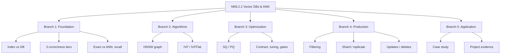
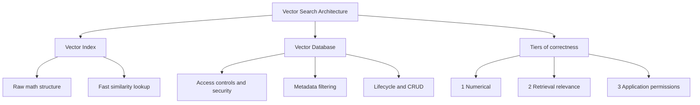
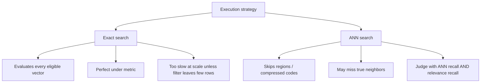
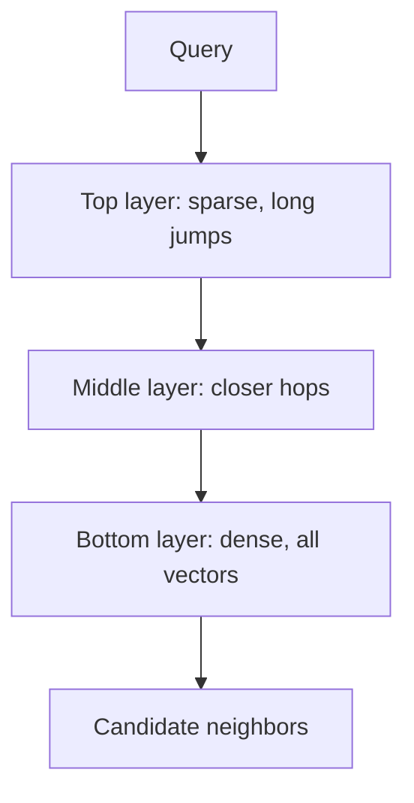
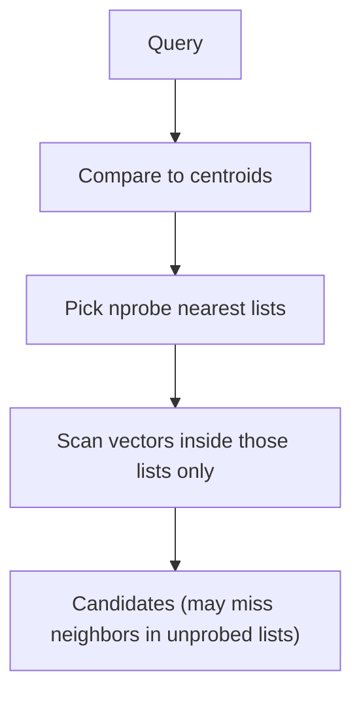
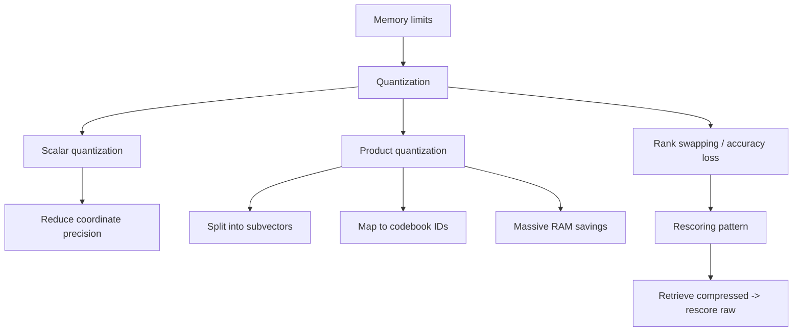
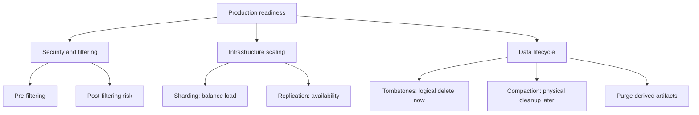
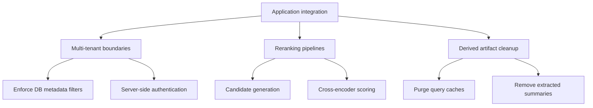
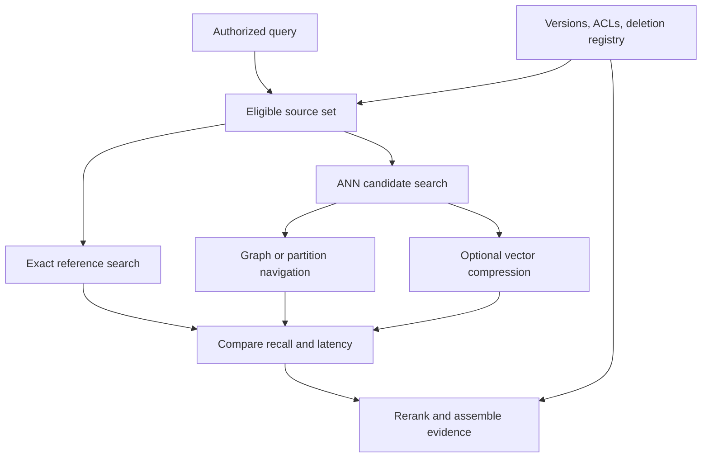

# M06.2.2 — Vector Databases and Approximate Nearest Neighbor Search
### Complete Consolidated Study Notes (Theory + Interview Q&A + Code + Real-World Scenarios)

**Path:** Core | **Depth:** L2 foundation; L3 through demonstrated project work
**Prerequisites:** M03, M05, M07; study *Embeddings* (M06.1.3) first.
**Purpose:** Understand how vector search retrieves candidates, how indexes trade speed vs. recall, and how storage choices affect correctness, permissions, updates, and deletion.

> **Source hierarchy:** This is the Note 2 master version. Note 1 was reviewed only for useful explanations and diagnostic material missing from this document. Its distinct useful points—exact-versus-ANN diagnosis, filtering and candidate-count behavior, index tuning, lifecycle consistency, and the associated interview scenarios—are already covered here in equal or greater detail. No duplicate sections or question sets have been appended.

> All identifiers, numbers, timings and business examples are **invented teaching examples**. They are not product benchmarks. Parameter names and defaults vary across libraries; verify against the installed version.

---

## Table of Contents

- [How to Use These Notes](#how-to-use-these-notes)
- [Master Quick-Reference Table](#master-quick-reference-table)
- [Master Mindmap](#master-mindmap)
- **[Branch 1 — Foundation & Mechanics](#branch-1--foundation--mechanics)**
  - [1.1 Vector Storage Fundamentals](#11-vector-storage-fundamentals)
  - [1.2 Exact Search, ANN, and Candidate Generation](#12-exact-search-ann-and-candidate-generation)
  - [Branch 1 Q&A](#branch-1-qa)
- **[Branch 2 — Indexing Algorithms](#branch-2--indexing-algorithms)**
  - [2.1 HNSW](#21-hnsw-hierarchical-navigable-small-world)
  - [2.2 IVF and IVFFlat](#22-ivf-and-ivfflat)
  - [2.3 HNSW vs IVF Comparison](#23-hnsw-vs-ivf-comparison)
  - [Branch 2 Q&A](#branch-2-qa)
- **[Branch 3 — Optimization & Implementation](#branch-3--optimization--implementation)**
  - [3.1 Product and Scalar Quantization](#31-product-and-scalar-quantization)
  - [3.2 Index Construction and Tuning](#32-index-construction-and-tuning)
  - [Branch 3 Q&A](#branch-3-qa)
- **[Branch 4 — Production Architecture & Lifecycle](#branch-4--production-architecture--lifecycle)**
  - [4.1 Filtering and Production Storage](#41-filtering-and-production-storage)
  - [4.2 Sharding, Replication, and Scaling](#42-sharding-replication-and-scaling)
  - [4.3 Updates, Deletes, Tombstones, and Compaction](#43-updates-deletes-tombstones-and-compaction)
  - [Branch 4 Q&A](#branch-4-qa)
- **[Branch 5 — Application](#branch-5--application)**
  - [5.1 Worked Case Study](#51-worked-case-study)
  - [5.2 Project Exercise and Required Evidence](#52-project-exercise-and-required-evidence)
  - [5.3 Holistic Architecture Notes](#53-holistic-architecture-notes)
  - [Branch 5 Q&A](#branch-5-qa)
- [Glossary](#glossary)
- [Final Revision Checklist](#final-revision-checklist)
- [Multiple-Choice Question Bank](#multiple-choice-question-bank)
- [References](#references)

---

## How to Use These Notes

1. Read each branch top to bottom: concept → analogy → code → pitfalls.
2. Cover the answers in the Q&A and attempt them aloud (interview practice).
3. Questions are tagged: **[Theory]**, **[Situational]**, **[Practical]**, **[Real-life]**, and levelled **Junior / Mid / Senior**.
4. Reproduce the code examples yourself. The project exercise in Branch 5 is the L3 evidence.

## Master Quick-Reference Table

| Topic | One-line essence | Key trap |
|---|---|---|
| Vector index vs database | Index = fast lookup structure; DB = index + metadata + security + lifecycle | Assuming a library (FAISS) gives auth/backups/deletes |
| 3 correctness tiers | Numerical → Retrieval → Application | Perfect math can still leak/stale data |
| Exact search | Work ∝ N·d, perfect under metric | Too slow at scale (but fine on small eligible sets) |
| ANN | Skip parts of space; may miss neighbors | ANN recall ≠ relevance recall |
| HNSW | Multi-layer graph; `M`, `ef_construction`, `ef_search` | Static benchmark ≠ months of updates/deletes |
| IVF / IVFFlat | Centroids → probe nearest lists | Centroids go stale on data drift |
| SQ | Lower precision per coordinate (~4x with int8) | Rounding swaps close candidates |
| PQ | Subvectors → codebook IDs (3072 B → 96 B) | Needs rescoring; can't recover missed candidates |
| Tuning | Index contract + one variable at a time + p95/p99 | Changing many things then crediting one |
| Pre- vs post-filter | Pre = restrict before search; post = after | Post-filter starves results; removing filter = security defect |
| Sharding | Split data | Hot shards; global top-K merge |
| Replication | Copy data | Stale replicas can resurrect deleted data |
| Tombstone / compaction | Logical hide now / physical cleanup later | Compaction is not a compliance mechanism; derived artifacts leak |

## Master Mindmap



---

# Branch 1 — Foundation & Mechanics

> *The base concepts of vector search: what a vector store actually is, what "correct" means, and the exact-vs-approximate tradeoff.*

## 1.1 Vector Storage Fundamentals

**Lifecycle connection:** The architectural foundation. Before inserting any data, decide whether you need a raw mathematical index or a secure, production-ready database.

### Definitions

- **Vector database:** stores vector representations plus associated records and supports similarity search. Depending on the system it may also offer filters, access control, durability, replication, text search, and operations tooling.
- **Vector index:** the data structure that accelerates vector lookup. It is *one component* of a retrieval system. A library containing an ANN index (e.g., FAISS) is **not** automatically a database with authentication, backups, transactional metadata, or a deletion policy.

> **Analogy:** The index is the card catalog. The database is the whole library, with a librarian checking permissions.

### What is actually stored?

```json
{
  "chunk_id": "tenant-A:M-104:v4:section-7:chunk-2",
  "document_id": "M-104",
  "document_version": "v4",
  "tenant_id": "tenant-A",
  "resource_id": "ship-A",
  "source_locator": "section 7, paragraph 2",
  "acl_version": 18,
  "content_hash": "example-hash",
  "embedding_model": "example-model-revision",
  "index_generation": "g12",
  "status": "active"
}
```

The embedding is an additional numeric field (or separate object). Original text may be co-stored or fetched by `chunk_id`.

- **Vector** answers: *"Which items are close in this representation?"*
- **Metadata** answers: *"Who owns this? Which version is valid? Where did it come from?"*
- Neither replaces the other.

### Three tiers of correctness

| Tier | Question | Example failure |
|---|---|---|
| 1. Numerical search correctness | Did search find the nearest **eligible** vectors? | ANN skipped a close vector |
| 2. Retrieval relevance | Do the passages actually answer the question? | Closest passage is about a different machine |
| 3. Application correctness | May this evidence be used **now**? | Passage is deleted, superseded, or unauthorized |

A perfect exact search can still fail tiers 2 and 3. **Similarity is not permission.**

### Why candidate generation matters

Vector search produces a **candidate pool**. A reranker refines it; evidence assembly picks what fits the context budget.

Example: dense retrieval returns 40, hybrid union has 70 unique, reranker keeps 8. These are three different counts. Name them explicitly:

- `dense_candidate_k` = 40
- `fused_candidate_count` = 70
- `final_context_k` = 8

Log the stage where a relevant passage disappeared; this makes debugging tractable.



**Key takeaway:** An index accelerates similarity lookup. The complete application remains responsible for relevance, provenance, permissions, and lifecycle.

## 1.2 Exact Search, ANN, and Candidate Generation

**Lifecycle connection:** Dictates the retrieval execution strategy: how candidates are gathered before they reach a reranker or LLM.

### Exact search

Evaluates similarity/distance against **every eligible vector**, returns the best under the metric (subject to numerical precision and a defined tie policy).

- Work ∝ **N × d** (N vectors, d dimensions). A conceptual model, not a wall-clock prediction; hardware, batching, memory layout, and filters matter.
- Use when: the corpus is small, **filters leave few rows**, or you need a **reference/gold baseline** to test an ANN index.

### ANN (Approximate Nearest Neighbor)

Reduces work by exploring only selected parts of the vector space or using compressed representations. **May miss true neighbors.** "Approximate" is not "arbitrary": a good index recovers most useful neighbors efficiently.

pgvector's default is exact search; approximate indexes can change returned results, and behaviour is product-specific.

### ANN recall ≠ relevance recall

Let E_K(q) = exact top-K IDs and A_K(q) = approximate top-K IDs.

```
ANN Recall@K(q) = |A_K(q) ∩ E_K(q)| / K
```

(Assumes ≥K eligible records; otherwise use exact result count as denominator and document the convention.)

**Example:** exact = {A,B,C,D,E}, approx = {A,B,D,F,G} → overlap {A,B,D} → recall@5 = 3/5 = **0.60**.

If a human says only B and H truly answer the question, ANN recall says nothing about whether H is represented well. **Relevance recall** requires human-labeled, authorized, current gold evidence.

### Recall vs. latency (illustrative, invented)

| Configuration | ANN recall@10 | Relevance recall@10 | p95 latency |
|---|---:|---:|---:|
| Small exploration | 0.83 | 0.66 | 19 ms |
| Medium exploration | 0.94 | 0.73 | 31 ms |
| Large exploration | 0.98 | 0.74 | 62 ms |
| Exact reference | 1.00 | 0.75 | 105 ms |

Medium looks attractive; doubling exploration again buys ~1 point of relevance for 2x latency. Better embeddings or lexical retrieval may help more. But a rare missed passage can matter a lot to the business even if the average gap is small.

### Code: exact-search reference (stdlib only)

Eligibility is applied **before** scoring. In production, `allowed_ids` comes from trusted authorization logic, never a client claim.

```python
from math import sqrt

def cosine(a, b):
    if len(a) != len(b):
        raise ValueError("Embedding dimensions differ")
    na = sqrt(sum(x * x for x in a))
    nb = sqrt(sum(x * x for x in b))
    if na == 0 or nb == 0:
        raise ValueError("Cosine is undefined for a zero vector")
    return sum(x * y for x, y in zip(a, b)) / (na * nb)

def exact_search(rows, query, allowed_ids, k):
    eligible = [r for r in rows if r["id"] in allowed_ids]
    ranked = sorted(eligible, key=lambda r: (-cosine(query, r["vector"]), r["id"]))  # tie policy: id
    return [r["id"] for r in ranked[:k]]

rows = [
    {"id": "A", "vector": [1.0, 0.0]},
    {"id": "B", "vector": [0.8, 0.6]},
    {"id": "C", "vector": [0.0, 1.0]},
]
assert exact_search(rows, [1.0, 0.0], {"B", "C"}, 2) == ["B", "C"]
```

### Code: measuring ANN recall@K

```python
def ann_recall_at_k(exact_ids, approx_ids, k):
    e, a = set(exact_ids[:k]), set(approx_ids[:k])
    denom = min(k, len(e)) or 1          # documented convention for small eligible sets
    return len(e & a) / denom

print(ann_recall_at_k(list("ABCDE"), list("ABDFG"), 5))  # 0.6

def mean_recall(queries, exact_fn, ann_fn, k):
    return sum(ann_recall_at_k(exact_fn(q), ann_fn(q), k) for q in queries) / len(queries)
```

Use the **same** eligibility predicate, embedding version, metric, and tie policy for exact and ANN evaluation.



## Branch 1 Q&A

### A. Theoretical

**Q1 [Junior · Theory] What is the main difference between a vector index and a vector database?**
An index accelerates finding similar vectors. A database stores vectors alongside metadata, handles CRUD, and can enforce access permissions, durability, and replication. Verify which capabilities a given product actually provides.

**Q2 [Junior · Theory] Why not always use exact search if it guarantees the closest vectors?**
At scale, work ∝ N×d per query. With millions of vectors, it crushes CPU/latency budgets for real-time use. (Exception: small eligible sets.)

**Q3 [Mid · Theory] Retrieval returns a semantically relevant passage. Can you guarantee application correctness?**
No. Relevance (tier 2) ≠ application correctness (tier 3). The passage may be outdated, deleted, or unauthorized.

**Q4 [Mid · Theory] Does exact vector search guarantee the right answer?**
No. It finds the nearest eligible vectors under a metric. The embedding may rank irrelevant text highly, and generation can still misuse evidence.

**Q5 [Mid · Theory] How do you compute ANN Recall@K?**
Take exact top-K IDs, take ANN top-K IDs, divide overlap count by K (document the convention if fewer than K eligible).

**Q6 [Mid · Theory] Why is ANN recall different from relevance recall?**
ANN recall compares against the exact result *in the same representation*. Relevance recall compares against human-labeled gold evidence. If the embedding is poor, ANN recall can be ~1.0 while relevance is low.

**Q7 [Junior · Theory] Why do we retain an exact reference system?**
To isolate approximation loss from embedding/chunking/corpus problems, and to have a stable comparator while tuning.

**Q8 [Mid · Theory] Why label counts like `dense_candidate_k` and `final_context_k` separately?**
Because several different "top-k" numbers exist in a pipeline. Without labels you can't tell where a relevant passage was lost.

### B. Situational

**Q9 [Senior · Situational] Your multi-tenant RAG (FastAPI) returns highly relevant chunks, but QA reports occasional cross-tenant leaks. Where is the flaw?**
The system treats similarity as authorization. Tenant boundaries must be enforced by database-level metadata filters or isolated namespaces/partitions, driven by **server-derived identity** (from the auth token), not by vector proximity or a client-supplied `tenant_id`.

**Q10 [Senior · Situational] Exact search gets 60% relevance, ANN gets 59%. The PM wants two weeks of ANN tuning. Agree?**
No. A 1-point gap is negligible. The real issue is that even the exact pipeline is at 60%. Investigate embeddings, chunking, query handling, and document coverage.

**Q11 [Mid · Situational] Exact search finds the relevant chunk for 92% of authorized questions; ANN for 80%. What now?**
That 12-point gap points to approximation. Tune query exploration, then build parameters; compare against a **filtered** exact reference.

**Q12 [Mid · Situational] Why must the exact reference be *filtered*?**
An unfiltered reference may include prohibited or superseded passages that the application correctly excludes, which would make ANN look worse (or better) for the wrong reasons.

### C. Practical (code / hands-on)

**Q13 [Mid · Practical] Write a function to compute recall@K, then explain what the number means when K=10 and result is 0.8.**
See `ann_recall_at_k`. 0.8 means 8 of the 10 exact nearest neighbors were returned by ANN. It says nothing yet about whether those 8 answer the user's question.

**Q14 [Mid · Practical] Design a benchmark harness for exact vs ANN.**
Freeze corpus snapshot, embeddings, metric, and eligibility predicate. Run N representative queries through both; record ANN recall@K, relevance recall@K (gold labels), p50/p95/p99 latency, and memory. Slice by query type (identifiers, conceptual, rare topics, multilingual).

### D. Real-life

**Q15 [Senior · Real-life] A legal-tech product says "our vector DB is 99% recall." What follow-up questions do you ask?**
99% of *what*? ANN recall vs relevance recall? On which corpus, filters, and K? Which tenants/slices? At what p95 latency and memory? Were deleted/unauthorized docs excluded from the reference?

**Q16 [Mid · Real-life] A startup uses FAISS in a notebook and wants to ship it as "the database." What's missing?**
Auth, tenant isolation, metadata storage/filters, durability/backups, replication, update/delete workflow, monitoring, versioned publication.

---

# Branch 2 — Indexing Algorithms

> *The distinct mathematical models used for ANN.*

## 2.1 HNSW (Hierarchical Navigable Small World)

**Lifecycle connection:** Primary index-construction choice when low latency is required. Original paper: Malkov & Yashunin (arXiv:1603.09320).

### Concept

Organizes vectors into a **multi-level graph**. Search starts in sparse upper layers to leap toward the right region, then descends to dense lower layers to examine nearby candidates closely.

> **Analogy:** Navigating a map: district (upper layer) → street → exact building (dense bottom layer). Real levels are graph links between vectors, not literal districts.



### The three controls

| Control | Influences | Practical question |
|---|---|---|
| `M` (connectivity) | Graph links per node → **memory/index size** | Is the graph connected enough? |
| `ef_construction` | Build-time exploration → **build time/graph quality** | Is a better graph worth longer builds? |
| `ef_search` | Query-time exploration → **latency & recall** | How much latency can retrieval spend? |

### Construction vs querying

- A weakly built graph limits recall; raising `ef_search` can't always fix it economically.
- Rebuilding is unnecessary if a modest `ef_search` increase hits the target.
- **Sensible experiment:** hold `M` and `ef_construction` fixed, vary `ef_search`. If no affordable `ef_search` meets the target, test a higher `ef_construction`/`M` in a **new index generation**.

### Lifecycle risk

A graph that excels on a static benchmark may degrade after months of updates/deletes (tombstones bloat traversal; navigability suffers). **Include update/delete operations in the workload test** and schedule rebuilds/compaction based on measured drift.

### Code: HNSW with FAISS

```python
import numpy as np, faiss

d, n = 128, 100_000
xb = np.random.random((n, d)).astype("float32")
xq = np.random.random((5, d)).astype("float32")

index = faiss.IndexHNSWFlat(d, 32)        # M = 32
index.hnsw.efConstruction = 200           # build-time effort
index.add(xb)

index.hnsw.efSearch = 64                  # query-time effort (tune this first)
D, I = index.search(xq, 10)
```

### Code: HNSW in pgvector (PostgreSQL)

```sql
CREATE EXTENSION IF NOT EXISTS vector;

CREATE TABLE chunks (
  id bigserial PRIMARY KEY,
  tenant_id text NOT NULL,
  doc_version text NOT NULL,
  status text NOT NULL DEFAULT 'active',
  embedding vector(768)
);

CREATE INDEX ON chunks USING hnsw (embedding vector_cosine_ops)
  WITH (m = 16, ef_construction = 64);

-- query-time exploration
SET hnsw.ef_search = 100;

SELECT id FROM chunks
WHERE tenant_id = 'tenant-A' AND status = 'active'
ORDER BY embedding <=> '[0.1, 0.2, ...]'
LIMIT 10;
```

> With an approximate index, a `WHERE` filter may be applied *after* the index scan, which can return fewer than `LIMIT` rows. See [Branch 4](#41-filtering-and-production-storage).

**Memory aid:** HNSW = *navigate a graph, then explore nearby candidates.*

## 2.2 IVF and IVFFlat

**Lifecycle connection:** Alternative index construction, heavily dependent on the shape and clustering of your dataset.

### Concept

- **IVF (inverted file):** partition vector space into regions with representative **centroids**. At query time, compare the query to centroids, pick the nearest lists, and search only those.
- **IVFFlat:** vectors inside the lists remain **uncompressed ("Flat")**. Approximation arises because only some lists are visited; "Flat" does *not* mean all lists are scanned.
- Read index names carefully: **IVFFlat vs IVFPQ** have different compression behaviour.

### Worked example

120,000 vectors in 120 lists; query probes 6 lists. If balanced: ~6,000 vectors inspected instead of 120,000 (≈5%). But real lists are unbalanced, and a true nearest neighbor sitting just across a boundary in an unprobed list is **missed**. More probes → more recall, more work (gain depends on clustering quality and query distribution).

### Training and representative data

Centroids must reflect the data you will search. Training on English policy docs and later ingesting multilingual technical manuals gives poorly fitted clusters.

- Train on a sample covering document types, languages, tenants (where policy permits), and time periods.
- Keep evaluation set **separate** from tuning data.
- Rebuild on **evidence** (list imbalance growth, widening quality gap), not just on a calendar.

### Code: IVFFlat with FAISS

```python
import numpy as np, faiss

d, n, nlist = 128, 120_000, 120
xb = np.random.random((n, d)).astype("float32")

quantizer = faiss.IndexFlatL2(d)                 # holds the centroids
index = faiss.IndexIVFFlat(quantizer, d, nlist)  # nlist = number of lists
index.train(xb)                                  # learn centroids on representative data
index.add(xb)

index.nprobe = 6                                 # lists searched per query
D, I = index.search(xb[:3], 10)
```

### Code: IVFFlat in pgvector

```sql
-- Build AFTER data is loaded so centroids are representative
CREATE INDEX ON chunks USING ivfflat (embedding vector_cosine_ops) WITH (lists = 100);
SET ivfflat.probes = 10;
```



## 2.3 HNSW vs IVF Comparison

| Dimension | HNSW-style question | IVF-style question |
|---|---|---|
| Construction | How costly are graph connections? | Is the training sample representative? |
| Query control | How broad is graph exploration (`ef_search`)? | How many lists probed (`nprobe`/`probes`)? |
| Memory | Vectors + graph links | Vectors/codes + list structures |
| Distribution change | Does graph quality hold after updates? | Do centroids still represent the corpus? |
| Filtering | Can eligible neighbors be reached efficiently? | How selective are filters within probed lists? |

This is a **decision framework**, not a claim that one family always wins. Benchmark on **your** workload.

## Branch 2 Q&A

### A. Theoretical

**Q1 [Junior · Theory] How does HNSW skip irrelevant data?**
Sparse upper layers allow big leaps toward the target region; only the dense bottom layer is explored closely around the final neighborhood.

**Q2 [Junior · Theory] What is a centroid in IVF?**
The mathematical center of a cluster of vectors; a representative marker for that list/bucket.

**Q3 [Mid · Theory] Why is IVFFlat "approximate" if vectors aren't compressed?**
Because only a subset of lists is searched; a true neighbor may be in an unsearched list near a boundary.

**Q4 [Junior · Theory] Name the three HNSW controls and what each affects.**
`M` → memory/connectivity; `ef_construction` → build time/graph quality; `ef_search` → query latency/recall.

**Q5 [Mid · Theory] What are the IVF analogues of build vs query effort?**
Build: number of lists (`nlist`/`lists`) and training sample quality. Query: number of probes (`nprobe`/`probes`).

**Q6 [Mid · Theory] Does increasing `ef_search` always improve recall for every query?**
No. It usually helps on average at a latency cost, but it is not guaranteed per query and can plateau if another bottleneck exists.

### B. Situational

**Q7 [Mid · Situational] HNSW recall is too low. Rebuild immediately?**
No. Raise `ef_search` first. Only if no affordable value meets the target, rebuild with higher `ef_construction` or `M` as a new generation.

**Q8 [Senior · Situational] HNSW is perfect on a static benchmark; after 6 months of updates/deletes, latency spikes and recall drops. Why?**
Continuous updates and tombstones degrade graph navigability (bloated traversal, poorly connected regions). Schedule rebuilds/compaction and include churn in benchmarks.

**Q9 [Senior · Situational] IVF trained on English financial reports; a year later multilingual manuals arrive; latency fine, recall terrible. Diagnose.**
Data drift: centroids no longer represent the distribution, so new data sits in poorly fitted clusters. Retrain centroids on a representative sample of the new corpus and measure list imbalance.

**Q10 [Mid · Situational] Which index would you choose for an interactive chatbot with frequent small updates and a generous RAM budget?**
Likely HNSW-style (low latency, incremental inserts), but only after benchmarking update behaviour, memory (vectors + graph), and filtered recall against alternatives.

**Q11 [Mid · Situational] Which for a mostly-static corpus with tight memory?**
IVF-family with quantization (IVFPQ/IVFSQ) is a candidate; add rescoring. Measure.

### C. Practical

**Q12 [Mid · Practical] Write the experiment to tune HNSW `ef_search`.**
Fix corpus, embeddings, `M`, `ef_construction`. For `ef_search` in [16, 32, 64, 128, 256]: compute ANN recall@10 vs filtered exact, relevance recall@10, p95 latency under target concurrency. Choose the cheapest value meeting gates.

```python
for ef in [16, 32, 64, 128, 256]:
    index.hnsw.efSearch = ef
    # run queries -> record recall@10, p95 latency
```

**Q13 [Mid · Practical] Your pgvector IVFFlat index gives poor recall right after a big import. Likely cause and fix?**
The index was built when the table was nearly empty (poor centroids). Rebuild after loading representative data; tune `lists` and raise `probes`.

**Q14 [Mid · Practical] How do you compute IVF work saved?**
Approx fraction scanned ≈ `nprobe / nlist` if balanced (6/120 = 5%). Verify actual list size distribution since imbalance changes this.

### D. Real-life

**Q15 [Senior · Real-life] A product launches in new languages and search quality drops only for those languages. HNSW or IVF?**
Could be either; first check the embedding model's multilingual quality with exact search. If exact is fine but ANN isn't, inspect IVF centroids (drift) or HNSW exploration. Slice metrics by language.

**Q16 [Mid · Real-life] Team copies "M=64, ef=500" from a blog. Evaluate.**
Parameters are workload-dependent. Cost: memory (M) and build time (ef_construction). Validate against own exact reference, latency budget, and memory; don't import benchmark values as standards.

---

# Branch 3 — Optimization & Implementation

> *Making the algorithms run efficiently and verifiably in the real world.*

## 3.1 Product and Scalar Quantization

**Lifecycle connection:** The optimization phase, applied when infrastructure cost or memory limits threaten production scaling.

### The memory problem

```
raw vector bytes = N × d × b
```

For N = 1,000,000; d = 768; b = 4 (float32):

```
1,000,000 × 768 × 4 = 3,072,000,000 bytes ≈ 3.07 GB (decimal) ≈ 2.86 GiB
```

This **excludes** metadata, graph links, text, replicas, allocator overhead, and build-time temp space. Vector search runs in **RAM** for speed, which is expensive.

### Scalar Quantization (SQ)

Reduces precision of **each coordinate** (e.g., map [-1, 1] into 256 integer bins). Distinct values can collapse into the same bin. int8 ≈ 1/4 of float32 coordinate storage (plus scaling parameters/alignment overhead in real layouts).

### Product Quantization (PQ)

Split the vector into **subvectors**; replace each with the ID of the nearest **learned codebook** entry.

- 768 dims → 96 subvectors × 8 dims; each subvector stored as 1 byte (256 centroids).
- Code size = **96 bytes** vs 3,072 bytes float32 (~32x), before overhead.
- Toy arithmetic, **not** a guarantee of accuracy or a full memory estimate.

| | Scalar Quantization | Product Quantization |
|---|---|---|
| Unit approximated | Each coordinate | Group of coordinates (subvector) |
| Mechanism | Fewer value levels | Learned codebook IDs |
| Typical compression | ~4x (int8) | Often much larger (e.g., 32x) |
| Analogy | Rounding each number | Replacing a whole phrase with a dictionary ID |

### What compression changes

Rounding error can swap the order of closely scored candidates. **Rescoring pattern:**

1. Retrieve a larger pool (e.g., top-100) with compressed index.
2. Fetch raw/uncompressed vectors (or text) for only those 100.
3. Rescore exactly (or rerank with a text reranker).
4. Pass top results to the LLM.

Rescoring fixes **ordering**; it **cannot recover** a relevant item that never entered the pool.



### Code: memory estimator and PQ in FAISS

```python
def raw_bytes(n, d, bytes_per=4):
    return n * d * bytes_per

n, d = 1_000_000, 768
b = raw_bytes(n, d)
print(f"{b/1e9:.2f} GB decimal | {b/2**30:.2f} GiB")       # 3.07 GB | 2.86 GiB

# PQ code size: m subvectors * (nbits/8) bytes
m, nbits = 96, 8
print("PQ bytes per vector:", m * nbits // 8)               # 96
print("Compression:", (d * 4) / (m * nbits // 8), "x")      # 32.0x
```

```python
import faiss, numpy as np
d, nlist, m, nbits = 768, 1024, 96, 8
quantizer = faiss.IndexFlatL2(d)
index = faiss.IndexIVFPQ(quantizer, d, nlist, m, nbits)
index.train(train_vectors)      # learns centroids + PQ codebooks (float32 array)
index.add(all_vectors)
index.nprobe = 16
D, I = index.search(queries, 100)   # large candidate pool -> then rescore with raw vectors
```

### Measure four stages separately

1. Exact search, original vectors.
2. ANN index, original vectors.
3. ANN index, compressed vectors.
4. Compressed retrieval + rescoring/reranking.

This separates **index approximation** from **compression loss** from **downstream recovery**. Always report memory saved *with* quality lost/regained.

## 3.2 Index Construction and Tuning

**Lifecycle connection:** The deployment-gating phase: prove the index works before production.

### The Index Contract

Record before indexing:

- Embedding model **and revision**
- Query/document encoding conventions
- Dimension and numeric type
- Similarity metric and normalization policy
- Chunking and extraction versions
- Metadata schema and authorization fields
- Index family and build parameters
- Corpus snapshot / generation

Two vectors of equal dimension from different models are **incompatible**. A successful insert doesn't prove meaningful comparison.

### One experiment answers one question

- ❌ Weak: change embedding model + chunk size + HNSW settings + reranker + prompt → "score went up."
- ✅ Strong: hold corpus and representation fixed; vary only query exploration; measure neighbor recovery, relevance retrieval, p95 latency, memory.

### Workload realism

Test short identifiers, conceptual questions, rare topics, multilingual queries, high-selectivity and low-selectivity filters, warm and cold caches, and realistic concurrency. **Never use average latency alone**; use p95/p99 and timeout rate. Break latency into: query embedding, DB retrieval, reranking, source fetch, generation.

### Quality gates (fictional example thresholds, not standards)

| Gate | Example requirement |
|---|---|
| Eligibility | **Zero** unauthorized passages returned in the security suite |
| Approximation | ANN recall@20 ≥ 0.95 on the chosen benchmark |
| Relevance | No material regression on exact identifiers / rare document classes |
| Performance | Retrieval p95 within budget at target concurrency |
| Deletion | Deleted IDs cannot be served after the declared enforcement point |
| Recovery | A failed build leaves the previous valid generation usable |

## Branch 3 Q&A

### A. Theoretical

**Q1 [Junior · Theory] Why compress vectors instead of buying more disk?**
Vector search is done in RAM for speed. RAM is expensive and raw vectors exhaust it quickly; disk doesn't fix the latency problem.

**Q2 [Mid · Theory] SQ vs PQ?**
SQ reduces precision of each coordinate independently. PQ splits the vector into chunks and replaces each chunk with a codebook ID learned from data.

**Q3 [Junior · Theory] What is an index contract?**
A documented record of exact build configuration (embedding model/revision, dimension, metric, chunking, schema, index params, corpus generation).

**Q4 [Mid · Theory] Why measure p95/p99 rather than average latency?**
Averages hide slow outliers. Users experience the tail; SLAs are set on percentiles.

**Q5 [Mid · Theory] Can rescoring recover a missed relevant document?**
No. It reorders documents already in the candidate pool. Recovery requires a larger pool or less lossy retrieval.

**Q6 [Mid · Theory] How do you estimate vector memory properly?**
`N × d × bytes` for raw vectors, then add measured index structures (graph/lists), metadata, replicas, temp build space, process overhead; state GB vs GiB; validate with a real build.

### B. Situational

**Q7 [Senior · Situational] PQ cut memory 75%, but the best document dropped from rank 1 to rank 15 and the LLM lacks context. Fix while keeping savings?**
Use rescoring: retrieve top-100 from the compressed index, fetch raw vectors for only those, rescore exactly (or rerank with a cross-encoder), return the top few. Memory stays low (raw vectors on disk/cheaper tier).

**Q8 [Senior · Situational] A dev changed embedding model, chunk size, and switched to HNSW all at once for +10% relevance. Merge?**
No. Confounded variables. Require independent tests against a fixed baseline.

**Q9 [Senior · Situational] Compressed index fits in memory but loses a rare document class. Deploy?**
Not on average score alone. Measure that slice; try larger pool or original-vector rescoring; evaluate memory/latency cost. If the class is required and still below gate, keep uncompressed or redesign.

**Q10 [Mid · Situational] After an embedding model upgrade, can you insert new vectors into the old index?**
No. Different representation spaces are not comparable. Build a new index generation, re-embed the corpus, validate, then switch via versioned publication.

### C. Practical

**Q11 [Mid · Practical] Compute memory for 50M vectors, 1024 dims, float32, and for PQ with 128 bytes/vector.**
Raw: 50,000,000 × 1024 × 4 = 204.8 GB (≈190.7 GiB). PQ codes: 50,000,000 × 128 = 6.4 GB (+ codebooks, lists, metadata, replicas).

**Q12 [Mid · Practical] Design the four-stage compression experiment.**
Run exact / ANN-raw / ANN-compressed / ANN-compressed+rescore on the same queries and filters; tabulate ANN recall, relevance recall, p95, memory for each. Differences attribute loss to the right layer.

**Q13 [Mid · Practical] Write a quality-gate checklist as CI steps.**
(1) Security suite: 0 leaks. (2) ANN recall@K ≥ threshold on frozen set. (3) Relevance on slices (IDs, rare classes). (4) p95 at target QPS. (5) Deletion test. (6) Failed-build rollback test.

### D. Real-life

**Q14 [Senior · Real-life] Cloud bill is exploding because the vector DB holds everything in RAM. Options?**
Quantization (SQ/PQ) + rescoring, tiering (raw vectors on SSD), dimension reduction (if the embedding model supports it), partitioning cold tenants, lowering replicas where availability permits. Measure quality at each step.

**Q15 [Mid · Real-life] Marketing demo "felt fast." Is that enough to ship?**
No. Need percentiles at concurrency, filter-selectivity tests, recall vs exact, memory, update/deletion behaviour.

---

# Branch 4 — Production Architecture & Lifecycle

> *Scaling the math into a secure, enterprise-grade system.*

## 4.1 Filtering and Production Storage

**Lifecycle connection:** Security and application logic. Ensure the right users see only the right data.

### Metadata filtering

A filter restricts eligibility (tenant, current version, language, product, date). Some are optional relevance preferences; others are **mandatory security constraints**. Database predicates (e.g., Qdrant payload filters, SQL `WHERE`) can express them, but security-critical values must be derived from **trusted identity and policy**.

> A user-provided `tenant_id` must **never** decide the security boundary. If an authenticated tenant-A user submits `tenant-B`, the server must not adopt it.

### Pre-, post-, and integrated filtering

| Mode | What it does | Risk |
|---|---|---|
| **Pre-filtering** | Removes ineligible records *before* similarity selection | May need filter-aware index or exact fallback for efficiency |
| **Post-filtering** | Removes ineligible records *after* initial top-K | **Starvation:** top-100 → 98 removed → 2 left |
| **Integrated filtering** | Eligibility checked during index traversal | Implementation-specific; verify behaviour |

A DB may guarantee returned rows satisfy a predicate while still exploring a region full of ineligible rows. **Security and retrieval recall are different properties.**

### The post-filter trap and the forbidden fix

Top-100 contains only 2 tenant-A rows → only 2 results even though tenant A has many useful passages. The tempting fix, *"disable the filter if fewer than 5 results,"* is a **security defect**.

**Valid fixes:**

- Increase bounded exploration (e.g., larger `ef_search`/candidate K, iterative scans where supported).
- Use a filter-aware index.
- Query an **authorized partition/namespace**.
- Run **exact search over the small eligible subset** (small tenant → small N → exact is cheap).

All unauthorized content must stay inside the trusted retrieval boundary: **never** send it to a reranker, embedding provider, LLM, user-facing log, or citation preview. Re-check authorization/deletion state before final emission if state can change mid-request.

### Collections and namespaces

Semantics vary (physical index, logical partition, routing label). Names help organization but become a **security control only when trusted server-side routing and access enforcement prevent unauthorized access**. A client-supplied namespace string is not isolation.

PostgreSQL Row-Level Security illustrates DB-enforced policies, but table owners/superusers/`BYPASSRLS` roles can bypass them. **Test the actual service role.**

### Code: server-derived tenant filtering (FastAPI + SQL)

```python
from fastapi import FastAPI, Depends, HTTPException
from pydantic import BaseModel

app = FastAPI()

class SearchRequest(BaseModel):
    query: str
    # NOTE: no tenant_id field here on purpose!

def current_identity(token: str = Depends(oauth2_scheme)):
    claims = verify_jwt(token)                  # your auth logic
    if not claims:
        raise HTTPException(401)
    return {"tenant_id": claims["tenant_id"], "allowed_resources": claims["resources"]}

@app.post("/search")
async def search(req: SearchRequest, ident=Depends(current_identity)):
    qvec = await embed(req.query)
    rows = await db.fetch(
        """
        SELECT id, text
        FROM chunks
        WHERE tenant_id = $1
          AND status = 'active'
          AND resource_id = ANY($2)
        ORDER BY embedding <=> $3
        LIMIT 20
        """,
        ident["tenant_id"], ident["allowed_resources"], qvec,
    )
    # Recheck current authz/deletion state before returning (state may change mid-request)
    return await recheck_and_emit(rows, ident)
```

### Code: small-tenant exact fallback (secure alternative to disabling the filter)

```python
SMALL_TENANT_THRESHOLD = 50_000

async def tenant_search(ident, qvec, k=20):
    n_eligible = await eligible_count(ident)             # trusted count
    if n_eligible <= SMALL_TENANT_THRESHOLD:
        return await exact_scan(ident, qvec, k)          # exact over pre-filtered subset
    return await ann_search_with_filter(ident, qvec, k, ef_search=200)  # bounded; filter stays ON
```

## 4.2 Sharding, Replication, and Scaling

**Lifecycle connection:** Infrastructure scaling for enterprise growth and high availability.

### Sharding

Splits data across nodes/partitions to balance storage and compute. Example: shard 1 owns tenants A–F, shard 2 owns G–L; a tenant-A query routes to shard 1.

> **Analogy:** Splitting a book into chapters across desks.

Challenges: balancing *load* (not just record count), correct routing. One huge tenant → **hot shard** while others idle. Hash sharding may balance counts but not traffic.

### Merging results across shards

A global top-10 **cannot** be built from "top-2 per shard." Collect enough candidates from every shard (e.g., 5 shards × top-10 = 50), sort at a **fusion layer** by *compatible* scores, return the true top-10. Dense scores need compatible embeddings/metrics; lexical scores (e.g., BM25) depend on collection statistics. Prefer deliberate fusion/reranking (e.g., RRF) over mixing incomparable numbers.

```python
import heapq

def global_top_k(shard_results, k):
    # shard_results: list of lists of (score, id), higher is better, scores comparable across shards
    merged = (item for res in shard_results for item in res)
    return heapq.nlargest(k, merged, key=lambda x: x[0])
```

### Replication

Stores extra copies for availability and read capacity.

> **Analogy:** A full copy of the book on every desk.

Consistency risk: if a delete reaches the primary before a replica, a replica query must not resurrect the source. Need a current authorization/deletion registry, read-routing policy, or stronger consistency.

### Scaling tradeoffs

| Change | Benefit | Cost / risk |
|---|---|---|
| Add shards | More storage + parallelism | Fan-out cost, routing complexity |
| Add replicas | Read capacity + availability | Storage + update propagation, staleness |
| Compress vectors | Lower memory | Approximation loss, rescoring |
| Lower candidate count | Less retrieval/rerank work | Missed evidence |
| Isolate large tenants | Workload control | More operational units |
| Cache retrieval | Lower repeated latency | Permission, freshness, invalidation |

Infrastructure complexity is a cost even when average latency improves.

## 4.3 Updates, Deletes, Tombstones, and Compaction

**Lifecycle connection:** Cleanup and maintenance; critical for legal compliance (e.g., GDPR) and system health.

### Updates

A document change can alter text, metadata, permissions, or all three.

- Embedded content changed → **re-embed**.
- ACL-only change → update metadata/authorization; vector may stay.
- Record **content version** and **policy (ACL) version separately**, otherwise a "no content change" optimization can skip a permission revocation.

### Tombstones

A **tombstone** is a logical marker (gravestone) that a record is inactive; serving stops *immediately* while physical cleanup is deferred. Physical deletion from graph indexes is slow and heavy.

### Compaction

**Compaction** is an asynchronous background process that reorganizes storage and reclaims bytes from tombstoned vectors. It is **operational, not a compliance guarantee**; privacy and freshness must not depend on its schedule. Suppress tombstoned items at serving time *now*.

### Derived artifacts: the hidden leak

A deleted source may survive in: lexical indexes, extracted text, thumbnails, generated summaries, graph facts/summaries, **query caches, answer caches, long-term conversation memory summaries**, reranker stores, and backups (per retention policy). Track derived artifacts by **source ID + version** so deletion can propagate.

### Versioned publication

For manual M-104: build v4 in a **staging generation**; validate extraction, vectors, metadata, source locators; publish as active only when all required indexes are ready. If publication fails midway, never mix v4 text with a v3 citation locator. Use a **manifest/publication record** stating which generation is authoritative.



### Code: deletion workflow skeleton

```python
async def delete_source(source_id: str):
    # 1. Logical delete first: stops serving immediately
    await registry.mark_deleted(source_id)                   # authoritative deletion registry
    await vector_store.tombstone(source_id)

    # 2. Propagate to every derived artifact
    await lexical_index.remove(source_id)
    await query_cache.invalidate_by_source(source_id)
    await answer_cache.invalidate_by_source(source_id)
    await summary_store.remove_by_source(source_id)
    await graph_store.remove_facts_by_source(source_id)
    await memory_store.scrub_by_source(source_id)

    # 3. Physical cleanup later (not a compliance mechanism)
    schedule_compaction()

    # 4. Evidence: verify across ALL serving paths, not just one empty search
    assert not await direct_id_lookup(source_id)
    assert not await any_cache_contains(source_id)
```

### Code: tombstone filter at serve time (defense in depth)

```python
def serve(results, registry):
    # Even if the index still physically holds a tombstoned vector, never emit it
    return [r for r in results if registry.is_active(r.source_id, r.version)]
```

## Branch 4 Q&A

### A. Theoretical

**Q1 [Junior · Theory] Pre-filtering vs post-filtering?**
Pre-filtering narrows the search space before vector math; post-filtering searches first and discards ineligible results afterward.

**Q2 [Mid · Theory] Why never trust a client-provided `tenant_id`?**
A malicious user could change it to read another tenant. Derive tenant from a verified auth token server-side.

**Q3 [Junior · Theory] Sharding vs replication?**
Sharding divides data (chapters across desks). Replication copies data (full book on each desk). Different problems: capacity vs availability.

**Q4 [Mid · Theory] Primary risk of sharding by `tenant_id`?**
Hot shard from imbalanced tenants (one with 80% of data/traffic).

**Q5 [Junior · Theory] Why use tombstones instead of immediate physical delete?**
Physical delete from complex indexes is slow/heavy. Tombstone hides data instantly while cleanup occurs in background.

**Q6 [Mid · Theory] Can compaction satisfy GDPR "right to be forgotten" instantly?**
No. It's scheduled and operational. Compliance needs immediate logical deletion across all serving paths (and defined retention handling for backups).

**Q7 [Mid · Theory] Why is a namespace string not isolation by itself?**
It's only a label unless trusted server-side routing and access control enforce it.

**Q8 [Mid · Theory] Why can a DB "guarantee the filter" yet still give poor recall?**
It can return only matching rows from an ANN-explored region that held few eligible rows. Correctness of the predicate ≠ recall of eligible neighbors.

### B. Situational

**Q9 [Senior · Situational] Post-filtered ANN returns 1–2 docs for a strict tenant → LLM hallucinates. Junior suggests disabling the filter below 5 results. Alternative?**
Never disable the filter. Route small tenants to a dedicated partition/namespace or exact search over their pre-filtered subset; for larger ones increase bounded exploration or use filter-aware/iterative index scans.

**Q10 [Senior · Situational] Query fan-out to 5 shards, each returns top-10. Build global top-10.**
Aggregate all 50, sort by comparable scores at a fusion layer, return the top 10. Taking top-2 per shard is wrong.

**Q11 [Senior · Situational] A sensitive doc is tombstoned and compacted; index shows 0 results; next day the LLM summarizes it. Failure points?**
Deletion didn't propagate to derived artifacts: query/answer cache (e.g., Redis), reranker/extracted-text store, graph/text summaries, or conversation memory summary.

**Q12 [Senior · Situational] Users receive old manual instructions though search is fast. What do you inspect?**
Trace returned chunk → document version & locator; publication state; metadata filters (`status`, `version`); replica lag; retrieval/answer caches; whether a failed update left a mixed generation.

**Q13 [Senior · Situational] A user revokes access mid-request while the pipeline is running. What guarantee do you implement?**
Re-check current authorization/deletion state immediately before emission (and keep unauthorized content out of reranker/LLM inputs); define the enforcement point explicitly.

**Q14 [Mid · Situational] A replica serves a deleted doc for a few seconds. Acceptable?**
Depends on declared guarantee. If not acceptable: consult a deletion registry at serve time, route reads to consistent nodes, or use stronger consistency; document the enforcement point.

### C. Practical

**Q15 [Mid · Practical] Write the SQL for a tenant-safe, current-version vector query.**
See the FastAPI/SQL example: `WHERE tenant_id = $1 AND status='active'` with tenant from the JWT; `ORDER BY embedding <=> $3 LIMIT k`.

**Q16 [Senior · Practical] Test atomicity of an index update workflow.**
During a batch insert/update of a new document version, blast the index with reads. If any query returns new vector with old metadata (or v4 text with v3 locator), the update isn't atomic. Fix with staging generation + manifest switch.

**Q17 [Senior · Practical] Design a deletion test that's convincing.**
Query the deleted content before and after deletion; do direct ID lookup; inspect caches, lexical index, summaries, replicas; verify the declared serving guarantee. A single empty search is weak evidence.

**Q18 [Mid · Practical] Test Postgres RLS correctly.**
Connect with the *actual* application role (not owner/superuser), attempt cross-tenant reads, verify the role lacks `BYPASSRLS`, and confirm policies apply to the vector query path.

### D. Real-life

**Q19 [Senior · Real-life] SaaS has 5,000 tenants; 3 are huge, the rest tiny. Storage architecture?**
Isolate the 3 large tenants onto dedicated shards/collections; pack small tenants into shared partitions with enforced filters and **exact search over pre-filtered subsets** when small. Monitor hot shards; keep server-side routing.

**Q20 [Senior · Real-life] Compliance asks: "prove deleted data is gone."**
Provide: deletion registry record + timestamp, test evidence across serving paths (vector, lexical, caches, summaries, memory), backup retention policy, compaction schedule, and audit logs. Distinguish logical non-retrievability from physical deletion.

**Q21 [Mid · Real-life] Caching boosts speed but a cached answer leaked a revoked doc. Redesign?**
Key caches by (tenant, ACL version, source versions); invalidate by source ID on delete/update; re-validate authorization on cache hit; short TTL for sensitive classes.

**Q22 [Mid · Real-life] Marketing wants "just show something if filtered results are few." Response?**
Fill with non-sensitive fallback (e.g., broader *authorized* content, clarification question, or "not enough evidence") but never relax authorization filters.

---

# Branch 5 — Application

> *Putting it all together: multi-tenant boundaries, reranking pipelines, derived-artifact cleanup, and project-level evidence.*



## 5.1 Worked Case Study

### Scenario

An employee of **tenant A** asks: *"What changed in section 7 of manual M-104?"* The system holds v3 and v4 of M-104, plus a similarly titled manual owned by **tenant B**.

Requirements: use only **authorized** versions of M-104 (current v4 vs archived v3 as the question needs); never retrieve tenant B's text merely because it scores higher.

### Pipeline view



### Diagnosis playbook

| Observation | Likely area to inspect |
|---|---|
| Exact finds v4, ANN misses | ANN exploration (`ef_search`/`nprobe`), filter behaviour |
| Neither finds v4 | Ingestion, chunking, embedding compatibility; maybe route via document/version metadata first |
| Retrieval finds v4 but answer cites v3 | Source lookup / context assembly, not the vector index |
| Tenant-B passage appears in reranker input | **Run fails**, even if final answer doesn't quote it |
| Fast but stale answers | Publication state, replicas, caches |
| Good average, bad rare class | Compression loss, slice-level evaluation |

## 5.2 Project Exercise and Required Evidence

**Build a small synthetic corpus with:**

- Two tenants with separate permissions
- Current and archived manual revisions
- Exact document identifiers
- Semantically similar distractors
- A deleted passage
- An ambiguous query requiring clarification

**Build** an exact reference and at least one ANN index (identical embedding config). Add lexical retrieval and a fixed reranker so vector changes are evaluated in the real pipeline.

**Deliverables (L3 evidence):**

1. Configuration record (index contract)
2. Exact-vs-ANN comparison (ANN recall + relevance recall)
3. Latency distribution (p50/p95/p99)
4. Memory estimate
5. Filter-selectivity results
6. Update test (version change, ACL-only change)
7. Deletion test (vector, lexical, caches, summaries, replicas)
8. Permission-negative test (cross-tenant attempts, tampered IDs, reranker-input inspection)

**Completion evidence:** Explain exact vs ANN; compare an index against an exact reference; measure relevance and latency under real filters; demonstrate correct source-version, permission, and deletion behaviour. "The database is popular" or "the demo felt fast" is *not* evidence.

### Starter harness (skeleton)

```python
def run_eval(queries, gold, exact_fn, ann_fn, k=10):
    report = []
    for q in queries:
        e, a = exact_fn(q), ann_fn(q)
        report.append({
            "q": q.text,
            "ann_recall": ann_recall_at_k(e, a, k),
            "relevance_recall": len(set(a[:k]) & gold[q.id]) / max(1, len(gold[q.id])),
            "leaks": [r for r in a if not q.identity.can_read(r)],   # must be empty
        })
    assert all(not r["leaks"] for r in report), "SECURITY FAILURE"
    return report
```

## 5.3 Holistic Architecture Notes

**Do vector DBs replace relational DBs?** No. Vector DBs do similarity search over unstructured data; relational DBs give ACID transactions and structured lookups. Extensions like **pgvector** let PostgreSQL do both, which also simplifies joins with ACL tables.

**Heterogeneous data (code, Slack, PDFs) for an agentic system:** don't dump everything into one unpartitioned index. Options: (1) route queries to domain-specific collections with specialized embeddings (e.g., a code model for code, a text model for chat); or (2) use a strong multimodal/general embedding with strict **metadata pre-filtering** by `data_source` so code questions don't pull chatter.

**Atomicity test:** during active batch insert of a new doc version, hammer reads; any hybrid of old metadata + new vector indicates a non-atomic update.

**End-to-end mental model:**

```
Identity (server-derived) -> Eligible set (tenant, ACL, version, status)
  -> Candidate generation (exact / ANN [+ lexical])
  -> Fusion -> Rerank -> Evidence assembly -> Authz/deletion recheck -> LLM
  Lifecycle registry (versions, ACLs, deletions) governs every stage.
```

## Branch 5 Q&A

### A. Theoretical

**Q1 [Junior · Theory] Do vector databases replace relational databases?**
No; different purposes. Vector DBs: similarity on unstructured data. Relational: ACID transactions/structured queries. pgvector blends both.

**Q2 [Mid · Theory] Why does a tenant-B passage in reranker input fail the run even if never quoted?**
Disclosure already crossed the trust boundary (to a reranker/model/logs). Security is about where data flows, not only what's displayed.

**Q3 [Mid · Theory] How does a good test distinguish retrieval error from generation error?**
Inspect each stage: does retrieval contain v4? Does context assembly include it? Does the answer cite it? Errors can occur at any stage; log stage-wise candidate IDs.

**Q4 [Mid · Theory] Why keep content version and ACL version separate?**
So ACL-only changes (permission revocations) are never skipped by "content unchanged" optimizations.

### B. Situational

**Q5 [Senior · Situational] Agentic assistant searches code repos, Slack, and PDFs. How do you design vector representation?**
Separate collections per domain with suited embeddings, or one strong embedding with mandatory `data_source` pre-filters; route queries by intent; evaluate per-source recall.

**Q6 [Senior · Situational] How do you test the atomicity of index updates?**
Concurrent read blast during batch update; flag any mixed old/new metadata/vector result; remediate with staged generation + manifest.

**Q7 [Senior · Situational] Retrieval finds v4 but the answer cites v3. Where's the bug?**
Likely source lookup or context assembly (e.g., resolving locator against the wrong version, cache keyed without version), not the ANN index.

**Q8 [Senior · Situational] User asks an ambiguous question ("what changed in section 7?") with multiple manuals. What does the system do?**
Detect ambiguity (multiple authorized candidates), ask a clarifying question or route via document/version metadata first; avoid guessing across tenants/versions.

### C. Practical

**Q9 [Senior · Practical] Prove tenant isolation for vector retrieval.**
Derive identity server-side; enforce tenant/resource policy before evidence leaves the retrieval boundary; adversarial tests (forged tenant IDs, document IDs, direct lookups, cache probes); inspect reranker and LLM inputs and logs; test revocation mid-request; confirm DB role lacks bypass.

**Q10 [Mid · Practical] Which five artifacts would you deliver to show an index is production-ready?**
Index contract, exact-vs-ANN report, latency percentiles at target concurrency, filter-selectivity matrix, and update/deletion/permission negative-test results.

**Q11 [Mid · Practical] Design logging so you can debug stage-level loss without leaking data.**
Log IDs, versions, scores, and stage names (not raw unauthorized text); store per-stage candidate lists under access control; scrub on deletion.

### D. Real-life

**Q12 [Senior · Real-life] Customers complain the bot quotes a deleted contract clause. Incident response?**
Contain: disable caches for that source, mark deletion in registry, purge derived artifacts. Investigate propagation gap (caches/summaries/memory). Add deletion test to CI; post-mortem; confirm enforcement point and notify per policy.

**Q13 [Senior · Real-life] You must choose between one big shared index with filters vs per-tenant indexes. Decide.**
Depends on tenant count/size, isolation policy, lifecycle (per-tenant delete/export), and cost. Shared+filters is cheaper but needs rigorous filter enforcement and handling of selectivity; per-tenant gives stronger isolation and simple deletion but more operational units. Hybrid: isolate large/high-sensitivity tenants.

**Q14 [Mid · Real-life] Leadership asks which vector DB to pick. How do you answer?**
Define requirements (scale, filters, updates, latency p95, compliance, ops skills); shortlist; run the project harness on your own data; compare exact-referenced recall, latency, memory, operational complexity, cost. Don't rely on popularity.

---

## Glossary

| Term | Meaning |
|---|---|
| Vector database | Storage + query system supporting vector representations (plus metadata/ops features) |
| Vector index | Structure used to accelerate vector lookup |
| Exact search | Best results under selected metric over the eligible set |
| ANN | Search that may sacrifice neighbor recovery to reduce work |
| ANN recall@K | Overlap of approximate top-K with exact top-K, divided by K |
| Relevance recall | Fraction of human-labeled gold evidence retrieved |
| HNSW | Hierarchical graph-based ANN approach |
| `M` / `ef_construction` / `ef_search` | HNSW connectivity / build effort / query effort |
| IVF / IVFFlat | Partitioned search using inverted lists / with uncompressed vectors in lists |
| Centroid | Representative center of a cluster/list |
| `nlist` / `nprobe` | Number of lists / lists searched per query |
| Scalar quantization | Lower-precision approximation of individual coordinates |
| Product quantization | Codebook approximation of vector subvectors |
| Rescoring | Re-computing exact scores on a shortlist from a compressed search |
| Candidate pool | Items retrieved and available for later refinement |
| Pre-/post-filtering | Eligibility applied before / after similarity selection |
| Filter selectivity | Fraction of records satisfying a predicate |
| Shard / Replica | Partition of the data / additional copy of data |
| Hot shard | Shard overloaded by skewed data or traffic |
| Tombstone | Logical deletion marker |
| Compaction | Background storage reorganization and space reclamation |
| Derived artifact | Cache, summary, graph fact, or memory derived from a source |
| Index generation | Identified version of a built index |
| Index contract | Recorded configuration of embedding, chunking, metric, schema, index params |

## Final Revision Checklist

- [ ] Separate nearest-neighbor recovery (ANN recall) from evidence relevance (relevance recall).
- [ ] Benchmark with identical vectors, metric, permissions, and corpus version; use a **filtered** exact reference.
- [ ] Treat HNSW `M`, `ef_construction`, `ef_search` as different controls; tune `ef_search` first.
- [ ] Treat IVF list count and probes as different controls; train on representative data.
- [ ] Measure compression loss separately from ANN traversal loss; use rescoring for ordering.
- [ ] Include metadata, graph, replicas, and temp build space in memory estimates.
- [ ] Keep security predicates **mandatory**, even when they reduce candidates; never "relax" them to fill results.
- [ ] Derive tenant/identity server-side; test the actual DB role.
- [ ] Merge shard results at a fusion layer using comparable scores.
- [ ] Test updates, deletions, caches, and replicas, not just inserts.
- [ ] Propagate deletes to all derived artifacts; don't rely on compaction for compliance.
- [ ] Preserve source IDs and versions through every derived artifact; publish via manifest/generation.
- [ ] Choose an index based on **measured workload** behaviour, with p95/p99 and slice metrics.

## Multiple-Choice Question Bank

**Easy**

**1. Suitable baseline for measuring ANN approximation loss?**
A. A different embedding model B. Exact search over the same eligible vectors C. Unfiltered web search D. Longer prompt
**Answer: B.** Hold representation, metric, corpus, and eligibility constant.

**2. Which statement about replicas is correct?**
A. They contain different shards B. They eliminate stale reads C. They are copies whose consistency behaviour must be understood D. They remove the need for deletion tests
**Answer: C.**

**Medium**

**3. ANN overlaps 8 of exact top-10. Recall@10?**
A. 0.08 B. 0.20 C. 0.80 D. 1.25
**Answer: C.** 8/10.

**4. Which change specifically tests compression loss?**
A. Replace embeddings and prompts B. Compare original vs compressed representations controlling the rest C. Increase answer length D. Remove metadata filters
**Answer: B.**

**5. Why might exact search be reasonable on a large database?**
A. Large DBs are small in memory B. A mandatory filter may leave a small eligible subset C. Exact always has constant cost D. It needs no metric
**Answer: B.** Database size ≠ per-query eligible set size.

**Hard**

**6. Tenant filtering leaves only 2 of 100 candidates. Best response?**
A. Remove the filter B. Ask the model to ignore unauthorized passages C. Bounded deeper search or authorized partition/exact search D. Include prohibited candidates without citations
**Answer: C.** A model instruction can't repair a disclosure that already occurred.

**7. After deletion, vector search is empty but a cached answer includes the source. What failed?**
A. Cosine similarity B. Deletion propagation across derived artifacts C. Exact search definition D. Need for a reranker
**Answer: B.**

**8. Exact relevance recall is 0.60, ANN is 0.59. Best next step?**
A. Rebuild HNSW B. Inspect representation, query handling, chunking, source coverage C. Remove the eval set D. Claim 99% accuracy
**Answer: B.**

**9. PQ saves memory but the top document fell to rank 15. Best mitigation?**
A. Drop the filter B. Retrieve a larger pool and rescore with raw vectors/reranker C. Lower `ef_search` D. Increase chunk size blindly
**Answer: B.**

**10. A dev changed embedding model, chunking, and index type simultaneously and saw +10%. Verdict?**
A. Merge B. Reject; confounded, require independent tests C. Merge if latency is fine D. Only test the index
**Answer: B.**

## References

Combine these with the installed version's documentation; names and behaviour can change.

- Malkov & Yashunin — *HNSW original paper*: https://arxiv.org/abs/1603.09320
- Faiss — *Index families and storage properties*: https://github.com/facebookresearch/faiss/wiki/Faiss-indexes
- pgvector — *Exact/approximate search, index configuration, filtering*: https://github.com/pgvector/pgvector
- Qdrant — *Structured filtering*: https://qdrant.tech/documentation/search/filtering/
- PostgreSQL — *Row security policies and bypass behavior*: https://www.postgresql.org/docs/current/ddl-rowsecurity.html
