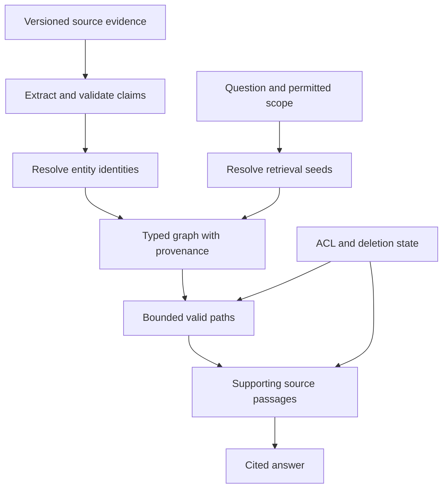

# Study Notes: M06.3.2 — Knowledge Graphs

**Path:** Core  
**Depth:** L2 foundation; L3 through demonstrated project work  
**Prerequisites:** M03, M05, M07; [Query processing and routing](M06.2.3_Query_Processing_and_Retrieval_Routing.md).  
**Purpose:** Represent entities and supported relationships, retrieve connected evidence, and understand when graph methods improve a document-search baseline.

The enterprise manuals, components, ships, task IDs, and relationships below are fictional teaching data. They do not describe actual equipment or operating procedures. Graph methods are an optional extension whose value must be demonstrated against the lexical/dense/hybrid baseline with basic reranking.

## Table of Contents

1. [Knowledge Graph Fundamentals](#1-knowledge-graph-fundamentals)
2. [M06.3.2.1 — Entities and Relationships](#2-m06321--entities-and-relationships)
3. [Graph Modeling](#3-graph-modeling)
4. [Cypher Concepts](#4-cypher-concepts)
5. [Entity and Relationship Extraction](#5-entity-and-relationship-extraction)
6. [M06.3.2.2 — Graph Traversal and Graph-Augmented Retrieval](#6-m06322--graph-traversal-and-graph-augmented-retrieval)
7. [Multi-Hop Reasoning](#7-multi-hop-reasoning)
8. [Entity Resolution and Disambiguation](#8-entity-resolution-and-disambiguation)
9. [Graph Provenance, Permissions, and Deletion](#9-graph-provenance-permissions-and-deletion)
10. [Graph and Vector Hybrid Retrieval](#10-graph-and-vector-hybrid-retrieval)
11. [Worked Case Study and Project Exercise](#11-worked-case-study-and-project-exercise)
12. [Concept Map](#12-concept-map)
13. [Glossary and Final Revision Sheet](#13-glossary-and-final-revision-sheet)
14. [Practice and Interview Questions](#14-practice-and-interview-questions)
15. [References](#15-references)

## 1. Knowledge Graph Fundamentals

### Definition

A **knowledge graph** represents entities and the relationships or claims connecting them. It makes selected structure explicit so a system can query connections, combine facts, and trace evidence.

For example:

- Ship A contains component P-17.
- Procedure PR-7 applies to component P-17.
- Manual M-104 v4 documents procedure PR-7.
- Task T-82 references procedure PR-7.

These statements can support a question such as “Which tasks refer to procedures in this manual?” A document search may find relevant text, while a graph can help follow the explicit links.

### A graph is a representation, not a truth guarantee

A graph can contain extraction errors, outdated relationships, duplicated entities, unsupported edges, and access-control mistakes. Storing a statement as an edge does not make it factual.

Separate three questions:

1. Is the entity or relationship represented correctly?
2. Is the represented claim supported and current for this query?
3. May the user access the supporting evidence and resulting disclosure?

A graph answer must satisfy all three.

### Property graphs and RDF

In a **property graph**, nodes and relationships can have properties; labels or types describe their roles. [Neo4j’s graph concepts](https://neo4j.com/docs/getting-started/appendix/graphdb-concepts/) provide an introduction to this model.

**RDF** represents statements using subject–predicate–object triples, with identifiers and literal values. The [W3C RDF concepts specification](https://www.w3.org/TR/rdf11-concepts/) defines this data model. RDF and property graphs are related ways to represent connected information, but their query languages, identity conventions, and modeling details differ.

For this foundation module, learn the shared ideas first: entities, relationships, identifiers, types, properties, provenance, and query scope. You do not need to master every graph standard before building a useful small example.

### What graphs are good at

Graphs are worth exploring when answers depend on relationships spanning records or documents: dependencies, ownership, affected components, version lineage, or links among procedures and tasks.

They are less compelling when all questions are answered by a single clearly written passage or a simple relational query already supported by an authoritative database.

**Key takeaway:** A graph makes relationships explicit. Its usefulness depends on the quality and meaning of those relationships.

## 2. M06.3.2.1 — Entities and Relationships

### Entities

An **entity** is a distinct thing the application needs to identify: a document, version, person, organization, component, procedure, event, or task.

A good entity definition includes a stable ID and type. A display name alone is often insufficient.

| Entity type | Example ID | Display name |
|---|---|---|
| Ship | `tenant-A:ship-A` | Ship A |
| Component | `tenant-A:ship-A:P-17` | Pump P-17 |
| Manual | `tenant-A:M-104` | Maintenance Manual |
| ManualVersion | `tenant-A:M-104:v4` | Revision v4 |
| Procedure | `tenant-A:PR-7` | Review procedure |
| Task | `tenant-A:T-82` | Task T-82 |

The tenant and resource portions of these teaching IDs help prevent accidental identity collisions. ID construction is an application design choice, not a universal graph requirement.

### Relationships

A **relationship** connects entities with a defined meaning. Names should be specific enough to support the questions you intend to ask.

`REFERENCES` is different from `REQUIRES`. A task referencing a procedure does not prove that the task satisfies the procedure. `LOCATED_IN` is different from `OWNED_BY`. `SUPERSEDES` is different from `MENTIONS`.

Weak graph modeling often uses a generic `RELATED_TO` edge everywhere. That makes the graph easy to populate but hard to reason over because the meaning of a path becomes unclear.

### Direction

Relationship direction encodes meaning. If A depends on B, then failure of B may affect A under the modeled dependency. The reverse statement is not automatically true.

Write relation definitions in plain language:

> `DEPENDS_ON(A, B)` means A requires B for the specific function represented by this relationship during the recorded validity period.

This definition immediately raises useful questions: Which function? Under what conditions? Is the dependency current? What evidence establishes it?

### Relationship properties

Properties can record qualifiers such as effective dates, source IDs, confidence labels, review status, and the context in which the relationship applies.

An edge without its qualifiers can overstate a source. “Procedure PR-7 applies to P-17 when configuration C is installed” is narrower than “PR-7 applies to P-17.”

### Entity versus claim

The component P-17 is an entity. The statement “PR-7 applies to P-17” is a claim about entities.

When claims have multiple sources, different validity periods, or independent permissions, representing the claim as its own node can make provenance easier to manage than placing everything on one edge.

A claim node might contain:

```json
{
  "claim_id": "tenant-A:claim-391",
  "subject_id": "tenant-A:PR-7",
  "relation": "APPLIES_TO",
  "object_id": "tenant-A:ship-A:P-17",
  "valid_from": "2026-10-01",
  "valid_to": null,
  "review_status": "verified",
  "source_version_id": "tenant-A:M-104:v4",
  "source_locator": "section 7, paragraph 2"
}
```

A `verified` field is meaningful only if a defined verification process exists. Do not set it merely because the extraction model returned well-formed JSON.

## 3. Graph Modeling

### Begin with questions

Modeling starts with the questions the graph should answer. If the target is “Which tasks are affected by changed procedures?”, the graph needs tasks, procedures, version changes, and explicit task-to-procedure links.

It does not necessarily need every noun mentioned in every document. Extracting all possible entities can produce a large, noisy graph without improving retrieval.

### A small schema

For the running example:

| Node or relationship | Meaning |
|---|---|
| `Manual` | Stable document identity |
| `ManualVersion` | A particular revision |
| `Section` | A version-specific source section |
| `Procedure` | Stable procedure identity |
| `Task` | A task from the task system |
| `HAS_VERSION` | Connects a manual to a revision |
| `CONTAINS_SECTION` | Connects a revision to source text |
| `DESCRIBES` | A section describes a procedure |
| `REFERENCES` | A task explicitly references a procedure |
| `SUPPORTED_BY` | A claim has supporting source evidence |

Keeping the manual separate from its revisions avoids treating v3 and v4 as interchangeable text.

### Schema constraints

Define allowed node types, relation types, required properties, and uniqueness rules. Examples:

- A task ID is unique within a tenant.
- A section belongs to one document version.
- A `SUPERSEDES` edge connects compatible versions of the same manual.
- A supported claim has at least one source locator.
- A current version is determined by an authoritative publication record.

A schema helps reject impossible or ambiguous extractions early. It also makes evaluation more specific: a wrong endpoint type is different from a missing source.

### Avoid over-modeling

A graph containing a node for every word is usually not useful for this task. A graph that collapses every document into one generic node may be too coarse.

Choose the smallest structure that preserves the relationships needed by the target questions. Keep source text available for details that do not need explicit graph representation.

### Model time explicitly

A relationship may be true for v3 but not v4. A task may be open at one time and closed later. Store or retrieve the relevant time dimension.

Common distinctions include:

- **Valid time:** When the claim applies in the represented world.
- **Recorded time:** When the system learned or stored it.
- **Source version:** Which document or record supports it.

You do not need a full temporal database for every project, but you must avoid silently treating historical facts as current.

### Modeling tradeoff

More structure can make some queries precise while increasing extraction, validation, and maintenance effort. A useful graph schema should have an owner, a change process, and tests for the questions it is meant to support.

## 4. Cypher Concepts

### Definition

**Cypher** is a declarative graph query language used by Neo4j. A query describes patterns to match rather than manually instructing the database how to walk every edge.

The [Cypher MATCH documentation](https://neo4j.com/docs/cypher-manual/current/clauses/match/) explains pattern matching. Foundation knowledge includes nodes, relationship types, labels, properties, filters, returned fields, and bounded paths.

### Reading a pattern

```cypher
MATCH (t:Task)-[:REFERENCES]->(p:Procedure)
RETURN t.id, p.id
```

This matches tasks connected to procedures by a `REFERENCES` relationship. It is a conceptual query against the illustrative schema, not a complete application: it lacks tenant scope, permissions, and lifecycle filters.

### A scoped example

The following query assumes an illustrative graph whose application maintains these fields and relationships. Parameters are supplied by trusted server logic after authorization.

```cypher
MATCH (t:Task {tenant_id: $tenant_id})-[:REFERENCES]->(p:Procedure)
WHERE t.resource_id IN $allowed_resource_ids
  AND t.status = 'OPEN'
  AND p.tenant_id = $tenant_id
  AND p.id IN $validated_procedure_ids
RETURN DISTINCT t.id AS task_id, p.id AS procedure_id
ORDER BY task_id, procedure_id
LIMIT 100
```

This illustrates explicit scope and a bounded result. A production query also needs the relevant relationship validity, source authorization, deletion state, and database privilege checks. Whether those are enforced in the query, a secure view, or a policy layer depends on the implementation.

### Parameters

Parameters separate data values from query text and support predictable query structure. The [Cypher parameter documentation](https://neo4j.com/docs/cypher-manual/current/syntax/parameters/) describes parameter syntax and supported uses.

Parameters do not establish authorization. An attacker’s tenant ID is still unauthorized even when passed safely as a parameter. Resolve the tenant and accessible resources from trusted identity.

### Variable-length paths

A path query can request several hops. Unbounded paths can produce expensive or misleading results, especially in graphs with cycles and high-degree nodes.

For a foundation project, use a small maximum depth, allowlisted relation types, result limits, and explicit path semantics. Record the actual path used as evidence.

### Generated Cypher

If a model proposes Cypher, treat it as untrusted code. Prefer approved templates or a constrained intermediate plan that maps to known query patterns.

Read-only database privileges are useful, but they do not prevent unauthorized reads or excessively expensive traversals. Validate scope and complexity separately.

**Key takeaway:** Learn to read graph patterns, but never confuse syntactically valid Cypher with an authorized or meaningful query.

## 5. Entity and Relationship Extraction

### Entity extraction

Entity extraction identifies mentions of relevant things in text and maps them into a schema.

Source sentence:

> “Task T-82 references procedure PR-7 in manual M-104 revision v4.”

Possible extracted mentions:

| Span | Type | Candidate normalized ID |
|---|---|---|
| T-82 | Task | `tenant-A:T-82` |
| PR-7 | Procedure | `tenant-A:PR-7` |
| M-104 | Manual | `tenant-A:M-104` |
| revision v4 | Version | `tenant-A:M-104:v4` |

The tenant context must come from the source record and trusted ingestion pipeline, not from guesswork about the sentence.

### Relationship extraction

Relationship extraction identifies a supported connection between entities. The example directly supports `T-82 REFERENCES PR-7` and a link between the referenced procedure context and M-104 v4.

It does not necessarily support “T-82 is complete,” “PR-7 is mandatory for all ships,” or “M-104 v4 is current.” Those require separate evidence.

### Extraction methods

Rules can reliably identify stable IDs and structured fields. Statistical or model-based extraction can handle varied language. A combined approach often works well: deterministic parsing for known IDs, model assistance for relation proposals, and validation against the schema and source spans.

The extraction output should include the supporting span, not just a relation label. That makes review and citation possible.

### Negation and uncertainty

These sentences have different meanings:

- “P-17 depends on controller C-2.”
- “P-17 does not depend on controller C-2.”
- “P-17 may depend on controller C-2 in configuration Z.”

A simplistic extractor can collapse them into the same edge. Preserve negation, modality, and conditions, or reject the extraction when the schema cannot represent them faithfully.

### Validation stages

1. Check the output schema and allowed types.
2. Resolve entity IDs without merging ambiguous mentions.
3. Verify that the cited source span supports the relation.
4. Preserve time, version, and conditions.
5. Attach source and permission lineage.
6. Publish only according to the chosen review policy.

A model-generated confidence score is a triage signal at best unless it has been calibrated. It is not a substitute for source support.

### Evaluate extraction

Create labeled examples with correct entities, relationships, endpoint direction, and qualifiers. Measure entity identification, relation correctness, and evidence-span accuracy separately.

A system can extract the right entity names but connect them incorrectly. Another can identify the right relation but attach it to the wrong tenant’s component. These are different failure modes and need different fixes.

## 6. M06.3.2.2 — Graph Traversal and Graph-Augmented Retrieval

### Graph traversal

A traversal follows relationships from a starting node. It can answer questions like “Which tasks reference this procedure?” or “Which procedures belong to this manual version?”

Traversal needs a seed entity, allowed relation types, direction, depth, and eligibility policy. Without these constraints, the result can be large and semantically vague.

### Choosing seed entities

An exact ID is a strong seed. A name or alias may require disambiguation. A semantic query can use vector retrieval to find candidate entities, but those candidates must be resolved before their relationships are treated as evidence.

If the user says “the auxiliary pump,” and the graph contains several pumps with that label, choose only when the context establishes which one. Otherwise clarify or present permitted candidates.

### Graph-augmented retrieval

Graph augmentation uses relationships to improve document retrieval. One pattern is:

1. Resolve the relevant entity.
2. Traverse a small set of meaningful relationships.
3. Collect linked source passages.
4. Rerank those passages for the original question.
5. Assemble evidence with graph-path and source provenance.

This can recover related evidence whose wording differs from the query. It can also add irrelevant neighbors if expansion is too broad.

### Expansion quality

For each expanded item, ask why it is included. “Within two hops” is a structural property, not a relevance explanation.

A procedure linked to a component through `APPLIES_TO` may be useful. A document linked only because it shares an author may not help answer an equipment question.

Measure expansion precision: how much newly added evidence is useful? Also measure whether the graph recovers evidence missed by the baseline.

### Graph retrieval still needs text

A graph often stores compact relationships rather than complete explanations. The answer may need the original passage’s conditions, exceptions, definitions, or wording.

Return source text where the user needs evidence. An edge label alone can hide important qualifiers that were omitted during extraction.

## 7. Multi-Hop Reasoning

### Definition

**Multi-hop reasoning** combines several supported facts to answer a question that no single fact resolves.

Example:

1. M-104 v4 changed procedure PR-7.
2. Task T-82 references PR-7.
3. T-82 belongs to ship A and is open.

The system can conclude that T-82 is an open ship-A task referencing a changed procedure, assuming every relation is current, correctly scoped, and supported.

### A path is not automatically an inference

Consider:

- Alice reviewed manual M-104.
- M-104 describes pump P-17.

This does not establish that Alice is qualified to operate P-17. The graph path connects the entities, but the relation composition does not support the conclusion.

Define which relationship combinations are meaningful. The application should not infer arbitrary causal, legal, or operational conclusions merely because nodes are connected.

### Missing links

If one required link is absent, the graph may be incomplete rather than the relationship false. “No known path” is not always equivalent to “no relationship exists.”

State the scope of the graph and its source coverage. For a closed, authoritative task registry, absence may have a clearer meaning than for a graph extracted from an incomplete document collection.

### Confidence across hops

Do not multiply arbitrary extraction confidence scores and call the result an answer probability. Those scores may not be calibrated, and errors across steps may be correlated.

Instead, track support and validation status for each link. A useful answer trace identifies which facts are directly sourced and which conclusion follows from a defined join or inference rule.

### Cost and stopping rules

Multi-hop workflows can branch quickly. Bound depth, relation types, candidate entities, and elapsed time. Stop when the evidence requirement is satisfied or when the allowed budget is exhausted.

A deeper path is not inherently a better explanation. Prefer the shortest sufficient supported relationship chain for the question.

## 8. Entity Resolution and Disambiguation

### Entity resolution

**Entity resolution** determines whether different records or mentions refer to the same real entity.

“Pump P-17,” “P17,” and “Auxiliary Pump 17” might be aliases for one component. They might also refer to different components across ships or tenants.

Resolution can use stable identifiers, tenant/resource scope, source registries, normalized names, attributes, and verified aliases. Similar wording alone is weak evidence for identity.

### Entity disambiguation

**Disambiguation** chooses the intended entity when a mention could refer to multiple candidates.

If the user asks about “Mercury,” context might refer to a component codename, a company, a chemical element, or a planet. In the enterprise example, “P-17” may exist on both ship A and ship B.

Resolution often merges records known to describe the same entity. Disambiguation selects the correct candidate for a particular mention or query.

### A practical decision sequence

1. Use an exact authoritative ID if available.
2. Restrict candidates to the permitted tenant and resource scope.
3. Compare entity type and known attributes.
4. Use verified aliases and source context.
5. Retain ambiguity when evidence is insufficient.

Never broaden the candidate scope to a prohibited tenant to improve a name match.

### False merge versus false split

A **false merge** combines two different entities. It can create incorrect cross-resource relationships and serious disclosure risk.

A **false split** leaves one entity represented by several nodes. It can reduce recall because relevant relationships are scattered.

These errors have different consequences. In a multi-tenant system, a conservative non-merge may be preferable to a risky merge when identity evidence is weak.

### Preserve merge history

When merging nodes, record aliases, original IDs, evidence, and the transformation version. Make corrections reversible.

If a mistaken merge connected ship A’s task to ship B’s component, repair all affected edges and derived summaries, not merely the display name.

## 9. Graph Provenance, Permissions, and Deletion

### Graph provenance

**Provenance** records where a fact came from and how it was produced. The [W3C PROV overview](https://www.w3.org/TR/prov-overview/) and [PROV data model](https://www.w3.org/TR/prov-dm/) describe entities, activities, and agents for representing derivation and responsibility.

A practical claim record should connect to source document/version, source span, extraction method/version, review result, effective dates, and ingestion event.

This lets the system answer “Why do you believe this relationship?” and “Which claims must be invalidated when the source changes?”

### Multiple supporting sources

One claim may be supported by several documents. Keep each support relationship separately.

If source A is deleted but source B independently supports the same claim and is current and authorized, the claim may remain usable with B’s provenance. Do not retain A’s text or citation merely because a similar fact survives.

If a derived conclusion requires both sources, losing either may invalidate that conclusion. Distinguish alternative support from joint dependencies.

### Permission propagation

A user’s access to an entity does not automatically grant access to every fact about it. A publicly visible company node could have confidential contract relationships.

Apply policy at the granularity needed by the data: nodes, relationships, claim nodes, supporting documents, or a combination. Ensure graph expansion cannot cross into unauthorized evidence before reranking or model input.

An ACL union is dangerous for a summary created from several protected sources: allowing anyone who can access any one source to read the entire summary can disclose the others. Use a policy that protects all disclosed dependencies, or regenerate a summary from the user’s authorized evidence subset.

### Metadata leakage

Even a node name, count, or relationship can reveal sensitive information. “There is a restricted investigation linked to this employee” may disclose information even without the underlying document text.

Design access behavior for graph previews, autocomplete, counts, error messages, logs, and visualizations as well as final answers.

### Deletion handling

When a source version is deleted:

- Mark its support records unavailable for serving.
- Remove or deactivate unsupported claims.
- Recompute derived paths, summaries, or aggregates as required.
- Invalidate graph, retrieval, and answer caches containing its content.
- Preserve only permitted audit metadata under the declared retention policy.
- Verify that restored snapshots cannot reintroduce the deleted evidence without policy checks.

Physical cleanup may occur later, but logical serving must honor the deletion guarantee immediately at the defined enforcement point.

### Revised sources

When M-104 v4 replaces v3, historical claims may remain available for authorized comparisons while current-state queries exclude them. Revision and deletion are different lifecycle events.

A current graph view should use explicit publication and validity rules. Sorting edges by ingestion timestamp is not enough to identify the authoritative current version.

## 10. Graph and Vector Hybrid Retrieval

### Complementary strengths

Vector retrieval finds semantically similar text or entities. Graph retrieval follows explicit relationships. Combining them can help when users describe an entity indirectly and then ask a relationship question.

Example: “Which open tasks relate to the review process described in the latest manual?” Vector search may identify candidate procedure passages; metadata resolves the manual version; graph or structured links identify tasks.

### Three common patterns

| Pattern | Starting point | Benefit | Risk |
|---|---|---|---|
| Vector to graph | Semantically retrieve seed entities/passages | Handles varied user wording | Wrong seed creates irrelevant expansion |
| Graph to text | Resolve entity and traverse source links | Retrieves connected evidence | Incomplete graph misses useful passages |
| Parallel graph and text | Search both, then combine | Recovers complementary evidence | Duplicate or conflicting candidates |

Keep each candidate’s origin, path, and source ID. A reranker can compare textual relevance, but it does not repair an invalid graph relationship.

### GraphRAG terminology

“Graph RAG” can refer broadly to graph-assisted retrieval. Microsoft’s [From Local to Global paper](https://arxiv.org/abs/2404.16130) describes a more specific approach using graph-derived community structure and summaries for query-focused global summarization.

Do not assume every graph-plus-vector application implements that method. Name the actual mechanism: entity expansion, path retrieval, community summaries, or another design.

### When to adopt

Start with the baseline. Identify a failure class requiring relationships across evidence. Build the smallest graph that addresses that class and compare it with the baseline under the same corpus, permissions, and evaluation questions.

Include construction cost, extraction error, refresh effort, deletion complexity, and additional latency. Better retrieval on one demonstration does not establish a worthwhile production tradeoff.

## 11. Worked Case Study and Project Exercise

### The question

> “Which open tasks on ship A reference procedures changed in M-104 v4?”

### Source facts

For this invented exercise:

| Fact | Source |
|---|---|
| v4 is the current M-104 revision | Manual registry |
| PR-7 changed between v3 and v4 | Verified comparison of section 7 |
| T-82 references PR-7 | Task system |
| T-82 belongs to ship A | Task system |
| T-82 is open at the query timestamp | Task system |
| T-93 references PR-7 but belongs to ship B | Task system |

The employee is authorized for tenant A, ship A. T-93 must not enter the answer evidence merely because it shares PR-7.

### Build the graph carefully

Represent manual versions, the changed-procedure claim, task references, resource membership, and current task status. Attach separate provenance to the document-derived change and the structured task facts.

Do not make task status a permanent fact detached from time. A task closed after graph ingestion must not remain open in the answer because the graph has not refreshed.

### Retrieve and validate

Resolve M-104 v4 and PR-7, then follow permitted task references. Check task state against the required freshness source. Fetch the manual spans supporting the change.

The answer can identify T-82 as a matching task and cite the manual comparison and task record. It should not claim that T-82 is “unsafe” or “noncompliant”; those conclusions are not established by the modeled relationships.

### Test deletion

Delete the source supporting the PR-7 change claim. If no independent support remains, the system must stop asserting that PR-7 changed. T-82 can remain a valid task entity, but the answer to this particular question is now unsupported.

This distinction is central: deleting one fact’s support does not require deleting every connected entity, but it must invalidate conclusions that depended on that fact.

### L3 exercise

Create a graph with at least two tenants, two manual revisions, six procedures, and a small task set. Include an alias collision, a negated relationship, a time-limited relationship, and a deleted source.

Compare the graph-enhanced route with lexical, dense, and hybrid retrieval plus the same reranker. Report which questions improve, which fail, and what additional maintenance is required.

### Acceptance evidence

Provide the schema, extraction examples with supporting spans, entity-resolution decisions, query templates, source-to-claim lineage, permission-negative traces, and a deletion trace.

A strong project demonstrates both useful relationship retrieval and correct refusal to infer beyond the evidence.

## 12. Concept Map



The graph supplies structure. Source passages supply evidence. Current policy determines which structure and evidence can be disclosed.

## 13. Glossary and Final Revision Sheet

| Term | Meaning |
|---|---|
| Entity | A distinct identifiable thing in the modeled domain |
| Relationship | A typed connection with defined meaning |
| Property graph | Graph model with node/relationship properties |
| RDF triple | Subject–predicate–object statement |
| Schema | Allowed types, relations, properties, and constraints |
| Claim node | A represented assertion that can carry provenance |
| Cypher | Declarative graph query language used by Neo4j |
| Traversal | Following selected relationships from seed entities |
| Multi-hop | Combining several supported relationship steps |
| Entity resolution | Deciding whether records refer to the same entity |
| Disambiguation | Choosing the intended entity for an ambiguous mention |
| False merge | Incorrectly combining distinct entities |
| False split | Incorrectly separating one entity into several records |
| Provenance | Source and transformation history of a fact |
| Valid time | Period when a fact applies in the represented domain |
| Graph-augmented retrieval | Using graph structure to improve evidence retrieval |

### Final revision sheet

- Model the questions you need to answer.
- Prefer stable IDs over names alone.
- Give relationship types precise meanings and directions.
- Preserve qualifiers, negation, time, and source version.
- Validate extraction against actual source spans.
- A path is not automatically a valid inference.
- Resolve identity within authorized scope.
- Keep alternative support separate from joint dependencies.
- Enforce permissions on facts and derived summaries, not just visible nodes.
- Recompute or invalidate conclusions after source deletion.
- Compare graph methods against the ordinary retrieval baseline.

## 14. Practice and Interview Questions

### Question-and-answer recall

**1. What is a knowledge graph?**  
A representation of entities and supported relationships or claims that allows connected information to be queried and traced.

**2. Why are stable entity IDs useful?**  
Names and aliases can collide or change. Stable IDs preserve identity and help prevent accidental cross-resource merges.

**3. Why does relationship direction matter?**  
Many relations are asymmetric. “A depends on B” does not imply “B depends on A.”

**4. What is the benefit of a claim node?**  
It can represent an assertion with its own sources, validity period, review status, and permissions, especially when several sources support it.

**5. What does Cypher MATCH do conceptually?**  
It describes a graph pattern to find, such as tasks connected to procedures through a particular relationship type.

**6. How do entity extraction and relationship extraction differ?**  
Entity extraction identifies things mentioned in text. Relationship extraction identifies supported connections between them.

**7. Why is a graph path not proof?**  
Its relation types may not compose into the claimed conclusion, and individual edges may be unsupported, stale, or unauthorized.

**8. How do resolution and disambiguation differ?**  
Resolution decides whether records refer to the same entity. Disambiguation selects the intended entity for a particular ambiguous mention.

**9. What is graph provenance?**  
The source, version, supporting span, and transformation history behind graph facts and derived conclusions.

**10. What happens when one of several supporting sources is deleted?**  
Remove that support and any dependent content. A claim may remain usable only if independent current authorized support remains; conclusions requiring the deleted source must be invalidated.

### Multiple-choice questions

#### Easy

**11. Which relationship name is most useful for a dependency question?**

A. `RELATED_TO`.  
B. `DEPENDS_ON`, with a defined direction and scope.  
C. `CONNECTED_SOMEHOW`.  
D. `SAME_TEXT_COLOR`.

**Answer: B.** A specific relation supports meaningful traversal and interpretation.

**12. What is a false merge?**

A. Two different entities are combined into one.  
B. One entity has two valid aliases.  
C. A source has two paragraphs.  
D. A query returns no rows.

**Answer: A.** False merges can create incorrect relationships and cross-resource leakage.

#### Medium

**13. A source says “P-17 may depend on C-2 in configuration Z.” What must extraction preserve?**

A. Only the names.  
B. The uncertainty and configuration condition.  
C. A permanent unconditional dependency.  
D. An unrelated current-status claim.

**Answer: B.** Removing qualifiers overstates the source.

**14. Which statement about a parameterized Cypher query is correct?**

A. Parameters automatically grant access.  
B. Parameters separate values from query text but do not replace authorization.  
C. Parameters guarantee graph truth.  
D. Parameters remove the need to bound traversal.

**Answer: B.** Query construction safety and permission enforcement are separate controls.

**15. Why retain original source passages alongside graph facts?**

A. They provide conditions, wording, and evidence needed to validate claims.  
B. They make every edge true automatically.  
C. They remove the need for IDs.  
D. They authorize all graph users.

**Answer: A.** Compact graph relations often omit detail needed for a defensible answer.

#### Hard — scenario-based

**16. Alice reviewed a manual, and the manual describes P-17. What follows?**

A. Alice is qualified to operate P-17.  
B. Alice owns P-17.  
C. Only the represented review and description relationships, unless another rule is supported.  
D. Alice must have repaired P-17.

**Answer: C.** Connectivity alone does not justify an unrelated operational conclusion.

**17. A summary uses confidential sources A and B. Who may read the full summary?**

A. Anyone with access to either source automatically.  
B. Anyone who knows a node name.  
C. Users authorized for all disclosed dependencies, or users receiving a regenerated permitted subset.  
D. Every user because summaries are new text.

**Answer: C.** Derived text can disclose protected facts from all its source dependencies.

**18. A graph contains no path between a task and a procedure. What can you conclude?**

A. The relationship definitely never exists.  
B. No path is known in the graph under the query scope; stronger conclusions require completeness assumptions.  
C. The task is deleted.  
D. The procedure is invalid.

**Answer: B.** An incomplete graph can lack true relationships.

### Interview questions with model answers

#### Easy

**19. When would you use a graph instead of only vector search?**  
I would consider a graph when questions depend on explicit relationships across entities, such as tasks linked to changed procedures or systems depending on a component. I would retain text retrieval for supporting detail and compare the graph route against the baseline before adopting it.

**20. Explain entity resolution using a simple example.**  
“Pump P-17” and “Auxiliary Pump 17” may describe the same component, but P-17 on ship A and P-17 on ship B may be different. I would use authoritative IDs, resource scope, and verified attributes before merging mentions.

#### Medium

**21. How would you validate an extracted relationship?**  
I would check its schema, endpoint identities, direction, qualifiers, and source span. I would verify that the text actually supports the relation and preserve version and permission metadata. A well-formed model response alone would not make it verified.

**22. How would you keep graph retrieval bounded?**  
I would resolve a small seed set, allowlist relation types and directions, limit path depth and result count, and apply timeouts. I would validate the meaning of returned paths and fetch supporting evidence before generating an answer.

#### Hard — scenario-based

**23. A source document is deleted but several graph summaries still mention its facts. What would you change?**  
I would add source-to-claim and claim-to-summary lineage so deletion can invalidate affected artifacts. I would stop serving summaries whose support is no longer available, recompute from remaining authorized evidence where appropriate, and test caches and restored snapshots as well as the graph store.

**24. A graph route improves multi-hop answers but creates many wrong entity merges. Is it ready?**  
No. I would measure false merges separately, especially across tenant and resource boundaries. I would strengthen identity rules, preserve ambiguity, add review for uncertain merges, and retest both relationship quality and permissions. Improved average answer quality cannot justify identity errors that corrupt evidence.

**25. How would you explain the difference between graph retrieval and GraphRAG?**  
Graph retrieval is a broad technique for finding connected entities or facts. Graph-assisted RAG uses that information in a retrieval-and-generation pipeline. A named GraphRAG method may add specific mechanisms such as community summaries. I would describe the actual implemented mechanism instead of treating the terms as interchangeable.

## 15. References

- [Neo4j — Graph database concepts](https://neo4j.com/docs/getting-started/appendix/graphdb-concepts/).
- [W3C — RDF concepts and abstract syntax](https://www.w3.org/TR/rdf11-concepts/).
- [Neo4j — MATCH clause](https://neo4j.com/docs/cypher-manual/current/clauses/match/).
- [Neo4j — Query parameters](https://neo4j.com/docs/cypher-manual/current/syntax/parameters/).
- [W3C — PROV overview](https://www.w3.org/TR/prov-overview/).
- [W3C — PROV data model](https://www.w3.org/TR/prov-dm/).
- [Edge et al. — From Local to Global: A Graph RAG Approach to Query-Focused Summarization](https://arxiv.org/abs/2404.16130).

**Completion evidence:** Model a small graph, extract and validate supported relationships, resolve ambiguous entities, retrieve bounded paths with source citations, and demonstrate permission propagation and source-deletion handling.
