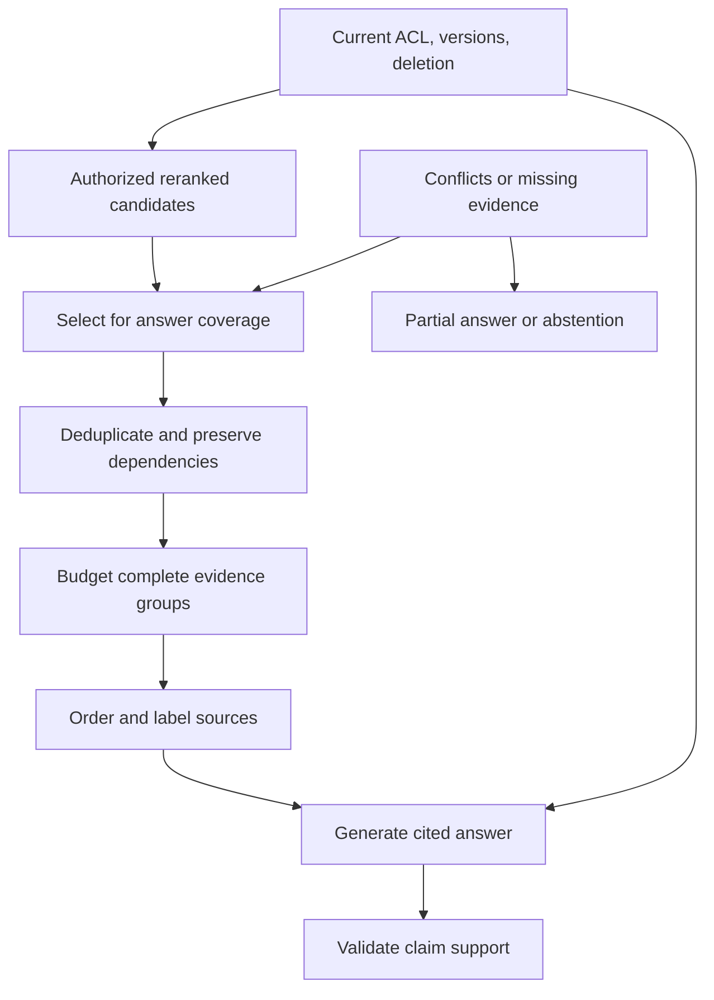

# Study Notes: M06.4.1 — Context Engineering for RAG

**Path:** Core  
**Depth:** L2 foundation; L3 through demonstrated project work  
**Prerequisites:** M03, M05, M07; [Retrieval fundamentals](M06.2.1_Retrieval_and_Information_Retrieval_Fundamentals.md).  
**Purpose:** Assemble a concise, sufficient, authorized evidence package that a model can use to answer accurately and cite the correct sources.

This section applies the broader Context Engineering layer specifically to RAG. It does not replace that broader module. All manual text, token counts, identifiers, and scoring examples are invented teaching data.

## Table of Contents

1. [Context Engineering Fundamentals](#1-context-engineering-fundamentals)
2. [M06.4.1.1 — Context Selection](#2-m06411--context-selection)
3. [Context Ordering and Prioritization](#3-context-ordering-and-prioritization)
4. [Token Budgeting](#4-token-budgeting)
5. [Deduplication and Repeated Evidence](#5-deduplication-and-repeated-evidence)
6. [Metadata Injection and Source Provenance](#6-metadata-injection-and-source-provenance)
7. [M06.4.1.2 — Long-Context Quality](#7-m06412--long-context-quality)
8. [Contradictory Context](#8-contradictory-context)
9. [Context Compression](#9-context-compression)
10. [Abstaining When Evidence Is Insufficient](#10-abstaining-when-evidence-is-insufficient)
11. [Worked Case Study](#11-worked-case-study)
12. [Testing and L3 Project Exercise](#12-testing-and-l3-project-exercise)
13. [Concept Map](#13-concept-map)
14. [Glossary and Final Revision Sheet](#14-glossary-and-final-revision-sheet)
15. [Practice and Interview Questions](#15-practice-and-interview-questions)
16. [References](#16-references)

## 1. Context Engineering Fundamentals

### Definition

**Context engineering for RAG** is the process of selecting, organizing, labeling, and budgeting the evidence supplied to a language model for a particular question.

Retrieval asks, “Which pieces might be useful?” Context assembly asks, “Which of those pieces should the model actually receive, in what form, and with which source information?”

A retrieval system can find the correct document and still produce a poor answer if the context omits a critical exception, mixes versions, repeats irrelevant passages, or loses the source locator.

### Context is more than retrieved text

The complete model input can contain system instructions, the current question, conversation history, tool schemas, tool outputs, retrieved evidence, and formatting requirements. The available space is shared among them.

[Anthropic’s context engineering discussion](https://www.anthropic.com/engineering/effective-context-engineering-for-ai-agents) treats context as a finite resource that must be curated over time. In a RAG application, that means controlling the evidence package rather than simply appending every retrieved result.

### A useful evidence contract

Each evidence item should answer:

- What is the source?
- Which version or timestamp applies?
- Which passage or record supports it?
- Why is it relevant to the question?
- Is it current and authorized?
- Is it original text or a derived summary?
- Which answer component can it support?

The model should not have to infer these facts from an unlabeled block of text.

### Context quality has several dimensions

| Dimension | Practical question |
|---|---|
| Relevance | Does the evidence help answer this request? |
| Sufficiency | Does it cover every necessary answer component? |
| Authority | Is the source appropriate for the claimed fact? |
| Freshness | Does the version or timestamp satisfy the request? |
| Consistency | Are conflicts identified and handled? |
| Economy | Is limited space used effectively? |
| Traceability | Can claims be mapped back to source spans? |
| Eligibility | May this user receive the evidence now? |

A context can be very relevant but insufficient. A single paragraph may answer the general rule while omitting an exception required for this user’s case.

**Key takeaway:** Good context is a deliberately assembled evidence package, not a large pile of search results.

## 2. M06.4.1.1 — Context Selection

### Definition

**Context selection** chooses which retrieved items will be included in the final model input.

The input to selection is usually a candidate pool from lexical, dense, or hybrid retrieval followed by a reranker. Selection should consider the question’s evidence needs, not only the ranking score.

### Define the answer components

For “What changed in M-104 section 7 from v3 to v4, and when does v4 take effect?”, the answer requires:

1. Relevant v3 content.
2. Relevant v4 content.
3. Evidence of the change.
4. The effective date and its authority.

A top-ranked v4 passage alone cannot answer the comparison or effective-date question completely.

A useful assembly step creates a small coverage table before choosing context:

| Required component | Candidate evidence | Status |
|---|---|---|
| Previous wording | v3 section 7 | Available |
| Current wording | v4 section 7 | Available |
| Effective date | Publication registry | Available |
| Applicability exception | v4 appendix note | Missing |

This makes missing evidence visible before generation.

### Relevance score is not the only criterion

A source with a slightly lower reranker score may supply the only relevant exception or missing subanswer. A high score may reflect repeated vocabulary rather than source authority.

Selection should balance relevance, coverage, source quality, freshness, and token cost. Security and deletion checks are mandatory eligibility rules, not optional scoring bonuses.

Do not assign an unauthorized passage a low score and hope it is not selected. Remove it from the eligible evidence set before reranking or model processing.

### Preserve context needed for interpretation

A passage saying “This does not apply to configuration Z” is meaningless if the preceding rule is absent. A table cell needs its row label, column header, units, and applicable footnote.

Context selection should preserve these dependencies. Expanding a child chunk to a parent section can help, but every added sentence must remain within the user’s authorized scope and token budget.

### Evidence diversity

Diversity means covering distinct useful information, not collecting many sources for appearance. Three near-identical passages from the same manual may contribute less than one rule, one exception, and one effective-date record.

Independent sources can corroborate a fact. Copies of the same source are not independent corroboration.

### Selection failure example

Suppose the top five passages all describe the general review process. The sixth explains that v4 is not yet effective. Taking the top five mechanically can produce a wrong current-state answer even though retrieval found the necessary evidence.

The fix is not necessarily a larger model context. It may be a coverage-aware selection rule that includes publication status whenever the question asks what applies now.

## 3. Context Ordering and Prioritization

### Ordering

**Ordering** determines the sequence in which selected evidence appears. Useful arrangements include grouping by answer component, source version, chronology, or authority.

For a version comparison, place the relevant v3 and v4 passages close together with clear labels. For a timeline question, chronological grouping may be easier to interpret. For a rule-and-exception question, keep the exception adjacent to the rule.

There is no universal order that is best for all models and tasks. Test the arrangement that matches your application.

### Prioritization

**Prioritization** decides which evidence is indispensable and which is optional when the budget is constrained.

A practical priority order for the fictional manual task might be:

1. Current authoritative rule and its applicability conditions.
2. Required historical comparison evidence.
3. Effective-date or publication record.
4. Supporting explanation.
5. Additional examples.

This is a task-specific design choice. For a historical question, the requested historical version becomes primary even when a newer version exists.

### Preserve dependencies as groups

Treat a rule, its exception, and its source metadata as a coherent evidence group. If the group cannot fit, compress it carefully or retrieve a smaller complete span. Do not keep only the first sentence because it has a higher score.

Similarly, a numeric result requires its unit and scope. “12” without “open tasks on ship A as of 10:00 UTC” is not an adequate evidence record.

### Source authority and ordering

Place authoritative evidence where it is easy to associate with the answer requirement. Do not let a large amount of commentary obscure the governing source.

However, ordering must not be used to conceal a genuine contradiction. If two applicable sources disagree, include the necessary conflict evidence and explain the uncertainty or source-precedence rule.

### A useful ordering experiment

Keep the same evidence items and compare:

- Retrieval-score order.
- Grouping by answer component.
- Chronological or version-paired order.

Measure answer correctness, exception retention, citation mapping, and completeness. This isolates ordering from retrieval changes.

**Key takeaway:** Organize evidence according to how its claims relate, and test the effect on answers rather than relying on a universal placement rule.

## 4. Token Budgeting

### Definition

**Token budgeting** allocates the model’s finite context capacity among instructions, question, history, tools, evidence, and expected output.

Use the actual model’s tokenizer or supported token-counting mechanism when implementing the budget. Character counts and words-per-token rules are rough estimates and can be poor for code, tables, identifiers, or multilingual text.

### A budget equation

Let:

- \(W\): usable context capacity under the selected model/API limits.
- \(I\): instructions and formatting overhead.
- \(Q\): current question.
- \(H\): retained conversation history.
- \(T\): tool schemas and other tool context.
- \(O\): reserved output allowance.
- \(S\): safety margin for serialization and count uncertainty.

Then an evidence budget is:

\[
B_E=W-I-Q-H-T-O-S
\]

Exact API accounting differs. Some limits separate input and output; reasoning-token or tool accounting may also matter. The equation is a planning framework, not a substitute for the chosen interface’s documented limits.

### Worked budget

For a fictional configuration:

| Component | Tokens |
|---|---:|
| Usable total capacity | 8,192 |
| Instructions | 900 |
| Question | 300 |
| History | 600 |
| Tool context | 400 |
| Output reserve | 1,200 |
| Safety margin | 392 |
| Remaining evidence budget | **4,400** |

The evidence budget includes source labels, titles, locators, separators, and any compact summaries, not just passage bodies.

### Budgeting by evidence unit

Suppose the candidate items cost:

| Item | Content and metadata tokens | Contribution |
|---|---:|---|
| v4 rule plus exception | 950 | Current rule and applicability |
| v3 corresponding rule | 650 | Previous state |
| Publication record | 220 | Effective date |
| Revision note | 430 | Author-stated change |
| Background explanation | 1,100 | Optional context |
| Duplicate v4 excerpt | 800 | Little new coverage |

The first four cost 2,250 tokens. Adding background gives 3,350, leaving 1,050 of the 4,400 budget. There is no need to include the duplicate just because space remains.

### Never budget by blind truncation

Taking the first 4,400 tokens can cut a sentence, table, footnote, or exception. Prefer complete evidence units, then validate the fully serialized input.

If mandatory evidence exceeds the budget, possible responses include retrieving smaller complete spans, using validated extractive compression, splitting the task into supported stages, or stating the limitation. Dropping required evidence silently is not an acceptable optimization.

### Executable budget check

This standard-library example assumes token counts were already obtained from the actual tokenizer. It checks arithmetic and required-group inclusion; it is not a tokenizer or optimal selector.

```python
from dataclasses import dataclass


@dataclass(frozen=True)
class Evidence:
    source_id: str
    token_count: int
    required: bool


def pack_in_order(items, budget):
    if sum(x.token_count for x in items if x.required) > budget:
        raise ValueError("Required evidence does not fit")
    selected = [x for x in items if x.required]
    used = sum(x.token_count for x in selected)
    for item in items:
        if not item.required and used + item.token_count <= budget:
            selected.append(item)
            used += item.token_count
    return selected, used


items = [
    Evidence("v4-rule-exception", 950, True),
    Evidence("v3-rule", 650, True),
    Evidence("publication", 220, True),
    Evidence("revision-note", 430, True),
    Evidence("background", 1100, False),
]
selected, used = pack_in_order(items, 4400)
assert used == 3350
assert len(selected) == 5
```

In production, validate policy before this stage and count the final serialized context afterward. Required groups should be derived from the task’s evidence needs, not from arbitrary flags provided by a user or document.

## 5. Deduplication and Repeated Evidence

### Exact duplicates

Identical chunks can arise from repeated ingestion, overlapping extracts, mirrored documents, or a hybrid union returning the same chunk twice.

Use stable source/chunk identity and content hashes to identify exact duplicates. Preserve all relevant provenance when identical text has multiple legitimate source locations.

### Near duplicates

Overlap can produce passages that differ slightly while repeating most information. Near-duplicate handling should consider source spans, version identity, and semantic contribution.

Do not merge v3 and v4 merely because their text is similar. The small difference may be the entire reason the user asked a comparison question.

### Repetition can distort evidence

If one incorrect passage appears five times, repetition does not make it more trustworthy. A model may nevertheless give it undue weight, and repeated text consumes space that could cover another answer component.

Deduplication helps preserve the distinction between independent corroboration and copied material.

### Deduplication should preserve context

Two overlapping passages may each contain unique useful information. A careful merge can create one coherent source span. A careless merge can reorder sentences, omit an exception, or combine text from incompatible versions.

Keep source offsets and document version in the merge record. If the system cannot confidently merge without changing meaning, choose one complete span or retain the necessary separate pieces.

### Example

Chunk A contains the rule and the first half of an exception. Chunk B contains the full exception and a source note. Dropping B as a near duplicate can remove the most important condition.

Evaluate deduplication on answer coverage, not only token savings. A shorter context is an improvement only if it preserves the evidence needed for the task.

## 6. Metadata Injection and Source Provenance

### Metadata injection

**Metadata injection** places useful source attributes alongside evidence in the model input. These attributes help the model distinguish versions, dates, scope, and citation targets.

Include only metadata needed for the task. Internal storage paths, ACL group names, personal identifiers, or confidential titles may be unnecessary or sensitive.

### A structured evidence block

```json
{
  "evidence_id": "E3",
  "document_id": "M-104",
  "version": "v4",
  "title": "Maintenance Manual",
  "section": "7",
  "source_locator": "paragraphs 2-4",
  "effective_date": "2026-10-01",
  "evidence_kind": "original_excerpt",
  "text": "Revision v4 adds a second reviewer for document approval. The change applies to new requests received on or after 2026-10-01."
}
```

The text field contains an invented example passage. In an application, it must contain the actual authorized source excerpt, with its wording and conditions preserved.

The short `evidence_id` gives the model a stable citation handle. The application maps that handle to a valid source link or locator. Do not ask the model to invent document URLs.

### Source provenance

Provenance tracks the origin and transformation of evidence. The [W3C PROV overview](https://www.w3.org/TR/prov-overview/) provides a general framework for representing derivation; a RAG system can apply the same principle to chunks, summaries, and citations.

Keep at least the original source ID, version, source span, extraction version, and any compression or transformation identifier. If a summary combines several sources, retain every supporting dependency.

### Citation identity versus citation support

A valid citation ID proves only that the source exists in the evidence set. It does not prove that the source supports the attached claim.

Citation validation needs two checks:

1. The cited ID maps to an available, authorized source.
2. The cited passage actually supports the claim with its relevant qualifiers.

The [ALCE citation-generation paper](https://aclanthology.org/2023.emnlp-main.398/) evaluates generated answers with citations and illustrates why citation quality is a separate dimension of answer quality.

### Metadata is data, not authority

A malicious document can contain a heading such as “SYSTEM INSTRUCTION.” It remains source text. Structured serialization and clear boundaries help interpretation, but they do not independently prevent prompt injection.

Application-side authorization, limited tools, and output validation remain necessary. Never let a source-supplied metadata field grant a higher instruction role or change tenant scope.

## 7. M06.4.1.2 — Long-Context Quality

### Lost in the middle

The **lost-in-the-middle problem** refers to reduced use of relevant information when it appears in less favorable positions within a long input.

The [Lost in the Middle paper](https://arxiv.org/abs/2307.03172) found position-dependent performance on its evaluated long-context tasks and models, often with stronger performance near the beginning or end than in the middle. This is evidence to test context placement, not a guarantee that every current model follows the same pattern.

### Why capacity is not reliable use

A model accepting many tokens does not prove it uses every detail equally well. The task may require locating a small exception, comparing distant passages, or resolving many similar versions.

Measure actual task performance as context grows. An apparently generous context window can still contain too much irrelevant or repetitive material.

### Irrelevant context

Irrelevant passages can distract from the question, introduce unsupported concepts, or consume space needed for useful evidence.

For an exact manual-version question, general maintenance advice may be topically related but irrelevant to the specific comparison. Filter or rerank for the actual question rather than broad topical similarity.

### Position-sensitivity test

Construct a question with known supporting evidence. Place the same evidence at the beginning, middle, and end among controlled distractors. Keep total length and source content constant.

Measure correctness, qualifier retention, and citation support across placements. Repeat with multiple examples; one successful case does not establish robust long-context behavior.

### Length-sensitivity test

Start with the minimum sufficient evidence, then add irrelevant or duplicated passages in controlled amounts. Identify when quality, latency, or citation behavior degrades.

This helps decide whether the system needs stronger selection, a different ordering strategy, a larger budget, or a model better suited to the task.

### Practical response

Prefer a complete, focused evidence package. Group related sources, preserve required conditions, remove redundancy, and test the chosen serialization. Do not assume that adding more text will solve a missing-evidence or reasoning problem.

## 8. Contradictory Context

### Definition

**Contradictory context** contains claims that cannot all be true under the same scope, time, and interpretation.

Not every apparent conflict is a real contradiction. Two manuals may apply to different configurations. A v3 statement and a v4 statement may represent a deliberate revision. Two numeric values may use different units or reporting periods.

### Resolve scope before declaring conflict

Compare entity, version, date, jurisdiction or organizational scope where relevant, units, conditions, and source authority.

For the fictional manual example:

- v3 requires one review step.
- v4 requires two review steps.
- The registry states v4 becomes effective next month.

The correct current answer depends on the query date. The newest wording does not automatically govern today.

### A conflict record

| Field | Example |
|---|---|
| Claim A | One review step |
| Source A | M-104 v3, section 7 |
| Claim B | Two review steps |
| Source B | M-104 v4, section 7 |
| Possible explanation | Revision with future effective date |
| Required resolver | Publication registry |
| Answer behavior | State the applicable version and explain the upcoming change |

### Unresolved contradictions

If both sources appear current and authoritative and no precedence rule resolves them, state the conflict. Do not average incompatible rules or choose the most convenient one.

A useful response can identify the disagreeing sources, describe the specific disputed point, and say that the available evidence does not establish which governs.

### Contradiction detection is imperfect

A model can flag possible conflicts, but source comparison and structured metadata often provide stronger evidence. Evaluate false positives caused by different scopes and false negatives caused by subtle negation or qualifiers.

Keep conflict information in the final context when it materially affects the answer. Removing the lower-ranked conflicting passage can create false certainty.

## 9. Context Compression

### Definition

**Context compression** reduces evidence size while attempting to preserve the information needed for the query.

Compression differs from ordinary chunking: chunking prepares units for indexing, while query-time compression focuses retrieved evidence for a particular information need.

### Extractive compression

Extractive compression selects original sentences or spans. It can preserve wording and citation alignment more directly, but may remove context needed to interpret those spans.

For a rule with an exception, select both. For a table, preserve headers and relevant footnotes. An isolated number or pronoun can become ambiguous.

### Abstractive compression

Abstractive compression creates a new summary. It can combine information efficiently but introduces another generation step that may omit conditions or invent connections.

The [RECOMP paper](https://arxiv.org/abs/2310.04408) studies extractive and abstractive compression before RAG context integration. Its reported results belong to its experimental setup; a project must test whether compression preserves its own evidence and answer quality.

### Token-level compression

Some methods compress prompts at a finer granularity. [LLMLingua](https://aclanthology.org/2023.emnlp-main.825/) is a research example of prompt compression. Such methods are electives, especially when human-readable quotations and exact source wording are important.

A highly compressed representation may work for one model/task while making auditing or citation mapping harder. Measure these effects rather than optimizing compression ratio alone.

### Compression is not contextual retrieval

In the named **contextual retrieval** approach, contextual information is added to chunks before indexing to improve how they are retrieved. [Anthropic’s contextual retrieval description](https://www.anthropic.com/engineering/contextual-retrieval) explains that preparation-stage mechanism.

Query-time compression reduces selected evidence for generation. The two operations act at different stages and can be combined, but they should not be treated as synonyms.

### Preserve provenance through compression

Store the compressor version, original source spans, and mapping from summary claims to support. Label derived summaries as derived evidence.

Do not present a generated summary as an exact quotation. Do not cite an original passage for a claim added by the compressor unless the passage actually supports it.

### A compression acceptance test

Check that the compressed evidence preserves:

- Entities and version identity.
- Negation and exceptions.
- Numeric values and units.
- Time and applicability conditions.
- Distinctions between sources.
- Required answer components.
- Citation support.

Measure total pipeline cost too. A compression model may reduce answer-model input while adding its own latency and token cost.

## 10. Abstaining When Evidence Is Insufficient

### Definition

**Abstention** means declining to make an unsupported claim, or limiting the answer to what the available evidence can establish.

It does not always require a complete refusal. A system can answer one supported part and state that another part cannot be verified.

### Insufficiency types

| Type | Example | Appropriate behavior |
|---|---|---|
| Missing source | Requested version is unavailable | State that comparison cannot be verified |
| Missing qualifier | Applicability condition absent | Avoid an unconditional rule |
| Unresolved conflict | Two current sources disagree | Explain the conflict |
| Stale evidence | Only an old status report is available | Label the date; do not claim current status |
| Unauthorized evidence | Required source is inaccessible | Respect policy without leaking protected details |
| Retrieval failure | Search did not find enough support | Use bounded recovery or state the limitation |

Absence from retrieved context does not prove absence from the entire corpus. Phrase the limitation accurately.

### Evidence sufficiency checks

Before generation, verify coverage of required answer components. After generation, check each substantive claim against evidence. Both stages matter: a complete context does not guarantee faithful use.

A model’s self-reported certainty should not override missing support. A fluent answer about the right topic can still be unsupported.

### A good partial answer

For the fictional comparison:

> “The available v4 passage specifies the revised review sequence. I cannot verify what changed from v3 because the corresponding v3 section is not available in the accessible evidence.”

This distinguishes known current content from an unverified historical comparison.

### Avoid unnecessary abstention

Abstention quality includes both refusing unsupported claims and answering when sufficient evidence exists. A system that refuses every question avoids some hallucinations but fails its purpose.

Evaluate answerable and unanswerable cases separately. Include questions with partial support and genuine conflicts, not just obviously missing documents.

## 11. Worked Case Study

### Request and candidate pool

An authorized tenant-A user asks:

> “What changed in section 7 of M-104 from v3 to v4, and which version applies today?”

The retrieved pool contains:

| Candidate | Content | Problem or contribution |
|---|---|---|
| A | v4 section 7 | Current revision text |
| B | v3 section 7 | Historical comparison text |
| C | Duplicate of A | Redundant |
| D | v4 publication record | Effective-date authority |
| E | General maintenance article | Topically related but unnecessary |
| F | v4 applicability exception | Essential condition |
| G | Similar tenant-B manual | Unauthorized; excluded before model processing |

### Step 1 — Establish eligibility

Remove G through trusted authorization before reranking or context assembly. Check deletion and publication state for the remaining sources. Do not include forbidden titles or snippets in the model context.

### Step 2 — Define coverage

The answer needs previous wording, revised wording, the exception, and the effective date. A, B, D, and F cover those needs. C adds little. E does not support the requested comparison.

### Step 3 — Group and label

Place B and A as a clearly labeled version pair. Keep F adjacent to A. Include D as the authority for which version applies on the query date.

Use stable evidence IDs and source locators. Keep the source date distinct from ingestion time.

### Step 4 — Fit the budget

Count the full serialized evidence, including metadata. If the evidence is too large, select complete relevant spans from each source. Do not remove F merely because it appears near the end.

### Step 5 — Generate and validate

The answer should describe the change, retain the exception, and state which version applies based on D. Check that each claim cites the source that supports it.

A citation to A cannot establish the previous wording in B. A citation to B cannot establish the effective date in D.

### Step 6 — Exercise lifecycle cases

If v4 is deleted during processing, the system must not emit the now-ineligible evidence. If v3 is archived but still authorized for history, it may remain suitable for this comparison. If a cache contains the old publication state, invalidate or revalidate it before answering.

### Why this example matters

Every candidate can be “about maintenance,” but only a subset forms a sufficient answer. Selection, ordering, metadata, and lifecycle checks turn retrieved text into usable evidence.

## 12. Testing and L3 Project Exercise

### Context ablations

An **ablation** removes or changes one component to measure its contribution. Compare:

- With and without deduplication.
- Score order versus answer-component grouping.
- Full excerpts versus extractive compression.
- Metadata labels versus unlabeled text.
- Minimum sufficient context versus added distractors.

Hold retrieval results constant when testing context assembly. Otherwise improvements may come from different candidates rather than the assembly change.

### Important test cases

Include an exception at a chunk boundary, a table with units, two similar versions, contradictory sources, an unsupported subquestion, an unauthorized parent section, and a deleted source referenced by a summary.

Measure correctness, completeness, faithfulness, citation correctness, citation completeness, token use, latency, and abstention behavior. See [RAG Evaluation](M06.4.2_RAG_Evaluation.md) for explicit definitions.

### L3 deliverables

Provide a context schema, budget calculation, selection policy, source-to-citation mapping, and before/after examples. Include a trace showing why each selected item is present and which required claim it supports.

Demonstrate that context is revalidated against current policy before protected output is emitted and that source deletion invalidates cached or compressed evidence derived from it.

A strong project can explain both the evidence included and the evidence deliberately omitted.

## 13. Concept Map



The diagram shows why source eligibility, evidence coverage, and claim validation are related but separate checks.

## 14. Glossary and Final Revision Sheet

| Term | Meaning |
|---|---|
| Context assembly | Preparing the evidence package used for generation |
| Context selection | Choosing which candidates to include |
| Context ordering | Arranging selected evidence |
| Prioritization | Deciding what is essential under constraints |
| Token budget | Allocated capacity for each input/output component |
| Evidence group | Related spans that must remain interpretable together |
| Deduplication | Removing redundant evidence while preserving useful coverage |
| Metadata injection | Adding source attributes to evidence blocks |
| Provenance | Origin and transformation history |
| Lost in the middle | Position-related degradation in using long-context evidence |
| Extractive compression | Selecting original source spans |
| Abstractive compression | Generating a shorter derived summary |
| Contradiction | Claims incompatible under the same relevant scope |
| Sufficiency | Enough evidence for the required answer components |
| Abstention | Avoiding claims that available evidence cannot support |

### Final revision sheet

- Retrieve candidates, then assemble evidence deliberately.
- Plan coverage for each required answer component.
- Keep rules with exceptions and tables with headers and units.
- Treat permissions and deletion as eligibility constraints.
- Budget the complete serialized input and reserve output capacity.
- Remove repetition without erasing meaningful version differences.
- Preserve source IDs, versions, locators, and transformation lineage.
- Test length and position sensitivity on the actual task.
- Resolve scope before treating sources as contradictory.
- Validate compression for meaning and citation preservation.
- Answer supported parts and identify unsupported parts accurately.

## 15. Practice and Interview Questions

### Question-and-answer recall

**1. How does context assembly differ from retrieval?**  
Retrieval finds potentially useful candidates. Assembly chooses and organizes the evidence that the model will actually receive.

**2. What is context sufficiency?**  
Enough evidence to cover every required answer component, including relevant conditions, exceptions, and time or version constraints.

**3. Why can a top-k-only selection fail?**  
The highest-ranked passages may repeat one subtopic while omitting a lower-ranked but essential exception or comparison source.

**4. What belongs in a token budget?**  
Instructions, question, history, tools, evidence and metadata, output reserve, and an appropriate safety margin under the chosen interface’s limits.

**5. Why is blind truncation risky?**  
It can cut off qualifiers, table headers, source information, or complete evidence units and change the apparent meaning.

**6. What does deduplication need to preserve?**  
Unique useful information, source identity, version distinctions, and dependencies such as a rule and its exception.

**7. What is the difference between citation identity and support?**  
Identity checks that a citation points to a real allowed source. Support checks that the source actually justifies the attached claim.

**8. What does lost in the middle imply for engineering?**  
Test how the actual model uses evidence at different positions and lengths rather than assuming accepted input capacity guarantees reliable use.

**9. How do extractive and abstractive compression differ?**  
Extractive compression selects source spans. Abstractive compression generates new summary text and therefore requires additional support validation.

**10. What is a good response to partial evidence?**  
Answer the supported portion and state precisely which remaining claim cannot be verified, without guessing or implying the whole corpus was exhaustively checked.

### Multiple-choice questions

#### Easy

**11. Which item is part of source provenance?**

A. A decorative icon.  
B. Document version and source locator.  
C. The model’s favorite writing style.  
D. An invented confidence number.

**Answer: B.** Provenance connects evidence to its actual origin and transformation history.

**12. Which context is usually more useful for a rule-and-exception question?**

A. Five copies of the rule.  
B. The rule, its exception, and relevant source metadata.  
C. A large unrelated article.  
D. Only a document title.

**Answer: B.** It preserves the information needed to interpret and cite the rule correctly.

#### Medium

**13. A budget has 8,192 tokens and reserves 3,792 for non-evidence components. How much remains?**

A. 3,400.  
B. 4,000.  
C. 4,400.  
D. 11,984.

**Answer: C.** Subtracting 3,792 from 8,192 leaves 4,400 tokens for fully serialized evidence.

**14. Why should similar v3 and v4 passages not automatically be deduplicated?**

A. Versions never share text.  
B. Their small difference may be essential to the requested comparison.  
C. Every version must always be included.  
D. Deduplication cannot process text.

**Answer: B.** Textual similarity does not imply identical evidentiary meaning.

**15. Which statement about compression is correct?**

A. A generated summary is automatically an exact quotation.  
B. Compression should be evaluated for qualifier and citation preservation.  
C. Compression removes the need for source IDs.  
D. Higher compression ratio always improves answers.

**Answer: B.** Smaller context is useful only if it preserves necessary evidence and traceability.

#### Hard — scenario-based

**16. The newest manual version takes effect next month. What applies today?**

A. Always the newest wording.  
B. Whatever passage has the highest vector score.  
C. The version determined by the authoritative effective-date rules.  
D. An average of both versions.

**Answer: C.** Freshness and applicability require source-version and effective-date reasoning.

**17. An answer cites a real source, but that passage does not support the claim. What failed?**

A. Citation support validation.  
B. File existence only.  
C. Token counting only.  
D. The definition of a source ID.

**Answer: A.** A valid link is not enough; the evidence must entail or otherwise justify the specific claim.

**18. Mandatory evidence exceeds the available context budget. What should the system do?**

A. Silently discard exceptions.  
B. Use smaller complete spans, validated compression, supported decomposition, or state the limitation.  
C. Insert unauthorized evidence because it is shorter.  
D. Pretend the whole source was included.

**Answer: B.** The response should preserve evidence sufficiency or acknowledge that it cannot be achieved.

### Interview questions with model answers

#### Easy

**19. Explain context engineering for RAG to a junior developer.**  
Search returns candidate passages, but the model should receive a focused evidence package. I choose the passages needed for the question, preserve exceptions and source labels, remove redundancy, fit the token budget, and validate that the final answer uses the evidence correctly.

**20. Why would you include document metadata in context?**  
It helps distinguish source identity, version, date, and location. The model can then attach claims to stable evidence IDs, and the application can render valid citations. I would include only metadata needed for the task and permitted for the user.

#### Medium

**21. How would you test context ordering?**  
I would hold the selected evidence constant and compare score order, answer-component grouping, and relevant chronological arrangements. I would measure correctness, exception retention, citation support, and completeness across multiple questions, including long-context distractor cases.

**22. How would you decide whether compression is worthwhile?**  
I would compare the complete pipeline with and without compression using the same evidence. I would measure token and latency savings, compressor cost, faithfulness, qualifier retention, and citation mapping. I would reject a configuration that saves tokens by losing required conditions or introducing unsupported claims.

#### Hard — scenario-based

**23. Retrieval finds the right document, but the model answers incorrectly. What do you inspect?**  
I would check whether the required passage survived selection, whether its exception or table header was omitted, whether versions were mixed, and whether source metadata was clear. Then I would inspect the generated claims and citations. The problem may be context assembly or evidence use rather than candidate retrieval.

**24. Two sources disagree and both appear current. How would you answer?**  
I would first compare scope, effective dates, units, and authority. If no valid precedence rule resolves the conflict, I would state the specific disagreement with both sources and avoid an unsupported definitive conclusion. I would not hide the conflict by dropping one source from context.

**25. A parent-section expansion adds restricted text around an authorized child chunk. What should happen?**  
The expansion must be checked against permissions at the granularity of the added content. Restricted text must not reach the reranker or model. I would assemble a permitted coherent span, retrieve another source, or state the evidence limitation, then test the expansion path as part of the security suite.

## 16. References

- [Anthropic — Effective context engineering](https://www.anthropic.com/engineering/effective-context-engineering-for-ai-agents).
- [Liu et al. — Lost in the Middle](https://arxiv.org/abs/2307.03172).
- [W3C — PROV overview](https://www.w3.org/TR/prov-overview/).
- [Gao et al. — Enabling Large Language Models to Generate Text with Citations](https://aclanthology.org/2023.emnlp-main.398/).
- [Xu et al. — RECOMP](https://arxiv.org/abs/2310.04408).
- [Jiang et al. — LLMLingua](https://aclanthology.org/2023.emnlp-main.825/).
- [Anthropic — Contextual retrieval](https://www.anthropic.com/engineering/contextual-retrieval).

**Completion evidence:** Assemble a budgeted context with correct versions and source mapping; demonstrate preserved exceptions and contradiction handling; compare assembly strategies; validate permission and deletion behavior through final emission.
