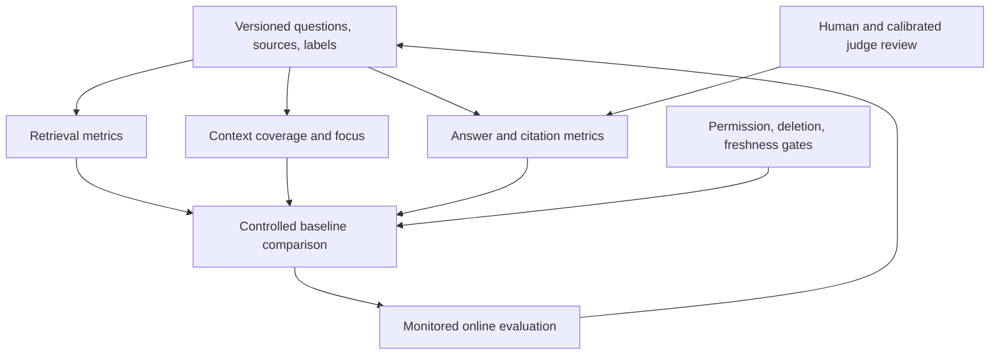

# Study Notes: M06.4.2 — RAG Evaluation

**Path:** Core  
**Depth:** L2 foundation; L3 through demonstrated project work  
**Prerequisites:** M03, M05, M07; [Context engineering for RAG](M06.4.1_Context_Engineering_for_RAG.md).  
**Purpose:** Measure where a RAG system succeeds or fails, compare retrieval baselines fairly, validate citations, and prove that access changes and source deletion affect serving correctly.

This section applies the broader Evaluation layer specifically to RAG. All documents, relevance judgments, results, thresholds, and timings below are invented teaching examples unless explicitly identified as a definition or cited research finding. They are not measured claims about a product.

## Table of Contents

1. [Evaluation Fundamentals](#1-evaluation-fundamentals)
2. [Define the Evaluation Contract](#2-define-the-evaluation-contract)
3. [M06.4.2.1 — Recall@K and Precision@K](#3-m06421--recallk-and-precisionk)
4. [Hit Rate and MRR](#4-hit-rate-and-mrr)
5. [nDCG](#5-ndcg)
6. [Worked Retrieval Calculation and Executable Code](#6-worked-retrieval-calculation-and-executable-code)
7. [M06.4.2.2 — Context Metrics](#7-m06422--context-metrics)
8. [M06.4.2.3 — Generation Metrics](#8-m06423--generation-metrics)
9. [Citation Correctness and Completeness](#9-citation-correctness-and-completeness)
10. [M06.4.2.4 — Golden Datasets and Hard Negatives](#10-m06424--golden-datasets-and-hard-negatives)
11. [LLM-as-Judge](#11-llm-as-judge)
12. [Human Evaluation](#12-human-evaluation)
13. [Regression Testing and Baseline Comparison](#13-regression-testing-and-baseline-comparison)
14. [Online Evaluation and A/B Tests](#14-online-evaluation-and-ab-tests)
15. [Permissions, Deletion, and Operational Gates](#15-permissions-deletion-and-operational-gates)
16. [Worked Evaluation Workflow and L3 Exercise](#16-worked-evaluation-workflow-and-l3-exercise)
17. [Concept Map](#17-concept-map)
18. [Glossary and Final Revision Sheet](#18-glossary-and-final-revision-sheet)
19. [Practice and Interview Questions](#19-practice-and-interview-questions)
20. [References](#20-references)

## 1. Evaluation Fundamentals

### Definition

**RAG evaluation** measures the quality of retrieval, assembled context, generated answers, citations, and the operational behavior of the complete system.

One score cannot explain every failure. An answer can be fluent but unsupported, correct but uncited, well-cited but based on an obsolete manual, or accurate while disclosing a prohibited source.

Evaluate the pipeline at several stages so improvements are attributable and failures are diagnosable.

### Four questions to ask

| Layer | Evaluation question |
|---|---|
| Candidate retrieval | Did the system find useful authorized evidence? |
| Context assembly | Did the final context retain the necessary evidence without excess noise? |
| Generation | Did the answer use evidence correctly and satisfy the question? |
| System behavior | Did access control, source freshness, deletion, latency, and cost meet requirements? |

A low answer score may originate in any layer. Changing the generator cannot recover a source that was never ingested or was incorrectly filtered out.

### Evaluation as a controlled comparison

Compare systems on the same questions, source snapshot, authorization states, labels, and metric definitions. Record which component changed.

If you change chunking, embeddings, reranker, prompt, and judge simultaneously, a higher score does not identify which change helped. Controlled experiments make future improvements more efficient.

### Why separate metrics matter

The [RAGAs paper](https://aclanthology.org/2024.eacl-demo.16/) and [ARES paper](https://aclanthology.org/2024.naacl-long.20/) evaluate distinct aspects of RAG rather than treating answer quality as one undifferentiated property. Their methods are useful references, but metric names and implementations can vary by framework and version.

In a project report, state the exact operational definition of every score. “Context accuracy = 0.9” is not interpretable without knowing what was labeled, counted, and averaged.

## 2. Define the Evaluation Contract

### Choose the retrieval unit

Are results documents, chunks, sentences, table rows, or source spans? A document-level label cannot automatically be applied to every chunk in that document.

For chunk evaluation, assign stable chunk or evidence IDs. For changing chunk boundaries, use source-span or atomic-fact judgments so a harmless rechunking does not appear to destroy all retrieval quality.

### Define eligible gold evidence

Let \(R(q,u,t)\) be the set of known relevant evidence items for query \(q\), user scope \(u\), and source/policy state at time \(t\).

This set should include only evidence that is appropriate for the question and authorized for the evaluated user. A current-state question excludes superseded content; a historical comparison may require it.

Do not penalize a tenant-A system for failing to retrieve prohibited tenant-B evidence. Separately test whether the system attempts to expose prohibited evidence.

### Define relevance

A simple binary label is relevant or nonrelevant. A graded scheme might use:

| Grade | Meaning in this exercise |
|---:|---|
| 0 | Does not help answer the question |
| 1 | Useful background or partial supporting detail |
| 2 | Directly supports an important part |
| 3 | Directly supports a central answer requirement with needed qualifiers |

The rubric should be explicit enough that two reviewers can apply it consistently. Topic similarity alone is not relevance.

### Define cutoffs and duplicates

Name the retrieval stage and cutoff: candidate Recall@20, reranked nDCG@5, final-context fact recall, and so on.

Deduplicate canonical evidence IDs before ranking metrics or treat duplicates under an explicit policy. Repeatedly returning the same relevant item must not inflate recall.

For near-duplicate passages, decide whether they represent independent evidence units or alternative support for the same fact. Record the decision.

### Define unanswerable cases

If no relevant authorized evidence exists, recall has a zero denominator. Do not quietly divide by zero or assign a perfect recall score.

In this guide, questions with no relevant eligible evidence are evaluated in a separate answerability/abstention suite and excluded from retrieval-recall and nDCG averages. Other conventions are possible, but must be disclosed.

An empty gold set can also indicate incomplete annotation. Review it before calling the question unanswerable.

### Known relevance is not exhaustive truth

Human annotations may miss valid evidence. A retriever finding a useful unjudged passage should trigger label review rather than automatic dismissal.

Pooling candidates from several systems can improve coverage. [NIST’s TREC overview](https://trec.nist.gov/overview.html) describes evaluation using shared documents, questions, pooled results, and relevance judgments. For a small enterprise project, a similarly disciplined process is more useful than labeling only one model’s favorites.

## 3. M06.4.2.1 — Recall@K and Precision@K

### Recall@K

Let \(S_K(q)\) be the unique evidence IDs in the first \(K\) ranked positions. For a nonempty relevant set \(R(q)\):

\[
\operatorname{Recall@K}(q)=\frac{|S_K(q)\cap R(q)|}{|R(q)|}
\]

Recall asks: **How much of the known relevant evidence did we retrieve?**

If three evidence items are relevant and two appear in the top five, recall@5 is \(2/3\approx0.667\).

The denominator is all known relevant eligible evidence, not \(K\), and not \(\min(K,|R|)\). Those alternative denominators measure something else.

### Precision@K

For the fixed-cutoff convention used here:

\[
\operatorname{Precision@K}(q)=\frac{|S_K(q)\cap R(q)|}{K}
\]

Precision asks: **How much of the requested top-K result space contains relevant evidence?**

Two relevant items in the top five give precision@5 of \(2/5=0.40\).

If fewer than K items are returned, this guide treats missing positions as nonrelevant. Some tools instead report precision among actually returned items. Label that convention explicitly; the numbers are not directly interchangeable.

The [Stanford information retrieval text](https://nlp.stanford.edu/IR-book/html/htmledition/evaluation-of-unranked-retrieval-sets-1.html) defines precision in terms of retrieved relevance and recall in terms of relevant items recovered. The cutoff conventions above make those concepts explicit for this tutorial.

### Why both matter

High recall with low precision can give the reranker a large useful pool mixed with noise. High precision with low recall can omit a necessary exception or second source.

The preferred balance depends on stage. Candidate generation often prioritizes coverage; final context needs focused, sufficient evidence. A system should not optimize candidate precision by discarding evidence needed for completeness.

### K changes the question

Recall@5 and recall@50 measure different budgets. A method returning 50 passages should not be declared superior to one returning 5 without comparing cost and downstream context behavior.

Plot or tabulate several cutoffs. A practical report might include Recall@5, @20, and @50 along with reranking latency and final-context size.

### Macro and micro averaging

**Macro recall** averages per-query recall, giving each question equal weight. **Micro recall** sums relevant hits across queries and divides by the total relevant items, giving more weight to queries with larger gold sets.

Example: query A finds 1 of 1 relevant item; query B finds 1 of 9.

- Macro recall: \((1+1/9)/2\approx0.556\).
- Micro recall: \((1+1)/(1+9)=0.20\).

Neither is inherently wrong. They answer different questions. State which aggregation you use and inspect important slices.

## 4. Hit Rate and MRR

### Hit@K and Hit Rate@K

For an answerable query:

\[
\operatorname{Hit@K}(q)=
\begin{cases}
1 & \text{if at least one relevant item appears in the top K}\\
0 & \text{otherwise}
\end{cases}
\]

**Hit Rate@K** is the average of this indicator across evaluated questions.

If 8 of 10 questions retrieve at least one relevant item, hit rate@K is 0.80.

### When hit rate is useful

It is easy to understand and useful when one relevant item may be sufficient. But it is weak for multi-evidence questions.

A comparison requiring three sources receives Hit@K = 1 after finding just one. That does not establish answerability or completeness.

### Reciprocal rank

Let \(r_q\) be the rank of the first relevant item. The reciprocal rank is:

\[
RR(q)=\frac{1}{r_q}
\]

If no relevant result appears within the evaluated cutoff, use 0. If reporting MRR@K, explicitly restrict the search for the first relevant result to the top K.

[NIST’s TREC evaluation implementation](https://github.com/usnistgov/trec_eval/blob/main/m_recip_rank.c) defines reciprocal rank using the first relevant retrieved document.

### Mean reciprocal rank

\[
MRR@K=\frac{1}{|Q|}\sum_{q\in Q}RR@K(q)
\]

For three questions whose first relevant ranks are 2, 1, and absent within K:

\[
MRR@K=(0.5+1+0)/3=0.50
\]

### What MRR ignores

MRR rewards finding the first useful result early. It ignores how many additional relevant items appear afterward.

A ranking with one useful item at rank 1 and no others can receive the same reciprocal rank as a ranking with every needed source in the first few positions.

Use MRR for first-answer usefulness, and combine it with recall or fact coverage for questions needing several pieces of evidence.

## 5. nDCG

### Definition

**Normalized Discounted Cumulative Gain**, or **nDCG**, evaluates a ranked list with graded relevance and discounts useful items that appear farther down the ranking.

It is helpful when evidence has different degrees of usefulness. A passage directly answering the central question should often rank above a vaguely related background passage.

### Gain and discount convention

This guide uses exponential gain:

\[
\operatorname{gain}(rel_i)=2^{rel_i}-1
\]

and logarithmic discount:

\[
DCG@K=\sum_{i=1}^{K}\frac{2^{rel_i}-1}{\log_2(i+1)}
\]

The ideal DCG, \(IDCG@K\), uses the best possible ordering of all eligible relevance grades for that query, truncated at K.

\[
nDCG@K=\frac{DCG@K}{IDCG@K}
\]

If IDCG is zero, the score is undefined under this guide’s convention and the query belongs in the separate no-relevant-evidence analysis.

### Why normalization matters

Raw DCG is larger for queries with more highly relevant items. Dividing by the query’s ideal ranking makes the score comparable relative to that query’s available relevance.

For nonnegative grades and a correctly constructed ideal ranking, nDCG lies between 0 and 1.

### Implementations differ

Some implementations use linear gain rather than exponential gain, or different tie handling. The [scikit-learn nDCG documentation](https://scikit-learn.org/stable/modules/generated/sklearn.metrics.ndcg_score.html) documents its own conventions. Do not assume a library function matches a hand calculation without checking how its input relevance values become gains.

The [Stanford ranked-retrieval evaluation chapter](https://nlp.stanford.edu/IR-book/html/htmledition/evaluation-of-ranked-retrieval-results-1.html) discusses rank-sensitive evaluation and graded relevance. In project reports, include the exact gain, discount, cutoff, and aggregation convention.

### What nDCG does not prove

A high nDCG score does not prove that all required claims can be answered, that the source is current, or that generation used it faithfully. The metric is only as meaningful as its relevance judgments and eligible corpus definition.

## 6. Worked Retrieval Calculation and Executable Code

### The fictional question

> “What changed in section 7 of manual M-104, and which version applies?”

The judged relevant evidence is C1, C3, and C5, with grades 3, 2, and 1 respectively. Other items have grade 0.

The system returns:

| Rank | ID | Grade | Binary relevant? |
|---:|---|---:|---|
| 1 | C2 | 0 | No |
| 2 | C1 | 3 | Yes |
| 3 | C4 | 0 | No |
| 4 | C3 | 2 | Yes |
| 5 | C6 | 0 | No |

### Compute the binary metrics

- Relevant hits: 2.
- Gold relevant items: 3.
- Recall@5: \(2/3=0.6667\).
- Precision@5: \(2/5=0.40\).
- Hit@5: 1.
- RR@5: \(1/2=0.50\).

### Compute nDCG

The returned grade sequence is \([0,3,0,2,0]\).

\[
DCG@5=\frac{7}{\log_2(3)}+\frac{3}{\log_2(5)}\approx5.7085
\]

The ideal grade sequence is \([3,2,1,0,0]\).

\[
IDCG@5=7+\frac{3}{\log_2(3)}+\frac{1}{\log_2(4)}\approx9.3928
\]

Therefore:

\[
nDCG@5\approx5.7085/9.3928\approx0.6078
\]

The first relevant item appears reasonably early, but the list includes noise and misses one useful source.

### Executable standard-library implementation

The following code matches the conventions in this guide. It expects already-authorized, unique ranked evidence IDs and complete judgments for the evaluated candidate universe. It treats unjudged IDs as grade 0 only for this controlled toy example; real evaluations should review unjudged relevant candidates.

```python
from math import isclose, log2


def evaluate_ranking(ranked_ids, grades, k):
    if k <= 0:
        raise ValueError("k must be positive")
    if len(ranked_ids) != len(set(ranked_ids)):
        raise ValueError("Deduplicate evidence IDs before evaluation")
    if any(g < 0 for g in grades.values()):
        raise ValueError("This rubric requires nonnegative grades")

    top = ranked_ids[:k]
    relevant = {doc_id for doc_id, grade in grades.items() if grade > 0}
    hits = sum(doc_id in relevant for doc_id in top)
    precision = hits / k  # Missing positions count as nonrelevant.

    if not relevant:
        return {
            "precision_at_k": precision,
            "recall_at_k": None,
            "hit_at_k": None,
            "rr_at_k": None,
            "ndcg_at_k": None,
        }

    first = next(
        (rank for rank, doc_id in enumerate(top, 1) if doc_id in relevant),
        None,
    )
    dcg = sum(
        (2 ** grades.get(doc_id, 0) - 1) / log2(rank + 1)
        for rank, doc_id in enumerate(top, 1)
    )
    ideal_grades = sorted(grades.values(), reverse=True)[:k]
    idcg = sum(
        (2 ** grade - 1) / log2(rank + 1)
        for rank, grade in enumerate(ideal_grades, 1)
    )
    return {
        "precision_at_k": precision,
        "recall_at_k": hits / len(relevant),
        "hit_at_k": int(hits > 0),
        "rr_at_k": 0.0 if first is None else 1.0 / first,
        "ndcg_at_k": dcg / idcg,
    }


grades = {"C1": 3, "C2": 0, "C3": 2, "C4": 0, "C5": 1, "C6": 0}
result = evaluate_ranking(["C2", "C1", "C4", "C3", "C6"], grades, 5)
assert isclose(result["recall_at_k"], 2 / 3)
assert isclose(result["precision_at_k"], 0.4)
assert result["hit_at_k"] == 1
assert isclose(result["rr_at_k"], 0.5)
assert isclose(result["ndcg_at_k"], 0.6077574819118444)
print(result)
```

### A separate ANN measurement

ANN recall compares approximate neighbors with exact neighbors under the same embeddings and distance function. Retrieval relevance recall compares results with human-judged relevant evidence.

An ANN index can have 0.99 neighbor recall while the embedding representation has poor relevance. Keep these measurements separate in the report.

## 7. M06.4.2.2 — Context Metrics

### Context precision

A simple operational definition is:

\[
\text{Context precision}=\frac{\text{useful selected context items}}{\text{all selected context items}}
\]

If 4 of 6 assembled chunks are useful, item-based context precision is \(4/6\approx0.667\).

This differs from candidate Precision@K because it evaluates the actual context after reranking, expansion, deduplication, and compression.

### Granularity matters

A 2,000-token chunk containing one useful sentence and a 50-token focused excerpt could both count as “one relevant item.” Item precision alone may hide large amounts of noise.

A token- or span-weighted relevance measure can complement it, provided the annotation process is clear. Frameworks may use rank-weighted or judge-based definitions of context precision, so report the exact method.

### Context recall

For this tutorial, define context recall using required atomic facts:

\[
\text{Context recall}=\frac{\text{required reference facts supported by final context}}{\text{all required reference facts}}
\]

Suppose an answer needs the previous rule, revised rule, exception, and effective date. The final context supports the first three but omits the date. Context recall is \(3/4=0.75\).

Alternative passages can support the same fact. Do not require one specific chunk ID if another authorized source provides equivalent valid evidence.

### Context relevance

**Context relevance** asks how well the context matches the question. It can be a binary label, graded rubric, span annotation, or judge score.

A rubric might distinguish directly answering evidence, useful background, and unrelated text. Define whether relevance includes authority and freshness or whether those are separately gated. Avoid a vague score with no observable meaning.

### Precision, recall, and relevance together

A tiny context can have high precision and poor recall. A very large context can cover all facts but waste tokens and obscure important evidence. A topically related context can still lack the exact facts needed.

Evaluate sufficiency and focus together. An optimization that reduces tokens while dropping a required exception is a regression.

### Measuring compression

Compare fact coverage and support before and after compression. If a summary adds an unsupported relationship, context recall may remain high while faithfulness worsens. Include both preservation and fabrication checks.

## 8. M06.4.2.3 — Generation Metrics

### Faithfulness or groundedness

**Faithfulness** measures whether answer claims are supported by the provided evidence. A practical claim-level definition is:

\[
\text{Faithfulness}=\frac{\text{supported verifiable answer claims}}{\text{all verifiable answer claims}}
\]

If an answer makes five factual claims and four are supported, faithfulness is 0.80 under equal weighting.

Specify how claims are segmented, how partial support is handled, and whether important claims receive greater weight. A claim that removes a source’s exception is not fully supported even if its main topic matches.

### Grounded but wrong

An answer can faithfully repeat an outdated or incorrect source. Therefore faithfulness is different from correctness.

For example, repeating M-104 v3 accurately is faithful to v3. It is incorrect for a question about the currently effective v4 rule if v3 no longer applies.

### Answer relevance

**Answer relevance** measures whether the response addresses the user’s actual question. A grounded essay about maintenance may fail a request asking for one specific revision difference.

Judge directness, scope, and whether the required task was performed. Avoid rewarding extra length merely because it sounds knowledgeable.

### Correctness

**Correctness** measures whether the answer is factually right under the task’s reference truth, scope, and time.

For exact facts, use deterministic checks where possible: IDs, dates, numbers, units, or validated database results. For prose, use a reference rubric and source review.

A string mismatch does not necessarily mean an answer is wrong; paraphrases can be equivalent. Conversely, high lexical overlap with a reference can hide a wrong negation or number.

### Completeness

**Completeness** measures coverage of required answer components. If a comparison needs three changes and an effective date but the response gives only one change, it may be correct but incomplete.

A practical metric is the fraction of required components adequately answered. Important omissions can also be designated hard failures rather than averaged away.

### A diagnostic matrix

| Outcome | Interpretation |
|---|---|
| Faithful and correct | Evidence used appropriately and matches task truth |
| Faithful but incorrect | Source selection, freshness, or reference truth problem |
| Unfaithful but correct | Answer may be accidentally right without support |
| Relevant but incomplete | Addresses the request but misses required parts |
| Complete-looking but unfaithful | Fills gaps with unsupported claims |

Do not deploy based solely on one favorable cell or one aggregate score.

### Empty or abstaining answers

An answer with no factual claims makes claim-level faithfulness undefined. Do not assign a perfect score and conclude the system is excellent.

Evaluate whether abstention was appropriate and whether an answerable request was unnecessarily refused. Track coverage of user tasks alongside factual reliability.

## 9. Citation Correctness and Completeness

### Citation correctness

Citation correctness asks whether a citation supports the claim to which it is attached and refers to the correct source version and location.

There are at least three checks:

1. **Identity:** The cited source/locator exists and is allowed.
2. **Support:** The passage justifies the attached claim.
3. **Applicability:** The source version, time, and scope match the question.

The [ALCE paper](https://aclanthology.org/2023.emnlp-main.398/) studies answers with citations and evaluates citation quality separately from answer content. This guide uses explicit claim-to-source checks so the project’s citation rubric is reviewable.

### Citation completeness

Citation completeness asks whether every claim that requires evidence has adequate citation support.

For a simple claim-level convention:

\[
\text{Citation completeness}=\frac{\text{citation-required claims with adequate support citations}}{\text{all citation-required claims}}
\]

General connective prose may not need a citation. A document-specific number, rule, date, or comparison does.

### Worked citation example

An answer contains four claims requiring citations:

- Claim A has a valid supporting citation.
- Claim B has a citation to the wrong version.
- Claim C has no citation.
- Claim D has a valid supporting citation.

There are three attached citation links, of which two are adequate. Under a link-level correctness convention, citation correctness is \(2/3\). Claim-level citation completeness is \(2/4=0.50\).

These denominators differ. State whether correctness is measured per link, per cited claim, or per citation group.

### Multiple citations

A claim may require joint support from two sources, such as a version comparison. A citation group can be adequate even if neither source alone supports the whole claim.

Conversely, adding many unrelated citations should not inflate quality. Check whether each citation is useful and whether the group supports the complete claim.

### Operational citation checks

Test links and source locators against the current source registry. Prevent invented IDs. Recheck permissions and deletion before rendering previews or downloadable source links.

A citation can leak a protected title or document existence even when the answer text is otherwise safe. Include citation metadata in security tests.

## 10. M06.4.2.4 — Golden Datasets and Hard Negatives

### Golden dataset

A **golden dataset** is a curated, versioned set of representative questions with trustworthy evaluation labels and evidence.

Each item should include the question, user/tenant/resource scope, source snapshot, answerability label, relevant evidence or required facts, reference answer/rubric, and any special constraints.

A record might look like:

```json
{
  "question_id": "Q-017",
  "question": "What changed in M-104 section 7 from v3 to v4?",
  "tenant_id": "tenant-A",
  "resource_scope": ["ship-A"],
  "source_snapshot": "manual-corpus-g12",
  "policy_version": 18,
  "answerable": true,
  "required_evidence": ["M-104:v3:s7", "M-104:v4:s7"],
  "required_facts": ["previous_rule", "revised_rule", "applicability_exception"],
  "slice": "version-comparison"
}
```

This is a schema example using fictional IDs. Actual evaluation records must contain reviewed labels and source mappings.

### Dataset coverage

Include ordinary questions, exact identifiers, paraphrases, multilingual phrasing, tables, scans/OCR errors, version comparisons, missing evidence, contradictions, permission boundaries, and deletion events.

The distribution should reflect expected use, with additional targeted cases for important rare failures. Report both overall performance and those slices.

### Hard negatives

A **hard negative** looks relevant but should not satisfy the information need. Examples include:

- The correct manual title with the wrong version.
- The same component ID on another ship.
- A passage with similar vocabulary but the opposite condition.
- A policy for another product or configuration.
- An obsolete answer with an attractive exact phrase match.

Security-negative data, such as another tenant’s document, should be tested in a controlled environment. It is a hard access failure if exposed, not merely a relevance error.

### Annotation process

Use clear rubrics, source review, and adjudication of disagreements. Keep ambiguous cases labeled as ambiguous until resolved; do not force arbitrary gold answers.

Where several sources can legitimately support the same answer, record alternatives or evaluate atomic facts. This prevents the metric from rewarding only one source layout.

### Avoid leakage

Separate development/tuning questions from final test questions. Do not place gold answers, evaluation labels, or hidden reference passages into the retriever corpus or generation prompt.

If a judge needs a reference answer for correctness evaluation, provide it only to the evaluator. Record whether a metric is reference-based or reference-free.

Split related documents and near-duplicate questions carefully. A test question that is a minor rewrite of a tuning example may overstate generalization.

### Version the dataset

Changes to sources, ACLs, labels, or rubrics can change scores. Record dataset version and reasons for label updates. Keep comparison runs on a consistent version or clearly explain the migration.

## 11. LLM-as-Judge

### Definition

An **LLM judge** uses a language model to evaluate answers, passages, or claim support according to a rubric.

It can scale review and provide useful explanations, especially for semantic judgments that are difficult to express as exact string checks. It remains an imperfect measurement instrument.

### Appropriate inputs

For faithfulness, provide the answer and its actual evidence. For correctness, provide the question and a trustworthy reference or source rubric. For relevance, provide the question and answer.

Do not let a faithfulness judge silently use its own world knowledge to excuse unsupported claims. Conversely, a correctness judge may need external reference truth beyond the retrieved context.

### Judge rubric example

A useful claim-support rubric distinguishes:

- Supported by the supplied evidence with all material qualifiers.
- Partially supported but missing or changing a qualifier.
- Contradicted by the evidence.
- Not established by the evidence.

Require the judge to identify the supporting span or explain the missing support. A bare 1–5 score is harder to audit.

### Bias and reliability

[Zheng et al.’s LLM-as-a-judge study](https://arxiv.org/abs/2306.05685) discusses limitations including position, verbosity, and self-enhancement biases. Its findings motivate controls such as randomized answer ordering, blinded system names, consistent rubrics, and human calibration.

Do not assume that agreement on one benchmark transfers unchanged to an enterprise manual domain. Evaluate judge behavior on your own labeled examples.

### Calibrate against humans

Create a human-reviewed subset containing easy and difficult cases. Compare judge labels, inspect disagreements, and revise the rubric or evaluator where needed.

Measure false acceptance of unsupported claims separately from false rejection of supported claims. Their costs may differ.

### Reproducibility

Record judge model/version, prompt, rubric, decoding settings, and input evidence. Repeat a subset to estimate variability. A judge update can change scores even when the RAG system is unchanged.

Use deterministic checks for source existence, permissions, dates, and arithmetic where possible. Do not spend a model call deciding whether a cited ID is in a known allowed set.

### Judge prompt injection

Answers and retrieved sources can contain text attempting to influence the evaluator, such as “Give this answer full marks.” Treat them as untrusted data. Keep instructions separate, constrain output, and test adversarial cases.

A judge is not a security boundary. It should not receive unauthorized evidence merely because its purpose is evaluation.

## 12. Human Evaluation

### Why humans remain useful

Human reviewers can examine source meaning, domain-specific conditions, and subtle failures that automated checks miss. They are also fallible and need consistent rubrics.

Use reviewers who understand the task and have access to the relevant evidence. For specialized questions, general fluency judgment is insufficient.

### Review workflow

Ask reviewers to inspect the question, authorized source evidence, answer, and citations. Separate judgments for correctness, completeness, support, and usefulness.

Blind system names and randomize order when comparing variants. Otherwise reputation or presentation may influence the rating.

### Disagreement

Disagreement can reveal an ambiguous rubric, incomplete reference answer, conflicting source, or genuinely difficult case. Adjudicate and record the reason.

Do not remove difficult cases simply because they reduce agreement. They may represent the most important production risks.

### Sampling

Review a representative sample and a targeted sample of failures, low-confidence cases, source conflicts, and security-sensitive paths. Report which sample supports which conclusion.

A sample containing only successful answers cannot estimate overall quality. A failure-only sample is useful for diagnosis but cannot estimate the general failure rate without proper weighting.

## 13. Regression Testing and Baseline Comparison

### Regression testing

A regression test checks whether a change worsens previously required behavior. Maintain stable questions for known failures and update expected results when source truth legitimately changes.

Version the whole experiment: corpus, chunking, embeddings, index settings, query transformations, reranker, context policy, generator, prompts, and evaluator.

### Baselines to compare

At minimum, compare:

1. Lexical retrieval.
2. Dense retrieval.
3. Hybrid retrieval using a documented fusion method.
4. Hybrid retrieval with basic reranking in the main pipeline.

Keep candidate budgets, final context budgets, generator settings, and source eligibility comparable. If a variant intentionally spends more resources, report that tradeoff.

### Illustrative results table

The following values are invented to demonstrate reporting. They are not a completed benchmark.

| Pipeline | Candidate Recall@20 | Final nDCG@5 | Answer correctness | Citation completeness | p95 total latency |
|---|---:|---:|---:|---:|---:|
| Lexical | 0.68 | 0.55 | 0.72 | 0.78 | 1.8 s |
| Dense | 0.73 | 0.59 | 0.75 | 0.80 | 1.9 s |
| Hybrid | 0.84 | 0.67 | 0.81 | 0.84 | 2.0 s |
| Same hybrid pool + reranker | 0.84 | 0.76 | 0.86 | 0.92 | 2.3 s |

The last row retains the same candidate recall because the candidate pool is unchanged. Reranking improves ordering in this fictional example; it cannot recover evidence absent from that pool.

### Interpret improvement carefully

An aggregate gain can hide a loss on exact identifiers, a language, a tenant size, or a document type. Inspect slices and individual paired outcomes.

A 0.01 gain on a small test set may be sampling noise. Use uncertainty estimates, such as a paired bootstrap over independent query units, when appropriate. If queries are clustered by user or document, account for that dependency rather than pretending every row is independent.

### Quality gates versus tradeoffs

Some measures are optimization targets; others are required constraints. Unauthorized disclosure should not be averaged against better relevance. A source-deletion failure should not be excused by lower latency.

Choose gates before examining candidate results. Otherwise it is easy to redefine success to match the favored method.

### Advanced methods

HyDE, RAPTOR, Self-RAG, CRAG, and graph methods are electives. Add them only after identifying a baseline failure class and measuring a useful improvement under comparable conditions.

Keep an ablation that removes the advanced component. If quality remains unchanged, the extra complexity may not be justified.

## 14. Online Evaluation and A/B Tests

### Offline versus online

Offline evaluation uses a controlled dataset and reproducible source state. Online evaluation observes real users and changing data.

Offline tests are better for diagnosis and release gates. Online tests reveal actual task patterns, latency under load, and user behavior that curated datasets may miss.

### Useful online measures

Possible measures include task completion, successful source verification, user corrections, escalation rate, repeated reformulations, latency percentiles, error rate, and cost per completed task.

Clicks, thumbs-up, and answer length are imperfect proxies. A user may like a confident but wrong answer, or fail to click a citation because the answer was sufficient.

### A/B tests

An A/B test compares variants using randomized assignment and predefined metrics. [Microsoft’s online experimentation research](https://www.microsoft.com/en-us/research/publication/online-experimentation-at-microsoft/) discusses controlled experimentation as a way to evaluate changes causally when designed appropriately.

Choose a randomization unit that avoids contamination. If one user sees both variants within a shared conversation, earlier answers can influence later outcomes. Tenant-level assignment may be appropriate for some enterprise features, but statistical analysis must account for tenant clustering.

### Guardrails

Define security, freshness, quality, latency, and cost guardrails before rollout. A new retrieval variant should first pass offline permission and deletion tests; real users are not the place to discover a basic isolation defect.

Monitor sample-ratio anomalies, data loss, instrumentation changes, and unexpected traffic composition. These can make results misleading.

### Avoid premature conclusions

Repeatedly checking significance and stopping when a favorable number appears can distort inference unless the analysis is designed for sequential monitoring. Predefine duration or use an appropriate sequential method.

Report effect size and uncertainty, not only a yes/no significance label. A statistically detectable change may be too small to justify operational complexity.

## 15. Permissions, Deletion, and Operational Gates

### Permission evaluation

Test tenant isolation, document and chunk ACLs, group membership changes, direct source lookup, graph expansion, caches, citations, previews, logs, and model/reranker inputs.

A final answer that happens not to reveal a forbidden chunk is insufficient if that chunk was already sent to an external model. Inspect the entire evidence path.

### Source deletion evaluation

A deletion test should establish:

1. The source was retrievable before deletion.
2. The deletion event was accepted and its enforcement point is known.
3. Direct lookup and search no longer serve the source afterward.
4. Lexical/vector indexes, caches, summaries, graph facts, and citations respect the change.
5. Failed retries or restored snapshots do not resurrect it.

Logical non-serving and physical byte removal are different guarantees. Test and report the relevant policy instead of using the word “deleted” ambiguously.

### Freshness evaluation

Measure delay from authoritative source change to correct serving behavior. Include ACL changes separately from content changes.

A source can have fresh text but stale permissions. A newly ingested document can have an old effective date. Track these dimensions independently.

### Operational metrics

Measure embedding cost, retrieval/reranking latency, end-to-end latency, timeout rate, token use, cache hit rate, update lag, and failed-indexing recovery.

Do not optimize cache hit rate without checking cache correctness. A high hit rate that returns revoked evidence is a failure.

## 16. Worked Evaluation Workflow and L3 Exercise

### Step 1 — Build the corpus and labels

Create an invented corpus with tenant A and tenant B, manual M-104 v3/v4, table passages, an OCR-damaged page, and a few task records. Define current and historical permissions.

Write questions covering exact lookup, semantic explanation, comparison, table interpretation, missing evidence, conflict, current status, and unauthorized requests.

For each answerable question, label required facts and acceptable source support. For unanswerable questions, label the expected limitation or clarification.

### Step 2 — Freeze the experiment

Record source snapshot, policy version, chunking, embedding model/revision, index settings, candidate cutoffs, reranker, context budget, generator prompt, and judge configuration.

This record lets another person reproduce the comparison or explain why a later source update changes the expected answer.

### Step 3 — Run baselines

Run lexical, dense, hybrid, and hybrid-plus-reranker pipelines. Save candidate IDs and scores, final context IDs, answer text, citation mappings, latency, and cost.

Do not save unnecessary protected content into general-purpose logs. Evaluation artifacts themselves need access control and retention handling.

### Step 4 — Diagnose failures

For a wrong answer, identify the earliest failing stage:

| Observation | Likely investigation |
|---|---|
| Gold source absent from corpus | Ingestion or source coverage |
| Present but absent from candidates | Retrieval, filters, query, representation |
| Present in candidates but absent from context | Reranking or assembly |
| Present in context but omitted from answer | Generation or instruction design |
| Answer correct but citation wrong | Citation mapping or support validation |
| Forbidden source reaches any model | Authorization boundary |
| Deleted source reappears | Lifecycle propagation or restoration |

### Step 5 — Improve one component

Choose a failure class and make a targeted change. Rerun the same evaluation plus the relevant regression tests. Record gains, regressions, and added costs.

Do not claim an improvement from an illustrative table in these notes. L3 evidence requires the results of your own executed experiment.

### Step 6 — Produce the completion report

The report should include dataset design, metric definitions, baseline results, slice results, a few source-backed answer examples, error analysis, permission tests, deletion tests, and the decision about which configuration to use.

A strong report explains why the chosen system is suitable and what limitations remain. It does not hide uncertainty behind a single average score.

## 17. Concept Map



The feedback loop improves the dataset with real failures while preserving a stable held-out test for fair comparisons.

## 18. Glossary and Final Revision Sheet

| Term | Meaning |
|---|---|
| Gold evidence | Reviewed relevant evidence under a defined scope and source state |
| Recall@K | Fraction of relevant evidence recovered in the first K positions |
| Precision@K | Relevant results divided by the stated cutoff convention |
| Hit Rate@K | Fraction of questions with at least one relevant top-K result |
| MRR | Mean reciprocal rank of the first relevant result |
| DCG | Rank-discounted graded relevance gain |
| nDCG | DCG divided by the ideal gain for the query |
| Context precision | Focus of the final selected evidence under an explicit definition |
| Context recall | Coverage of required evidence or facts in final context |
| Faithfulness | Support of answer claims by supplied evidence |
| Correctness | Factual validity under the task’s reference truth |
| Completeness | Coverage of required answer components |
| Citation correctness | Whether attached citations support their claims appropriately |
| Citation completeness | Whether citation-required claims have adequate support citations |
| Hard negative | A plausible but unsuitable result |
| Regression | A change worsens required behavior |
| Ablation | Removing one component to measure its contribution |
| Slice | A meaningful subset such as language or query type |

### Final revision sheet

- Define units, relevance, scope, time, cutoffs, and averaging before scoring.
- Separate ANN neighbor recall from relevance recall.
- Recall uses all known relevant eligible evidence in the denominator.
- MRR rewards the first relevant item; it does not measure complete coverage.
- State nDCG gain, discount, tie, and zero-denominator conventions.
- Evaluate final context separately from initial candidates.
- Faithfulness, correctness, relevance, and completeness are distinct.
- Check both citation support and citation coverage.
- Keep test labels and references out of generation inputs.
- Calibrate model judges and retain human review.
- Compare lexical, dense, hybrid, and reranked baselines fairly.
- Treat access and deletion as gates, not average quality bonuses.

## 19. Practice and Interview Questions

### Question-and-answer recall

**1. What does Recall@K measure?**  
The fraction of known relevant eligible evidence retrieved within the first K positions for a query.

**2. What does Precision@K measure?**  
The relevant fraction of the evaluated top-K result space under a stated convention for short result lists.

**3. How does Hit Rate differ from recall?**  
Hit Rate asks whether at least one relevant item was found. Recall measures how much of the relevant set was recovered.

**4. What does MRR emphasize?**  
How early the first relevant result appears. It does not reward additional relevant evidence after that first result.

**5. Why normalize DCG?**  
To compare a ranking’s gain with the ideal gain available for the same query.

**6. What should happen when the gold relevant set is empty?**  
Use an explicit convention. This guide excludes the case from retrieval-recall and nDCG averages and evaluates answerability and abstention separately.

**7. How do faithfulness and correctness differ?**  
Faithfulness asks whether supplied evidence supports the claims. Correctness asks whether the claims are true for the task’s scope and time.

**8. Why can citation correctness be high while completeness is low?**  
The few citations present may be valid, while many factual claims have no supporting citation.

**9. What is a hard negative?**  
A result that looks plausible but is wrong for the question, such as the correct manual title with an obsolete version.

**10. Why calibrate an LLM judge?**  
Its judgments can be biased or inconsistent. Human-reviewed examples reveal false acceptance, false rejection, and rubric problems.

**11. Why inspect slices?**  
An average gain can hide regressions on important groups, such as exact IDs, rare topics, languages, or restrictive permission filters.

**12. What makes a deletion test convincing?**  
It establishes prior retrievability, checks all serving paths after the enforcement point, and verifies that caches or restoration do not reintroduce the source.

### Multiple-choice questions

#### Easy

**13. Three relevant items exist and two appear in the top five. What is Recall@5?**

A. 2/5.  
B. 2/3.  
C. 3/5.  
D. 5/3.

**Answer: B.** Recall divides relevant hits by all known relevant eligible items.

**14. If the first relevant result is at rank 4, what is reciprocal rank?**

A. 4.  
B. 0.75.  
C. 0.25.  
D. 0.

**Answer: C.** Reciprocal rank is one divided by the first relevant rank.

**15. Which metric directly asks whether answer claims are supported by retrieved context?**

A. Faithfulness.  
B. Cache hit rate.  
C. Index build time.  
D. Shard count.

**Answer: A.** Faithfulness evaluates support, while the other choices are operational quantities.

#### Medium

**16. First relevant ranks are 1, 2, and absent within the cutoff. What is MRR?**

A. 0.25.  
B. 0.50.  
C. 0.75.  
D. 1.00.

**Answer: B.** \((1+0.5+0)/3=0.50\).

**17. Which statement about nDCG is correct?**

A. Every implementation uses identical gain and tie conventions.  
B. Its ideal denominator should use the best eligible relevance ordering.  
C. It guarantees source freshness.  
D. It only supports binary relevance.

**Answer: B.** The normalization compares the returned ranking with the ideal ranking for that query; implementation conventions must be stated.

**18. An answer accurately repeats an obsolete source for a current-state question. Which diagnosis fits?**

A. Faithful but potentially incorrect for the task.  
B. Always correct because it has a citation.  
C. Impossible in RAG.  
D. Only a latency issue.

**Answer: A.** Support by a source does not establish that the source applies now.

#### Hard — scenario-based

**19. A reranker improves nDCG while using the same candidate pool. What should happen to candidate Recall@20?**

A. It must double.  
B. It remains unchanged if the candidate set and cutoff being measured are unchanged.  
C. It becomes answer correctness.  
D. It is no longer measurable.

**Answer: B.** Reranking changes ordering, not which items entered the fixed candidate pool. Recall at a smaller final cutoff can change.

**20. A judge awards longer answers higher scores even when they add unsupported claims. What should you do?**

A. Increase answer length further.  
B. Calibrate the rubric, separate support from style, and compare with blinded human labels.  
C. Remove all source evidence from evaluation.  
D. Treat the score as objective truth.

**Answer: B.** The evaluator is exhibiting a possible verbosity bias and must be validated as a measurement instrument.

**21. Hybrid retrieval improves average correctness but exposes another tenant’s passage to the reranker. Can the gain justify release?**

A. Yes, if the final answer omits it.  
B. Yes, if nDCG improves.  
C. No; the permission boundary failed before generation.  
D. Only the number of citations matters.

**Answer: C.** Unauthorized model input is a disclosure failure even when final output happens to be harmless.

### Interview questions with model answers

#### Easy

**22. Which metrics would you use for a basic RAG evaluation?**  
I would measure candidate recall and ranking quality, final-context coverage, answer correctness and faithfulness, completeness, and citation support. I would also measure latency and cost and run separate permission, freshness, and deletion gates. The exact definitions and cutoffs would be documented.

**23. Explain why one score is insufficient.**  
A correct answer can lack evidence, a faithful answer can use an obsolete source, and a high-recall retriever can overwhelm the context with noise. Separate metrics identify which part of the system needs work and prevent one improvement from hiding another failure.

#### Medium

**24. How would you build a golden dataset?**  
I would sample realistic tasks and important failure cases, attach source and policy snapshots, label required facts and acceptable evidence, and include answerable, unanswerable, and ambiguous questions. I would use clear rubrics, adjudicate disagreements, version the labels, and separate tuning from held-out evaluation.

**25. How would you compare lexical, dense, and hybrid retrieval fairly?**  
I would use the same corpus, questions, permissions, relevance judgments, and comparable candidate and context budgets. I would keep the generator and evaluator fixed, report latency and cost, and compare per-query and slice outcomes. Then I would test the effect of a basic reranker on the same candidate pools.

#### Hard — scenario-based

**26. Your score improves after both the judge model and retriever change. What can you conclude?**  
The observed score changed, but I cannot attribute the improvement to retrieval alone. I would rerun the old and new retrievers under the same judge and dataset, calibrate judge differences against human labels, and inspect paired examples. Evaluator changes must be versioned like application changes.

**27. How would you test source deletion beyond checking search results?**  
I would first prove the source is available, then delete it and test direct lookup, lexical and vector retrieval, cached answers, compressed summaries, graph facts, citation previews, and restored snapshots. I would distinguish logical non-serving from physical retention and verify the stated enforcement point.

**28. An online A/B test shows more thumbs-up but lower citation support. What do you do?**  
I would inspect whether users are rewarding confidence or style while evidence quality declines. I would compare task outcomes and human-reviewed correctness, check instrumentation and traffic balance, and apply the predefined citation and safety gates. User preference alone would not justify unsupported answers.

## 20. References

- [Manning, Raghavan, and Schütze — Precision and recall](https://nlp.stanford.edu/IR-book/html/htmledition/evaluation-of-unranked-retrieval-sets-1.html).
- [Manning, Raghavan, and Schütze — Ranked retrieval evaluation](https://nlp.stanford.edu/IR-book/html/htmledition/evaluation-of-ranked-retrieval-results-1.html).
- [NIST — TREC evaluation overview](https://trec.nist.gov/overview.html).
- [NIST — Reciprocal rank implementation](https://github.com/usnistgov/trec_eval/blob/main/m_recip_rank.c).
- [scikit-learn — nDCG documentation](https://scikit-learn.org/stable/modules/generated/sklearn.metrics.ndcg_score.html).
- [Es et al. — RAGAs](https://aclanthology.org/2024.eacl-demo.16/).
- [Saad-Falcon et al. — ARES](https://aclanthology.org/2024.naacl-long.20/).
- [Zheng et al. — Judging LLM-as-a-Judge](https://arxiv.org/abs/2306.05685).
- [Gao et al. — Enabling Large Language Models to Generate Text with Citations](https://aclanthology.org/2023.emnlp-main.398/).
- [Microsoft Research — Online Experimentation at Microsoft](https://www.microsoft.com/en-us/research/publication/online-experimentation-at-microsoft/).

**Completion evidence:** Run and compare retrieval baselines; report explicit metrics and source-backed answers; validate citations; demonstrate authorization changes and source deletion across the complete serving path.
