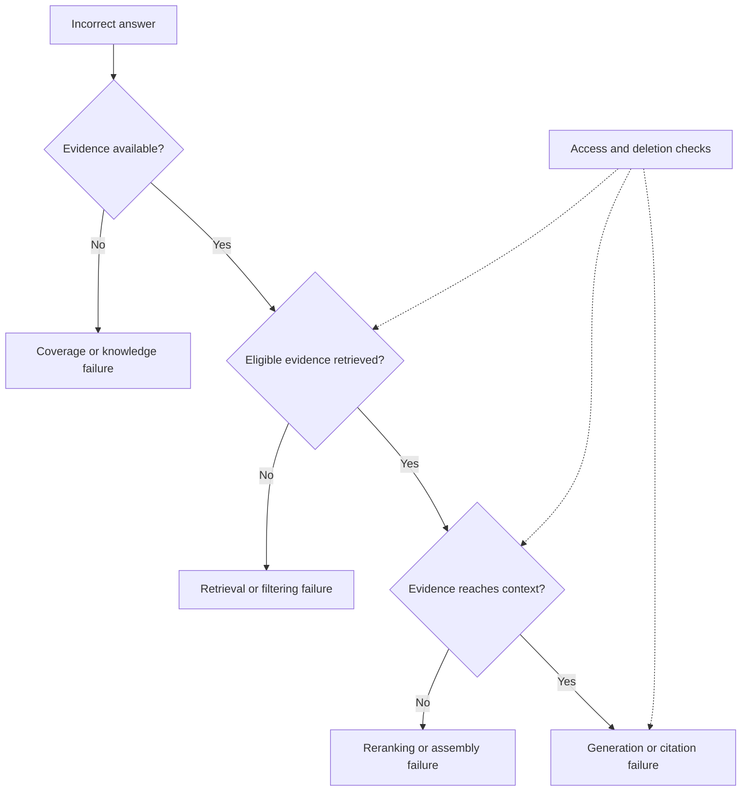

# Study Notes: M06.5.1 — RAG Failure Modes

**Path:** Core · **Depth:** L2 foundation; L3 through demonstrated project work  
**Purpose:** Knowledge application · **Prerequisites:** M03, M05, M07  
**Completion evidence:** Diagnose failures at the correct stage, compare retrieval baselines, validate citations, and demonstrate that restricted or deleted evidence cannot influence an answer.

The examples in these notes use an **invented maintenance-manual collection**. Manual M-104 has revisions v3 and v4; Tenant A and Tenant B have separate information. Example maintenance intervals and test results are fictional teaching data, not operational instructions or reported benchmarks.

## Table of Contents

1. [Failure-Mode Fundamentals](#1-failure-mode-fundamentals)
2. [M06.5.1.1 — Retrieval Failures](#2-m06511--retrieval-failures)
3. [M06.5.1.2 — Knowledge Failures](#3-m06512--knowledge-failures)
4. [M06.5.1.3 — Generation Failures](#4-m06513--generation-failures)
5. [Stage-by-Stage Diagnosis](#5-stage-by-stage-diagnosis)
6. [Metrics That Identify the Problem](#6-metrics-that-identify-the-problem)
7. [Worked Incident: The Wrong Maintenance Interval](#7-worked-incident-the-wrong-maintenance-interval)
8. [A Small Diagnostic Program](#8-a-small-diagnostic-program)
9. [Choosing a Corrective Action](#9-choosing-a-corrective-action)
10. [Overall Concept Map](#10-overall-concept-map)
11. [Glossary and Final Revision Sheet](#11-glossary-and-final-revision-sheet)
12. [Practice and Interview Questions](#12-practice-and-interview-questions)
13. [L3 Project Exercise and Acceptance Evidence](#13-l3-project-exercise-and-acceptance-evidence)
14. [Primary Sources and Further Reading](#14-primary-sources-and-further-reading)

## 1. Failure-Mode Fundamentals

### Definition

A **RAG failure mode** is a repeatable way in which a retrieval-augmented generation system produces an incomplete, incorrect, unsupported, unauthorized, stale, or unusable result.

RAG combines retrieval from an external collection with answer generation. The original RAG research provides a foundational example of combining a retriever and generator; modern applications add ingestion, permissions, reranking, citation handling, and operational controls around that basic relationship. See [Lewis et al., Retrieval-Augmented Generation for Knowledge-Intensive NLP Tasks](https://arxiv.org/abs/2005.11401).

An answer can fail even when the language model behaves exactly as instructed. If extraction removed a critical table column, the correct value may never reach the model. Conversely, the correct evidence may be present, but the model may ignore a condition and state an overly broad conclusion.

### Symptom versus cause

**Symptom:** “The assistant gave the wrong inspection interval.”

**Possible causes:**

- The current manual was never ingested.
- The manual exists, but its relevant page was not extracted.
- The correct chunk exists, but candidate retrieval missed it.
- A metadata filter selected the wrong equipment model.
- Reranking removed the correct chunk.
- The evidence was truncated during context assembly.
- The model used the old interval despite seeing the new one.
- A cached answer belonged to an earlier manual revision.

Changing the prompt addresses only some of these causes. Diagnosis should locate the **earliest stage that violated its contract**.

### Three primary categories

| Category | Main question | Example |
|---|---|---|
| Retrieval failure | Did the system find the right eligible evidence? | Exact part number was missed |
| Knowledge failure | Was the available evidence complete, current, and interpretable? | Only an obsolete manual exists |
| Generation failure | Did the answer accurately use the selected evidence? | A conditional rule became an unconditional claim |

Security and operations can create failures in all three categories. A stale permission cache is an operational defect with a security consequence; its visible symptom may be an unauthorized answer.

### Failure is relative to a task contract

Before deciding that an answer is wrong, define what the system was supposed to do. A historical query about v3 should not automatically receive v4. An unanswered question is not necessarily a failure: abstaining can be correct when no eligible source supports the answer.

A useful task contract specifies the user, tenant, allowed sources, effective date, requested equipment, expected evidence, and allowed answer behavior. Without that contract, “good retrieval” can mean different things to different reviewers.

### Key takeaway

**Debug the evidence path before changing the wording of the answer prompt.**

## 2. M06.5.1.1 — Retrieval Failures

### Retrieval misses

A **retrieval miss** occurs when an eligible, relevant item exists in the searchable collection but is not returned within the candidate set used by the next stage.

Suppose the question is “What does error code AX-17 mean?” The relevant chunk contains the exact code, but dense search retrieves general troubleshooting passages. The embedding model may represent the topic well while failing to distinguish AX-17 from AX-71.

Check whether the relevant chunk is actually indexed, whether the query and document vectors use compatible embedding configurations, and whether a lexical baseline can retrieve it. An exact-term question is a useful reason to compare BM25 or other lexical retrieval with dense retrieval.

Do not classify “the document is absent from the collection” as a retrieval miss without qualification. That is a coverage or ingestion problem. Search cannot recover an item that does not exist in its searchable universe.

### Wrong chunks

A **wrong-chunk failure** returns text that resembles the query but does not answer the specific question.

Example:

- User: “What is the interval for filter Q on equipment model X?”
- Retrieved text: “Filter Q installation procedure for equipment model Y.”

The nouns overlap, but the equipment and requested relationship differ. A relevance judgment should therefore consider the complete information need: entity, attribute, applicability, time, and conditions.

Useful corrections include adding model metadata, retaining headings during chunking, using exact identifier matching, and adding a reranker that scores query–passage pairs. Reranking can improve the order of available candidates; it cannot select a missing passage.

### Low recall

**Recall** measures how much of the relevant evidence was found. For a labeled query with four eligible gold passages, retrieving one of them gives Recall@K of 1/4, regardless of how confident the answer sounds.

Low recall matters especially when answering requires multiple facts. A procedure may require both an action and its exception. Retrieving only the action can create a dangerously incomplete answer even if the passage is individually relevant.

Possible causes include candidate K being too small, weak lexical coverage, embedding mismatch, overly restrictive business filters, poor chunk boundaries, or approximate-search settings that omit neighbors.

Measure relevance recall separately from **ANN recall**. ANN recall compares approximate neighbors against exact neighbors under the same vector metric. A system can have excellent ANN recall while its embedding space ranks irrelevant text highly.

### Low precision

**Precision** measures how many returned items are relevant. If a five-passage result contains one relevant passage and four unrelated passages, Precision@5 is 1/5.

Low precision consumes reranker capacity and context tokens. It can also introduce conflicting vocabulary, unrelated entities, or misleading instructions. However, the optimal candidate stage may intentionally favor recall; the final context should be more selective.

Do not demand that candidate precision and context precision have the same target. A broad candidate pool followed by an effective reranker can work well. Compare the complete pipeline under a fixed budget.

### Bad filters

Filters may fail in two directions:

| Filter defect | Consequence | Example |
|---|---|---|
| Too restrictive | Relevant allowed material disappears | Language filter excludes a bilingual manual |
| Too permissive | Irrelevant or restricted material enters the result | Tenant condition omitted |
| Wrong interpretation | Correct field receives the wrong value | “Current” mapped to upload time instead of effective revision |
| Wrong operator | Intended conjunction becomes disjunction | Tenant A OR public document |
| Inconsistent stage | Branches search different allowed universes | Dense branch applies ACLs; lexical branch does not |

Security filters must remain enforced while diagnosing a quality problem. Temporarily removing tenant restrictions in a production request is not an acceptable way to increase recall.

Filtering an unrestricted top-10 result after retrieval can leave only two allowed items even when many relevant allowed items exist elsewhere. This can protect the final output only if restricted content has not already crossed a trust boundary, and it still does not establish retrieval completeness. Prefer a supported eligible-search strategy and test its behavior under selective filters.

### Query drift

**Query drift** occurs when rewriting, expanding, translating, or decomposing a query changes its intended meaning.

Original: “When must the standby unit be tested after replacement?”

Drifted rewrite: “How often should the main unit be serviced?”

Both concern maintenance, but the equipment, trigger, and action differ. Preserve critical terms, identifiers, dates, negation, and conditions. Store the original query alongside the rewrite, and evaluate both.

Expansion should add possible vocabulary, not silently replace exact constraints. For instance, adding “backup” as an alternative to “standby” may help; dropping “after replacement” changes the question.

### Key takeaway

Candidate generation should recover the right **eligible** evidence. Relevance scores do not establish authority, freshness, or permission.

## 3. M06.5.1.2 — Knowledge Failures

### Contradictory chunks

Two passages may state different values because they concern different versions, scopes, or conditions. Apparent contradiction is not automatically source unreliability.

Invented example:

- M-104 v3: “Review the log every 30 days.”
- M-104 v4: “Review the log every 14 days.”
- M-205: “For the demonstration unit, review daily.”

Resolve document identity, revision, effective date, equipment applicability, and source authority before choosing a value. If two current, equally authoritative sources still conflict, report the disagreement and avoid manufacturing a reconciliation.

Majority voting over duplicated passages is especially misleading. Ten copies of v3 do not outweigh one authoritative v4.

### Stale data

**Stale data** was once valid but is no longer suitable for the requested time or current state. A source can be recently indexed yet stale if the connector fetched an old export.

Track at least source change time, connector observation time, index publication time, and effective validity. These answer different questions. A current ingestion timestamp proves recent processing, not current knowledge.

Freshness is task dependent. A historical maintenance explanation may tolerate an older reference; a query about whether a record is currently approved may require an authoritative live lookup.

### Missing data

A collection may not contain an answer because a document was never uploaded, an appendix was omitted, the source is unavailable, the user lacks access, or the organization has never documented the fact.

These cases require different internal classifications, but externally revealing which hidden source exists may itself leak information. The assistant can say it lacks sufficient accessible evidence without listing restricted document titles.

The correct response may ask for a missing public detail, retrieve from another permitted source, or abstain. Repeating the same retrieval request with larger K cannot create absent knowledge.

### Wrong versions

Version errors include mixing chunks from v3 and v4, citing a v3 URL while quoting v4 text, treating upload sequence as document revision order, or restoring an obsolete index after rollback.

Maintain stable document identity separately from version identity. A source locator should point to the actual cited version where possible, with a clearly stated current-source policy.

A useful serving rule for current queries is: choose one published revision for each document, then retrieve only chunks belonging to that revision. Historical queries require an explicit alternative policy, not accidental inclusion of obsolete material.

### Bad chunk boundaries

A boundary can remove meaning even when every individual word was extracted correctly.

Examples include separating a table value from its unit, an exception from its rule, a figure from its caption, or “do not” from the following instruction. Overlap may help, but overlap alone does not reliably preserve section or table semantics.

Inspect the original page, extracted representation, chunk, and expanded context together. A parent-child approach may retrieve a small precise unit and then provide its authorized parent section. Parent expansion must reapply permissions and token limits.

For tables, preserve the row key, column heading, units, and notes in the representation. A chunk containing only “14” is not useful evidence for a 14-day interval.

### Key takeaway

The index is a representation of the knowledge source. Errors in that representation can survive even excellent retrieval and generation.

## 4. M06.5.1.3 — Generation Failures

### Hallucination despite relevant evidence

A model can add a plausible claim that the retrieved text does not support. If a passage says a component was replaced, the answer may incorrectly add that it passed all tests.

Break the answer into atomic claims and map each factual claim to evidence. A claim can be topically consistent yet unsupported. Treat “sounds reasonable” and “is stated or justified by the source” as different standards.

Useful controls include constrained answer scope, explicit evidence references, extractive intermediate facts, and post-generation validation. None of these independently guarantees factual correctness.

### Evidence ignored

The model may prefer its prior knowledge, an earlier conversational statement, a repeated obsolete passage, or a more prominent source in the prompt.

A controlled test can replace the retrieved context with a short, unambiguous gold passage. If the model still answers incorrectly, investigate instructions, conversation contamination, answer formatting, and model capability. If it succeeds, context construction is a stronger suspect.

Research on the [lost-in-the-middle problem](https://arxiv.org/abs/2307.03172) found position-sensitive performance in the models and tasks studied. Use this as a reason to test evidence placement in your own configuration, not as a universal rule that all models always fail in the center.

### Unsupported synthesis

Synthesis combines facts across passages. It becomes unsupported when the combined conclusion requires an unstated link.

Passage A: “Unit P has a replacement kit.”  
Passage B: “Replacement kits for Unit Q require approval.”

Unsupported answer: “Replacing the kit for Unit P requires approval.”

The answer transferred a rule across entities. Valid synthesis must preserve entity identity, scope, conditions, and time. Multi-hop questions should record which source supports each link; a missing link should remain uncertain.

### Citation mismatch

A citation can fail even when it opens successfully:

- The cited passage is irrelevant to the adjacent claim.
- It supports only part of a compound sentence.
- It refers to a different entity or revision.
- The page number is wrong after extraction.
- A generated source identifier does not exist.
- The source is no longer accessible to the requester.

Validate citation identity, location, permissions, and semantic support separately. The application should supply allowed citation IDs and reject fabricated IDs. Semantic support still needs evaluation; syntactic validation cannot prove entailment.

### Context overflow

Context overflow occurs when assembled input exceeds a limit or when automatic truncation removes necessary material. There are several budgets: embedding input, reranker input, model input, model output, and application-specific message limits.

Reserve space for instructions, conversation, tool outputs, and the answer. Truncation should follow an explicit priority policy. Do not silently chop the tail of a procedure if that tail contains exceptions.

Even context that fits can be ineffective if it is repetitive or irrelevant. “Within the token limit” is a capacity check, not a quality check.

### Key takeaway

A fluent answer with citations still needs claim-level validation. Presence of evidence is different from correct use of evidence.

## 5. Stage-by-Stage Diagnosis

### Start with a reproducible case

Record a privacy-appropriate trace containing a case ID, authenticated scope, source snapshot, query configuration, candidate IDs and ranks, reranker results, selected evidence IDs, citation mapping, and timing. Store sensitive text only where justified and access controlled.

[OpenTelemetry traces](https://opentelemetry.io/docs/concepts/signals/traces/) provide a general model of related spans across a request. Applying that model to RAG stages is an architectural choice; the retrieval-specific fields must be defined by the application.

### Use boundary questions

| Boundary | Diagnostic question | Evidence to inspect |
|---|---|---|
| Source to extraction | Does the original contain the answer? | Original page or record |
| Extraction to chunks | Were units, scope, and conditions retained? | Parsed blocks and chunks |
| Chunks to index | Is the correct version searchable? | Manifest and index record |
| Index to candidates | Was the correct eligible passage found? | Candidate ranks and filters |
| Candidates to reranked results | Was useful evidence demoted? | Before/after rankings |
| Reranked results to context | Was evidence removed or truncated? | Assembled evidence package |
| Context to answer | Are all claims supported? | Claim-to-passage mapping |
| Answer to delivery | Are access and deletion state still valid? | Final authorization check |

### Change one factor at a time

If you simultaneously change chunking, embeddings, K, reranker, and prompt, you cannot identify which change helped. Controlled ablations preserve most of the pipeline and change one component.

Useful diagnostic substitutions include exact vector search instead of ANN, gold evidence instead of retrieved evidence, no rewriting instead of rewriting, and a current-source-only fixture instead of a mixed-version collection. These are evaluation experiments on authorized data, not permission bypasses.

## 6. Metrics That Identify the Problem

Suppose one invented query requires eligible gold chunks `{A, B, C}`. Candidate generation returns `{A, C, D, E, F}`. Reranking and context assembly retain `{A, D}`.

- Candidate Recall@5 = 2/3.
- Candidate Precision@5 = 2/5.
- Final-context evidence recall = 1/3.
- Final-context precision = 1/2 under the same binary labels.

The candidate stage missed B, and refinement lost C. Fixing only generation cannot recover either absent fact.

Define gold evidence at a stable level. If A and A-overlap repeat the same answer, counting them as two independent facts can inflate recall. For some tasks, label atomic evidence requirements or source sections rather than every overlapping chunk.

Unanswerable queries need a separate policy because their relevant set can be empty. Do not divide by zero or silently score abstention as failure. Measure correct abstention, unsupported-answer rate, and inappropriate abstention on answerable queries.

Citation correctness asks whether cited evidence supports its claim. Citation completeness asks whether claims requiring evidence are cited. An answer with one correct citation and five uncited factual claims can perform well on the first measure and poorly on the second.

Security failures should not disappear inside an average relevance metric. A cross-tenant leak remains a release-blocking defect even if aggregate answer quality improves.

## 7. Worked Incident: The Wrong Maintenance Interval

### Initial report

A Tenant A user asks for the current log-review interval for fictional equipment Q. The assistant answers “30 days” and cites M-104.

The authoritative current fixture is v4, which says “14 days.” Revision v3 says “30 days.” Neither value is an operational recommendation outside this exercise.

### Investigation

1. Confirm the user is allowed to access M-104 v4.
2. Verify the source manifest marks v4 as published and v3 as superseded.
3. Inspect extraction: both values and their headings are correct.
4. Inspect candidates: v3 and v4 both appear because the active-version filter was omitted.
5. Inspect reranking: v3 ranks first because its chunk repeats the query terms.
6. Inspect context: the budget retains v3 and removes v4.
7. Inspect citations: the display URL resolves to the latest source, creating a v3-text/v4-link mismatch.

There are three distinct defects: revision eligibility, evidence selection, and citation identity.

### Corrective work

Add a published-version constraint to all retrieval branches. Preserve version-specific source locators in evidence records. Rebuild any citation cache that stored only document IDs. Add a regression case in which an obsolete revision has stronger lexical overlap than the current one.

A reranker upgrade alone would be unreliable: even if v4 usually ranks higher, obsolete content would remain eligible.

### Evidence of repair

The corrected fixture should show that current queries cannot select v3, historical queries can select v3 only under the historical-access policy, v4 citations point to v4, and deletion or revocation blocks both cached and uncached answers.

Report actual observed results after running the tests. The scenario above is an analysis example, not a claim that any deployment was tested.

## 8. A Small Diagnostic Program

This executable Python standard-library example distinguishes a candidate miss from evidence lost during refinement. It uses known labels; it cannot discover missing gold evidence by itself.

```python
from dataclasses import dataclass

@dataclass(frozen=True)
class RetrievalCase:
    gold: frozenset[str]
    candidates: tuple[str, ...]
    context: tuple[str, ...]


def diagnose(case: RetrievalCase) -> dict:
    gold = set(case.gold)
    candidates = set(case.candidates)
    context = set(case.context)
    if not context <= candidates:
        raise ValueError("Context contains untraced evidence")
    if not gold:
        return {
            "status": "evaluate_answerability_separately",
            "candidate_recall": None,
            "context_recall": None,
        }
    return {
        "missed_by_retrieval": sorted(gold - candidates),
        "lost_after_retrieval": sorted((gold & candidates) - context),
        "irrelevant_in_context": sorted(context - gold),
        "candidate_recall": len(gold & candidates) / len(gold),
        "context_recall": len(gold & context) / len(gold),
    }

case = RetrievalCase(
    gold=frozenset({"A", "B", "C"}),
    candidates=("A", "C", "D", "E", "F"),
    context=("A", "D"),
)
print(diagnose(case))
```

Expected interpretation: B was missed during retrieval, C was lost after retrieval, and D is irrelevant under the supplied binary labels. In a production evaluator, labels must include applicability and access scope, and derived context expansion needs an explicit lineage relationship rather than the simple subset assumption used here.

## 9. Choosing a Corrective Action

| Observed defect | First useful action | Misleading shortcut |
|---|---|---|
| Relevant source absent | Repair ingestion or coverage | Increase top-K indefinitely |
| Exact identifier missed | Compare lexical retrieval | Assume a larger generator fixes search |
| Relevant candidate removed | Inspect reranking and context budget | Change extraction without evidence |
| Exception split from rule | Repair boundaries or expand parent | Add random overlap everywhere |
| Obsolete revision selected | Enforce version policy | Ask model to “prefer newer” |
| Unauthorized candidate reaches model | Repair authorization boundary | Hide its citation afterward |
| Correct context, unsupported answer | Tighten answer contract and validate claims | Re-index unchanged data |
| Cached result survives deletion | Invalidate and reauthorize cache entries | Wait only for TTL |

A correction should come with a regression test that reproduces the original failure and checks adjacent cases. For query drift, include both a case where expansion helps and a case where it changes an exact constraint.

## 10. Overall Concept Map



The map is a starting point. More than one failure can occur in the same request, and operational incidents can affect multiple branches simultaneously.

## 11. Glossary and Final Revision Sheet

| Term | Meaning |
|---|---|
| Retrieval miss | Relevant eligible evidence is absent from returned candidates |
| Wrong chunk | Retrieved text does not satisfy the actual information need |
| Recall | Fraction of relevant eligible evidence recovered |
| Precision | Fraction of returned evidence judged relevant |
| Query drift | Query transformation changes the original intent |
| Staleness | Data no longer meets the requested validity or freshness need |
| Version contamination | Evidence from incompatible revisions is mixed |
| Unsupported synthesis | A conclusion requires a relationship absent from the evidence |
| Citation mismatch | Citation identity, location, scope, or support is wrong |
| Context overflow | Input exceeds a budget or required evidence is truncated |
| Ablation | Controlled removal or replacement of one pipeline component |
| Gold evidence | Human-validated reference evidence for evaluation |
| Abstention | Declining to answer when sufficient eligible support is absent |
| Regression | Previously acceptable behavior becomes worse after a change |

### High-value revision rules

- Confirm answerability before judging retrieval.
- Separate source coverage, candidate recall, context recall, and answer correctness.
- Keep tenant and permission constraints enforced during diagnosis.
- A reranker cannot recover a passage absent from its candidate pool.
- A current timestamp does not prove current document content.
- A valid citation URL does not prove semantic support.
- Token fit does not prove useful context.
- Treat source deletion and permission revocation as independent test dimensions.
- Reproduce a failure with a fixed source snapshot and configuration.
- Choose a repair because of observed evidence, then retain the case as a regression test.

## 12. Practice and Interview Questions

### Question-and-Answer Recall

**1. What is the difference between a symptom and a root cause?**  
A symptom is the visible bad result, such as a wrong interval. A root cause is the pipeline defect that produced it, such as selecting an obsolete revision. Several root causes can produce the same symptom.

**2. When is an absent answer a knowledge failure?**  
When the required information is absent, stale, or unusable in the permitted collection. If the correct searchable evidence exists but ranking misses it, the defect is retrieval-related.

**3. Why does high ANN recall not guarantee good answers?**  
ANN recall measures agreement with exact vector neighbors. Those neighbors may still be irrelevant, stale, or insufficient for the task.

**4. Can low candidate precision be acceptable?**  
Sometimes. A broad pool may improve recall, provided subsequent reranking and selection produce useful context within latency and cost limits.

**5. What is query drift?**  
It is a change in the information need during rewriting or expansion, such as losing an equipment identifier or an “after replacement” condition.

**6. Why can duplicated evidence be harmful?**  
It consumes context and can make an obsolete or unsupported claim appear more authoritative through repetition.

**7. What is unsupported synthesis?**  
It combines individually supported facts into a conclusion whose connecting relationship is not supported.

**8. How can a citation be incorrect even if it opens?**  
The target may concern a different claim, entity, page, or revision, or it may support only part of the answer.

**9. What should happen when evidence is insufficient?**  
The system should retrieve additional permitted evidence if appropriate, request a relevant clarification, or abstain without inventing missing facts.

**10. Why preserve failed examples?**  
They become regression cases that test whether a later release reintroduces the defect.

### Multiple-Choice Questions

#### Easy

**11. The correct passage is indexed and allowed but is absent from the top-20 candidates. What is the most direct classification?**

A. Citation completeness failure  
B. Retrieval miss  
C. Successful abstention  
D. Output-format failure

**Answer: B.** The failure occurs before refinement and generation: candidate search did not recover an existing eligible passage.

**12. Which check establishes whether a claim is supported?**

A. The answer sounds professional  
B. The citation link is blue  
C. The cited evidence entails the claim in its stated scope  
D. The passage has a high vector score

**Answer: C.** Fluency, presentation, and similarity do not establish factual support.

**13. Which is a knowledge-quality problem?**

A. The current appendix was never ingested  
B. The model used the wrong JSON field  
C. A valid answer took too long to stream  
D. The user interface displayed a spinner

**Answer: A.** The system lacks required source material, so retrieval alone cannot solve the problem.

#### Medium

**14. Three of four relevant eligible passages are retrieved. What is recall?**

A. 25%  
B. 50%  
C. 75%  
D. Impossible to calculate without precision

**Answer: C.** Recall is 3/4. Precision would additionally require the total number of returned passages.

**15. The correct passage is rank 8 among candidates but never reaches context. Where should investigation start?**

A. Only the source upload form  
B. Reranking and context selection  
C. The user's password policy  
D. The model's pretrained knowledge

**Answer: B.** The evidence was found. Investigate the boundary where it was removed, including truncation and deduplication.

**16. A rewrite removes “except during demonstration mode.” What is the primary risk?**

A. Query drift  
B. Better compression with no trade-off  
C. Guaranteed lower latency  
D. Improved authorization

**Answer: A.** The condition changes applicability and may lead to an answer to a different question.

#### Hard — Scenario-Based

**17. v3 appears in ten duplicate files and v4 appears once. Which current-query policy is strongest?**

A. Choose the majority value  
B. Choose the longest passage  
C. Resolve authority and active revision before ranking  
D. Randomly choose a citation

**Answer: C.** Duplicate count is not source authority. Eligibility should encode the document's current publication state.

**18. A post-filter leaves no Tenant A results among a global top-5. What can you conclude?**

A. Tenant A has no relevant documents  
B. No relevant allowed document exists anywhere  
C. This candidate sample contained no allowed result; eligible-search recall remains unproven  
D. Tenant restrictions should be disabled

**Answer: C.** Relevant Tenant A passages may rank outside the unrestricted top-5. Security must remain enforced while the retrieval strategy is improved.

**19. Gold evidence produces a correct answer, but the normal pipeline fails. What is the best next step?**

A. Assume the generator is always correct  
B. Compare retrieval, refinement, and assembled context with the gold evidence  
C. Delete all tests  
D. Increase temperature

**Answer: B.** The substitution narrows the likely cause to the evidence path. It does not establish that generation is universally reliable.

### Interview Questions

#### Easy

**20. Explain retrieval failure versus generation failure.**  
A retrieval failure means the model is not given the right eligible evidence. A generation failure means the answer misuses, ignores, or goes beyond the evidence it receives. I would inspect the actual context before deciding which category applies, because the same wrong answer can arise from either.

**21. Why is “increase top-K” not a complete repair strategy?**  
It can improve candidate recall, but it can also add irrelevant material and latency. It does not fix missing source data, stale versions, permission defects, or unsupported synthesis. I would compare recall and downstream quality at several K values under a fixed budget.

#### Medium

**22. How would you debug a citation mismatch?**  
I would identify the claim, the application-issued citation ID, the document and version behind that ID, the source location, and the exact supporting text. I would separately verify current user access. Then I would determine whether the problem is mapping, locator generation, version selection, or semantic support and add a regression case for that boundary.

**23. How do you distinguish missing data from a weak retriever?**  
I would inspect the authoritative source and the indexed representation. If the fact is absent from the collection, it is a coverage issue. If the passage exists but search misses it, I would compare exact-term search, exact vector search, ANN search, and the active filters. I would use authorized fixtures so investigation does not weaken access controls.

#### Hard — Scenario-Based

**24. Aggregate quality improved, but one restricted source appeared in an answer. Would you release?**  
No. Average relevance cannot compensate for an authorization failure. I would stop that release, identify the earliest boundary at which restricted evidence crossed scope, repair all equivalent paths including caches and parent expansion, and rerun a permission matrix and deletion tests. Quality comparisons resume only after the security gate passes.

**25. A new prompt fixes one question but harms twenty others. How would you proceed?**  
I would preserve the failing example, compare prompt versions on the same held-out dataset, and inspect whether the change overfits one wording pattern. If the underlying issue is retrieval or source state, I would fix that component instead. A prompt change should be accepted based on broad evidence and relevant risk slices, not one attractive demonstration.

## 13. L3 Project Exercise and Acceptance Evidence

Build a small diagnostic collection with two tenants, two versions of M-104, a table containing a fictional interval, a deliberately missing appendix, an obsolete duplicate, and one allowed document containing an irrelevant instruction-like sentence.

Create at least twelve labeled questions covering exact terms, paraphrases, multi-fact answers, historical versions, unanswerable requests, restricted sources, and source deletion. Keep a development set separate from the final evaluation questions.

Compare lexical, dense, and hybrid candidate retrieval with a common basic reranker. Record candidate and context metrics independently. Deliberately introduce one defect per stage, then demonstrate that your trace identifies the relevant boundary.

**Required evidence:**

- A source/version/permission manifest.
- A query set with gold evidence or an explicit unanswerable label.
- A baseline comparison with actual observed results.
- One trace showing a retrieval miss and one showing refinement loss.
- Claim-to-citation checks for generated answers.
- A test showing that revoked or deleted content does not reach the model or cached answer.
- A short explanation of each repair and the regression case that protects it.

**Acceptance rule:** Every claimed repair must be demonstrated on a reproducible test. A polished explanation without the candidate lists, source identities, or access checks does not establish L3 competence.

## 14. Primary Sources and Further Reading

- Lewis et al. [Retrieval-Augmented Generation for Knowledge-Intensive NLP Tasks](https://arxiv.org/abs/2005.11401): foundational retriever–generator formulation.
- Liu et al. [Lost in the Middle: How Language Models Use Long Contexts](https://arxiv.org/abs/2307.03172): controlled study of evidence-position effects.
- OpenTelemetry. [Traces](https://opentelemetry.io/docs/concepts/signals/traces/): request-level tracing and spans.
- OWASP. [Authorization Decisions and Output Handling](https://cheatsheetseries.owasp.org/cheatsheets/Authorization_Decisions_And_Output_Handling_Cheat_Sheet.html): authorization decisions and protection of output paths.
- Elastic. [Near real-time search](https://www.elastic.co/docs/manage-data/data-store/near-real-time-search): distinction between indexing operations and search visibility.

The diagnostic cases, arithmetic, taxonomy applications, and project design in these notes are original teaching examples. Product behavior depends on the deployed version and configuration; verify implementation-specific semantics before using a suggested diagnostic procedure in a live system.
