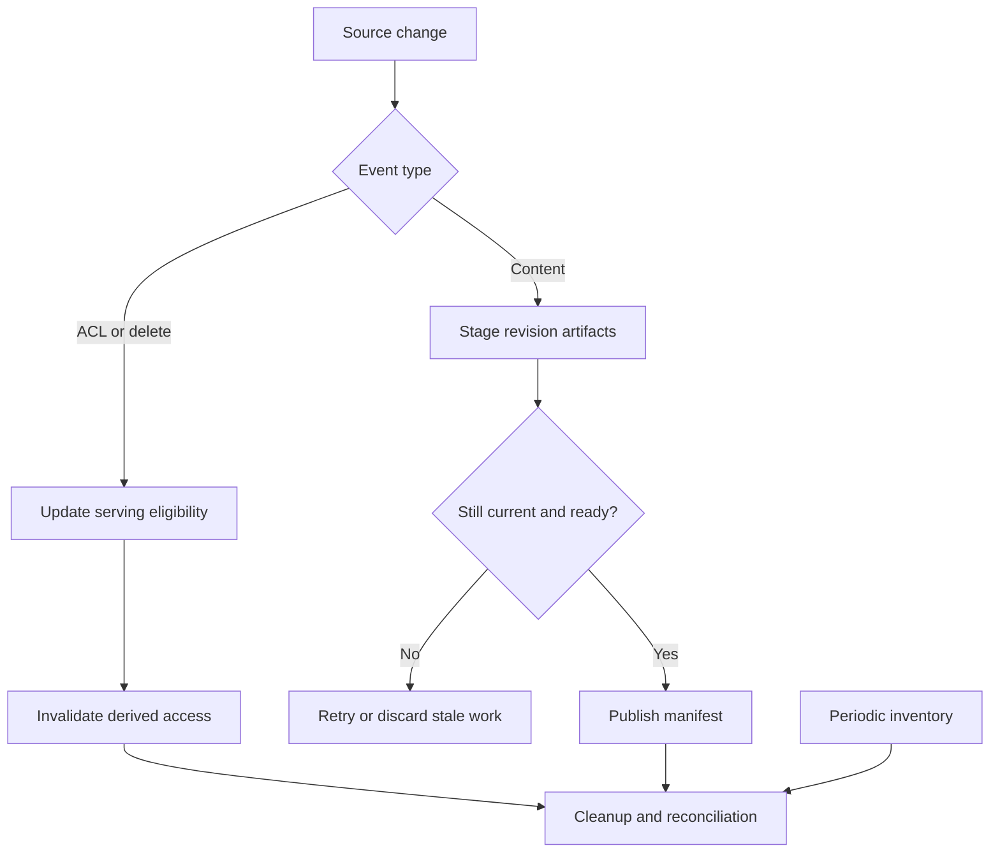

# Study Notes: M06.6.1 — Incremental Indexing

**Path:** Core · **Depth:** L2 foundation; L3 through demonstrated project work  
**Purpose:** Knowledge application · **Prerequisites:** M03, M05, M07  
**Completion evidence:** Update a revised source without serving mixed versions, demonstrate idempotent recovery, reconcile source and index state, and prove deletion blocks every derived serving path.

The M-104 manual, event sequences, processing times, and storage records below are **invented teaching examples**. Configuration values illustrate reasoning and must be established through measurements for a real deployment.

## Table of Contents

1. [Incremental Indexing Fundamentals](#1-incremental-indexing-fundamentals)
2. [M06.6.1.1 — Change Detection and Content Hashing](#2-m06611--change-detection-and-content-hashing)
3. [M06.6.1.1 — Diff-Based Re-Indexing](#3-m06611--diff-based-re-indexing)
4. [M06.6.1.1 — Version Tracking and Publication](#4-m06611--version-tracking-and-publication)
5. [M06.6.1.1 — Freshness Policies](#5-m06611--freshness-policies)
6. [M06.6.1.1 — Deletion Handling](#6-m06611--deletion-handling)
7. [M06.6.1.1 — Event-Driven Re-Indexing](#7-m06611--event-driven-re-indexing)
8. [M06.6.1.2 — Idempotent Updates and Failed Recovery](#8-m06612--idempotent-updates-and-failed-recovery)
9. [M06.6.1.2 — Reconciliation and Freshness Monitoring](#9-m06612--reconciliation-and-freshness-monitoring)
10. [Worked Revision and Deletion Example](#10-worked-revision-and-deletion-example)
11. [A Small Event-Ordering Program](#11-a-small-event-ordering-program)
12. [Overall Concept Map](#12-overall-concept-map)
13. [Glossary and Final Revision Sheet](#13-glossary-and-final-revision-sheet)
14. [Practice and Interview Questions](#14-practice-and-interview-questions)
15. [L3 Project Exercise and Acceptance Evidence](#15-l3-project-exercise-and-acceptance-evidence)
16. [Primary Sources and Further Reading](#16-primary-sources-and-further-reading)

## 1. Incremental Indexing Fundamentals

### Definition

**Incremental indexing** updates the searchable representation of knowledge when sources change, processing the affected items instead of rebuilding the entire collection every time.

The word “incremental” describes the amount of work. It does not guarantee correctness. A fast update that leaves obsolete chunks searchable or drops permissions is still a failed update.

A complete change can affect several representations: extracted text, chunks, embeddings, lexical records, metadata, parent sections, graph relations, summaries, and caches. A useful indexer tracks these dependencies rather than treating the vector row as the only output.

### Full rebuild versus incremental update

| Approach | Suitable situation | Main trade-off |
|---|---|---|
| Full rebuild | New parser, incompatible embedding model, major schema migration | More work, but simpler complete recomputation |
| Document-level update | A small number of documents change | Reprocesses unchanged sections within those documents |
| Chunk-level update | Large documents with stable local edits | More complex matching and lineage |
| Metadata-only update | ACL, tags, or publication state changes without embedded text changes | Must invalidate relevant serving decisions |
| Hybrid policy | Routine deltas plus periodic verification or rebuild | Balances efficiency and repairability |

A full rebuild remains valuable as a repair mechanism. Incremental processing should not make the system impossible to reconstruct from authoritative sources.

### Four different identities

Keep these concepts separate:

1. **Document ID:** stable identity of M-104 across changes.
2. **Source revision:** a version assigned by the source, such as v4.
3. **Processing generation:** the parser, chunker, embedding, and schema configuration used.
4. **Lifecycle generation:** an ordered state change used to reject stale publication attempts.

A filename is often insufficient as a document ID. Renaming a manual should not automatically create a duplicate unrelated source. Likewise, “v10” and “v9” must not be compared as ordinary strings.

### Key takeaway

**Incremental indexing is a state-management problem with an optimization inside it.**

## 2. M06.6.1.1 — Change Detection and Content Hashing

### Change detection

Change detection identifies created, modified, deleted, moved, or permission-changed sources.

Possible signals include connector webhooks, database change streams, file modification metadata, source revision IDs, delta APIs, and scheduled inventory comparisons. Each signal has different delivery and consistency behavior.

A webhook means “something may have changed.” It does not necessarily contain the final authoritative content. Fetch the source under approved credentials and compare it with known state.

### Polling versus events

| Mechanism | Strength | Limitation |
|---|---|---|
| Periodic polling | Simple and can recover missed notifications | Delay and repeated scanning |
| Webhook/event | Fast reaction to changes | Duplicates, reordering, and missed delivery may occur |
| Change-data capture | Tracks committed database changes | Source-specific configuration and operational complexity |
| Snapshot reconciliation | Finds drift across the collection | Potentially expensive and requires a complete snapshot |

Combining events with periodic reconciliation is often a useful engineering design. Events provide responsiveness; reconciliation catches discrepancies. The exact cadence should follow source size, freshness requirements, and available connector guarantees.

### Content hashing

A **content hash** is a deterministic digest of a representation. If the bytes change, a suitable cryptographic hash is overwhelmingly likely to change. Equal hashes can support reuse decisions, but hashes do not establish source truth or access rights.

A source-byte hash detects file changes, including formatting and metadata differences. A normalized-text hash can identify text-equivalent files but may miss layout changes that affect table interpretation. Store the hash type and canonicalization version.

Executable standard-library example:

```python
import hashlib
import json


def processing_key(text: str, config: dict) -> str:
    payload = {"text": text, "config": config}
    encoded = json.dumps(payload, sort_keys=True,
                         ensure_ascii=False,
                         separators=(",", ":")).encode("utf-8")
    return hashlib.sha256(encoded).hexdigest()

config = {"parser": "p2", "chunker": "c3", "embedder": "e1"}
print(processing_key("Fictional manual section", config))
```

Including configuration avoids reusing an embedding produced by a different model or preprocessing pipeline. A production cache also needs an appropriate tenant and processing-policy boundary.

### Hashing pitfalls

Do not normalize away meaningful distinctions. Removing punctuation, units, negation, or table structure can make different instructions appear identical. “Do inspect” and “Do not inspect” must never collapse to the same normalized content.

An ACL-only change may leave the content hash unchanged while requiring urgent serving updates. Therefore content change and permission change need separate signals.

A parser upgrade may change extracted text even when source bytes are identical. The transformation version must participate in the decision to regenerate downstream artifacts.

## 3. M06.6.1.1 — Diff-Based Re-Indexing

### Definition

**Diff-based re-indexing** compares old and new source representations and rebuilds affected units while reusing compatible unchanged artifacts.

For a 100-section manual with one edited section, it may be wasteful to regenerate every embedding. However, efficient reuse depends on reliable section identity and on whether nearby context influences the chunk representation.

### A careful process

1. Fetch the complete new source revision.
2. Extract using a versioned parser.
3. Compare stable structural units, such as sections or table rows.
4. Identify changed, added, removed, and moved units.
5. Re-chunk affected regions, including necessary neighboring context.
6. Reuse compatible embeddings for unchanged text under approved scope.
7. Build a complete manifest for the new revision.
8. Validate and publish the revision as one serving unit.

The new manifest matters even when most embeddings are reused. A reused vector can support a newly assigned source-version record, but citation and permission lineage must point to the correct revision.

### Why a small edit can have a large effect

Fixed-size chunking can shift many boundaries after an insertion near the beginning. Recursive chunking may preserve more local structure but still change neighboring chunks. Semantic chunking can change segmentation when paragraph relationships change.

Consider chunks of 200 tokens. Adding 20 tokens to an early paragraph may shift every later fixed boundary. A naive “same chunk number means same content” rule can silently attach old vectors to new text.

Stable section IDs and content-based matching help, but moved content and duplicate paragraphs still require careful handling.

### What can be reused?

| Artifact | Reuse condition |
|---|---|
| Source bytes | Source revision and integrity checks unchanged |
| Extracted text | Same source representation and parser behavior |
| Chunk | Same content, boundaries, and relevant metadata |
| Embedding | Same embedded text, model, preprocessing, and compatible dimensions |
| Lexical record | Same analyzed text, fields, and analyzer configuration |
| Summary | All contributing evidence and summary configuration remain valid |
| Cached answer | Query context, access, evidence, and answer configuration remain valid |

Do not infer the last rows from the first. An unchanged embedding does not make an answer cache valid after a permission change.

### Deduplication with lineage

Two documents may contain identical text. Reusing computation can be efficient, but each source must retain its own identity and access policy. Deleting one source should not necessarily delete a still-valid identical source; conversely, a shared artifact must not keep a deleted source's exclusive information accessible.

Separate artifact identity from the source-to-artifact references. Reference counting can assist physical cleanup, but authorization must still be evaluated per source path and effective policy.

## 4. M06.6.1.1 — Version Tracking and Publication

### Version manifest

A manifest records the complete searchable representation intended for a source revision.

```json
{
  "tenant_id": "A",
  "document_id": "M-104",
  "source_revision": "v4",
  "lifecycle_generation": 42,
  "parser_version": "p2",
  "chunker_version": "c3",
  "embedding_version": "e1",
  "policy_version": 17,
  "chunk_ids": ["M-104:v4:s1", "M-104:v4:s2"],
  "state": "staged"
}
```

The example omits many production fields for readability. A real manifest can also include source hashes, source locations, timestamps, expected artifact counts, and verification results.

### Stage, validate, publish

Write new artifacts into a non-serving generation. Verify that the required dense, lexical, metadata, and citation representations are ready. Then update the authoritative serving pointer to the new revision.

If the dense index is ready but the lexical index failed, publishing only the dense part can produce inconsistent hybrid results. The publication condition should reflect the system's required branches or explicitly activate a tested degraded mode.

A source update and multiple index writes are usually not one database transaction. A serving manifest can provide a single selection point even though artifact construction is asynchronous.

### Atomicity has a scope

Elastic documents atomic alias changes within its alias API. See [Elastic: Aliases](https://www.elastic.co/docs/manage-data/data-store/aliases). That capability can support an index switch inside Elasticsearch; it does not make an Elasticsearch switch and a separate vector-store switch one shared transaction.

For a multi-store pipeline, application-level generation selection can keep queries pinned to a compatible set of stores. Every branch reads the same published generation or fails according to the declared fallback policy.

### Search visibility is separate from write acknowledgment

An index write may be acknowledged before it appears in search. Elastic's [near real-time search documentation](https://www.elastic.co/docs/manage-data/data-store/near-real-time-search) explains that refresh makes recent changes visible to search.

Therefore, a readiness probe should test the serving operation that matters, not only a write response. Similar distinctions may exist in other products; verify their documented consistency and visibility semantics.

### Key takeaway

A revision is published when the serving contract is satisfied, not merely when one worker reports success.

## 5. M06.6.1.1 — Freshness Policies

### Definition

A **freshness policy** states how current knowledge must be for a task and what to do when that requirement cannot be met.

Separate these times:

- Source commit or revision time.
- Connector observation time.
- Extraction and embedding completion time.
- Search publication time.
- Query evaluation time.

A 10-second embedding job does not imply a 10-second update delay if the connector polls once a day.

### Task-specific freshness

A general explanation of a documented concept may tolerate a scheduled update. A question about the current approval state of a record may need a live structured lookup. “Latest” must refer to authoritative source state, not merely the largest timestamp in an index.

If the current revision is unavailable, choose a deliberate response: mark available information as older, ask the user whether historical information is acceptable, use a live approved source, or abstain. Do not silently answer a current-state question from obsolete evidence.

### Synthetic SLO example

Suppose the lab target is: “99% of authorized manual changes become searchable within 120 seconds of source commit over the evaluation period.”

For 1,000 changes, at least 990 must meet the delay threshold. Define how failures, missing events, and still-pending changes enter the denominator. Excluding unfinished updates can make the metric look excellent while documents remain stale indefinitely.

This target is illustrative. [Google SRE's guidance on implementing SLOs](https://sre.google/workbook/implementing-slos/) explains the use of measurable service indicators and explicit objectives; the 120-second target here is not taken from that source.

### Permission freshness differs from content freshness

A content update may tolerate a delay. Permission revocation may require immediate serving exclusion after acknowledgment. Do not apply a relaxed content-refresh schedule to security state without an explicit, acceptable policy.

## 6. M06.6.1.1 — Deletion Handling

### Deletion is a lifecycle event

Deleting a source should make it ineligible and initiate removal of its derived artifacts. It must not be represented only as “the next crawl probably will not find the file.”

A temporary connector outage, incomplete page of results, or permission error is not proof of deletion. A reliable deletion signal comes from an authoritative event or a completed inventory comparison under known semantics.

### Two phases

**Phase 1: Serving exclusion.** Persist deletion state or a tombstone in authoritative lifecycle storage. All answer paths consult it so stale index hits cannot be used.

**Phase 2: Derived cleanup.** Remove or invalidate chunks, embeddings, lexical records, parent documents, graph relations, summaries, caches, and source previews linked to the deleted source.

The [OWASP RAG Security Cheat Sheet](https://cheatsheetseries.owasp.org/cheatsheets/RAG_Security_Cheat_Sheet.html) discusses carrying deletion through derived representations. The two-phase protocol here is an original implementation pattern for separating serving correctness from asynchronous cleanup.

### Tombstones

A **tombstone** is a durable record that a source is deleted or otherwise ineligible. It often includes the document ID, lifecycle generation, deletion time, and processing status.

Its purpose is not only cleanup. It also prevents old events from recreating the source. Removing tombstones too early can allow a replayed backlog to resurrect deleted content.

If a document is intentionally restored, that restoration must be a new authorized lifecycle event with a later generation and explicit policy. An old worker retry is not a restoration request.

### Physical removal and compaction

Some storage engines mark records deleted and reclaim bytes later. Elastic's [force-merge documentation](https://www.elastic.co/docs/api/doc/elasticsearch/operation/operation-indices-forcemerge) describes segment merging and cautions about its operational use.

Do not force-merge an actively written index as a generic deletion ritual. Follow the actual engine's procedures and distinguish logical ineligibility, searchable deletion, physical cleanup, and backup retention.

A completion report should say what was verified. “No longer served from active indexes and caches” is different from “physically removed from every retained backup.”

## 7. M06.6.1.1 — Event-Driven Re-Indexing

### Event envelope

A useful event contains a stable event ID, document identity, tenant, authoritative source revision or sequence, event type, lifecycle generation, and a reference to the source. Avoid treating client timestamps as authoritative ordering.

Common event types include source created, source updated, source deleted, ACL changed, source restored, and transformation configuration changed.

### Transactional outbox

The dual-write problem occurs when application state changes in a database but the corresponding event fails to reach the queue, or the event is sent while the state change fails.

A transactional outbox writes the business change and an event record in the same local transaction. A separate publisher forwards committed events. AWS's [transactional outbox pattern](https://docs.aws.amazon.com/prescriptive-guidance/latest/cloud-design-patterns/transactional-outbox.html) explains this design and the need to handle duplicate delivery.

This provides a reliable relationship between a local state change and its pending notification. It does not make all downstream index writes exactly once.

### Ordering and partitioning

Ordering by document can simplify lifecycle processing. Global ordering is often unnecessary and expensive. A worker should still compare the event's source/lifecycle generation with authoritative current state because delays, retries, and backfills can produce stale work.

A large document's embedding job may finish after a newer revision. Before publication, the old job must verify that it is still the intended generation. Starting first does not grant permission to publish last.

### Backpressure

When changes arrive faster than the pipeline can process them, queues grow. Coalesce superseded ordinary updates where safe, prioritize deletions and ACL changes, and limit concurrency to protect shared services.

Do not coalesce away the only deletion event. Lifecycle semantics matter more than reducing queue length.

## 8. M06.6.1.2 — Idempotent Updates and Failed Recovery

### Idempotency

An operation is **idempotent** when repeating it has the same intended effect on state as applying it once.

A worker that appends a fresh random-ID chunk on every retry is not idempotent: duplicates accumulate. A worker that writes the same generation and chunk identity with the same content can be idempotent if conflicting payloads are detected and publication is guarded.

### Idempotency keys

A useful key can combine tenant, document ID, source revision, transformation version, and stage. Store completion status and the associated payload fingerprint. Reusing an event ID with a different payload should be treated as an error, not silently accepted.

Keys must cover the effect being protected. An extraction key does not make an unrelated notification or cache invalidation idempotent.

### Recovery checkpoints

| Checkpoint | Persisted evidence | Recovery action |
|---|---|---|
| Source fetched | Revision and hash | Reuse only if source still matches |
| Extraction complete | Parser version and output hash | Resume chunking |
| Embeddings complete | Model/configuration and artifact IDs | Resume index writes |
| Index writes complete | Per-store readiness | Resume validation |
| Published | Active manifest generation | Avoid publishing duplicates |
| Cleanup pending | Old artifact IDs | Retry deletion independently |

Do not delete the old serving revision before the new one is ready unless source policy requires the old version to become immediately ineligible. If it does, availability must yield to the stated source-validity requirement.

### Retry policy

Retry transient errors with bounded attempts, increasing delay, jitter, and an overall deadline. Distinguish invalid documents and authorization failures from temporary network failures.

AWS's [retry with backoff guidance](https://docs.aws.amazon.com/prescriptive-guidance/latest/cloud-design-patterns/retry-backoff.html) emphasizes idempotency for retried operations. An unbounded retry loop can consume resources and repeatedly fail without making progress.

A dead-letter queue is a place to investigate or repair failed work. It is not proof the update completed. Keep the document's indexing status visible and monitor its age.

### Rollback

Rollback should restore a known-good serving configuration while preserving current lifecycle and permission constraints. A previous index generation may contain deleted sources; the serving gate must continue to exclude them.

If the prior embedding configuration cannot represent newly added documents, a rollback may reduce coverage. Report that limitation, use an approved fallback, or rebuild the compatible index. Do not silently claim complete freshness after reverting.

## 9. M06.6.1.2 — Reconciliation and Freshness Monitoring

### Index/source reconciliation

**Reconciliation** compares authoritative source state with derived state and repairs discrepancies.

Compare identities, active revisions, content hashes, transformation versions, permissions, lifecycle states, and required artifacts. A count-only check is weak: 1,000 source documents and 1,000 index records can still contain different IDs.

Useful discrepancy classes include missing source representation, orphaned derived artifact, wrong active revision, stale ACL, incomplete store publication, duplicate chunk identity, and pending deletion beyond its objective.

### Reconciliation safety

Use a completed, consistent source inventory where possible. Do not delete thousands of indexed items because one connector returned an empty page during an outage. Mark the run incomplete, retain its cursor and error state, and retry or escalate according to the operational contract.

Repairs should be idempotent and respect tombstones. A reconciliation job must not revive an item because an old backup still contains its bytes.

### Freshness monitoring

Track update lag, oldest pending event age, source-to-publication delay, failed-document count, deletion completion delay, ACL propagation delay, and discrepancies by source connector.

Percentiles are useful, but inspect tails and pending work. An average of 10 seconds can hide a document stale for several days. A percentile computed only over successful jobs also omits stuck jobs unless they are represented separately.

### Synthetic monitoring

Create a harmless test document with a known revision and unique phrase. Update it, verify the new phrase becomes searchable, remove access, verify it is blocked, then delete it and verify all serving paths remain blocked.

Use an isolated test tenant and controlled content. This checks the full path, whereas a queue metric shows only that a component is active.

## 10. Worked Revision and Deletion Example

### Starting state

M-104 v3 is published at lifecycle generation 41. Both dense and lexical indexes reference manifest 41. A response cache entry depends on M-104 v3.

### Revision arrives

An authorized v4 event creates generation 42. The worker fetches the source, computes its hash, identifies two changed sections, and stages four affected chunks. Unchanged compatible vectors are reused through new source-version references.

The lexical write succeeds, but the embedding service times out. Manifest 42 stays staged; queries continue using eligible v3 only if the source's publication policy permits that temporary state. The application reports v4 as processing rather than pretending it is available.

### Recovery and publication

The embedding job retries with the same idempotency key. It completes the remaining artifacts, verifies both stores through search, and checks that generation 42 is still current. The serving pointer moves to 42. v3 is superseded, and affected response-cache entries are invalidated.

### Deletion race

Generation 43 deletes M-104 while an old generation-42 worker is still running. The authoritative gate records the tombstone before acknowledging the deletion contract. The worker later tries to publish 42 and is rejected because 42 is older than 43.

Cleanup removes derived references from dense, lexical, summary, and cache stores. Reconciliation checks for orphaned M-104 records. Restoring an old index does not remove the generation-43 tombstone.

### What the project must prove

A trace should show each state transition and its reason. Tests should demonstrate no mixed revision results, no duplicate chunks after retry, no stale source resurrection, and no cached answer after deletion. These are expected outcomes for the exercise, not claims of measured deployment performance.

## 11. A Small Event-Ordering Program

This Python fixture demonstrates stale-event rejection and conflicting duplicate detection. It is intentionally in-memory; durable transactions and external-store coordination are additional work.

```python
from dataclasses import dataclass

@dataclass(frozen=True)
class Event:
    generation: int
    kind: str
    revision: str | None

@dataclass
class State:
    generation: int = 0
    kind: str = "absent"
    revision: str | None = None


def apply(state: State, event: Event) -> str:
    if event.kind not in {"upsert", "delete"}:
        raise ValueError("Unsupported lifecycle event")
    if event.generation < state.generation:
        return "ignored_stale"
    if event.generation == state.generation:
        same = (event.kind, event.revision) == (state.kind, state.revision)
        if not same:
            raise ValueError("Conflicting payload for one generation")
        return "duplicate"
    state.generation = event.generation
    state.kind = event.kind
    state.revision = event.revision
    return "applied"

state = State()
assert apply(state, Event(42, "upsert", "v4")) == "applied"
assert apply(state, Event(43, "delete", None)) == "applied"
assert apply(state, Event(42, "upsert", "v4")) == "ignored_stale"
assert apply(state, Event(43, "delete", None)) == "duplicate"
assert state.kind == "delete"
```

Generations must come from trusted lifecycle state. The program does not prove that vector deletion completed. It only illustrates one invariant: an older event cannot overwrite newer accepted lifecycle state.

## 12. Overall Concept Map



The immediate eligibility path prevents slow embedding work from delaying an urgent permission or deletion decision.

## 13. Glossary and Final Revision Sheet

| Term | Meaning |
|---|---|
| Incremental indexing | Updating affected source representations |
| Content hash | Digest used to compare a defined representation |
| Canonicalization | Deterministic normalization before comparison or hashing |
| Diff-based update | Rebuilding changed units and compatible neighbors |
| Manifest | Complete description of artifacts in a source or index generation |
| Publication | Making a validated generation eligible for serving |
| Lifecycle generation | Ordered source-state identifier |
| Tombstone | Durable marker preventing use or resurrection of deleted content |
| Idempotency | Repeated operation has the same intended state effect |
| Outbox | Transactionally stored event awaiting delivery |
| Reconciliation | Comparing authoritative and derived state to find drift |
| Backpressure | Limiting incoming work to sustainable processing capacity |
| Freshness lag | Delay between authoritative change and usable representation |
| Dead-letter queue | Failed work requiring investigation or repair |
| Compaction | Storage reorganization that may reclaim deleted records |

### Revision rules

- Compare content, permissions, lifecycle state, and transformation versions separately.
- Do not trust filenames or lexical version sorting as authoritative identity.
- Reuse embeddings only when text and model configuration are compatible.
- Stage full revision manifests even when only some artifacts change.
- Acknowledged writes may not yet be searchable.
- Atomic operations are atomic only within their documented scope.
- Event delivery can duplicate or reorder work; publication must reject stale jobs.
- Deletion acknowledgment and physical cleanup are different milestones.
- A missing source in an incomplete crawl is not a verified deletion.
- Reconciliation checks identities and versions, not just totals.
- Rollback must preserve current revocations and tombstones.

## 14. Practice and Interview Questions

### Question-and-Answer Recall

**1. What makes indexing incremental?**  
Only affected sources or derived units are processed rather than rebuilding the entire collection after every change.

**2. Why include processing configuration in a reuse key?**  
Identical text embedded with a different model or preprocessing recipe may produce incompatible vectors. Parser and chunker changes can also alter meaning or boundaries.

**3. What is an ACL-only update?**  
An access-policy change with no content change. It may avoid re-embedding but still requires serving-policy and cache updates.

**4. What is a publication manifest?**  
A record identifying the complete set of artifacts and versions that a query may use together.

**5. Why are write acknowledgment and search visibility different?**  
A storage system may accept a write before refreshing or propagating its searchable representation. Readiness must test the intended serving path.

**6. What does idempotency prevent?**  
It prevents repeated processing of the same intended operation from causing additional unintended state changes, such as duplicate chunks.

**7. Why keep tombstones?**  
They block stale events, retries, and restored indexes from resurrecting deleted sources.

**8. What is reconciliation?**  
It compares authoritative source state with derived stores to discover missing, obsolete, orphaned, or inconsistent representations.

**9. Why can a completed-job percentile mislead?**  
Stuck or never-completed updates may be excluded, making the reported delay look better than actual user experience.

**10. Does an outbox provide exactly-once indexing?**  
No. It ties a local state change to a durable event, but downstream delivery and processing still need duplicate handling and guarded writes.

### Multiple-Choice Questions

#### Easy

**11. Which change can require urgent action without changing the content hash?**

A. Permission revocation  
B. A different sentence  
C. A new table row  
D. A changed paragraph

**Answer: A.** Access metadata is a separate dimension from content bytes.

**12. Which record best identifies a source across renames?**

A. The current display title alone  
B. A stable document ID  
C. Its rank in search  
D. Its current chunk count

**Answer: B.** Titles, ranks, and counts can change without changing source identity.

**13. What is the purpose of a staged generation?**

A. Expose incomplete data immediately  
B. Build and validate artifacts before serving them  
C. Avoid recording versions  
D. Remove all source permissions

**Answer: B.** Staging supports a defined readiness and publication boundary.

#### Medium

**14. A one-paragraph insertion shifts many fixed-size chunks. What follows?**

A. Chunk number alone remains a reliable content identity  
B. Boundary changes must be considered before reusing vectors  
C. No re-indexing can ever be incremental  
D. All old vectors are automatically compatible

**Answer: B.** A chunk's meaning depends on its actual text and boundaries, not just its ordinal position.

**15. Dense writes succeed and lexical writes fail. What should a hybrid pipeline do?**

A. Claim complete publication automatically  
B. Publish only if the declared readiness or tested degraded-mode contract is satisfied  
C. Delete the source immediately  
D. Ignore the failure permanently

**Answer: B.** The system must avoid accidental mixed readiness while allowing explicit, evaluated fallback designs.

**16. A crawl returns only its first page before timing out. Are unseen sources deleted?**

A. Yes, all unseen IDs should be removed  
B. Only if they have long filenames  
C. No; the inventory is incomplete  
D. Yes, if the first page is empty

**Answer: C.** Absence from a partial observation is not authoritative deletion evidence.

#### Hard — Scenario-Based

**17. Generation 42 finishes after generation 43 deleted the source. What should publication do?**

A. Publish 42 because it finished last  
B. Reject 42 as stale against current lifecycle state  
C. Remove the deletion record  
D. Ask the model to choose

**Answer: B.** Completion time must not override authoritative event order.

**18. Two stores support atomic switches independently. Does switching both create one atomic cross-store transaction?**

A. Yes, because both use the word atomic  
B. No; cross-store consistency needs an additional coordination contract  
C. Yes, if the names match  
D. Only vector search is affected

**Answer: B.** Atomicity applies within each operation's documented scope.

**19. An old index snapshot is restored after a deletion. Which state must remain authoritative?**

A. The snapshot's old permission metadata  
B. Current lifecycle tombstones and access policy  
C. The largest chunk count  
D. The snapshot creation filename

**Answer: B.** Rollback must not reverse later revocations or deletions.

### Interview Questions

#### Easy

**20. Explain document-level versus chunk-level incremental indexing.**  
Document-level indexing rebuilds the affected document as a unit, which is simpler and often sufficient. Chunk-level indexing attempts to reuse unchanged artifacts inside the document, reducing work but requiring reliable boundary matching, configuration compatibility, and lineage. I would choose based on source size and observed update patterns.

**21. Why is a content hash useful but insufficient?**  
It can show whether a defined representation changed and help avoid duplicate computation. It does not capture ACL changes unless those are included separately, does not establish authority, and can be invalidated by parser or normalization changes. I would record the hash algorithm and representation version.

#### Medium

**22. How would you recover after an embedding timeout halfway through a document?**  
I would retain the staged generation and per-chunk completion records, retry only missing compatible work using stable idempotency keys, and verify current lifecycle state before publication. The old generation remains available only if the source-validity policy permits it. I would not publish a partial revision accidentally.

**23. How would you monitor freshness?**  
I would measure authoritative source-change time to publication, track pending-event age and failed documents, and separate ACL/deletion lag from ordinary content lag. I would include unfinished work in the operational view and run a synthetic update-to-search test. A queue-depth dashboard alone does not prove source freshness.

#### Hard — Scenario-Based

**24. How would you guarantee that retries cannot revive a deleted manual?**  
I would keep a durable lifecycle generation and tombstone, require workers to compare their intended generation with current state before publishing, and make deletion eligibility checks independent of stale index records. Tests would replay old upserts, resume paused workers, and restore an older index. An authorized restoration would require a new later event.

**25. What would you reconcile beyond document counts?**  
I would compare stable IDs, active source revisions, content and transformation hashes, policy versions, lifecycle states, and required artifact references across all stores. Equal counts can conceal missing and extra items. Repairs would be idempotent and based on a completed authoritative inventory, with incomplete connector runs excluded from deletion decisions.

## 15. L3 Project Exercise and Acceptance Evidence

Implement a small source catalog and two derived stores representing lexical and dense retrieval. Use deterministic fixture vectors or a real embedding model with pinned configuration; state which you used.

Process create, content update, ACL update, delete, duplicate event, out-of-order event, and intentionally authorized restoration cases. Simulate a failure after one store succeeds and before the other completes.

**Required deliverables:**

- A source/version/ACL manifest and artifact lineage records.
- Stable idempotency keys and guarded publication logic.
- A test showing consistent revision selection across retrieval branches.
- A failed-update recovery trace without duplicate chunks.
- A deletion test that includes caches and stale event replay.
- A reconciliation report containing a missing item, an orphan, and a stale revision.
- Freshness measurements with clear start/end timestamps and unfinished-work handling.
- A rollback demonstration preserving current tombstones and permissions.

**Acceptance criterion:** No supported failure or replay sequence may publish an older lifecycle state over a newer accepted one. Any eventual physical cleanup must have a documented status distinct from immediate serving exclusion.

## 16. Primary Sources and Further Reading

- AWS. [Transactional outbox pattern](https://docs.aws.amazon.com/prescriptive-guidance/latest/cloud-design-patterns/transactional-outbox.html).
- AWS. [Retry with backoff pattern](https://docs.aws.amazon.com/prescriptive-guidance/latest/cloud-design-patterns/retry-backoff.html).
- Elastic. [Aliases](https://www.elastic.co/docs/manage-data/data-store/aliases).
- Elastic. [Near real-time search](https://www.elastic.co/docs/manage-data/data-store/near-real-time-search).
- Elastic. [Force a merge](https://www.elastic.co/docs/api/doc/elasticsearch/operation/operation-indices-forcemerge).
- Google SRE. [Implementing SLOs](https://sre.google/workbook/implementing-slos/).
- OWASP. [RAG Security Cheat Sheet](https://cheatsheetseries.owasp.org/cheatsheets/RAG_Security_Cheat_Sheet.html).

The state machine, manifests, example SLO, code, and exercises are original educational constructions. Consult the exact versions of your queue, database, connector, and search engine for their ordering, consistency, deletion, and recovery guarantees.
