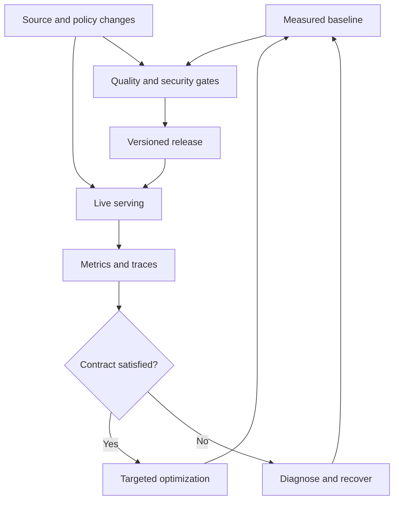

# Study Notes: M06.6.2 — Production RAG

**Path:** Core · **Depth:** L2 foundation; L3 through demonstrated project work  
**Purpose:** Knowledge application · **Prerequisites:** M03, M05, M07  
**Completion evidence:** Operate a measured lexical/dense/hybrid retrieval baseline with basic reranking, bounded latency and cost, safe caches, freshness monitoring, quality gates, and a tested recovery strategy.

All prices, timings, traffic volumes, and release thresholds in worked examples are **synthetic teaching assumptions**. They are not vendor prices, measured benchmark results, or recommended universal defaults.

## Table of Contents

1. [Production RAG Fundamentals](#1-production-rag-fundamentals)
2. [M06.6.2.1 — Embedding Batching](#2-m06621--embedding-batching)
3. [M06.6.2.1 — Retrieval and Reranker Latency](#3-m06621--retrieval-and-reranker-latency)
4. [M06.6.2.1 — Parallel Retrieval and Async Pipelines](#4-m06621--parallel-retrieval-and-async-pipelines)
5. [M06.6.2.1 — Connection Pooling and Index Tuning](#5-m06621--connection-pooling-and-index-tuning)
6. [M06.6.2.2 — Caching and Invalidation](#6-m06622--caching-and-invalidation)
7. [M06.6.2.3 — Cost and Token Optimization](#7-m06623--cost-and-token-optimization)
8. [M06.6.2.3 — Observability and Tracing](#8-m06623--observability-and-tracing)
9. [M06.6.2.3 — Freshness SLOs and Quality Gates](#9-m06623--freshness-slos-and-quality-gates)
10. [M06.6.2.3 — Rollback and Re-Index Strategy](#10-m06623--rollback-and-re-index-strategy)
11. [Worked Production Review](#11-worked-production-review)
12. [Overall Concept Map](#12-overall-concept-map)
13. [Glossary and Final Revision Sheet](#13-glossary-and-final-revision-sheet)
14. [Practice and Interview Questions](#14-practice-and-interview-questions)
15. [L3 Project Exercise and Acceptance Evidence](#15-l3-project-exercise-and-acceptance-evidence)
16. [Primary Sources and Further Reading](#16-primary-sources-and-further-reading)

## 1. Production RAG Fundamentals

### Definition

**Production RAG** is a retrieval-augmented generation system operated for real users with explicit expectations for usefulness, permissions, freshness, reliability, latency, cost, and maintenance.

A demonstration answers a few selected questions. A production system must handle repeated traffic, malformed sources, dependency failures, changing access rights, missing evidence, and releases that may introduce regressions.

### The main optimization problem

You are balancing several objectives:

| Objective | Example measurement |
|---|---|
| Retrieval quality | Recall@K and ranking quality on labeled queries |
| Answer quality | Supported, correct, complete responses |
| Security | No unauthorized evidence in downstream inputs or outputs |
| Latency | End-to-end completion time and tail percentiles |
| Freshness | Source-change-to-serving delay |
| Cost | Cost per useful answer and per indexed update |
| Reliability | Successful eligible requests under defined conditions |
| Operability | Time to detect, diagnose, and recover from failures |

Optimizing one dimension can harm another. Increasing candidate count may improve recall but increase reranking cost. Larger batches can improve throughput but make an individual item wait longer. More caching can reduce latency while increasing invalidation complexity.

### Establish a baseline first

Compare lexical, dense, and hybrid candidate retrieval under the same source snapshot and query set. Include basic reranking in the main pipeline and measure what it adds. Preserve a simple configuration that the team can explain and reproduce.

Treat specialized methods such as HyDE, graph expansion, or iterative retrieval as optional additions justified by a measured problem. Operational complexity has a cost even when an extra stage improves an isolated example.

### Key takeaway

**Production quality means the system keeps its evidence and access contract under ordinary change and failure.**

## 2. M06.6.2.1 — Embedding Batching

### Definition

**Embedding batching** processes several input texts together instead of issuing one operation per chunk. It can reduce per-request overhead and improve compute utilization, depending on the model and service.

Separate ingestion batching from online query embedding. A background indexing job can often wait briefly to accumulate work. A user query usually has a much tighter delay budget.

### Batch by more than item count

A batch of 100 short titles is different from a batch of 100 long sections. Consider item count, total tokens, maximum individual input length, available memory, provider limits, and allowed processing scope.

Maintain a stable mapping from each input ID to its returned vector. Never assume an unordered asynchronous response has the same order as the request unless the API guarantees it.

### Throughput versus waiting time

Suppose a hypothetical service processes 20 chunks in 200 ms and 100 chunks in 500 ms. The larger batch has higher throughput: 200 chunks/second instead of 100 chunks/second. However, if the system waits two seconds to collect the larger batch, the first chunk experiences at least that additional wait.

A dynamic batching policy can flush when a token limit, item limit, or maximum waiting time is reached. Measure the actual distribution rather than selecting a batch size from a generic example.

### Partial failures

A batch may fail entirely, return some invalid inputs, or complete while the client loses the response. Use stable IDs, per-item status, and idempotent storage. Retry only what needs retrying, and avoid writing duplicate vectors.

Validate dimensionality, numeric values, model identity, and input compatibility before publication. A vector with the expected length can still be wrong if it was produced for a different text or embedding configuration.

### Privacy and isolation

Batching must respect the processing destination's approval and data scope. Combining requests does not authorize sending one tenant's content to another tenant's dedicated model or logging it in a shared unprotected queue.

The same source lineage and deletion requirements apply to batched artifacts as to individually generated artifacts.

## 3. M06.6.2.1 — Retrieval and Reranker Latency

### Retrieval latency

Retrieval latency includes more than vector distance computation. It can include policy checks, query preprocessing, query embedding, network delay, shard coordination, metadata filtering, candidate merging, and text fetching.

Measure stages separately. A slow search request may be waiting for a connection or a cold filesystem cache rather than spending most of its time in ANN traversal.

### Reranker latency

A reranker examines query–candidate relationships more closely than first-stage search. Its work depends on candidate count, passage length, model architecture, batching, and hardware or provider capacity.

Use separate parameters for candidate K and context K. For example, an experiment might retrieve 60 candidates, rerank 40 eligible candidates, and assemble 6 passages. These are illustrative values, not defaults.

Reducing candidate length can help only if it preserves the evidence needed for relevance scoring. Truncating a passage before its exception may cause the reranker to favor misleading text.

### End-to-end latency

For a fully sequential request:

\[
T_{total}=T_{auth}+T_{query}+T_{retrieve}+T_{rerank}+T_{assemble}+T_{generate}+T_{validate}.
\]

This equation describes a single request's stage durations. Do not add independently measured p95 values and call the result the system's p95; percentile aggregation does not generally work that way.

### Time to first token versus complete answer

Streaming can make the interface feel responsive, but time to first token is not the same as time to a complete supported answer. Citation validation, final authorization, and source checks may happen later unless the architecture explicitly buffers output.

For sensitive answers, streaming before validation may violate the intended contract. Decide what must be verified before any content is released.

### Latency budgets

Assign budgets to stages and propagate an overall deadline. A request with 200 ms remaining should not start an optional retrieval branch that routinely takes two seconds.

A timeout should produce a defined outcome. If dense retrieval fails, a validated lexical fallback may be acceptable for some tasks. If the current permission state cannot be established, an unrestricted fallback is not acceptable.

## 4. M06.6.2.1 — Parallel Retrieval and Async Pipelines

### Parallel retrieval

Independent eligible retrieval branches can run concurrently. Dense and lexical search may use different representations but share the same trusted tenant, policy, and source-generation constraints.

A hypothetical sequential timing is:

- Query embedding: 40 ms.
- Dense search: 70 ms.
- Lexical search: 50 ms.

If lexical search starts while query embedding and dense search proceed, branch time is approximately `max(40 + 70, 50) = 110 ms`, before merging and other overhead. Sequential execution would take 160 ms for those operations. Actual gains depend on contention and service behavior.

### Async does not mean unlimited concurrency

Asynchronous code can avoid blocking while waiting for I/O. It does not make CPU-heavy work disappear or create unlimited provider capacity.

Use bounded concurrency, connection limits, and backpressure. If each user query launches twenty subqueries, a traffic burst can multiply load across every dependency.

### Cancellation and deadlines

Cancel unnecessary work when a request expires or is abandoned. Ensure cleanup releases connections and does not swallow cancellation exceptions. Python's [asyncio task documentation](https://docs.python.org/3.12/library/asyncio-task.html) describes task groups, timeouts, and cancellation semantics; behavior should be checked against the runtime version used.

Conceptual pseudocode:

```text
trusted_scope = authenticate_and_resolve_scope(request)
deadline = establish_request_deadline()

run concurrently, with bounded capacity:
    lexical = search_lexical(query, trusted_scope, deadline)
    dense = embed_then_search(query, trusted_scope, deadline)

validate branch status against the fallback policy
merge only authorized, current candidates
rerank within remaining budget
assemble evidence with source lineage
validate answer and current access before delivery
```

The names describe responsibilities, not a library API. Each retrieval branch must enforce scope even if the merge stage also checks it.

### Async ingestion

Ingestion naturally benefits from queued stages: extraction, OCR, chunking, embedding, indexing, and publication. Record stage status and support safe retries.

Separate ingestion resource pools from online query capacity when heavy updates would otherwise block users. A large OCR batch should not exhaust every connection or model worker needed for interactive answers.

## 5. M06.6.2.1 — Connection Pooling and Index Tuning

### Connection pooling

A **connection pool** reuses a bounded set of database or service connections. It avoids repeatedly creating connections and provides a point at which concurrency can be controlled.

Pool size should reflect downstream capacity, not only application thread count. Ten application instances each configured for 100 connections can create a much larger database load than expected.

PostgreSQL documents that `max_connections` affects resource allocation; see [PostgreSQL 18: Connections and Authentication](https://www.postgresql.org/docs/18/runtime-config-connection.html). Increasing connection limits is therefore not a free performance fix.

### Tenant state on pooled connections

If authorization depends on session variables, temporary tables, or a selected role, reset that state correctly before returning the connection. Otherwise the next request may inherit the previous tenant's context.

Prefer transaction-scoped settings where appropriate and verify the behavior with the pool's actual mode. Do not assume a session-level setting survives transaction pooling or is safely cleared by every library.

### Index tuning

Choose an index family and parameters based on corpus size, vector dimensions, memory, update rate, filter selectivity, and quality targets. Measure exact-search relevance separately from ANN approximation loss.

The Faiss project's [performance guidance](https://github.com/facebookresearch/faiss/wiki/How-to-make-Faiss-run-faster) discusses index parameters and batching trade-offs. Its specific recommendations apply to Faiss configurations; they are not universal parameter defaults for every vector database.

### A useful tuning experiment

Keep source data, embeddings, and query labels fixed. Vary one search parameter at a time and record:

- Relevant evidence recall.
- ANN recall against exact neighbors where applicable.
- p50, p95, and p99 request latency.
- Memory footprint.
- Index build and update cost.
- Behavior under realistic metadata filters.

Do not select a configuration using unfiltered random vectors if actual queries usually filter to a small tenant or document subset.

### Shards, replicas, and warm state

Sharding distributes data; replication provides additional copies and may support read capacity and availability. Neither automatically improves every query. Fan-out across many shards can add coordination cost, while replicas consume memory and require update propagation.

Test cold and warm behavior. Elastic's [search-speed guidance](https://www.elastic.co/docs/deploy-manage/production-guidance/optimize-performance/search-speed) discusses factors such as cache behavior and profiling. A warm development test may underrepresent restart or failover latency.

## 6. M06.6.2.2 — Caching and Invalidation

### Cache categories

| Cache | Stored item | Key dependencies |
|---|---|---|
| Query cache | Normalized query, classification, or rewrite | Query, language, router/prompt version, relevant conversation |
| Embedding cache | Vector for a text representation | Text, embedding model, preprocessing, dimensions, approved scope |
| Retrieval cache | Candidate IDs, ranks, and possibly snippets | Query, filters, index generation, retrieval configuration, access scope |
| Answer cache | Generated answer and citations | Evidence versions, permissions, query intent, prompt/model configuration |

Terminology varies: some systems call a search-result cache a query cache. Define your team's vocabulary so invalidation rules are unambiguous.

### Cache invalidation

Invalidate or bypass entries when their dependencies change. Examples include a new source revision, deletion, ACL change, embedding migration, reranker update, query-rewrite change, or a changed answer template.

A broad generation key can cheaply invalidate many entries. Dependency-level invalidation is more precise but requires accurate lineage. Often both are useful: generations support safe releases, while source dependencies support targeted invalidation.

### Tenant-safe keys

For retrieval or answer caches, include trusted tenant and effective authorization scope, not merely text similarity. Same-tenant users may have different permissions. Include current policy generation or another dependable mechanism to reject stale allow decisions.

On a hit, verify that the referenced sources are still permitted and not deleted. A TTL is an age limit; it does not prove that access has not changed.

### Cache stampedes

A popular entry expiring can cause many identical requests to recompute simultaneously. Coalesce in-flight work for the same authorized key, add bounded jitter where appropriate, and cap refresh concurrency.

Do not coalesce requests across different access scopes merely because their query strings match. An optimization can become a data leak if it shares a result before authorization.

### Stale-while-revalidate

Serving a stale entry while refreshing it can improve availability for suitable public data. It is unsafe as a generic policy for permission-sensitive or current-state answers.

If the task requires the current manual and the cached answer depends on a superseded version, revalidation must establish whether reuse is allowed. A hidden background refresh does not make an already delivered stale statement correct.

### Cache measurements

Track hit rate, valid-hit rate after policy checks, recomputation cost, invalidation delay, and stale-result incidents. A 95% hit rate is not a success if entries are reused for the wrong users or revisions.

## 7. M06.6.2.3 — Cost and Token Optimization

### Cost model

A useful model separates ingestion and query-serving costs:

\[
C_{total}=C_{ingest}+C_{embedding}+C_{index/storage}+C_{retrieve}+C_{rerank}+C_{generation}+C_{operations}.
\]

Operations include monitoring, evaluation, engineering, and recovery. A method with inexpensive model calls can still be costly to maintain.

### Synthetic generation-cost example

Assume 1,000 requests, 5,000 input tokens and 400 output tokens each, with fictional rates of $1 per million input tokens and $3 per million output tokens.

- Input cost: `1,000 × 5,000 / 1,000,000 × $1 = $5.00`.
- Output cost: `1,000 × 400 / 1,000,000 × $3 = $1.20`.
- Generation subtotal: **$6.20**.

This excludes embeddings, reranking, storage, retries, and infrastructure. It illustrates arithmetic only; use actual contracted rates for a real estimate.

### Cost per useful answer

Cost per request can reward a cheap system that frequently fails. Track the proportion of answers meeting the quality contract and calculate cost per accepted useful answer where feasible.

If a cheap configuration needs repeated retries or follow-up questions, its total task cost may exceed that of a more effective initial answer.

### Token budgeting

For a hypothetical 16,000-token total budget, reserve 2,000 for instructions, 3,000 for conversation, 2,000 for output, and 500 as a margin. That leaves 8,500 tokens for retrieved evidence and any remaining tool material.

The allocation must match the API's actual limits and accounting. Some systems distinguish input capacity from output limits differently. Count with the relevant tokenizer rather than assuming characters map to tokens at a fixed ratio.

### Useful reductions

Deduplicate repeated passages, remove navigation boilerplate, retrieve at an appropriate granularity, and retain the evidence that supports the requested claims. Use structured retrieval for exact counts or database fields when that is the right source.

Compression can remove conditions and units, so evaluate it against uncompressed evidence. Lower token count is useful only if the answer remains supported and complete.

### Avoid false economies

Do not remove authorization checks, current-source validation, or citation provenance to reduce tokens or latency. These are part of the product contract.

Similarly, do not re-embed an entire corpus after an ACL-only change unless the embedding representation itself depends on changed text or policy-derived content. Metadata and serving invalidation can often handle that class of change more directly.

## 8. M06.6.2.3 — Observability and Tracing

### Metrics, logs, and traces

Metrics summarize behavior over many events. Logs record selected events. Traces connect stages of one request. OpenTelemetry describes these as complementary observability signals; see [OpenTelemetry: Signals](https://opentelemetry.io/docs/concepts/signals/).

For RAG, an end-to-end trace might contain spans for authorization, query understanding, dense retrieval, lexical retrieval, reranking, context assembly, generation, and citation validation.

### What to record

Use request ID, tenant-safe identity reference, source/index generation, configuration versions, stage durations, candidate counts, selected source IDs, token counts, cache status, and error categories.

Do not log credentials or unrestricted source text by default. Protect source identities and queries when they are sensitive. A debugging system can otherwise become a second ungoverned knowledge store.

### Operational signals

Google SRE's [monitoring guidance](https://sre.google/sre-book/monitoring-distributed-systems/) describes latency, traffic, errors, and saturation as core service signals. For RAG, extend the operational view with freshness and evidence quality rather than relying only on HTTP success.

A response can return HTTP 200 while citing an obsolete source or containing no relevant evidence. Semantic success needs separate evaluation.

### Useful dashboards

| Dashboard view | Questions it answers |
|---|---|
| Request health | Are users receiving complete responses within the objective? |
| Retrieval quality | Are candidate and context metrics changing by query slice? |
| Data freshness | Which connectors or documents are behind? |
| Security | Are denials, cross-scope attempts, or policy errors increasing? |
| Cost | Which routes, tenants, or retries drive spending? |
| Release comparison | Did a configuration change introduce regressions? |

### Alert design

Alert on symptoms that require action, with enough context to identify the affected contract. “Embedding queue exists” is not an incident. “Oldest required current-manual update exceeds the freshness objective” is actionable.

Use sampled content reviews and controlled evaluation jobs for semantic issues that are too expensive to score on every request. Security audit requirements may require a different retention or sampling policy from ordinary performance traces.

## 9. M06.6.2.3 — Freshness SLOs and Quality Gates

### SLI, SLO, and error budget

An **SLI** is a measured service indicator. An **SLO** is its target over a defined window. An **error budget** is the allowed shortfall under that objective.

For a synthetic target of 99% of eligible updates published within 120 seconds, 10 of 1,000 updates may miss the delay threshold. This arithmetic does not make those misses harmless; severity and source criticality still matter.

Do not interpret a reliability error budget as permission for data leaks. Authorization violations require their own release and incident policy.

### Freshness SLOs

Define the start event, end event, population, threshold, and measurement period. Use source commit time where available, not just worker start time. Track still-pending updates separately so the measurement cannot hide unfinished work.

Separate ordinary content updates, deletion exclusion, physical cleanup, and policy changes. They may need different guarantees and monitoring.

### Quality gates

A release gate is a condition a candidate configuration must satisfy before promotion. Useful gates cover retrieval recall, answer correctness, grounding, citation quality, abstention, permissions, deletion, latency, and cost.

Thresholds should be set before examining the final held-out results. Otherwise the team can move the target to fit the preferred change.

### Evaluate slices

Aggregate quality can hide failures in exact identifiers, tables, scanned sources, multilingual queries, old revisions, small tenants, or unanswerable questions.

Compare lexical, dense, and hybrid baselines on the same eligible query set. Then evaluate the reranker and context assembly. Keep labels and source snapshots versioned so results can be reproduced.

### Offline versus online evidence

Offline evaluation offers controlled comparisons. Online evaluation shows real request distributions, latency, abandonment, and user outcomes. Both are useful, but user satisfaction alone does not prove factual correctness.

A/B testing should not expose users to a configuration that fails basic permission or deletion tests. Security gates precede traffic experiments.

## 10. M06.6.2.3 — Rollback and Re-Index Strategy

### Version the release unit

Record embedding model, parser, chunker, lexical analyzer, vector index settings, reranker, router, prompt, citation renderer, and source/index generation. A prompt version alone is not enough to reproduce the answer pipeline.

### Rollback scope

A prompt rollback may be quick. An embedding rollback may require an old compatible index. A parser rollback may need re-extraction. Document which artifacts must move together.

Never mix query vectors from one embedding space with document vectors from another simply because dimensions match.

### Blue/green indexing

Build a new generation alongside the current one, validate it, and switch serving to it through a controlled publication mechanism. Keep a known-good generation temporarily where permitted for recovery.

Current lifecycle and authorization state must remain outside any rollback that could restore old access. An older index may still contain deleted records; the gate must block them.

### Re-index triggers

A complete or substantial re-index may be required after incompatible embedding changes, parser fixes affecting content, major chunking changes, lexical analyzer changes, or discovery of widespread corruption.

Use incremental processing for compatible local updates. Maintain enough source lineage to rebuild deterministically and compare the new representation with the old one.

### Runbooks

| Incident | Safe initial response |
|---|---|
| Reranker unavailable | Use only a pre-evaluated fallback or return a controlled failure |
| Policy service unavailable | Deny uncertain evidence; preserve only independently authorized paths |
| Index generation mismatch | Pin compatible generation or fail the affected route |
| Source deletion incomplete | Keep serving tombstone active and retry cleanup |
| Provider cost spike | Apply quotas and bounded retries; inspect routing and token growth |
| Bad release | Roll back compatible components while retaining current policy and lifecycle state |

A runbook should identify the operator, evidence to inspect, approved action, expected recovery condition, and verification steps. “Restart everything” is not an adequate general recovery plan.

## 11. Worked Production Review

### Fictional situation

An M-104 assistant performs hybrid search and basic reranking. Users report slow answers after a large manual update. The team initially suspects the generator.

### Trace-based diagnosis

The request trace shows generation time unchanged. Connection wait increased, and query embedding calls are queued behind a bulk ingestion job. Meanwhile, a stale answer cache hides some failures, making average latency look better than uncached latency.

### Proposed changes

Separate interactive and ingestion concurrency budgets. Bound batch size by tokens and waiting time. Reserve database capacity for online serving. Add source-generation dependencies to answer-cache entries and show valid-cache-hit metrics separately from raw hits.

None of these changes requires an advanced RAG method. They address the observed resource and correctness bottlenecks.

### Validation plan

Replay representative queries while a controlled update batch runs. Measure end-to-end latency, connection wait, query-embedding delay, candidate recall, answer correctness, freshness lag, and cache validity.

Then simulate reranker failure, policy-service failure, and deletion during a request. Confirm that fallbacks preserve authorization and that current-source claims remain accurate.

Do not claim the changes improved performance until measured. A design review produces a hypothesis; the controlled experiment supplies evidence.

## 12. Overall Concept Map



The loop connects optimization to measured outcomes and keeps changing knowledge and permissions within the release and serving contracts.

## 13. Glossary and Final Revision Sheet

| Term | Meaning |
|---|---|
| Throughput | Work completed per unit time |
| Latency | Time experienced by an individual operation or request |
| Tail latency | Slow-end behavior such as p95 or p99 |
| Batching | Processing multiple inputs together |
| Backpressure | Limiting work to sustainable capacity |
| Connection pool | Bounded reusable downstream connections |
| Critical path | Dependent operations determining completion time |
| Cache invalidation | Preventing reuse after a dependency changes |
| Cache stampede | Many simultaneous recomputations after a shared miss |
| SLI | Measured indicator of service behavior |
| SLO | Target for an SLI over a defined period |
| Quality gate | Required condition before promotion or release |
| Blue/green indexing | Building and switching between separate index generations |
| Runbook | Documented procedure for diagnosis and recovery |
| Cost per useful answer | Spending relative to answers meeting the task contract |

### Revision rules

- Profile the actual critical path before optimizing.
- Batch size, token volume, and maximum wait all matter.
- Bound concurrency even in asynchronous code.
- Keep candidate K separate from context K.
- Do not sum stage percentiles to estimate request percentiles.
- Reset authorization-related state on pooled connections.
- Cache hits still need access and lifecycle validity.
- Lower token count must preserve conditions, units, and evidence.
- Measure semantic success alongside HTTP success.
- Security gates cannot be traded for an average-quality improvement.
- Version the complete retrieval and generation configuration.
- Rollback must preserve current deletion and permission state.

## 14. Practice and Interview Questions

### Question-and-Answer Recall

**1. Why can a larger batch improve throughput but harm latency?**  
It can use compute more efficiently, but individual items may wait longer for the batch to fill or finish.

**2. What is the difference between candidate K and context K?**  
Candidate K determines the initial pool considered for refinement. Context K is the smaller set selected for answer generation.

**3. Why are p95 stage times not simply additive?**  
The slowest 5% of each stage need not occur on the same requests. End-to-end percentiles must be measured from request-level durations.

**4. What does asynchronous execution improve?**  
It can overlap independent waiting operations and improve resource use. It does not eliminate CPU cost or downstream limits.

**5. Why can connection pooling create a security risk?**  
Session state such as tenant variables or roles can leak between requests if not correctly scoped and reset.

**6. What invalidates an embedding cache entry?**  
Changes to embedded text, model, preprocessing, dimensions, or the relevant processing-policy scope can make it unusable.

**7. What is a valid cache hit?**  
A matching entry whose access, lifecycle, source, and configuration dependencies still satisfy the current request.

**8. Why measure cost per useful answer?**  
A low-cost request may fail and require retries or human work. Task-level usefulness gives a more meaningful denominator.

**9. Why does HTTP 200 not prove RAG success?**  
The answer can still be unsupported, stale, irrelevant, incomplete, or unauthorized.

**10. What must survive rollback?**  
Current permission decisions, revocations, deletion tombstones, and source-validity constraints must remain authoritative.

### Multiple-Choice Questions

#### Easy

**11. Which optimization should normally follow evidence that a stage is slow?**

A. Increase every model's size  
B. Profile and optimize the identified bottleneck  
C. Remove all permission checks  
D. Disable citations permanently

**Answer: B.** Targeted changes address observed causes and are easier to validate.

**12. Which metric captures user-visible completion time?**

A. Only vector distance time  
B. Only batch throughput  
C. End-to-end request latency  
D. Total source count

**Answer: C.** Users experience all dependent stages, including queueing and validation.

**13. Which operation is appropriate on a cache hit?**

A. Assume permissions never changed  
B. Revalidate relevant source and access dependencies  
C. Remove the source IDs  
D. Ignore document deletion

**Answer: B.** Caching is another serving path and must preserve the same contract.

#### Medium

**14. Dense retrieval takes 110 ms including embedding, while independent lexical retrieval takes 50 ms. Ignoring overhead, parallel branch time is approximately what?**

A. 50 ms  
B. 60 ms  
C. 110 ms  
D. 160 ms

**Answer: C.** The slower branch determines completion when both must finish.

**15. Which cache key is insufficient for users with different permissions in one tenant?**

A. Tenant plus query only  
B. Tenant plus effective access scope and required dependencies  
C. A policy-aware, source-aware key  
D. A key verified against current dependencies

**Answer: A.** Tenant membership does not imply identical document access.

**16. What is the main risk of aggressive context compression?**

A. It always improves evidence fidelity  
B. It may remove conditions or relationships needed for a supported answer  
C. It automatically encrypts the source  
D. It guarantees citation correctness

**Answer: B.** Token savings must be evaluated against preservation of meaning.

#### Hard — Scenario-Based

**17. A release improves average answer quality but leaks one tenant's document to another. What should happen?**

A. Release because the average improved  
B. Hide the citation and release  
C. Block release and repair the authorization failure  
D. Increase cache TTL

**Answer: C.** Security violations are not offset by aggregate quality gains.

**18. A prompt rollback uses query embeddings from a new model against old document vectors of the same dimension. Is compatibility established?**

A. Yes, dimensions prove shared meaning  
B. No, embedding-space compatibility requires more than matching dimensions  
C. Yes, if top-K is large  
D. Only citations are affected

**Answer: B.** Coordinates from different embedding models may not have compatible semantics.

**19. An update-delay dashboard includes only completed jobs. What is the blind spot?**

A. It automatically includes every missing event  
B. Stuck and unfinished updates can disappear from the reported distribution  
C. It cannot show any latency  
D. It measures authorization perfectly

**Answer: B.** Pending-work age and failure counts are needed alongside completion percentiles.

### Interview Questions

#### Easy

**20. What turns a RAG demo into a production system?**  
The system needs explicit quality, permission, freshness, latency, cost, and reliability contracts, plus measurement and recovery procedures. It must handle changing sources and access rights, not just answer selected examples. I would start with reproducible baselines and a controlled release process.

**21. Why keep basic reranking in the main pipeline?**  
Candidate retrieval is designed to find plausible evidence efficiently; reranking makes a more detailed relevance comparison before scarce context tokens are allocated. I would measure its improvement and latency on the same candidate pool, while remembering that it cannot recover evidence the first stage missed.

#### Medium

**22. How would you reduce latency without weakening correctness?**  
I would profile request traces, parallelize independent authorized branches, tune candidate volume, bound batch waiting, and remove unnecessary repeated work. I would validate any fallback and preserve permission, source-version, and citation checks. I would compare end-to-end tail latency and quality rather than only a fast component benchmark.

**23. How would you design observability without creating a data leak?**  
I would record identifiers, versions, durations, counts, and reason codes by default, with sensitive text captured only in protected diagnostic workflows when justified. Traces and audit logs would have access controls and retention policies. I would avoid tokens, secrets, and unrestricted source content in general telemetry.

#### Hard — Scenario-Based

**24. Ingestion saturates the embedding service and user queries slow down. What would you change?**  
I would separate or reserve capacity for interactive and background work, apply bounded ingestion concurrency, and measure queue delay and token volume. Dynamic batches would have waiting deadlines. I would also verify that indexing freshness remains acceptable and that no cache hides stale answers after the change.

**25. How would you release a new embedding model safely?**  
I would build a compatible document index alongside the old one, pin preprocessing and dimensions, and evaluate retrieval and downstream answers on held-out queries. The release would switch query embedding and document index together. Rollback would restore a compatible pair while preserving current source, deletion, and authorization state.

## 15. L3 Project Exercise and Acceptance Evidence

Operate a small RAG service with a document-update worker, lexical and dense candidate retrieval, basic reranking, and a permission-aware cache.

Define a realistic workload containing exact identifiers, paraphrases, multi-fact questions, restricted sources, unanswerable requests, and document updates. Run a controlled load experiment while indexing a revised M-104 fixture.

**Submit:**

- A versioned baseline comparison and configuration manifest.
- Stage-level traces and end-to-end latency distributions.
- Batch size, token volume, and concurrency measurements.
- A cost model with stated rates and included/excluded components.
- Cache-hit and invalidation evidence for updates, revocation, and deletion.
- Freshness indicators including unfinished work.
- Release gates with held-out evaluation results.
- A tested dependency-failure fallback and rollback procedure.

**Acceptance criterion:** The reported optimization must improve the intended metric under the declared workload without violating the minimum quality, permission, deletion, and source-validity contracts. Synthetic estimates must remain labeled separately from observed measurements.

## 16. Primary Sources and Further Reading

- Faiss project. [How to make Faiss run faster](https://github.com/facebookresearch/faiss/wiki/How-to-make-Faiss-run-faster).
- Python. [Coroutines and Tasks, version 3.12](https://docs.python.org/3.12/library/asyncio-task.html).
- PostgreSQL. [Connections and Authentication, version 18](https://www.postgresql.org/docs/18/runtime-config-connection.html).
- Elastic. [Tune Elasticsearch for search speed](https://www.elastic.co/docs/deploy-manage/production-guidance/optimize-performance/search-speed).
- OpenTelemetry. [Signals](https://opentelemetry.io/docs/concepts/signals/).
- OpenTelemetry. [Handling sensitive data](https://opentelemetry.io/docs/security/handling-sensitive-data/).
- Google SRE. [Monitoring Distributed Systems](https://sre.google/sre-book/monitoring-distributed-systems/).
- Google SRE. [Implementing SLOs](https://sre.google/workbook/implementing-slos/).

The formulas, numerical assumptions, cache design examples, incident review, and exercises are original instructional material. Product-specific settings and limits must be checked for the deployment being evaluated.
