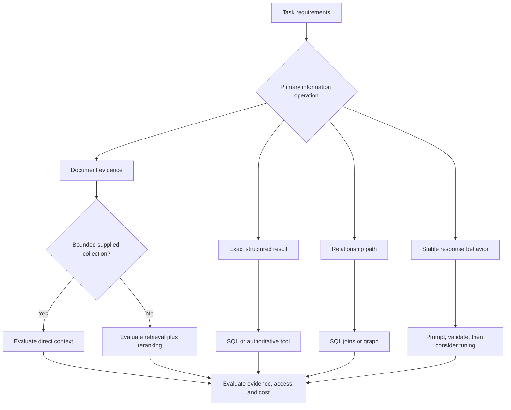

# Study Notes: M06.7.1 — Knowledge Architecture Comparison

**Module:** M06 — Embeddings, Search & RAG  
**Path:** Core  
**Depth:** L2 foundation; L3 through demonstrated project work  
**Prerequisites:** M03, M05, M07  
**Purpose:** Choose an architecture that matches the question, authoritative data, permissions, freshness and operational requirements.

**Syllabus coverage:** M06.7.1.1 compares RAG, fine-tuning, long-context prompting, knowledge graphs, SQL/structured retrieval, search engines and agents with tools. M06.7.1.2 develops the optional Enterprise Knowledge Platform brief.

All enterprise examples and numerical budgets in this file are synthetic teaching examples. Model capabilities, prices and product limits must be checked for the version actually selected; no fixed vendor pricing is assumed here.

## Table of Contents

1. [Architecture Selection Fundamentals](#1-architecture-selection-fundamentals)
2. [RAG](#2-rag)
3. [Fine-Tuning](#3-fine-tuning)
4. [Long-Context Prompting](#4-long-context-prompting)
5. [Knowledge Graphs](#5-knowledge-graphs)
6. [SQL and Structured Retrieval](#6-sql-and-structured-retrieval)
7. [Search Engines](#7-search-engines)
8. [Agents and Tools](#8-agents-and-tools)
9. [M06.7.1.1 Comparison and Decision Rules](#9-m06711-comparison-and-decision-rules)
10. [M06.7.1.2 Enterprise Knowledge Platform](#10-m06712-enterprise-knowledge-platform)
11. [Worked Architecture Decisions](#11-worked-architecture-decisions)
12. [Cost, Latency and Operational Tradeoffs](#12-cost-latency-and-operational-tradeoffs)
13. [Overall Concept Map](#13-overall-concept-map)
14. [Glossary and Final Revision Sheet](#14-glossary-and-final-revision-sheet)
15. [Practice and Interview Questions](#15-practice-and-interview-questions)
16. [Project Exercise and Completion Evidence](#16-project-exercise-and-completion-evidence)
17. [Primary Sources and Further Reading](#17-primary-sources-and-further-reading)

## 1. Architecture Selection Fundamentals

### Definition

A **knowledge architecture** specifies where information lives, how it is represented, how the application obtains it, and how that information supports an answer or action.

An architecture is more than a vector database choice. It includes source systems, permissions, synchronization, indexing, queries, models, evidence assembly, citations, evaluation and operations.

### Start with the job to be done

Compare these questions:

| Question | Required operation |
|---|---|
| “What does the current manual say?” | Locate applicable source evidence |
| “How many tasks are overdue?” | Exact filtering and aggregation |
| “Which supplier is linked to these affected parts?” | Relationship traversal |
| “Rewrite this supplied note in our format.” | Behavior or language transformation |
| “Summarize these three complete documents.” | Understand a bounded supplied context |
| “Check the live status of order O-31.” | Query an authoritative live system |
| “Find documents containing this exact phrase.” | Lexical search |

All can appear in one product, but they do not require the same mechanism.

### Three different problems

**Access to facts:** The model needs information it does not already have in the current input. Retrieval, long-context input and tools can supply it.

**Behavior:** The model needs to follow a particular format, style or task policy. Prompting, examples, validation and sometimes fine-tuning can improve this.

**Computation or action:** The task requires a count, join, calculation, workflow transition or external lookup. A database or tool may be the authoritative mechanism.

Confusing these problems causes poor designs. Re-embedding a document will not make an unreliable JSON parser robust. Fine-tuning a writing style will not create a live inventory database.

### Authority before representation

Ask which system owns the answer. For an asset count, the operational database may be authoritative. For a procedure, the approved document registry may be authoritative. For a historical change, the version history may matter more than the newest timestamp.

Then choose a representation that preserves the required meaning. Do not declare a derived vector index authoritative simply because it is convenient to query.

### Useful decision questions

1. Is the input supplied completely, or must the application find it?
2. Is the answer textual, numeric, relational or action-oriented?
3. How fresh must the information be?
4. Does the answer need source citations?
5. Which users may access which information?
6. How will updates and deletions become effective?
7. What are the latency, cost and operational constraints?
8. How will correctness be demonstrated?

### Key takeaway

Choose the information operation first. Select the storage and model components that implement it reliably.

## 2. RAG

### Definition and mechanism

RAG obtains external evidence and conditions answer generation on that evidence. A practical document workflow ingests sources, extracts and chunks them, builds search representations, retrieves authorized candidates, reranks them, assembles context, and generates a cited answer.

The original RAG paper is the historical research starting point. The application architecture described here is a broader engineering pattern. [Source: Lewis et al.](https://arxiv.org/abs/2005.11401).

### When RAG fits

RAG is useful when the application must answer questions over a changing document collection, return citations, and select a small relevant portion of that collection for each request.

For example, a maintenance knowledge assistant can retrieve the current section of manual M-104 and explain it with a revision-specific citation.

The source collection can be too large or diverse to include entirely in every prompt. Retrieval narrows the input while preserving an evidence trail.

### Strengths

- Knowledge updates can occur in the source/index pipeline.
- Citations can refer to explicit retrieved sources.
- Retrieval can respect document and user scope.
- Different search signals can serve different question types.
- Evidence selection can be inspected separately from generation.

These are capabilities an implementation can provide, not automatic guarantees of the RAG label.

### Limitations

RAG can miss relevant evidence, retrieve the wrong version, lose a table header, or generate an unsupported claim despite good evidence. Each stage needs evaluation.

A retrieved subset also cannot establish a complete count over a database unless the retrieval operation itself guarantees completeness for that count. “I found eight matching chunks” is not the same as “there are eight overdue tasks.”

### Update and deletion implications

Every chunk and embedding must retain source identity. A deletion should first make the source ineligible to serve. Background workers then remove its vectors, lexical entries, derived summaries and cached content according to the architecture's deletion policy.

A citation must not keep exposing removed source content through an unrestricted cache.

### Example

Question: “What changed in the approved preparation procedure?”

Retrieve both explicitly authorized versions for a comparison task. Use revision-aware citations and explain differences. For “What is the current procedure?”, default to the active revision rather than mixing historical text.

### Decision rule

Test RAG when the task requires finding and explaining selected current document evidence. Do not assume it replaces structured queries or model behavior training.

## 3. Fine-Tuning

### Definition

**Fine-tuning** adapts a model using additional training examples. It can change task behavior, formatting patterns, terminology and response style. Full fine-tuning changes many or all trainable parameters; parameter-efficient methods update a smaller set of parameters.

LoRA is a primary example of parameter-efficient adaptation using trainable low-rank components while keeping original model weights fixed during that adaptation. Its suitability and actual resource savings depend on the model and implementation. [Source: Hu et al., LoRA](https://arxiv.org/abs/2106.09685).

### What problem can it solve?

Suppose an assistant consistently receives the correct evidence but produces poorly structured maintenance notes. After improving prompts, schemas and examples, fine-tuning may be worth testing to improve a stable response pattern.

Fine-tuning is a behavior intervention in this example. The current procedure should still come from an authoritative source.

### What it does not automatically solve

Fine-tuning does not create an explicit, queryable source registry. It does not automatically return correct citations, enforce per-document permissions, or implement source-level deletion from learned parameters.

A training example may influence model output without a simple one-to-one mapping from a generated statement back to that example. Therefore, a model trained on private documents should not be treated as a document store with ordinary row deletion.

### RAG and fine-tuning can be combined

A fine-tuned model can learn to use retrieved evidence more effectively while retrieval supplies current facts. RAFT is original research exploring domain-specific adaptation for retrieval-augmented answering. It illustrates that retrieval and training are compatible choices, not mutually exclusive categories. [Source: Zhang et al., RAFT](https://arxiv.org/abs/2403.10131).

A combined design might use:

- Retrieved current manuals for knowledge.
- A fine-tuned output pattern for a standardized report.
- Deterministic validation for required fields.
- Application permissions for source access.

Each element has a different responsibility.

### Data and evaluation requirements

Training needs representative, permitted examples. Keep development and evaluation documents separated enough to expose genuine generalization. Near-duplicate training and test examples can produce misleading results.

Measure behavior on old and new tasks. A specialized model can improve one format while regressing elsewhere.

Track training dataset versions, model versions, evaluation results and deployment configuration. Training is an operational commitment, not a one-time magic fix.

### Original example

Desired output:

```json
{
  "observation": "Provided by the user",
  "evidence_ids": ["known-source-id"],
  "required_action": "Supported by retrieved evidence",
  "unresolved_questions": []
}
```

Fine-tuning may help the model consistently populate that shape. Application code must still validate the schema and ensure every evidence ID exists and is permitted.

### Decision rule

Consider fine-tuning when a stable behavior remains unreliable after simpler interventions, and sufficient high-quality examples and evaluation capacity are available. Keep changing facts in retrievable or tool-accessible sources when freshness and source-level control are required.

## 4. Long-Context Prompting

### Definition

**Long-context prompting** supplies a large amount of source material directly to a model in a single context. The application may include full documents instead of selecting small chunks through a retrieval index.

This can be a straightforward choice for a bounded set of documents already selected by the user.

### When it fits

A user uploads three short reports and asks for a cross-document summary. If their complete authorized contents fit the selected model's context and budget, direct inclusion may be easier than creating a persistent search index.

Long-context input is also useful for questions requiring broad document structure, provided the model actually handles the relevant material well.

### Context capacity versus effective use

A model's maximum context size is not a guarantee that it uses every detail reliably. Lost-in-the-Middle research demonstrated sensitivity to the position of relevant information in tested models and tasks. Treat that result as a reason to test your selected model and workload, not a permanent universal ranking of every model. [Source: Liu et al.](https://arxiv.org/abs/2307.03172).

Measure answers with evidence at different locations, distractors, repeated material and conflicting revisions.

### Comparison with retrieval

A comparative study by Li and colleagues examined RAG, long-context approaches and a hybrid routing method, identifying quality/cost tradeoffs in the tested setups. The appropriate choice depends on the actual corpus, models, questions and budget. [Source: RAG or Long-Context LLMs?](https://arxiv.org/abs/2407.16833).

Do not infer that long context always wins because more text is available. Do not infer that retrieval always wins because fewer tokens are sent.

### Security and deletion still matter

The application must authorize every included document before sending it to a model. Including an entire folder for convenience can expose documents irrelevant to the user's permitted scope.

Cached prompts, conversation histories and saved summaries are derived copies. A source deletion policy must account for those copies. A new document set should not silently reuse cached material from a previous permission state.

### Original example

Two manuals contain 18,000 tokens each. The question requires a full comparison of their procedures. A long-context route may be reasonable if the model, output budget and latency support it.

For repeated questions across 100,000 manuals, sending the whole collection is infeasible. Retrieval or source selection becomes necessary.

### Decision rule

Test direct long-context input for a small, complete, authorized document set. Use retrieval or a hybrid when source selection, scale, frequent updates or evidence precision justify it.

## 5. Knowledge Graphs

### Definition

A **knowledge graph** represents entities and relationships. An asset can be connected to its component, a component to its supplier, and a supplier to a service bulletin.

The graph may come from authoritative structured records, extraction from text, or a combination. Record that distinction.

### When it fits

Graph retrieval is useful when the question is naturally relational: “Which assets are affected by parts from supplier S?” or “How is this component linked to this bulletin?”

A graph makes paths explicit. It can support repeated traversal queries without asking the model to infer every relationship from loosely matching paragraphs.

### Graph query versus generated answer

A graph query returns nodes, edges or paths. A language model may then explain the result with citations. The query itself can be the useful output.

Cypher is a graph query language with pattern-matching concepts; Neo4j's official manual documents its role and syntax. [Source: Cypher introduction](https://neo4j.com/docs/cypher-manual/current/introduction/).

### Limitations

Entity extraction may merge two similarly named suppliers. An edge may represent an outdated relationship. A path can be structurally valid but semantically inappropriate for the question.

Graph modeling is work: define entity identity, relationship meaning, time validity, provenance and permission rules.

A graph also does not automatically solve every “why” question. A connection is not necessarily a causal explanation.

### RAG integration

Use a graph to identify candidate entities or linked evidence, then retrieve source passages supporting those relationships. Alternatively, use vector search to resolve an entity before graph traversal.

Broad graph-summary methods introduce additional derived summaries and their maintenance obligations. They are elective choices to evaluate.

### Decision rule

Choose a graph when repeated relationship questions justify explicit modeling. Use structured joins when the relationship structure is simple and already well represented in a relational database.

## 6. SQL and Structured Retrieval

### Definition

**Structured retrieval** queries information whose fields and relationships are explicitly represented. SQL commonly supports filtering, joins, sorting and aggregation over relational tables.

The result can be exact with respect to the queried database state and query semantics. It is not automatically correct if the data is incomplete, stale or misinterpreted.

### Why top-k search is different

Suppose a database contains 120 open tasks. The user asks how many are overdue. Vector search returning ten relevant task descriptions cannot establish the total.

A structured query evaluates the condition over all eligible rows:

```sql
-- Conceptual parameterized SQL.
-- Parameter binding and access control are implemented by the application.
SELECT COUNT(*) AS overdue_count
FROM maintenance_tasks
WHERE tenant_id = :authenticated_tenant
  AND assigned_group_id = :authorized_group
  AND status = :open_status
  AND due_at < :as_of_time;
```

The named placeholders are conceptual; actual binding syntax depends on the database driver. A client-supplied tenant field is not an authenticated tenant identity.

### Permissions

Use database roles, constrained views, application authorization and row-level policies where appropriate. PostgreSQL documents both the behavior of row-security policies and important bypass conditions for owners or privileged roles. Test the actual application role rather than assuming the existence of a policy is sufficient. [Source: PostgreSQL row security](https://www.postgresql.org/docs/current/ddl-rowsecurity.html).

Generated SQL should not be executed with broad administrative privileges. Prefer allowlisted query templates for common tasks. Where flexible generation is required, constrain available schema, allowed operations, resource limits and parameter handling.

### Useful combinations

A document assistant may retrieve a procedure and query SQL for the assets to which it applies. The final answer can distinguish the procedure source from the live asset snapshot.

Record the database query timestamp, filters, source table or view version when relevant, and row identifiers supporting the result. Do not fabricate a document citation for a computed database result.

### Limitations

A syntactically valid query can use the wrong field or time zone. “Overdue” needs a definition. A join can duplicate rows and inflate a count. Null values and status conventions can change the result.

Use domain-approved query semantics. Validate representative and edge cases against known records.

### Decision rule

Use SQL or another authoritative structured query for counts, filters, joins and exact record lookup. Let a model explain results when useful, while preserving the query's scope and evidence.

## 7. Search Engines

### Definition

A **search engine** indexes material for retrieval using terms, fields, filters and relevance signals. It may also support vectors and hybrid retrieval.

Search is useful without generation. A ranked list with titles, snippets and filters can be the right product when the user wants to locate and inspect source documents.

Official Elasticsearch documentation describes full-text search as a distinct set of retrieval capabilities. Product syntax and supported combinations should be checked against the deployed version. [Source: Elasticsearch full-text search](https://www.elastic.co/docs/solutions/search/full-text).

### Where lexical search is strong

Exact identifiers, product codes, phrases, named entities and known terminology often need explicit lexical treatment.

For example, M-104 and M-140 are similar strings but different manuals. Semantic resemblance cannot substitute for exact identity.

Field boosting can prioritize titles or model-number fields. Facets let users narrow a collection by source type, revision, location or equipment family.

### When search alone is enough

Question: “Find all manuals with ‘P-20 intake filter’ in the title.”

The useful output may be a permission-filtered result list. A generated paragraph could add delay and introduce unnecessary summarization.

Question: “Explain the applicable filter procedure using the current manual.”

This requires evidence interpretation; a RAG answer may be more useful.

### Search engine plus vector index

A single engine may support both lexical and vector retrieval. Alternatively, separate systems may supply those branches. The choice affects consistency, deployment, scaling and failure handling.

With separate indexes, use the same source IDs, versions and eligibility rules. If only one index publishes a revision, fusion can mix stale and current evidence unless the serving layer checks the active manifest.

### Decision rule

Start with lexical search for exact document finding and identifiers. Add dense retrieval when semantic matching helps, and generation when an evidence-based explanation improves the user task.

## 8. Agents and Tools

### Definition

An **agent with tools** chooses and invokes application-provided operations while pursuing a goal. Tools may query a database, search documents, inspect a live API or perform an authorized action.

Agentic operation is about decision flow. RAG is about grounding generation in retrieved evidence. An agent can use RAG, and a RAG workflow can be entirely deterministic.

ReAct is original research illustrating interleaved reasoning-related output and tool actions. Production systems need additional controls for identity, privileges, tool arguments and auditability. [Source: ReAct](https://arxiv.org/abs/2210.03629).

### When tools are necessary

A current order status should come from the order system. A document describing last month's status is not an adequate substitute.

A model can decide which authorized lookup to call, but the lookup service must independently enforce access. Knowing an order ID does not establish the right to view it.

### Fixed workflow versus agent

| Situation | A suitable starting point |
|---|---|
| Every question follows the same sequence | Deterministic workflow |
| One of a few known routes is required | Rule-based or constrained router |
| Next action depends on intermediate results | Bounded agentic workflow |
| User wants a prohibited or unavailable action | Explain the boundary or limitation |
| Tool result is incomplete | Retrieve another permitted source or clarify |

An agent is not required merely because the system uses more than one API.

### Read versus write operations

Reading evidence and changing external state have different consequences. A knowledge assistant may be configured with read-only tools. If the user asks for an action, the application should apply its established authorization and confirmation rules for that action.

A retrieved instruction cannot grant action permission. Documents are data, even when they contain imperative language.

### Failure modes

The agent may select the wrong tool, form invalid arguments, loop, trust malicious tool content or combine incompatible snapshots. Constrain tool schemas, record evidence dependencies, impose budgets, and make failures visible.

### Decision rule

Use tools for authoritative live data and deterministic operations. Add agentic choice only when the task's branching behavior warrants it.

## 9. M06.7.1.1 Comparison and Decision Rules

### Main comparison

| Approach | Best-fit problem | Where task facts live | Update mechanism | Main weakness to test |
|---|---|---|---|---|
| RAG | Explain selected document evidence | Sources and retrieval indexes | Ingest and synchronize sources | Retrieval or evidence-use failures |
| Fine-tuning | Improve stable learned behavior | Model parameters plus runtime inputs | Training and model release | Staleness, regressions, weak source traceability |
| Long-context prompting | Analyze a bounded supplied collection | Current prompt/context | Replace the supplied context | Cost, attention quality and context limits |
| Knowledge graph | Follow explicit relationships | Nodes, edges and provenance | Update graph and derived artifacts | Entity and relationship errors |
| SQL/structured retrieval | Exact filtering, joins and aggregates | Structured source system | Database transactions or data pipeline | Wrong query semantics or stale data |
| Search engine | Locate documents and exact terms | Indexed documents and fields | Index updates | Vocabulary mismatch and ranking |
| Agent + tools | Dynamic evidence or action workflow | Tool-accessible systems | Source-system updates | Wrong action, routing and control failures |

These approaches are composable. A search engine can implement RAG retrieval; SQL can supply one evidence branch; a tuned model can format the answer.

### Permission and citation comparison

| Approach | Permission responsibility | Citation strategy |
|---|---|---|
| RAG | Source scope, retrieval eligibility, expansion and emission | Document/version/span IDs |
| Fine-tuning | Training-data controls and runtime system boundaries | Retrieve supporting sources; weights are not citations |
| Long context | Authorize every included input and cached copy | Source labels and locators retained in context |
| Graph | Node/edge/path and derived-summary eligibility | Edge provenance and original source spans |
| SQL | Roles, row policies, views and query scope | Query snapshot and contributing record IDs |
| Search | Document/field visibility and result metadata | Search result resolves to authorized source |
| Agent | Per-tool action and data authorization | Evidence returned by each permitted tool |

A source title or graph entity name can itself be sensitive. Citation and result metadata must obey the same access policy as the content.

### A practical selection sequence

First identify required authority and operations. Then select the least complex design that satisfies those requirements and can be evaluated.

- Supplied text transformation: begin with prompting and validation.
- Bounded document comparison: compare direct context with retrieval.
- Large changing document collection: compare lexical, dense and hybrid retrieval with reranking.
- Exact aggregate: use structured queries.
- Relationship traversal: assess SQL joins versus an explicit graph.
- Live external state: use an authorized API or tool.
- Stable behavior problem: investigate examples, validation and potentially fine-tuning.

“Least complex” does not mean “fewest lines of code.” A small unsafe script that bypasses source permissions is not a suitable architecture.

### Conditions that disqualify a design

A design fails if it cannot enforce required access, cannot make necessary updates effective, cannot provide required evidence, or cannot meet essential task semantics.

You should not compensate for a source-deletion failure by giving the design extra points for a pleasant writing style.

## 10. M06.7.1.2 Enterprise Knowledge Platform

### Optional extension brief

Build a platform that answers authorized questions over documents and structured records. This is an **L3 project extension**, not a requirement to implement every advanced research method.

The following specification turns the syllabus list into concrete components and acceptance evidence.

### A. Source ingestion and representation

| Requirement | Implementation responsibility | Demonstrable evidence |
|---|---|---|
| PDFs and web pages | Parse content and retain source identity | Known passages match the original sources |
| OCR | Route scanned pages through OCR | Sampled text and coordinates checked against images |
| Tables | Preserve headers, rows, units and footnotes | Extracted values trace to original cells |
| Structured metadata | Store tenant, document, version, dates and scope | Schema validation and searchable filters |
| Vector + sparse indexes | Build both from the same eligible source manifest | Consistent source IDs and revision coverage |

Reject or quarantine failed extraction instead of treating empty text as successful indexing. A document marked “ready” should meet declared extraction and metadata checks.

### B. Retrieval and routing

| Requirement | Implementation responsibility | Demonstrable evidence |
|---|---|---|
| ANN/vector database tuning | Compare exact and approximate search | Recall/latency curves under real filter conditions |
| Hybrid retrieval | Combine lexical and dense results | Baseline comparison on the same query set |
| Reranking | Refine eligible candidates | Ranking and answer-quality ablation |
| Query routing | Select allowed source families | Routing confusion matrix and error examples |
| SQL/structured retrieval | Use deterministic queries for structured questions | Known counts and joins match expected records |
| Citations | Resolve answer claims to actual sources | Claim-level citation correctness and completeness |

Start with clear route types. Do not introduce an unconstrained agent before you understand recurring question categories.

### C. Security and maintenance

| Requirement | Implementation responsibility | Demonstrable evidence |
|---|---|---|
| Authorization-aware retrieval | Enforce current server-side eligibility | Forbidden evidence absent from reranker/model inputs |
| Multi-tenant isolation | Separate identity, policy and cached state | Cross-tenant queries cannot expose text or metadata |
| Incremental updates | Process source changes idempotently | Correct revision appears after publication |
| Source deletion | Deny serving and remove dependent artifacts | Old IDs fail across retrieval, cache and citations |
| Security tests | Probe injection, scope changes and stale copies | Test cases with outcomes and protected traces |

Include same-tenant permission differences. A tenant-level filter alone does not handle a user who may view only one vessel, department or case.

### D. Evaluation and operations

| Requirement | Implementation responsibility | Demonstrable evidence |
|---|---|---|
| Evaluation datasets | Version questions, labels and source snapshots | Reproducible frozen evaluation set |
| RAG metrics | Measure retrieval, context and answer stages | Metrics with definitions and denominators |
| Observability | Trace stage latency, versions and decisions | A failed answer can be diagnosed end to end |
| Quality gates | Define release conditions | Candidate release passes agreed checks |
| Rollback | Restore components without restoring revoked access | Reverted deployment still respects current deny state |

### Suggested service boundaries

Keep a source registry responsible for source identity, revision and deletion state. Keep a policy service or equivalent layer responsible for current authorization. Indexes provide search acceleration. The answer service uses evidence whose source and access state have been checked.

The architecture may implement these responsibilities inside one application initially. The logical separation matters before deciding whether they need separate deployed services.

### Suggested evidence record

```json
{
  "evidence_id": "A:M-104:v4:section-2:chunk-3",
  "tenant_id": "A",
  "document_id": "M-104",
  "document_version": 4,
  "source_locator": "section 2, paragraph 3",
  "content_hash": "example-content-digest",
  "acl_reference": "policy-record-17",
  "index_generation": "generation-12",
  "derived_from": ["A:M-104:v4"],
  "status": "active"
}
```

This is a fictional conceptual record. A content hash detects byte changes; it does not prove that a source is authoritative or that a user is permitted to view it.

### Milestone sequence

1. Establish source identity, ingestion and a small lexical baseline.
2. Add dense retrieval and compare it with lexical search.
3. Add hybrid fusion and basic reranking.
4. Add evidence assembly, citations and answer validation.
5. Complete access, revision, deletion and cache tests.
6. Add structured retrieval and a bounded router.
7. Add observability, performance budgets and release gates.
8. Test one justified advanced extension.

A platform can pass the core module without implementing RAPTOR, Self-RAG or a knowledge graph. It must still satisfy its chosen task's evidence and access requirements.

## 11. Worked Architecture Decisions

### Case A — Small handbook comparison

**Request:** Compare two supplied handbooks and explain differences.

**Candidate designs:** Direct long-context prompting, or retrieval over their sections.

**Decision process:** Check whether the complete authorized inputs fit the model and budget. Create comparison questions that require details from different parts of each handbook. Compare direct context against section retrieval using the same expected changes.

**Likely starting choice:** Direct context for a small one-off comparison, retaining labels and section references. This is a reasoned starting point, not a performance claim.

**Failure to watch:** A broad summary that misses a small but important exception. Evaluate completeness, not just fluent prose.

### Case B — Enterprise manual assistant

**Request:** Answer repeated questions over a large changing manual collection.

**Candidate designs:** Lexical search, dense retrieval, hybrid RAG, whole-collection context.

**Decision process:** Establish a current-source registry and access model. Compare search baselines and add reranking. Evaluate exact identifiers, paraphrases, revision questions and unanswerable requests.

**Starting choice:** Permission-aware hybrid retrieval with reranking and source-linked answers if the comparison supports it.

**Failure to watch:** Different search indexes serving different revisions, or a cached answer bypassing a changed permission.

### Case C — Overdue task dashboard

**Request:** Count overdue tasks by vessel and explain the main categories.

**Candidate designs:** Vector search over descriptions, SQL aggregation, or an agent that selects SQL templates.

**Decision process:** Define “overdue,” the snapshot time, task statuses and eligible vessels. Compute counts in SQL. Use retrieved policy text only if the explanation requires policy definitions.

**Starting choice:** A deterministic structured query with an optional prose explanation.

**Failure to watch:** Duplicate join rows, time-zone mistakes and a count over only the top retrieved results.

### Case D — Supplier impact analysis

**Request:** Identify assets affected by a supplier bulletin across several component relationships.

**Candidate designs:** SQL joins, graph traversal, or manual retrieval followed by entity resolution.

**Decision process:** Inspect whether the required relationships already exist as reliable keys. If they do, joins may be sufficient. If variable-depth relationship queries are common, a graph may justify its modeling cost.

**Failure to watch:** Two suppliers sharing a similar display name. Use canonical identifiers and provenance.

### Case E — Standardized report writing

**Request:** Turn supplied observations and source evidence into a consistent report format.

**Candidate designs:** Prompt/schema improvements, few-shot examples, fine-tuning, or a combination with retrieval.

**Decision process:** Determine whether the failure is missing evidence or inconsistent output behavior. Solve evidence access first. Then evaluate behavior interventions on a held-out set.

**Failure to watch:** A beautifully formatted report with unsupported claims. Formatting and factual support need separate checks.

## 12. Cost, Latency and Operational Tradeoffs

### Separate one-time and recurring work

A retrieval index incurs ingestion, embedding and storage costs. Queries incur search, reranking and generation costs. A graph can add extraction and maintenance costs. Fine-tuning adds training, evaluation and model-release costs. Long-context prompting may avoid persistent indexing while increasing repeated input processing.

Use workload estimates rather than choosing based on one demonstration query.

### A vendor-independent cost model

```text
Monthly total
  = ingestion and reprocessing
  + storage and index operation
  + query_count × average_query_cost
  + monitoring and evaluation
  + maintenance effort
```

Average query cost can include query rewriting, embedding, search infrastructure, reranking, input tokens, output tokens and tool calls.

If architecture A costs 20 fictional units to prepare and 0.02 units per query, while B costs 2 units to prepare and 0.08 units per query, their simplified break-even point is:

```text
20 + 0.02Q = 2 + 0.08Q
18 = 0.06Q
Q = 300 queries
```

Beyond 300 queries, A is cheaper in this toy model. This ignores maintenance, quality and capacity differences. It demonstrates a calculation, not vendor economics.

### Latency

For parallel retrieval branches, request time is closer to the slowest required branch plus fusion and downstream work, not the sum of every independent branch. In contrast, dependent multi-hop retrieval adds sequential work.

Measure full request latency, including queueing, retries and tool waits. Median latency alone can hide a poor experience for slower requests.

### Operational complexity

Every derived representation creates a maintenance responsibility:

| Artifact | What can make it invalid |
|---|---|
| Vector | Source text or embedding model change |
| Lexical entry | Source text, analyzer or field changes |
| Summary | Any contributing source change |
| Graph edge | Relationship correction or source removal |
| Cached evidence | Source, permission or query-context change |
| Fine-tuned model | Behavior requirements or training-data policy change |
| Prompt context cache | Included content, permissions or version change |

A design with excellent retrieval metrics may still be unsuitable if the team cannot safely operate its update and deletion path.

### Common evaluation mistake

Comparing a heavily tuned new architecture with an untuned baseline exaggerates the value of complexity. Give reasonable effort to both designs and disclose what was tuned.

## 13. Overall Concept Map



An agent can orchestrate permitted operations when intermediate results determine the next action. It does not replace the controls applied to those operations.

## 14. Glossary and Final Revision Sheet

### Glossary

| Term | Meaning |
|---|---|
| Knowledge architecture | Design of information sources, representations and access |
| Source of truth | System responsible for the authoritative record |
| RAG | Answer generation using retrieved external evidence |
| Fine-tuning | Additional training that adapts model behavior |
| Parameter-efficient tuning | Adaptation using a limited trainable parameter set |
| LoRA | Adaptation using trainable low-rank components |
| Long context | Large source input supplied directly to a model |
| Knowledge graph | Entities and explicit relationships |
| SQL | Language for querying and manipulating relational data |
| Structured retrieval | Querying explicit fields and relationships |
| Lexical search | Retrieval using terms and text-analysis signals |
| Hybrid search | Retrieval combining complementary search signals |
| Agent | System choosing actions during execution |
| Tool | Application-provided operation |
| Router | Component selecting permitted processing paths |
| Citation | Locator connecting a claim to supporting evidence |
| Lineage | Links from derived data to source data |
| Snapshot | Defined source or database state for a request or experiment |
| Quality gate | Criterion that must pass before release |
| Break-even point | Workload at which two cost models are equal |

### Revision sheet

**Changing facts:** Keep an authoritative source and a reliable retrieval or tool path.

**Stable behavior:** Improve prompts, examples and validation; investigate fine-tuning if justified.

**Exact counts:** Query the complete eligible structured dataset.

**Relationships:** Use canonical identities and explicit joins or graph paths.

**Small supplied corpus:** Compare direct context against retrieval instead of assuming an index is required.

**Large document corpus:** Establish lexical, dense and hybrid baselines with reranking.

**Live state:** Query the responsible system.

**Dynamic workflow:** Use constrained orchestration or a bounded agent when steps genuinely depend on previous results.

**Every architecture:** Enforce access, track provenance, handle updates and deletion, and evaluate user-visible results.

## 15. Practice and Interview Questions

### Question-and-Answer Recall

**1. Why is architecture selection broader than choosing a vector database?**  
It includes authoritative sources, data representation, permissions, updates, query operations, evidence, generation and operations. Vector storage is one possible component.

**2. What problem does fine-tuning most naturally address?**  
Stable learned behavior such as formatting or task patterns. It may be combined with retrieval for changing factual knowledge.

**3. Why is a top-k result unsuitable for an exact database count?**  
Top-k returns a selected subset. An exact count requires evaluating the defined condition over all eligible records.

**4. When can long-context prompting be a good starting point?**  
When the complete authorized source set is small enough to supply directly and the model can answer the required questions reliably within the budget.

**5. Can RAG and fine-tuning be used together?**  
Yes. Retrieval can supply current evidence while a tuned model improves how the evidence is used or how the output is formatted.

**6. What does a graph add?**  
Explicit entities and relationship paths that can support traversal and connection questions.

**7. Does a graph connection prove causation?**  
No. The relationship's semantics and supporting evidence determine what can be concluded.

**8. What makes a live API useful?**  
It accesses the responsible operational system for current state instead of relying on a stale document snapshot.

**9. What is a source registry for?**  
It tracks identities, approved revisions, state and lineage so derived retrieval data can be checked against authoritative source status.

**10. Why should a rollback preserve current denial state?**  
Reverting software or indexes must not restore access to revoked or deleted information.

### Multiple-Choice Questions

#### Easy

**11. Which operation should normally use structured retrieval?**

A. Counting overdue records under a defined policy  
B. Rewriting supplied prose  
C. Choosing a color palette  
D. Expanding an acronym from supplied text

**Answer: A.** Counts require deterministic scope and aggregation over eligible records.

**12. Which technique changes learned model behavior through training?**

A. RRF  
B. Fine-tuning  
C. SQL filtering  
D. Index compaction

**Answer: B.** Fine-tuning adapts model parameters or added trainable components.

**13. A user only wants matching document titles and snippets. What can be sufficient?**

A. A search engine with authorization  
B. A multi-agent reasoning system in all cases  
C. Fine-tuning on every document  
D. A graph of every word

**Answer: A.** A direct search result can satisfy a document-finding task.

#### Medium

**14. A company procedure changes weekly and needs revision-specific citations. Which is a strong starting point?**

A. Memorize every revision through repeated training alone  
B. Retrieve current authorized source evidence  
C. Ignore revision metadata  
D. Ask the model to guess the newest wording

**Answer: B.** Retrieval supports explicit current-source selection and citations when properly implemented.

**15. Which statement about long context is correct?**

A. Fitting inside the limit guarantees accurate use  
B. It removes the need for authorization  
C. Effective use and cost must be tested on the actual task  
D. It always requires a vector index

**Answer: C.** Capacity, effective attention, evidence quality and cost are distinct considerations.

**16. When is a graph worth considering?**

A. Every time any document contains a noun  
B. When repeated relationship queries justify explicit entity and edge modeling  
C. Only when SQL is unavailable  
D. When source provenance is unnecessary

**Answer: B.** The workload and relationship structure determine whether graph modeling adds value.

#### Hard — Scenario-Based

**17. A fine-tuned model writes excellent reports but invents the latest inventory count. What should change?**

A. Treat writing quality as proof of factual accuracy  
B. Query the authoritative inventory system and validate the result  
C. Remove all source links  
D. Increase the number of invented examples

**Answer: B.** The failure concerns current facts and computation. A reliable structured source is needed.

**18. A hybrid system fuses a new lexical index with an old vector index. What must the serving layer check?**

A. Only the vector dimensionality  
B. Current source/version eligibility across both branches  
C. Only the final answer length  
D. Whether the document title sounds familiar

**Answer: B.** Otherwise incompatible revisions can enter the same evidence set.

**19. A knowledge platform improves average answer quality but cannot prevent cross-tenant cache reuse. What is the release decision?**

A. Release because the average improved  
B. Release only to smaller tenants  
C. Fix the access failure before release  
D. Remove the test from the report

**Answer: C.** An access failure is a disqualifying condition, not an acceptable quality tradeoff.

### Interview Questions

#### Easy

**20. Compare RAG and fine-tuning in plain language.**

**Model answer:** RAG obtains evidence for the current question; fine-tuning changes learned response behavior through examples. A model can use both. I would use authoritative retrieval or tools for changing facts and investigate tuning for stable behavior problems after simpler improvements.

**21. When would you choose search without a generated answer?**

**Model answer:** When the user wants to locate documents, inspect exact matches or browse filtered results. Direct search preserves source visibility and avoids unnecessary generated synthesis. I would still enforce permissions and protect result metadata.

#### Medium

**22. Design an assistant that answers manual questions and counts open tasks.**

**Model answer:** I would use a permission-aware document retrieval route for manuals and a parameterized structured query route for task counts. A constrained router selects the appropriate route or both. The final answer distinguishes document citations from database snapshot results and retains source/version information.

**23. How would you compare direct context with RAG?**

**Model answer:** I would use the same authorized corpus snapshot and questions, include detailed and broad tasks, and measure correctness, completeness, citations, latency and cost. I would vary evidence position and distractors for direct context and inspect retrieval misses for RAG. I would not assume one approach is universally better.

#### Hard — Scenario-Based

**24. Your organization wants a graph because its documents mention many entities. What would you ask?**

**Model answer:** I would ask which recurring relationship questions fail today, whether canonical entity IDs exist, and whether SQL joins already solve them. I would estimate extraction, disambiguation, provenance and update costs. I would test a representative graph route against a simpler baseline before committing.

**25. How would you prevent an agent from using a document as an authorization policy?**

**Model answer:** I would keep authorization in deterministic application and tool layers, use authenticated identity and constrained arguments, and treat retrieved instructions as data. The agent can request a permitted operation but cannot grant itself a new permission or widen its tenant scope.

**26. A retrieval platform must support deletion, citations and model tuning. What distinction matters?**

**Model answer:** Removing a document from retrieval, caches and derived summaries is different from removing influence already learned in model parameters. I would avoid representing ordinary source deletion as guaranteed model unlearning, clearly define the training-data lifecycle, and use retrieval for source-controlled current knowledge.

## 16. Project Exercise and Completion Evidence

### Task

Design an Enterprise Knowledge Platform for a fictional organization with two tenants, revised manuals, scanned pages, tables and a task database.

### Required work

Produce a short architecture decision record for each source family. Explain why a document, structured, graph, direct-context or tool route is appropriate. Implement the core routes needed by your chosen questions.

Prepare:

- A source and identity model.
- A permission-aware ingestion and retrieval design.
- Lexical, dense and hybrid baseline comparisons.
- Basic reranking and evidence assembly.
- Structured query validation.
- Revision, permission-change and deletion demonstrations.
- An evaluation set and stage-level metrics.
- An operational budget and rollback plan.

### Model decision record

```text
Decision: Use SQL for overdue task counts.
Reason: The answer requires complete aggregation over authorized rows.
Alternative considered: Top-k retrieval over task descriptions.
Reason alternative is unsuitable: It returns a subset and cannot prove the total.
Evidence: Known fixture counts match query results across time and status cases.
Access: Authenticated tenant and allowed asset scope enforced independently.
Limit: Accuracy depends on source data and the agreed overdue definition.
```

### Completion standard

A reviewer should be able to reproduce the baseline comparison, trace at least one answer to current evidence, show that an unauthorized user cannot obtain it, and show that a deleted source stops contributing to answers.

## 17. Primary Sources and Further Reading

- [Lewis et al. — RAG](https://arxiv.org/abs/2005.11401).
- [Hu et al. — LoRA](https://arxiv.org/abs/2106.09685).
- [Zhang et al. — RAFT](https://arxiv.org/abs/2403.10131).
- [Liu et al. — Lost in the Middle](https://arxiv.org/abs/2307.03172).
- [Li et al. — RAG or Long-Context LLMs?](https://arxiv.org/abs/2407.16833).
- [Neo4j — Cypher introduction](https://neo4j.com/docs/cypher-manual/current/introduction/).
- [PostgreSQL — Row Security Policies](https://www.postgresql.org/docs/current/ddl-rowsecurity.html).
- [Elastic — Full-text search](https://www.elastic.co/docs/solutions/search/full-text).
- [Yao et al. — ReAct](https://arxiv.org/abs/2210.03629).

**Related study files:** [Query Routing](M06.2.3_Query_Processing_and_Retrieval_Routing.md), [Knowledge Graphs](M06.3.2_Knowledge_Graphs.md), [Production RAG](M06.6.2_Production_RAG.md), and [Permission-Aware Worked Example](M06.10.1_Permission_Aware_Document_Answer.md).

