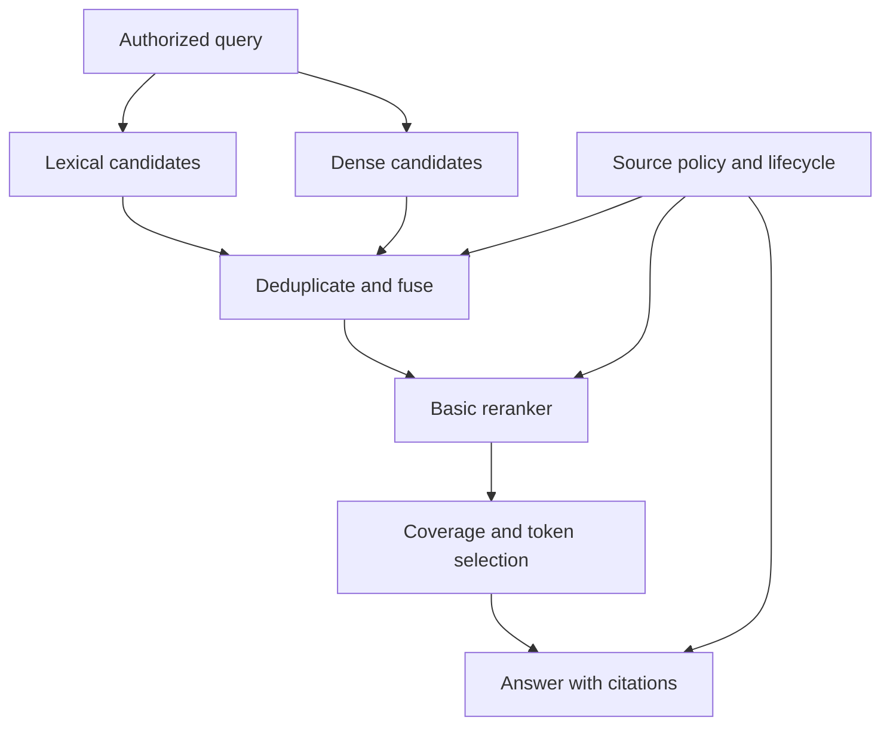

# Study Notes: M06.8.1 — Candidate Refinement

**Path:** Core · **Depth:** L2 foundation; L3 through demonstrated project work  
**Prerequisites:** M03, M05 and M07; retrieval fundamentals from M06.2.1  
**Purpose:** Build a practical retrieval baseline in which basic reranking improves the evidence selected for an answer.  
**Completion evidence:** Compare lexical, dense and hybrid candidates; measure the effect of reranking; verify authorization, citations and deletion through the full selection path.

## Table of Contents

1. [Candidate Refinement Fundamentals](#1-candidate-refinement-fundamentals)
2. [Candidate Generation Versus Reranking](#2-candidate-generation-versus-reranking)
3. [The Main Retrieval Pipeline](#3-the-main-retrieval-pipeline)
4. [Basic Reranking and Cross-Encoders](#4-basic-reranking-and-cross-encoders)
5. [Candidate Budgets and Recall Ceilings](#5-candidate-budgets-and-recall-ceilings)
6. [Deduplication, Diversity and Evidence Coverage](#6-deduplication-diversity-and-evidence-coverage)
7. [Comparing Lexical, Dense and Hybrid Baselines](#7-comparing-lexical-dense-and-hybrid-baselines)
8. [Worked Ranking Example](#8-worked-ranking-example)
9. [Implementation Contracts and Failure Handling](#9-implementation-contracts-and-failure-handling)
10. [Permission and Source-Lifecycle Checks](#10-permission-and-source-lifecycle-checks)
11. [Project Exercise and Acceptance Evidence](#11-project-exercise-and-acceptance-evidence)
12. [Overall Concept Map](#12-overall-concept-map)
13. [Glossary and Final Revision Sheet](#13-glossary-and-final-revision-sheet)
14. [Practice and Interview Questions](#14-practice-and-interview-questions)
15. [Sources and Further Reading](#15-sources-and-further-reading)

## 1. Candidate Refinement Fundamentals

### Definition

**Candidate refinement** turns a broad set of potentially useful search results into a smaller, better-supported selection of evidence. It includes detailed relevance scoring, removal of duplicate or ineligible material, and selection under the answer’s context budget.

The central requirement of this section is explicit: **basic reranking belongs in the main pipeline**. It is a practical component to learn and evaluate before treating advanced methods such as HyDE, Self-RAG or graph retrieval as necessary.

### Why the first results may not be the best evidence

A first-stage retriever needs to search many records efficiently. Its score can be useful without capturing every condition in the question.

For example, “What inspection applies to Unit A after storage?” can retrieve:

- A general Unit A overview.
- A Unit B inspection procedure.
- The current Unit A interval.
- An old revision with similar wording.
- The return-to-service prerequisite.

Several results share the topic, but only the correct current sources together answer the full question. Refinement should distinguish direct evidence from topical similarity.

### Refinement is not evidence invention

A reranker reorders or scores candidates. It does not create a missing source, repair a corrupted scan, or grant access to a restricted manual. If no authorized evidence supports the answer, the system must preserve that uncertainty.

The original BERT passage-reranking paper is a primary research example of applying a language model to query-based passage ranking. It motivates detailed scoring of retrieved candidates, while its reported benchmark results remain specific to its datasets and evaluation setup. [Source: Nogueira and Cho, Passage Re-ranking with BERT](https://arxiv.org/abs/1901.04085)

### Key takeaway

**Retrieve broadly enough to include the evidence, then select carefully enough to use it.** Both stages need separate evaluation.

## 2. Candidate Generation Versus Reranking

### Candidate generation

Candidate generation searches the corpus and returns a manageable pool. It can use BM25, dense vector search, learned sparse retrieval, structured lookup, or a combination.

Its immediate goal is sufficient coverage of potentially relevant eligible evidence within a reasonable cost and latency budget. It does not need to place every relevant passage in perfect order if a later stage can improve the ranking.

### Reranking

Reranking takes the query and a bounded candidate set, then computes a new ordering using a more detailed scoring method. A common choice is a cross-encoder that jointly processes the query and each passage.

Sentence Transformers describes a retrieve-and-rerank architecture in which a first-stage lexical or dense retriever supplies candidates and a cross-encoder scores them in a second stage. The essential pattern is broad search followed by detailed evaluation of a smaller set. [Source: Sentence Transformers retrieve and rerank](https://www.sbert.net/examples/sentence_transformer/applications/retrieve_rerank/README.html)

### Comparison

| Aspect | Candidate generation | Reranking |
|---|---|---|
| Input scope | Entire eligible corpus or a large search space | Bounded candidate set |
| Main concern | Find necessary evidence efficiently | Improve order and relevance precision |
| Common methods | BM25, dense search, hybrid search | Cross-encoder or another detailed ranker |
| Failure | Required source never enters the pool | Relevant source is scored too low |
| Useful metric | Recall at candidate budget | nDCG, MRR and evidence quality at selection budget |
| Hard limit | Index and source coverage | Cannot recover a missing candidate |

### Reranking versus fusion

Fusion combines result lists from different retrieval branches. Reranking applies a new relevance assessment to the combined candidates.

RRF, for example, uses ranks from existing lists. A cross-encoder reads the query-passage pair and produces another score. Both may appear in one pipeline, but they do different work.

### Reranking versus generation

A generator writes the answer. A reranker selects evidence. Asking the generator to “choose the best passages” inside an enormous context is an alternative architecture, but it should not be assumed to replace an evaluated candidate-refinement stage.

Separation makes debugging easier: the trace can show whether the right evidence was retrieved, whether it survived reranking, and whether the final answer used it.

## 3. The Main Retrieval Pipeline

### A practical baseline

The following is a conceptual sequence, not a requirement to use one framework:

1. Authenticate the request and resolve its mandatory access scope.
2. Validate the query and any optional metadata constraints.
3. Retrieve lexical, dense or hybrid candidates within the allowed scope.
4. Resolve stable identities and current source state.
5. Deduplicate candidates and apply a bounded fusion strategy if needed.
6. Rerank authorized candidate text.
7. Select complementary evidence within the context budget.
8. Assemble source labels and provenance.
9. Generate the answer from the evidence.
10. Validate support and citations, then recheck source access before emission.

The exact placement of internal filtering depends on the engine. The invariant is that unauthorized source content must not reach external rerankers, generators, user-visible snippets or citations.

### Candidate count versus evidence count

Keep separate settings for branch retrieval, reranker input and final evidence. An illustrative configuration might retrieve 50 results from each hybrid branch, rerank at most 80 unique authorized candidates, and select evidence that fits a 3,000-token budget.

These numbers are not defaults. The right values depend on source lengths, query difficulty and measured service requirements.

### A candidate is more than text

A useful candidate record includes stable chunk identity, document identity, source revision, source location, policy reference, retrieval branch/rank and the text representation used for scoring.

If only raw strings are passed between stages, identical sentences from different sources become difficult to distinguish. Citations and deletion handling then become unreliable.

### Key takeaway

**Make each transition inspectable.** A practical baseline should reveal where evidence was added, removed, reordered or expanded.

## 4. Basic Reranking and Cross-Encoders

### Bi-encoder versus cross-encoder

A bi-encoder computes query and document representations independently, allowing document vectors to be prepared in advance. A cross-encoder jointly processes the pair, allowing interactions between the query and passage during scoring.

Sentence Transformers documents this architectural distinction and the tradeoff between reusable embeddings and pair-specific scoring. Cross-encoder scores are useful for reranking a bounded set, while independent embeddings support efficient corpus-wide comparison. [Source: Sentence Transformers cross-encoders](https://www.sbert.net/examples/cross_encoder/applications/README.html)

### What a reranker may distinguish

A suitable model may assign different scores to a passage that merely mentions Unit A and a passage that answers the requested Unit A inspection question. It may also use nearby words to distinguish a prerequisite from an unrelated procedure.

These are possibilities to evaluate, not guarantees. A reranker can still miss negation, numbers, specialized codes, language distinctions or document authority.

### Score interpretation

A reranker score can be a logit, similarity-like value, transformed value or other model-specific output. Do not assume all models return a probability between zero and one.

Even a bounded score is not automatically calibrated as “probability this evidence is correct.” Thresholds require task-specific validation.

### Input length

The reranker usually receives both the query and candidate passage, plus required formatting. Their combined length must fit the model’s supported input.

Silent truncation can remove the very exception the question asks about. If long candidates are common, evaluate a suitable model, controlled passage windows, or hierarchical selection. Record which text was actually scored.

### Pointwise, pairwise and listwise awareness

A pointwise ranker scores each candidate against the query. A pairwise approach compares candidates. A listwise approach considers a group or ordering. These choices affect inference cost, order sensitivity and output validation.

For this foundation section, a well-understood pointwise cross-encoder is a reasonable experimental baseline. More complex ranking schemes should demonstrate additional value over it.

### Key takeaway

**Use the reranker’s documented input and score contract, then evaluate it on your corpus.** A more detailed model can still make a wrong relevance judgment.

## 5. Candidate Budgets and Recall Ceilings

### The recall ceiling

Let \(R\) be the set of required relevant evidence items, \(C\) the retrieved candidate set, and \(S\) the selected reranked subset. If reranking only selects candidates, then \(S \subseteq C\).

Therefore:

\[
\frac{|S \cap R|}{|R|} \le \frac{|C \cap R|}{|R|}.
\]

In words, selected-evidence recall cannot exceed candidate recall under the same evidence definition.

This statement does not apply unchanged when a later stage performs additional retrieval or expands to new source spans. In that case, record the additional evidence operation rather than crediting it to reranking alone.

### Example

If a question requires an interval and a prerequisite, but the candidate pool contains only the interval, no reordering can supply the prerequisite. The system needs another authorized retrieval, a known source expansion, or an answer that states the limitation.

### Increasing candidate count

A larger pool can improve coverage, but it adds scoring work and distractors. The useful question is whether the additional candidates supply previously missing evidence often enough to justify the cost.

Measure a curve across candidate budgets rather than testing one arbitrary value. Record how candidate recall, selected-evidence quality and latency change.

### Query-dependent budgets

An exact identifier query may need few candidates. A multi-part comparison may need broader coverage. A router can choose different budgets, but that adds another policy to test.

Do not allow untrusted query text to request unlimited candidate counts. Resource controls should be enforced by the application.

### Candidate count and latency

Reranking cost depends on both the number and length of query-passage pairs, batching, model size and serving environment. Two configurations with the same candidate count can have very different latency because their passage lengths differ.

Report p50 and tail latency such as p95 when useful, along with the workload and concurrency. A single timing on a warm local example is not production evidence.

## 6. Deduplication, Diversity and Evidence Coverage

### Deduplication

Remove exact duplicate candidates before spending expensive reranker work when identity and policy allow it. Distinguish duplicated records from legitimately separate sources containing similar text.

Overlapping chunks can include the same statement repeatedly. Their repetition should not create the impression of independent corroboration.

### Source-span deduplication

Stable document and source-span identities help detect repeated evidence. Text similarity alone can accidentally merge distinct policy clauses or revisions that differ in one important number.

For example, “30 days” and “45 days” may appear in otherwise identical paragraphs. Near-duplicate handling must preserve that distinction and let version policy select the correct source.

### Diversity

A top-ranked list can contain many passages about one part of a multi-part question while omitting another required part. Diversity aims to avoid redundant selections and improve useful coverage.

Diversity does not mean choosing unrelated topics for variety. The selected evidence should remain relevant to the actual information need.

### Coverage-aware selection

Suppose a question asks for the interval, prerequisite and recording requirement. A helpful final context contains support for all three, even if the third-best interval paragraph has a higher individual score than the only recording paragraph.

A practical selector can use source structure, validated subquestions or explicit evidence requirements. Its decisions should be inspectable and evaluated; a model-generated decomposition can itself be wrong.

### Reranking and context expansion

If a short child passage ranks highly, the system may expand to its parent section. Recheck whether the larger text fits the budget and remains authorized. Do not assume the child’s relevance score applies uniformly to every sentence in the parent.

The answer should cite the original spans supporting each claim, not a generated summary treated as if it were source text.

## 7. Comparing Lexical, Dense and Hybrid Baselines

### Required comparison

Build a baseline matrix that separates candidate generation from reranking:

| Configuration | Candidate generator | Reranker |
|---|---|---|
| L | Lexical, such as BM25 | None |
| D | Dense | None |
| H | Hybrid with defined fusion | None |
| L+R | Same lexical configuration | Fixed basic reranker |
| D+R | Same dense configuration | Same reranker |
| H+R | Same hybrid configuration | Same reranker |

This lets you ask two questions: which generator supplies useful candidates, and what does reranking add to each?

### Hold important variables constant

Use the same source snapshot, relevance labels, authorization scenarios, chunking configuration and answer-generation setup. Record all exceptions.

For the reranker comparison, use the same candidate pool before and after reranking. Otherwise, a gain could come from retrieving more candidates rather than from better ranking.

### Budget fairness

Hybrid retrieval performs work in more than one branch. Report that work. You can compare at a fixed final candidate budget, at a fixed latency budget, or both.

For example, 100 lexical candidates, 100 dense candidates, and a hybrid union from 50 of each all have an upper bound of 100 items for reranking, but they do not necessarily incur equal retrieval cost or produce equal unique counts.

### Evaluation datasets

Include exact identifiers, paraphrases, similar but wrong equipment variants, contradictory conditions, current versus superseded sources, multilingual questions where applicable, and unanswerable requests.

BEIR’s heterogeneous retrieval benchmark is a useful reminder that retrieval systems behave differently across tasks and domains. Its results support broad evaluation rather than choosing a system from one narrow benchmark. [Source: Thakur et al., BEIR](https://arxiv.org/abs/2104.08663)

### Avoid tuning on the final test set

Use development queries to choose candidate budgets and reranker settings. Reserve a held-out set for the final comparison. If you repeatedly inspect and tune against the held-out results, it has become development data.

Split related query variants and source families carefully so nearly identical examples do not appear on both sides of the comparison.

### Report the failure slices

An overall improvement is insufficient if exact identifiers deteriorate or a permission boundary fails. Security and source-lifecycle correctness are release requirements, not average-quality metrics that can be traded away.

## 8. Worked Ranking Example

### Fictional question and evidence

The following example is invented. It is not an operational instruction.

Question: “For Unit A in manual M-104 v4, what inspection interval applies, and what must happen after storage?”

Required evidence:

- C1: the interval paragraph.
- C2: the return-to-service prerequisite.

All five candidates below are authorized and current. Superseded and unauthorized records have already been excluded.

| Candidate | Description | First-stage rank | Illustrative reranker score |
|---|---|---:|---:|
| C3 | Unit B inspection information | 1 | 0.18 |
| C4 | General equipment overview | 2 | 0.24 |
| C1 | Unit A interval | 3 | 0.94 |
| C5 | Supplier catalog description | 4 | 0.08 |
| C2 | Unit A storage prerequisite | 5 | 0.89 |

These scores are synthetic ordering values, not probabilities or measured model outputs.

### Before reranking

The candidate pool contains both required items, so candidate Recall@5 is 1.0. However, selecting only the first two results supplies neither required item:

- Precision@2 = 0.
- Recall@2 = 0.
- Reciprocal rank of the first relevant result = \(1/3\).

### After reranking

The order becomes C1, C2, C4, C3, C5. Selecting two results now covers both required items:

- Precision@2 = 1.
- Recall@2 = 1.
- Reciprocal rank = 1.

The candidate set did not change. Reranking improved which evidence fit into the small final selection.

### Why MRR alone is insufficient

If C1 ranked first but C2 remained omitted, reciprocal rank would still be 1. The question would remain incompletely supported.

For multi-part questions, combine first-hit metrics with required-evidence coverage and answer completeness. A single relevant passage is not always enough.

### Runnable metric check

This standard-library example calculates the binary metrics used above.

```python
def metrics(ranked_ids, relevant_ids, k):
    if k <= 0:
        raise ValueError("k must be positive")
    relevant = set(relevant_ids)
    if not relevant:
        raise ValueError("use a separate policy for unanswerable queries")
    unique = list(dict.fromkeys(ranked_ids))
    selected = unique[:k]
    hits = sum(item in relevant for item in selected)
    reciprocal_rank = next(
        (1 / rank for rank, item in enumerate(unique, 1) if item in relevant),
        0.0,
    )
    return {
        "precision_at_k": hits / k,
        "recall_at_k": hits / len(relevant),
        "reciprocal_rank": reciprocal_rank,
    }


before = ["C3", "C4", "C1", "C5", "C2"]
after = ["C1", "C2", "C4", "C3", "C5"]
relevant = {"C1", "C2"}
print(metrics(before, relevant, 2))
print(metrics(after, relevant, 2))
```

Precision uses the fixed requested cutoff k as its denominator here. The reciprocal rank is untruncated over the supplied list. State these conventions when comparing with a library that reports a different cutoff or missing-result policy.

## 9. Implementation Contracts and Failure Handling

### Reranker request

A conceptual request contains the original or validated rewritten query, a list of candidate IDs and exact scoring text, plus a pinned reranker configuration.

Keep the query that produced candidates and the query used for reranking in the trace. If they differ, the difference should be deliberate and testable.

### Reranker response

Require a score or ordering that maps unambiguously to submitted candidate IDs. Validate:

- No unknown candidate IDs appear.
- No required candidate is silently lost without a documented failure.
- Scores have the expected type and finite values.
- Duplicates are handled deterministically.
- The response belongs to the correct request and configuration.

A listwise model that invents a document ID has produced an invalid ranking output. Do not fetch arbitrary content based on that ID.

### Timeouts and fallback

Define what happens if reranking fails. Possible policies include returning the authorized first-stage order with a recorded degraded mode, attempting a bounded retry, or declining to answer when quality requirements cannot be met.

The fallback must preserve authorization and source-state checks. A timeout is not a reason to bypass them.

### Determinism and ties

Some rankers produce tied scores or small numerical differences. Define a stable secondary ordering, such as source identity, for reproducibility. Do not overinterpret tiny score differences as meaningful improvements.

If the ranker is stochastic, measure variation and record its configuration. Compare systems over a sufficient query set rather than choosing the best-looking single run.

### Observability

Log stage timings, candidate IDs, source versions, filter decisions, score changes, selected source spans and configuration identifiers under appropriate access controls.

Avoid placing unrestricted source text in general-purpose logs. Debuggability and privacy should be designed together.

## 10. Permission and Source-Lifecycle Checks

### Authorization before reranking

A reranker can expose content to a model service. Therefore, candidate text must already be authorized for the user and approved for that processing environment before it is submitted.

Application-side access checks are necessary even if the prompt says “ignore unauthorized documents.” The model cannot retroactively undo exposure.

### Current versions

If the user asks for the current manual, eligibility should follow the source’s approved effective revision, not whichever passage receives the highest reranker score.

A superseded paragraph can look highly relevant because it uses the exact query wording. Version policy should remove or separately label it before ordinary current-source ranking.

### Permission changes during a request

A user can lose access while retrieval or generation is in progress. Recheck source authorization before final emission according to the application’s consistency model. For strict requirements, buffer the response until those checks pass rather than streaming unsupported source content early.

### Deletion and caches

Track dependencies from sources to candidate caches, reranker caches, assembled contexts and answer caches. A deleted source must not return through an older cached ranking.

A cache key should include the authorized scope and relevant source/index generation, or the cache lookup must revalidate dependencies. The precise design can vary, but “cache hit means skip access checks” is not acceptable.

### Citations

The citation should resolve to the actual current, authorized source span that supports the claim. A high reranker score is not evidence of citation correctness.

Test direct citation access as well as ordinary queries. A removed manual should not remain exposed through a previously issued source link.

## 11. Project Exercise and Acceptance Evidence

### Build the six baseline configurations

Implement L, D, H, L+R, D+R and H+R from Section 7 over a small authorized corpus. Use a fixed basic reranker and a recorded source snapshot.

Include at least one example where lexical retrieval is expected to help, one paraphrase case, one multi-part question, one wrong-version distractor, one restricted document and one deleted source.

### Measure each stage

Record candidate recall before reranking, selected-evidence metrics afterward, answer support, citation correctness, evidence tokens, latency and failure rate.

Inspect queries where reranking makes the result worse. A model can prefer polished background prose over a short table row that contains the actual answer. Those failures help identify whether you need better scoring text, a different model or a structured route.

### Minimum completion evidence

| Deliverable | What it demonstrates |
|---|---|
| Frozen corpus and relevance labels | Reproducible comparison |
| Six-configuration matrix | Separation of retrieval and reranking effects |
| Before/after candidate trace | Why selected evidence changed |
| Multi-part evidence example | Coverage beyond the first relevant hit |
| Unauthorized-query test | No forbidden text reaches downstream stages |
| Revision and deletion tests | Current-source lifecycle correctness |
| Latency and budget report | Operational cost of quality improvement |
| Decision note | Measured reason for the selected baseline |

For L3 depth, include a bounded failure fallback and demonstrate its behavior during a reranker timeout. Verify that the fallback remains permission-aware and does not serve deleted cached evidence.

### What to adopt next

Only after this baseline is measured should you consider additional retrieval methods. A failure analysis should identify the missing capability: candidate recall, evidence aggregation, source relationships, structured data or something else.

“More advanced” is not a measurable benefit. The next method should improve a specific failing slice while preserving the working baseline’s correctness.

## 12. Overall Concept Map



The reranker improves candidate order, while evidence selection handles complementary support and context limits. Source policy governs all of these stages.

## 13. Glossary and Final Revision Sheet

| Term | Meaning |
|---|---|
| Candidate | Potential evidence returned by first-stage retrieval |
| Candidate generation | Search that supplies a manageable pool |
| Reranking | Detailed rescoring or reordering of that pool |
| Cross-encoder | Model jointly scoring a query and passage |
| Fusion | Combination of result lists or retrieval signals |
| Candidate budget | Limit on items considered by a stage |
| Recall ceiling | Coverage limit imposed by the available candidates |
| Deduplication | Removal of redundant records or source spans |
| Diversity | Avoidance of unnecessary repetition in selected evidence |
| Coverage | Support for the required parts of an information need |
| Degraded mode | Defined fallback when a component fails |
| Ranking trace | Record of candidates, scores and selection changes |
| Source dependency | Link connecting an output or cache entry to its source |

### Revision sheet

- Basic reranking is part of the main practical pipeline.
- Candidate generation and reranking solve different problems.
- RRF is fusion; it is not cross-encoder scoring.
- A reranker cannot select evidence missing from its input.
- A high relevance score does not establish truth or permission.
- Evaluate both first-hit quality and complete evidence coverage.
- Compare lexical, dense and hybrid baselines fairly.
- Track exact scoring text and candidate identities.
- Revalidate versions, ACLs and deletion across caches and final output.
- Adopt advanced methods only for measured remaining failures.

## 14. Practice and Interview Questions

### Question-and-answer recall

**1. What is candidate refinement?**  
The process of turning broad search results into a smaller evidence selection through eligibility checks, deduplication, detailed ranking and context-aware selection.

**2. How does reranking differ from candidate generation?**  
Generation searches the corpus for possible evidence. Reranking scores a bounded set more carefully and changes its order or selection.

**3. Why is basic reranking in the main pipeline?**  
It is a practical way to improve the evidence that fits the final context. It should be evaluated as a baseline component before more complex RAG methods are adopted.

**4. What is a cross-encoder?**  
A model that processes the query and passage together to produce a pair-specific score, rather than relying only on independently prepared vectors.

**5. What does candidate recall limit?**  
When selection uses only the retrieved pool, it limits the maximum relevant evidence the reranker can select. Missing evidence requires additional retrieval or expansion.

**6. Why can MRR be insufficient for a multi-part question?**  
MRR measures the position of the first relevant result. It can be perfect while other required evidence is missing.

**7. Why deduplicate before reranking?**  
It avoids repeatedly scoring the same evidence and reduces the chance that duplicates consume the final context. Distinct revisions and policies must still be preserved.

**8. How should a reranker timeout be handled?**  
Use a defined bounded retry or degraded behavior that preserves authorization and source-state checks. Record the failure and avoid pretending the reranker succeeded.

**9. Why must authorization occur before the reranker receives text?**  
Submitting the passage to a model service is already a disclosure or processing action. A later refusal cannot undo that exposure.

**10. What should a before/after trace show?**  
Candidate identities, source versions, initial ranks, reranker scores or order, removed items, selected source spans and the configuration used.

### Multiple-choice questions

#### Easy

**11. Which operation is reranking?**

A. Accepting a file upload.  
B. Reordering retrieved passages using query-passage relevance scores.  
C. Creating a new source manual.  
D. Granting a user access to a tenant.

**Answer: B.** Reranking operates on existing candidates and changes their relevance ordering.

**12. Which component can find a source absent from the current candidate set?**

A. Reordering the same set.  
B. Sorting by the same scores again.  
C. Additional authorized retrieval.  
D. Removing citation metadata.

**Answer: C.** A pure reranker cannot invent or select a candidate it was never given.

#### Medium

**13. Hybrid retrieval plus RRF is followed by a cross-encoder. Which statement is correct?**

A. Both stages perform identical work.  
B. RRF combines existing ranks; the cross-encoder applies new pair-specific scoring.  
C. RRF grants permissions.  
D. The cross-encoder repairs missing OCR automatically.

**Answer: B.** Fusion and reranking are complementary operations with different inputs and purposes.

**14. A question needs two facts. The first relevant passage ranks first, but the second fact is missing. What can still be perfect?**

A. Complete evidence coverage.  
B. Citation completeness by definition.  
C. Reciprocal rank.  
D. Recall over all required evidence.

**Answer: C.** Reciprocal rank depends only on the first relevant result, so it does not capture missing additional support.

#### Hard — scenario based

**15. A reranker assigns a high score to a superseded manual for a current-procedure query. What should control its eligibility?**

A. The model score alone.  
B. Source approval and version policy.  
C. The paragraph’s length.  
D. The number of query words repeated.

**Answer: B.** Relevance scoring cannot override the source’s lifecycle and authority requirements.

**16. A reranker cache contains a previously authorized passage after access is revoked. What should happen?**

A. Return it because the cache is faster.  
B. Revalidate dependencies and prevent unauthorized serving.  
C. Remove its title but send the body.  
D. Ask the generator to conceal the leak.

**Answer: B.** Cache reuse must respect current authorization and source state.

**17. H+R improves average quality but doubles latency and fails exact-code queries. What is the correct decision process?**

A. Adopt because hybrid is more advanced.  
B. Ignore the exact-code slice.  
C. Assess the quality, latency and slice-specific requirements before adoption.  
D. Remove the lexical baseline from the report.

**Answer: C.** Averages alone cannot justify a change that violates material task or service requirements.

### Interview questions with model answers

#### Easy

**18. Explain retrieve-and-rerank to a new developer.**

**Model answer:** The first search stage finds a manageable pool from the large corpus. The reranker then examines each query-passage relationship more carefully so the best evidence appears near the top. The final selector assembles enough complementary support to answer within the context budget. All stages retain source identity, current version and user permissions.

**19. Why not run a cross-encoder on every document?**

**Model answer:** Pair-specific scoring requires work for each query-document pair and is usually too expensive for a large corpus at interactive latency. A first-stage retriever narrows the search to likely candidates. For a very small collection, direct scoring may be reasonable, but it should be measured rather than assumed to scale.

#### Medium

**20. How would you prove that reranking helped?**

**Model answer:** I would freeze the candidate pool and compare its original order with the reranked order on the same relevance judgments. I would measure ranking and evidence coverage at the actual selection budget, then evaluate answer support and citations with the downstream system held fixed. I would also report latency and inspect regressions so gains are not confused with increased retrieval work.

**21. How would you select evidence for a multi-part question?**

**Model answer:** I would identify the required parts using a validated interpretation of the query, then ensure the selected passages support each part without unnecessary duplication. Individual relevance scores would inform selection but would not replace coverage checks. I would preserve source spans and add authorized parent context only when needed for interpretation.

#### Hard — scenario based

**22. The candidate pool has high recall but final answers are incomplete. Where would you investigate?**

**Model answer:** I would inspect whether the relevant candidates survive reranking and context selection, whether truncation removes critical text, and whether duplicate passages crowd out complementary evidence. If the assembled context is complete, I would inspect generation and citation validation. Separating these stages avoids changing the retriever when the failure lies later.

**23. A deleted source appears only when the reranker service times out. What does that suggest?**

**Model answer:** The degraded path probably bypasses a source-state check or uses a stale candidate or answer cache. I would compare normal and fallback execution, block the deleted source at the shared serving boundary, and invalidate dependent caches. The regression test must force the timeout so the fallback receives the same authorization and lifecycle scrutiny as the main path.

## 15. Sources and Further Reading

The ranking table, metric values, code and project design are original instructional examples. They do not report measured performance of a particular model or service.

- [Sentence Transformers: retrieve and rerank](https://www.sbert.net/examples/sentence_transformer/applications/retrieve_rerank/README.html).
- [Sentence Transformers: cross-encoders](https://www.sbert.net/examples/cross_encoder/applications/README.html).
- [Nogueira and Cho: Passage Re-ranking with BERT](https://arxiv.org/abs/1901.04085).
- [Thakur et al.: BEIR](https://arxiv.org/abs/2104.08663).

**Related foundation:** [M06.2.1 — Retrieval and Information Retrieval Fundamentals](M06.2.1_Retrieval_and_Information_Retrieval_Fundamentals.md).

