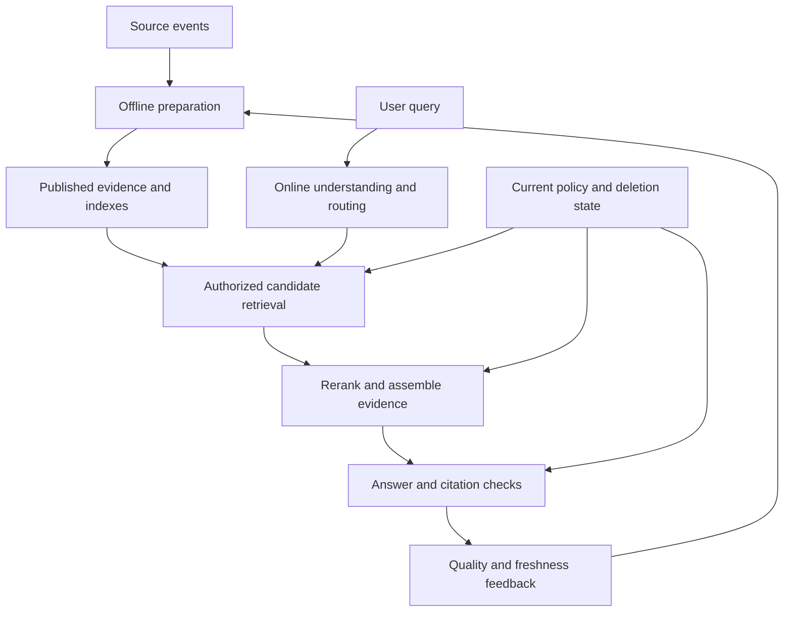

# Study Notes: M06.8.2 — Offline versus Online Pipelines

**Path:** Core · **Depth:** L2 foundation; L3 through demonstrated project work  
**Purpose:** Knowledge application · **Prerequisites:** M03, M05, M07  
**Completion evidence:** Explain and implement the separation between knowledge preparation and request-time answering, compare retrieval baselines, cite current evidence, and verify permissions and source deletion across both paths.

The manual IDs, text, users, timestamps, and data values in the examples are **fictional training fixtures**. They illustrate pipeline design and are not real maintenance instructions.

## Table of Contents

1. [The Fundamental Distinction](#1-the-fundamental-distinction)
2. [Offline Stage 1 — Ingest](#2-offline-stage-1--ingest)
3. [Offline Stage 2 — Extract](#3-offline-stage-2--extract)
4. [Offline Stage 3 — Chunk](#4-offline-stage-3--chunk)
5. [Offline Stage 4 — Embed](#5-offline-stage-4--embed)
6. [Offline Stage 5 — Index and Publish](#6-offline-stage-5--index-and-publish)
7. [Online Stage 1 — Understand the Query](#7-online-stage-1--understand-the-query)
8. [Online Stage 2 — Retrieve and Filter](#8-online-stage-2--retrieve-and-filter)
9. [Online Stage 3 — Rerank](#9-online-stage-3--rerank)
10. [Online Stage 4 — Assemble Evidence and Answer](#10-online-stage-4--assemble-evidence-and-answer)
11. [Contracts between the Two Pipelines](#11-contracts-between-the-two-pipelines)
12. [Worked Example: M-104 Revision v4](#12-worked-example-m-104-revision-v4)
13. [A Small Executable Evidence-Selection Fixture](#13-a-small-executable-evidence-selection-fixture)
14. [Overall Concept Map](#14-overall-concept-map)
15. [Glossary and Final Revision Sheet](#15-glossary-and-final-revision-sheet)
16. [Practice and Interview Questions](#16-practice-and-interview-questions)
17. [L3 Exercise and Acceptance Evidence](#17-l3-exercise-and-acceptance-evidence)
18. [Primary Sources and Further Reading](#18-primary-sources-and-further-reading)

## 1. The Fundamental Distinction

### Definition

The **offline pipeline** prepares knowledge for future questions. The **online pipeline** handles a particular user request using prepared knowledge and, where appropriate, approved live sources.

Here, “offline” means outside the latency-critical answering path. It does not mean the computer is disconnected from the internet. An offline worker can use network APIs, run continuously, and process events immediately after a document changes.

### The two paths

| Aspect | Offline preparation | Online answering |
|---|---|---|
| Trigger | Upload, source change, schedule, migration | User or application query |
| Main work | Ingest, extract, chunk, embed, index | Understand, retrieve, filter, rerank, assemble, answer |
| Typical optimization | Throughput, completeness, recoverability | Response quality, latency, access correctness |
| Inputs | Source bytes, metadata, ACLs, processing configuration | Query, trusted identity, conversation, published indexes |
| Outputs | Searchable artifacts and publication manifest | Supported answer, citations, trace |
| Failure handling | Retry, quarantine, resume, reconcile | Deadline, permitted fallback, clarification, abstention |

The original [RAG paper](https://arxiv.org/abs/2005.11401) connects a retriever with generation over external knowledge. The operational separation described here is a practical application design around that relationship, not a claim that every RAG implementation uses identical services.

### Why separation matters

Processing an entire manual on every question repeats expensive work and makes latency unpredictable. Preparing documents once allows many queries to reuse stable representations.

However, the online path still performs some representation work. A dense-search query often needs a fresh query embedding. Query rewriting, reranking, and answer generation also happen per request unless a valid cache can be used.

### Different meanings of offline and online

The terms also appear in evaluation: **offline evaluation** uses a fixed dataset, while **online evaluation** observes live behavior or controlled traffic experiments. That is a different distinction from indexing versus serving. An offline evaluation job can execute the entire online answering pipeline without real users.

### Key takeaway

**Prepare reusable document representations outside the request path; make request-specific evidence and access decisions when answering.**

## 2. Offline Stage 1 — Ingest

### Purpose

Ingestion obtains an authorized copy of a source and records enough identity and metadata to track it through later transformations.

A file upload alone is not a searchable knowledge base. It creates an input to the preparation pipeline.

### Inputs and outputs

| Input | Required output |
|---|---|
| File or source record | Stable document identity |
| Source revision | Version identity and source timestamps |
| Connector identity | Provenance and permitted processing scope |
| Source ACL | Policy reference and version |
| Raw bytes | Stored source artifact and integrity hash |

A user-provided filename or MIME type is not sufficient to establish file type or safety. The [OWASP File Upload Cheat Sheet](https://cheatsheetseries.owasp.org/cheatsheets/File_Upload_Cheat_Sheet.html) describes layered validation of uploads. Ingestion additionally needs source authority, permissions, and lifecycle tracking.

### Common ingestion decisions

Decide which file types are supported, how large they may be, where raw bytes are stored, whether external links are followed, and what happens when validation fails.

A connector failure should produce a visible processing status. It must not silently create an empty successful document. Similarly, a partial source inventory must not be treated as proof that all unseen documents were deleted.

### Example

M-104 v4 is uploaded by an authorized maintainer in Tenant A. The pipeline assigns stable document ID `M-104`, records source revision `v4`, captures its access policy, and stores raw bytes under a non-public internal identifier.

At this moment, the user interface can truthfully say “Uploaded” or “Processing.” It should not yet claim the manual is available for current-source answers.

## 3. Offline Stage 2 — Extract

### Purpose

Extraction converts source formats into an interpretable representation: text blocks, headings, tables, image descriptions, page locations, and other structured elements.

Different formats require different handling. A digital PDF may contain text; a scanned PDF may require OCR; an office document may contain tables and headings; a webpage may include navigation unrelated to the main content.

### Preserve meaning and locations

The output should preserve reading order, headings, table labels, units, footnotes, and source locations. These details support both retrieval and citations.

A table value without its column heading is not complete evidence. A statement separated from its exception can become misleading even though all words were extracted somewhere.

### Extraction quality checks

Check for empty text, unusually low text volume, repeated headers, broken characters, suspicious reading order, missing table columns, and OCR uncertainty. Keep representative rendered-source comparisons in the development workflow.

Extraction is not generation. If a parser cannot read a value, it should mark uncertainty or failure rather than inventing a plausible value to fill the gap.

### Example

The invented v4 manual includes the row “Log review — 14 days.” Extraction should retain both the activity and the unit. A record containing only `14` cannot establish what the value describes.

Store the page or section locator with the extracted block so later chunks can cite the source accurately.

## 4. Offline Stage 3 — Chunk

### Purpose

Chunking divides extracted material into units suitable for retrieval and downstream context assembly.

Useful units depend on source structure and query needs. A short definition, a procedure with conditions, and a table row may require different handling.

### Chunk contract

Each chunk should retain text, source ID, revision, location, heading path, relevant business metadata, and permission lineage. If a parent-child strategy is used, record the parent relationship explicitly.

Chunk IDs should be stable enough to support updates and traceability, but do not assume an old ordinal identifies unchanged content after editing. Boundaries may shift.

### Overlap and expansion

Overlap can preserve nearby context but also increases duplication and storage. Parent expansion can add surrounding meaning after a precise child is retrieved, but the parent must satisfy the same access and lifecycle requirements.

The online pipeline should know whether an evidence record is a direct chunk, an expanded parent, or a generated summary. Each has different validation needs.

### Example

For M-104, a chunk includes the “Log review” heading, the fictional interval, and the applicability sentence. A separate restricted appendix remains in a narrower permission scope.

Combining the ordinary section with that appendix in one broadly accessible chunk would be a preparation defect that online ranking cannot safely repair by hoping the model ignores the restricted part.

## 5. Offline Stage 4 — Embed

### Purpose

Embedding maps the chunk's chosen representation into a vector for dense similarity search. The embedding represents relationships learned by a model; it is not a database record of verified facts.

### Compatibility

Record the model identifier, revision where available, dimensions, preprocessing, and any required query/document prefixes or modes. Query vectors and document vectors must belong to compatible representations.

Equal dimensions alone do not establish compatibility. Two different models can produce vectors of the same length with unrelated coordinate meanings.

### Batching and reuse

Batch compatible inputs to improve throughput where supported, while retaining an exact input-to-output mapping. Reuse an embedding only when the embedded text and relevant configuration are unchanged.

The Faiss project's [performance guidance](https://github.com/facebookresearch/faiss/wiki/How-to-make-Faiss-run-faster) discusses batching for its search workloads. The broader principle is to measure batching at the actual embedding and index layers instead of assuming identical performance behavior across products.

### What embedding does not solve

Embedding does not grant permissions, verify source authority, fix OCR errors, or establish current revision state. Those properties must remain explicit metadata and enforced decisions.

An ACL-only update may not require new vectors, but it still requires permission and cache updates. A parser fix that changes the embedded text does require regenerating affected representations.

## 6. Offline Stage 5 — Index and Publish

### Purpose

Indexing stores the representations needed for candidate search. A practical system may maintain lexical and vector indexes together with metadata and source-location storage.

For the baseline, support lexical, dense, and hybrid experiments under the same document and permission universe. The choice of search representation should not change who is allowed to access a source.

### Staging versus publication

Build a new revision in a staged state. Validate required artifacts, metadata, and search visibility. Publish only when the serving contract is satisfied.

A worker's successful write response is not always proof of query visibility. Elastic documents the distinction between indexing and search refresh in its [near real-time search explanation](https://www.elastic.co/docs/manage-data/data-store/near-real-time-search).

### Cross-store consistency

If dense and lexical indexes update at different times, a hybrid query can combine incompatible revisions. Use a publication manifest or equivalent mechanism that tells every branch which generation is eligible.

An atomic alias switch within one search engine does not automatically coordinate a separate vector database. Define the consistency boundary explicitly.

### Offline output

The finished preparation output is more than vectors. It includes a published source manifest, chunk identities, citation locations, permission references, transformation versions, and enough lineage to update or delete every derivative.

## 7. Online Stage 1 — Understand the Query

### Purpose

Query understanding interprets the user's information need within trusted identity and conversation context.

Resolve the task, entities, exact identifiers, time requirement, source preference, and whether the request can be answered from documents or needs a live structured source.

### Preserve the original request

Store the original query alongside any normalization, rewrite, translation, or decomposition. A rewrite must not discard negation, equipment identifiers, version requests, or conditions.

For example, “What changed from v3 to v4?” is different from “What does the current manual say?” The first requires a permitted comparison of two revisions; the second normally selects the current published revision.

### Routing

A router can select dense search, lexical search, hybrid search, SQL, graph retrieval, metadata lookup, or an approved tool. Routing is a request-specific decision, so it belongs in the online path unless precomputed rules are simply being loaded.

Use deterministic routes for exact structured lookups where appropriate. A question asking for a current record count should not force a language model to estimate from a few retrieved passages.

### Security scope

Authenticate before resolving protected resources. Derive tenant and group scope from trusted server state, not a client field or the model's interpretation.

The model may suggest a route. The server decides whether that route and its arguments are allowed.

## 8. Online Stage 2 — Retrieve and Filter

### Candidate retrieval

Retrieve a bounded set of plausible passages from the eligible collection. Compare lexical, dense, and hybrid candidate generation as distinct baselines.

For hybrid retrieval, merge candidates using a defined fusion method and retain branch provenance. Do not assume raw lexical and vector scores have directly comparable scales.

### Why “retrieve, then filter” needs qualification

The syllabus lists retrieval and filtering as online activities. This does not mean protected content should first be sent to a reranker or model and filtered afterward.

Apply trusted tenant, authorization, lifecycle, and necessary business constraints within the retrieval boundary. Candidate validation afterward can provide another layer, but it must occur before sensitive text crosses an unauthorized processing boundary.

The [OWASP Authorization Decisions and Output Handling guidance](https://cheatsheetseries.owasp.org/cheatsheets/Authorization_Decisions_And_Output_Handling_Cheat_Sheet.html) emphasizes complete decision handling across output paths. In this pipeline, filtering is an enforcement responsibility, not a stylistic instruction to the generator.

### Recall under filtering

A global top-10 followed by a filter can leave only one permitted item even when many relevant permitted items exist outside the global top-10. That result does not prove the allowed collection lacks evidence.

Test the chosen engine's filtered-search behavior and compare quality under realistic tenant sizes and filter selectivity.

### Candidate record

A useful candidate includes source/chunk ID, revision, score or rank, retrieval branch, location, and relevant policy/lifecycle references. Fetch full text only through the authorized path.

For a small study implementation, these records can be ordinary dictionaries. In production, they should follow a validated schema so required lineage cannot disappear between components.

## 9. Online Stage 3 — Rerank

### Purpose

Reranking performs a more detailed relevance comparison over the candidate set before the system spends its limited context budget.

Candidate generation prioritizes efficient coverage. Reranking prioritizes ordering and selection among those candidates. These are different responsibilities.

### Basic reranking belongs in the baseline

Do not classify all reranking as an advanced elective. A basic reranker is part of the practical pipeline in this module. Evaluate its effect separately from candidate retrieval.

A cross-encoder may score the query and passage together; another implementation may use a different reranking model. The implementation choice should follow measured quality, latency, and processing-policy requirements.

### Limits

A reranker cannot recover a passage absent from its candidate pool. It also cannot establish current authorization from text similarity. Version and access eligibility must be enforced before reranking.

Inspect whether the model truncates long candidate passages. The decisive exception may occur beyond its input limit.

### Output

Retain the reranked order, scores if useful internally, model/configuration identity, and selected evidence IDs. This makes it possible to distinguish a candidate miss from a passage lost during refinement.

## 10. Online Stage 4 — Assemble Evidence and Answer

### Evidence assembly

Select passages that jointly cover the question, remove unnecessary duplicates, retain source locations, and respect the token budget. Include enough context to preserve conditions, entities, and units.

Context assembly is not “take the first K chunks and concatenate.” It must consider overlap, source authority, contradictory revisions, coverage of subquestions, and the space needed for instructions and the answer.

### Parent expansion and compression

Expanding a child to its parent can restore context, but the parent may contain restricted sections or exceed the budget. Reauthorize the expansion and preserve its lineage.

Compression can save tokens while losing meaning. If a summary removes “only for model X,” the answer may apply a rule too broadly. Evaluate compression against the original supporting passages.

### Answer generation

Give the model the task, allowed evidence, source IDs, required output format, and instructions to abstain when evidence is insufficient. Treat retrieved material as evidence rather than authority to change the application's behavior.

The answer should distinguish direct facts, supported synthesis, unresolved contradictions, and missing information. It should not fill gaps merely because a complete-sounding answer is more fluent.

### Citation validation

Validate that every citation ID exists in the allowed evidence package, refers to the correct version and location, and supports its associated claim. Citation presence alone is not citation correctness.

The application should construct or resolve citation URLs. A model-generated URL can be fabricated or point to the wrong source.

### Final access check

Before delivery, recheck current permission and deletion state for evidence dependencies. Define how in-flight revocation works, especially if output streams before all checks complete.

If a source becomes ineligible during generation, do not return an answer that still depends on it. Regenerate from permitted evidence or produce a controlled response consistent with the task.

## 11. Contracts between the Two Pipelines

### Data contract

The online pipeline expects complete, valid evidence records. The offline pipeline must provide stable identities, compatible embeddings, source locations, publication state, and permission lineage.

If either side changes a schema, version the contract and migrate deliberately. A renamed metadata field can silently remove a filter if missing values default to unrestricted search.

### Consistency contract

Specify what a query sees while an update is in progress. Options include a pinned published generation, an explicitly labeled older permitted revision, or temporary unavailability for sources that must be current.

Do not accidentally mix versions because one index updated first. A request should record which source generation it used.

### Deletion contract

Deletion must update authoritative eligibility before slow cleanup completes. The online path rejects the source immediately according to the defined acknowledgment semantics; the offline maintenance path removes derivatives and reconciles stores.

The [AWS transactional outbox pattern](https://docs.aws.amazon.com/prescriptive-guidance/latest/cloud-design-patterns/transactional-outbox.html) is one way to tie a source-state change to durable processing work. Downstream workers still require idempotency and ordering checks.

### Failure contract

| Failure | Offline responsibility | Online responsibility |
|---|---|---|
| Extraction fails | Mark failed and retain repair evidence | Do not claim missing text was indexed |
| New index incomplete | Keep staged or use declared policy | Select only a valid published generation |
| Policy revoked | Propagate lifecycle and cleanup work | Block source use and cache reuse |
| Reranker times out | Usually no preparation action | Use tested fallback or controlled failure |
| Citation source removed | Invalidate dependent artifacts | Block or regenerate affected answer |

### Resource contract

Bulk preparation should not consume all capacity needed for user queries. Use separate queues, priorities, or quotas where necessary. Measure both freshness and query latency so one path is not optimized at the other's expense.

## 12. Worked Example: M-104 Revision v4

### Preparation

An authorized Tenant A maintainer uploads v4. Ingestion captures source identity and ACLs. Extraction preserves the fictional “14 days” interval with its activity label. Chunking retains the heading and applicability. Embedding creates compatible vectors. Lexical and vector indexes are staged and verified.

The publication manifest changes from v3 to v4 only after required representations are ready. Derived caches depending on v3 are invalidated or rejected under the current-source policy.

### Request-time answering

A Ship A user asks, “What is the current log-review interval?” The server authenticates the user, selects the current-manual route, and searches only permitted published material.

Hybrid retrieval produces candidates, basic reranking selects the best evidence, and context assembly includes the interval and its scope. The generated answer cites M-104 v4 at the recorded section. The final gate confirms v4 remains permitted and undeleted.

### What changes for a historical query?

If the user asks, “How did the interval change from v3 to v4?”, the route must explicitly authorize both historical and current evidence. The answer compares the two revisions and cites each separately.

This is not an excuse to leave v3 eligible for all current questions. Query intent changes the source-selection policy in a controlled way.

### What changes after deletion?

Deletion marks M-104 ineligible. The same user query now receives an answer only if another permitted source supports it; otherwise the system abstains. A cached v4 answer is blocked, and a stale index hit cannot bypass the tombstone.

The maintenance worker removes derived records later and verifies completion. The online serving guarantee does not depend on waiting for physical compaction.

## 13. A Small Executable Evidence-Selection Fixture

This standard-library example represents already prepared records and a request-time eligibility check. Its lexical overlap score is a simple teaching baseline, **not BM25, dense retrieval, a reranker, or an LLM**.

```python
from dataclasses import dataclass

@dataclass(frozen=True)
class Record:
    chunk_id: str
    tenant: str
    document: str
    version: str
    text: str
    required_group: str

records = [
    Record("a-v4", "A", "M-104", "v4",
           "current log review interval is 14 days", "ship-a"),
    Record("a-v3", "A", "M-104", "v3",
           "log review interval is 30 days", "ship-a"),
    Record("b-v1", "B", "M-207", "v1",
           "current log review interval is 7 days", "ship-b"),
]


def retrieve(query, tenant, groups, active_versions, deleted):
    eligible = [
        r for r in records
        if r.tenant == tenant
        and r.required_group in groups
        and (r.tenant, r.document) not in deleted
        and active_versions.get((r.tenant, r.document)) == r.version
    ]
    terms = set(query.lower().split())
    scored = [(len(terms & set(r.text.lower().split())), r)
              for r in eligible]
    scored.sort(key=lambda item: (-item[0], item[1].chunk_id))
    return [r.chunk_id for score, r in scored if score > 0]

active = {("A", "M-104"): "v4", ("B", "M-207"): "v1"}
assert retrieve("current log review", "A", {"ship-a"},
                active, set()) == ["a-v4"]
assert retrieve("current log review", "A", {"ship-a"},
                active, {("A", "M-104")}) == []
```

In a real service, tenant, groups, active versions, and deletion state must come from trusted authenticated and authoritative systems. The fixture demonstrates how offline metadata becomes an online decision; it does not implement identity validation or distributed consistency.

## 14. Overall Concept Map



Preparation and answering share source identity and policy contracts, while their timing and computational responsibilities remain distinct.

## 15. Glossary and Final Revision Sheet

| Term | Meaning |
|---|---|
| Offline preparation | Reusable knowledge processing outside the request-critical path |
| Online answering | Work performed for a particular query |
| Ingestion | Obtaining and registering a source |
| Extraction | Converting source formats into usable structured content |
| Chunking | Creating retrieval units while preserving context and lineage |
| Embedding | Mapping a representation into a vector |
| Indexing | Storing searchable representations |
| Publication | Making a validated generation eligible for serving |
| Query understanding | Interpreting task, entities, time, and source needs |
| Candidate generation | Finding plausible evidence efficiently |
| Reranking | Refining relevance order within candidates |
| Evidence assembly | Selecting and organizing source support for the answer |
| Generation compatibility | Agreement between query and document representation settings |
| Serving gate | Enforced access and lifecycle decision before release |

### Revision sheet

**Offline responsibilities:** obtain the source, preserve identity and permissions, extract faithfully, chunk meaningfully, embed compatibly, index completely, and publish deliberately.

**Online responsibilities:** authenticate, interpret the question, choose a permitted route, retrieve eligible evidence, rerank, assemble context, answer with support, validate citations, and recheck access.

**Shared responsibilities:** version contracts, track lineage, handle freshness, propagate deletion, protect caches, measure failures, and keep recovery reproducible.

**Common mistakes:** treating uploads as instantly searchable; bulk re-embedding on every question; losing ACLs during transformation; allowing current and historical revisions to mix; filtering after restricted text reached the model; omitting basic reranking; and treating a cache as exempt from deletion.

## 16. Practice and Interview Questions

### Question-and-Answer Recall

**1. Does offline processing require no internet connection?**  
No. It means processing outside the query's latency-critical path. Background workers may use network services continuously.

**2. Which pipeline usually embeds document chunks?**  
The offline preparation pipeline. Dense-search query embeddings are usually created online for the current request.

**3. Why preserve source locations during extraction?**  
They allow retrieved passages and generated claims to point back to the actual source section or page.

**4. Why does chunking need permission metadata?**  
Chunks are derived copies of a source and must not become more accessible than their contributing material.

**5. What is publication?**  
The controlled transition that makes a validated source or index generation available for serving.

**6. Why retain the original query after rewriting?**  
It allows the system and evaluator to detect query drift and verify that exact constraints were preserved.

**7. What is the difference between candidate retrieval and reranking?**  
Candidate retrieval finds plausible evidence broadly and efficiently. Reranking makes a more detailed relevance comparison within that pool.

**8. Why is final context selection more than top-K concatenation?**  
It must balance coverage, relevance, duplication, authority, contradictions, permissions, and token limits.

**9. Which path handles deletion?**  
Both. Online serving blocks the source using authoritative lifecycle state; offline maintenance removes derivatives and verifies cleanup.

**10. How is offline evaluation different from offline indexing?**  
Offline evaluation tests behavior using a fixed dataset and may run the entire answer pipeline. Offline indexing prepares reusable source representations.

### Multiple-Choice Questions

#### Easy

**11. Which operation normally belongs to document preparation?**

A. Parsing an uploaded PDF  
B. Choosing citations for one answer  
C. Interpreting a user's current question  
D. Checking a final answer's claims

**Answer: A.** Parsing creates reusable source content before individual requests use it.

**12. Which operation commonly remains online in dense retrieval?**

A. Rebuilding every document embedding  
B. Embedding the current query  
C. OCR of the complete archive  
D. Recreating all source IDs

**Answer: B.** The query is request-specific even though document vectors were prepared earlier.

**13. When is a newly uploaded manual ready for current-source answers?**

A. As soon as its filename appears  
B. After required processing and publication checks pass  
C. Before its ACL is captured  
D. Whenever a model guesses its content

**Answer: B.** Upload completion alone does not establish searchable, authorized, complete evidence.

#### Medium

**14. Why can hybrid retrieval mix wrong revisions?**

A. Lexical and dense stores can update at different times without a shared publication contract  
B. Hybrid search always ignores versions  
C. Every revision has identical text  
D. Reranking guarantees freshness

**Answer: A.** Cross-store consistency must be designed rather than assumed.

**15. What does a reranker need as input?**

A. Any protected document, regardless of scope  
B. A candidate set already eligible for the request and processing environment  
C. Only the final answer  
D. The user's password

**Answer: B.** Relevance refinement does not authorize content processing.

**16. What should happen if evidence does not support the requested fact?**

A. Fill the gap from a plausible guess  
B. Use another permitted source, clarify, or abstain  
C. Remove all citations  
D. Increase confidence wording

**Answer: B.** A complete-sounding answer is not a substitute for support.

#### Hard — Scenario-Based

**17. A deleted document remains physically present in an old vector segment. What should protect current answers?**

A. Waiting until storage compaction finishes  
B. An authoritative serving exclusion that blocks the source on every path  
C. The model's promise to forget it  
D. A hidden citation

**Answer: B.** Serving ineligibility must not depend solely on eventual byte reclamation.

**18. A user asks to compare v3 and v4. Which behavior is correct?**

A. Always hide v3 without considering the task  
B. Authorize historical access explicitly and cite each revision separately  
C. Mix versions without labels  
D. Treat upload time as source authority

**Answer: B.** Historical and current queries have different explicit source-selection requirements.

**19. A filter runs after restricted text was sent to an external reranker. Is the processing boundary protected?**

A. Yes, if the final answer is clean  
B. No, the content already crossed the boundary  
C. Yes, if the score is low  
D. Only the UI needs changing

**Answer: B.** Authorization must precede unauthorized processing, not merely visible output.

### Interview Questions

#### Easy

**20. Explain offline and online RAG to a junior developer.**  
Offline work prepares documents so they can be reused: register them, extract content, create chunks, generate embeddings, and publish searchable indexes. Online work answers one query by interpreting it, retrieving allowed evidence, reranking, assembling context, and producing a validated answer. Both share source identity and permission state.

**21. Why should the system not parse all documents for every question?**  
That repeats expensive work, increases latency, and makes answers depend on changing processing conditions. Prepared artifacts make serving more predictable. Exceptions such as an ad hoc uploaded document still need a bounded preparation step with clear processing status and permissions.

#### Medium

**22. What metadata contract would you require between indexing and serving?**  
Every evidence unit needs stable source and chunk IDs, source revision, location, transformation versions, permission lineage, publication state, and deletion/lifecycle references. Query and document embedding configurations must be compatible. Missing security fields must not default to unrestricted use.

**23. How would you debug a current answer citing an old revision?**  
I would inspect the source catalog, publication manifest, each retrieval branch's generation, reranked candidates, context, and citation mapping. The defect might be offline publication, online filtering, or a stale cache. I would reproduce it with an obsolete revision having strong lexical overlap and add that case to regression tests.

#### Hard — Scenario-Based

**24. A large upload delays all user questions. How would you redesign the paths?**  
I would move expensive preparation to bounded background workers and separate or reserve online capacity. I would expose processing status, publish only ready generations, and measure both update freshness and query latency under load. Moving work into a queue is incomplete unless recovery, deadlines, and backpressure are also handled.

**25. How would you demonstrate that both paths respect deletion?**  
I would delete a source, verify the serving gate blocks it immediately under the defined acknowledgment contract, and test fresh retrieval, cache hits, citations, parent expansion, and in-flight requests. Then I would inspect offline cleanup and reconciliation, replay stale events, and confirm an older index cannot resurrect the source.

## 17. L3 Exercise and Acceptance Evidence

Create a small preparation pipeline and a separate query function or service. The preparation path should accept M-104 v3 and v4, preserve source locations and ACLs, and publish a consistent generation. The query path should use lexical, dense, and hybrid baselines with basic reranking and explicit evidence assembly.

Demonstrate a current query, a historical comparison, an unanswerable question, a denied cross-tenant request, an update during querying, and deletion after an answer was cached.

**Submit:**

- A diagram showing preparation, serving, and shared authoritative state.
- Schemas for source manifests and evidence records.
- A trace of each pipeline's responsibilities.
- Baseline results using the same source snapshot and labeled queries.
- A current-version answer with validated citations.
- A failed or incomplete ingestion case that is not falsely published.
- Permission and deletion tests covering both fresh and cached responses.
- A brief explanation of which operations are precomputed and why.

**Acceptance criterion:** The online answer must be traceable to an eligible published representation, and an old or incomplete preparation job must not bypass current access or lifecycle state.

## 18. Primary Sources and Further Reading

- Lewis et al. [Retrieval-Augmented Generation for Knowledge-Intensive NLP Tasks](https://arxiv.org/abs/2005.11401).
- OWASP. [File Upload Cheat Sheet](https://cheatsheetseries.owasp.org/cheatsheets/File_Upload_Cheat_Sheet.html).
- Faiss project. [How to make Faiss run faster](https://github.com/facebookresearch/faiss/wiki/How-to-make-Faiss-run-faster).
- Elastic. [Near real-time search](https://www.elastic.co/docs/manage-data/data-store/near-real-time-search).
- OWASP. [Authorization Decisions and Output Handling](https://cheatsheetseries.owasp.org/cheatsheets/Authorization_Decisions_And_Output_Handling_Cheat_Sheet.html).
- AWS. [Transactional outbox pattern](https://docs.aws.amazon.com/prescriptive-guidance/latest/cloud-design-patterns/transactional-outbox.html).

The pipeline contracts, worked manual lifecycle, code, and exercises are original teaching material. Exact API behavior, consistency guarantees, and service limits must be checked for the products used in a real implementation.
