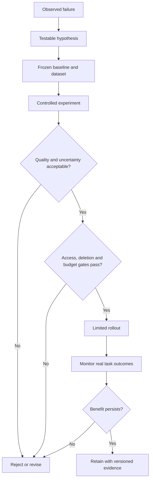

# Study Notes: M06.9.1 — Evidence-Based Adoption

**Module:** M06 — Embeddings, Search & RAG  
**Path:** Core  
**Depth:** L2 foundation; L3 through demonstrated project work  
**Prerequisites:** M03, M05, M07; understand the baseline in M06.8.1 and evaluation in M06.4.2.  
**Purpose:** Decide whether an advanced retrieval method earns its complexity through measurable, reproducible improvement.

**Syllabus rule:** HyDE, RAPTOR, Self-RAG, CRAG and graph methods are electives. Measure improvement over a sound baseline before adopting them.

All datasets, model outcomes and budgets in the worked examples are **synthetic**. The numerical calculations illustrate evaluation methods; they are not measured claims about the named research systems.

## Table of Contents

1. [Evidence-Based Adoption Fundamentals](#1-evidence-based-adoption-fundamentals)
2. [Establish the Baseline](#2-establish-the-baseline)
3. [Match a Method to an Observed Failure](#3-match-a-method-to-an-observed-failure)
4. [Design a Fair Experiment](#4-design-a-fair-experiment)
5. [Choose Metrics and Release Gates](#5-choose-metrics-and-release-gates)
6. [Worked Comparison and Slice Analysis](#6-worked-comparison-and-slice-analysis)
7. [Uncertainty and Paired Evaluation](#7-uncertainty-and-paired-evaluation)
8. [Offline Evidence and Online Validation](#8-offline-evidence-and-online-validation)
9. [Adoption, Rollout and Rejection](#9-adoption-rollout-and-rejection)
10. [Common Mistakes and Concept Map](#10-common-mistakes-and-concept-map)
11. [Glossary and Final Revision Sheet](#11-glossary-and-final-revision-sheet)
12. [Practice and Interview Questions](#12-practice-and-interview-questions)
13. [Project Exercise and Completion Evidence](#13-project-exercise-and-completion-evidence)
14. [Primary Sources and Further Reading](#14-primary-sources-and-further-reading)

## 1. Evidence-Based Adoption Fundamentals

### Definition

**Evidence-based adoption** means choosing a technique because a well-designed evaluation shows that it improves the intended task under the constraints that matter.

A persuasive demonstration is useful for forming a hypothesis. It is not sufficient evidence for deploying a method across every user, document and query type.

### Why complexity needs justification

Every added method creates costs. A generated query adds a model call. A hierarchy adds summaries to maintain. A graph adds entity and relationship modeling. A critique loop adds decisions, latency and possible failure paths.

The question is not whether a method is interesting. The question is whether its improvement justifies these obligations in this application.

### Hypothesis versus conclusion

**Weak claim:** “RAPTOR is more advanced, so it will improve our assistant.”

**Testable hypothesis:** “Our baseline misses cross-section explanations. A hierarchy of source-linked summaries may improve completeness on broad questions without weakening exact lookup accuracy.”

The second statement names the failure, the intervention, the expected outcome and an important regression risk.

### Four evidence levels

| Evidence | What it establishes | What it does not establish |
|---|---|---|
| One successful example | A behavior is possible | Typical reliability |
| Small labeled test set | Initial performance estimate | Broad generalization |
| Representative held-out evaluation | Comparative task performance under defined conditions | Every production effect |
| Controlled production evidence | Behavior for real users under the experiment design | Permanent performance after future changes |

An evidence level is meaningful only if the data and evaluation are valid. A large leaked test set is not stronger evidence than a smaller genuinely held-out set.

### Experimental design

Plan the factors being changed and the outcomes being measured before running the comparison. NIST's experimental-design guidance emphasizes deliberate planning of factors and observations to support defensible conclusions. The RAG workflow in this file applies that principle to retrieval changes. [Source: NIST, experimental design](https://www.itl.nist.gov/div898/handbook/pri/section1/pri11.htm).

## 2. Establish the Baseline

### What counts as a baseline?

A baseline is a concrete, reproducible system against which changes are compared. It includes the corpus, queries, preprocessing, models, indexes, filters, reranking, answer prompt and evaluation definitions.

“Basic RAG” is too vague to reproduce.

### Required retrieval comparison

Compare:

1. **Lexical retrieval:** such as a BM25-based configuration.
2. **Dense retrieval:** with a compatible query/document embedding model.
3. **Hybrid retrieval:** with an explicit fusion rule.

Use the same authorized source snapshot and equivalent evaluation tasks. A lexical baseline should receive reasonable tokenization and field configuration rather than being deliberately weak.

### Basic reranking remains in the main pipeline

Candidate generation and reranking have different jobs. The main working pipeline should contain a basic reranker. Keep ablations without it to measure its value.

Do not compare an optional advanced method plus a reranker against a baseline that lacks reranking, then attribute all improvement to the advanced method.

### Freeze a configuration manifest

A useful experiment record contains:

```json
{
  "experiment_id": "example-exp-12",
  "corpus_snapshot": "example-corpus-2026-10-20",
  "evaluation_set": "example-eval-v3",
  "chunker": "structure-aware-config-2",
  "embedding_model": "record-exact-model-and-revision",
  "lexical_config": "example-analyzer-4",
  "candidate_k_per_branch": 40,
  "fusion": "RRF-c60",
  "reranker": "record-exact-model-and-revision",
  "context_budget_tokens": 4000,
  "generator": "record-exact-model-and-revision",
  "prompt_version": "example-prompt-7",
  "authorization_policy_version": "example-policy-19"
}
```

This illustrates what must be recorded. The generic model-value strings are schema examples, not claims that an experiment has been configured or run.

### Baseline quality checks

Before adding a method, inspect:

- Whether documents were extracted correctly.
- Whether relevant sources are actually indexed.
- Whether the right revision is eligible.
- Whether filters accidentally eliminate valid material.
- Whether the embedding model fits the language and task.
- Whether context assembly discards necessary evidence.
- Whether the generator uses the evidence it receives.

A correction to an ingestion bug may outperform an elaborate retrieval method.

## 3. Match a Method to an Observed Failure

Detailed method explanations are in [M06.3.1](M06.3.1_Advanced_RAG.md). Here the focus is deciding whether to investigate them.

| Elective | Failure that could justify a test | Simplest competing intervention |
|---|---|---|
| HyDE | Short queries fail to match source terminology | Query clarification, lexical synonyms, model-fit correction |
| RAPTOR | Broad questions need information distributed across a long collection | Better section retrieval or source-linked summaries |
| Self-RAG | A suitable trained model's adaptive evidence behavior may help | A bounded explicit retrieval/validation workflow |
| CRAG | Poor initial evidence needs a reliable correction decision | Clear fallback rules and better retrieval diagnostics |
| Graph methods | Repeated relationship queries fail with passage matching | Canonical IDs, SQL joins and entity-aware filters |

### HyDE adoption question

Does a hypothetical query representation improve real-source retrieval on vocabulary-mismatch questions? Track whether it also invents misleading entity or part-number terms.

Do not treat the generated passage as an answer or citation. Its value is measured through the real evidence found afterward.

### RAPTOR adoption question

Do higher-level representations help the broad questions the product actually receives? Measure whether they preserve exceptions and whether specific claims can be traced to original leaves.

Estimate update cost and permission-safe summary maintenance before calling the method production-ready.

### Self-RAG adoption question

Are you evaluating the original trained reflection approach, a model adapted to it, or a generic critique loop? Name the implementation accurately.

Compare end-to-end evidence use and total cost, including extra retrieval and reflection behavior.

### CRAG adoption question

Can the retrieval-quality evaluator distinguish sufficient from insufficient evidence? Does the corrective route use an appropriate source?

For private policies, public web search is not automatically a valid fallback. Evaluate source authority and data exposure as part of the route.

### Graph adoption question

Do explicit relationships answer important recurring questions better than the baseline? Can entities be resolved correctly? Are edges backed by sources?

If a simple join solves the task, compare against that join rather than only against weak vector search.

### Key takeaway

A method needs an application-specific reason to exist. A research paper's task and corpus are not automatically the same as yours.

## 4. Design a Fair Experiment

### Change one factor when isolating an effect

Suppose the baseline uses one chunk size and the candidate uses a new chunker, embedding model, reranker and graph route. The combined candidate can be evaluated as a new system, but improvement cannot be attributed to the graph alone.

An **ablation** holds most conditions constant and adds or removes one component to estimate its contribution.

### Control source and permission state

The same question must be evaluated against comparable source states. If revision 4 exists only in the candidate corpus, the comparison confounds algorithm quality with source freshness.

Permissions belong in the test input. User A's relevant evidence set may differ from user B's. Gold evidence should reflect what each user is allowed to receive.

### Choose a representative question set

Include the question types expected in real use:

- Exact terms and identifiers.
- Natural-language paraphrases.
- Ambiguous questions.
- Multi-document questions.
- Tables and numerical questions.
- Different languages where supported.
- Current-versus-historical questions.
- Questions with no sufficient evidence.
- Permission-denied and source-deleted cases.

A balanced diagnostic test set and a production-weighted test set serve different purposes. Keep both when practical.

### Development versus held-out evaluation

Use development questions to tune chunk sizes, thresholds and routes. Reserve a held-out set to estimate performance after those choices.

Repeatedly inspecting the held-out answers and adjusting the system makes that set part of development. Replace or refresh the evaluation strategy rather than claiming it remains untouched.

Prevent near-duplicate leakage. A question about paragraph 3 in training and a lightly reworded question about the same paragraph in testing may be an easy memorization case.

### Judge controls

If an LLM evaluates answers, version the judge model, prompt, rubric and input. Check a human-reviewed subset and difficult disagreements.

Blind the judge to configuration names where possible. A label such as “advanced system” should not influence a quality judgment.

Separate judgments of support, correctness and completeness. A long answer may sound helpful while adding unsupported claims.

### Repeated runs

Generation may vary. Where this affects the comparison, repeat the same questions with documented settings and report variability.

Use the same policy for both systems. Do not keep the candidate's best attempt and the baseline's first attempt.

## 5. Choose Metrics and Release Gates

### Primary metric

Choose one primary outcome that reflects the task. For an evidence-based answer system, an example is **supported correct answer rate**: the proportion of evaluated questions whose required answer is correct and backed by acceptable evidence.

Define the rubric precisely. If abstention is the correct outcome for a question, label and score it accordingly.

### Supporting metrics

| Category | Examples | Why it matters |
|---|---|---|
| Candidate retrieval | Recall@K, Hit Rate | Whether needed evidence was found |
| Ranking | MRR, nDCG | Whether useful evidence appears early |
| Context | Relevance, evidence coverage, redundancy | What the generator actually receives |
| Answer | Correctness, groundedness, completeness | User-visible quality |
| Citations | Correctness and completeness | Traceable support |
| Operations | p50/p95 latency, cost, failure rate | Feasibility |
| Lifecycle | Freshness and deletion propagation | Current source behavior |
| Security | Unauthorized content or metadata exposure | Required access boundary |

ANN recall measures agreement with exact vector neighbors. It is not the same as recall of relevant evidence for a user's question.

### Hard gates versus tradeoffs

Some metrics are tradeoffs. A small latency increase may be acceptable for a substantial quality gain.

Other requirements are hard gates. A system that leaks another tenant's evidence should not be released because its average correctness improved.

A declared gate might require no unauthorized disclosure in the specified test suite. Passing that finite suite is evidence about those tests, not proof that every possible attack is impossible.

### Example predeclared decision rule

```text
Adopt only if:
- supported answer quality improves on the target slice;
- exact identifier performance does not materially regress;
- citation support meets the declared threshold;
- permission and deletion tests pass;
- p95 latency stays within the product budget;
- update and operating costs are maintainable.
```

Specify thresholds and acceptable uncertainty before reviewing the final comparison. Otherwise the criteria can drift to favor whichever result appeared.

## 6. Worked Comparison and Slice Analysis

### Synthetic evaluation set

Suppose a diagnostic set contains 200 questions:

- 100 exact-identifier questions.
- 60 paraphrase questions.
- 40 multi-document questions.

These are invented results:

| System | Exact success / 100 | Paraphrase success / 60 | Multi-document success / 40 | Total success / 200 |
|---|---:|---:|---:|---:|
| Hybrid + reranker baseline | 92 | 43 | 25 | 160 |
| Baseline + HyDE experiment | 89 | 50 | 26 | 165 |
| Baseline + hierarchy experiment | 92 | 45 | 32 | 169 |

The HyDE experiment improves from 80% to 82.5%, an increase of **2.5 percentage points**. The relative increase is 2.5/80 = **3.125%**. Those are different ways of expressing the change.

### Why averages can mislead

The HyDE candidate gains seven paraphrase successes but loses three exact-identifier successes. Whether that is useful depends on the product workload and error importance.

Suppose actual traffic is estimated as:

- 80% exact identifiers.
- 15% paraphrases.
- 5% multi-document questions.

Applying those weights to the observed slice rates gives:

```text
Baseline:
0.80 × 0.92 + 0.15 × (43/60) + 0.05 × (25/40)
= 0.87475, or 87.475%

HyDE candidate:
0.80 × 0.89 + 0.15 × (50/60) + 0.05 × (26/40)
= 0.86950, or 86.950%
```

The candidate's weighted estimate is lower, despite its higher unweighted diagnostic score. These are estimates based on the same synthetic observations, not new production measurements.

### What decision follows?

Do not roll HyDE out to all traffic based only on the aggregate result. Consider improving exact-term preservation, evaluating a paraphrase-only route, or rejecting the method if complexity outweighs the gain.

A selective route needs its own evaluation. A perfect manual categorization does not establish that an automatic router will make the same decisions.

### Read individual changes

Inspect the questions that changed from correct to incorrect and from incorrect to correct. A gain of five net successes could hide 18 gains and 13 losses. Different failure types may carry different operational importance.

The next section uses exactly that paired outcome pattern.

## 7. Uncertainty and Paired Evaluation

### Why the same questions should be paired

If both systems answer the same question, their outcomes are related. A difficult question may defeat both; an easy question may be answered by both.

A paired comparison examines the change for each question rather than treating the two result sets as unrelated samples.

For our synthetic 200-question comparison:

| Baseline outcome | Candidate outcome | Questions |
|---|---|---:|
| Correct | Correct | 147 |
| Incorrect | Correct | 18 |
| Correct | Incorrect | 13 |
| Incorrect | Incorrect | 22 |
| Total |  | 200 |

Baseline success is (147 + 13)/200 = 80%. Candidate success is (147 + 18)/200 = 82.5%.

The candidate wins on 18 questions and loses on 13. The net gain is five questions.

### Uncertainty in plain language

A measured improvement can depend on which questions happened to be sampled. Another representative set might produce a different difference.

A confidence interval expresses uncertainty under a specified statistical procedure and assumptions. It is not a guarantee that the system will achieve a particular future result, nor is a 95% frequentist interval a statement that a fixed true value has a 95% probability after observing the interval.

### Bootstrap intuition

A bootstrap repeatedly resamples observed evaluation units with replacement and recomputes the statistic. For paired evaluation, keep the baseline/candidate result for each question together. SciPy's official bootstrap documentation explains paired resampling and several confidence interval methods. [Source: SciPy bootstrap](https://docs.scipy.org/doc/scipy/reference/generated/scipy.stats.bootstrap.html).

The following Python example uses only the standard library. It demonstrates a simple empirical percentile interval. It is not a general-purpose statistical package.

```python
from random import Random

# Synthetic paired outcomes: (baseline_correct, candidate_correct).
pairs = (
    [(1, 1)] * 147
    + [(0, 1)] * 18
    + [(1, 0)] * 13
    + [(0, 0)] * 22
)

differences = [candidate - baseline for baseline, candidate in pairs]
n = len(differences)
observed_delta = sum(differences) / n

rng = Random(2026)
bootstrap_means = sorted(
    sum(rng.choices(differences, k=n)) / n
    for _ in range(5000)
)

# Simple empirical percentile selection for this teaching example.
lower = bootstrap_means[int(0.025 * (len(bootstrap_means) - 1))]
upper = bootstrap_means[int(0.975 * (len(bootstrap_means) - 1))]

print(f"Observed improvement: {100 * observed_delta:.1f} percentage points")
print(f"Illustrative interval: {100 * lower:.1f} to {100 * upper:.1f}")
```

For this fixture and seed, the calculation gives an observed improvement of **2.5 percentage points** and an illustrative interval of **−3.0 to 8.0 percentage points**.

### Interpretation

The example does not provide strong evidence that the modest observed gain is stable across comparable questions. A negative difference remains plausible under this simple resampling analysis.

The correct response is not to report only the favorable point estimate. Gather more representative evidence, reduce uncertainty where practical, and consider whether the expected gain is large enough to justify the cost.

### Assumptions and limitations

The resampling unit must match the dependence structure. If many questions come from one document or one user session, independently resampling them can overstate the effective sample size. Consider document-level or session-level grouping where appropriate.

A bootstrap cannot fix biased question selection, incorrect labels or missing production slices. It reuses the data you supplied.

Different interval methods and small or degenerate samples require care. Use an appropriate validated statistical method for consequential release decisions.

### Statistical significance versus practical importance

A tiny effect can become statistically detectable with a very large sample while offering little practical value. A meaningful effect can remain uncertain in a small sample.

Therefore ask both:

- Is the observed improvement credible under the evaluation design?
- Is it large enough to matter after considering cost, risk and maintenance?

### Repeated experiments and selection bias

Trying twenty variants and reporting only the best result can select a lucky outcome. Keep experiment history, disclose the search process, and confirm the selected configuration on fresh held-out evidence.

Do not repeatedly stop an online test when its result first looks favorable unless the statistical design supports such monitoring.

## 8. Offline Evidence and Online Validation

### Offline evaluation

Offline evaluation uses a fixed corpus and labeled questions outside the live user interaction. It is useful for reproducibility, debugging and controlled comparisons.

It can directly inspect evidence IDs, source versions, retrieval rankings and expected answers.

Its limitation is coverage. Real users may ask different questions, use different languages or interact with the system in unexpected ways.

### Shadow evaluation

In a shadow comparison, the candidate may process a permitted request without presenting its answer to the user. This can expose latency and routing issues while preserving the current user-facing behavior.

Shadow processing still handles user data. It must use the same authorization, permitted processing destinations and retention rules. “Not shown to the user” does not make unrestricted data processing acceptable.

### A/B testing

An A/B test assigns eligible traffic to different configurations under a controlled design. Define the unit of randomization, such as user or session, to avoid confusing repeated exposures.

Microsoft's experimentation guidance discusses trustworthiness before an experiment, including clear hypotheses, metrics and data-quality checks. These principles apply to RAG product experiments too. [Source: Microsoft, pre-experiment guidance](https://www.microsoft.com/en-us/research/articles/patterns-of-trustworthy-experimentation-pre-experiment-stage/).

### What to measure online

Measure task completion, meaningful user corrections, evidence interactions and unresolved requests alongside system metrics.

Clicks alone do not establish factual correctness. A user may click because an answer is confusing. A low complaint rate may reflect users who do not notice an error.

Maintain human review of selected cases and automated checks of citations, scope and freshness where possible.

### No online experimentation on known access failures

A candidate that already fails tenant-isolation or deletion tests should be repaired before serving users. An A/B test is not a way to average away a known security defect.

### Guardrails

Set operational rollback triggers. Examples include a rise in errors, unacceptable tail latency, unsupported answers, stale citations or any identified unauthorized exposure.

The exact thresholds depend on the product. State them as your decision policy, not universal industry standards.

## 9. Adoption, Rollout and Rejection

### Four legitimate decisions

| Decision | Appropriate reason |
|---|---|
| Adopt | Benefit is supported and required gates pass |
| Restrict | Benefit applies to a well-defined route or query slice |
| Revise | The method is promising but has fixable failures |
| Reject | Benefit is weak, costs are excessive or hard requirements fail |

Rejecting a sophisticated method can be a strong engineering result. The project has produced evidence that a simpler design is preferable for its workload.

### Adoption record

Record the problem, baseline, candidate, dataset, metrics, uncertainty, costs, failures, decision and rollback conditions.

A short example:

```text
Problem: Paraphrase queries miss domain terminology.
Baseline: Hybrid retrieval plus reranking, configuration B7.
Candidate: Query expansion before dense retrieval.
Evidence: Gains concentrated in paraphrase questions.
Regression: Exact identifiers sometimes altered.
Decision: Revise before release; preserve identifiers deterministically.
Next check: Evaluate revised route on held-out exact and paraphrase cases.
```

### Rollout

Use a limited rollout when appropriate, then inspect real behavior before expanding. Keep configuration versions and evidence traces so a regression can be reproduced.

A rollback should revert the method while continuing to honor the latest permission and deletion state. Never restore a stale source snapshot merely because it belonged to the previous retrieval configuration.

### Re-evaluation

An adopted method can lose its advantage after a better embedding model, a changed corpus, a new language or a different workload mix.

Treat adoption as a documented decision under stated conditions. Monitor whether those conditions remain true.

## 10. Common Mistakes and Concept Map

### Common mistakes

**Comparing unmatched corpora:** A candidate with more current sources may appear algorithmically superior.

**Using only easy questions:** The evaluation misses the failure the method was intended to solve.

**Testing an optional method against a weak baseline:** Improvement may come from basic missing features.

**Ignoring losses:** Net improvement hides which important questions became worse.

**Confusing percentage points with relative percent:** An increase from 80% to 82.5% is 2.5 points, not 2.5% relative.

**Assuming scores are probabilities:** Relevance scores and judge outputs need interpretation and calibration.

**Letting the judge see system labels:** Brand or complexity cues can bias evaluation.

**Counting unauthorized gold evidence as required:** Correct access denial should not be scored as a retrieval miss.

**Ignoring derived deletion:** A method with summaries or graphs changes the deletion surface.

**Claiming a synthetic example is a benchmark:** Demonstrations teach arithmetic; they do not establish real model performance.

### Overall concept map



## 11. Glossary and Final Revision Sheet

### Glossary

| Term | Meaning |
|---|---|
| Baseline | Reproducible reference configuration |
| Hypothesis | Testable expectation about an intervention |
| Ablation | Component-level comparison |
| Golden dataset | Curated evaluation inputs and expected evidence/outcomes |
| Held-out set | Evaluation data not used for tuning decisions |
| Slice | Meaningful subgroup of questions |
| Primary metric | Main outcome used to judge the experiment |
| Guardrail | Metric or condition that must remain acceptable |
| Hard gate | Requirement that must pass before release |
| Paired evaluation | Comparison of both systems on the same units |
| Percentage point | Absolute difference between percentages |
| Relative improvement | Difference divided by the baseline value |
| Bootstrap | Resampling-based uncertainty estimation |
| Confidence interval | Interval produced by a statistical procedure with stated coverage properties |
| Leakage | Evaluation information contaminating development or training |
| Shadow evaluation | Candidate processing without serving its answer |
| A/B test | Controlled assignment to alternative configurations |
| Rollback | Return to a previous approved configuration |
| Adoption record | Written rationale and evidence for a decision |

### Revision sheet

A strong experiment has:

- A specific observed failure.
- A sound lexical/dense/hybrid baseline with reranking.
- A clearly identified intervention.
- The same source and permission state for comparisons.
- Representative questions and reliable labels.
- A predeclared primary metric and hard gates.
- Slice analysis and paired outcomes.
- Honest uncertainty and operational costs.
- Permission-change and deletion tests.
- A recorded adoption, restriction, revision or rejection decision.

## 12. Practice and Interview Questions

### Question-and-Answer Recall

**1. Why are the advanced methods electives?**  
Their value depends on the workload, failure pattern and operating constraints. They should be adopted only after evidence shows a worthwhile improvement.

**2. What is an ablation?**  
A controlled comparison that adds, removes or changes a component to understand its contribution.

**3. Why keep basic reranking in the baseline?**  
It is part of the practical main pipeline. An advanced method should be compared against a competent baseline rather than gaining credit for a missing basic stage.

**4. What does a query slice reveal?**  
It shows whether a method behaves differently for categories such as exact identifiers, paraphrases, languages or multi-document questions.

**5. Why pair results by question?**  
It preserves the relationship between the two systems' outcomes on the same item and reveals gains and losses directly.

**6. Can more bootstrap samples fix biased evaluation data?**  
No. They resample the same observed data and cannot create missing representativeness or correct bad labels.

**7. What is a hard gate?**  
A requirement, such as tenant isolation, that must pass rather than being traded against average quality.

**8. Is an LLM judge ground truth?**  
No. Its judgments depend on its model, prompt and biases and should be calibrated against suitable human review.

**9. Why record rejected experiments?**  
They prevent repeated work, clarify what has been tested and help explain why complexity was not adopted.

**10. When should an adopted method be reconsidered?**  
When sources, workload, models, permissions, costs or requirements change enough to affect its value.

### Multiple-Choice Questions

#### Easy

**11. Which is a testable hypothesis?**

A. “This technique sounds advanced.”  
B. “This method will improve paraphrase retrieval recall on our held-out set.”  
C. “Everyone should use graphs.”  
D. “More model calls must be better.”

**Answer: B.** It specifies a mechanism's expected effect on a defined task.

**12. What is the absolute increase from 80% to 82.5%?**

A. 2.5 percentage points  
B. 25 percentage points  
C. 3.125 percentage points  
D. 82.5 percentage points

**Answer: A.** Subtract the percentages. The relative increase is separately 3.125%.

**13. Which result is most useful for diagnosing reranking?**

A. Whether the correct evidence was in the candidate set and where it ranked afterward  
B. The number of logos in the interface  
C. Only total source-file size  
D. The name of the newest paper

**Answer: A.** It distinguishes an upstream retrieval miss from a ranking failure.

#### Medium

**14. A candidate changes four components and improves. What can you conclude?**

A. The graph component alone caused the improvement  
B. The complete candidate improved under the test, but component attribution is unresolved  
C. Every component improved independently  
D. No evaluation is possible

**Answer: B.** A system-level comparison is valid, but isolating causes requires more controlled ablations.

**15. Why can an unweighted test average disagree with a traffic-weighted estimate?**

A. Arithmetic cannot be used for evaluation  
B. The distribution of query types differs  
C. All query slices must have equal accuracy  
D. Weighted estimates are always measured production results

**Answer: B.** Different workload weights change the contribution of each slice's success rate.

**16. Which action preserves a held-out set?**

A. Tune repeatedly after reading its failures  
B. Train directly on its expected answers  
C. Reserve it for final evaluation after development choices  
D. Publish only its easiest questions

**Answer: C.** Development feedback should come from separate data.

#### Hard — Scenario-Based

**17. An optional method improves quality but reveals another tenant's document title. What follows?**

A. Average quality compensates for the leak  
B. The access gate fails and the issue must be fixed before release  
C. Only full document text counts as leakage  
D. Remove the title from the evaluation logs and release

**Answer: B.** Sensitive metadata is part of the access boundary.

**18. A 2.5-point improvement has an illustrative interval from −3 to 8 points. What is the appropriate interpretation?**

A. Improvement is guaranteed  
B. The true effect is certainly zero  
C. The modest point estimate has substantial uncertainty under the stated method  
D. More decimals would prove the result

**Answer: C.** Both negative and positive effects remain compatible with the illustrative analysis.

**19. A paraphrase-only route works well when humans select it. What remains to be tested?**

A. The automatic router's errors and end-to-end effect  
B. Nothing  
C. Only the document font  
D. Whether more methods can be added

**Answer: A.** Selective adoption depends on correctly identifying the target slice in real use.

### Interview Questions

#### Easy

**20. How would you decide whether to add HyDE?**

**Model answer:** I would first verify a real vocabulary-mismatch failure in a sound baseline. I would compare the candidate on the same corpus and queries, measure real-source recall and supported answers, inspect exact-identifier regressions, and include the added latency and cost. I would never use the hypothetical text as evidence.

**21. What is the difference between a demonstration and an evaluation?**

**Model answer:** A demonstration shows that a behavior can work. An evaluation estimates how reliably it works across a defined set of realistic and difficult cases. I would use demonstrations to form hypotheses and evaluation to support adoption decisions.

#### Medium

**22. How would you make a baseline reproducible?**

**Model answer:** I would version the corpus, labels, extraction and chunking configuration, embedding model, indexes, retrieval settings, reranker, prompt, generator and permission state. I would retain per-question evidence IDs and results so another reviewer can reproduce the same comparison.

**23. How would you evaluate a graph extension fairly?**

**Model answer:** I would identify the relationship questions it should improve, compare against entity-aware retrieval and appropriate SQL joins, and hold source data constant. I would measure path correctness, source support, answer quality, cost, permissions and update/deletion behavior. I would not compare only against a weak generic vector search.

#### Hard — Scenario-Based

**24. Your team tested twenty variants and wants to publish the best result. What would you require?**

**Model answer:** I would disclose the tuning process, inspect how the evaluation set was reused, and confirm the selected configuration on fresh held-out data. I would report meaningful uncertainty and important regressions instead of presenting the best observed score as an unbiased estimate.

**25. The candidate improves nDCG but answers become less complete. How do you respond?**

**Model answer:** I would inspect which evidence reaches the final context. The ranking metric may reward one relevant passage while the question needs several complementary sources. I would evaluate context coverage and claim support, revise selection or expansion, and judge release by the actual task outcome.

**26. How can a rollback remain safe after source deletion?**

**Model answer:** I would separate versioned retrieval configuration from current eligibility state. Reverting an index or model must still consult current tombstones, active revisions and permissions. I would test that previously deleted or revoked sources remain inaccessible after rollback.

## 13. Project Exercise and Completion Evidence

### Task

Choose one elective method and write a complete experiment report for a permission-aware document assistant.

### Required report structure

1. Observed failure and representative examples.
2. Baseline specification and source snapshot.
3. Proposed method and simpler alternatives.
4. Development and held-out data separation.
5. Primary metric, slice metrics and hard gates.
6. Paired results and uncertainty analysis.
7. Latency, cost and maintenance implications.
8. Permission, revision and deletion outcomes.
9. Adoption decision and rollout or rejection rationale.

### Passing evidence

The reader should be able to verify the numerical calculations, understand what changed, inspect a successful and failed case, and reproduce the comparison. A justified rejection is an acceptable outcome.

For L3, run the experiment on a real permitted corpus rather than only copying the synthetic example.

## 14. Primary Sources and Further Reading

- [NIST — What is experimental design?](https://www.itl.nist.gov/div898/handbook/pri/section1/pri11.htm).
- [SciPy — Bootstrap confidence intervals and paired resampling](https://docs.scipy.org/doc/scipy/reference/generated/scipy.stats.bootstrap.html).
- [Microsoft Research — Pre-experiment trustworthiness](https://www.microsoft.com/en-us/research/articles/patterns-of-trustworthy-experimentation-pre-experiment-stage/).
- Named-method primary papers are linked alongside their explanations in [M06.3.1 — Advanced RAG](M06.3.1_Advanced_RAG.md).
- Metric definitions and additional primary evaluation sources are in [M06.4.2 — RAG Evaluation](M06.4.2_RAG_Evaluation.md).

**Continue with:** [M06.10.1 — Permission-Aware Document Answer](M06.10.1_Permission_Aware_Document_Answer.md).

