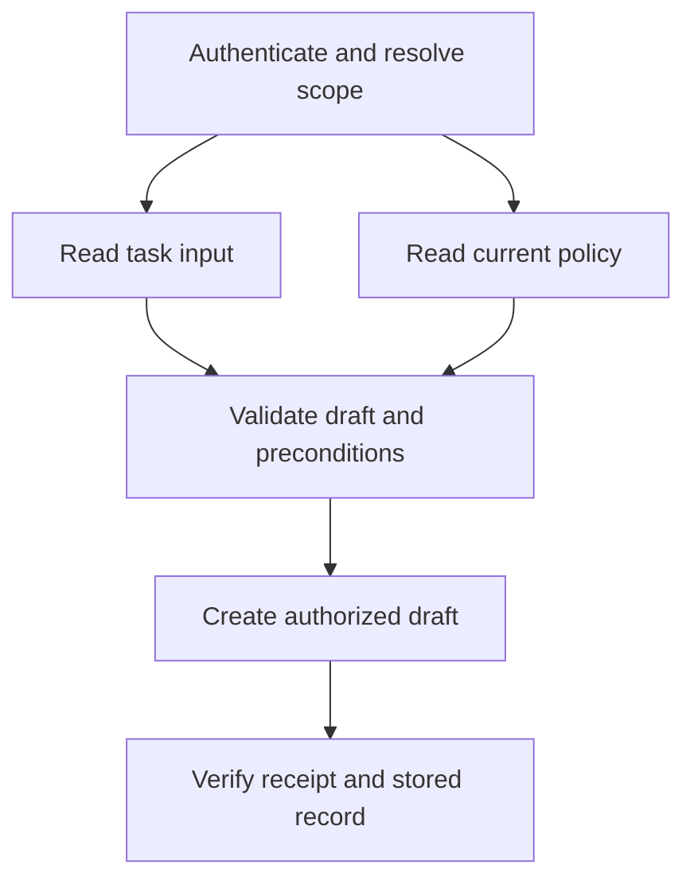
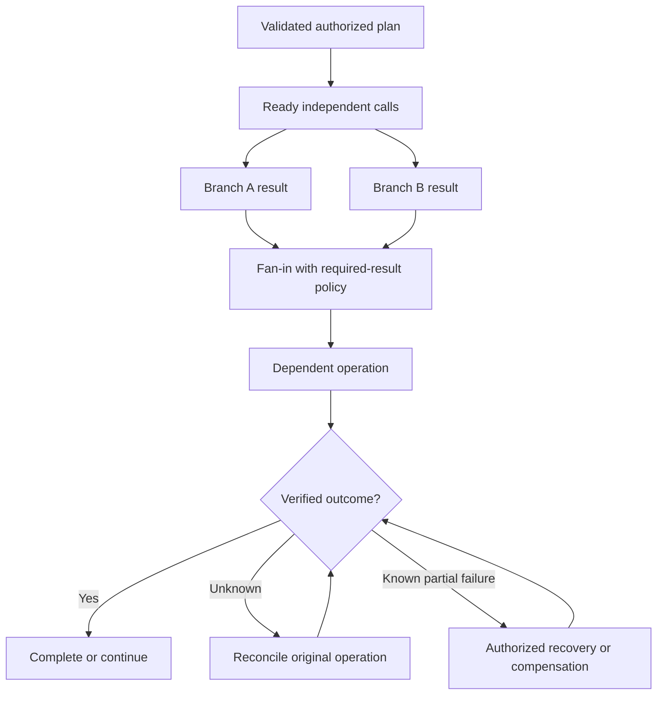

# Study Notes: M08.3.1 — Execution Models

**Module:** M08  
**Path:** Core  
**Depth:** L2 foundation; L3 through demonstrated project work  
**Prerequisites:** M02, M05, M25  
**Purpose:** Design tool-call execution so dependencies, concurrency, authorization, partial success, and recovery are explicit.  
**Completion evidence:** Block unauthorized calls, survive an ambiguous timeout, and verify that a retry does not create a duplicate write.

All tenants, task identifiers, service responses, timings, and business examples below are fictional teaching data. The Python demonstration performs local simulated reads and produces a plan; it does not call external services or implement a production workflow engine.

## Table of Contents

1. [Execution Model Fundamentals](#1-execution-model-fundamentals)
2. [Single Calls](#2-single-calls)
3. [Sequential Calls](#3-sequential-calls)
4. [Dependent Calls and Dependency Graphs](#4-dependent-calls-and-dependency-graphs)
5. [Parallel Calls](#5-parallel-calls)
6. [Fan-Out and Fan-In](#6-fan-out-and-fan-in)
7. [Partial Failure](#7-partial-failure)
8. [Timeout, Cancellation, and Unknown Outcomes](#8-timeout-cancellation-and-unknown-outcomes)
9. [Compensation](#9-compensation)
10. [Worked Verified-Action Workflow](#10-worked-verified-action-workflow)
11. [Executable Dependency and Fan-In Demonstration](#11-executable-dependency-and-fan-in-demonstration)
12. [Testing and L3 Project Exercise](#12-testing-and-l3-project-exercise)
13. [Overall Concept Map](#13-overall-concept-map)
14. [Glossary and Final Revision Sheet](#14-glossary-and-final-revision-sheet)
15. [Practice and Interview Questions](#15-practice-and-interview-questions)
16. [Primary Sources and Further Reading](#16-primary-sources-and-further-reading)

## 1. Execution Model Fundamentals

### Definition

An **execution model** determines when tool calls run, which calls depend on earlier results, how concurrent results are combined, and what happens when only some work succeeds.

A model may suggest several tool calls, but the application must decide whether those calls are authorized, valid, independent, and safe to execute. A list of function names is not yet an executable plan.

Consider a request to create a maintenance task for an authorized resource. The application may need to load the resource, verify current policy, check a required field, create the task, and verify the resulting record. Those steps have different responsibilities and failure consequences.

### Four separate responsibilities

| Responsibility | Main question |
|---|---|
| Planning | Which operations are needed to fulfill the request? |
| Authorization | Which operations may this identity perform on these resources? |
| Scheduling | Which permitted operations can run now or concurrently? |
| Verification | What evidence establishes the actual outcome? |

Planning does not grant authorization. Scheduling does not establish success. A successful HTTP exchange does not necessarily mean that the intended business state exists.

### Execution is about state transitions

Represent calls with explicit states rather than one `done` Boolean. Useful distinctions include planned, blocked, authorized, dispatched, acknowledged, succeeded, failed, unknown, and awaiting reconciliation.

For a remote write, “the client stopped waiting” is a statement about the client. It is not a statement about whether the server created the record.

A workflow can therefore be unfinished even when no worker is actively running. It may be waiting for a status lookup, a delayed receipt, or a human decision about a partially completed business process.

### Tool capability versus task permission

A tool may technically support deleting any task in a database. The current request may authorize only creating a draft task for ship A. The executor should apply the narrower task and identity scope.

Use allowlisted tools, validated arguments, server-derived tenant/resource scope, and appropriate credentials. Never treat a model-generated `tenant_id`, document instruction, or earlier successful call as proof that a later write is permitted.

### A common execution contract

For each planned operation, record:

- Stable operation ID and workflow ID.
- Tool and operation type.
- Validated arguments or their secure reference.
- Authenticated actor and authorized resource scope.
- Dependencies and required preconditions.
- Side-effect classification.
- Deadline and retry budget.
- Idempotency contract, when available.
- Expected result schema and verification method.
- Recovery or compensation policy.

The contract makes implementation choices inspectable. It also helps a later worker resume the intended operation without inventing a new one.

**Key takeaway:** An execution model coordinates authorized state transitions and their evidence. It is more than choosing between synchronous and asynchronous code.

## 2. Single Calls

### Definition

A **single-call execution** performs one tool operation for the task. Examples include reading a task by its exact ID, calculating a value locally, or creating one draft record through a supported API.

Single-call does not mean risk-free. One call can trigger a remote workflow with many internal actions, and one write can have an ambiguous outcome.

### The simplest useful lifecycle

Before dispatch, validate the tool name, argument types, resource identity, permissions, and preconditions. After dispatch, validate the response and determine whether the intended result is established.

For a read, verify that the returned object belongs to the requested tenant and resource. For a write, verify the operation receipt and resulting business record using the service’s contract.

### Example: exact task lookup

The user asks to inspect task T-82. The application authenticates the user, resolves T-82 within their allowed scope, calls the read endpoint, and checks the returned task ID and tenant.

A response containing a task object is insufficient if it is the wrong T-82 from another tenant. Identity validation belongs in the wrapper even when the model never sees the raw database response.

### Example: single remote write

The user requests a draft task. The application assigns operation ID `op-401`, validates the payload, and uses the service’s supported idempotency key. The service commits the task, but the response is lost.

The application now has one dispatched call and an unknown outcome. It must reconcile or retry under the same established idempotency contract. Creating a new operation ID solely because the response was lost can create a second task.

### Safe and idempotent are different

HTTP distinguishes safe methods from idempotent methods. A safe method has read-oriented intended semantics; an idempotent method has the same intended effect when repeated. [RFC 9110, sections 9.2.1–9.2.2](https://www.rfc-editor.org/rfc/rfc9110.html#section-9.2.1) defines these terms.

These protocol properties do not replace business authorization or a service-specific contract. A read can disclose private data, and a nominally idempotent operation can still produce logs, notifications, or other secondary behavior that matters operationally.

### When a single call is enough

Use the smallest execution plan that can fulfill the request and establish its result. Do not introduce extra model steps or parallel branches when one authoritative lookup is sufficient.

A larger workflow is justified by dependencies, evidence needs, or recovery requirements, not by the desire to make the system appear more agentic.

## 3. Sequential Calls

### Definition

**Sequential execution** runs calls one after another. A later call starts after the previous call reaches the required state.

Sequential order can be necessary because data flows between calls, because a business rule imposes order, or because shared-resource contention makes concurrency unsuitable.

### Sequential does not always mean dependent

Two independent reads can be run sequentially for simplicity or rate-limit control. Their ordering is a scheduling choice, not a data dependency.

Conversely, “create a task, then attach a checklist to the returned task ID” contains a real dependency. The second call needs the verified output of the first.

Making this distinction helps avoid unnecessary latency while preserving required ordering.

### A sequential write example

A fictional workflow:

1. Read the current resource version.
2. Validate the draft task against policy.
3. Create the draft task using a stable operation key.
4. Fetch the created task by the returned identity.
5. Verify tenant, resource, requested fields, and state.

Step 4 must use a validated receipt or authoritative lookup. It must not use a guessed task ID generated by the model.

### What counts as completion of a step?

An API may return an acknowledgment that processing has started. That is different from the business operation being completed.

If step 2 requires a completed export, an accepted export job is not enough. The workflow needs to wait for or query the job’s terminal result before consuming its output.

Define dependency conditions precisely: “request accepted,” “record committed,” “record visible,” and “business process complete” are different milestones.

### Failure handling

A required step that definitively fails should block dependent operations. An unknown write outcome should also block dependent operations that assume either success or absence until reconciliation resolves the state.

An independent optional read may still be useful. The executor should preserve completed work and explain partial status rather than flattening the entire workflow into a generic error.

### Benefits and costs

Sequential execution is easier to reason about and can reduce concurrent contention. It can also add avoidable waiting when many calls are independent.

Measure the full workflow, not just the number of calls. Three inexpensive sequential calls may be appropriate, while three slow independent network reads may justify parallelism.

**Key takeaway:** Sequence calls according to real dependencies and business requirements. Do not confuse arrival of a response with completion of the required state transition.

## 4. Dependent Calls and Dependency Graphs

### Definition

A **dependent call** requires data or a verified condition from another call. A **dependency graph** represents these relationships explicitly.

For a bounded workflow without intentional loops, a directed acyclic graph, or DAG, is a useful representation. An edge from A to B means B cannot run until A satisfies its dependency condition.

### Data dependencies

Examples include using a resolved account ID in a lookup, a verified task ID in an attachment call, or a validated document version in an update request.

Do not substitute a plausible model-generated value when a required predecessor has not completed. That converts a dependency failure into an unauthorized or incorrect action risk.

### Control dependencies

A call can depend on a decision without consuming its raw data. For example, creating a task depends on a policy decision allowing that action.

A policy result should include its scope and relevant version. If permission changes before dispatch, the application must enforce its current-policy requirements rather than blindly trusting an old decision.

### Resource dependencies

Two writes may conflict even if neither uses the other’s output. They may update the same record, spend a shared quota, or compete for one reservation.

Treat shared invariants as dependencies or enforce them atomically at the service. A model’s claim that operations are “independent” is not sufficient evidence.

### A small dependency graph



The two reads can overlap after scope is established. The write waits for both validated prerequisites.

### Scheduling ready work

A node is ready when its required predecessors have succeeded and its own authorization, deadline, and resource constraints permit execution.

A failed predecessor can mark dependents as blocked. An unknown predecessor should retain that uncertainty rather than being silently converted to failure.

If no nodes are running and no remaining node is ready, inspect the plan for blocked dependencies or a cycle. A scheduler should fail visibly on an invalid graph rather than wait forever.

### Critical-path reasoning

Consider invented task durations:

- A takes 300 ms.
- B takes 500 ms and is independent of A.
- C takes 200 ms after A.
- D takes 250 ms after both B and C.

Sequential execution would take 1,250 ms. With sufficient resources, the ideal dependency schedule takes:

\[
\max(300+200,500)+250=750\text{ ms}
\]

These are illustrative deterministic durations. Real latency also includes queueing, network variation, concurrency limits, retries, and result validation. Do not calculate p95 workflow latency by casually combining individual p95 values.

### Dynamic dependencies

Sometimes the next tool depends on an earlier result. For example, a resource lookup identifies which service owns its task records.

A bounded agent can propose the next step, but the executor must validate the new node and edges before dispatch. Dynamic planning does not remove the need for fixed allowed tools, scope, budgets, and side-effect rules.

## 5. Parallel Calls

### Definition

**Parallel execution** allows several operations to be in progress at the same time. It can reduce waiting when operations are independent and the system has available capacity.

Concurrency is not a guarantee of simultaneous CPU execution. Threads, asynchronous I/O, processes, and remote workers have different behavior. Choose the mechanism according to the workload and runtime.

### Good candidates for parallel execution

Independent authorized reads are common candidates: load a task, read the applicable policy, and fetch optional explanatory notes.

Each branch must carry the correct scope. Do not authenticate once and then allow branch-specific arguments to select any tenant.

### When parallel execution is unsafe

Avoid uncoordinated concurrency when calls modify the same business invariant, depend on unverified intermediate IDs, share a non-thread-safe client, or can cause duplicate external effects.

Two reservation calls may appear independent because they use different endpoints, but they can still compete for the same slot. Two update calls may overwrite each other if both use the same old record version.

### Parallel writes

Parallel writes are possible when their independence and service contracts are established. Conditions can include distinct resources, no shared invariant, correct authorization, separate stable operation identities, and reliable per-operation reconciliation.

If the business task requires all-or-nothing behavior across services, parallel dispatch alone does not provide it. You need an appropriate transaction protocol or a workflow that explicitly handles partial completion and compensation.

### Bound concurrency

Use a maximum number of in-flight calls, per-service limits, and backpressure. Launching 10,000 requests at once may increase timeouts and overwhelm a dependency.

[Google SRE’s handling-overload chapter](https://sre.google/sre-book/handling-overload/) discusses controlling load and degraded service under overload. In an action workflow, any degradation must still preserve authorization and the meaning of the requested operation.

### Shared state

Avoid concurrent mutation of a shared result dictionary without an appropriate design. Prefer collecting each branch’s immutable result under a stable operation ID and combining results in one coordinator.

A result should include which operation produced it. Completion order can differ from dispatch order; positional assumptions can attach the wrong response to the wrong resource.

### Runtime behavior

Python’s [`concurrent.futures` documentation](https://docs.python.org/3/library/concurrent.futures.html) describes futures, executors, completion handling, and cancellation behavior. A future represents the local callable’s state; it does not independently describe a remote business transaction.

Python’s [`asyncio` task documentation](https://docs.python.org/3/library/asyncio-task.html) describes cooperative cancellation and task-group behavior. Cancelling a coroutine can stop local processing while a remote service continues work already submitted.

**Key takeaway:** Parallelize demonstrated independence, bound the load, and keep each operation’s identity and outcome separate.

## 6. Fan-Out and Fan-In

### Fan-out

**Fan-out** dispatches work to multiple branches. For example, a summary request may query three permitted read services.

The plan should specify why each branch exists, whether it is required, its deadline, and how its result contributes to the final task.

### Fan-in

**Fan-in** combines branch outcomes. It is a policy decision, not merely waiting until the last future finishes.

Possible policies include:

| Policy | Meaning | Suitable use |
|---|---|---|
| All required branches | Continue only when every required result is verified | A write needing both policy and resource data |
| Required plus optional | Required results govern success; optional failures are reported | A task preview with optional background notes |
| First valid result | Accept the first result satisfying a defined authority and freshness contract | Redundant permitted read sources with equivalent semantics |
| Defined quorum | Use a service-specific quorum protocol | Replicated systems designed for that consistency model |
| Best available partial result | Return clearly scoped partial information | A read-only report where partial coverage is acceptable |

A majority of arbitrary sources does not make an answer correct. Quorum semantics require a defined consistency protocol, not a vote among unrelated tools.

### Required versus optional

Make this classification before failure occurs. Otherwise the system may retroactively call a failed prerequisite “optional” to claim success.

For a draft task, optional background notes may be omitted. Current authorization and required business fields are not optional merely because their services are slow.

### Partial aggregation

Represent every branch explicitly:

```json
{
  "workflow_id": "wf-17",
  "required_results_complete": true,
  "branches": {
    "resource": {"state": "succeeded", "source_version": 12},
    "policy": {"state": "succeeded", "policy_version": 8},
    "background_notes": {"state": "failed", "reason": "unavailable"}
  },
  "result_kind": "verified_preview_with_optional_omission"
}
```

This fictional result preserves the omission. It does not claim that all tools succeeded.

### Do not confuse transport success with usable results

A branch can return HTTP 200 but contain malformed JSON, the wrong resource, an old snapshot, or a business-level rejection. Fan-in should consume validated outcomes, not raw status codes.

Conversely, a write’s transport error can coexist with a committed remote effect. That branch belongs in an unknown/reconciliation state until authoritative evidence resolves it.

### Early completion and remaining work

If a read-only fan-in policy completes early, the application may request cancellation of remaining local work. It must still account for work already running and protect any late results.

For writes, do not abandon tracking simply because another branch failed. A late receipt may be essential to establish whether compensation or further verification is needed.

## 7. Partial Failure

### Definition

A **partial failure** occurs when some workflow operations succeed while others fail, remain pending, or have unknown outcomes.

Distributed calls do not share the simple failure boundary of one local function. A client process can fail after a remote service commits a write, and one branch can be healthy while another is unavailable.

### Preserve per-step outcomes

A useful outcome record distinguishes:

| State | Meaning |
|---|---|
| Not dispatched | No attempt was sent by this executor |
| Denied | Authorization prevented the operation |
| Rejected | The service definitively rejected the requested operation under its contract |
| Succeeded | Verified evidence establishes the intended result |
| Unknown | An attempt may have taken effect but the result is not established |
| Blocked | Required predecessors did not reach the necessary state |
| Compensated | A verified compensating action achieved its defined business outcome |

“Not dispatched by this executor” is not automatically proof that no other worker dispatched the same operation. A durable operation registry is needed when several workers can act.

### Failure classification

Classify failures by whether dispatch occurred, whether the service processed the request, whether an effect is known, and whether a retry is safe.

A local argument-validation error before any dispatch differs from a connection loss after a write request was sent. Treating both as “try again” ignores the most important distinction.

### Continue, stop, or reconcile

After a failure:

- Continue independent authorized work that remains useful and consistent with the request.
- Block operations whose prerequisites are missing or uncertain.
- Reconcile ambiguous writes.
- Apply an approved compensation policy for verified completed effects when required.
- Report unresolved state accurately.

Do not execute extra writes solely to make the workflow appear complete.

### Partial read versus partial write

A partial report can sometimes be useful with a clear coverage statement. A partially executed action may require recovery before it is safe to claim completion.

For example, “Two of three source systems were available” is a meaningful read result. “Two of three reservations succeeded” is an incomplete business state with potential costs and cleanup obligations.

### Durable progress

Persist state transitions and receipts before acknowledging overall completion. After a crash, a replacement worker should know which operations were planned, dispatched, verified, or unresolved.

A local flag written before dispatch can prevent duplicate scheduling but does not prove remote success. A flag written only after success leaves a crash window in which the remote effect happened but the flag was never stored.

The design needs an operation identity and a reconciliation contract, not a belief that a Boolean eliminates distributed uncertainty.

## 8. Timeout, Cancellation, and Unknown Outcomes

### Timeout

A timeout means the caller’s waiting policy expired. It does not establish that the service never received the request or that the service rolled it back.

[AWS’s discussion of timeouts, retries, and jitter](https://aws.amazon.com/builders-library/timeouts-retries-and-backoff-with-jitter/) explicitly warns that a timeout or failure does not necessarily mean side effects did not occur. This distinction governs every write branch in an execution plan.

### Three possible histories

After a create-task timeout, any of these may be true:

1. The request never reached the service.
2. The service is still processing it.
3. The task was created, but the response was lost.

The client’s identical timeout observation does not distinguish those histories.

### Cancellation

Cancellation requests the termination of local or remote work through some mechanism. Its guarantee depends on the mechanism.

A cancelled queued future may never start its local callable. A running future generally cannot be cancelled by simply calling `Future.cancel()`. A cancelled coroutine may have already submitted an HTTP request.

A remote cancellation API can return “cancellation requested,” “cancelled before effect,” “already completed,” or another defined state. Only the service contract and authoritative result establish what happened.

### Circuit opening

An open circuit breaker prevents or limits new calls. It does not undo earlier calls or prove that outstanding writes failed.

Keep the operation registry independent of the circuit’s health state. A circuit can open while an earlier task creation is committed and awaiting reconciliation.

### Reconciliation

**Reconciliation** obtains authoritative evidence about an uncertain operation. It may use an operation-status endpoint, idempotency receipt lookup, or a read of the created resource linked to a stable client request ID.

Search by a human-readable title is usually weak evidence: two legitimate tasks can share the same title, and an index may lag. Prefer service-supported operation identity.

A “not found” result is conclusive only under an appropriate consistency and retention contract. A stale replica or expired receipt can return no record even when an effect happened.

### Deadline propagation

Give the workflow an overall deadline and allocate bounded time to calls, retries, verification, and recovery. Do not reset the full timeout for every retry indefinitely.

When the user-facing deadline expires, return an accurate pending or unknown status and continue only the authorized background recovery defined by the application. The response should not claim “nothing was created” unless that is established.

### Late results

A late successful receipt should be matched to the original operation ID and incorporated into the state machine. It must not create a second task or overwrite an unrelated newer operation.

Verify that late results still belong to the correct tenant, resource, payload fingerprint, and workflow. Delay is not permission to ignore identity checks.

## 9. Compensation

### Definition

A **compensating action** is a new business operation intended to counteract some effect of an earlier completed operation.

It is not a magical rollback of time. It can have different semantics, permissions, costs, and failure modes from the original action.

[Azure’s Compensating Transaction pattern](https://learn.microsoft.com/en-us/azure/architecture/patterns/compensating-transaction) describes recording progress and recovery information and notes that compensation can itself fail and may require manual intervention.

### Example

A workflow creates a draft task and reserves a review slot. The checklist attachment then definitively fails. Depending on the agreed business policy, the system may release the reserved slot and mark the draft as incomplete, or leave both in place for repair.

Deleting the draft is not automatically the correct compensation. Another authorized person may already have added information, or the record may need to remain for audit.

### Authorization

The original action’s authorization does not automatically permit every possible reverse action. A user allowed to create a draft may not be allowed to delete a reviewed record.

Define compensation permissions and service identities explicitly. Check the current target state before executing a compensating update.

### Compensation ordering

Reverse order is a useful starting intuition, but not a universal rule. Dependencies and business semantics determine order.

Releasing a slot before marking a task incomplete may be appropriate in one workflow. Another may require preserving the slot until the task state is durably updated. Some independent compensations can run in parallel after their prerequisites are met.

### Unknown effects must be resolved

Do not compensate a guessed effect. If slot reservation timed out, first establish whether the slot was reserved or use a service-supported cancellation by stable operation identity with a clear contract.

A blind “reserve a replacement slot, then cancel the old one” can create additional side effects while the original outcome is still unknown.

### Compensation can fail

Record each compensating operation with its own stable ID, authorization, deadline, idempotency contract, and verification method.

If releasing a slot fails ambiguously, the workflow now has an unknown compensation outcome. It should remain in recovery or review state, not be marked fully rolled back.

### Irreversible effects

An email that was delivered cannot be made unread. A published message may have been copied. A financial refund is a new transaction and may not restore fees, timing, or exchange-rate effects.

Classify these effects before execution and choose an appropriate workflow. Where a draft, reservation, or reversible preparation stage is available, it can reduce the consequences of later failure.

### Compensation versus transaction rollback

| Property | Local transactional rollback | Business compensation |
|---|---|---|
| Boundary | One supported transaction scope | Often several services and committed steps |
| Effect | Reverts uncommitted changes within the transaction | Applies new changes to counter prior effects |
| Visibility | Intermediate changes may be isolated | Earlier effects may already be visible |
| Authorization | Governed by the transaction operation | May require distinct permissions |
| Failure handling | Defined by the database/transaction system | Compensation can fail or remain unknown |

**Key takeaway:** Compensation is an authorized, verifiable recovery workflow with its own state. It does not erase evidence of the original operation.

## 10. Worked Verified-Action Workflow

### The request

An authenticated tenant-A user asks:

> “Create one draft maintenance task for ship A using checklist CL-7, then reserve its review slot.”

The request authorizes the described operations within the user’s permitted scope. It does not authorize using ship B, sending notifications to unrelated people, or deleting records arbitrarily.

### Step 1 — Build and validate the plan

Resolve ship A and CL-7 within tenant A. Validate required task fields and current permission. Assign stable workflow and operation IDs before any write.

The plan contains independent reads followed by dependent writes:

| Operation | Depends on | Effect |
|---|---|---|
| Read resource | Authenticated scope | Read |
| Read checklist | Authenticated scope | Read |
| Read action policy | Authenticated scope | Read |
| Create draft task | Validated resource, checklist, policy | Write |
| Verify task | Create receipt or reconciled operation | Read/verification |
| Reserve review slot | Verified task identity and current permission | Write |
| Verify reservation | Reservation receipt or reconciliation | Read/verification |

### Step 2 — Run independent reads

Dispatch the three reads with bounded concurrency. Validate each response’s tenant, identity, and version. A missing required checklist blocks task creation.

If optional descriptive notes are unavailable, the workflow may continue only if those notes were explicitly optional and their absence does not change the requested task semantics.

### Step 3 — Dispatch the task write

Use operation ID `task-op-401` with the service’s supported key and request fingerprint. Record the dispatch attempt durably.

Assume the service creates task T-82 but the client times out. Mark the operation unknown. Do not issue a new create request with a new key, and do not proceed to slot reservation with a guessed task ID.

### Step 4 — Reconcile

Query the service’s operation-status endpoint using `task-op-401`. Suppose it returns a succeeded receipt for T-82 with the matching tenant and fingerprint.

Fetch T-82 if the contract requires read-after-write verification. Confirm the intended fields and draft status. The task step can now be marked verified.

If status remains unavailable, preserve the unknown state. A circuit breaker or user-facing deadline does not change that factual uncertainty.

### Step 5 — Reserve and verify

Create a reservation using a distinct stable operation ID linked to T-82. Verify the receipt and slot identity.

If reservation definitively fails, the workflow is partially completed: T-82 exists, but no verified slot is reserved. Apply the established business recovery policy, such as leaving the task draft with a visible “review not reserved” state.

### Step 6 — Compensation if required

If policy explicitly requires cancelling the draft after a failed reservation, perform a new authorized compensating action against the verified T-82 state. Use a version precondition so the operation does not overwrite another person’s subsequent work.

Verify the compensation result. If it fails or becomes unknown, report recovery status rather than claiming that the original task never existed.

### Step 7 — Communicate the verified outcome

A completed result names the task and reservation and identifies their verified states. A partial result states what succeeded and what remains unresolved.

A useful unknown-status message is: “The task creation request was submitted, but its result has not yet been confirmed. The workflow is checking the original operation before attempting another write.”

The wording follows evidence. It avoids both premature success and the unsupported claim that nothing happened.

## 11. Executable Dependency and Fan-In Demonstration

### What this example demonstrates

This standalone Python program runs two independent required reads and one optional read concurrently. It builds a plan only after the required reads have validated results. An optional failure remains visible in the final fan-in output.

All functions operate on fictional local data. The example has no external writes, no durable recovery, and no production authorization service. It demonstrates scheduling and result semantics, not a complete action platform.

```python
from concurrent.futures import ThreadPoolExecutor, as_completed
from dataclasses import dataclass


@dataclass(frozen=True)
class Outcome:
    state: str
    value: object = None
    error: str = ""


def load_resource(scope):
    if scope != ("tenant-A", "ship-A"):
        raise PermissionError("Resource is outside the permitted scope")
    return {"tenant": "tenant-A", "resource": "ship-A", "version": 12}


def load_policy(scope):
    if scope != ("tenant-A", "ship-A"):
        raise PermissionError("Policy scope is not permitted")
    return {"can_create_draft": True, "policy_version": 8}


def load_optional_notes(scope):
    raise ConnectionError("Optional notes service is unavailable")


def build_plan(resource, policy, scope):
    if (resource["tenant"], resource["resource"]) != scope:
        raise PermissionError("Response identity does not match scope")
    if not policy["can_create_draft"]:
        raise PermissionError("Draft creation is denied")
    return {
        "kind": "validated_preview",
        "tenant": resource["tenant"],
        "resource": resource["resource"],
        "expected_resource_version": resource["version"],
        "policy_version": policy["policy_version"],
        "external_write_performed": False,
    }


def execute_preview(scope):
    readers = {
        "resource": load_resource,
        "policy": load_policy,
        "notes": load_optional_notes,
    }
    outcomes = {}
    with ThreadPoolExecutor(max_workers=3) as pool:
        futures = {pool.submit(fn, scope): name for name, fn in readers.items()}
        for future in as_completed(futures):
            name = futures[future]
            try:
                outcomes[name] = Outcome("succeeded", future.result())
            except PermissionError as exc:
                outcomes[name] = Outcome("denied", error=str(exc))
            except ConnectionError as exc:
                outcomes[name] = Outcome("failed", error=str(exc))

    required = ("resource", "policy")
    if any(outcomes[name].state != "succeeded" for name in required):
        outcomes["plan"] = Outcome("blocked", error="Required read unavailable")
    else:
        try:
            plan = build_plan(
                outcomes["resource"].value,
                outcomes["policy"].value,
                scope,
            )
            outcomes["plan"] = Outcome("succeeded", plan)
        except PermissionError as exc:
            outcomes["plan"] = Outcome("denied", error=str(exc))
    return outcomes


valid = execute_preview(("tenant-A", "ship-A"))
assert valid["resource"].state == "succeeded"
assert valid["policy"].state == "succeeded"
assert valid["notes"].state == "failed"
assert valid["plan"].state == "succeeded"
assert valid["plan"].value["external_write_performed"] is False

blocked = execute_preview(("tenant-A", "ship-B"))
assert blocked["resource"].state == "denied"
assert blocked["plan"].state == "blocked"

print({name: outcome.state for name, outcome in sorted(valid.items())})
print({name: outcome.state for name, outcome in sorted(blocked.items())})
```

### Expected behavior

The valid preview succeeds even though optional notes fail. The forbidden resource scope produces denied required reads and a blocked plan. The program never performs a write.

Unexpected exception types are deliberately not converted into success. A production wrapper should classify additional failures explicitly and record sanitized diagnostics.

### What to add for a real workflow

Replace the fixed scope check with trusted authentication and authorization. Add durable operation records, deadlines, idempotency, remote-result reconciliation, current-policy checks before writes, and verification of resulting state.

The `with ThreadPoolExecutor(...)` context waits for running local work during shutdown. Adding a future timeout does not automatically terminate workers or remote requests. Understand that behavior before adapting this example to blocking network calls.

## 12. Testing and L3 Project Exercise

### Required scenarios

Create a fixture with two tenants, two resources, one allowed draft operation, and a simulated remote task service. Implement stable operation IDs and a lookup path for receipts.

Test:

1. Unauthorized scope is blocked before dispatch.
2. A required read failure blocks the write.
3. An optional read failure preserves a clearly labeled partial preview.
4. Independent reads can overlap without mismatched results.
5. A dependent call receives only a verified predecessor ID.
6. A write commits but its response is lost.
7. Recovery resolves the original operation without a second effect.
8. A compensation succeeds, fails, or remains unknown with accurate state.
9. A process restart resumes from durable progress.
10. A late receipt is associated with the correct original operation.

### Evidence to retain

Keep operation IDs, payload fingerprints, authorized resource scope, state transitions, service receipts, attempt counts, and verified effect counts. Protect these artifacts because they can contain sensitive identifiers.

Do not prove “no duplicate write” by counting client responses. Count committed business effects at the authoritative service for the operation scope under test.

### Acceptance criteria

The unauthorized test must show zero prohibited dispatches. The ambiguous-timeout test must show a committed effect, a lost response, an unknown client state, and a successful reconciliation or contract-safe replay.

The duplicate-write test must show that all attempts for the same logical operation yield one committed intended effect within the documented idempotency scope and retention window.

Compensation tests must verify the defined final business state and retain the original effect’s history. An unresolved compensation must remain visibly unresolved.

### Review questions

Can another engineer determine which steps actually happened? Can they distinguish a blocked call from an unknown dispatched write? Can they resume the workflow without inventing new operation identities? Can they explain why each parallel branch was independent?

Those are stronger completion signals than a demonstration that prints “workflow successful.”

## 13. Overall Concept Map



The plan’s security boundary, deadlines, and operation identities apply to every branch and every recovery action.

## 14. Glossary and Final Revision Sheet

| Term | Meaning |
|---|---|
| Execution model | Rules for scheduling calls, dependencies, results, and recovery |
| Single call | One tool operation in the plan |
| Sequential execution | Calls run in a defined order |
| Dependency | A required predecessor result or condition |
| DAG | A directed acyclic representation of bounded dependencies |
| Parallel execution | Multiple operations are in progress concurrently |
| Fan-out | Dispatching several branches |
| Fan-in | Combining branch outcomes under a defined policy |
| Critical path | Longest dependency path governing ideal completion time |
| Partial failure | Some operations succeed while others fail or remain unresolved |
| Unknown outcome | A dispatched operation’s effect is not established |
| Reconciliation | Checking authoritative state to resolve uncertainty |
| Compensation | A new action counteracting a previous effect |
| Receipt | Service evidence identifying an operation and its result |
| Idempotency | A contract that makes repeated intent safe within defined bounds |
| Backpressure | Limiting accepted or in-flight work to control load |

### Final revision sheet

- Validate and authorize before scheduling.
- Separate data, control, and shared-resource dependencies.
- Run independent calls concurrently only within capacity limits.
- Match results by operation identity, not completion position.
- Define required and optional branches before failures occur.
- Treat acknowledgment and completed business effect as different states.
- A timeout, cancellation, or open circuit does not prove write absence.
- Reconcile the original operation before inventing a replacement.
- Compensation is a new authorized operation that can fail.
- Persist progress and verify authoritative effects.
- State guarantees in terms of scope, concurrency, and retention.

## 15. Practice and Interview Questions

### Question-and-answer recall

**1. What does an execution model define?**  
It defines when calls run, which results they depend on, how concurrent outcomes are combined, and how partial or uncertain results are handled.

**2. Are sequential calls always dependent?**  
No. Independent calls may be scheduled sequentially for simplicity or capacity control. A real dependency requires a predecessor’s data or verified condition.

**3. What makes a call ready?**  
Its required predecessors have reached the necessary state, and its own permissions, preconditions, deadline, and resource limits allow execution.

**4. What is fan-in?**  
The policy for combining branch outcomes, including which results are required, which are optional, and how failures affect the workflow.

**5. Why use operation IDs?**  
They keep dispatches, late responses, retries, receipts, and recovery associated with one logical operation instead of confusing them with new work.

**6. What does a write timeout establish?**  
Only that the caller did not obtain the required response within its waiting policy. The remote effect may be absent, in progress, or already committed.

**7. Does cancelling a local task undo its remote call?**  
Not generally. Cancellation guarantees depend on the local and remote mechanisms, and already-submitted remote work may continue.

**8. What is compensation?**  
A new business action intended to counteract an earlier effect. It requires authorization, verification, and its own failure handling.

**9. Why is a partially successful write workflow different from a partial report?**  
Writes can leave durable business effects and recovery obligations. A partial report may simply have limited source coverage if that is acceptable and disclosed.

**10. How do you verify no duplicate write?**  
Inspect the authoritative committed effects for the same logical operation and demonstrate that repeated attempts produce one intended effect within the service’s documented idempotency contract.

### Multiple-choice questions

#### Easy

**11. Which pair is a real data dependency?**

A. Two unrelated read-only lookups.  
B. Creating a task and then attaching a checklist to its verified returned ID.  
C. Reading two optional documents.  
D. Logging two independent timing values.

**Answer: B.** The attachment operation requires the identity established by task creation.

**12. What is a good default for independent authorized reads?**

A. Unlimited concurrency.  
B. Bounded concurrency with per-operation result identity.  
C. Treat all responses as interchangeable.  
D. Skip authorization after the first call.

**Answer: B.** It can reduce latency while preserving scope, capacity control, and correct result association.

**13. Which state accurately describes a lost response after a write may have been submitted?**

A. Definitely not executed.  
B. Unknown outcome pending reconciliation.  
C. Automatically compensated.  
D. Guaranteed success.

**Answer: B.** The client observation alone does not establish the remote effect.

#### Medium

**14. One optional read fails while every required read succeeds. What should fan-in do?**

A. Pretend the optional read succeeded.  
B. Continue only under the predefined optionality policy and preserve the omission.  
C. Mark required permissions optional too.  
D. Repeat every completed write with new IDs.

**Answer: B.** Optionality is a business rule established before failure, and partial coverage remains visible.

**15. Which statement about compensation is correct?**

A. It always restores the exact original world state.  
B. It is a new action with its own authorization and possible failure.  
C. It never needs an operation ID.  
D. It can ignore concurrent user changes.

**Answer: B.** Compensation counteracts a defined business effect; it is not a universal transactional rollback.

**16. A takes 300 ms, B 500 ms, C takes 200 ms after A, and D takes 250 ms after B and C. What is the ideal dependency-scheduled duration?**

A. 250 ms.  
B. 500 ms.  
C. 750 ms.  
D. 1,250 ms.

**Answer: C.** The prerequisite paths both finish at 500 ms, followed by D’s 250 ms. This ignores real-world overhead and variation.

#### Hard — scenario-based

**17. A create call times out. The model suggests generating a new request ID and trying again. What should happen?**

A. Always follow the suggestion.  
B. Resolve or safely replay the original operation under its service contract.  
C. Assume no task exists.  
D. Reserve dependent resources using a guessed task ID.

**Answer: B.** A new identity can convert a retry into a second business operation.

**18. A circuit opens while an earlier reservation call is unresolved. What is true?**

A. The reservation definitely failed.  
B. Opening the circuit cancels the reservation.  
C. New dispatch may be blocked, but the original operation still needs reconciliation.  
D. The reservation should be repeated on another service immediately.

**Answer: C.** Circuit state controls call admission; it is not evidence about an earlier remote effect.

**19. Two writes use different endpoints but spend the same remaining quota. Can they be assumed independent?**

A. Yes, because their URLs differ.  
B. No; they share a business invariant that needs coordination or atomic enforcement.  
C. Yes, if the model says they are parallel.  
D. Only their response lengths matter.

**Answer: B.** Independence depends on data and business constraints, not endpoint naming.

### Interview questions with model answers

#### Easy

**20. Explain single, sequential, and parallel tool execution.**  
A single call performs one operation. Sequential calls run in order, either because of dependencies or a scheduling choice. Parallel calls overlap independent work within capacity limits. In all cases, the executor validates permissions and results, and remote writes need explicit handling for uncertain outcomes.

**21. How would you represent a workflow’s progress?**  
I would use per-operation records with stable IDs, dependencies, dispatch attempts, current state, and receipts. I would distinguish blocked, denied, succeeded, failed, and unknown states. A single Boolean cannot represent a partially completed workflow or an unresolved write.

#### Medium

**22. How would you choose which calls to parallelize?**  
I would inspect data dependencies, policy dependencies, shared resource invariants, client thread safety, and service limits. Independent authorized reads are good candidates. Writes require stronger evidence of independence and separate idempotency and verification contracts. I would bound concurrency and measure end-to-end behavior.

**23. How would you implement fan-in for a partially available reporting workflow?**  
I would define required and optional sources in advance, collect validated outcomes under stable branch IDs, and return a result that states its coverage. A required failure would block claims that depend on it. I would not treat HTTP success as proof that the returned data is valid or current.

#### Hard — scenario-based

**24. A worker crashes after a remote write commits but before local success is saved. How should recovery work?**  
The replacement worker should load the durable operation identity and dispatch history, then query or safely replay that same operation under the remote service’s idempotency contract. It should validate the receipt and business record before marking success. Generating a new operation would risk duplication.

**25. A workflow created a draft and reserved a slot, but a later step failed. How do you decide whether to compensate?**  
I would inspect the agreed business recovery policy and verify which effects actually completed. I would consider concurrent changes, irreversibility, and permissions. Any compensation would have its own operation identity, preconditions, retry policy, and verification. If compensation failed ambiguously, the workflow would remain in recovery rather than claim a complete rollback.

## 16. Primary Sources and Further Reading

- [RFC 9110 — HTTP safe and idempotent method semantics](https://www.rfc-editor.org/rfc/rfc9110.html#section-9.2).
- [Python — concurrent.futures](https://docs.python.org/3/library/concurrent.futures.html).
- [Python — asyncio tasks, cancellation, and task groups](https://docs.python.org/3/library/asyncio-task.html).
- [AWS Builders’ Library — Timeouts, retries, and backoff with jitter](https://aws.amazon.com/builders-library/timeouts-retries-and-backoff-with-jitter/).
- [AWS Builders’ Library — Making retries safe with idempotent APIs](https://builder.aws.com/content/3Ev0BENTyBr0XxzRk5FDZzgNYos/making-retries-safe-with-idempotent-apis).
- [Google SRE — Handling overload](https://sre.google/sre-book/handling-overload/).
- [Azure Architecture Center — Compensating Transaction pattern](https://learn.microsoft.com/en-us/azure/architecture/patterns/compensating-transaction).

**Related guide:** [M08.3.2 — Tool Reliability](M08.3.2_Tool_Reliability.md).

**Completion standard:** The workflow blocks unauthorized dispatch, preserves dependencies and partial outcomes, reconciles ambiguous writes, and verifies the absence of duplicate committed effects under its stated contract.
