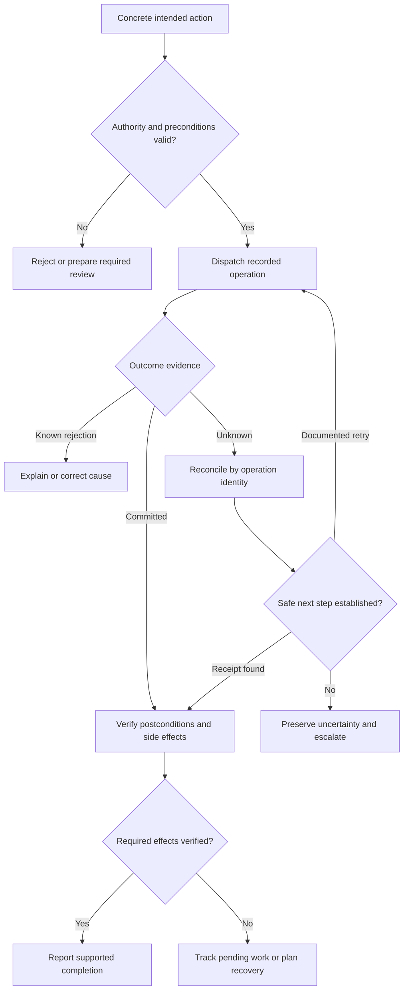

# Study Notes: M08.4.1 — Action Verification and Safe Side Effects

**Path:** Core · **Depth:** L2 foundation; L3 through demonstrated project work  
**Purpose:** Verified action workflow · **Prerequisites:** M02, M05, M25  
**Completion evidence:** Block unauthorized calls, verify intended effects, survive an ambiguous timeout, and demonstrate that retrying one logical operation does not duplicate its write.

All task records, users, versions, receipts, and failure scenarios in this guide are **fictional teaching examples**. The runnable demonstration changes only an in-memory database. It does not call an external service, deliver messages, or perform a financial transaction.

## Table of Contents

1. [Action Verification Fundamentals](#1-action-verification-fundamentals)
2. [Before Execution: Preconditions and Authority](#2-before-execution-preconditions-and-authority)
3. [Input Validation, Risk, and Dry Runs](#3-input-validation-risk-and-dry-runs)
4. [Operation Identity and Idempotency Keys](#4-operation-identity-and-idempotency-keys)
5. [Execution Boundaries and Recorded Effects](#5-execution-boundaries-and-recorded-effects)
6. [After Execution: Results and Postconditions](#6-after-execution-results-and-postconditions)
7. [Ambiguous Timeouts and Reconciliation](#7-ambiguous-timeouts-and-reconciliation)
8. [Safe Retries and Duplicate Prevention](#8-safe-retries-and-duplicate-prevention)
9. [Compensation, Undo, and Escalation](#9-compensation-undo-and-escalation)
10. [Runnable Transaction and Receipt Example](#10-runnable-transaction-and-receipt-example)
11. [Worked Scenarios and Verification Evidence](#11-worked-scenarios-and-verification-evidence)
12. [Overall Concept Map](#12-overall-concept-map)
13. [Glossary and Final Revision Sheet](#13-glossary-and-final-revision-sheet)
14. [Practice and Interview Questions](#14-practice-and-interview-questions)
15. [L3 Project and Acceptance Evidence](#15-l3-project-and-acceptance-evidence)
16. [Primary Sources and Further Reading](#16-primary-sources-and-further-reading)

## 1. Action Verification Fundamentals

### Definition

**Action verification** is the process of checking that an action is permitted and well specified before execution, then gathering evidence of what actually happened afterward.

A tool call requests an effect; it does not prove that effect occurred. Valid arguments, network acceptance, and reassuring response text can accompany an incomplete business action.

A **side effect** is a change outside the computation that produces the tool response. Examples include changing a task's assignee, appending a comment, creating an audit record, scheduling a notification, or updating a search index. Some are the user's main objective. Others accompany it and need separate consideration.

### Several different milestones

| Milestone | What it establishes | What it does not establish |
|---|---|---|
| Proposed | An action has been described | Permission or execution |
| Authorized | The relevant access and intent checks passed | Continued permission after later changes |
| Dispatched | A request left the caller | Arrival or commitment |
| Accepted | A service accepted responsibility for processing | Completion of the requested effect |
| Committed | A defined state change was recorded | Completion of every downstream effect |
| Verified | Appropriate evidence supports the required postconditions | That the state will never change again |

Suppose the user asks, “Mark task T-104 as reviewed.” The task service may commit that field and then asynchronously update a dashboard. The database write can be complete while the dashboard remains stale. A useful answer identifies the completed effect and any material pending work instead of treating the entire system as a single Boolean.

### An evidence contract

Before acting, define what would count as success. For T-104, the contract might require the correct tenant and project, `reviewed=true`, a specific operation receipt, and no change to the assignee. If the operation must also schedule a notification, that obligation needs its own status.

Keep verification proportional. A local draft edit may need a read-back or diff. A consequential shared change needs stronger evidence about authority, concurrency, and side effects. Repeat checks only to resolve a remaining uncertainty.

**Key takeaway:** Successful invocation, successful business action, and verified current state are distinct claims.

## 2. Before Execution: Preconditions and Authority

### Start with the intended outcome

Define the action, target, material arguments, environment, and expected result. “Fix the project” is underspecified; “Set T-104's review flag to true” can become a narrow update.

Resolve stable identifiers through authorized lookups. Duplicate titles and renamed projects make names ambiguous. Show enough identifying information for review without exposing unrelated private data.

### Four independent controls

**Authentication** identifies the caller. **Authorization** determines what that identity may do. **User intent** limits the work to what the user requested. **Approval** satisfies a required review of a concrete action.

Login does not grant every permission, and service credentials do not expand user intent. Approval cannot supply missing access. Tool hints, model risk labels, and task text cannot replace trusted policy.

Enforce tenant, object, relationship, and relevant property checks in the server at every access, including verification reads and receipt lookups. Derive tenant scope from the authenticated context rather than a client-provided `tenant_id`. The [OWASP Authorization Cheat Sheet](https://cheatsheetseries.owasp.org/cheatsheets/Authorization_Cheat_Sheet.html) provides the server-side, deny-by-default foundation; [M08.2.1 — Tool Permissions](M08.2.1_Tool_Permissions.md) develops the complete permission model.

### Preconditions describe the state that makes the action valid

A **precondition** is something that must be true when the change is applied. Examples include:

- The task still belongs to project P-17.
- The task remains editable rather than archived.
- The expected assignee has not changed since review.
- The current revision matches the revision used to prepare the update.
- The caller still has the required permission.

An earlier read cannot guarantee these conditions remain true. Another actor may edit the object between preparation and execution. This is a time-of-check/time-of-use problem.

For a fictional versioned task, request “apply this patch only if version is 7.” The server checks that condition together with the mutation. If the task has become version 8, it rejects the stale operation. Reading version 7 and later issuing an unconditional write provides no equivalent protection.

### Conditional requests

An HTTP API can use `If-Match` with a strong entity tag to condition an update on a particular representation version. Under [RFC 9110, Section 13.1.1](https://www.rfc-editor.org/rfc/rfc9110.html#section-13.1.1), a failed condition normally prevents the operation and yields a precondition failure. `If-Match: *` checks existence, not a particular revision.

Version preconditions and idempotency solve different problems. A precondition stops an operation from applying to an unexpected state. Idempotency prevents repeated delivery of the same logical operation from repeating its effect. Many workflows need both.

### Prepare fully before required review

Complete authorized lookups, construct the patch, identify secondary effects, and produce a concrete reviewable result before requesting approval. Reuse clear existing user authority where it covers the action. Do not insert repetitive confirmation into routine, already authorized work.

When review is required, bind it to the actual action and relevant state. Changes to material arguments or scope may invalidate the previous review. See [M08.5.1 — Approval Validity](M08.5.1_Approval_Validity.md) for approval identity, scope, freshness, and consumption; this guide focuses on execution and evidence after that gate.

## 3. Input Validation, Risk, and Dry Runs

### Validate meaning as well as shape

A schema can reject an unexpected field or an integer where a string is required. It cannot alone establish that an assignee belongs to the project or that the user intended the selected task.

| Validation layer | Example check | Failure it prevents |
|---|---|---|
| Syntax and types | Task identifier is a bounded string | Malformed calls |
| Allowed properties | Patch contains only `reviewed` | Unintended property updates |
| Semantics | Requested state transition is allowed | Invalid business state |
| Relationships | Assignee belongs to the authorized project | Cross-project assignment |
| Scope | Exact task matches the approved target | Target substitution |
| Concurrency | Expected version still matches | Stale overwrite |

Normalize inputs before binding them to an operation. Reviewed and executed commands should use the same canonical values so that approval and duplicate detection refer to identical arguments.

Trusted code must reject extra or unauthorized properties; a model proposing the command cannot authorize them.

### Assess actual effects

Risk depends on context. Adding a private label to one task may be low risk. Reassigning many tasks can alter ownership and trigger messages. Reading an attachment can disclose sensitive information to a processing service even though it does not modify the task database.

Identify the action's reach, reversibility, audience, information sensitivity, and dependencies. These determine whether a preview, stronger preconditions, or a required human review is appropriate. A tool name alone does not establish its risk class.

### What a dry run can establish

A **dry run** exercises a documented preview or validation path without performing specified persistent changes. It can reveal invalid arguments, disallowed transitions, unexpected targets, or a surprising patch.

A dry run is not a universal promise that nothing observable happens. It may read private information, return sensitive fields, invoke validation services, or create operational logs. Understand the actual tool contract. The [Kubernetes dry-run documentation](https://kubernetes.io/docs/reference/using-api/api-concepts/#dry-run) gives a concrete example of a server-supported contract, including authorization and restrictions on side-effecting components. Other APIs may provide weaker previews.

### What a dry run cannot establish

A preview at version 7 does not prove that the real action will see version 7. Capacity, permissions, dependent objects, and policy may change. A generated preview identifier may differ from the final resource identifier.

Use the dry run to make the action reviewable, then enforce preconditions at execution. If preview itself requires reading data, perform the normal access checks before returning that data to the assistant or user.

**Worked example:** A bulk preview selects twelve fictional tasks. Before execution, another task begins matching the search filter. Running the filter again and updating thirteen tasks silently changes the scope. A safer design records the reviewed target set and verifies its relevant versions, or explicitly defines a reviewed dynamic selection rule with appropriate policy. The two designs have different semantics and should not be confused.

## 4. Operation Identity and Idempotency Keys

### Logical operation versus delivery attempt

A **logical operation** is one intended business action. An **attempt** is one delivery of that action to a service. Several attempts may belong to one operation because responses can be lost.

An **idempotency key** identifies those repeated attempts as belonging to the same operation. Generate it once before the first dispatch, persist it with the command, and reuse it unchanged for a permitted retry. Generating a new key in every retry loop defeats the purpose.

A key is neither a password nor authorization. Knowing it must not enable foreign receipt access or privileged execution.

### Scope and payload binding

A fictional receipt ledger could use this identity:

`authenticated tenant + authenticated actor + operation type + idempotency key`

The service also records a canonical payload fingerprint. If an existing key arrives with a different target, desired state, or expected version, it rejects the mismatch instead of silently changing the operation.

A payload hash alone is a poor replacement for operation identity. A user may intentionally create two comments with identical text at different times. The text being equal does not establish that the requests represent one intention.

The [AWS Builders' Library article on idempotent APIs](https://aws.amazon.com/builders-library/making-retries-safe-with-idempotent-APIs/) explains caller-provided request identifiers, parameter mismatch handling, and atomic recording of identifiers with mutations. The task examples here apply those principles to a small teaching system.

### A useful operation envelope

| Field | Purpose |
|---|---|
| Operation ID | Correlates the logical action across attempts |
| Authenticated tenant and actor | Establishes trusted ownership and scope |
| Canonical command | Identifies target, action, and material arguments |
| Preconditions | Defines the state required for first application |
| Authorization and approval references | Supports current enforcement and audit |
| Attempt IDs | Distinguishes deliveries without changing operation identity |
| Receipt and outcome | Records what the service actually committed |
| Secondary-effect references | Connects the action to notifications or other work |

Keep credentials and sensitive approval material in trusted storage. Protect audit identifiers according to what they reveal.

### Retention matters

A deduplication record has a lifecycle. If a service forgets an operation key and later receives an old attempt, it may treat the attempt as new. The retry contract must define how long keys remain effective and what happens to late requests.

After the safe retry window expires, an empty key lookup is not enough to justify another write. Reconcile through authoritative history or use a recovery procedure that prevents late arrivals from applying the old command. Operation tombstones or explicit cancellation states may help, depending on the service design.

## 5. Execution Boundaries and Recorded Effects

### The dangerous gap between mutation and receipt

Consider two independent steps: update T-104, then write its receipt. If the process fails between them, the task changes but a retry sees no record. Reversing the order creates the opposite problem: a receipt can claim completion even though the task never changed.

For changes in one transactional database, commit the mutation and completion receipt together. The record should not describe a successful effect until the effect and record are part of the same successful transaction.

Remote effects complicate this design. A local database cannot automatically include another service's message delivery in its transaction. Calling an external notification service while holding a database transaction does not make the external call roll back if the database later fails.

### Transactional outbox

An **outbox** records a durable obligation to perform downstream work in the same transaction as the main state change. A worker later delivers that work. This couples “task updated” with “notification scheduled,” while leaving actual notification delivery asynchronous.

The [AWS transactional outbox guidance](https://docs.aws.amazon.com/prescriptive-guidance/latest/cloud-design-patterns/transactional-outbox.html) describes this pattern and the need for consumers to handle duplicate deliveries. One outbox row does not prove a downstream service received exactly one message.

In a fictional task system, `event_id=E-901` represents one notification obligation. A dispatcher may transmit E-901 repeatedly if acknowledgments are lost. The consumer needs an appropriate deduplication contract for E-901 and its actual effect. If that consumer cannot provide one, the remaining uncertainty must be exposed and managed.

### Deadlines and cancellation

A client deadline ends waiting, not necessarily server execution. Cancellation needs a documented state: requested, confirmed before effect, or already committed.

If the assistant times out locally, it should preserve the operation identity and investigate status. Reporting “cancelled” merely because the user interface stopped waiting would assert more than the available evidence supports.

## 6. After Execution: Results and Postconditions

### Validate results in layers

Validate network, protocol, tool, and business outcomes separately; reassuring free text is insufficient.

| Layer | Example evidence | Interpretation |
|---|---|---|
| Transport | Connection failed | Outcome may be unknown |
| Protocol | Malformed response | Do not trust unvalidated fields |
| Tool execution | Structured execution error | Inspect documented effect semantics |
| Business operation | `state=committed` with matching receipt | Defined effect recorded |
| Postcondition | Authoritative task shows expected revision | Current state supports the desired result |
| Downstream work | Notification status is pending | Main write may be complete; delivery is not |

The [MCP tools specification](https://modelcontextprotocol.io/specification/2025-11-25/server/tools) distinguishes tool execution errors from protocol errors and supports output schemas. Schema validity improves interpretation; it cannot prove that a backend acted correctly.

### Check the receipt's identity

A receipt should come from the trusted service through an authenticated channel. Validate its tenant scope, operation ID, target, command fingerprint or equivalent binding, outcome, and resulting version. Do not accept an identifier supplied by untrusted task text as proof that an operation succeeded.

Receipt lookup itself is an access-controlled read. A guessed receipt ID must not reveal a restricted task's title, existence, assignee, or action history.

A receipt describes an event. If T-104 was reviewed at version 8 and later reopened at version 9, the receipt remains valid evidence of the earlier operation. It does not prove that `reviewed=true` still holds now.

### Verify postconditions proportionately

Read the authoritative resource or a documented consistency path. Check the fields that define success and any important fields that should remain unchanged. For a review-flag update, these may be target identity, review state, version, project, and assignee.

Use the receipt's version to interpret the read. A replica returning version 7 after a version-8 receipt may be stale. A version-9 response may reflect a legitimate later edit. Neither observation should immediately trigger a repeat of the original write.

Confirm the evidence belongs to the intended account, tenant, project, and environment. A successful test-workspace result does not establish production completion.

### Asynchronous and partial completion

HTTP `202 Accepted` means processing has been accepted but is not complete; [RFC 9110, Section 15.3.3](https://www.rfc-editor.org/rfc/rfc9110.html#section-15.3.3) makes that distinction explicit. Follow the documented status mechanism and report pending work honestly.

For batches, inspect every item's outcome. Suppose ten task updates yield seven committed, two rejected, and one unknown. “The request succeeded” is an inadequate summary. Record the seven receipts, explain the two rejections, and reconcile the unknown item. Retrying the entire batch with new operation keys risks repeating the seven successful effects.

### Side effects require their own evidence

A changed field does not establish notification delivery, search-index freshness, or a completed export. Define which secondary effects are part of completion and which are operationally acceptable pending work.

An unexpected cross-project exposure is a separate incident even if the primary field changed correctly. Stop dependent actions, preserve minimal evidence, and begin authorized recovery.

## 7. Ambiguous Timeouts and Reconciliation

### Unknown is an outcome category

An **ambiguous outcome** occurs when available evidence cannot determine whether an operation took effect. A timeout after dispatch is the classic example: the service may have rejected the request, may still be processing it, or may have committed it before losing the response.

Unknown does not mean failed. It also does not mean successful. Treating either interpretation as fact creates avoidable errors.

### A practical state model

| Observed state | Appropriate next step |
|---|---|
| Definitely not dispatched | Correct local issue; dispatch if still authorized |
| Authoritatively rejected before effect | Explain or repair the known cause |
| Accepted and still pending | Query status within bounded time limits |
| Committed with valid receipt | Verify relevant postconditions |
| Failed after specified partial effects | Reconcile completed steps and plan recovery |
| Unknown | Preserve operation identity; seek authoritative evidence |

A generic error code is not automatically evidence of “rejected before effect.” Learn the service's documented transaction and error semantics.

### Reconciliation procedure

Retain the original command, operation key, attempt information, and receipt or job ID. Avoid a new logical operation while the original is unresolved.

Use the authorized status or receipt endpoint and match operation identity and target. For pending work, use bounded polling or the completion notification mechanism.

Inspect authoritative history or postconditions where needed. Another user may have produced the matching state; that observation alone cannot prove this operation scheduled its notification.

Classify the evidence as complete, safely retryable, partial, or still unknown. Preserve that distinction in both report and ledger.

### Why an empty lookup may not settle the question

A receipt index might lag behind the transaction store. A timed-out request might still be queued. A status endpoint may retain records for less time than the client retains operations. Therefore “not found” can mean more than “never happened.”

A negative result supports retry only when the service contract makes that result authoritative for the relevant operation and prevents an old in-flight attempt from later creating a conflicting effect, or when documented idempotency safely handles both attempts.

### A useful user-facing status

“Task T-104's update request was submitted, but its final status is not yet confirmed. I am checking operation O-104 before issuing another write.”

If authoritative evidence remains unavailable, report the uncertainty and the specific recovery decision needed. Do not claim completion, failure, or cancellation merely to provide a cleaner answer.

## 8. Safe Retries and Duplicate Prevention

### Retry safety is a service property

A retry is safe only under known conditions. Relevant questions include whether the operation is inherently idempotent, whether the service honors an idempotency key, whether the original payload remains unchanged, whether the deduplication window is valid, and whether authorization still permits the attempted access.

HTTP idempotency concerns repeated intended effects, not necessarily identical response bodies or the absence of repeated operational logs; see [RFC 9110, Section 9.2.2](https://www.rfc-editor.org/rfc/rfc9110.html#section-9.2.2). Do not infer a complete business deduplication guarantee merely from a method name.

### Different actions have different duplicate risks

| Action | Repeated-request concern | Useful protection |
|---|---|---|
| Set review flag to true | Repeated notifications or overwriting later state | Stable key, version checks, downstream deduplication |
| Toggle review flag | Second attempt reverses the first | Replace toggle with desired-state command when possible |
| Append comment | Duplicate comments | One logical operation key and receipt |
| Increment priority counter | Double increment | Atomic operation ledger with update |
| Bulk reassignment | Mixed item outcomes | Stable per-item identities and result ledger |
| Delete task | Later 404 does not describe original execution history | Receipt plus documented deletion semantics |

### Retry the same operation, not a modified one

Changing the payload while retaining the key should produce a conflict. A changed desired state is a new logical operation and needs its own authority and applicable review. Do not use a new key simply to escape a mismatch error while the original action remains ambiguous.

A successful original operation may advance the resource version. A legitimate same-key replay should follow the service's duplicate-handling contract and retrieve the existing outcome, rather than attempting the mutation again against the old version. Current access checks still apply before returning that receipt.

### Backoff does not prevent duplicates

Backoff reduces retry concentration, not uncertainty about commitment. An attempt limit helps control load, but three tries can still create three comments.

Set a total deadline and attempt budget appropriate to the service. Reconcile after exhaustion. For non-idempotent actions without reliable status, do not enable generic automatic retries merely because the SDK offers them.

### Protect the whole effect chain

Deduplicating the database update while sending a new notification on every replay is incomplete. Return the recorded outcome for duplicates, and ensure downstream operations have their own stable identities and supported effect semantics.

A strong project claim is specific: “Repeated delivery of operation O-104 produced one task mutation and one outbox event in this tested service.” Claiming universal exactly-once execution across databases, queues, and external recipients requires much more than an idempotency-key field.

## 9. Compensation, Undo, and Escalation

### Undo and compensation differ

An **undo** restores a previous state when that restoration is supported and appropriate. A **compensation** is a new business action that offsets a completed action's consequences as far as possible.

Changing a label back may resemble undo. Restoring an assignee after a notification was delivered cannot make the recipient forget the message. Deleting a duplicate comment may remove its visible record while leaving audit history and previously delivered copies.

Compensation is itself a write. It needs authorization, appropriate user intent or recovery authority, current preconditions, a recorded outcome, and its own retry protections.

### Concurrency can make restoration harmful

Suppose the assistant mistakenly reassigns T-104 from Lina to Omar. Before recovery, a project owner deliberately assigns it to Mei. An unconditional “restore Lina” overwrites a legitimate later decision.

A safe recovery plan checks the current state and the scope of recovery authority. It may condition restoration on the task still having the mistaken assignment. If the condition fails, present the specific conflict to an authorized reviewer rather than guessing whose change should win.

### Multi-step recovery

A workflow may create a task, attach a document, and schedule a notification. If attachment fails, the task creation may already be committed. A recovery procedure could retry the attachment, leave a clearly incomplete draft, or remove the draft under appropriate authority.

A **saga** coordinates such steps and compensating actions. The [AWS saga orchestration guidance](https://docs.aws.amazon.com/prescriptive-guidance/latest/cloud-design-patterns/saga-orchestration.html) explains the pattern and its concurrency limitations. A saga is not a single transaction that automatically erases all external effects.

Record compensation states separately: requested, pending, completed, failed, or unknown. A failed compensation should not be silently marked as a successful rollback.

### Human escalation does not eliminate uncertainty

Human approval can authorize a well-specified recovery action. It cannot reveal whether an unobserved write committed, grant missing access, or make a blind retry technically safe.

An escalation should provide the operation identity, intended effect, known receipts, observed state, remaining uncertainty, available recovery options, and consequences. An authorized operator may consult a stronger audit source, fence old attempts, or choose an accepted recovery procedure. Simply asking “try again?” transfers an unresolved technical hazard without resolving it.

Complete authorized investigation before required approval, then explain the concrete recovery decision. If no safe next write is known, preserve the unknown state.

## 10. Runnable Transaction and Receipt Example

### What the example demonstrates

This Python standard-library fixture marks a task reviewed. The task mutation, receipt, and outbox event share a local transaction. It then simulates losing the response **after commit**. Repeating the same command and key returns the receipt without repeating the write.

Authenticated principals and project grants are trusted test fixtures. This example assumes the concrete action already passed the intent and applicable approval gates described in M08.2.1 and M08.5.1. It still checks current object access before mutation or receipt replay. There is no endpoint that trusts a client-supplied approval Boolean.

```python
import hashlib
import json
import sqlite3
from dataclasses import dataclass
from uuid import uuid4


@dataclass(frozen=True)
class Principal:
    tenant: str
    actor: str


# Trusted fixture state: never populate this from tool arguments.
grants = {("A", "lina"): frozenset({"P-17"})}
db = sqlite3.connect(":memory:")
db.row_factory = sqlite3.Row
db.executescript("""
CREATE TABLE tasks (
    tenant TEXT, task_id TEXT, project TEXT,
    reviewed INTEGER, version INTEGER,
    PRIMARY KEY (tenant, task_id)
);
CREATE TABLE receipts (
    tenant TEXT, actor TEXT, operation TEXT, request_key TEXT,
    payload_hash TEXT, task_id TEXT, version INTEGER, receipt_id TEXT,
    PRIMARY KEY (tenant, actor, operation, request_key)
);
CREATE TABLE outbox (
    event_id TEXT PRIMARY KEY, tenant TEXT, task_id TEXT
);
INSERT INTO tasks VALUES ('A', 'T-104', 'P-17', 0, 1);
INSERT INTO tasks VALUES ('A', 'T-105', 'P-29', 0, 1);
INSERT INTO tasks VALUES ('B', 'T-104', 'P-17', 0, 1);
""")


def mark_reviewed(principal, task_id, expected_version, request_key,
                  *, lose_response=False):
    if type(expected_version) is not int or expected_version < 1:
        raise ValueError("Invalid expected version")
    if not isinstance(request_key, str) or not 1 <= len(request_key) <= 100:
        raise ValueError("Invalid operation key")
    if not isinstance(task_id, str) or not 1 <= len(task_id) <= 100:
        raise ValueError("Invalid task identifier")

    operation = "mark_reviewed"
    payload = {"operation": operation, "task_id": task_id,
               "reviewed": True, "expected_version": expected_version}
    canonical = json.dumps(payload, sort_keys=True, separators=(",", ":"))
    digest = hashlib.sha256(canonical.encode()).hexdigest()
    scope = (principal.tenant, principal.actor, operation, request_key)

    # Single connection, sequential fixture. Current access precedes replay.
    with db:
        task = db.execute(
            "SELECT * FROM tasks WHERE tenant=? AND task_id=?",
            (principal.tenant, task_id),
        ).fetchone()
        projects = grants.get((principal.tenant, principal.actor), frozenset())
        if task is None or task["project"] not in projects:
            raise PermissionError("Access denied")

        previous = db.execute(
            """SELECT * FROM receipts WHERE tenant=? AND actor=?
               AND operation=? AND request_key=?""", scope,
        ).fetchone()
        if previous is not None:
            if previous["payload_hash"] != digest:
                raise ValueError("Key reused with different command")
            return dict(previous)

        changed = db.execute(
            """UPDATE tasks SET reviewed=1, version=version+1
               WHERE tenant=? AND task_id=? AND version=?""",
            (principal.tenant, task_id, expected_version),
        ).rowcount
        if changed != 1:
            raise ValueError("Precondition failed")

        receipt_id = str(uuid4())
        version = expected_version + 1
        db.execute("INSERT INTO receipts VALUES (?, ?, ?, ?, ?, ?, ?, ?)",
                   scope + (digest, task_id, version, receipt_id))
        db.execute("INSERT INTO outbox VALUES (?, ?, ?)",
                   (receipt_id, principal.tenant, task_id))
        receipt = dict(db.execute(
            """SELECT * FROM receipts WHERE tenant=? AND actor=?
               AND operation=? AND request_key=?""", scope,
        ).fetchone())

    # The database commit has completed before this simulated network loss.
    if lose_response:
        raise TimeoutError("Response lost after commit")
    return receipt


def expect_error(error_type, call):
    try:
        call()
    except error_type:
        return
    raise AssertionError(f"Expected {error_type.__name__}")


lina = Principal("A", "lina")
key = str(uuid4())  # Generate once for this logical operation.
expect_error(TimeoutError,
             lambda: mark_reviewed(lina, "T-104", 1, key, lose_response=True))
receipt = mark_reviewed(lina, "T-104", 1, key)
assert mark_reviewed(lina, "T-104", 1, key) == receipt
assert tuple(db.execute(
    "SELECT reviewed, version FROM tasks WHERE tenant='A' AND task_id='T-104'"
).fetchone()) == (1, 2)
assert db.execute("SELECT COUNT(*) FROM receipts").fetchone()[0] == 1
assert db.execute("SELECT COUNT(*) FROM outbox").fetchone()[0] == 1
expect_error(ValueError, lambda: mark_reviewed(lina, "T-104", 2, key))
expect_error(ValueError, lambda: mark_reviewed(lina, "T-104", 1, str(uuid4())))
expect_error(PermissionError,
             lambda: mark_reviewed(lina, "T-105", 1, str(uuid4())))
expect_error(PermissionError,
             lambda: mark_reviewed(Principal("B", "lina"), "T-104", 1, key))
grants[("A", "lina")] = frozenset()  # Access revocation also blocks replay.
expect_error(PermissionError, lambda: mark_reviewed(lina, "T-104", 1, key))
db.close()
print("Verified: one mutation, one receipt, one outbox event; unsafe calls blocked.")
```

### Why the ordering matters

The replay lookup occurs after current access checks but before the original version precondition. The original successful request advanced the version from 1 to 2. Reapplying its version-1 mutation would be wrong; returning its stored result is the intended duplicate behavior.

Changed arguments with the same key fail. A new key with the stale version also fails. Access revocation prevents replay from exposing the receipt. The fixture therefore separates duplicate recognition, concurrency protection, and permission enforcement.

### Limits of the demonstration

This in-memory fixture demonstrates transaction and replay behavior, not durability across process failure. Deployment requires persistent storage, explicit transaction configuration, concurrency handling, current policy enforcement at the write boundary, and key-retention rules.

The [Python sqlite3 documentation](https://docs.python.org/3/library/sqlite3.html#how-to-use-the-connection-context-manager) explains commit and rollback behavior for the connection context manager. Here, sequential calls use one connection; no concurrent access or changing policy during a transaction is simulated.

The outbox row represents an obligation only. There is no dispatcher, recipient, or delivery guarantee. Add a separately verified consumer before claiming anything about external notifications. For stricter concurrent authorization changes, coordinate policy version checks with the transaction or use an equivalent enforcement mechanism supported by the real service.

## 11. Worked Scenarios and Verification Evidence

### Scenario A: Timeout after a committed write

Lina authorizes the review-flag update to T-104 at version 7. The runtime records operation O-104 and dispatches it. The service commits version 8 and receipt R-104, but the response disappears.

The runtime records an unknown outcome and queries O-104. The service returns R-104. An authorized read shows T-104 at version 8 with the desired flag and unchanged assignee. One associated outbox event exists.

**Correct conclusion:** The task update is verified. If notification delivery belongs to the user request, its status still needs evidence. A same-key replay is permitted only under the service's documented contract; a new-key write is unnecessary.

### Scenario B: Another actor changes the task

The same receipt exists, but the subsequent read returns version 9 with the flag cleared. History shows that the project owner reopened the task after Lina's operation.

**Correct conclusion:** Lina's update committed, and the current task differs because of a later action. Repeating the original update would be a new decision affecting someone else's work. Explain the evidence and determine whether the user's existing instruction covers further action; request a concrete decision only if needed.

### Scenario C: Unknown comment append without deduplication

A legacy endpoint appends a comment and times out. It supplies no operation key, receipt, or authoritative operation status. The comment list is eventually consistent.

**Correct conclusion:** A missing comment in the immediate list does not prove absence. Pause additional appends, investigate through authorized history, and escalate if stronger evidence is unavailable. Human approval alone does not make another append duplicate-safe.

### An evidence record

| Evidence item | Example | Purpose |
|---|---|---|
| Intended action | Review T-104 in tenant A | Defines scope |
| Expected state | Version 7 | Supports concurrency control |
| Operation identity | O-104 | Connects attempts |
| Receipt | R-104, committed version 8 | Supports event claim |
| Verification read | Version 8, reviewed true | Supports current-state claim |
| Secondary-effect status | Event scheduled, delivery pending | Prevents overstated completion |
| Recovery decision | No additional write needed | Explains next action |

Limit trace detail to the task and audit purpose, with appropriate access and retention controls.

## 12. Overall Concept Map



The retry edge reuses the same logical operation and unchanged command. It does not authorize unlimited attempts or a new operation identity. Access and relevant execution controls remain active.

## 13. Glossary and Final Revision Sheet

### Glossary

| Term | Meaning |
|---|---|
| Precondition | State or authority required before an effect may apply |
| Postcondition | State expected after a successful operation |
| Conditional update | Mutation applied only if a version or other condition holds |
| Logical operation | One intended business action |
| Attempt | One delivery of that operation |
| Idempotency key | Stable identifier used to recognize duplicate attempts |
| Receipt | Trusted record of an operation's recorded outcome |
| Reconciliation | Resolving uncertainty by comparing authoritative evidence |
| Ambiguous outcome | Evidence does not establish whether the effect occurred |
| Outbox | Transactionally recorded obligation for downstream work |
| Compensation | New action that offsets earlier consequences where possible |
| Fencing | Preventing obsolete or competing work from applying effects |
| Retry budget | Limits on attempts, elapsed time, or resource use |
| Partial completion | Some required effects occurred while others did not |

### Final revision sheet

Before execution, establish the concrete target, current authority, valid inputs, contextual risk, required review, relevant preconditions, and stable operation identity. Use a dry run when it provides useful evidence, with its own access checks.

After execution, validate the response, match the receipt, inspect authoritative postconditions, and track required secondary effects. A transport success or accepted job is not enough to prove completion.

On timeout, preserve the original operation and reconcile. Retry only under an applicable service contract. Compensation is a new controlled action. Approval does not grant permission, resolve unknown status, or prevent duplicates.

## 14. Practice and Interview Questions

### A. Active recall: ten questions with answers

**1. What is the difference between dispatch and commitment?**  
Dispatch means the caller sent a request. Commitment means the service recorded a defined effect. A request can be lost before arrival or commit even when the response is lost.

**2. Why check preconditions at mutation time?**  
State can change after the preparatory read. An atomic condition prevents the update from applying to an unexpected version instead of relying on an earlier observation.

**3. How do authorization and approval differ?**  
Authorization grants access under policy. Approval satisfies a required review of a particular action. Approval cannot supply a permission the actor lacks.

**4. Does dry-run mode remove disclosure risk?**  
No. A dry run can read or return sensitive information. Its authorization and side-effect contract must be understood, and it does not guarantee later execution against unchanged state.

**5. When should an idempotency key be generated?**  
Before the first dispatch of one logical operation. Persist and reuse it for retries. A changed intended operation needs its own key after the previous outcome is appropriately resolved.

**6. Why store a command fingerprint with a key?**  
It detects attempts to reuse one operation identity with different material arguments. The key identifies intent; the fingerprint checks whether the command still matches that intent.

**7. Why can a receipt and current state disagree?**  
A receipt records an earlier committed event. Another authorized actor may subsequently change the resource. Both records can be valid if their versions and timing are understood.

**8. What should happen after an ambiguous timeout?**  
Preserve operation identity, consult authorized status or receipt evidence, inspect relevant state, and classify the result. Do not treat timeout alone as permission for a new write.

**9. Does one outbox event prove one delivered notification?**  
No. Delivery may be pending or repeated. The consumer needs its own appropriate deduplication and result evidence.

**10. Can compensation fully reverse every action?**  
No. It may restore some state while leaving notifications, audit records, or disclosed information. Compensation can also conflict with later changes and needs its own controls.

### B. Graded multiple-choice questions

**1. Easy — A service returns a job ID with HTTP 202. What is established?**

A. All requested effects have completed.  
B. Processing was accepted but completion is not established.  
C. The request definitely failed.  
D. A new request should immediately be created.

**Answer: B.** Acceptance is an intermediate state. Follow the documented job-status mechanism. Neither automatic success nor automatic resubmission follows from 202.

**2. Easy — Which is the correct source of tenant scope?**

A. A tenant name found in the task description.  
B. The model's preferred tenant.  
C. The authenticated server-side context.  
D. An arbitrary client field.

**Answer: C.** Trusted identity context establishes the access boundary. Resource IDs and tool arguments still require object-level checks within that boundary.

**3. Easy — A write times out after dispatch. Which statement is accurate?**

A. The write never happened.  
B. The write definitely happened.  
C. The outcome may be unknown.  
D. Cancellation is confirmed.

**Answer: C.** The response can disappear before or after commitment. Status and receipt evidence determine the next safe action.

**4. Medium — A retry uses the same key but changes the assignee. What should a payload-bound service do?**

A. Reject the command mismatch.  
B. Apply both assignments.  
C. Ignore the key and create another operation.  
D. Treat the change as automatically approved.

**Answer: A.** One operation identity must retain its material meaning. Changing the target state requires a separately authorized operation, with the old outcome handled appropriately.

**5. Medium — Why combine the receipt and mutation in one local transaction?**

A. It guarantees every remote notification is delivered.  
B. It prevents the local record and local effect from being committed separately.  
C. It replaces authorization.  
D. It makes the payload irrelevant.

**Answer: B.** Atomic commitment prevents the mutation-without-receipt and receipt-without-mutation gaps. Remote effects require additional mechanisms and evidence.

**6. Medium — A version-8 receipt is valid, but a read returns version 9 with different data. What is the best response?**

A. Reapply version 8 unconditionally.  
B. Delete the receipt.  
C. Determine whether a subsequent change explains the difference.  
D. Assume the receipt is fraudulent.

**Answer: C.** Historical commitment and current state answer different questions. Check authorized history and current intent before deciding whether another write is justified.

**7. Hard — A receipt lookup returns “not found” on an eventually consistent index after timeout. What follows?**

A. The operation certainly never executed.  
B. The same operation may still be in flight or absent from the index; use the service's reconciliation or idempotency contract.  
C. Generate a new key and retry until visible.  
D. Ask for approval, then assume no duplicate is possible.

**Answer: B.** Negative evidence is only as authoritative as the lookup's consistency and lifecycle contract. Approval does not convert a weak observation into proof of nonexecution.

**8. Hard — A mistaken assignment is followed by a legitimate reassignment from another user. What makes compensation safe?**

A. Restoring the oldest value automatically.  
B. Ignoring later history.  
C. Checking current state and recovery authority, with a conditional change or specific human decision if needed.  
D. Reusing the original operation key with new arguments.

**Answer: C.** Recovery must avoid overwriting legitimate later work. A compensating action has its own intent, permissions, preconditions, and identity.

**9. Hard — A same-key duplicate reaches the service after the caller's access was revoked. Which behavior best protects receipt privacy?**

A. Return the receipt because the original action was permitted.  
B. Check current access before returning the receipt and deny unauthorized disclosure.  
C. Transfer the receipt to another tenant.  
D. Reapply the mutation without returning a result.

**Answer: B.** Historical permission does not establish present access to sensitive records. Duplicate recognition must not become an authorization bypass.

### C. Interview questions with model answers

**1. Design a workflow that survives a lost response to a task update.**

“I record one canonical command and operation key before dispatch. The server checks current access and atomically records the mutation with its receipt. After a timeout, the client uses that identity to query status or make a documented same-key replay. It verifies the receipt and relevant postconditions. It never creates a second logical operation just because the response disappeared.”

**2. How do you distinguish idempotency from optimistic concurrency control?**

“Idempotency associates repeated deliveries with one intended action and prevents duplicate application. Optimistic concurrency checks whether the resource still has the expected version before a new operation applies. The two controls are complementary. A successful same-key replay returns its earlier result, while a genuinely new operation must satisfy current preconditions.”

**3. What evidence belongs in a completion report?**

“The evidence should support the user's actual objective: correct target and environment, committed operation identity, relevant current state, and required secondary effects. I separate completed work from pending or unknown work. I do not present a job acceptance, a model statement, or a matching field without operation context as universal proof of completion.”

**4. What is your approach when an API has no idempotency or reliable status?**

“I classify which operations can be safely repeated from their documented semantics. For an ambiguous non-idempotent write, I pause additional writes and seek authoritative history or a controlled recovery path. Bounded retries do not solve duplication. If uncertainty remains, I describe it and escalate the concrete recovery decision without suggesting that approval can make a blind retry safe.”

**5. How would you handle notifications after a database update?**

“I would record the state change and a uniquely identified outbox obligation in one transaction, then deliver asynchronously. The consumer needs its own deduplication or reconciliation contract because dispatch acknowledgments can be lost. I track scheduling separately from delivery and state exactly which guarantee is demonstrated by tests.”

**6. When should an assistant request human approval during recovery?**

“When policy requires review or the recovery changes material scope beyond existing intent. I first gather authorized evidence and prepare concrete options, including current state and potential side effects. The reviewer must have the necessary authority. Approval selects a permissible recovery action; it neither supplies missing permissions nor proves the unknown original outcome.”

## 15. L3 Project and Acceptance Evidence

### Project brief

Build a fictional task-service adapter that marks one task reviewed and optionally schedules a notification obligation. Include tenant A and tenant B, two projects within tenant A, versioned tasks, a receipt ledger, and deterministic access rules. Use an isolated test environment.

Write the operation contract before implementation: exact input fields, identity scope, permission checks, applicable approval boundary, idempotency behavior, key retention, status states, postconditions, and downstream-effect guarantees. Keep the runtime's user-intent checks separate from database permission enforcement.

### Required experiments

| Experiment | Pass evidence | Failure evidence |
|---|---|---|
| Unauthorized tenant | Denied with no task or receipt disclosure | Foreign data or mutation returned |
| Unauthorized same-tenant project | Denied before effect | Tenant membership treated as universal access |
| Invalid command | Rejected without mutation | Unrecognized properties applied |
| Stale precondition | Update rejected at write boundary | Later work overwritten |
| Lost response after commit | Same key reconciles to original receipt | New duplicate mutation |
| Same key, changed command | Explicit mismatch rejection | Command silently replaced |
| Access revoked before replay | Receipt disclosure denied | Cached outcome bypasses policy |
| Partial batch | Per-item results preserved | Entire batch reported successful |
| Downstream redelivery | Consumer behavior matches documented guarantee | Duplicate effect concealed |
| Compensation conflict | Later edit preserved or reviewed explicitly | Unconditional restoration overwrites it |
| Unresolvable legacy timeout | Unknown state retained and escalated | Approval followed by blind retry |

### Submission artifacts

Provide the runnable fixture, a short design note, operation traces with synthetic identifiers, test outputs, and a completion report. The report should connect every claim to evidence and identify what the fixture does not establish, especially persistent durability and external delivery behavior.

For L2, explain each control and diagnose the scenarios. For L3, demonstrate the failure injections and show that the system blocks unauthorized calls, reconciles an ambiguous timeout, and avoids a duplicate write under its stated contract.

## 16. Primary Sources and Further Reading

These references support the underlying protocol, security, and transaction concepts. The task-service scenarios, acceptance matrix, and demonstration are original teaching material.

1. [OWASP — Authorization Cheat Sheet](https://cheatsheetseries.owasp.org/cheatsheets/Authorization_Cheat_Sheet.html): trusted enforcement of resource access.
2. [OWASP — Transaction Authorization Cheat Sheet](https://cheatsheetseries.owasp.org/cheatsheets/Transaction_Authorization_Cheat_Sheet.html): authorization of concrete significant actions and execution boundaries.
3. [RFC 9110 — HTTP Semantics](https://www.rfc-editor.org/rfc/rfc9110.html): idempotent methods, conditional requests, and accepted processing.
4. [AWS Builders' Library — Making retries safe with idempotent APIs](https://aws.amazon.com/builders-library/making-retries-safe-with-idempotent-APIs/): request identity, atomic recording, parameter binding, and late-arrival concerns.
5. [AWS Prescriptive Guidance — Transactional outbox pattern](https://docs.aws.amazon.com/prescriptive-guidance/latest/cloud-design-patterns/transactional-outbox.html): coordinating database state and downstream event obligations.
6. [AWS Prescriptive Guidance — Saga orchestration pattern](https://docs.aws.amazon.com/prescriptive-guidance/latest/cloud-design-patterns/saga-orchestration.html): multi-step workflows and compensation.
7. [Kubernetes — API concepts: dry run](https://kubernetes.io/docs/reference/using-api/api-concepts/#dry-run): a concrete documented dry-run contract.
8. [Model Context Protocol — Tools, specification 2025-11-25](https://modelcontextprotocol.io/specification/2025-11-25/server/tools): tool results, output schemas, errors, and security considerations.
9. [Python documentation — sqlite3 connection context manager](https://docs.python.org/3/library/sqlite3.html#how-to-use-the-connection-context-manager): transaction commit and rollback behavior used in the demonstration.

Continue with [M08.2.1 — Tool Permissions](M08.2.1_Tool_Permissions.md) for authority boundaries and [M08.5.1 — Approval Validity](M08.5.1_Approval_Validity.md) for the approval lifecycle.
