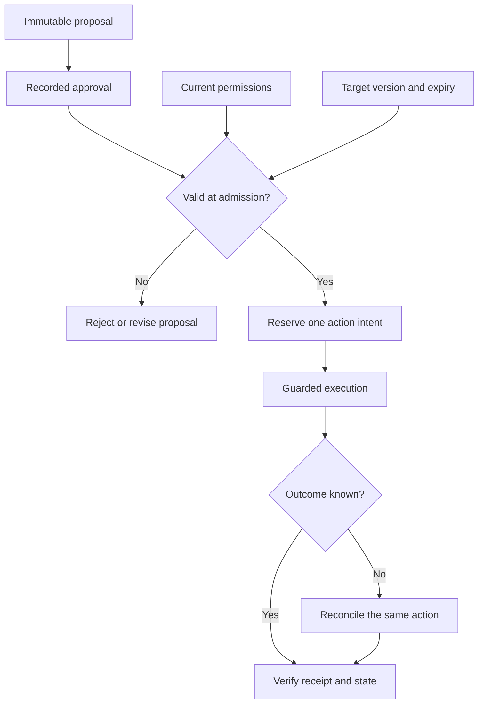

# Study Notes: M08.5.1 — Approval Validity

**Path:** Core · **Depth:** L2 foundation; L3 through demonstrated project work  
**Prerequisites:** M02, M05 and M25; tool permissions from M08.2.1  
**Purpose:** Keep an approval connected to the exact action and external state the user reviewed.  
**Completion evidence:** Reject changed, expired and unauthorized actions; prevent approval replay; explain how approval remains associated with one action during timeout recovery.

## Table of Contents

1. [Approval Validity Fundamentals](#1-approval-validity-fundamentals)
2. [Permission, Intent and Approval](#2-permission-intent-and-approval)
3. [Bind Approval to the Action](#3-bind-approval-to-the-action)
4. [Normalize Parameters Before Review](#4-normalize-parameters-before-review)
5. [Bind Approval to Target Versions](#5-bind-approval-to-target-versions)
6. [Expire Stale Approvals](#6-expire-stale-approvals)
7. [Recheck Current Permissions](#7-recheck-current-permissions)
8. [Detect Changed External State](#8-detect-changed-external-state)
9. [Close the Check-to-Execution Gap](#9-close-the-check-to-execution-gap)
10. [Approval Lifecycle and Timeout Recovery](#10-approval-lifecycle-and-timeout-recovery)
11. [Worked Example and Runnable Gate](#11-worked-example-and-runnable-gate)
12. [Approval Screens, Receipts and Audit Evidence](#12-approval-screens-receipts-and-audit-evidence)
13. [Failure Patterns and Design Decisions](#13-failure-patterns-and-design-decisions)
14. [Overall Concept Map](#14-overall-concept-map)
15. [Glossary and Final Revision Sheet](#15-glossary-and-final-revision-sheet)
16. [Practice and Interview Questions](#16-practice-and-interview-questions)
17. [L3 Project and Completion Evidence](#17-l3-project-and-completion-evidence)
18. [Sources and Further Reading](#18-sources-and-further-reading)

## 1. Approval Validity Fundamentals

### Definition

**Approval validity** means that a recorded approval still applies to the action about to execute. The action must have the approved meaning, target, parameters and relevant version, and the approving authority must still be acceptable under the current policy.

Consider a fictional task-management system. A supervisor reviews an action that will assign task `T-41`, currently at version 8, to employee `U-17`. Before execution, another employee changes the task to version 9 and assigns it elsewhere. The old approval does not automatically authorize overwriting that newer decision.

A user clicking **Approve** is an event in a workflow. A safe execution system must interpret what that event authorizes, how long it applies, whether it has already been used, and what to do if conditions change.

### Why this section exists

The time between preparation and execution can contain several changes:

- The model revises its proposed parameters.
- A background job changes the target resource.
- A user loses access to the project.
- A tool implementation changes its defaults.
- A price quote or temporary resource reservation expires.
- A worker crashes after dispatching the request.
- A second worker tries to execute the same approved action.

These are distinct situations. An approval record should help the system distinguish them instead of collapsing them into a single Boolean such as `approved=true`.

### A useful validity rule

For an action that requires approval, a conceptual execution rule is:

\[
\text{eligible} = \text{current permission}
\land \text{valid approval}
\land \text{matching action}
\land \text{valid preconditions}.
\]

This formula describes necessary checks. The implementation also needs to coordinate the checks with execution so the relevant state cannot change unnoticed between them.

The detailed approval record and state machine below are teaching designs. Their fields are not a universal vendor standard. OWASP's transaction-authorization guidance provides a useful primary reference for server-side enforcement, meaningful action review and an execution-time authorization gate. [Source: OWASP Transaction Authorization](https://cheatsheetseries.owasp.org/cheatsheets/Transaction_Authorization_Cheat_Sheet.html)

### Key takeaway

**Approve a concrete action under explicit conditions. Check those conditions again at the execution boundary.**

## 2. Permission, Intent and Approval

### Four separate questions

| Concept | Question it answers | Example |
|---|---|---|
| Authentication | Who is making the request? | The session belongs to Alice |
| Authorization | May this actor perform this operation on this object now? | Alice may assign tasks in project P1 |
| User intent | What outcome has the user requested? | Assign this particular task to U-17 |
| Approval | Has the required person confirmed this particular proposed action? | A supervisor approved the reviewed change |

Authentication can succeed while authorization fails. Authorization can succeed while the requested action is outside the user's instruction. The user can intend an action while a policy requires an additional approval. An approval can exist while the current permissions no longer allow execution.

For example, an assistant helping someone review task workloads should not infer that it may reassign every overdue task. Technical access to the reassignment tool does not establish that broader intent.

### Approval cannot grant missing access

Suppose Alice belongs to tenant Alpha and a tool request targets tenant Beta. Alice's approval of that request cannot create cross-tenant access. The server still needs to reject the operation unless a real authorization policy grants that access.

Similarly, an administrator approving a workflow does not necessarily authorize execution under an unrelated user's identity. The system must define which principal owns the action and how delegation is represented.

The authorization layer should validate permissions on each request and deny operations that do not have an applicable grant. The approval layer adds action-specific confirmation to that enforcement. [Source: OWASP Authorization](https://cheatsheetseries.owasp.org/cheatsheets/Authorization_Cheat_Sheet.html)

### Approval requirements should match the risk

An authorized, reversible internal task creation may be covered by the user's direct instruction without a second confirmation screen. A bulk reassignment affecting hundreds of people may require a concrete preview and explicit approval. An irreversible action can require stronger checks, a second person, or a policy that forbids automation entirely.

The aim is to preserve meaningful authorization, not to force repeated confirmation for every harmless step. Once valid approval covers a fixed action, avoid repeatedly asking the user to approve the same unchanged action merely because the client is performing safe recovery.

### How this guide connects to the others

[Tool Permissions](M08.2.1_Tool_Permissions.md) teaches risk classification and access boundaries. [Action Verification](M08.4.1_Action_Verification_and_Safe_Side_Effects.md) teaches preconditions, postconditions and recovery. This guide concentrates on whether a particular approval remains valid between those stages.

## 3. Bind Approval to the Action

**Syllabus coverage: Bind approval to action parameters and target version.**

### What does binding mean?

An approval is **bound** when the executor can reliably determine whether the proposed operation is the same operation that was approved. A free-text comment saying “looks good” is insufficient unless the application associates it with an immutable proposal.

A server-owned proposal might contain:

```json
{
  "action_id": "action-104",
  "tool": "tasks.assign.v1",
  "tenant_id": "tenant-alpha",
  "requested_by": "user-alice",
  "target_id": "task-41",
  "expected_target_version": 8,
  "parameters": {
    "assignee_id": "user-17",
    "notify_assignee": false
  }
}
```

These are fictional identifiers. The tenant and requester come from trusted application context, not from unchecked model-generated fields.

### Significant parameters

A parameter is significant when changing it can change the effect the user is approving. Examples include:

| Parameter | Why it matters |
|---|---|
| Target account, project or task ID | Determines which resource changes |
| Recipient or assignee ID | Determines who receives information or responsibility |
| Quantity or amount | Changes the scale of the effect |
| Currency or unit | Changes the meaning of a number |
| Notification option | Can create an additional external communication |
| Visibility or sharing setting | Changes who can access the result |
| Schedule and timezone | Changes when the action happens |
| Attachment or content version | Changes what is sent or published |
| Tool or operation version | Defines the semantics used to execute |

An approval for creating a private draft should not be reused for publishing it publicly. An approval for assigning one task should not become approval for assigning every task returned by a new search.

### Store an immutable proposal

A useful approach is to store the complete normalized proposal on the server and issue an opaque proposal ID. The approval references that proposal. The executor loads it rather than trusting a client to send a matching copy.

If users edit the draft, create a new proposal revision and invalidate the previous unused approval when the edit changes a significant field. Preserve the old record for auditability.

An immutable proposal also improves error messages: the system can show what changed instead of merely saying “approval invalid.”

### Fingerprints

A **fingerprint** is a digest of the canonical action representation. It can help detect whether the execution payload differs from the approved payload.

Conceptually:

\[
\text{action fingerprint} = H(\text{canonical action envelope}).
\]

The envelope should include the trusted scope and semantics, not just a user-visible title. Two actions with the same title in different tenants are not interchangeable.

A hash alone does not prove who approved the action. If an attacker can replace both the payload and the stored hash, the comparison provides no useful trust. Protect the approval store, authenticate approval events, and validate access to both proposal and approval records.

### Scope of an approval

Some workflows deliberately authorize bounded choices: “Create up to three internal tasks from this reviewed list.” Represent the allowed set, maximum count, permitted recipients and expiry explicitly. The executor must prove that its chosen action is inside that approved scope.

An open-ended instruction such as “do whatever is necessary” should not silently erase the organization's action limits. The application's policy defines what delegated authority can cover.

## 4. Normalize Parameters Before Review

### Definition

**Normalization** converts equivalent accepted inputs into the application’s explicit execution representation. For approval, normalization should happen before the user reviews the proposal.

Suppose the form omits `notify_assignee`. Version 1 of the tool defaults it to `false`, while a later implementation defaults it to `true`. If the stored approval only contains the fields the user typed, the same apparent proposal can acquire a new side effect.

Materialize significant defaults into the approved proposal. The execution adapter should use that explicit value rather than recomputing a default later.

### Separate formatting from meaning

These changes are not all equivalent:

| Change | Usually equivalent? | Approval treatment |
|---|---|---|
| JSON object key order changes | Yes, under a defined canonical representation | Fingerprint should remain equivalent |
| A display label changes while a stable target ID remains the same | Depends on whether meaning or identity changed | Evaluate the field's role |
| `5` changes to `"5"` | Not automatically | Validate the input type |
| An omitted notification field becomes `true` | No | Require a proposal reflecting that effect |
| A timezone changes from UTC to another zone | No, unless resolved to the exact same intended instant | Preserve the scheduling contract |
| A target display name resolves to a different ID | No | Re-resolve and review the actual target |

Do not hide meaningful changes behind an aggressive “cleanup” function. Trimming a task title may be harmless in a defined schema; changing a recipient address is not routine formatting.

### Canonical serialization

Ordinary JSON permits differences in formatting and member order. A system that compares raw JSON text can reject equivalent objects or, if different components parse ambiguously, disagree about meaning.

RFC 8785 describes a JSON canonicalization scheme for situations requiring a consistent representation. A local `json.dumps(..., sort_keys=True)` example is not automatically a complete implementation of that standard, particularly across languages and numeric representations. [Source: RFC 8785](https://www.rfc-editor.org/rfc/rfc8785.html)

For a small teaching system, restrict the accepted types and specify exactly how they are serialized. For a production integration, select a canonicalization method appropriate to its language and protocol boundaries.

### Resolve names to stable identities

“Assign to Sam” is not a complete execution target when several people share that name. Resolve the intended person before approval, display enough context for the user to confirm the choice, and bind the approval to the stable identity.

If the target account later becomes inactive, do not silently substitute another person with a similar name. That is a new proposal.

### Protect the parser boundary

Reject unexpected fields, unsupported types and ambiguous representations before computing the fingerprint. In Python, for example, `bool` is a subclass of `int`; a strict version validator should not accidentally accept `True` as version 1.

Type validation, business validation and approval matching serve different purposes. Passing one does not imply passing the others.

## 5. Bind Approval to Target Versions

### Definition

A **target version** identifies the state of the resource that was reviewed. The version can be a revision number, an ETag, a content digest, a quote identifier or another server-defined concurrency token.

The approved action often means:

> Apply this change to the resource state I reviewed.

It does not necessarily mean:

> Apply this change to whatever state happens to exist later.

### Optimistic concurrency

An application can require the target's current version to equal the approved expected version when the update is committed.

Conceptual SQL:

```sql
UPDATE tasks
SET assignee_id = :new_assignee,
    version = version + 1
WHERE tenant_id = :trusted_tenant
  AND task_id = :task_id
  AND version = :approved_version;
```

The executor checks that exactly one row was updated. Zero rows means the resource did not match the guarded condition. The surrounding operation still needs current authorization and approval validation; this SQL statement alone is not a complete access-control system.

### Conditional HTTP requests

For an API that supports the relevant semantics, the client can send an `If-Match` condition using the server's strong ETag. The server evaluates that condition as part of handling the state-changing request. A failed condition can produce `412 Precondition Failed`.

This protects against overwriting an unexpected representation. It does not verify the user's identity or establish that the user approved the action. [Source: RFC 9110, conditional requests](https://www.rfc-editor.org/rfc/rfc9110.html#section-13.1.1)

### What belongs in the version boundary?

The relevant resource is not always the object being created. A new task has no previous task version, but its project may have changed: it might be archived, moved to another access group, or configured to send notifications automatically.

For creation, bind any significant parent-resource version or business precondition. In the [worked lifecycle](M08.6.1_Worked_Example.md), creation checks an expected project version.

For actions using several resources, determine which state changes could alter the approved effect. A task assignment may depend on task version, project status and assignee eligibility. A single ETag from one object does not cover every related resource unless the API contract explicitly provides that coverage.

### Avoid the ABA problem

Suppose a task moves from status Open to Closed and then back to Open. Checking only the text `status == "Open"` cannot reveal the intervening changes. A monotonically increasing revision or generation can detect that the resource is no longer the originally reviewed state.

The same reasoning applies to an approval that is revoked and later replaced. Matching a superficial label such as `approved` is weaker than matching a specific approval identity and generation.

### Avoid automatically refreshing the guard

If version 8 is stale, fetching version 9 and retrying with the new version can overwrite a change the user never reviewed. Refresh the proposal, explain the meaningful difference and obtain renewed approval when the changed conditions invalidate the existing approval.

If the previous request timed out, reconcile its receipt before treating a new version as an unrelated conflict. The first request may itself have created the newer version.

## 6. Expire Stale Approvals

**Syllabus coverage: Expire stale approvals.**

### Why expiry matters

An approval that was sensible yesterday may be inappropriate after the target, organization or user's circumstances change. An expiry bounds how long an unused approval can remain eligible.

There is no universal five-minute or one-hour lifetime for every action. Select a lifetime based on the action's risk, the rate of relevant state changes, the expected human workflow and any underlying quote or reservation expiry.

### Useful time fields

| Field | Meaning |
|---|---|
| `issued_at` | When the proposal or approval record was created |
| `approved_at` | When the required actor confirmed it |
| `expires_at` | Latest allowed admission or execution time under the policy |
| `revoked_at` | When a formerly valid approval was explicitly withdrawn |
| `admitted_at` | When the executor accepted the bound action for processing |
| `completed_at` | When the system established the outcome |

Do not use these timestamps interchangeably. An operation can be admitted before approval expiry and complete afterward; whether that is permitted must be part of the service contract.

### Define the expiry boundary

Two possible policies are:

1. **Admission expiry:** The action must be accepted by the authoritative executor before expiry. The accepted operation may finish later under a documented execution policy.
2. **Effect expiry:** The state-changing effect must occur before expiry. A queued operation that reaches execution later must stop or obtain a new valid authorization.

The second policy requires enforcement where the effect occurs. A client checking the clock before sending a request cannot guarantee when a remote service will commit it.

When multiple services are involved, make the deadline part of the request contract where supported. Do not imply a guarantee that the provider cannot enforce.

### Use trusted time

Persist timestamps in an unambiguous format such as UTC instants. Evaluate validity with trusted server time. A user's browser clock or a model-supplied timestamp should not extend an approval.

For measuring an in-process timeout, a monotonic clock is appropriate. For persisted approval expiry across restarts, use a defined wall-clock timestamp and account for clock synchronization behavior. These solve different problems.

### Expiry is not outcome evidence

If an approval expires after a write may have been accepted, expiry does not prove that the write failed. Preserve the action identity and reconcile the outcome.

A new approval must not automatically produce a new idempotency key for an unresolved old action. Doing so can transform a recovery operation into a duplicate business action.

### Revocation

Revocation explicitly invalidates an approval before its scheduled expiry. It should be visible to the execution gate. The system must define what happens if revocation races with admission or commit.

For an operation already committed, revocation does not undo it. A supported reversal is a separate action with its own permissions, semantics and verification.

## 7. Recheck Current Permissions

**Syllabus coverage: Recheck permissions.**

### What can change after approval?

An employee can leave a project, a tenant can be suspended, a role can be removed, or a resource can move into a more restricted category. Reusing yesterday's permission decision would miss these changes.

The execution gate should derive the actor and tenant from authenticated context and check current operation-level and object-level access. A stored approval is evidence of a past confirmation; it is not a replacement for the current access decision.

### Requester and approver

Some workflows distinguish the person requesting an action from the person approving it. Define both roles explicitly.

For example:

- Alice requests a bulk reassignment.
- Bob approves it as the project supervisor.
- A service worker executes it under a constrained service identity while preserving Alice's and Bob's identities in the action record.

The service must determine whether Alice still has the relevant request authority, Bob's approval remains valid, and the worker has the narrowly scoped execution capability. Do not reduce this chain to “the worker token can call the API.”

### Policy versions and membership generations

A proposal can retain the policy version or membership generation observed at approval time. This makes changes detectable and supports explanation.

However, matching a policy-version string is not the authorization decision itself. The current policy might allow an operation under revised conditions, or might deny it despite an unchanged version label because another attribute changed.

Use version metadata to detect drift; use the policy engine to evaluate current permission.

### Fail closed when a required check is unavailable

If a sensitive write requires a current permission check and the authority cannot be reached, do not silently treat a cached approval as fresh authorization. Mark the action as not admitted or pending verification, depending on the actual execution state.

This is different from claiming a previously dispatched action has failed. Access-check unavailability before dispatch can block a new effect; access-check unavailability after an uncertain dispatch leaves the old outcome unresolved.

### Receipt access also needs authorization

Knowing an action ID or idempotency key should not allow someone to retrieve confidential task details after access is revoked. Recovery endpoints need their own authorization checks and appropriately scoped results.

If the original requester loses access, an authorized operator may reconcile the operation without disclosing restricted details to that requester.

## 8. Detect Changed External State

**Syllabus coverage: Detect changed external state.**

### Build a dependency inventory

Before asking for approval, identify the external facts that influence the action's meaning. For a task assignment, these can include task version, project membership, recipient identity, notification behavior and task status.

The inventory should be small enough to maintain and specific enough to protect what matters. Treating every unrelated metric as approval-critical creates needless invalidations. Ignoring important dependencies creates stale approvals.

### Relevant and irrelevant changes

| Observed change | Example decision |
|---|---|
| Task assignee changed after review | Rebuild the proposal; the approved before-state is stale |
| Assignee account was disabled | Block or prepare a new eligible target |
| Tool now sends a notification by default | Preserve an explicitly approved value or request a new approval |
| Internal trace ID changed | Usually does not alter the business action |
| Display formatting changed | Usually retain approval if the underlying reviewed meaning is identical |
| Project moved to another tenant | Re-evaluate identity, scope and authorization; do not reuse blindly |
| Approval policy changed | Apply current policy and determine whether old approval evidence satisfies it |

These are design examples, not universal rules. The service's documented action semantics decide which changes are significant.

### Revalidate a plan, not merely a message

A multi-step plan can expand after approval because an earlier tool returns new results. If the user approved reassignment of tasks T1 and T2, a later search returning T3 does not place T3 inside the approval automatically.

Bind a concrete item list, or define an explicit bounded selection rule the user can understand. Record which version of that list or rule was approved.

For large batches, retain per-item versions and outcomes. If one item changes, the policy may allow unaffected items to proceed, or it may require the whole batch to be reviewed again. Choose deliberately and describe the resulting partial-success semantics.

### Tool changes are external state too

Dynamic tool discovery can return an updated schema or implementation. Pin or validate the reviewed contract before executing a stored proposal. An approval for a tool whose semantics are no longer available should fail visibly.

A tool's self-description cannot authorize its own expansion of privileges. The trusted application catalog and execution policy decide which implementation is acceptable.

## 9. Close the Check-to-Execution Gap

### Definition

A **time-of-check to time-of-use gap** occurs when a system checks a condition, the condition changes, and the system later acts as though the old check still applies.

Checking a target version and then sending an unconditional update leaves such a gap. Checking whether an approval is unused and then marking it used in a separate uncoordinated operation can let two workers consume it.

### Same database boundary

When the approval record, permissions and target are controlled by one transactional service, it can coordinate the following:

1. Load the bound proposal and approval.
2. Check current access and the approval's state and expiry.
3. Verify the target version.
4. Claim the approval for one action.
5. Apply the effect and record the action receipt.
6. Commit the transaction.

The database's isolation and constraints must match the invariant. Merely wrapping arbitrary reads and writes in a transaction does not prove that every concurrency anomaly is prevented. PostgreSQL's documentation distinguishes isolation levels and their consequences. [Source: PostgreSQL Transaction Isolation](https://www.postgresql.org/docs/current/transaction-iso.html)

### Remote provider boundary

If the application stores approvals but another service performs the action, one local transaction cannot atomically cover both systems without an explicitly supported distributed protocol.

A practical design can persist a bound execution intent, reserve the approval for that intent, and dispatch with provider-supported idempotency and preconditions. Recovery then reuses the same intent and reconciles the provider's receipt.

The local reservation prevents another local worker from using the approval for a different action. The provider's idempotency prevents duplicate effects within its documented scope. The provider's conditional-write support protects the target version. Each control has a separate job.

### If the provider lacks a required control

Do not describe an application-side check as equivalent to a provider-side conditional write. There can still be a race.

Possible choices include using an alternative supported API, introducing an authoritative service that owns the affected state, narrowing the operation, requiring supervised execution, or declining to automate that class of action. The appropriate choice depends on the consequence of the remaining race.

### Long-running operations

An accepted asynchronous operation may return an operation identifier while work continues. Approval must bind to that operation and its immutable input. Completion is determined through the operation's documented status interface and verified effect.

The asynchronous request-reply pattern separates acceptance from eventual completion. An acceptance response should not be presented as proof that the business change is finished. [Source: Microsoft Asynchronous Request-Reply](https://learn.microsoft.com/en-us/azure/architecture/patterns/asynchronous-request-reply)

## 10. Approval Lifecycle and Timeout Recovery

### Useful states

| State | Meaning |
|---|---|
| Draft | Proposal can still change |
| Awaiting approval | A fixed proposal is ready for review |
| Approved | Required confirmation exists and has not yet been reserved |
| Reserved | One execution intent has claimed this approval |
| Dispatched | A request may have reached the effect-producing service |
| Outcome unknown | Available evidence does not establish the final result |
| Verified | Receipt and relevant postconditions establish the intended result |
| Rejected or expired | The proposal cannot initiate a new action under that approval |

These states describe a possible application model. They should not be confused with a vendor's actual response enums.

### One approval, one logical action

Consuming an approval once should mean binding it to one logical action, not forbidding all safe recovery calls for that action. A same-action receipt lookup or contract-safe idempotent retry is different from authorizing a second independent effect.

For example, `approval-9` can be reserved for `action-104` and `key-K`. If the response is lost, recovery uses `action-104` and `key-K`. It does not reset the approval to unused and generate `action-105`.

The idempotency design described in AWS's Builders' Library illustrates why a caller-provided request identity is useful for expressing repeated intent. Its details are a service contract, not a property created by adding an arbitrary request header. [Source: AWS Making Retries Safe](https://aws.amazon.com/builders-library/making-retries-safe-with-idempotent-APIs/)

### Approval consumption is not proof of completion

The approval may be reserved before the request is sent. A worker can then crash. Conversely, the provider may commit a write before the client records the successful response.

Therefore, do not infer the outcome solely from `approval.used = true`. Associate the approval with an action record whose execution state and receipt can be reconciled.

### How expiry interacts with a retry

After the original approval expires, first determine whether the provider already accepted or committed the same action. A read-only receipt lookup can establish that fact if the caller still has access.

A replay endpoint that returns an existing result without producing a new effect may be usable under its current authorization rules. Initiating an action that was never accepted may require fresh approval. The provider and application must define this boundary; a client cannot guess it from the timeout.

### Human review of ambiguity

When evidence is insufficient, ask an authorized operator to investigate the existing action. Provide its identity, target, approved parameters, attempted times, known receipts and unresolved facts.

Do not ask a vague “Try again?” question that hides the possibility of a duplicate. A human cannot make a blind retry technically safe simply by clicking a button. If a new action is eventually justified, document how the old action was resolved or prevented from later committing.

## 11. Worked Example and Runnable Gate

### Scenario

The following fictional example approves one task assignment. It checks a fixed action fingerprint, target version, current permission generation, expiry and reservation identity.

The code is a **pure eligibility demonstration**, not a production approval service. It does not authenticate users, persist records, perform an assignment, implement a distributed lock or close the gap between this check and a later remote write. Those responsibilities are explained above.

Copy the following complete block into `approval_gate.py` and run it with Python 3.10 or later. It uses only the standard library.

```python
from dataclasses import dataclass, replace
import hashlib
import json


def digest(action):
    required = {"action_id", "tenant", "actor", "tool", "task_id",
                "expected_version", "assignee_id", "notify"}
    if type(action) is not dict or set(action) != required:
        raise ValueError("invalid action fields")
    for field in required - {"expected_version", "notify"}:
        if type(action[field]) is not str or not action[field]:
            raise ValueError("invalid identity or text")
    if type(action["expected_version"]) is not int:
        raise ValueError("version must be an integer")
    if action["expected_version"] < 1 or type(action["notify"]) is not bool:
        raise ValueError("invalid version or notification setting")
    # Restricted teaching representation; not RFC 8785 canonicalization.
    encoded = json.dumps(action, sort_keys=True, separators=(",", ":"),
                         allow_nan=False).encode()
    return hashlib.sha256(encoded).hexdigest()


@dataclass(frozen=True)
class Approval:
    tenant: str
    actor: str
    action_digest: str
    target_version: int
    permission_generation: int
    expires_at: int
    revoked: bool = False
    reserved_for: str | None = None


def admission_reason(action, approval, current, now):
    # `current` and `approval` are trusted server-derived fixture values.
    action_digest = digest(action)
    if (action["tenant"], action["actor"]) != (current["tenant"], current["actor"]):
        return "wrong authenticated scope"
    if not current["can_assign"]:
        return "permission denied"
    if (approval.tenant, approval.actor) != (current["tenant"], current["actor"]):
        return "approval belongs to another scope"
    if approval.revoked:
        return "approval revoked"
    if now >= approval.expires_at:
        return "approval expired for new admission"
    if approval.action_digest != action_digest:
        return "action changed"
    if approval.permission_generation != current["permission_generation"]:
        return "permission state changed; reevaluate approval policy"
    if not (action["expected_version"] == approval.target_version == current["task_version"]):
        return "target version changed"
    if approval.reserved_for not in (None, action["action_id"]):
        return "approval reserved for another action"
    return "eligible for atomic admission checks"


action = {"action_id": "A1", "tenant": "alpha", "actor": "alice",
          "tool": "tasks.assign.v1", "task_id": "T41",
          "expected_version": 8, "assignee_id": "U17", "notify": False}
current = {"tenant": "alpha", "actor": "alice", "can_assign": True,
           "permission_generation": 4, "task_version": 8}
approval = Approval("alpha", "alice", digest(action), 8, 4, 1200)
assert admission_reason(action, approval, current, 1100).startswith("eligible")
assert admission_reason({**action, "notify": True}, approval, current, 1100) == "action changed"
assert "expired" in admission_reason(action, approval, current, 1200)
assert "target version" in admission_reason(action, approval, {**current, "task_version": 9}, 1100)
assert "permission denied" == admission_reason(action, approval, {**current, "can_assign": False}, 1100)
assert "revoked" in admission_reason(action, replace(approval, revoked=True), current, 1100)
assert "another action" in admission_reason(action, replace(approval, reserved_for="A2"), current, 1100)
assert "scope" in admission_reason(action, approval, {**current, "tenant": "beta"}, 1100)
print("PASS: binding, expiry, versions, permissions, revocation and reservation")
```

### Interpret the result correctly

The success message means the fixture's assertions passed. It does not establish that an assignment occurred. The function returns an eligibility reason; a real executor must repeat or enforce the decisive conditions atomically when claiming the approval and changing the resource.

This example deliberately uses a conservative rule: any permission-generation change triggers review of approval validity. A real policy can decide whether a particular change invalidates approval, but it still evaluates current permission.

Notice the expiry boundary: `now == expires_at` is expired. The approved interval is explicit rather than depending on inconsistent comparisons in different workers.

## 12. Approval Screens, Receipts and Audit Evidence

### Present the actual decision

A useful approval screen identifies the operation, target, important before-and-after values, affected scope, additional side effects and relevant expiry. It should be generated from the stored proposal that execution will use.

For the fictional assignment:

| Review field | Displayed value |
|---|---|
| Action | Assign task |
| Task | T-41 — Review the draft checklist |
| Current assignee | U-09 |
| New assignee | U-17 — Sam, Operations |
| Notification | No notification will be sent |
| Reviewed revision | 8 |
| Approval applies to | This task assignment only |

Avoid asking the user to approve raw internal JSON when a readable summary can convey the decision. Also avoid hiding significant settings in a collapsed technical panel.

### Record evidence without storing secrets

Useful audit fields include proposal and approval IDs, actor and approver identities, action fingerprint, target version, decision time, policy decision reference, reservation identity, provider operation ID and verified outcome.

Do not log authentication tokens, one-time passwords, private signing keys or unnecessary sensitive payloads. Protect access to audit records and record enough context to correlate events without turning the log into a new disclosure channel.

### Distinguish approval receipt and action receipt

An approval receipt proves that the approval workflow recorded a confirmation. An action receipt identifies what the executor accepted or completed. A verification record describes the resulting environment state.

Keep the links between them, but do not present one as if it automatically proves the others.

### Explain invalidation precisely

Useful explanations include “The task changed from revision 8 to 9 before execution” or “The recipient account is no longer active.” Show only information the user may access.

If permissions were revoked, an appropriate response may be limited to “You no longer have access to perform this action.” Detailed hidden policy information need not be exposed.

## 13. Failure Patterns and Design Decisions

| Failure pattern | Why it fails | Better design |
|---|---|---|
| Store only `approved=true` | No binding to action or scope | Immutable proposal plus action-specific approval |
| Trust model-supplied `approved_by` | Untrusted input claims authority | Authenticated approval event |
| Check version, then update unconditionally | Resource can change in between | Conditional update at the effect boundary |
| Refresh the target version automatically | Changes the approved before-state | Review meaningful drift before a new action |
| Reset approval after timeout | Can authorize a second effect | Preserve reservation and reconcile the original action |
| Reuse approval across recipients | Changes who is affected | Bind stable target identities |
| Ignore changed defaults | Adds unreviewed behavior | Materialize significant defaults before approval |
| Approval expiry means failure | A dispatched action may already have committed | Separate validity from outcome state |
| Human approval bypasses ACL | Confirmation is mistaken for a permission grant | Enforce current server-side authorization |

### Choosing an appropriate design

For a single-resource update in a service you control, an immutable proposal, current access check, approval claim and conditional write in one transaction can be straightforward.

For a remote operation, preserve a durable execution intent and use the provider's documented idempotency, concurrency and receipt mechanisms. Explicitly describe any guarantee that remains unavailable.

For a batch, decide whether approval covers exact items, a fixed snapshot, or a bounded selection rule. Match the recovery and partial-success behavior to that choice.

## 14. Overall Concept Map



The reservation connects an approval to one logical action. It is not a claim that a remote effect has already occurred.

## 15. Glossary and Final Revision Sheet

### Glossary

| Term | Meaning |
|---|---|
| Approval binding | Association between confirmation and a specific action envelope |
| Immutable proposal | Reviewed action data that cannot be silently changed |
| Significant parameter | A value that changes the effect or decision being approved |
| Fingerprint | Digest of a defined canonical representation |
| Expected version | Reviewed state token required by the operation |
| Optimistic concurrency | Detecting conflicting changes through conditional writes |
| TOCTOU | Relevant state changing between check and use |
| Expiry | Time after which an approval cannot initiate an action under its policy |
| Revocation | Explicit invalidation of an approval or permission |
| Reservation | Claiming an approval for one durable execution intent |
| Admission | Authoritative acceptance of an action for execution |
| Action receipt | Identifier and outcome evidence from the executor |
| Reconciliation | Determining the outcome of an existing uncertain action |
| ABA problem | State appears unchanged after intervening changes |

### Final revision sheet

- Authenticate the actor; authorize the operation and object; establish intent; apply required approval.
- Review the exact normalized action, including significant defaults and side effects.
- Bind stable identities, scope, tool semantics and expected versions.
- Keep approval records in a trusted store.
- Define expiry at admission or effect, and enforce the chosen boundary.
- Recheck current permissions and relevant external state.
- Use atomic admission and conditional effects where supported.
- Reserve one approval for one logical action.
- Recover the same action after timeout; preserve its identity and idempotency key.
- An approval receipt, action receipt and verified postcondition are different evidence.
- Escalate unresolved state with a concrete investigation record.

## 16. Practice and Interview Questions

### Recall questions with answers

**1. What is approval validity?**  
It is the condition that a recorded approval still applies to the exact proposed action, relevant target state, time window and current authority when execution is attempted.

**2. Why is `approved=true` insufficient?**  
It does not identify the approved parameters, target, scope, revision, approver, expiry or permitted number of uses. Those omissions make substitution and replay difficult to detect.

**3. Can user approval override missing tenant access?**  
No. The server must enforce actual permissions. Approval confirms an action within the actor's permitted authority; it does not manufacture that authority.

**4. Why materialize defaults before approval?**  
Defaults can change the action's behavior. Explicitly storing significant defaults ensures the reviewed proposal and executed request agree about effects such as notifications or visibility.

**5. What does a fingerprint prove?**  
It can show that two representations match under the chosen canonicalization. By itself it does not prove who approved the action or that the stored fingerprint is trustworthy.

**6. What does an expected target version protect?**  
It prevents the action from silently applying to a different resource state when the authoritative service enforces the version condition at the effect boundary.

**7. Why recheck permissions after approval?**  
Permissions, memberships, account status and resource restrictions can change. The historical approval does not establish that the operation remains authorized now.

**8. Does approval expiry prove that an uncertain action failed?**  
No. The action may have been admitted or committed before expiry. Reconcile the existing action's receipt and state instead of assuming it is safe to start another.

**9. What is approval reservation?**  
It binds an available approval to one execution intent so multiple workers cannot legitimately use it for separate actions. Reservation is distinct from verified completion.

**10. What should happen when a significant parameter changes?**  
Reject the mismatch and create or review a revised proposal according to policy. Do not silently reuse an approval that applies to different effects.

### Multiple-choice questions — Easy

**11. Which field most directly connects approval to the reviewed resource state?**

A. A friendly tool icon  
B. The expected target version  
C. The model's response temperature  
D. A random display color

**Answer: B.** The expected version identifies the resource state that execution must respect. The other fields do not constrain the affected resource.

**12. Who should determine the trusted tenant identity?**

A. Any document returned by a tool  
B. The model's best guess  
C. The authenticated application context  
D. A user-editable approval flag

**Answer: C.** Tenant identity is a security boundary. Model arguments and retrieved documents must not independently establish it.

**13. Which statement about an approval receipt is correct?**

A. It proves the business action finished  
B. It proves no retry can ever be needed  
C. It records the approval event  
D. It bypasses current authorization

**Answer: C.** Completion needs action and environment evidence. The approval event alone does not establish the write's outcome.

### Multiple-choice questions — Medium

**14. A tool's notification default changes after approval. What best preserves the reviewed action?**

A. Always use the latest default  
B. Store and execute the explicit approved notification value  
C. Ask the model to remember the old behavior  
D. Remove notification logging

**Answer: B.** Significant defaults belong in the normalized proposal. If the new tool cannot preserve the approved semantics, execution should not silently substitute them.

**15. A worker checks a version and then sends an unconditional update. What remains?**

A. A possible check-to-use race  
B. Guaranteed serial execution  
C. Automatic approval renewal  
D. Complete protection against every duplicate

**Answer: A.** The target may change after the check. A provider-enforced conditional update is needed to protect that version condition during the write.

**16. Two workers see an unused approval simultaneously. What is the relevant control?**

A. Longer tool descriptions  
B. Atomic reservation or consumption for one action  
C. Different random keys for both workers  
D. Hiding the approval button

**Answer: B.** The claim must be coordinated in shared authoritative state. Different keys would make duplicate effects easier, not safer.

### Multiple-choice questions — Hard scenarios

**17. An approved update times out. A subsequent read shows a newer target version. What should happen first?**

A. Replace the approved version and retry with a new key  
B. Assume another user changed it  
C. Reconcile whether the original action produced that version  
D. Mark the action failed because approval expired

**Answer: C.** The original action might have committed. Preserve its identity and investigate before constructing another write.

**18. A supervisor approved a batch of tasks T1 and T2. A later search also returns T3. What is valid?**

A. Include T3 because the search is newer  
B. Include T3 if the model believes it is relevant  
C. Execute within the approved set, or obtain approval for the changed scope  
D. Treat every task in the tenant as approved

**Answer: C.** Relevance is not approval. The stored proposal or explicit bounded rule determines the authorized set.

**19. A user clicks “retry” while the old operation remains unresolved and the provider offers no deduplication contract. What follows?**

A. The click eliminates duplicate risk  
B. A new write remains unsafe without resolving or containing the old action  
C. A new UUID makes the old write disappear  
D. A timeout guarantees zero effects

**Answer: B.** Human confirmation does not change the provider's behavior. The review must address the unresolved original action and the consequences of a replacement.

### Interview questions with model answers

**20. How would you implement approval binding?**  
I would store an immutable, normalized proposal under a server-generated action ID. It would contain the trusted scope, operation version, stable targets, significant parameters and expected resource versions. The authenticated approval event would reference that proposal. Execution would load the stored proposal, check approval state and current permissions, and reject any mismatch. A digest could assist comparison, but the trusted store and authenticated event establish authority.

**21. How would you prevent stale approval from overwriting a concurrent change?**  
I would bind the approval to the reviewed version and enforce that condition where the change occurs, using a conditional API operation or guarded database update. If the condition fails, I would determine whether a prior uncertain attempt caused the change, then rebuild the proposal if necessary. I would not replace the version automatically and continue as though the old approval covered the new state.

**22. What happens when approval expires during an asynchronous operation?**  
The answer depends on the documented boundary. An admission-based policy can allow an already accepted operation to finish, while an effect-based policy must enforce the deadline at the actual effect. I would retain the operation identity and receipt. Expiry would not be used as evidence that the operation failed or that a new key is safe.

**23. How do you handle a permission change after approval?**  
I re-evaluate the actor's current operation and object access at execution. I also apply the policy for the approver's continuing authority where relevant. If the action has already been dispatched, I separate denial of new execution from reconciliation of the old outcome. Receipt access remains authorized, and an operator may need to investigate without disclosing restricted information to the original requester.

**24. How would you coordinate one approval across multiple workers?**  
I would atomically reserve it for one durable action intent in shared state. Every worker recovering that action would use the same intent and idempotency identity. The provider would still need its own supported deduplication and precondition controls. I would track unknown outcomes explicitly and would not reset the approval to unused merely because a worker crashed.

**25. What would you test before calling the approval flow reliable?**  
I would mutate each significant field, expire and revoke approvals, change target versions and membership, race two workers, and inject failures before and after dispatch. I would verify the resulting state and receipts, not just response codes. I would also test that a used approval cannot authorize another action and that an uncertain action remains linked to its original approval during recovery.

## 17. L3 Project and Completion Evidence

### Project: approve and assign a task

Build a small task assignment service with authenticated test principals, tenant-scoped tasks, revisions, an immutable proposal table and an approval table. Use synthetic data and a local test environment.

Implement the following flow:

1. Load a task the requester may access.
2. Create a fixed proposal with the reviewed version and explicit side effects.
3. Record approval by an eligible actor.
4. Atomically reserve the approval and enforce the relevant conditions during execution.
5. Return an action receipt and verify the resulting task assignment.
6. Recover an injected timeout using the original action identity.

### Required failure cases

| Test | Expected evidence |
|---|---|
| Change the assignee after approval | Mismatch rejection; no assignment change |
| Enable notification after approval | Rejection or a newly reviewed proposal |
| Advance the target version | Conditional-write failure without overwriting the new state |
| Revoke requester access | Execution denied under current policy |
| Expire the unused approval | No new effect admitted |
| Race two workers | One logical execution; shared reservation evidence |
| Lose the response after commit | Existing action recovered without a duplicate |
| Reuse approval for another action | Rejected binding or reservation mismatch |
| Make status unavailable | Explicit unresolved state with a review record |

### What to submit

Retain the schema, action and approval records, expected state transitions, sanitized trace, test inputs, actual results and a brief explanation of the transaction boundary. State whether the effect is local or remote and what the provider guarantees.

L2 is demonstrated by explaining why each check exists. L3 requires running these cases and showing that the environment satisfies the intended invariants.

## 18. Sources and Further Reading

These references support specific protocol and security concepts. The examples, field names, decision tables and exercises are original teaching designs.

1. [OWASP Transaction Authorization Cheat Sheet](https://cheatsheetseries.owasp.org/cheatsheets/Transaction_Authorization_Cheat_Sheet.html) — transaction review and execution-time authorization controls.
2. [OWASP Authorization Cheat Sheet](https://cheatsheetseries.owasp.org/cheatsheets/Authorization_Cheat_Sheet.html) — server-side access decisions and current permissions.
3. [RFC 9110: HTTP Semantics](https://www.rfc-editor.org/rfc/rfc9110.html) — conditional requests, ETags and method semantics.
4. [RFC 8785: JSON Canonicalization Scheme](https://www.rfc-editor.org/rfc/rfc8785.html) — consistent JSON representations for hashing and signing applications.
5. [PostgreSQL: Transaction Isolation](https://www.postgresql.org/docs/current/transaction-iso.html) — transaction isolation and concurrency behavior.
6. [AWS Builders' Library: Making Retries Safe with Idempotent APIs](https://aws.amazon.com/builders-library/making-retries-safe-with-idempotent-APIs/) — caller intent and request identity.
7. [Microsoft: Asynchronous Request-Reply Pattern](https://learn.microsoft.com/en-us/azure/architecture/patterns/asynchronous-request-reply) — acceptance, status tracking and eventual completion.

Product-specific behavior should be checked against the version of the service used in your project. A teaching approval state or schema is not a claim about an existing provider's API.
