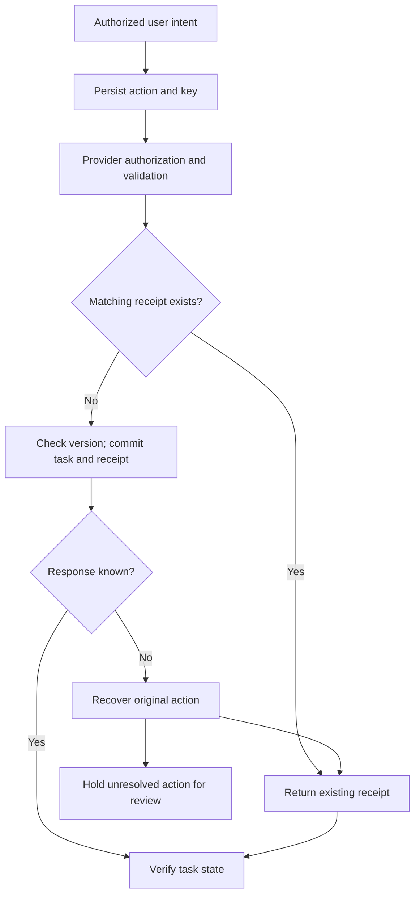

# Study Notes: M08.6.1 — Worked Example: Create a Task Safely

**Path:** Core · **Depth:** L2 foundation; L3 through demonstrated project work  
**Prerequisites:** M02, M05 and M25; the earlier M08 guides  
**Purpose:** Apply tool interfaces, authorization, execution, reliability and verification in one traceable action lifecycle.  
**Completion evidence:** Block unauthorized calls, survive an ambiguous timeout and verify no duplicate write.

## Table of Contents

1. [The Task and the Required Invariants](#1-the-task-and-the-required-invariants)
2. [Define the Tool and Service Contracts](#2-define-the-tool-and-service-contracts)
3. [Distinguish the Action Identifiers](#3-distinguish-the-action-identifiers)
4. [Understand the Unsafe Baseline](#4-understand-the-unsafe-baseline)
5. [Prepare a Durable Client Intent](#5-prepare-a-durable-client-intent)
6. [Authorize and Commit at the Provider](#6-authorize-and-commit-at-the-provider)
7. [Handle the Ambiguous Timeout](#7-handle-the-ambiguous-timeout)
8. [Look Up the Receipt and Verify One Task](#8-look-up-the-receipt-and-verify-one-task)
9. [Escalate Unresolved State](#9-escalate-unresolved-state)
10. [Complete Runnable Python Example](#10-complete-runnable-python-example)
11. [Read the Program as a Lifecycle](#11-read-the-program-as-a-lifecycle)
12. [Fault Injection and Expected Evidence](#12-fault-injection-and-expected-evidence)
13. [Production Boundaries and Extensions](#13-production-boundaries-and-extensions)
14. [Operations and User-Facing Results](#14-operations-and-user-facing-results)
15. [Overall Concept Map](#15-overall-concept-map)
16. [Glossary and Final Revision Sheet](#16-glossary-and-final-revision-sheet)
17. [Practice and Interview Questions](#17-practice-and-interview-questions)
18. [L3 Project and Completion Portfolio](#18-l3-project-and-completion-portfolio)
19. [Sources and Further Reading](#19-sources-and-further-reading)

## 1. The Task and the Required Invariants

### Scenario

A user asks an assistant:

> Create an internal task in project P1 titled “Review the draft checklist.”

The assistant can discover tools and propose arguments. A trusted application checks the actor's identity and permission, resolves the project, persists the requested action and invokes the task service.

The service creates the task, but the response disappears before the client receives it. The client now has a timeout and does not know whether the task exists.

The correct outcome is one authorized task with verified contents. The client should recover the original operation instead of blindly creating another task.

All organizations, people, projects and tasks in this guide are fictional. The runnable program uses temporary local SQLite databases and performs no network requests or real external actions.

### Three module-level invariants

| Invariant | Meaning | Evidence |
|---|---|---|
| Unauthorized actions have no business effect | A denied actor cannot create a task | Denial plus authoritative state showing no task was added |
| One intent does not become multiple writes during recovery | Repeating the same logical action does not create another task | Stable intent/key, a retained receipt and database uniqueness |
| Completion claims match the environment | “Created” means the intended task exists with the expected properties | Authorized receipt lookup and task-state verification |

An **invariant** is a property the system must preserve across normal operation and relevant failures. In this project, the difficult cases matter more than a single successful happy-path request.

### What is deliberately small about this example?

The action creates a reversible internal task without sending notifications. The test policy treats it as a low-risk write covered by the user's explicit instruction and current permission. A separate approval step is therefore not required in this fixture.

For a higher-risk task action, insert the approval process from [Approval Validity](M08.5.1_Approval_Validity.md) before admitting a new write. Bind the approval to the same intent used for recovery. Do not add a new approval requirement merely because a harmless receipt lookup is needed.

### Key takeaway

**The unit of recovery is the original logical action. Keep its identity stable until its outcome is resolved.**

## 2. Define the Tool and Service Contracts

### The model-facing operation

A tool interface can expose the business request:

```json
{
  "project_id": "P1",
  "title": "Review the draft checklist"
}
```

The trusted runtime resolves the authenticated tenant and actor, loads the relevant project version, validates the proposal, and assigns the action and idempotency identities.

The model does not choose its own tenant, grant itself a role, mark the request approved or invent a provider receipt. These are control-plane responsibilities.

### The executable action envelope

The teaching service receives a validated payload containing:

```json
{
  "action_id": "a-server-generated-action-id",
  "project_id": "P1",
  "expected_version": 7,
  "title": "Review the draft checklist"
}
```

The authenticated principal and idempotency key are supplied separately by the trusted adapter. A generated action ID is persisted before dispatch. The string above describes its role; the program generates real UUID values for its local fixture.

### The provider's explicit contract

The example owns the task service, so it can define and implement these rules:

1. The provider checks current project-level read and create permission before a create or replay response.
2. The idempotency scope is `(tenant, actor, tool version, idempotency key)`.
3. The same key must describe the same normalized action envelope.
4. The same action ID cannot be submitted with another key within that scope.
5. A new action must match the current project version and target an open project.
6. The task, project-version increment and receipt are committed in one database transaction.
7. A duplicate request returns the existing committed receipt without repeating the effect.
8. Receipt lookup and verification require current read permission.
9. The fixture never expires its receipts during a run.

These guarantees exist because the code implements them. They are not automatically provided by every API accepting a parameter named `idempotency_key`.

### HTTP method semantics versus an application contract

HTTP defines idempotence in terms of the intended effect of repeated identical requests. It does not make every POST operation safe to repeat. A non-idempotent-looking operation can still support a separate application-level deduplication contract, but the client must know that contract applies. [Source: RFC 9110, idempotent methods](https://www.rfc-editor.org/rfc/rfc9110.html#section-9.2.2)

### Retention matters

A production service may retain idempotency records for a limited period. After that period, the same key might be treated as new. For example, Stripe documents key-pruning and parameter-mismatch behavior for its API v1 idempotency contract. This is a provider-specific example, not a general time limit for all services. [Source: Stripe Idempotent Requests](https://docs.stripe.com/api/idempotent_requests)

Your adapter should retain the actual provider's supported window and stop relying on it after the window expires. The local fixture uses no expiry so that the mechanics remain easy to inspect.

## 3. Distinguish the Action Identifiers

### Why one generic `id` is confusing

One user request may generate several attempts, a provider operation, a task resource and a receipt. These identities are related but serve different purposes.

| Identifier | Meaning | Changes on a retry? |
|---|---|---|
| User or conversation request ID | Context in which the user expressed intent | Depends on the application; do not use it alone as business identity |
| Action ID | One logical business action | No |
| Idempotency key | Provider's deduplication identity within a documented scope | No, for the same unresolved action |
| Attempt ID | One dispatch attempt | Yes |
| Provider operation ID | An accepted asynchronous operation, when applicable | Reuse the original operation identity |
| Receipt ID | Provider evidence associated with the accepted or committed action | Reuse the retained receipt |
| Task ID | The resource created by the action | The same resource on an idempotent replay |
| Trace ID | Correlation across logs and services | Follow the tracing convention; it is not the deduplication rule |

The demonstration implements action IDs, keys, receipt IDs and task IDs. A production client should additionally maintain explicit attempt records and timing information.

### A key expresses repeated intent

The same task title can legitimately appear in two different tasks. A user might ask for two independent review tasks with identical wording. Therefore, do not automatically deduplicate every matching title or every matching payload hash.

Generate a fresh logical action when the user intends another independent effect. Reuse the old identity when recovering the same action. A fingerprint checks that a repeated identity still carries the same parameters.

AWS's discussion of idempotent APIs explains this distinction between identifying repeated intent and inferring duplication from similar parameters. [Source: AWS Making Retries Safe](https://aws.amazon.com/builders-library/making-retries-safe-with-idempotent-APIs/)

### Scope prevents collisions and disclosure

An identical key in another tenant should not return a receipt from the first tenant. The provider includes authenticated scope in its key lookup.

The fixture also includes the actor and tool version. This means another actor's independently requested task belongs to another deduplication scope. A real API might choose a different scope, such as account plus endpoint. The client must follow the documented rule rather than assume that every key is globally unique.

### Hashes are not authentication

The action fingerprint is computed from the validated envelope and trusted scope. It detects a changed title, project, version or action identity under the same key.

It does not authenticate the caller. The service separately checks an authenticated principal's current grants. In the program, `Principal` objects are trusted test fixtures standing in for that authentication boundary.

## 4. Understand the Unsafe Baseline

### A tempting implementation

Conceptual pseudocode:

```text
try:
    create_task(project, title)
except timeout:
    create_task(project, title)
return "Task created"
```

The second call might create a duplicate. The return message might also be false if the second call fails or creates the wrong task.

### The ambiguous history

| Time | Provider | Client knowledge |
|---|---|---|
| T0 | No task exists | Ready to request creation |
| T1 | Receives the create request | Waiting |
| T2 | Commits task T1 | Still waiting |
| T3 | Response is lost | Timeout; outcome unknown |
| T4 | Receives another create with new identity | Client thinks it is recovering |
| T5 | Commits task T2 | Duplicate effect exists |

A timeout at T3 is compatible with several provider states. It is not equivalent to an authoritative rejection before execution.

### Three incomplete fixes

**Search by title before retrying.** A search index may lag, titles may not be unique, results may be permission-filtered, and the original request may still be in flight. A missing search hit is insufficient proof that the original write cannot happen.

**Generate a new UUID for every attempt.** This makes attempts easy to identify but defeats deduplication if the UUID is used as the provider key. Attempt IDs can change; the logical action key must remain stable.

**Put a lock in one process.** The lock does not coordinate other workers or survive a process restart. Even a shared local lock does not, by itself, prevent a remote provider from processing two requests.

### Why cancellation is insufficient

Stopping the client from waiting can leave the remote request running. A cancellation acknowledgement also needs documented semantics: it might acknowledge a request to cancel rather than prove that no effect occurred.

Recovery should use the service's operation status, receipts and effect checks. It should not infer outcome from what happened to the client's waiting task.

## 5. Prepare a Durable Client Intent

### Definition

A **durable intent** is a persisted record of the action the client intends to perform, including the identity required to recover it after a restart.

The fixture writes the payload and key into a client SQLite database before contacting the task service. Reloading the client preserves the original action and key.

### Suggested production fields

| Field group | Examples |
|---|---|
| Scope | Tenant, requester, delegated actor if applicable |
| Meaning | Tool version, normalized parameters, target IDs |
| Conditions | Expected resource versions, approval reference if required |
| Identity | Action ID, idempotency key, fingerprint |
| Lifecycle | Prepared, dispatched, unknown, verified, needs review |
| Recovery | Provider receipt/operation ID, attempts, deadline, retention window |
| Evidence | Postcondition result, verification time, sanitized error category |

The teaching journal intentionally stores a smaller set. Its role is to make restart-safe identity visible without introducing an entire workflow platform.

### Prepare once

Calling the program's `Journal.prepare()` creates a new action. It must not be called again just because an old attempt timed out. Recovery uses `Journal.load()`.

This is an important interface design decision. The function names and storage model should make “new action” and “recover existing action” separate operations.

### Persist before dispatch

If a client generates a key, sends the request and crashes before saving the key, it may be unable to correlate the provider's eventual result with the original request. Persisting first removes that particular gap.

There is still a boundary between the client database and provider database. The client may remain `unknown` while the provider is committed. The solution is reconciliation using the retained identity, not pretending both databases share one transaction.

### What does durable mean here?

The fixture commits its journal through SQLite and reconstructs Python objects to demonstrate recovery without in-memory state. It does not perform a hardware power-loss test, verify filesystem flush behavior or simulate a whole distributed cluster.

Python's `sqlite3` module exposes transactions and parameterized queries used by the example. The code chooses explicit transaction statements to make boundaries visible. [Source: Python 3.12 sqlite3](https://docs.python.org/3.12/library/sqlite3.html)

## 6. Authorize and Commit at the Provider

### Validate before interpreting the action

The program rejects missing or unexpected fields, invalid text, overly long titles and invalid versions. A Boolean is not accepted as an integer version.

This protects the input contract. It does not establish business permission, so the service separately checks tenant, actor and project access.

### Current authorization

The database contains explicit read and create grants for each actor and project. Creation requires both in this fixture, because the operation returns a task receipt containing information about the created resource.

The viewer can read project P1 but cannot create tasks. Another tenant containing a project with the same display ID still has a separate access boundary. The fixture tests both cases.

Authorization needs to be enforced by the effect-producing service. A model prompt saying “only use authorized projects” is useful guidance but cannot replace the service's check. [Source: OWASP Authorization](https://cheatsheetseries.owasp.org/cheatsheets/Authorization_Cheat_Sheet.html)

### The atomic provider operation

For a new action, the provider transaction contains:

1. Current authorization.
2. Deduplication lookup.
3. Action/key consistency checks.
4. Project availability and expected-version checks.
5. Task insertion.
6. Receipt insertion.
7. Project-version increment.

Either the transaction commits its writes, or the transaction rolls them back. The task and receipt are not stored through unrelated best-effort writes.

SQLite permits multiple readers but coordinates writes through its transaction and locking behavior. `BEGIN IMMEDIATE` starts a write transaction and can encounter contention if another writer is active. The fixture uses a bounded connection timeout and keeps the transaction short. [Sources: SQLite Transactions](https://www.sqlite.org/lang_transaction.html), [SQLite Isolation](https://www.sqlite.org/isolation.html)

### Why task and receipt belong together

If the task commits but no deduplication record exists, a retry can create another task. If the receipt commits but the task does not exist, the provider may falsely claim completion.

In this example, the provider owns both pieces of state and can commit them together. A wrapper around an unrelated external task API cannot obtain this guarantee merely by adding its own local receipt table.

### Replay before new-action preconditions

Creating a task increments the project version. The replay still carries the original approved version. If the provider checked that old version before recognizing a duplicate, it would report a conflict for its own successful earlier action.

The program first checks current authorization, then recognizes an existing matching receipt. A replay returns that historical result without applying another effect. Only a genuinely new action must pass the current project-version check.

This ordering is a defined part of the teaching contract. Follow a real provider's documented ordering and response semantics when integrating its API.

### Concurrent identical requests

Two threads can request the same action concurrently. Database coordination and uniqueness constraints ensure that one transaction creates the task and the other observes the existing receipt.

The receipt key is unique within the defined scope. The task's logical action ID is also unique within its tenant and actor scope. These constraints reinforce the invariant instead of relying solely on a prior “does it exist?” query.

## 7. Handle the Ambiguous Timeout

**Syllabus coverage: Create with an idempotency key; retry after timeout.**

### The injected failure

The provider's `create(..., lose_response=True)` commits the task and receipt, exits the database transaction and then raises `TimeoutError`.

The placement of this failure is the teaching point: the client experiences a timeout even though the effect already exists. The client records `unknown` and retains the original payload and key.

### Two legitimate recovery strategies

| Strategy | When it is appropriate | Result |
|---|---|---|
| Look up the existing operation or receipt first | A trustworthy status interface is available | A known committed result can avoid another create call |
| Retry the identical action with its original key | The provider explicitly deduplicates the action, the key remains valid and current permission allows the call | The provider returns the existing result or admits the one intended effect |

The program demonstrates the second strategy, then performs receipt lookup and verification. It can do so because it owns and implements the provider contract.

For a less capable integration, do not copy that retry policy without checking whether the same guarantees exist.

### Retry limits and timing

Production retry behavior should use a defined total deadline, bounded attempts and a backoff policy appropriate to the service. Jitter can reduce synchronized retry pressure, but it cannot turn an unsafe operation into a safe one. [Source: AWS Timeouts, Retries and Backoff](https://aws.amazon.com/builders-library/timeouts-retries-and-backoff-with-jitter/)

The fixture makes one immediate replay after a controlled simulated response loss. It measures correctness, not performance, and does not model network delay or retry timing.

### Preserve parameters

The retry uses the same action ID, key, project, title and original expected version. Altering parameters while retaining the old key is rejected.

Changing the title from “Review the draft checklist” to “Review the final checklist” may be a reasonable new user request. It is not the same recovery request. Resolve the old action before deciding whether a separate new task is intended.

## 8. Look Up the Receipt and Verify One Task

**Syllabus coverage: Look up the receipt; verify one resulting task.**

### Receipt lookup

The client looks up the receipt through the authenticated tenant, actor, tool and key scope. The returned receipt contains the action ID, fingerprint, receipt ID and task ID.

The service checks current read access before returning information. A key is a correlation mechanism, not a password granting access to whatever it names.

### Validate the receipt

An assistant should not turn any arbitrary JSON object containing `status: "committed"` into a completion claim. The fixture verifies that the receipt corresponds to the provider's stored record and that the record matches the original action fingerprint.

A forged task ID is rejected. In a real integration, the tool adapter's trusted provider connection and validated result contract establish where the receipt came from. The model cannot manufacture that authority.

### Verify the environment

The program reads the task table under the authorized scope and verifies:

- Exactly one task is associated with this logical action.
- The task ID matches the receipt.
- The task belongs to the intended project.
- The title matches the original validated request.

Both receipt and task checks occur within a consistent read transaction in this fixture.

### What does “one task” mean?

The assertion is scoped to the logical action, not to all tasks with a similar title. Multiple users can legitimately create separate tasks with the same text.

The demonstration also blocks reusing the same action ID with a different key. However, if a client intentionally invents both a new action ID and a new key, the provider treats it as a new intent. Application workflow design must therefore preserve the original identity during recovery.

### A missing receipt is not universal proof of absence

A request may be in flight while a status read returns no record. A replica may lag. A receipt may have expired. A lookup may be filtered by access controls. The client must know what the provider's “not found” means.

The fixture's lookup returns `None` for a missing record, with a comment warning against treating that fact alone as proof that an outstanding write cannot later commit.

### Historical completion versus current state

A receipt can establish that a task was created earlier even if a later legitimate action edits or deletes it. The verification in this exercise checks the expected task state at the verification instant.

A production system should distinguish “the create operation committed” from “the task currently still has every originally requested property.” A subsequent change is not automatically proof that the original creation failed.

## 9. Escalate Unresolved State

**Syllabus coverage: Escalate ambiguous state.**

### When the status service is also unavailable

The second failure scenario loses a create response and then makes receipt lookup unavailable. The configured reconciliation budget is exhausted. The client records `needs_review` and sends no replacement create request.

The simulation later restores lookup and an authorized operator recovers the existing receipt. The final state is verified without adding another task.

### What the review record should contain

| Field | Purpose |
|---|---|
| Action ID and original key reference | Identify the existing action without inventing a replacement |
| Trusted tenant and requester | Route review to an authorized context |
| Operation and target | Explain which effect may have occurred |
| Approved or requested parameter summary | Preserve the intended outcome |
| Dispatch and timeout times | Establish the sequence of observations |
| Provider IDs already received | Correlate status and support investigations |
| Known and unknown facts | Prevent reviewers from treating assumptions as observations |
| Allowed next steps | Receipt/status lookup, authorized state inspection, or a supported containment action |

Keep credentials and unnecessary sensitive data out of the record. Access to it should be controlled.

### What human approval can and cannot do

An authorized person can investigate, select among documented recovery choices, approve a supported reversal or decide that the business needs a new action after resolving the old one.

A click cannot make an unknown old request disappear. If a reviewer authorizes another create while the old request can still commit, duplication remains possible. The system must make that unresolved condition clear and follow the relevant policy.

### Escalation is not automatically a message to someone

In this local project, escalation means recording `needs_review` and producing an inspectable recovery outcome. It does not send email, chat messages or notifications.

A deployed workflow can have an authorized incident queue or notification process. Such communications have their own recipients, permissions and side effects and should be implemented deliberately.

## 10. Complete Runnable Python Example

### How to run

Copy the complete Python block below into `action_lifecycle_demo.py` and run:

```bash
python3 action_lifecycle_demo.py
```

The program uses the Python standard library and was exercised with Python 3.12. It creates a temporary client database and a separate temporary provider database, runs the scenarios and removes its temporary directory when it finishes.

The databases remain available while the program reconstructs client and service objects, so that restart step does not rely on their former in-memory state. This is a local lifecycle demonstration, not a live API integration or a hardware crash test.

### Complete program

```python
"""A local teaching fixture. No network, model, credentials, or real tasks."""
from contextlib import contextmanager
from dataclasses import dataclass
from pathlib import Path
from tempfile import TemporaryDirectory
from concurrent.futures import ThreadPoolExecutor
import hashlib
import json
import sqlite3
import uuid


TOOL = "tasks.create.v1"


class Denied(Exception):
    pass


class Conflict(Exception):
    pass


@dataclass(frozen=True)
class Principal:
    tenant: str
    user: str


def canonical(value):
    # Sufficient for this fixture's restricted strings and integers.
    # This is not an implementation of RFC 8785.
    return json.dumps(value, sort_keys=True, separators=(",", ":"),
                      ensure_ascii=False, allow_nan=False)


def validate(payload):
    expected = {"action_id", "project_id", "expected_version", "title"}
    if type(payload) is not dict or set(payload) != expected:
        raise ValueError("unexpected or missing fields")
    for name in ("action_id", "project_id", "title"):
        value = payload[name]
        if type(value) is not str or not value or value != value.strip():
            raise ValueError("invalid text field")
    if len(payload["title"]) > 200:
        raise ValueError("title too long")
    if type(payload["expected_version"]) is not int or payload["expected_version"] < 1:
        raise ValueError("version must be a positive integer")
    return dict(payload)


def fingerprint(principal, payload):
    envelope = {"tenant": principal.tenant, "actor": principal.user,
                "tool": TOOL, "payload": validate(payload)}
    return hashlib.sha256(canonical(envelope).encode("utf-8")).hexdigest()


@contextmanager
def transaction(path, write=False):
    connection = sqlite3.connect(path, timeout=5, isolation_level=None)
    connection.row_factory = sqlite3.Row
    try:
        connection.execute("BEGIN IMMEDIATE" if write else "BEGIN")
        yield connection
        connection.commit()
    except BaseException:
        connection.rollback()
        raise
    finally:
        connection.close()


class Journal:
    """Trusted client storage: prepare once, recover the SAME intent later."""
    def __init__(self, path):
        self.path = path
        with transaction(path, True) as db:
            db.execute("""CREATE TABLE IF NOT EXISTS intents (
                tenant TEXT NOT NULL, actor TEXT NOT NULL,
                action_id TEXT NOT NULL, idem_key TEXT NOT NULL,
                payload TEXT NOT NULL, state TEXT NOT NULL,
                PRIMARY KEY (tenant, actor, action_id))""")

    def prepare(self, principal, project_id, version, title):
        payload = validate({"action_id": str(uuid.uuid4()),
                            "project_id": project_id,
                            "expected_version": version, "title": title})
        key = str(uuid.uuid4())
        with transaction(self.path, True) as db:
            db.execute("INSERT INTO intents VALUES (?, ?, ?, ?, ?, ?)",
                       (principal.tenant, principal.user, payload["action_id"],
                        key, canonical(payload), "prepared"))
        return payload["action_id"]

    def load(self, principal, action_id):
        with transaction(self.path) as db:
            row = db.execute("""SELECT * FROM intents
                WHERE tenant=? AND actor=? AND action_id=?""",
                (principal.tenant, principal.user, action_id)).fetchone()
            if row is None:
                raise Denied("intent unavailable")
            return json.loads(row["payload"]), row["idem_key"], row["state"]

    def mark(self, principal, action_id, state):
        if state not in {"unknown", "needs_review", "verified"}:
            raise ValueError("unsupported teaching state")
        with transaction(self.path, True) as db:
            changed = db.execute("""UPDATE intents SET state=?
                WHERE tenant=? AND actor=? AND action_id=?""",
                (state, principal.tenant, principal.user, action_id)).rowcount
            if changed != 1:
                raise Denied("intent unavailable")


class TaskService:
    """Provider owns BOTH the task and deduplication record in one database."""
    def __init__(self, path):
        self.path = path
        with transaction(path, True) as db:
            db.execute("""CREATE TABLE IF NOT EXISTS projects (
                tenant TEXT NOT NULL, project_id TEXT NOT NULL,
                version INTEGER NOT NULL, is_open INTEGER NOT NULL,
                PRIMARY KEY (tenant, project_id))""")
            db.execute("""CREATE TABLE IF NOT EXISTS grants (
                tenant TEXT NOT NULL, actor TEXT NOT NULL,
                project_id TEXT NOT NULL, can_read INTEGER NOT NULL,
                can_create INTEGER NOT NULL,
                PRIMARY KEY (tenant, actor, project_id))""")
            db.execute("""CREATE TABLE IF NOT EXISTS tasks (
                tenant TEXT NOT NULL, actor TEXT NOT NULL,
                action_id TEXT NOT NULL, task_id TEXT NOT NULL UNIQUE,
                project_id TEXT NOT NULL, title TEXT NOT NULL,
                PRIMARY KEY (tenant, actor, action_id))""")
            db.execute("""CREATE TABLE IF NOT EXISTS receipts (
                tenant TEXT NOT NULL, actor TEXT NOT NULL, tool TEXT NOT NULL,
                idem_key TEXT NOT NULL, action_id TEXT NOT NULL,
                digest TEXT NOT NULL, receipt_id TEXT NOT NULL UNIQUE,
                task_id TEXT NOT NULL,
                PRIMARY KEY (tenant, actor, tool, idem_key),
                UNIQUE (tenant, actor, tool, action_id))""")

    def seed(self):
        # Fixture administration, not a model-callable tool.
        with transaction(self.path, True) as db:
            db.execute("INSERT INTO projects VALUES ('alpha', 'P1', 7, 1)")
            db.execute("INSERT INTO projects VALUES ('beta', 'P1', 7, 1)")
            db.execute("INSERT INTO grants VALUES ('alpha', 'alice', 'P1', 1, 1)")
            db.execute("INSERT INTO grants VALUES ('alpha', 'viewer', 'P1', 1, 0)")

    def authorize(self, db, principal, project_id, write=False):
        grant = db.execute("""SELECT * FROM grants
            WHERE tenant=? AND actor=? AND project_id=?""",
            (principal.tenant, principal.user, project_id)).fetchone()
        if grant is None or not grant["can_read"] or (write and not grant["can_create"]):
            raise Denied("operation unavailable")

    def project_version(self, principal, project_id):
        with transaction(self.path) as db:
            self.authorize(db, principal, project_id)
            row = db.execute("SELECT version FROM projects WHERE tenant=? AND project_id=?",
                             (principal.tenant, project_id)).fetchone()
            if row is None:
                raise Denied("operation unavailable")
            return row["version"]

    def create(self, principal, payload, key, lose_response=False):
        payload = validate(payload)
        if type(key) is not str or not key or len(key) > 200:
            raise ValueError("invalid idempotency key")
        digest = fingerprint(principal, payload)
        scope = (principal.tenant, principal.user, TOOL, key)
        with transaction(self.path, True) as db:
            self.authorize(db, principal, payload["project_id"], write=True)
            old = db.execute("""SELECT * FROM receipts
                WHERE tenant=? AND actor=? AND tool=? AND idem_key=?""", scope).fetchone()
            if old is not None:
                if old["digest"] != digest:
                    raise Conflict("same key, different request")
                receipt = dict(old)
                replay = True
            else:
                reused_action = db.execute("""SELECT 1 FROM receipts
                    WHERE tenant=? AND actor=? AND tool=? AND action_id=?""",
                    (principal.tenant, principal.user, TOOL, payload["action_id"])).fetchone()
                if reused_action:
                    raise Conflict("same action, different key")
                project = db.execute("""SELECT * FROM projects
                    WHERE tenant=? AND project_id=?""",
                    (principal.tenant, payload["project_id"])).fetchone()
                if project is None or not project["is_open"]:
                    raise Conflict("project unavailable for creation")
                if project["version"] != payload["expected_version"]:
                    raise Conflict("stale project version")
                task_id, receipt_id = str(uuid.uuid4()), str(uuid.uuid4())
                db.execute("INSERT INTO tasks VALUES (?, ?, ?, ?, ?, ?)",
                           (principal.tenant, principal.user, payload["action_id"],
                            task_id, payload["project_id"], payload["title"]))
                db.execute("INSERT INTO receipts VALUES (?, ?, ?, ?, ?, ?, ?, ?)",
                           (*scope, payload["action_id"], digest, receipt_id, task_id))
                db.execute("""UPDATE projects SET version=version+1
                    WHERE tenant=? AND project_id=?""",
                    (principal.tenant, payload["project_id"]))
                receipt = dict(db.execute("""SELECT * FROM receipts
                    WHERE tenant=? AND actor=? AND tool=? AND idem_key=?""", scope).fetchone())
                replay = False
        # The task AND receipt have committed before this simulated failure.
        if lose_response:
            raise TimeoutError("simulated lost response after commit")
        return {"status": "committed", "replayed": replay, **receipt}

    def lookup(self, principal, payload, key, unavailable=False):
        payload = validate(payload)
        if unavailable:
            raise TimeoutError("simulated status endpoint unavailable")
        with transaction(self.path) as db:
            self.authorize(db, principal, payload["project_id"])
            row = db.execute("""SELECT * FROM receipts
                WHERE tenant=? AND actor=? AND tool=? AND idem_key=?""",
                (principal.tenant, principal.user, TOOL, key)).fetchone()
            if row is None:
                return None  # Not, by itself, proof that an in-flight write cannot commit.
            if row["digest"] != fingerprint(principal, payload):
                raise Conflict("receipt does not match intent")
            return {"status": "committed", **dict(row)}

    def verify(self, principal, payload, key, receipt):
        payload = validate(payload)
        if receipt.get("status") != "committed":
            raise Conflict("not a committed receipt")
        with transaction(self.path) as db:
            self.authorize(db, principal, payload["project_id"])
            stored = db.execute("""SELECT * FROM receipts
                WHERE tenant=? AND actor=? AND tool=? AND idem_key=?""",
                (principal.tenant, principal.user, TOOL, key)).fetchone()
            if stored is None or any(receipt.get(k) != stored[k] for k in stored.keys()):
                raise Conflict("untrusted or mismatched receipt")
            if stored["digest"] != fingerprint(principal, payload):
                raise Conflict("wrong intent")
            rows = db.execute("""SELECT * FROM tasks
                WHERE tenant=? AND actor=? AND action_id=?""",
                (principal.tenant, principal.user, payload["action_id"])).fetchall()
            if len(rows) != 1:
                raise Conflict("task cardinality is not one")
            task = rows[0]
            if (task["task_id"] != stored["task_id"] or
                    task["project_id"] != payload["project_id"] or
                    task["title"] != payload["title"]):
                raise Conflict("task postconditions do not match")
            return {"verified": True, "task_count_for_action": len(rows),
                    "task_id": task["task_id"]}


def must_raise(expected, fn):
    try:
        fn()
    except expected:
        return
    raise AssertionError(f"expected {expected.__name__}")


def main():
    with TemporaryDirectory() as directory:
        client_path = str(Path(directory) / "client.db")
        service_path = str(Path(directory) / "service.db")
        journal, service = Journal(client_path), TaskService(service_path)
        service.seed()
        alice = Principal("alpha", "alice")
        viewer = Principal("alpha", "viewer")
        other_tenant = Principal("beta", "alice")

        action = journal.prepare(alice, "P1", 7, "Review the draft checklist")
        payload, key, _ = journal.load(alice, action)
        must_raise(Denied, lambda: service.create(viewer, payload, key))
        must_raise(Denied, lambda: service.create(other_tenant, payload, key))
        with transaction(service_path) as db:
            assert db.execute("SELECT count(*) FROM tasks").fetchone()[0] == 0
        print("PASS: unauthorized calls produced zero tasks")

        try:
            service.create(alice, payload, key, lose_response=True)
        except TimeoutError:
            journal.mark(alice, action, "unknown")
        # Reconstruct both objects: in-memory result state is gone.
        journal, service = Journal(client_path), TaskService(service_path)
        payload, key, state = journal.load(alice, action)
        assert state == "unknown"
        replay = service.create(alice, payload, key)
        assert replay["replayed"] is True
        receipt = service.lookup(alice, payload, key)
        evidence = service.verify(alice, payload, key, receipt)
        assert evidence["task_count_for_action"] == 1
        journal.mark(alice, action, "verified")
        print("PASS: timeout, restart, same-key retry, receipt, exactly one task")

        changed = {**payload, "title": "A different task"}
        must_raise(Conflict, lambda: service.create(alice, changed, key))
        must_raise(Conflict, lambda: service.create(alice, payload, str(uuid.uuid4())))
        stale = {**payload, "action_id": str(uuid.uuid4())}
        must_raise(Conflict, lambda: service.create(alice, stale, str(uuid.uuid4())))
        forged = {**receipt, "task_id": "invented-task"}
        must_raise(Conflict, lambda: service.verify(alice, payload, key, forged))
        print("PASS: changed payload, rotated key, stale version, forged receipt blocked")

        version = service.project_version(alice, "P1")
        parallel_action = journal.prepare(alice, "P1", version, "Review the appendix")
        parallel_payload, parallel_key, _ = journal.load(alice, parallel_action)
        with ThreadPoolExecutor(max_workers=2) as pool:
            futures = [pool.submit(service.create, alice, parallel_payload, parallel_key)
                       for _ in range(2)]
            answers = [future.result() for future in futures]
        assert {answer["replayed"] for answer in answers} == {False, True}
        receipt2 = service.lookup(alice, parallel_payload, parallel_key)
        assert service.verify(alice, parallel_payload, parallel_key, receipt2)["verified"]
        journal.mark(alice, parallel_action, "verified")
        print("PASS: concurrent identical requests produced one task")

        version = service.project_version(alice, "P1")
        uncertain_action = journal.prepare(alice, "P1", version, "Review the summary")
        uncertain, uncertain_key, _ = journal.load(alice, uncertain_action)
        must_raise(TimeoutError, lambda: service.create(
            alice, uncertain, uncertain_key, lose_response=True))
        journal.mark(alice, uncertain_action, "unknown")
        try:
            service.lookup(alice, uncertain, uncertain_key, unavailable=True)
        except TimeoutError:
            # The configured reconciliation budget is exhausted in this fixture.
            journal.mark(alice, uncertain_action, "needs_review")
        assert journal.load(alice, uncertain_action)[2] == "needs_review"
        print("PASS: unavailable status escalated; no replacement create was sent")
        # An authorized operator resumes read-only reconciliation after recovery.
        recovered = service.lookup(alice, uncertain, uncertain_key)
        assert service.verify(alice, uncertain, uncertain_key, recovered)["verified"]
        journal.mark(alice, uncertain_action, "verified")

        # Revocation applies even when an old receipt and key are known.
        with transaction(service_path, True) as db:
            db.execute("UPDATE grants SET can_read=0, can_create=0 WHERE actor='alice'")
        must_raise(Denied, lambda: service.lookup(alice, payload, key))
        must_raise(Denied, lambda: service.create(alice, payload, key))
        print("PASS: current permission revocation blocks replay and receipt access")


if __name__ == "__main__":
    main()
```

## 11. Read the Program as a Lifecycle

### Expected output

The UUID values are intentionally not included in the printed assertions. A successful run prints:

```text
PASS: unauthorized calls produced zero tasks
PASS: timeout, restart, same-key retry, receipt, exactly one task
PASS: changed payload, rotated key, stale version, forged receipt blocked
PASS: concurrent identical requests produced one task
PASS: unavailable status escalated; no replacement create was sent
PASS: current permission revocation blocks replay and receipt access
```

### Step 1: establish a trusted actor

`Principal("alpha", "alice")` is a test representation of an authenticated principal. A real adapter would construct it from verified session or service identity, not from a model's proposed arguments.

The fixture seeds an allowed creator, a read-only viewer and a separate tenant. The same project ID in two tenants deliberately tests whether the service treats tenant identity as part of the lookup boundary.

### Step 2: create the client intent

`Journal.prepare()` generates the action ID and key and stores them with the validated payload. The method returns the action ID so subsequent work can reload the exact stored intent.

The title and expected project version are now fixed for this action. A later retry loads them instead of re-running a model prompt and accepting whatever slightly different arguments it produces.

### Step 3: prove unauthorized attempts have no effect

The viewer lacks create permission. The other-tenant principal lacks a matching grant. Both calls raise `Denied`, and the fixture administrator checks that the provider has zero task rows.

That final state check matters. A service that inserts a task and then returns a permission error would fail the invariant despite having the expected error label.

The administrator's raw database count belongs to the test harness. It is not exposed as a user-facing tool that can enumerate other tenants' tasks.

### Step 4: commit and lose the response

The allowed request creates the task, stores its receipt and increments the project version. Only after commit does the provider raise the simulated timeout.

The client records `unknown`. This is an accurate statement of what the client knows even though the test harness deliberately knows where the injected failure occurred.

### Step 5: reconstruct and recover

New `Journal` and `TaskService` objects load the existing databases. The client retrieves the original payload and key. A same-key retry returns the existing receipt with `replayed=True`.

The original expected version is now older than the project's current version. The replay succeeds because it retrieves the earlier result instead of trying a new state change. This is why deduplication recognition precedes new-action version checks.

### Step 6: verify independently of the success string

`lookup()` finds the recorded receipt. `verify()` compares it to the provider record and reads the task state, checking the exact identity, project, title and cardinality.

Only after that check does the client mark its intent `verified`.

### Step 7: test changed identities and concurrency

The code rejects four misleading recovery attempts:

- A changed title under the original key.
- The original action ID under a new key.
- A new action with an obsolete expected project version.
- A forged receipt naming an invented task.

It then starts two requests for one newly prepared action in parallel. One creates the task and the other replays the existing result. Both futures are collected, so a worker exception cannot disappear unnoticed.

### Step 8: hold and review unresolved state

Another action loses its response, and status lookup becomes unavailable. The client enters `needs_review`; it does not create a replacement. When status returns, an authorized operator verifies the existing task.

Finally, permissions are revoked. Even with an old valid key, the original caller can no longer use create replay or obtain the receipt through the normal service interface.

## 12. Fault Injection and Expected Evidence

### A fault is useful when it challenges an invariant

Randomly making a function throw an exception is less useful than placing a failure at a meaningful boundary. In an action system, distinguish failure before admission, during a local transaction, after provider commit and during result verification.

| Failure point | Possible business state | Client treatment |
|---|---|---|
| Local validation rejects before dispatch | No request was sent by that attempt | Correct the input or report rejection |
| Current authorization rejects before the transaction writes | No business effect from that attempt | Report denied action |
| Provider rolls back an uncommitted transaction | No committed effect from that transaction | Use the actual provider result to determine safe recovery |
| Response lost after commit | Effect exists, client may not know | Preserve identity and reconcile or use a valid same-key retry |
| Status lookup times out | Original effect may or may not exist | Keep outcome unknown; apply bounded recovery |
| Task verification fails | Receipt and expected environment do not agree | Investigate; do not claim verified completion |

In a local test, the harness knows the injected point. In a real network incident, the client may lack that knowledge. Do not make the production controller depend on information only the test harness possesses.

### The minimum meaningful assertions

For an unauthorized call, assert both that it is rejected and that no business state changes. For an idempotent retry, assert that the same action is recovered, the resource identifier agrees and exactly one effect exists in the defined scope.

For ambiguity, assert that the client retains its original action and does not silently send a replacement with fresh identity. A test that only checks an error message misses the dangerous behavior that might follow it.

### Additional L3 cases

Extend the fixture to test process termination during a transaction, replay after a key-retention boundary, two different payloads racing under one key, and receipt lookup after a project's permissions change.

If you add notifications, assert that a create replay does not send another notification. One task row alone does not prove that every side effect happened once.

If you add cancellation, test the race between cancellation and commit. Record whether the provider proves cancellation, reports completion, or leaves an unresolved outcome.

### Avoid tests that simply repeat the implementation

Useful tests assert business invariants from the environment. They should not merely assert that a function returned the constant its implementation contains.

For example, an independent query for the number and properties of tasks is stronger than asserting `result["success"] is True`. A controlled response-loss test challenges the design precisely where a happy-path test does not.

## 13. Production Boundaries and Extensions

### What this program demonstrates

The program demonstrates validated inputs, trusted-context authorization, durable client identity, atomic provider effect and receipt storage, same-key replay, parameter mismatch detection, conditional creation, concurrent duplicate handling and explicit unresolved state.

It does not provide an authentication server, a public HTTP API, encrypted storage, a durable job queue, automatic key expiry, a full approval service, distributed tracing or production deployment configuration.

The `Journal.mark()` method is deliberately a simple teaching update. A production workflow engine should enforce allowed state transitions and coordinate competing recovery workers with versioned updates or equivalent mechanisms.

### One database is a meaningful boundary

The provider transaction covers the task, its receipt and the project version because those records are in one service-owned database.

It does not cover a notification service or an external ticketing platform. Sending an email inside a database transaction does not make the email roll back if the database transaction later fails.

For additional external effects, use an explicitly designed workflow: a durable outbox can record work to be dispatched, and each downstream consumer needs its own safe deduplication or reconciliation contract. Explain the guarantees at each boundary rather than describing the whole system as universally “exactly once.”

### Exactly one effect in a defined scope

The exercised property is one committed task for one logical action under the fixture's retained identities and database constraints. It is not exactly-once network delivery. Requests can be delivered more than once; the provider recognizes them and reuses the result.

The property depends on preserving the scope and record history. Deleting receipt records, restoring mismatched database backups, or minting new logical action IDs during recovery changes the assumptions.

### Current state can legitimately differ later

A task might be edited or deleted after creation. A create replay should not recreate a deleted task merely because the original row is no longer visible; that would turn a historical operation into a new effect.

A production receipt should preserve enough history to distinguish the original completion from later resource changes, subject to the applicable data-retention requirements. The client can then report the historical outcome and current state separately.

### Approval extension

For a higher-risk write, add an immutable proposal and valid approval reference to the execution intent. Recheck current permissions, expiry, action binding and target versions before admitting a new effect.

If the approved action has an ambiguous outcome, reserve the approval for that original action while reconciling it. A newly approved replacement does not automatically prevent the old operation from later committing.

### Compensation extension

Suppose a workflow creates a task and then fails while assigning a related resource. The task may need to be closed or cancelled as compensation. That is a new state-changing action with its own current permission and result verification.

Compensation need not restore the exact former world, and it can fail. For example, people may already have seen a notification. A compensating transaction is therefore an explicit business recovery process. [Source: Microsoft Compensating Transaction](https://learn.microsoft.com/en-us/azure/architecture/patterns/compensating-transaction)

### Read consistency and provider behavior

This fixture reads the authoritative SQLite state. An external search endpoint, cached list or asynchronously replicated read can have different consistency behavior.

Use the provider's documented operation status and resource-read interfaces, and state any remaining uncertainty. An asynchronous API may return an accepted operation before a resource is ready; status polling then belongs to the workflow. [Source: Microsoft Asynchronous Request-Reply](https://learn.microsoft.com/en-us/azure/architecture/patterns/asynchronous-request-reply)

### Security of the journal and receipts

The client journal can contain sensitive target names and user intent. Restrict who may read or modify it. Protect credentials separately; do not place authentication tokens into the model-visible payload or ordinary logs.

A recovery worker may need access different from the original requester. Give it a documented service role and preserve the chain of authority. Do not solve a permission failure by silently switching to an unrestricted administrator identity.

## 14. Operations and User-Facing Results

### Tell the user what the evidence supports

| Observed state | Suitable message |
|---|---|
| Verified task with receipt | “Created task T-… in project P1: Review the draft checklist.” |
| Request accepted, still processing | “The request was accepted and is still processing.” |
| Permission denied before effect | “You do not have permission to create a task in this project.” |
| Timeout with unresolved outcome | “The request timed out, and I could not confirm whether the task was created. The original action is retained for review.” |
| Existing result recovered | “The original request created the task. I verified the existing task and did not create another.” |

The message should not imply the action failed merely because the response was unavailable. It also should not expose private tenant information or internal security details the user is not allowed to see.

### Useful operational measurements

Track authorized success, denial, timeout, unknown-outcome age, receipt-lookup success, replay frequency, parameter mismatch, duplicate invariant failures and verification failures.

Count logical actions separately from attempts. Ten retries of one task creation are not ten successful task creations.

Latency should be measured from user intent through verified outcome when that is the product promise. A fast initial acceptance response can coexist with a slow or unresolved business operation.

### A useful trace

A sanitized trace might contain:

```json
{
  "action_id": "action-104",
  "attempt_number": 2,
  "operation": "tasks.create.v1",
  "state": "verified",
  "replayed": true,
  "receipt_id": "receipt-104",
  "task_id": "task-104",
  "task_count_for_action": 1
}
```

These are illustrative IDs. In actual logs, retain the genuine returned identifiers and a suitable key reference without unnecessarily exposing sensitive request data.

### Recovery ownership

Assign responsibility for unresolved actions. A row that remains `unknown` indefinitely is an operational problem, even if it successfully avoids duplicates.

Define bounded automated checks, authorized human review, escalation deadlines and a policy for records whose provider no longer retains recoverable evidence. Keeping an unresolved state honest is necessary, but the team also needs a process for resolving it.

## 15. Overall Concept Map



Recovery may use a supported same-key replay or a receipt lookup. It preserves the original logical identity in either case.

## 16. Glossary and Final Revision Sheet

### Glossary

| Term | Meaning |
|---|---|
| Logical action | One intended business effect |
| Attempt | One effort to dispatch or recover that action |
| Durable intent | Persisted action identity and parameters used across restarts |
| Idempotency key | Provider-scoped identity used to recognize repeated requests |
| Fingerprint | Digest used to compare the meaning of repeated action envelopes |
| Receipt | Provider record identifying the operation and known outcome |
| Postcondition | A property that should hold after successful execution |
| Cardinality check | Verification of how many effects exist for the action |
| Ambiguous timeout | Timeout compatible with both committed and uncommitted outcomes |
| Reconciliation | Recovering evidence about an existing operation |
| Conditional write | A write performed only when required state conditions hold |
| Atomicity | A transaction's writes commit together or are rolled back together |
| Deduplication scope | The identities within which a key is interpreted |
| Compensation | A new business action intended to address an earlier effect |

### Final revision sheet

- Validate model-generated arguments at the application and service boundaries.
- Take tenant and actor identity from authenticated context.
- Classify the actual effect and apply the required approval policy.
- Persist one logical action and its idempotency key before dispatch.
- Treat timeout as unknown when the remote effect is uncertain.
- Reuse the original parameters and key only under a valid provider contract.
- Commit provider-owned effects and deduplication evidence together where possible.
- Recognize a committed replay before reapplying new-action preconditions.
- Validate receipt identity and verify the authoritative task state.
- Check that exactly one task exists for the logical action.
- Preserve current authorization for replay, lookup and verification.
- Hold unresolved state for investigation without silently generating another action.
- Describe the guarantee's scope and retention assumptions.

## 17. Practice and Interview Questions

### Recall questions with answers

**1. Why can a timeout happen after successful creation?**  
The provider can commit the task before the response reaches the client. A lost or delayed response affects the client's observation, not necessarily the provider's business state.

**2. What remains stable during recovery?**  
The logical action ID, original idempotency key, normalized parameters and relevant expected-version contract. Individual dispatch attempts may have new attempt IDs.

**3. Why not deduplicate by task title?**  
Identical titles can represent separate legitimate actions. Titles also provide weak correlation when search results lag or the original request is still in flight.

**4. Why persist the key before sending the request?**  
The client needs the original identity after a crash or restart. If it loses the key after dispatch, it may be unable to correlate the provider's eventual effect.

**5. What does a same-key parameter mismatch mean?**  
The caller is presenting different action meaning under a previously used identity. The provider should apply its documented mismatch behavior rather than silently creating another effect.

**6. Why commit the task and receipt together?**  
Separating those writes can leave a task without deduplication evidence or a receipt without a task. The provider-owned transaction prevents those partial local outcomes.

**7. Why does replay recognition precede the new-action version check?**  
The original successful action may have advanced the version itself. A matching replay should recover its existing result rather than try to create again against the old version.

**8. What does the verification function check beyond `status`?**  
It validates the receipt against the stored record and checks that one task exists for the action with the matching task ID, project and title.

**9. What happens when receipt lookup is unavailable?**  
The client preserves the original action, keeps the outcome unresolved, applies its bounded recovery policy and records a review state when the budget is exhausted.

**10. Does knowledge of a key allow receipt access after revocation?**  
No. The service rechecks current read authorization. An authorized operator may need to reconcile the action without disclosing restricted information to the former requester.

### Multiple-choice questions — Easy

**11. Which identity should usually remain unchanged when retrying the same unresolved action?**

A. A new per-attempt trace span  
B. The provider idempotency key  
C. The current timestamp  
D. The worker process ID

**Answer: B.** The original key identifies the repeated action within the provider's documented scope. Changing it can initiate another effect.

**12. A create call times out. Which conclusion is justified without more evidence?**

A. The task definitely does not exist  
B. The task definitely exists  
C. The client may not know the outcome  
D. Retrying with new identity is always safe

**Answer: C.** A timeout is an observation about the call, not a complete description of the remote state.

**13. Which result best supports a verified completion claim?**

A. The model predicts success  
B. The tool description says it is reliable  
C. A matching receipt and authoritative task-state check  
D. The request JSON was syntactically valid

**Answer: C.** The receipt identifies the operation and the state check establishes the intended effect in this fixture.

### Multiple-choice questions — Medium

**14. A retry carries the same key but changes the task title. What should the service do under this guide's contract?**

A. Silently change the existing task  
B. Create another task  
C. Reject the parameter mismatch  
D. Ignore all remaining validation

**Answer: C.** The key is bound to the original action envelope. A changed business request must not be disguised as a replay.

**15. Why is a local wrapper receipt insufficient when the external task API lacks deduplication?**

A. Receipts cannot be stored in databases  
B. The wrapper cannot atomically commit its receipt with the external effect  
C. All external tasks are reversible  
D. Every provider retains keys forever

**Answer: B.** The external effect can commit while the wrapper loses the response before storing its own record. A local table does not remove that boundary.

**16. Two concurrent requests use the same valid intent and key in the fixture. What should occur?**

A. Two tasks because there were two network attempts  
B. One creation and one recovery of its receipt  
C. A random task is deleted  
D. Both requests bypass authorization

**Answer: B.** Database coordination and uniqueness protect the provider's one-task invariant, while each request still passes its access checks.

### Multiple-choice questions — Hard scenarios

**17. The client loses the response, and the project's version has advanced. Which explanation must be considered?**

A. Only another user's action could advance it  
B. The original request may have committed and advanced the version  
C. A newer version guarantees failure  
D. The client should replace the expected version automatically

**Answer: B.** Reconcile the original operation. Automatically changing the version and creating with new identity can duplicate the effect.

**18. A receipt lookup returns no record while the original request could still be running. What follows?**

A. A new key is proven safe  
B. The user must have revoked access  
C. Absence of a record alone may not establish that the write cannot commit  
D. The server can never return a receipt later

**Answer: C.** The client must understand the status interface's consistency and in-flight semantics before concluding the original action is absent.

**19. A reviewer approves a replacement while the first action remains unresolved. Which statement is correct?**

A. Approval eliminates duplicate risk  
B. The old request is automatically cancelled  
C. The system still needs to resolve or contain the old action and apply policy to the remaining risk  
D. The replacement must use the old task's title as a key

**Answer: C.** Human approval is a decision mechanism, not a mechanism for changing remote execution history.

### Interview questions with model answers

**20. Walk through safe task creation after a timeout.**  
I validate the request and current authorization, persist one action and its key, and call a service with a documented deduplication contract. If the call times out, I retain an unknown outcome. I recover using the same identity through receipt lookup or a permitted identical retry, validate the returned receipt and read the resulting task. I report completion only after the intended postconditions are established.

**21. How would you prove there was no duplicate write?**  
I define the logical action's identity and scope, then inspect authoritative resources associated with that action. I check cardinality and relevant properties, correlate the task ID with the receipt and include a controlled response-loss or concurrent-retry test. I also inspect downstream effects such as notifications if they are part of the action. A success flag alone is insufficient.

**22. What does idempotency fail to solve?**  
It does not authorize the request, validate every business rule, ensure the original intent was correct, guarantee unlimited retention or make unrelated external effects atomic. It also cannot identify repeated intent if the client incorrectly invents a new logical action and key during recovery. The surrounding workflow must preserve identity and verify the outcome.

**23. How would you adapt this to a remote provider?**  
I would inspect the provider's key scope, retention, payload-mismatch behavior, concurrent-request behavior, status interface and conditional-write support. The client would retain a durable intent and use those documented mechanisms. I would explicitly state which invariants the provider enforces and which require application design. I would not claim that a local receipt transaction covers the external service's write.

**24. What if the requester loses permission before recovery?**  
I would enforce current access on replay and receipt lookup. Losing permission would not prove the original write failed. An authorized recovery role could inspect the outcome under a documented delegation policy, while the former requester receives only information they may still access. I would not silently use an unrestricted credential to bypass the denial.

**25. How would you handle an outcome that remains unknown?**  
I would retain the exact action, key, target and attempt history, stop unsafe or exhausted retries, and create a review record with known facts and unresolved questions. Recovery would continue through authorized provider status or state inspection. A new write would require a reasoned decision about the original action's possible future completion, not merely a generic retry approval.

## 18. L3 Project and Completion Portfolio

### Build a verified task-action service

Implement a small service with at least two tenants and two users with different permissions. Provide create, receipt lookup and task-read operations. You can start with the included fixture, but your submitted project should expose and test the boundaries you claim to support.

Retain stable logical action identity across client restarts. Make the provider contract explicit, including key scope, same-key/different-payload behavior, concurrency and retention.

### Required demonstrations

| Demonstration | Required evidence |
|---|---|
| Unauthorized creation | Rejection and unchanged task state |
| Cross-tenant attempt | No foreign effect or unauthorized receipt disclosure |
| Normal creation | Receipt plus matching task properties |
| Lost response after commit | Preserved unknown state followed by safe recovery |
| Client restart | Original action and key recovered from durable storage |
| Same-key replay | Same logical effect and resource identity |
| Changed payload | Explicit mismatch rejection |
| Concurrent duplicate attempts | Exactly one task for the action |
| Stale target state | New write rejected without overwriting changed state |
| Status unavailable | Bounded recovery, no replacement write, review record |
| Revoked permissions | Replay or receipt access denied as applicable |
| Final verification | Environment evidence demonstrating no duplicate write |

### Suggested portfolio files

Submit the interface schemas, permission matrix, provider idempotency contract, state-transition diagram, implementation, fault-injection tests, sanitized traces and a short results report.

The report should identify what each test proves and what remains outside the implementation boundary. If you test one local database, say so. If you integrate a remote API, record its relevant documented guarantees and observed outcomes.

### Completion rubric

**L2 foundation:** Explain the timeout ambiguity, distinguish action from attempt, describe why current authorization remains necessary and walk through a receipt-based recovery.

**L3 demonstrated project work:** Run the failure scenarios, preserve identity across restart, enforce access at the effect boundary, verify one resulting task and show a safe unresolved-state path.

The module is complete when those claims are supported by reproducible evidence rather than memorized terminology.

## 19. Sources and Further Reading

The code, synthetic scenario and exercises are original teaching material. These primary sources support the protocol, database and workflow concepts used in the explanation.

1. [RFC 9110: HTTP Semantics](https://www.rfc-editor.org/rfc/rfc9110.html) — idempotent methods and conditional requests.
2. [AWS Builders' Library: Making Retries Safe with Idempotent APIs](https://aws.amazon.com/builders-library/making-retries-safe-with-idempotent-APIs/) — request identity and repeated intent.
3. [AWS: Timeouts, Retries and Backoff with Jitter](https://aws.amazon.com/builders-library/timeouts-retries-and-backoff-with-jitter/) — bounded, coordinated retry behavior.
4. [Stripe: Idempotent Requests](https://docs.stripe.com/api/idempotent_requests) — a concrete provider contract with parameter comparison and retention behavior.
5. [Python 3.12: sqlite3](https://docs.python.org/3.12/library/sqlite3.html) — database connections, transactions and SQL parameter binding.
6. [SQLite: Transactions](https://www.sqlite.org/lang_transaction.html) — explicit transaction behavior and write coordination.
7. [SQLite: Isolation](https://www.sqlite.org/isolation.html) — visibility and concurrency behavior.
8. [OWASP: Authorization](https://cheatsheetseries.owasp.org/cheatsheets/Authorization_Cheat_Sheet.html) — access checks and least privilege.
9. [Microsoft: Asynchronous Request-Reply](https://learn.microsoft.com/en-us/azure/architecture/patterns/asynchronous-request-reply) — operation acceptance and completion tracking.
10. [Microsoft: Compensating Transaction](https://learn.microsoft.com/en-us/azure/architecture/patterns/compensating-transaction) — explicit recovery actions across distributed work.

Before using a real tool or API, verify its supported contract and version. The presence of a tool schema, success flag or idempotency-shaped parameter is not evidence that the entire action lifecycle is correct.
