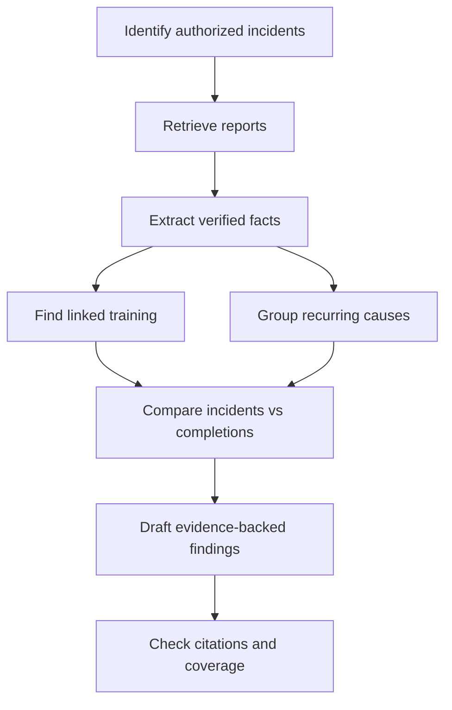
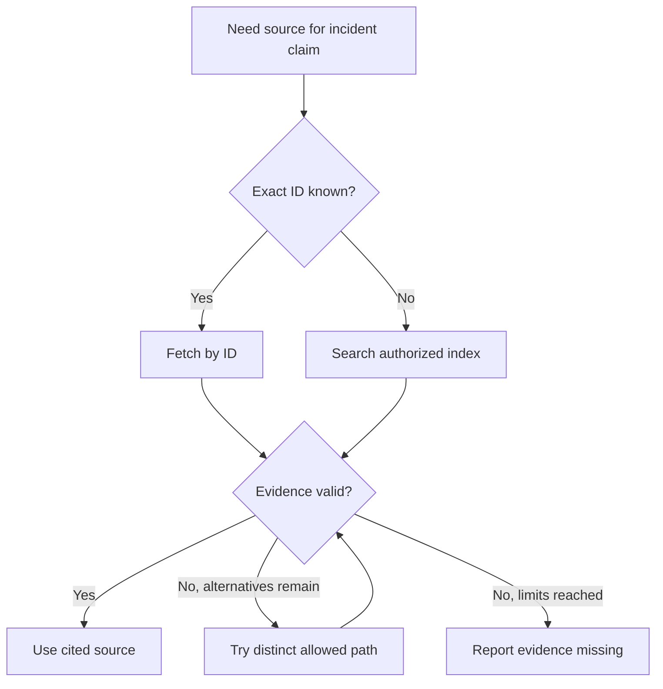
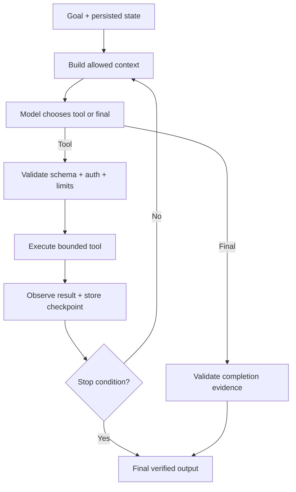
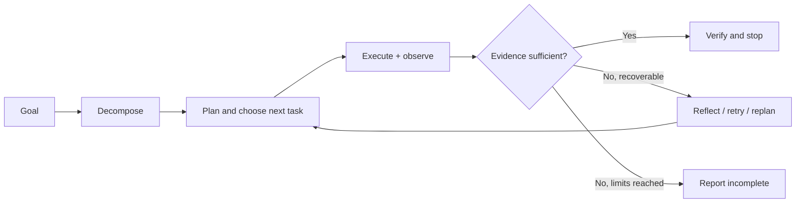

# M09.2 — Task Reasoning and Planning
## Full Reorganized Study Guide

## Table of Contents

- [Part 0 — Document Metadata & Orientation](#part-0-document-metadata-orientation)
  - [0.1 Path, Depth & Prerequisites](#01-path-depth-prerequisites)
  - [0.2 Purpose & Completion Evidence](#02-purpose-completion-evidence)
  - [0.3 Memory Aid](#03-memory-aid)
  - [0.4 Learning Path](#04-learning-path)
- [Part 1 — Planning Fundamentals](#part-1-planning-fundamentals)
  - [1.1 What Is Agent Planning?](#11-what-is-agent-planning)
  - [1.2 Task Decomposition](#12-task-decomposition)
    - [1.2.1 Definition](#121-definition)
    - [1.2.2 Decomposition Granularity](#122-decomposition-granularity)
    - [1.2.3 Dependency Graph](#123-dependency-graph)
  - [1.3 Plan-and-Execute](#13-plan-and-execute)
    - [1.3.1 Definition](#131-definition)
    - [1.3.2 Example](#132-example)
    - [1.3.3 Strengths and Weaknesses](#133-strengths-and-weaknesses)
  - [1.4 Least-to-Most Reasoning](#14-least-to-most-reasoning)
    - [1.4.1 Definition](#141-definition)
    - [1.4.2 Why It Helps](#142-why-it-helps)
    - [1.4.3 When Not to Use It](#143-when-not-to-use-it)
  - [1.5 Plan Quality Checklist](#15-plan-quality-checklist)
- [Part 2 — Exploration and Revision](#part-2-exploration-and-revision)
  - [2.1 Reflection](#21-reflection)
  - [2.2 Self-Critique](#22-self-critique)
  - [2.3 Retry with Alternate Strategies](#23-retry-with-alternate-strategies)
    - [2.3.1 Retry Is Not Replanning](#231-retry-is-not-replanning)
    - [2.3.2 Retry Policy](#232-retry-policy)
    - [2.3.3 Alternate Strategy Budget](#233-alternate-strategy-budget)
  - [2.4 Search-Based Reasoning](#24-search-based-reasoning)
    - [2.4.1 Candidate Generation and Scoring](#241-candidate-generation-and-scoring)
    - [2.4.2 Beam-Style Exploration](#242-beam-style-exploration)
  - [2.5 Branching and Backtracking](#25-branching-and-backtracking)
    - [2.5.1 Branching](#251-branching)
    - [2.5.2 Backtracking](#252-backtracking)
    - [2.5.3 Branching Example](#253-branching-example)
  - [2.6 Exploration and Revision Comparison](#26-exploration-and-revision-comparison)
- [Part 3 — M09.2.1.3 Execution and Termination](#part-3-m09213-execution-and-termination)
  - [3.1 ReAct: Reason and Act](#31-react-reason-and-act)
    - [3.1.1 ReAct Loop](#311-react-loop)
    - [3.1.2 Simple Trace](#312-simple-trace)
  - [3.2 Why Stop Criteria Are Part of Correctness](#32-why-stop-criteria-are-part-of-correctness)
  - [3.3 Stop Conditions](#33-stop-conditions)
    - [3.3.1 Success](#331-success)
    - [3.3.2 Insufficient Evidence](#332-insufficient-evidence)
    - [3.3.3 Exhausted Budget](#333-exhausted-budget)
    - [3.3.4 Safety / Policy Block](#334-safety-policy-block)
    - [3.3.5 Cancellation / Human Intervention](#335-cancellation-human-intervention)
    - [3.3.6 Lack of Progress](#336-lack-of-progress)
  - [3.4 Stop Priority and Runtime Contract](#34-stop-priority-and-runtime-contract)
  - [3.5 Termination Proof, Not Just Intention](#35-termination-proof-not-just-intention)
- [Part 4 — Combining Techniques Without Overengineering](#part-4-combining-techniques-without-overengineering)
  - [4.1 A Practical Policy](#41-a-practical-policy)
  - [4.2 Pattern Selection Matrix](#42-pattern-selection-matrix)
  - [4.3 Risk of Compounding Errors](#43-risk-of-compounding-errors)
  - [4.4 Plan Revision Is a State Transition](#44-plan-revision-is-a-state-transition)
- [Part 5 — Implementation Example (Framework-Agnostic Python)](#part-5-implementation-example-framework-agnostic-python)
  - [5.1 A Small Plan Representation](#51-a-small-plan-representation)
  - [5.2 Retry Classifier](#52-retry-classifier)
  - [5.3 A Repetition Detector](#53-a-repetition-detector)
- [Part 6 — Evaluation and Debugging](#part-6-evaluation-and-debugging)
  - [6.1 Diagnostic Table](#61-diagnostic-table)
  - [6.2 Core Evaluation Metrics](#62-core-evaluation-metrics)
  - [6.3 L3 Project Exercise — Bounded Evidence Research](#63-l3-project-exercise-bounded-evidence-research)
- [Part 7 — Concept Map and Revision](#part-7-concept-map-and-revision)
  - [7.1 Concept Map](#71-concept-map)
  - [7.2 Glossary](#72-glossary)
  - [7.3 Ten Revision Rules](#73-ten-revision-rules)
- [Part 8 — Practice and Interview Questions](#part-8-practice-and-interview-questions)
  - [8.1 Quick Recall](#81-quick-recall)
    - [Q1 — What is task decomposition?](#q1-what-is-task-decomposition)
    - [Q2 — How does plan-and-execute work?](#q2-how-does-plan-and-execute-work)
    - [Q3 — What does least-to-most mean?](#q3-what-does-least-to-most-mean)
    - [Q4 — What is reflection in an agent?](#q4-what-is-reflection-in-an-agent)
    - [Q5 — Why is self-critique insufficient for critical correctness?](#q5-why-is-self-critique-insufficient-for-critical-correctness)
    - [Q6 — When should a failed tool be retried?](#q6-when-should-a-failed-tool-be-retried)
    - [Q7 — What is search-based reasoning?](#q7-what-is-search-based-reasoning)
    - [Q8 — What does backtracking mean for side effects?](#q8-what-does-backtracking-mean-for-side-effects)
    - [Q9 — What is ReAct?](#q9-what-is-react)
    - [Q10 — Name five stop conditions.](#q10-name-five-stop-conditions)
  - [8.2 Multiple-Choice Questions](#82-multiple-choice-questions)
    - [Q11 — Why break a large task into subtasks?](#q11-why-break-a-large-task-into-subtasks)
    - [Q12 — A tool returns 403. What is appropriate?](#q12-a-tool-returns-403-what-is-appropriate)
    - [Q13 — A draft passes the model's own review but contradicts a database value. Which source decides?](#q13-a-draft-passes-the-models-own-review-but-contradicts-a-database-value-which-source-decides)
    - [Q14 — What most directly limits infinite model-driven loops?](#q14-what-most-directly-limits-infinite-model-driven-loops)
    - [Q15 — After a write times out, what should the agent do first?](#q15-after-a-write-times-out-what-should-the-agent-do-first)
  - [8.3 Interview Questions with Model Answers](#83-interview-questions-with-model-answers)
    - [Q16 — How would you explain plan-and-execute in an interview?](#q16-how-would-you-explain-plan-and-execute-in-an-interview)
    - [Q17 — What is the difference between reflection, retry and replanning?](#q17-what-is-the-difference-between-reflection-retry-and-replanning)
    - [Q18 — What is ReAct, and what are its failure modes?](#q18-what-is-react-and-what-are-its-failure-modes)
    - [Q19 — How do you design stopping criteria?](#q19-how-do-you-design-stopping-criteria)
    - [Q20 — When would you use branching or backtracking?](#q20-when-would-you-use-branching-or-backtracking)
- [Part 9 — Senior/Staff-Level Production Scenarios](#part-9-seniorstaff-level-production-scenarios)
  - [9.1 Scenario — Exponential Search Cost](#91-scenario-exponential-search-cost)
  - [9.2 Scenario — Perfectly Fluent Wrong Report](#92-scenario-perfectly-fluent-wrong-report)
  - [9.3 Scenario — Persistent Infinite Loop After a Tool Error](#93-scenario-persistent-infinite-loop-after-a-tool-error)
  - [9.4 Scenario — Task Plan Changes Mid-Approval](#94-scenario-task-plan-changes-mid-approval)
- [Part 10 — References and Advanced Extensions](#part-10-references-and-advanced-extensions)
  - [10.1 Sources and Further Reading](#101-sources-and-further-reading)
  - [10.2 Advanced Topics Not Covered in Depth](#102-advanced-topics-not-covered-in-depth)
  - [10.3 Section Navigation](#103-section-navigation)


---

# Part 0 — Document Metadata & Orientation

## 0.1 Path, Depth & Prerequisites

- **Path:** Core · **Module:** M09 Agent Fundamentals · **Section:** M09.2
- **Depth:** L2 foundation; L3 through demonstrated project work.
- **Prerequisites:** M08, M07 and M09.1 architecture selection / component anatomy.
- **Syllabus:** M09.2.1.1 Planning and decomposition; M09.2.1.2 Exploration and revision; M09.2.1.3 Execution and termination.

## 0.2 Purpose & Completion Evidence

**Purpose:** Understand how agents choose intermediate steps, use feedback to revise plans and stop reliably. The emphasis is on **observable decisions and controlled execution**, not promises that private model reasoning is complete or correct.

**Completion evidence:** Show an explicit plan with dependencies, trace a ReAct-style execution, demonstrate a bounded retry/alternate branch, record why the agent stopped and test pathological cases such as repeating a failed tool.

## 0.3 Memory Aid

> **Plan small, check evidence, revise intentionally, stop deterministically.**

## 0.4 Learning Path

**Decomposition → exploration → runtime execution → termination → implementation → evaluation → scenarios.** The named techniques are compatible building blocks, not an obligatory “stack” that every agent must use.

---

# Part 1 — Planning Fundamentals

## 1.1 What Is Agent Planning?

Planning is deciding what intermediate actions would help achieve a goal under constraints. For an agent, a plan can include information to retrieve, conditions to test, actions to request and a stopping criterion.

**User goal:** “Prepare a brief on recurring navigation incidents and identify training gaps.”

**Possible plan:** (1) identify relevant incident reports; (2) fetch authorized details; (3) cluster by issue; (4) check linked training completion; (5) draft evidence-backed findings. Every step should name its *input*, *expected output* and *verification condition*.

Planning is useful when steps depend on one another. It is unnecessary overhead for a single deterministic lookup.

## 1.2 Task Decomposition

### 1.2.1 Definition

**Task decomposition** breaks a larger objective into smaller, testable subtasks. A good subtask is independently verifiable and carries enough information for its successor.

| Subtask | Input | Expected output | Verification |
|---|---|---|---|
| Find reports | Time window + tenant scope | Incident IDs | IDs returned by authorized search |
| Inspect reports | Selected IDs | Normalized incident facts | Each fact linked to report ID |
| Find training evidence | Incident IDs / course IDs | Completion facts | DB status + timestamp |
| Identify gaps | Verified facts | Gap list | Each gap traceable to evidence |
| Write brief | Approved evidence | Draft with citations | Unsupported claims flagged |

**Avoid:** “Analyze everything carefully” as one giant untestable subtask.

### 1.2.2 Decomposition Granularity

Too broad → opaque failures and difficult retries. Too fine → excessive model calls, orchestration cost and latency. Decompose where there is a genuine **dependency**, **independent check**, **permission boundary** or **recoverable failure boundary**.

### 1.2.3 Dependency Graph



A graph permits parallel steps only when their dependencies permit it. For example, grouping causes and querying training completion can run concurrently *after* incident facts are available.

## 1.3 Plan-and-Execute

### 1.3.1 Definition

**Plan-and-execute** separates planning from step execution. The model or a template produces a plan; an executor carries out allowed steps, evaluates results and optionally replans.

```text
Goal → Make finite plan → Validate plan → Execute one step →
Observe and checkpoint → Revise remaining plan if needed → Stop
```

### 1.3.2 Example

Initial plan: `search_reports → fetch_reports → compare_training → summarize`.

During `fetch_reports`, the API reveals that two reports reference an archived course. An intentional plan revision adds `resolve_course_version` before comparison. The agent does not silently redefine the original goal.

### 1.3.3 Strengths and Weaknesses

- **Strengths:** Dependencies visible, easier human approval, fewer aimless model decisions.
- **Weaknesses:** Early plan may assume nonexistent data, and replanning can become costly.
- **Safety rule:** Approve a plan *structure* only if each executable action is also separately authorized when run.

## 1.4 Least-to-Most Reasoning

### 1.4.1 Definition

**Least-to-most** solves easy prerequisites before harder dependent questions. It is a *reasoning strategy*, not a guarantee of correctness and not necessarily a separate planner.

**Example question:** “Which training topics should be prioritized based on incidents and completion history?”

1. Determine which incidents are within scope.
2. Identify recurring categories from verified incident labels.
3. Retrieve completion rates for associated training.
4. Combine severity, frequency and coverage according to declared business rules.
5. Produce a ranked recommendation with evidence and limitations.

### 1.4.2 Why It Helps

Later decisions rely on earlier facts rather than unverified guesses. Each intermediate result can be checked and cached. A mistake upstream can still compound, so validation at the boundaries matters.

### 1.4.3 When Not to Use It

If all information is already available and the task is a simple calculation, ordinary deterministic code is better. Do not force multiple LLM calls for arithmetic, sorting, joins or policy checks.

## 1.5 Plan Quality Checklist

A usable plan specifies:

- A concrete **goal** and success condition.
- Inputs and trusted/authorized data sources.
- Subtasks with dependencies and verifiable outputs.
- Tools and permissions required for each step.
- Resource ceilings: steps, wall time, tokens, API cost and retries.
- Replanning triggers, escalation paths and failure behavior.
- Whether a step reads data, prepares a draft or commits a side effect.

---

# Part 2 — Exploration and Revision

## 2.1 Reflection

**Reflection** means examining evidence or execution results to decide whether the current approach should change. In production, reflection should operate on concrete, observable failures rather than vague “think again” instructions.

**Bad reflection:** “Maybe I am wrong, try to be smarter.”

**Useful reflection:** “The search returned no reports under this date range; verify date format and whether the scope permits a broader search.”

A reflection step incurs cost and can introduce fresh errors. Use it where measurable quality improves.

## 2.2 Self-Critique

**Self-critique** asks a model to identify weaknesses in a draft or plan. It is an *additional review signal*, not independent proof.

**Example critique rubric:**

| Check | Pass condition | What to do on fail |
|---|---|---|
| Evidence | Every claimed incident trend cites report IDs | Retrieve missing source or remove claim |
| Scope | No records outside authorized company | Reject and investigate data path |
| Numeric consistency | Counts match deterministic aggregation | Recompute using code |
| Completeness | Required sections exist | Add missing section |
| Risk | No unapproved publication | Pause for reviewer |

A critique model can share biases with the writer model. For consequential claims, use source validation, deterministic tests or human review rather than only “LLM judges LLM.”

## 2.3 Retry with Alternate Strategies

### 2.3.1 Retry Is Not Replanning

**Retry:** Reattempt the same operation because failure is likely temporary (e.g., HTTP 503). **Alternate strategy:** Switch to a different authorized path because the current approach did not produce evidence (e.g., search by stable ID instead of title).

| Failure | Suitable next step | Unsuitable next step |
|---|---|---|
| Timeout on read | Retry once with backoff if safe | Assume empty result |
| 400 invalid schema | Correct args or fail | Repeat identical 400 forever |
| 403 forbidden | Stop/escalate | Ask model to bypass access |
| 404 record missing | Check approved alternate identifier | Invent a report ID |
| 429 rate limit | Respect retry-after / budget | Flood service with retries |
| Write timed out | Reconcile status via idempotency key | Blind duplicate commit |

### 2.3.2 Retry Policy

Define **retryable errors**, **attempt cap**, **backoff with jitter**, **overall deadline** and **state checkpoint**. Do not let tool-level retries plus agent-level retries multiply invisibly (e.g., 3 × 3 × 3 calls).

### 2.3.3 Alternate Strategy Budget

Allow a finite number of genuine alternatives and record the reason for each change. For example:

```text
Search by exact report ID → 404
Search authorized report index using incident date → one candidate
Verify candidate ID → match
Stop searching and use verified record
```

If alternatives fail, produce an explicit “unable to verify” result.

## 2.4 Search-Based Reasoning

**Search-based reasoning** explores candidate solution paths and evaluates evidence. It is conceptually related to graph/tree search, but agentic search is not necessarily a formal optimal-search algorithm.

### 2.4.1 Candidate Generation and Scoring

A search controller may maintain candidate plans with attributes such as evidence coverage, expected cost, risk and unresolved dependencies. Avoid treating a model-generated score as a calibrated probability unless validated.

```text
candidate_score = evidence_coverage - cost_penalty - risk_penalty
```

This is an illustrative ranking heuristic. Hard constraints (forbidden action, budget overrun) must reject a candidate regardless of its score.

### 2.4.2 Beam-Style Exploration

Keep at most `k` promising candidate approaches at each depth and discard the rest. This may help search ambiguous sources but uses more model calls and can lose the best path if an early heuristic is wrong.

## 2.5 Branching and Backtracking

### 2.5.1 Branching

Branching explores alternative routes from a decision point: search by document ID, search by text, or ask for missing details. Branches should be distinct and bounded rather than cosmetic restatements.

### 2.5.2 Backtracking

Backtracking returns to a prior *decision state* after an unproductive route. For an agent, that means changing a plan based on recorded evidence—not reversing side effects automatically.

**Important:** Backtracking through *reads* is usually safe. Backtracking after *writes* may require a compensating action, explicit authorization and awareness that compensation is not always a perfect rollback.

### 2.5.3 Branching Example



## 2.6 Exploration and Revision Comparison

| Technique | Key question | Best use | Common error |
|---|---|---|---|
| Reflection | What did the observation teach us? | Detect plan mismatch | Unproductive repeated reflection |
| Self-critique | What is unsupported or inconsistent? | Draft verification | Treat self-score as truth |
| Retry | Was this a transient failure? | Recover from timeouts/5xx | Retry permanent failures |
| Alternate strategy | Is there another allowed evidence path? | Ambiguous search | Change goal without user approval |
| Search-based reasoning | Which candidate path meets constraints? | Uncertain multi-step retrieval | Exponential cost |
| Branching | Which alternatives should be examined? | Discovery under uncertainty | Too many branches |
| Backtracking | Which decision should be revised? | Dead ends | Assume committed writes undo themselves |

---

# Part 3 — M09.2.1.3 Execution and Termination

## 3.1 ReAct: Reason and Act

**ReAct** describes an interleaving of decision-making and action: the agent chooses an action, observes a result and updates its next decision. The useful production artifact is the *observable action-and-observation trace*; private chain-of-thought text is neither required nor a trustworthy audit log.

### 3.1.1 ReAct Loop



### 3.1.2 Simple Trace

| Turn | Decision | Tool observation | Plan change |
|---|---|---|---|
| 1 | Search incident by identifier | Found report INC-104 | Fetch linked training |
| 2 | Lookup training requests | 503 transient | Retry once after bounded backoff |
| 3 | Retry lookup | Found request TR-88 | Stop exploration |
| 4 | Final answer | Source IDs preserved | Completed |

A trace should show *what was requested* and *what happened*, not merely that the model “thought” something happened.

## 3.2 Why Stop Criteria Are Part of Correctness

Without stopping conditions, the agent may loop, repeatedly query tools, exceed budget or keep searching after adequate evidence exists. Stopping is a runtime decision with clear priority over the model's desire to continue.

## 3.3 Stop Conditions

### 3.3.1 Success

The required evidence exists, final output meets schema and all required checks passed. **Do not stop on fluent text alone.**

### 3.3.2 Insufficient Evidence

The available authorized sources cannot answer the question. Return a concise explanation of gaps and attempted sources, without fabricating missing facts.

### 3.3.3 Exhausted Budget

Maximum model decisions, tool calls, tokens, cost, branching factor or wall-clock time reached. Return `LIMIT_REACHED` or `INCOMPLETE`, with partial verified evidence where appropriate.

### 3.3.4 Safety / Policy Block

Permission denied, approval missing, dangerous action or unsupported operation. Do not rephrase the same action repeatedly to evade policy.

### 3.3.5 Cancellation / Human Intervention

User cancels, reviewer rejects or the system pauses for approval. Persist the status and the resume point.

### 3.3.6 Lack of Progress

The same tool/arguments recur without new evidence or the plan cycles through already-rejected branches. A progress detector stops after a bounded number of such attempts.

## 3.4 Stop Priority and Runtime Contract

A practical order is: **cancellation or hard policy block → deadline / resource cap → verified success → wait for approval → recovery/replan → incomplete**. Exact ordering may differ by system; the key is deterministic semantics and race-safe state transitions.

```json
{
  "limits": {
    "max_model_steps": 8,
    "max_tool_calls": 6,
    "max_same_call_repeats": 1,
    "max_retry_per_tool": 2,
    "deadline_seconds": 30,
    "max_cost_usd": 0.20
  },
  "allowed_stop_reasons": [
    "COMPLETED", "INCOMPLETE", "LIMIT_REACHED",
    "CANCELLED", "PERMISSION_DENIED", "WAITING_APPROVAL", "FAILED"
  ]
}
```

**These numbers are example limits**, not recommended defaults for all workloads. A longer approved research job may need different deadlines and quotas.

## 3.5 Termination Proof, Not Just Intention

A simple bounded loop can be shown to terminate if it has a monotonically increasing counter `step_count`, checks `step_count < max_steps` before each iteration and stops on a deadline/cancellation. An unbounded agent loop cannot be made safe merely by asking the model to stop eventually.

Formal intuition:

```text
Each loop iteration consumes at least one of the finite resources:
  remaining_model_steps, remaining_tool_calls, remaining_time.
When any mandatory remaining budget reaches zero, the runtime exits.
Therefore indefinite model-driven looping is prevented by runtime checks.
```

A blocked network call needs its own enforced timeout; a loop counter alone cannot end a hanging tool invocation.

---

# Part 4 — Combining Techniques Without Overengineering

## 4.1 A Practical Policy

Begin with a **short plan**, execute one verifiable step, then revise only when the observation changes your assumptions. Reflection should be triggered by a discrepancy, not invoked automatically after every easy tool call.

## 4.2 Pattern Selection Matrix

| Task | Preferred technique | Why |
|---|---|---|
| Fetch one incident by ID | Direct workflow | Known one-step retrieval |
| Compare incident and training records | Structured workflow or least-to-most | Known dependencies |
| Locate unclear source among many indexes | ReAct with limited alternatives | Next lookup depends on observation |
| Produce report with verifiable sections | Plan-and-execute | Explicit checkpoints |
| Investigate contradictory evidence | Critique + alternate search | Need evidence review |
| Explore many strategic options | Small bounded branching search | Multiple plausible plans |
| Publish training | Approval-controlled workflow | Real external side effect |

## 4.3 Risk of Compounding Errors

If one stage produces a wrong ID, downstream stages can produce internally consistent but false conclusions. Guard against error propagation with **typed intermediate artifacts**, source identifiers, version tags and validation before each dependency transition.

## 4.4 Plan Revision Is a State Transition

When a plan changes, store `plan_version`, `reason`, `new_dependencies` and `superseded_steps`. Do not silently overwrite the execution history. The plan is a proposal; the **executed trace** is the factual record.

---

# Part 5 — Implementation Example (Framework-Agnostic Python)

## 5.1 A Small Plan Representation

```python
from dataclasses import dataclass, field
from enum import Enum

class StepStatus(str, Enum):
    PENDING = "pending"
    RUNNING = "running"
    DONE = "done"
    FAILED = "failed"

@dataclass
class PlanStep:
    id: str
    action: str
    depends_on: tuple[str, ...] = ()
    status: StepStatus = StepStatus.PENDING
    evidence_ids: list[str] = field(default_factory=list)

plan = [
    PlanStep("find", "search authorized incidents"),
    PlanStep("inspect", "fetch incident records", ("find",)),
    PlanStep("compare", "check related training", ("inspect",)),
    PlanStep("report", "write evidenced findings", ("compare",)),
]

def ready_steps(steps: list[PlanStep]) -> list[PlanStep]:
    finished = {s.id for s in steps if s.status == StepStatus.DONE}
    return [s for s in steps
            if s.status == StepStatus.PENDING
            and set(s.depends_on).issubset(finished)]

assert [s.id for s in ready_steps(plan)] == ["find"]
```

The example demonstrates dependency readiness. A production planner must also detect missing dependencies/cycles and enforce a maximum plan size.

## 5.2 Retry Classifier

```python
from enum import Enum

class ErrorKind(str, Enum):
    TRANSIENT = "transient"
    INVALID_ARGUMENT = "invalid_argument"
    FORBIDDEN = "forbidden"
    UNKNOWN_OUTCOME = "unknown_outcome"

def recovery_action(kind: ErrorKind, retry_count: int) -> str:
    if kind == ErrorKind.FORBIDDEN:
        return "STOP_PERMISSION_DENIED"
    if kind == ErrorKind.INVALID_ARGUMENT:
        return "FIX_ARGUMENTS_OR_STOP"
    if kind == ErrorKind.UNKNOWN_OUTCOME:
        return "RECONCILE_EXTERNAL_STATUS"
    return "RETRY_WITH_BACKOFF" if retry_count < 2 else "STOP_FAILED"
```

Do not implement a blanket `except Exception: retry_forever`. Make retry categories explicit.

## 5.3 A Repetition Detector

```python
import json

def fingerprint(tool_name: str, args: dict) -> str:
    # Strict schemas should normalize arguments before this point.
    return tool_name + ":" + json.dumps(args, sort_keys=True)

recent = [fingerprint("search", {"q": "INC-104"})]
next_call = fingerprint("search", {"q": "INC-104"})
if recent.count(next_call) >= 1:
    print("NO_PROGRESS: same call already failed without new context")
```

In production, only treat repeated calls as non-progress when there is **no meaningful state change**; polling a known asynchronous operation may require intentional repetitions with a separate polling budget.

---

# Part 6 — Evaluation and Debugging

## 6.1 Diagnostic Table

| Symptom | Likely fault | First check | Corrective action |
|---|---|---|---|
| Plan has 50 trivial steps | Over-decomposition | Steps vs real dependencies | Merge steps; limit plan size |
| Agent repeats an invalid query | No progress detector | Same tool/args and error codes | Stop or choose one alternate path |
| 403 causes another credential attempt | Policy avoidance | Forbidden error handling | Immediate stop / escalation |
| Wrong final count | Error compounding | Deterministic source aggregation | Compute totals in code |
| Agent explores every branch | Unbounded branching | Frontier size/depth | Beam or search budget |
| “Self-critique” approves a false report | Correlated evaluator errors | Evidence support check | Source verification/human review |
| Stops too early | Weak success criteria | Required fields/evidence | Structured completion validator |
| Never ends after API hangs | No tool timeout | Executor deadline | Per-call cancellation/timeout |
| Retries multiply | Nested retry policies | Total attempts per operation | One shared retry budget |
| Replan hides history | State overwritten | Plan version / audit events | Append-only decision log |

## 6.2 Core Evaluation Metrics

- **Success rate:** Fraction of tasks meeting externally checked completion criteria.
- **Evidence support:** Proportion of final claims backed by valid sources.
- **Wrong-action rate:** Calls to irrelevant or forbidden tools per run.
- **Tool efficiency:** Useful observations per tool call.
- **Recovery rate:** Transient failures handled without duplicate effects.
- **False-completion rate:** Runs marked completed without sufficient evidence.
- **Termination compliance:** Fraction that obey limits and cancellation.
- **Latency/cost:** p50/p95 completion time, model tokens and tool expense.

Report denominators and dataset composition. A high completion score on trivial cases can hide failure on conflicts and missing-data scenarios.

## 6.3 L3 Project Exercise — Bounded Evidence Research

Create a single agent answering “Which recent incidents had unresolved training actions?” from a small authorized dataset. Require it to plan, execute, checkpoint, revise at most once and stop after a finite budget.

**Test cases:** no incidents, missing report, stale linked course, conflicting record status, intermittent 503, 403 cross-tenant source and model attempting the same call repeatedly.

**Acceptance evidence:** Plan versions, verified tool trace, retry classifier results, final source IDs, stop reasons and a test showing the execution never exceeds step and tool budgets.

---

# Part 7 — Concept Map and Revision

## 7.1 Concept Map



## 7.2 Glossary

| Term | Meaning |
|---|---|
| Task decomposition | Breaking a goal into verifiable subtasks |
| Plan-and-execute | Separate finite plan from execution and revision |
| Least-to-most | Solve easier prerequisites before harder dependent tasks |
| Reflection | Inspect observed results to decide if approach should change |
| Self-critique | Review a draft/plan against a rubric |
| Retry | Repeat a recoverable operation within explicit limits |
| Alternate strategy | Try a distinct, permitted path to the goal |
| Search-based reasoning | Evaluate candidate solution paths using constraints and evidence |
| Branching | Explore multiple next-step alternatives |
| Backtracking | Return to an earlier decision when a branch fails |
| ReAct | Interleave model choices, tool execution and observations |
| Stop criteria | Runtime-enforced conditions that end or pause execution |

## 7.3 Ten Revision Rules

1. A plan is a hypothesis; tool observations are evidence.
2. Decompose for verification and dependency boundaries, not appearance.
3. Least-to-most is useful for genuinely dependent tasks.
4. ReAct does not require exposing private chain-of-thought.
5. Retrying transient failures is different from exploring an alternate path.
6. A 403 is not an invitation to replan around authorization.
7. “Think again” does not replace deterministic validation.
8. Branching needs depth, breadth and cost caps.
9. Writes are not automatically undone by backtracking.
10. Every run ends with a reason: success, incomplete, blocked, cancelled or limit reached.

---

# Part 8 — Practice and Interview Questions

## 8.1 Quick Recall

### Q1 — What is task decomposition?

**Answer:** Dividing a larger goal into small, testable steps with clear dependencies and outputs.

### Q2 — How does plan-and-execute work?

**Answer:** Form a finite plan, validate it, execute allowed steps, observe results and revise when evidence makes the current plan invalid.

### Q3 — What does least-to-most mean?

**Answer:** Resolve simple prerequisites before more complex dependent decisions.

### Q4 — What is reflection in an agent?

**Answer:** Re-evaluating the approach based on an actual result, error or contradiction.

### Q5 — Why is self-critique insufficient for critical correctness?

**Answer:** The reviewing model can repeat the creator's mistakes. Confirm important claims against authoritative sources or deterministic checks.

### Q6 — When should a failed tool be retried?

**Answer:** When the error is plausibly transient and retrying is safe, under a capped retry policy.

### Q7 — What is search-based reasoning?

**Answer:** Exploring candidate solution routes and comparing them against evidence, cost and constraints.

### Q8 — What does backtracking mean for side effects?

**Answer:** It can revise decisions, but committed external changes require separate compensation or approval; they are not magically undone.

### Q9 — What is ReAct?

**Answer:** A loop that chooses an action, executes it, observes the result and chooses the next action.

### Q10 — Name five stop conditions.

**Answer:** Verified success, insufficient evidence, resource limit, policy denial and user cancellation (also approval wait or failure).

## 8.2 Multiple-Choice Questions

### Q11 — Why break a large task into subtasks?

A. To guarantee truth  
B. To make dependencies and checks explicit  
C. To maximize tokens  
D. To eliminate authorization

**Answer: B.** Smaller verifiable units improve diagnosis and controlled recovery.

### Q12 — A tool returns 403. What is appropriate?

A. Retry with different credentials chosen by the model  
B. Stop/escalate according to policy  
C. Continue until it works  
D. Invent a result

**Answer: B.** Permission denial is a hard boundary, not a transient service failure.

### Q13 — A draft passes the model's own review but contradicts a database value. Which source decides?

A. The model's confidence  
B. The database's authoritative value  
C. The longer answer  
D. A second unverified draft

**Answer: B.** Source verification outranks fluent self-evaluation.

### Q14 — What most directly limits infinite model-driven loops?

A. “Please stop soon” in the prompt  
B. A hard runtime step/deadline cap  
C. A larger context window  
D. More tools

**Answer: B.** Runtime limits bound execution even if model choices are poor.

### Q15 — After a write times out, what should the agent do first?

A. Blindly write again  
B. Reconcile via operation ID / authoritative status  
C. Assume success  
D. Delete the audit trace

**Answer: B.** The prior side effect may already have happened.

## 8.3 Interview Questions with Model Answers

### Q16 — How would you explain plan-and-execute in an interview?

**Model answer:** “The agent first creates a small, verifiable sequence of tasks. The runtime validates the plan and runs one step at a time. After each result, it updates progress and replans only when the new evidence requires it. This makes execution easier to test and recover.”

**Follow-up:** Should every task have a plan? **Answer:** No. A fixed one-step workflow is simpler for known operations.

### Q17 — What is the difference between reflection, retry and replanning?

**Model answer:** “Reflection reviews what happened. A retry repeats the same operation for a transient error. Replanning changes the remaining sequence because the assumptions or dependencies changed.”

**Follow-up:** What if an authorization check fails? **Answer:** Stop or escalate rather than trying alternate ways around it.

### Q18 — What is ReAct, and what are its failure modes?

**Model answer:** “ReAct alternates selecting actions and observing tool results. It helps the agent adapt, but can get stuck in loops, choose bad tools or compound errors. I enforce tool schemas, repeat detection, step limits, timeouts and evidence validation in the runtime.”

**Follow-up:** Can ReAct guarantee a correct answer? **Answer:** No; outcomes still depend on evidence quality and evaluation.

### Q19 — How do you design stopping criteria?

**Model answer:** “I define success from externally checked evidence and also enforce hard limits for tool calls, model decisions, wall time and cost. I include cancellation, policy denial, insufficient evidence and approval wait as explicit terminal or paused states.”

**Follow-up:** Why store `stop_reason`? **Answer:** It distinguishes verified completion from incomplete or interrupted work.

### Q20 — When would you use branching or backtracking?

**Model answer:** “When multiple legitimate evidence paths exist and the first can fail. I cap branch depth and total calls, compare alternatives using real observations, and avoid assuming that backtracking undoes external writes.”

**Follow-up:** What is the main trade-off? **Answer:** More exploration may improve coverage but increases latency, cost and error surface.

---

# Part 9 — Senior/Staff-Level Production Scenarios

## 9.1 Scenario — Exponential Search Cost

**Question:** An agent evaluates five candidate paths at each of six planning levels, and usage cost explodes. What would you change?

**Model answer:** Restrict the search frontier and depth; use a deterministic baseline; prune invalid paths before model calls; cache verified intermediate evidence; and add an expected-value/cost threshold. Log branch counts and ensure global budgets include retries. A smaller, shallower search often satisfies the task.

## 9.2 Scenario — Perfectly Fluent Wrong Report

**Question:** The agent's self-critique gives a report 9/10, but a key incident count is wrong. What failed?

**Model answer:** Self-critique was mistaken for ground truth. Recompute aggregations in code, bind every claim to source IDs, create adversarial evaluation cases and report unsupported sections as incomplete. Model assessment can supplement but cannot replace deterministic reconciliation.

## 9.3 Scenario — Persistent Infinite Loop After a Tool Error

**Question:** A search endpoint returns 400 and the agent issues the same invalid arguments repeatedly. How do you contain the failure?

**Model answer:** The executor returns a structured non-retryable error, and the runtime fingerprints repeated call arguments. Permit at most one corrected attempt if schema feedback indicates a clear fix; otherwise stop with `INVALID_ARGUMENT`. This must be enforced independently of the model prompt.

## 9.4 Scenario — Task Plan Changes Mid-Approval

**Question:** A reviewer approved a plan to publish one report, but after new data the agent revises the plan and changes recipients. Is the original approval sufficient?

**Model answer:** No. Approval must be scoped to the exact action payload, resource versions and recipients. A material change invalidates the approval and requires fresh review. Persist plan versions and approval evidence to prevent stale authorization.

---

# Part 10 — References and Advanced Extensions

## 10.1 Sources and Further Reading

- [Yao et al. — ReAct: Synergizing Reasoning and Acting in Language Models](https://arxiv.org/abs/2210.03629)
- [Wang et al. — Plan-and-Solve Prompting](https://arxiv.org/abs/2305.04091)
- [Zhou et al. — Least-to-Most Prompting](https://arxiv.org/abs/2205.10625)
- [Yao et al. — Tree of Thoughts](https://arxiv.org/abs/2305.10601)
- [OpenAI — A Practical Guide to Building AI Agents](https://openai.com/business/guides-and-resources/a-practical-guide-to-building-ai-agents/)

The planning diagrams, policies and maritime examples are explanatory designs. Research techniques describe useful patterns, not universal performance guarantees.

## 10.2 Advanced Topics Not Covered in Depth

- Monte Carlo Tree Search and heuristic search on tool states.
- Cost-aware policy optimization and optimal stopping.
- Hierarchical task networks and formal planning.
- Counterfactual evaluation and causal diagnosis of failed plans.

## 10.3 Section Navigation

**Previous:** [M09.1 — Architecture Selection](M09.1_Architecture_Selection_and_Agent_Components.md) · **Next:** [M09.3 — State and Execution Failures](M09.3_State_and_Execution_Failures.md)
