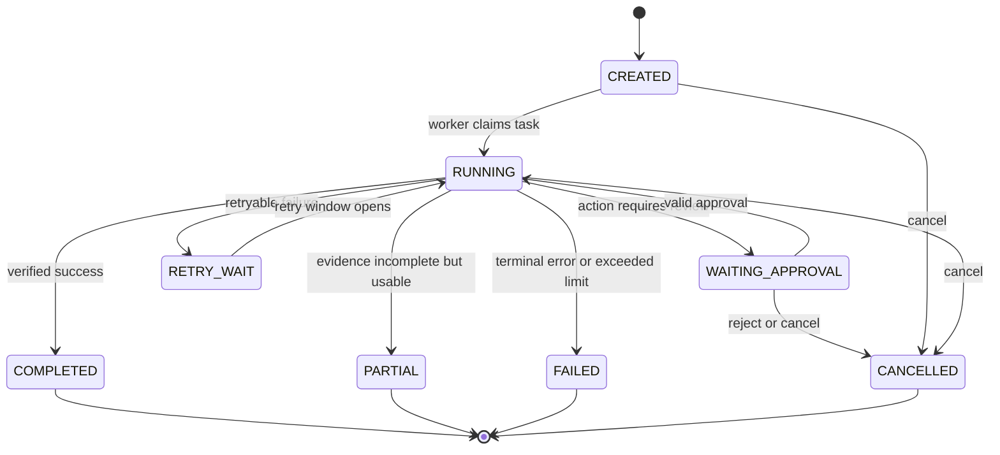
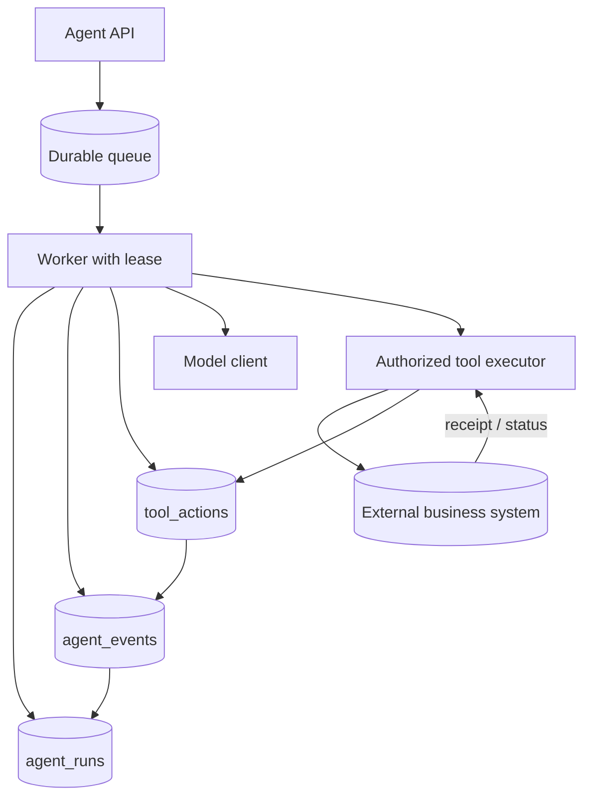
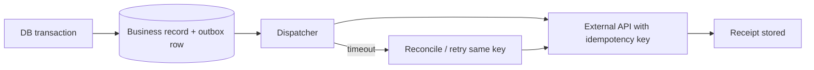
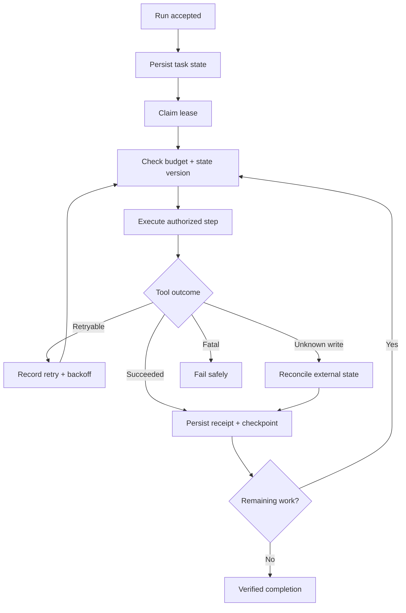

# M09.3 — State and Execution Failures
## Full Reorganized Study Guide

## Table of Contents

- [Part 0 — Document Metadata & Orientation](#part-0-document-metadata-orientation)
  - [0.1 Path, Depth & Prerequisites](#01-path-depth-prerequisites)
  - [0.2 Purpose & Completion Evidence](#02-purpose-completion-evidence)
  - [0.3 Memory Aid](#03-memory-aid)
  - [0.4 Learning Path](#04-learning-path)
- [Part 1 — M09.3.1 Agent State](#part-1-m0931-agent-state)
  - [1.1 What Is Agent State?](#11-what-is-agent-state)
  - [1.2 M09.3.1.1 Four State Categories](#12-m09311-four-state-categories)
    - [1.2.1 Conversation State](#121-conversation-state)
    - [1.2.2 Task State](#122-task-state)
    - [1.2.3 Tool State](#123-tool-state)
    - [1.2.4 External State](#124-external-state)
  - [1.3 State Category Comparison](#13-state-category-comparison)
  - [1.4 State Structure Example](#14-state-structure-example)
- [Part 2 — M09.3.1.2 Persistence and Transitions](#part-2-m09312-persistence-and-transitions)
  - [2.1 State Machine Concepts](#21-state-machine-concepts)
    - [2.1.1 Recommended States](#211-recommended-states)
    - [2.1.2 Transition Diagram](#212-transition-diagram)
  - [2.2 Transition Invariants](#22-transition-invariants)
  - [2.3 Workflow State vs Conversation State](#23-workflow-state-vs-conversation-state)
  - [2.4 Checkpoints](#24-checkpoints)
  - [2.5 Resumability](#25-resumability)
  - [2.6 Exactly-Once Illusion vs Effectively-Once](#26-exactly-once-illusion-vs-effectively-once)
  - [2.7 Crash Windows](#27-crash-windows)
- [Part 3 — Practical Persistence Architecture](#part-3-practical-persistence-architecture)
  - [3.1 Runtime Storage Diagram](#31-runtime-storage-diagram)
  - [3.2 Example PostgreSQL Schema](#32-example-postgresql-schema)
  - [3.3 Compare-and-Swap State Updates](#33-compare-and-swap-state-updates)
  - [3.4 Event Log Example](#34-event-log-example)
- [Part 4 — M09.3.2 The Thirteen Failure Modes](#part-4-m0932-the-thirteen-failure-modes)
  - [4.1 Failure Matrix](#41-failure-matrix)
  - [4.2 Infinite Loops](#42-infinite-loops)
  - [4.3 Wrong Tool](#43-wrong-tool)
  - [4.4 Wrong Arguments](#44-wrong-arguments)
  - [4.5 Hallucinated Actions](#45-hallucinated-actions)
  - [4.6 Error Compounding](#46-error-compounding)
  - [4.7 Stale Context](#47-stale-context)
  - [4.8 Context Overflow](#48-context-overflow)
  - [4.9 Deadlocks](#49-deadlocks)
  - [4.10 Duplicate Actions](#410-duplicate-actions)
  - [4.11 Unbounded Cost](#411-unbounded-cost)
  - [4.12 Tool Timeout](#412-tool-timeout)
  - [4.13 Partial Completion](#413-partial-completion)
  - [4.14 State Corruption](#414-state-corruption)
- [Part 5 — Recovery Patterns and Production Controls](#part-5-recovery-patterns-and-production-controls)
  - [5.1 Error Classification](#51-error-classification)
  - [5.2 Idempotency and the Outbox Pattern](#52-idempotency-and-the-outbox-pattern)
  - [5.3 Retry Backoff](#53-retry-backoff)
  - [5.4 Checkpoint Placement](#54-checkpoint-placement)
  - [5.5 Compensation Is Not Time Travel](#55-compensation-is-not-time-travel)
- [Part 6 — Fault Injection and L3 Project](#part-6-fault-injection-and-l3-project)
  - [6.1 Fault-Injection Matrix](#61-fault-injection-matrix)
  - [6.2 L3 Project Exercise — Crash-Safe Report Builder](#62-l3-project-exercise-crash-safe-report-builder)
  - [6.3 Observability Dashboard Suggestions](#63-observability-dashboard-suggestions)
- [Part 7 — Concept Map and Revision](#part-7-concept-map-and-revision)
  - [7.1 Concept Map](#71-concept-map)
  - [7.2 Glossary](#72-glossary)
  - [7.3 Ten Revision Rules](#73-ten-revision-rules)
- [Part 8 — Practice and Interview Questions](#part-8-practice-and-interview-questions)
  - [8.1 Quick Recall](#81-quick-recall)
    - [Q1 — What are the four categories of agent state?](#q1-what-are-the-four-categories-of-agent-state)
    - [Q2 — Why is task state different from chat history?](#q2-why-is-task-state-different-from-chat-history)
    - [Q3 — What is a checkpoint?](#q3-what-is-a-checkpoint)
    - [Q4 — What is a state machine?](#q4-what-is-a-state-machine)
    - [Q5 — What is resumability?](#q5-what-is-resumability)
    - [Q6 — Why can a timeout be dangerous for a write?](#q6-why-can-a-timeout-be-dangerous-for-a-write)
    - [Q7 — What does idempotency mean?](#q7-what-does-idempotency-mean)
    - [Q8 — What is error compounding?](#q8-what-is-error-compounding)
    - [Q9 — What is a deadlock?](#q9-what-is-a-deadlock)
    - [Q10 — How should partial completion be reported?](#q10-how-should-partial-completion-be-reported)
  - [8.2 Multiple-Choice Questions](#82-multiple-choice-questions)
    - [Q11 — Which field is essential for safe concurrent state updates?](#q11-which-field-is-essential-for-safe-concurrent-state-updates)
    - [Q12 — An external write times out after dispatch. What do you know?](#q12-an-external-write-times-out-after-dispatch-what-do-you-know)
    - [Q13 — Two workers both try to publish the same report. Which design is safest?](#q13-two-workers-both-try-to-publish-the-same-report-which-design-is-safest)
    - [Q14 — When a task is in WAITINGAPPROVAL, the worker should:](#q14-when-a-task-is-in-waitingapproval-the-worker-should)
    - [Q15 — After reviewing 8 of 10 sources, 2 fail. Best final status?](#q15-after-reviewing-8-of-10-sources-2-fail-best-final-status)
  - [8.3 Interview Questions with Model Answers](#83-interview-questions-with-model-answers)
    - [Q16 — Explain the types of state in an AI agent.](#q16-explain-the-types-of-state-in-an-ai-agent)
    - [Q17 — How would you implement checkpoints and resumability?](#q17-how-would-you-implement-checkpoints-and-resumability)
    - [Q18 — How do you prevent duplicate actions on retry?](#q18-how-do-you-prevent-duplicate-actions-on-retry)
    - [Q19 — Name major agent failure modes and controls.](#q19-name-major-agent-failure-modes-and-controls)
    - [Q20 — What would you log in a production agent?](#q20-what-would-you-log-in-a-production-agent)
- [Part 9 — Senior/Staff-Level Production Scenarios](#part-9-seniorstaff-level-production-scenarios)
  - [9.1 Scenario — Duplicate Publication After Restart](#91-scenario-duplicate-publication-after-restart)
  - [9.2 Scenario — Stale Approval and Updated Data](#92-scenario-stale-approval-and-updated-data)
  - [9.3 Scenario — Intermittent Corrupted State](#93-scenario-intermittent-corrupted-state)
  - [9.4 Scenario — 429 and Cascading Retry Storm](#94-scenario-429-and-cascading-retry-storm)
- [Part 10 — References and Advanced Extensions](#part-10-references-and-advanced-extensions)
  - [10.1 Sources and Further Reading](#101-sources-and-further-reading)
  - [10.2 Advanced Topics Not Covered in Depth](#102-advanced-topics-not-covered-in-depth)
  - [10.3 Section Navigation](#103-section-navigation)


---

# Part 0 — Document Metadata & Orientation

## 0.1 Path, Depth & Prerequisites

- **Path:** Core · **Module:** M09 Agent Fundamentals · **Section:** M09.3
- **Depth:** L2 foundation; L3 through demonstrated project work.
- **Prerequisites:** M08, M07, M09.1 and M09.2.
- **Scope:** M09.3.1 Agent State and M09.3.2 Failure Modes.

## 0.2 Purpose & Completion Evidence

**Purpose:** Make an agent's execution recoverable, inspectable and safe under retries, timeouts, model errors and mutable external systems.

**Completion evidence:** Persist task state; implement a state machine; resume a run after interruption; enforce retries and deadlines; demonstrate failure and partial-completion reporting; show how duplicate writes are prevented.

## 0.3 Memory Aid

> **Persist decisions, record actual effects, retry safely, and never confuse “unknown” with “not done.”**

## 0.4 Learning Path

**Four state categories → lifecycle/transitions → checkpointing → failure taxonomy → recovery patterns → practical schema → fault-injection tests.**

---

# Part 1 — M09.3.1 Agent State

## 1.1 What Is Agent State?

Agent state is the structured information required to understand, control and continue a task. It is broader than a chat history. Critical fields must be stored explicitly so that a restart or new worker can tell which actions were completed and which remain unresolved.

**Example:** An agent is collecting evidence for a safety review when its process crashes after fetching two reports. A durable state record identifies the fetched report IDs, current plan version, remaining work and step budget; it should not simply restart blindly and send duplicate notifications.

## 1.2 M09.3.1.1 Four State Categories

### 1.2.1 Conversation State

Contains the interaction history relevant to the task: messages, user clarifications, current prompt context and model/tool exchanges. It supports coherence but can become too large or contain stale assumptions.

**Do not mistake conversation state for authoritative business data.** The model saying “completed” is not evidence that the database was updated.

### 1.2.2 Task State

Contains execution progress: goal, task/run ID, owner, status, current step, plan version, attempts, budgets, evidence references, pending approval, stop reason and timestamps.

Task state is normally the **core durable state** for resumability.

### 1.2.3 Tool State

Contains the observable status of operations: requested tool, validated arguments or hash, request ID, attempt number, start/end time, result, external receipt, idempotency key and error classification.

It answers: *Did we attempt the action? Did the service acknowledge it? Can we safely retry?*

### 1.2.4 External State

The real world that the agent reads or changes: database records, remote APIs, mailboxes, ticket systems, documents and permissions. It can change independently of the agent.

**Critical distinction:** External state cannot be fully inferred from local tool state. After a timeout, the remote write may have committed even if the local request has no success response.

## 1.3 State Category Comparison

| Category | Owned by | Representative fields | Source of truth for |
|---|---|---|---|
| Conversation | Chat/session service | message IDs, summary, user turns | Interaction history |
| Task | Workflow/agent runtime | run ID, status, plan, cursor, budgets | Task progression |
| Tool | Executor / audit | action ID, attempts, result, receipt | What was attempted and observed |
| External | DB/API/provider | incident status, published report, email sent | Real business outcome |

## 1.4 State Structure Example

```json
{
  "run_id": "run-47",
  "tenant_id": "tenant-A",
  "goal": "Prepare incident training follow-up brief",
  "status": "RUNNING",
  "state_version": 7,
  "plan_version": 2,
  "current_step_id": "fetch-training",
  "model_decisions": 3,
  "tool_calls": 2,
  "limits": {"max_model_decisions": 8, "max_tool_calls": 6},
  "completed_step_ids": ["search", "fetch-incidents"],
  "evidence_refs": [{"source_id": "INC-104", "version": 12}],
  "pending_action_id": null,
  "last_error": null,
  "stop_reason": null
}
```

This is an illustrative snapshot. A real system should protect secrets, use database types and avoid putting large payloads in the task row; store references to large artifacts instead.

---

# Part 2 — M09.3.1.2 Persistence and Transitions

## 2.1 State Machine Concepts

A **state machine** defines legal statuses and transitions. This prevents contradictory states such as “completed” while an unapproved write remains pending.

### 2.1.1 Recommended States

- `CREATED`: request accepted but not started.
- `RUNNING`: model/tool steps may execute.
- `WAITING_APPROVAL`: paused for a specific authorized decision.
- `RETRY_WAIT`: delayed after a recoverable failure.
- `COMPLETED`: externally checked success criteria met.
- `PARTIAL`: some verified work delivered, unresolved requirements remain.
- `FAILED`: terminal unsuccessful outcome.
- `CANCELLED`: authorized cancellation.

Status names are application design choices, not a universal standard. Define each one's permitted operations.

### 2.1.2 Transition Diagram



A retry/repair operation may create a **new run linked to the prior run** rather than silently reopening a terminal run. Choose a documented policy.

## 2.2 Transition Invariants

An **invariant** is a property that must remain true before and after valid transitions.

1. A run has exactly one current status.
2. A terminal run cannot execute new tool actions.
3. Only one worker owns a given step lease at a time.
4. An approval resumes only the action payload and version it authorized.
5. Committed actions carry stable idempotency keys and receipts.
6. Counters never decrease and are checked before dispatch.
7. State changes are durable before the next irreversible action where practical.

## 2.3 Workflow State vs Conversation State

**Workflow state** is the machine-readable location of the task within its process and its current obligations. Conversation state helps the model interpret the task, but workflow state decides which transition is legal. The model cannot rename a task `COMPLETED` without passing a validation gate.

## 2.4 Checkpoints

A **checkpoint** is a durable snapshot of the state (or event-log position) from which execution can safely resume. Checkpoint after significant boundaries: receiving validated user input, successful tool completion, plan revision, approval decision and before/after a risky side effect.

**Checkpoint design options:**

| Option | Strength | Trade-off |
|---|---|---|
| Snapshot row after each step | Simple restore | Can overwrite history without audit log |
| Append-only event log | Complete trace / replay | Requires event projection and retention policy |
| Snapshot + event log | Fast restore + auditability | Slightly more complexity |
| Durable workflow engine | Built-in waiting/retry concepts | Framework deployment and semantic constraints |

## 2.5 Resumability

**Resumability** means restoring a valid execution position after restart without repeating unsafe effects or losing accepted work.

The resume procedure should:

1. Authenticate the principal or service identity and recheck authorization.
2. Load task snapshot and recent durable events.
3. Acquire an exclusive lease/version lock.
4. Reconcile any `UNKNOWN` tool outcome with the external system.
5. Verify approvals, deadlines and source versions remain applicable.
6. Continue from the next uncompleted step, not blindly from the beginning.
7. Persist the new event and release/update the lease safely.

**Warning:** Persisting a transcript alone does not solve crash safety. If a worker crashes after sending an email but before recording success, replay can resend it unless the remote operation is idempotent or reconciled.

## 2.6 Exactly-Once Illusion vs Effectively-Once

In distributed systems, the common operational case is **at-least-once execution**: a call can be retried after uncertain failure. “Exactly once” business effect generally requires the destination to enforce deduplication or transactional coordination.

Use a stable **idempotency key**, such as `task_id:step_id:action_version`, and a uniqueness constraint at the destination when possible. The key must remain the **same across retries of the same business action**, but change for an intentionally new action.

## 2.7 Crash Windows

| Crash occurs… | What is known? | Safe response |
|---|---|---|
| Before tool dispatch | No attempt sent | Resume and dispatch within limits |
| After dispatch, before response | Outcome unknown | Reconcile by operation key; do not blindly repeat write |
| After success, before checkpoint | Remote effect may exist | Reconcile and then persist confirmation |
| After checkpoint | Completed step known | Resume next step |
| While waiting approval | No action should run | Restore pending approval with expiry/version |

---

# Part 3 — Practical Persistence Architecture

## 3.1 Runtime Storage Diagram



## 3.2 Example PostgreSQL Schema

```sql
CREATE TABLE agent_runs (
    run_id UUID PRIMARY KEY,
    tenant_id UUID NOT NULL,
    owner_id UUID NOT NULL,
    status TEXT NOT NULL CHECK (status IN (
        'CREATED','RUNNING','WAITING_APPROVAL','RETRY_WAIT',
        'COMPLETED','PARTIAL','FAILED','CANCELLED'
    )),
    state_version BIGINT NOT NULL DEFAULT 0,
    plan_version INTEGER NOT NULL DEFAULT 1,
    model_steps INTEGER NOT NULL DEFAULT 0,
    tool_calls INTEGER NOT NULL DEFAULT 0,
    max_model_steps INTEGER NOT NULL,
    max_tool_calls INTEGER NOT NULL,
    deadline_at TIMESTAMPTZ NOT NULL,
    stop_reason TEXT,
    state_json JSONB NOT NULL DEFAULT '{}'::jsonb,
    updated_at TIMESTAMPTZ NOT NULL DEFAULT now()
);

CREATE TABLE agent_events (
    event_id BIGSERIAL PRIMARY KEY,
    run_id UUID NOT NULL REFERENCES agent_runs(run_id),
    sequence_no INTEGER NOT NULL,
    event_type TEXT NOT NULL,
    payload JSONB NOT NULL DEFAULT '{}'::jsonb,
    created_at TIMESTAMPTZ NOT NULL DEFAULT now(),
    UNIQUE (run_id, sequence_no)
);

CREATE TABLE tool_actions (
    action_id UUID PRIMARY KEY,
    run_id UUID NOT NULL REFERENCES agent_runs(run_id),
    step_id TEXT NOT NULL,
    action_version INTEGER NOT NULL,
    tool_name TEXT NOT NULL,
    status TEXT NOT NULL,
    idempotency_key TEXT NOT NULL UNIQUE,
    external_receipt TEXT,
    attempt_count INTEGER NOT NULL DEFAULT 0,
    updated_at TIMESTAMPTZ NOT NULL DEFAULT now(),
    UNIQUE (run_id, step_id, action_version)
);
```

**Security note:** This is an educational schema. Production needs indexes, field-level privacy, RLS/tenant predicates, retention and concurrency policy. Do not store access tokens or raw confidential tool payloads in unrestricted JSONB.

## 3.3 Compare-and-Swap State Updates

To avoid two workers committing competing state updates, use a version check:

```sql
UPDATE agent_runs
SET state_version = state_version + 1,
    status = $2,
    state_json = $3,
    updated_at = now()
WHERE run_id = $1 AND state_version = $4
RETURNING state_version;
```

If zero rows are returned, another worker updated state; reload and reconcile rather than overwriting it. State versioning must be combined with *leases or transactional locking* for external side-effect dispatch, because a local version check alone does not make a remote write atomic.

## 3.4 Event Log Example

```text
01 RUN_CREATED           goal accepted
02 PLAN_CREATED          plan v1
03 TOOL_REQUESTED        get_incident, action key A
04 TOOL_SUCCEEDED        source INC-104 revision 12
05 TOOL_REQUESTED        get_training_request, action key B
06 TOOL_TIMEOUT          outcome UNKNOWN
07 TOOL_RECONCILED       no mutation (read-only request)
08 RUN_PARTIAL           missing training confirmation
```

The log communicates what the system *knows*, not what it merely hopes happened.

---

# Part 4 — M09.3.2 The Thirteen Failure Modes

## 4.1 Failure Matrix

| Failure mode | What happens | Typical cause | Prevention / response |
|---|---|---|---|
| **Infinite loops** | Repeating actions indefinitely | No stop/progress check | Step, time and repeat caps |
| **Wrong tool** | Irrelevant operation selected | Ambiguous descriptions | Narrow allowlist + tool-choice evals |
| **Wrong arguments** | Tool called with invalid ID/filters | Loose schema or stale context | Typed validation + trusted identity |
| **Hallucinated actions** | Claims a write/read occurred when none verified | Confusion between text and receipt | Confirm real tool results |
| **Error compounding** | Early mistake corrupts later steps | Unverified dependencies | Validate intermediate artifacts |
| **Stale context** | Uses old version / outdated status | No refresh/version tracking | Recheck authoritative source |
| **Context overflow** | Critical facts lost/truncated | Unbounded history | Summarize with IDs and durable structured state |
| **Deadlocks** | Waits forever on resource or approval | Cyclic waits / missing expiry | Lock order, lease TTL, escalation |
| **Duplicate actions** | Same write committed twice | Retries after uncertain outcome | Idempotency key + reconciliation |
| **Unbounded cost** | Tokens/tools grow without control | Hidden retries / recursive loops | Global budget and accounting |
| **Tool timeout** | No result within deadline | Network / provider failure | Per-call timeout and outcome state |
| **Partial completion** | Some steps succeed; goal incomplete | Mixed success/failure | Preserve artifacts and report gaps |
| **State corruption** | Task snapshot contradicts reality | Concurrent writes/bad migrations | Version checks, schema validation, audit log |

## 4.2 Infinite Loops

A model may keep calling the same tool because it believes more evidence is needed. Hard termination requires **maximum steps**, **deadline**, **progress detector** and an explicit `LIMIT_REACHED` outcome. Do not rely on the model's self-discipline.

**Diagnostic:** Same tool+arguments appear repeatedly without a new observation or changed state.

## 4.3 Wrong Tool

The model calls `create_training` when it only needs to read completion status. Prevent this with well-scoped tool descriptions, read-only tool options and authorization that blocks unnecessary writes even if chosen.

## 4.4 Wrong Arguments

The model supplies `company_id` from a retrieved document or passes a malformed UUID. Enforce schema validation, derive tenant scope from server identity and use typed IDs. Tool argument validation must happen before remote execution.

## 4.5 Hallucinated Actions

The model says, “I emailed the report,” but no mail tool was called. Output claims must be based on a **verified external receipt**, not prose. A draft may be created locally without implying it has been sent.

## 4.6 Error Compounding

A wrong report ID is passed to analysis, which produces the wrong risk score, which produces a flawed recommendation. Validate IDs, record versions and check intermediate data before dependent steps.

## 4.7 Stale Context

A retrieved `status=pending` becomes `approved` while the agent is running. If the action depends on freshness, re-fetch immediately before commitment and use optimistic version conditions. Retention of old context is not a substitute for current authorization and state.

## 4.8 Context Overflow

Long chat histories or raw documents exceed the model's usable context and may truncate critical instructions or evidence. Keep structured task state outside context; summarize with stable source IDs; retrieve targeted evidence. Never summarize away essential approval or action receipts.

## 4.9 Deadlocks

A deadlock occurs when participants wait on one another in a cycle. Example: agent A holds a task lock while waiting for B, and B needs A's lock to proceed. Avoid holding database locks during human approval, use consistent lock ordering, finite leases and timeout/escalation rules.

## 4.10 Duplicate Actions

A `send_notification` call succeeds remotely but the connection drops; retry sends the same message twice. Use stable idempotency keys or an outbox table plus recipient+event deduplication, and query the provider's authoritative status if available.

## 4.11 Unbounded Cost

A small task triggers multiple nested retries, web searches and model reflections. Track a **global budget across substeps**, not independent uncoordinated per-tool caps. Terminate or request approval for expanding the scope.

## 4.12 Tool Timeout

A timeout indicates the caller did not receive a timely answer; it **does not** prove the remote side did nothing. Reads may be safely retried within limits; writes require idempotency/reconciliation and an `UNKNOWN` outcome state until resolved.

## 4.13 Partial Completion

Suppose the agent checked 18 of 20 documents but two retrievals failed. A responsible result includes completed evidence, incomplete source IDs, limitations, error category and next action. It should not report “all 20 reviewed.”

## 4.14 State Corruption

Two workers update the same run, one marks `COMPLETED` and the other resumes a cancelled step. Protect transitions using transactional updates, unique keys, leases, schema validation and append-only audit events. Monitor illegal transitions as production incidents.

---

# Part 5 — Recovery Patterns and Production Controls

## 5.1 Error Classification

| Class | Examples | Retry? | Typical outcome |
|---|---|---|---|
| Transient | 503, intermittent network, 429 | Bounded with backoff | Continue or `RETRY_WAIT` |
| Permanent input | Invalid ID, schema error | Not unchanged | Ask for correction / `FAILED` |
| Authorization | 401/403, revoked permission | No bypass | `FAILED` / `CANCELLED` |
| Unknown side effect | Write timed out after dispatch | Reconcile first | Pending until known |
| Business conflict | Stale version, already approved | Re-read and re-evaluate | Replan or human decision |
| Fatal invariant | Corrupt snapshot, missing receipt | Not blindly | Quarantine and alert |

## 5.2 Idempotency and the Outbox Pattern

Use a transaction to record a pending action in an **outbox** alongside its business state change. A worker dispatches the outbox record to an external service; on retry it uses the same stable operation key. A delivery attempt may occur more than once, but downstream deduplication can make the *business outcome* effectively once.



## 5.3 Retry Backoff

A typical exponential delay formula is `min(cap, base × 2^attempt) + jitter`. Choose caps that respect the overall deadline and any provider `Retry-After` header. Never let a long retry queue obscure a cancelled task.

## 5.4 Checkpoint Placement

Checkpoint after **successful** tools and before **high-risk** changes. For external writes, the correct pattern is: persist intent/operation ID → dispatch with idempotency key → persist receipt/reconcile → mark step complete. Do not store “done” before the external action is verified.

## 5.5 Compensation Is Not Time Travel

Some workflows use **compensating actions** to reduce impact (e.g., unpublish a previously published draft). They are distinct operations, subject to their own permissions and may not remove emails already read or external copies. Prefer drafts and approval gates over trying to undo unsafe actions.

---

# Part 6 — Fault Injection and L3 Project

## 6.1 Fault-Injection Matrix

| Injection | Expected state/result | Prohibited outcome |
|---|---|---|
| Crash after read success | Resume next step from checkpoint | Repeat entire plan unnecessarily |
| Crash after remote write before receipt | `UNKNOWN` then reconciliation | Duplicate write |
| Two workers claim task | One lease/version wins | Concurrent uncoordinated commits |
| Tool returns 403 | Terminal permission event | Privilege escalation attempt |
| Model repeats one tool 50 times | Stop at hard cap | 50 remote calls |
| 2 of 10 sources unavailable | `PARTIAL` with gaps | Claim complete coverage |
| User cancels during approval | `CANCELLED` | Late approval applies anyway |
| Source updates before commit | Version conflict and re-evaluation | Commit based on stale status |
| Retrieved doc contains malicious instructions | Ignore command as untrusted data | Unauthorized tool execution |

## 6.2 L3 Project Exercise — Crash-Safe Report Builder

Build a report agent that retrieves incidents and drafts a follow-up report. Use a database-backed `agent_runs` table and append-only `agent_events`. Add simulated 503s, process restarts and delayed approvals.

**Demonstrate:**

1. A run can resume after a worker exits and restarts.
2. The completed source IDs are not lost.
3. An external write is not duplicated after an ambiguous timeout.
4. Every run has a terminal or paused status and stop reason.
5. Concurrent workers cannot both commit the same action.
6. Source/approval versions are rechecked before publishing.

**L3 evidence:** Database migration, state graph, replay trace, fault-injection test output, idempotency contract, unauthorized access test and recovery playbook.

## 6.3 Observability Dashboard Suggestions

Track runs by status, age in each status, retry count, duplicate prevented count, `UNKNOWN` outcomes awaiting reconciliation, p95 tool latency, deadline expirations, stale approvals, state version conflicts and terminal-failure classes. Monitor **unknown-outcome backlog** because it indicates a business action may have happened without a reliable local result.

---

# Part 7 — Concept Map and Revision

## 7.1 Concept Map



## 7.2 Glossary

| Term | Meaning |
|---|---|
| Conversation state | Information from interaction history |
| Task state | Durable progress and control data for the job |
| Tool state | Attempts, results, receipts and errors of operations |
| External state | Real source-of-truth business world |
| State machine | Set of valid statuses and transitions |
| Checkpoint | Durable recovery position |
| Resumability | Continue safely after pause/restart |
| Lease | Time-limited exclusive ownership for a worker |
| Compare-and-swap | Version-checked state update |
| Idempotency key | Stable identifier to prevent duplicate business effects |
| Outbox | Durable record of side effects pending dispatch |
| Reconciliation | Verify real external outcome after uncertainty |
| Partial completion | Some requirements met, others unresolved |
| State corruption | Saved execution facts inconsistent or invalid |

## 7.3 Ten Revision Rules

1. Task state is not merely conversation text.
2. Tool result is not always external truth, especially after timeout.
3. Persist a stop reason and state version.
4. Define legal states and transitions before coding recovery.
5. Checkpoints enable resume, not automatic exactly-once effects.
6. Use the same idempotency key across retries of one business operation.
7. Reconcile ambiguous write outcomes before retrying.
8. Never hold long-lived locks while waiting for human approval.
9. Report partial success with exact missing evidence.
10. Test worker crashes and concurrent claims, not just happy paths.

---

# Part 8 — Practice and Interview Questions

## 8.1 Quick Recall

### Q1 — What are the four categories of agent state?

**Answer:** Conversation state, task state, tool state and external state.

### Q2 — Why is task state different from chat history?

**Answer:** Task state records machine-verifiable progress, limits and transitions; chat text may contain guesses and lacks concurrency guarantees.

### Q3 — What is a checkpoint?

**Answer:** A durable point from which execution can resume without losing validated progress.

### Q4 — What is a state machine?

**Answer:** A defined set of allowed statuses and transitions with invariants.

### Q5 — What is resumability?

**Answer:** Restoring and continuing a task after interruption while respecting completed steps, budgets and side effects.

### Q6 — Why can a timeout be dangerous for a write?

**Answer:** The external system may have completed the write even if the response was lost; repeating it could duplicate the effect.

### Q7 — What does idempotency mean?

**Answer:** Repeating the same logical operation has the same business effect as doing it once.

### Q8 — What is error compounding?

**Answer:** An earlier incorrect fact or action propagates into later decisions and produces larger errors.

### Q9 — What is a deadlock?

**Answer:** A cycle in which participants wait for each other's resources or decisions and cannot progress.

### Q10 — How should partial completion be reported?

**Answer:** State what succeeded, what remains unknown or failed, which evidence is available and the next safe step.

## 8.2 Multiple-Choice Questions

### Q11 — Which field is essential for safe concurrent state updates?

A. Report font  
B. State version  
C. Friendly model name  
D. Extra prompt examples

**Answer: B.** Version checks protect against lost updates when used with appropriate concurrency control.

### Q12 — An external write times out after dispatch. What do you know?

A. It definitely failed  
B. It definitely succeeded  
C. Its outcome may be unknown  
D. Retrying creates no risk

**Answer: C.** Reconcile against external state using the operation key.

### Q13 — Two workers both try to publish the same report. Which design is safest?

A. Ask both models to cooperate  
B. Lease/transaction + unique idempotency key  
C. Increase token limits  
D. Use a longer prompt

**Answer: B.** Concurrency and deduplication belong in infrastructure.

### Q14 — When a task is in `WAITING_APPROVAL`, the worker should:

A. Keep performing writes  
B. Hold a database lock indefinitely  
C. Release execution resources and persist the pause  
D. Assume approval

**Answer: C.** Durable waiting avoids deadlocks and resource exhaustion.

### Q15 — After reviewing 8 of 10 sources, 2 fail. Best final status?

A. COMPLETED  
B. PARTIAL with evidence gaps  
C. Invent missing observations  
D. Delete the failed IDs

**Answer: B.** The report must reflect incomplete coverage.

## 8.3 Interview Questions with Model Answers

### Q16 — Explain the types of state in an AI agent.

**Model answer:** “Conversation state tracks user interaction, task state tracks progress and limits, tool state tracks attempted calls and their results, and external state is the real database or API state. I persist task and tool state so a restart doesn't lose what happened.”

**Follow-up:** Can chat history alone guarantee safe resume? **Answer:** No, especially after writes and concurrent updates.

### Q17 — How would you implement checkpoints and resumability?

**Model answer:** “I store a task ID, status, plan cursor, evidence IDs and operation receipts. Each step updates state transactionally with a version check. On resume, I revalidate permissions and reconcile unknown tool results before continuing.”

**Follow-up:** What if a source changed? **Answer:** Re-read and validate its current version before dependent actions.

### Q18 — How do you prevent duplicate actions on retry?

**Model answer:** “I assign a stable idempotency key to every business action and persist it before dispatch. When a response is uncertain, I query the destination's status and retry with the same key only when safe.”

**Follow-up:** Are retries alone sufficient? **Answer:** No; without destination deduplication or reconciliation they can cause duplicates.

### Q19 — Name major agent failure modes and controls.

**Model answer:** “The common classes are looping, wrong tool or arguments, hallucinated actions, stale/overflowing context, cascading errors, deadlocks, duplicates, unbounded cost, timeouts, partial completion and corrupted state. I use typed tools, budgets, state machines, idempotency, checkpoints and fault-injection tests.”

**Follow-up:** What should happen after a 403? **Answer:** Stop or escalate; never bypass authorization.

### Q20 — What would you log in a production agent?

**Model answer:** “Each transition and tool attempt with run and action IDs, version, status, timestamps, error class, idempotency key, external receipt and final stop reason, while redacting secrets and retaining data only as needed.”

**Follow-up:** What metric reveals unresolved external effects? **Answer:** The count/age of `UNKNOWN` tool outcomes awaiting reconciliation.

---

# Part 9 — Senior/Staff-Level Production Scenarios

## 9.1 Scenario — Duplicate Publication After Restart

**Question:** A worker crashes after a remote `publish` call succeeds, but before it updates local state. It restarts and calls `publish` again. How do you fix this?

**Model answer:** Persist a unique action record and idempotency key before dispatch; the remote API should deduplicate the same key. On restart, reconcile external status and receipt, then update the local checkpoint. If the destination lacks idempotency, design a compensating or manual recovery protocol and acknowledge that exactly-once effect is not guaranteed.

## 9.2 Scenario — Stale Approval and Updated Data

**Question:** A reviewer approved a report version 3, but the underlying incident is now version 4. What should happen?

**Model answer:** Scope approval to the exact action payload and source version. Before commit, recheck both approval and source version; if materially changed, invalidate the approval and return to review. Do not silently publish the newer version under the old approval.

## 9.3 Scenario — Intermittent Corrupted State

**Question:** Two worker instances sometimes create contradictory statuses and missing evidence entries. What is the triage path?

**Model answer:** Inspect lease ownership, state-version conflicts, transaction boundaries and event sequence uniqueness. Reconstruct each run from its append-only events; quarantine inconsistent runs, add concurrency fault tests and repair state projections without erasing history. Treat unsafe double-dispatch as a priority incident.

## 9.4 Scenario — 429 and Cascading Retry Storm

**Question:** A third-party search API rate-limits your agents, but each agent retries internally while a parent job also retries. Requests surge. What should change?

**Model answer:** Consolidate retries under a global budget, honor `Retry-After`, use exponential backoff with jitter, enforce tenant/global rate limits and make jobs wait durably rather than spinning. Track per-provider concurrency and introduce a circuit breaker if appropriate.

---

# Part 10 — References and Advanced Extensions

## 10.1 Sources and Further Reading

- [Temporal — Activity Definition and Idempotency](https://docs.temporal.io/activity-definition)
- [Temporal — Retry Policies](https://docs.temporal.io/encyclopedia/retry-policies)
- [LangGraph — Interrupts, persistence and human-in-the-loop](https://docs.langchain.com/oss/python/langgraph/interrupts)
- [PostgreSQL — Transaction Isolation](https://www.postgresql.org/docs/current/transaction-iso.html)
- [Microsoft — AI Agent Orchestration Patterns](https://learn.microsoft.com/en-us/azure/architecture/ai-ml/guide/ai-agent-design-patterns)

The SQL schema and failure exercises are original educational material. Framework-specific guarantees depend on the deployed system and exact API contracts.

## 10.2 Advanced Topics Not Covered in Depth

- Event sourcing and deterministic replay.
- Saga orchestration, compensations and transaction boundaries.
- Fencing tokens, distributed leases and split-brain recovery.
- Workflow history growth, retention, archival and cross-region failover.

## 10.3 Section Navigation

**Previous:** [M09.2 — Task Reasoning](M09.2_Task_Reasoning_and_Planning.md) · **Next:** [M09.4 — Human Control and Event Triggers](M09.4_Human_Control_and_Event_Triggers.md)
