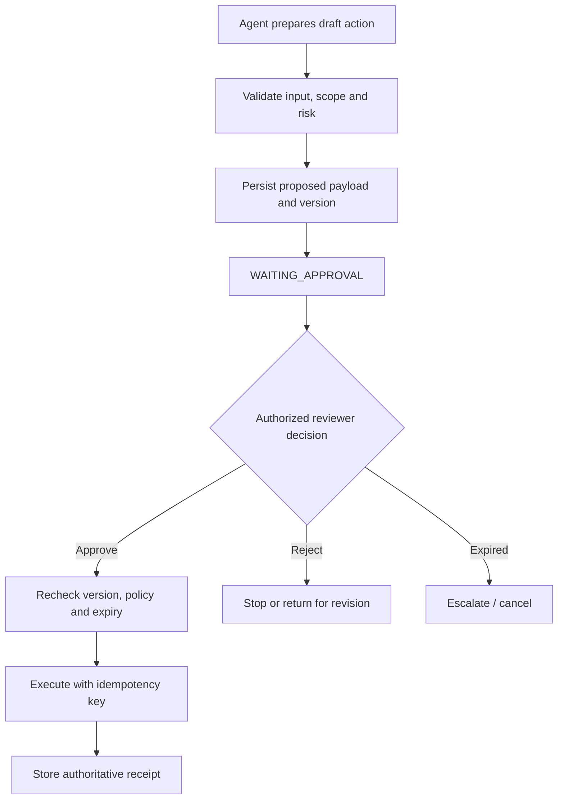
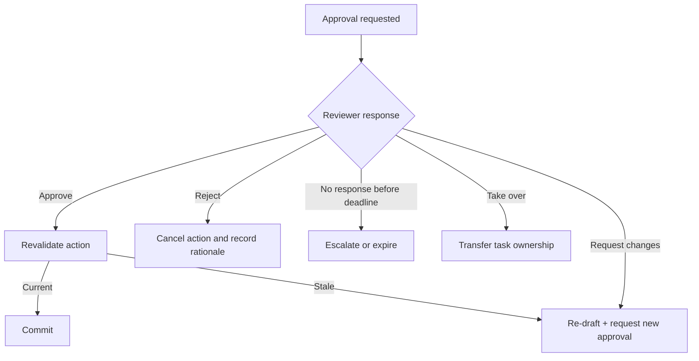
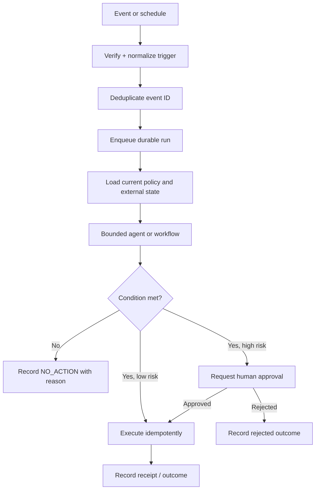
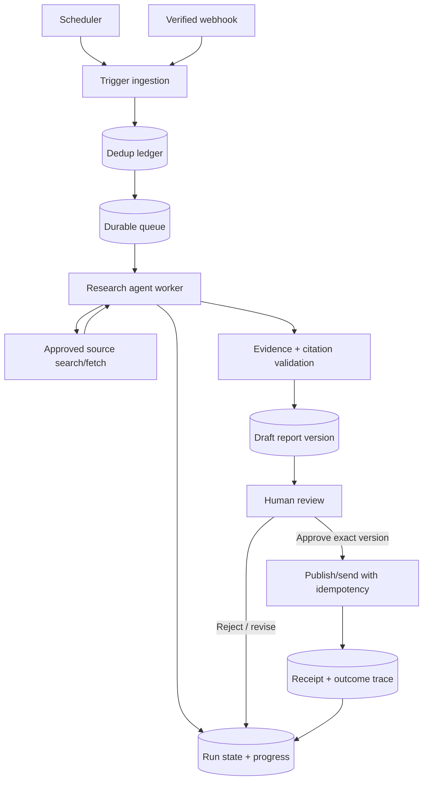
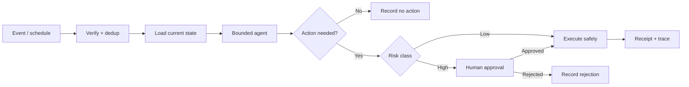

# M09.4 — Human Control and Event Triggers
## Full Reorganized Study Guide

## Table of Contents

- [Part 0 — Document Metadata & Orientation](#part-0-document-metadata-orientation)
  - [0.1 Path, Depth & Prerequisites](#01-path-depth-prerequisites)
  - [0.2 Purpose & Completion Evidence](#02-purpose-completion-evidence)
  - [0.3 Memory Aid](#03-memory-aid)
  - [0.4 Organization](#04-organization)
- [Part 1 — M09.4.1 Human-in-the-Loop](#part-1-m0941-human-in-the-loop)
  - [1.1 Why Human Control Matters](#11-why-human-control-matters)
  - [1.2 Approval Checkpoints](#12-approval-checkpoints)
    - [1.2.1 What Is an Approval Checkpoint?](#121-what-is-an-approval-checkpoint)
    - [1.2.2 What the Reviewer Should See](#122-what-the-reviewer-should-see)
  - [1.3 Rejection Handling](#13-rejection-handling)
  - [1.4 Escalation](#14-escalation)
  - [1.5 Asynchronous Approval](#15-asynchronous-approval)
  - [1.6 Human Takeover](#16-human-takeover)
  - [1.7 Confidence/Risk-Based Escalation](#17-confidencerisk-based-escalation)
  - [1.8 High-Risk Action Confirmation](#18-high-risk-action-confirmation)
    - [1.8.1 Example Approval Payload](#181-example-approval-payload)
    - [1.8.2 Four Approval Invariants](#182-four-approval-invariants)
- [Part 2 — Control Boundaries and Human Experience](#part-2-control-boundaries-and-human-experience)
  - [2.1 Human Review Is Not Just a UI Modal](#21-human-review-is-not-just-a-ui-modal)
  - [2.2 Risk-Based Action Classes](#22-risk-based-action-classes)
  - [2.3 Approval Race Conditions](#23-approval-race-conditions)
  - [2.4 Rejection and Escalation Flow](#24-rejection-and-escalation-flow)
- [Part 3 — M09.4.2 Proactive and Event-Driven Agents](#part-3-m0942-proactive-and-event-driven-agents)
  - [3.1 Not Every Agent Starts with Chat](#31-not-every-agent-starts-with-chat)
  - [3.2 M09.4.2.1 Seven Trigger Types](#32-m09421-seven-trigger-types)
    - [3.2.1 Scheduled Agents](#321-scheduled-agents)
    - [3.2.2 Webhook-Triggered Agents](#322-webhook-triggered-agents)
    - [3.2.3 Email/Message-Triggered Agents](#323-emailmessage-triggered-agents)
    - [3.2.4 Database-Change Agents](#324-database-change-agents)
    - [3.2.5 Monitoring Agents](#325-monitoring-agents)
    - [3.2.6 Conditional Watchers](#326-conditional-watchers)
    - [3.2.7 Event-Driven Agents](#327-event-driven-agents)
  - [3.3 Trigger Comparison Table](#33-trigger-comparison-table)
- [Part 4 — M09.4.2.2 Event-Driven Pattern](#part-4-m09422-event-driven-pattern)
  - [4.1 Canonical Pattern](#41-canonical-pattern)
  - [4.2 Walkthrough: Training Deadline Watcher](#42-walkthrough-training-deadline-watcher)
  - [4.3 Action vs No-Action States](#43-action-vs-no-action-states)
  - [4.4 Event Schema](#44-event-schema)
- [Part 5 — M09.4.2.3 Production Concerns](#part-5-m09423-production-concerns)
  - [5.1 Deduplication](#51-deduplication)
  - [5.2 Idempotency](#52-idempotency)
  - [5.3 Event Ordering Awareness](#53-event-ordering-awareness)
  - [5.4 Missed-Event Recovery](#54-missed-event-recovery)
  - [5.5 Scheduling Drift](#55-scheduling-drift)
  - [5.6 Notification Suppression](#56-notification-suppression)
  - [5.7 Safe Repeated Execution](#57-safe-repeated-execution)
  - [5.8 Operational Diagnostic Table](#58-operational-diagnostic-table)
- [Part 6 — Optional L3 Extension: Research / Monitoring Agent](#part-6-optional-l3-extension-research-monitoring-agent)
  - [6.1 Project Brief](#61-project-brief)
  - [6.2 End-to-End Architecture](#62-end-to-end-architecture)
  - [6.3 Milestones](#63-milestones)
    - [6.3.1 Milestone 1 — Source Boundaries](#631-milestone-1-source-boundaries)
    - [6.3.2 Milestone 2 — Iterative Retrieval](#632-milestone-2-iterative-retrieval)
    - [6.3.3 Milestone 3 — Evidence Validation](#633-milestone-3-evidence-validation)
    - [6.3.4 Milestone 4 — Progress Reporting](#634-milestone-4-progress-reporting)
    - [6.3.5 Milestone 5 — Approval and Resume](#635-milestone-5-approval-and-resume)
    - [6.3.6 Milestone 6 — Schedule and External Event](#636-milestone-6-schedule-and-external-event)
    - [6.3.7 Milestone 7 — Trace and Replay](#637-milestone-7-trace-and-replay)
  - [6.4 Minimal API Surface](#64-minimal-api-surface)
  - [6.5 Suggested Database Entities](#65-suggested-database-entities)
  - [6.6 Example Acceptance Test Matrix](#66-example-acceptance-test-matrix)
- [Part 7 — Concept Map and Revision](#part-7-concept-map-and-revision)
  - [7.1 Concept Map](#71-concept-map)
  - [7.2 Glossary](#72-glossary)
  - [7.3 Ten Revision Rules](#73-ten-revision-rules)
- [Part 8 — Practice and Interview Questions](#part-8-practice-and-interview-questions)
  - [8.1 Quick Recall](#81-quick-recall)
    - [Q1 — What is human-in-the-loop?](#q1-what-is-human-in-the-loop)
    - [Q2 — What should an approval record identify?](#q2-what-should-an-approval-record-identify)
    - [Q3 — How should rejection be handled?](#q3-how-should-rejection-be-handled)
    - [Q4 — What is async approval?](#q4-what-is-async-approval)
    - [Q5 — What is human takeover?](#q5-what-is-human-takeover)
    - [Q6 — Name four trigger types.](#q6-name-four-trigger-types)
    - [Q7 — What is the event-driven pattern?](#q7-what-is-the-event-driven-pattern)
    - [Q8 — Why does deduplication matter?](#q8-why-does-deduplication-matter)
    - [Q9 — What is scheduling drift?](#q9-what-is-scheduling-drift)
    - [Q10 — Why record “no action”?](#q10-why-record-no-action)
  - [8.2 Multiple-Choice Questions](#82-multiple-choice-questions)
    - [Q11 — Which approval is safer?](#q11-which-approval-is-safer)
    - [Q12 — A webhook is delivered twice. What should happen?](#q12-a-webhook-is-delivered-twice-what-should-happen)
    - [Q13 — A source database emits version 12, then version 11. What is safest?](#q13-a-source-database-emits-version-12-then-version-11-what-is-safest)
    - [Q14 — A report was rejected for external publication. The agent should:](#q14-a-report-was-rejected-for-external-publication-the-agent-should)
    - [Q15 — A daily monitor found no changes. Correct outcome?](#q15-a-daily-monitor-found-no-changes-correct-outcome)
  - [8.3 Interview Questions with Model Answers](#83-interview-questions-with-model-answers)
    - [Q16 — How do you design human approval for an agent?](#q16-how-do-you-design-human-approval-for-an-agent)
    - [Q17 — How do you decide when to escalate?](#q17-how-do-you-decide-when-to-escalate)
    - [Q18 — Explain an event-driven agent architecture.](#q18-explain-an-event-driven-agent-architecture)
    - [Q19 — How do you avoid duplicate notifications?](#q19-how-do-you-avoid-duplicate-notifications)
    - [Q20 — How should missed scheduled runs be handled?](#q20-how-should-missed-scheduled-runs-be-handled)
- [Part 9 — Senior/Staff-Level Production Scenarios](#part-9-seniorstaff-level-production-scenarios)
  - [9.1 Scenario — Approval after Resource Version Changed](#91-scenario-approval-after-resource-version-changed)
  - [9.2 Scenario — Alert Storm after Service Recovery](#92-scenario-alert-storm-after-service-recovery)
  - [9.3 Scenario — Forged Event Attempts High-Risk Action](#93-scenario-forged-event-attempts-high-risk-action)
  - [9.4 Scenario — “No Action” Hides a Tool Failure](#94-scenario-no-action-hides-a-tool-failure)
- [Part 10 — References and Advanced Extensions](#part-10-references-and-advanced-extensions)
  - [10.1 Sources and Further Reading](#101-sources-and-further-reading)
  - [10.2 Advanced Topics Not Covered in Depth](#102-advanced-topics-not-covered-in-depth)
  - [10.3 Section Navigation](#103-section-navigation)


---

# Part 0 — Document Metadata & Orientation

## 0.1 Path, Depth & Prerequisites

- **Path:** Core · **Module:** M09 Agent Fundamentals · **Section:** M09.4
- **Depth:** L2 foundation; L3 through demonstrated project work.
- **Prerequisites:** M08, M07 and M09.1–M09.3 (tools, state, planning and failures).
- **Syllabus:** M09.4.1 Human-in-the-Loop; M09.4.2 Proactive and Event-Driven Agents; optional research/monitoring extension.

## 0.2 Purpose & Completion Evidence

**Purpose:** Design agents whose risky actions remain under human control and whose scheduled or externally triggered executions are reliable, deduplicated and auditable.

**Completion evidence:** Pause a run for an approval, reject and cancel safely, resume after approval, implement an event trigger with deduplication, record `action` or `no action`, and demonstrate missed-event recovery.

## 0.3 Memory Aid

> **Events start work; state decides work; people authorize risk; receipts prove outcomes.**

## 0.4 Organization

We cover **approval patterns → risk and control → trigger families → event-driven lifecycle → production correctness → optional monitoring agent → interview practice**.

---

# Part 1 — M09.4.1 Human-in-the-Loop

## 1.1 Why Human Control Matters

An agent can prepare decisions, but some actions have legal, financial, operational or reputational consequences. **Human-in-the-loop (HITL)** introduces an explicit human decision at a defined point rather than assuming the model's choice is final.

Examples: publish a safety circular, change a ship's training requirement, email a customer, delete a record, or escalate a sensitive report. The approval boundary should be based on **action impact and reversibility**, not merely the model's claimed confidence.

## 1.2 Approval Checkpoints

### 1.2.1 What Is an Approval Checkpoint?

A durable pause between **prepared action** and **committed action**. The system stores the exact proposed payload and does not execute the side effect until a principal with the right authority explicitly approves it.



### 1.2.2 What the Reviewer Should See

- Requested action and affected resource IDs.
- Before/after values or draft content.
- Source evidence and material uncertainties.
- Consequence, reversibility and any recipients.
- Expiration time and permission scope.
- Clear **Approve**, **Reject**, **Request changes** and (where appropriate) **Take over** controls.

A vague “approve the agent” button is poor authorization because it does not specify which operation is approved.

## 1.3 Rejection Handling

A rejection is an authoritative outcome, not feedback the model can reinterpret as “try again using a different tool.”

Possible deterministic paths:

| Decision | Runtime transition | Next action |
|---|---|---|
| Approved | `WAITING_APPROVAL → RUNNING` | Execute exact approved operation after rechecks |
| Rejected | `WAITING_APPROVAL → CANCELLED` | No commit; record reason |
| Changes requested | `WAITING_APPROVAL → RUNNING/DRAFTING` | Create new draft and new approval request |
| Approval expired | `WAITING_APPROVAL → EXPIRED` (or `CANCELLED`) | Notify owner; do not auto-approve |
| Permission revoked | Remain blocked | Require currently authorized reviewer |

**Important:** The agent should not automatically resubmit a rejected payload until it gets approval. A revised payload needs a new approval identity/version.

## 1.4 Escalation

Escalation routes a case to a more appropriate person, role or queue when it exceeds automated authority or stalls.

**Triggers:** high impact, conflicting evidence, insufficient data, repeated failures, missed SLA, disputed recommendation or suspected unauthorized access.

An escalation payload should include **run ID, reason, attempted work, evidence references, risk category, pending action and deadline**. Avoid dumping entire prompts or secrets.

## 1.5 Asynchronous Approval

An approval may arrive minutes or days after the run paused. The runtime must persist state; it must not block an HTTP request, hold a database transaction open or depend on a live model session.

**Mechanism:** Create approval record → notify reviewer → receive authenticated decision via API/event → validate token/role/action version → resume work using durable state.

```text
Agent run: WAITING_APPROVAL
Approval ID: apr-102
Action hash: hash(publish:report-44:v3:recipient-set-A)
Expires: policy-defined deadline
Approver role: company_admin
Decision: pending
```

## 1.6 Human Takeover

**Human takeover** hands control of the task to a human operator. The agent should stop generating new writes, expose relevant verified state and mark who owns the next action. On handback, reload external state and require a fresh scope check before continuing.

Examples: reviewer edits a report manually; support engineer resolves a provider outage; safety officer decides whether evidence supports an escalation.

## 1.7 Confidence/Risk-Based Escalation

Model “confidence” is not automatically calibrated. Choose escalation based on **measured risk indicators** and **business impact**.

Possible signal dimensions:

- Severity: financial or operational impact of being wrong.
- Reversibility: can the action be cleanly undone?
- Evidence quality: source freshness, contradictions, missing records.
- Privilege: does the action cross roles, tenants or systems?
- Novelty: is the case outside validated test distribution?
- Historic model performance: measured error rates on comparable tasks.

**Illustrative policy:** An informational summary with valid citations can be generated automatically; sending the summary externally requires approval; a bulk deletion always requires a separately authorized human path. Never use a fabricated “90% model confidence” as a permission token.

## 1.8 High-Risk Action Confirmation

The approval record should bind **who**, **what**, **which version**, **where** and **until when**. At commit time, verify it has not been revoked or superseded.

### 1.8.1 Example Approval Payload

```json
{
  "approval_id": "apr-102",
  "run_id": "run-47",
  "action_type": "PUBLISH_REPORT",
  "resource_id": "report-44",
  "resource_version": 3,
  "payload_hash": "<stable hash of canonical action payload>",
  "reviewer_role_required": "company_admin",
  "status": "PENDING",
  "expires_at": "<server-generated expiry>",
  "decision_at": null
}
```

Hash canonicalized exact payload values and bind recipients/permissions as part of the approval. An approval is insufficient if the payload materially changes between review and commit.

### 1.8.2 Four Approval Invariants

1. No committed high-risk action without an authorized, current approval.
2. An approval cannot be reused for a different action or payload.
3. A rejected/expired approval never counts as consent.
4. Approval and external execution both leave auditable records.

---

# Part 2 — Control Boundaries and Human Experience

## 2.1 Human Review Is Not Just a UI Modal

A confirmation dialog that disappears when the browser closes is not durable approval. Build a backend state transition that the user interface renders. Review actions must be authenticated, authorized, CSRF-protected where relevant and concurrency-safe.

## 2.2 Risk-Based Action Classes

| Risk tier | Illustrative action | Control |
|---|---|---|
| Low | Search authorized public/manual content | Automatic within limits |
| Medium | Create an unpublished training draft | Audit and possibly reviewer workflow |
| High | Send externally, publish training, modify records | Explicit scoped approval |
| Critical | Bulk delete / irreversible sensitive change | Separate privileged workflow, dual control if policy requires |

This table is illustrative; actual policy comes from business, security and regulatory requirements.

## 2.3 Approval Race Conditions

| Race | Risk | Prevention |
|---|---|---|
| Two reviewers respond | Conflicting decisions | Transactional status update; first valid final decision wins |
| Payload changes during review | Stale approval | Payload hash + version recheck |
| Reviewer role revoked | Unauthorized late approval | Re-authorize on submission and commit |
| Run cancelled before approval arrives | Ghost write | Terminal status check on resume |
| Approval arrives after expiry | Unintended commit | Expiry validated server-side |
| Same approval webhook delivered twice | Duplicate commit | Approval-event dedup + idempotent action |

## 2.4 Rejection and Escalation Flow



---

# Part 3 — M09.4.2 Proactive and Event-Driven Agents

## 3.1 Not Every Agent Starts with Chat

A proactive agent runs after an external event or schedule. However, the trigger should only begin an authorized process; it should not automatically turn every signal into an action.

**Example:** A daily monitoring job notices a revised maritime safety advisory, compares it to the previous version and prepares a summary. It sends a notification only if the change meets a configured relevance threshold and deduplication rules.

## 3.2 M09.4.2.1 Seven Trigger Types

### 3.2.1 Scheduled Agents

Triggered by a clock or scheduler: daily digest, weekly compliance review or periodic missing-training scan.

**Design concerns:** timezone, daylight saving rules where applicable, schedule drift, overlap, holidays, missed executions and catch-up policy. Use a stable scheduled-slot ID (e.g., `daily:2026-11-23:tenant-A`), not just `now()`.

### 3.2.2 Webhook-Triggered Agents

Triggered by a signed HTTP event sent by a provider: “report uploaded,” “ticket closed,” “payment status changed.”

**Verify:** provider signature, timestamp/replay window, event ID, tenant mapping and schema. Acknowledge quickly and enqueue durable work rather than running a long model loop inside the webhook request.

### 3.2.3 Email/Message-Triggered Agents

Triggered by new authorized mail or message. Extract intent, classify relevance, then decide whether to draft, request approval or do nothing.

**Risks:** prompt injection inside message content, spoofed senders, attachments, accidental auto-replies, reply loops and leaking recipients. For sending messages, use approval or narrowly scoped allowlists.

### 3.2.4 Database-Change Agents

Triggered by a database event, change-data-capture record or outbox entry (e.g., incident status changed to “training requested”).

**Critical:** Handle transaction commit order and avoid reading a half-finished business update. Prefer outbox/CDC rather than a fragile application callback that can vanish after commit.

### 3.2.5 Monitoring Agents

Triggered by metrics or health anomalies: delayed task count, repeated safety flags or service error rate.

**Risks:** noise, false positives, alert storms and actions based on unverified metrics. Add cool-down intervals, alert grouping and human incident ownership.

### 3.2.6 Conditional Watchers

Periodically or event-driven, evaluate a condition: a source page changed, a training deadline is approaching, or a database count crossed a threshold.

The watcher should record the last evaluated state and only alert on **meaningful transitions**. Otherwise it will send the same message every scan.

### 3.2.7 Event-Driven Agents

An umbrella category for workflows awakened by incoming events. A webhook, queue message, database change or monitoring alert can all trigger an event-driven workflow. The distinguishing characteristic is that **an event**, rather than a synchronous user chat turn, initiates the run.

## 3.3 Trigger Comparison Table

| Trigger | Example | Unique event identity | Typical failure |
|---|---|---|---|
| Scheduled | Every morning at 09:00 | Schedule + intended slot | Missed/overlapping execution |
| Webhook | New report uploaded | Provider event ID | Duplicate delivery / spoofing |
| Email/message | Incoming safety email | Message ID + mailbox scope | Reply loops / malicious content |
| Database change | Incident updated | Outbox ID / CDC position | Duplicate or out-of-order event |
| Monitoring | Error rate exceeds limit | Alert group ID + window | Alert storms |
| Conditional watcher | Page content has changed | Resource + observed version | Repeated false notifications |
| Event driven (general) | Queue event | Stable event ID | Lost events / retries |

---

# Part 4 — M09.4.2.2 Event-Driven Pattern

## 4.1 Canonical Pattern

**Event / Schedule → Trigger → Agent / Workflow → Evaluate State / Condition → Action or No Action → Record Outcome**.

Every box has distinct responsibilities. In particular, *no action* is a legitimate, auditable result.



## 4.2 Walkthrough: Training Deadline Watcher

**Business rule:** Check daily whether a ship has crew with training due in the next 7 days; prepare reminders, but suppress duplicates and obtain approval before external messages if required by policy.

| Stage | Data / behavior |
|---|---|
| Event | Scheduler emits `2026-11-23/tenant-A/daily-training-check` |
| Trigger | Normalize timezone and tenant scope |
| Check state | Query authorized crew training due dates |
| Condition | At least one verified due item within policy window |
| No action | If nothing due, save `NO_ACTION:none_due` |
| Action | Prepare recipient-scoped reminder draft |
| Human check | Reviewer approves external distribution |
| Outcome | Save message ID, exact recipient set, dedup key, timestamps |

The model may assist with wording, but due-date arithmetic, recipient authorization and deduplication should be deterministic.

## 4.3 Action vs No-Action States

Define explicit statuses such as `ACTION_COMPLETED`, `NO_ACTION`, `WAITING_APPROVAL`, `PARTIAL`, `FAILED`. Recording “no action” prevents the scheduler from confusing “nothing needed” with “job never ran.”

## 4.4 Event Schema

```json
{
  "event_id": "evt-2001",
  "event_type": "training.deadline.check",
  "tenant_id": "tenant-A",
  "source": "scheduler",
  "occurred_at": "2026-11-23T03:30:00Z",
  "resource_id": "ship-18",
  "resource_version": "2026-11-23",
  "correlation_id": "run-group-64"
}
```

An event is a notification about a change, not necessarily a complete and authoritative copy of current state. Fetch current business data before a consequential action.

---

# Part 5 — M09.4.2.3 Production Concerns

## 5.1 Deduplication

Events can be delivered more than once. **Deduplication** prevents the same logical event from creating repeated runs or notifications. Keep a processed-event table with a unique constraint on `(source, tenant_id, event_id)`, and handle replays according to retention policy.

**Caution:** A duplicate *event* and a repeated *business action* are related but different. Both need identity boundaries.

## 5.2 Idempotency

**Idempotent execution** ensures retrying a logical action has the same business effect as one successful execution. A run keyed to a schedule slot can be repeated safely only if its notifications/publications also use stable idempotency identifiers.

```text
trigger_key = tenant_id + scheduled_slot + policy_version
notification_key = trigger_key + recipient_id + template_version
```

Use canonical input encoding and stable identifiers. The exact key policy depends on whether a deliberate second notification is allowed.

## 5.3 Event Ordering Awareness

A system can receive event `version 12` before `version 11`. If it blindly applies stale event data later, it may revert a correct state.

- Prefer **current-state re-read** for decisions.
- Maintain per-resource sequence/version if the source guarantees one.
- Reject or ignore stale transitions when policy requires monotonic versions.
- Do not assume global ordering across different partitions or services.

## 5.4 Missed-Event Recovery

Outages and provider bugs can cause missed events. Use **periodic reconciliation** against the source of truth: “Which records changed since checkpoint X but have no processed-event/run outcome?” Backfill missing runs with deduplication.

The watermark must account for clock skew and late arrivals. A safe strategy uses provider sequence positions or overlapping time windows plus dedup, not a brittle “strictly greater than last timestamp” query if sources are eventually consistent.

## 5.5 Scheduling Drift

A job planned for 09:00 may actually start at 09:07 due to load or outage. Record both **scheduled_at** and **started_at**, and define catch-up behavior.

| Policy | Use case | Caution |
|---|---|---|
| Skip missed slot | Noncritical frequent metrics | May miss useful alerts |
| Catch up all | Audit-critical ledger processing | Can overload providers |
| Coalesce missed slots | Latest-status daily digest | Must document lost granularity |
| Limited lookback | Time-window monitoring | Requires dedup and late-data handling |

## 5.6 Notification Suppression

Prevent alert fatigue using **cooldowns, quiet hours, recipient-specific dedup, threshold hysteresis, alert grouping and notification quotas**. Retain a reason field explaining suppression to distinguish it from processing failure.

**Hysteresis example:** Raise an alert when a metric crosses 90, but do not clear the alert until it drops below 80. This avoids noisy alert toggling around a single boundary; the thresholds are illustrative.

## 5.7 Safe Repeated Execution

A robust event-run contract supports repeated execution without unsafe duplication:

1. Trigger carries stable identity and authenticated source.
2. Ingestion persists event before acknowledging where possible.
3. Work is queued durably and claimed with controlled concurrency.
4. Agent loads current authorized state and hard budgets.
5. External writes use idempotency keys and approval gates.
6. Outcomes, including no-action and rejection, are persisted.
7. Reconciliation finds missing/incomplete work after outages.

## 5.8 Operational Diagnostic Table

| Symptom | Likely cause | First check | Fix |
|---|---|---|---|
| Same alert sent five times | Duplicate deliveries / missing suppression | Event and notification keys | Enforce unique keys + cooldown |
| No report during outage | Missed scheduler slot | Scheduled slot ledger | Catch-up / reconciliation |
| Old event overwrites current state | Out-of-order delivery | Resource version | Compare versions / fetch current state |
| Untrusted webhook starts agent | Missing signature check | Provider signature | Verify signature + replay window |
| Webhook times out | Long processing inline | Request handler duration | Acknowledge after durable enqueue |
| Approval after cancel publishes anyway | Stale pending decision | Run status and payload hash | Revalidate on resume |
| “No changes” indistinguishable from failed run | No outcome record | Run log | Persist `NO_ACTION` reason |
| Agent replies to its own email | Message loop | Sender headers / sent IDs | Loop prevention + outbound approval |
| Alerts flood on metric jitter | No hysteresis/cooldown | Threshold history | Suppression policy |
| Writes duplicated on retry | No operation idempotency | External receipts | Stable key + reconciliation |

---

# Part 6 — Optional L3 Extension: Research / Monitoring Agent

## 6.1 Project Brief

Build a **Research/Monitoring Agent** that periodically checks approved sources, gathers evidence, performs iterative retrieval, validates claims, prepares a cited report, displays progress, pauses for approval, resumes safely, stores a trace and can start from either a schedule or external event.

**Boundary:** It is one bounded research agent embedded in a workflow. A multi-agent architecture is not required to satisfy the syllabus.

## 6.2 End-to-End Architecture



## 6.3 Milestones

### 6.3.1 Milestone 1 — Source Boundaries

Define an explicit allowlist of source domains and APIs, query limit, fetch timeout, source identity/version, retention policy and whether robots/terms/access rights permit automated fetching. Do not let retrieved pages issue instructions to the agent.

### 6.3.2 Milestone 2 — Iterative Retrieval

Search with an initial query, inspect returned documents, decide whether a missing claim needs one alternate lookup and cap retrieval attempts. Preserve source URLs, retrieved timestamps, snippets/claim spans and version identifiers.

### 6.3.3 Milestone 3 — Evidence Validation

For every material claim, store supporting source ID, source span and a validation result. If sources conflict or are stale, label uncertainty and optionally escalate. A citation is not proof if the source does not support the claim.

### 6.3.4 Milestone 4 — Progress Reporting

Expose `queued`, `searching`, `verifying`, `draft_ready`, `waiting_approval`, `published`, `partial`, `failed` and `no_action` as task statuses. Show source counts and unresolved gaps rather than leaking internal reasoning.

### 6.3.5 Milestone 5 — Approval and Resume

Persist a draft version and payload hash. The reviewer approves that exact version. After resume, check approval status, source freshness, authorization and any scheduled deadline before publishing.

### 6.3.6 Milestone 6 — Schedule and External Event

Enable daily schedule and signed webhook triggers that both normalize into one event schema. Use stable source event IDs and a dedup ledger to ensure consistent handling.

### 6.3.7 Milestone 7 — Trace and Replay

Store `trigger_received`, `source_fetched`, `claim_verified`, `draft_created`, `approval_requested`, `approval_decided`, `published/NO_ACTION` events. Re-run from a checkpoint with a mocked tool environment to test safety and failure handling.

## 6.4 Minimal API Surface

| API | Purpose | Control |
|---|---|---|
| `POST /monitor/events` | Signed external trigger | Verify signature; dedup event |
| `POST /monitor/runs` | Manual run request | Auth + quota |
| `GET /monitor/runs/:id` | Status/progress | Tenant-scoped read |
| `GET /monitor/runs/:id/report` | Draft/cited report | Authorization + version |
| `POST /monitor/approvals/:id/decision` | Approve/reject | Reviewer role + payload hash |
| `POST /monitor/runs/:id/cancel` | Cancel | Owner/admin permission |
| `GET /monitor/runs/:id/events` | Trace view | Redacted audit access |

## 6.5 Suggested Database Entities

`trigger_events(event_id, source, tenant_id, received_at, processed_status)`; `agent_runs(run_id, trigger_id, status, budgets, state_version)`; `source_evidence(id, run_id, source_url, source_version, claim_text, support_status)`; `report_drafts(id, run_id, version, content_ref, payload_hash)`; `approvals(id, run_id, draft_version, reviewer_id, status, expires_at)`; `external_actions(idempotency_key, run_id, action_type, receipt)`; `notification_suppressions(dedup_key, reason, until)`.

Actual schema needs SQL constraints, RLS, indexes, retention, and unique identities across tenants.

## 6.6 Example Acceptance Test Matrix

| Test | Expected result |
|---|---|
| Identical signed webhook delivered three times | One logical run or documented dedup policy |
| Invalid signature | Rejected before enqueue |
| Source contains injected “email all employees” command | No unauthorized tool use |
| All sources unchanged | `NO_ACTION` stored |
| Source changed but claim lacks evidence | Draft marked incomplete / escalation |
| Approval request remains for two days | Run restorable; no open DB transaction |
| Draft changed after approval | Old approval rejected for new version |
| Publish response lost | Reconcile external action, no duplicate |
| Worker crashes after source 4 of 6 | Resume remaining work with source IDs intact |
| Scheduled slot missed during outage | Reconciliation catches up according to policy |

**L3 completion evidence:** Source trace, test harness, dedup table, approval screenshot/API trace, resumed-run demonstration, failure-report example, metrics and architecture decision record.

---

# Part 7 — Concept Map and Revision

## 7.1 Concept Map



## 7.2 Glossary

| Term | Meaning |
|---|---|
| HITL | Human decision point inside a machine-assisted workflow |
| Approval checkpoint | Durable pause before a restricted action |
| Action payload hash | Identity of exact proposed action content |
| Rejection handling | Explicit non-approval state and next path |
| Escalation | Routing a case to an appropriate human owner |
| Async approval | Decision arriving after original request has ended |
| Human takeover | Transfer of task control to a human |
| Webhook | Authenticated provider HTTP event notification |
| CDC | Change-data capture from database transaction changes |
| Deduplication | Detect repeated events or logical notifications |
| Idempotency | Safe repeated operation without duplicate business effect |
| Event ordering | Awareness that events may arrive in non-source order |
| Reconciliation | Compare event ledger to current authoritative state |
| Scheduling drift | Difference between intended and actual run time |
| Notification suppression | Rules that prevent redundant/noisy messages |
| No-action outcome | Recorded evaluation resulting in no external action |

## 7.3 Ten Revision Rules

1. Human approval should target an exact action and version.
2. Approval is not permanent authorization if the world changes.
3. Rejection must be enforceable without model discretion.
4. Never block an HTTP request or hold a DB lock while awaiting days-long approval.
5. Model confidence alone is not a risk policy.
6. Events are triggers, not automatically current truth.
7. Dedup both incoming triggers and downstream effects.
8. Record no-action as a legitimate result.
9. Expect duplicates, delays and out-of-order delivery.
10. Reconciliation closes the gap left by missed events and outages.

---

# Part 8 — Practice and Interview Questions

## 8.1 Quick Recall

### Q1 — What is human-in-the-loop?

**Answer:** A human reviews or takes over a decision at a defined point, especially before risky agent actions.

### Q2 — What should an approval record identify?

**Answer:** The exact action, affected resources and versions, payload hash, authorized reviewer, deadline and decision.

### Q3 — How should rejection be handled?

**Answer:** Record a terminal denial or request revisions; the agent must not bypass or silently reissue the rejected action.

### Q4 — What is async approval?

**Answer:** Approval that arrives after the original execution pauses; the task persists and resumes from durable state.

### Q5 — What is human takeover?

**Answer:** Transfer of responsibility to a human with the agent paused and all verified context available.

### Q6 — Name four trigger types.

**Answer:** Scheduled, webhook, email/message and database-change triggers; monitoring and conditional watcher triggers also exist.

### Q7 — What is the event-driven pattern?

**Answer:** Event/schedule → validated trigger → agent/workflow → evaluate current condition → action/no-action → record outcome.

### Q8 — Why does deduplication matter?

**Answer:** Event delivery can repeat; without dedup it can launch duplicate runs or notifications.

### Q9 — What is scheduling drift?

**Answer:** A job starting later or earlier than its intended schedule; the system needs a catch-up policy.

### Q10 — Why record “no action”?

**Answer:** To distinguish a correctly evaluated condition with no work needed from a missed or failed execution.

## 8.2 Multiple-Choice Questions

### Q11 — Which approval is safer?

A. “Approve anything the agent wants”  
B. Approval bound to exact payload/version  
C. Approval based on model confidence  
D. Approval stored only in chat

**Answer: B.** Scope and versioning prevent reuse for a different action.

### Q12 — A webhook is delivered twice. What should happen?

A. Two identical notifications  
B. Deduplicate by stable event/action identity  
C. Ignore authentication  
D. Ask the model to remember

**Answer: B.** Duplicate delivery is normal in event-driven systems.

### Q13 — A source database emits version 12, then version 11. What is safest?

A. Apply version 11 last  
B. Compare versions and fetch current state  
C. Trust arrival order  
D. Retry with another model

**Answer: B.** Delivery order need not match source order.

### Q14 — A report was rejected for external publication. The agent should:

A. Try a different send tool  
B. Use a private email account  
C. Cancel/revise under policy and require new review  
D. Publish anyway

**Answer: C.** Human rejection is a hard workflow decision.

### Q15 — A daily monitor found no changes. Correct outcome?

A. No record at all  
B. `NO_ACTION` with reason  
C. Pretend it changed  
D. Retry endlessly

**Answer: B.** No-action is a meaningful auditable outcome.

## 8.3 Interview Questions with Model Answers

### Q16 — How do you design human approval for an agent?

**Model answer:** “I let the agent prepare a concrete action but pause before any high-risk side effect. I persist the exact payload, version and approval ID. An authorized reviewer approves or rejects it, and the executor rechecks permissions and version before committing with an idempotency key.”

**Follow-up:** Can a two-day approval hold a DB transaction? **Answer:** No; persist the pause and release execution resources.

### Q17 — How do you decide when to escalate?

**Model answer:** “I use impact, reversibility, evidence quality, permissions and measured error rates. Sensitive writes or contradictory evidence trigger a human. I don't treat an uncalibrated model confidence score as approval.”

**Follow-up:** What if the reviewer rejects? **Answer:** Record rejection and either stop or build a new draft that needs its own approval.

### Q18 — Explain an event-driven agent architecture.

**Model answer:** “A schedule or event starts a workflow. We authenticate and deduplicate the trigger, enqueue a durable run, load current authorized state, let the bounded agent evaluate the condition, then take an allowed action or record no action. Results and receipts are saved for auditing.”

**Follow-up:** Why re-read current state? **Answer:** Events can be stale or out of order.

### Q19 — How do you avoid duplicate notifications?

**Model answer:** “I use a stable event ID to deduplicate triggers and a separate idempotency key for each logical notification. I also apply recipient cooldowns, quotas and suppression rules, and reconcile uncertain outcomes after provider timeouts.”

**Follow-up:** Is an event ID sufficient for all dedup? **Answer:** No; the same event can legitimately map to multiple distinct recipients or actions.

### Q20 — How should missed scheduled runs be handled?

**Model answer:** “I record intended schedule slots, compare them with completed outcomes and apply an explicit skip, catch-up or coalesce policy. I backfill missing work using the same dedup rules so recovery doesn't duplicate earlier notifications.”

**Follow-up:** What if events arrive late? **Answer:** Use source sequence positions or overlapping lookback windows with dedup.

---

# Part 9 — Senior/Staff-Level Production Scenarios

## 9.1 Scenario — Approval after Resource Version Changed

**Question:** A manager approves a report while an incident record is updated by another user. What should the publishing workflow do?

**Model answer:** Recheck the report payload hash, incident revision, approval status and reviewer authorization at the moment of commit. If the material content changed, invalidate the stale approval and request review of the new version. Do not apply old approval to new content.

## 9.2 Scenario — Alert Storm after Service Recovery

**Question:** A monitoring service was down for a day and replays thousands of alerts. How can the agent avoid overwhelming users?

**Model answer:** Reconcile current state first, apply per-resource dedup, group related alerts, use suppression/cooldowns and coalesce old events where policy allows. Preserve audit events for skipped/coalesced slots while keeping recipient communication bounded.

## 9.3 Scenario — Forged Event Attempts High-Risk Action

**Question:** An attacker sends a webhook body requesting the agent publish a safety notice. What protections matter?

**Model answer:** Verify provider signature/timestamp/replay window before enqueue; map the event to server-side tenant scope; restrict allowed actions and require human approval for publication. Treat event payload strings as untrusted data, not commands with authority.

## 9.4 Scenario — “No Action” Hides a Tool Failure

**Question:** A watcher records `NO_ACTION` whenever its search tool returns an empty array, but sometimes the provider times out and returns an empty fallback. What is wrong?

**Model answer:** The system conflates a successful empty result with a failed observation. Tool results should distinguish `SUCCESS_EMPTY`, `TIMEOUT`, `PERMISSION_DENIED` and other statuses. Only verified empty searches can produce `NO_ACTION`; failed retrieval yields `INCOMPLETE/FAILED` with retry or escalation.

---

# Part 10 — References and Advanced Extensions

## 10.1 Sources and Further Reading

- [Microsoft — AI Agent Orchestration Patterns](https://learn.microsoft.com/en-us/azure/architecture/ai-ml/guide/ai-agent-design-patterns)
- [LangGraph — Interrupts and Human-in-the-Loop](https://docs.langchain.com/oss/python/langgraph/interrupts)
- [Temporal — Activity Definition and Idempotency](https://docs.temporal.io/activity-definition)
- [OpenAI — A Practical Guide to Building AI Agents](https://openai.com/business/guides-and-resources/a-practical-guide-to-building-ai-agents/)
- [CloudEvents — Specification](https://github.com/cloudevents/spec)

Architecture diagrams, policies, API shapes and the monitoring exercise are original teaching examples, not provider contracts.

## 10.2 Advanced Topics Not Covered in Depth

- Formal approval delegation, dual-control and revocation.
- Event-time processing, watermarks and event-time vs processing-time windows.
- Cross-region exactly-once-effect design and disaster recovery.
- Risk-calibrated abstention and human workload optimization.

## 10.3 Section Navigation

**Previous:** [M09.3 — State and Failures](M09.3_State_and_Execution_Failures.md) · **Next:** [M09.5 — Architecture Decision](M09.5_Architecture_Decision.md)
