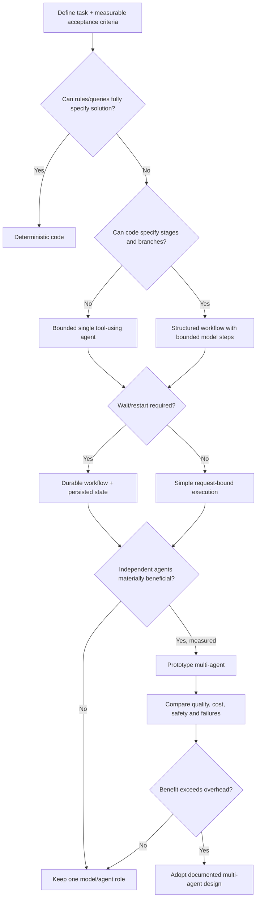
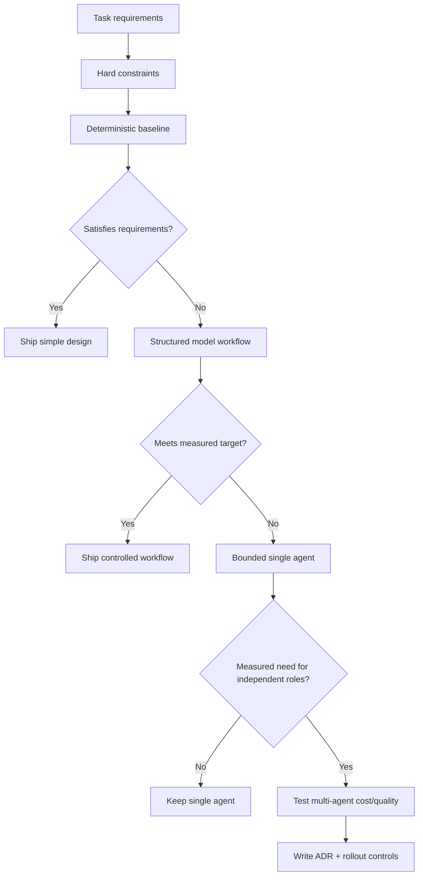

# M09.5 — Architecture Decision
## Full Reorganized Study Guide

## Table of Contents

- [Part 0 — Document Metadata & Orientation](#part-0-document-metadata-orientation)
  - [0.1 Path, Depth & Prerequisites](#01-path-depth-prerequisites)
  - [0.2 Purpose & Completion Evidence](#02-purpose-completion-evidence)
  - [0.3 Memory Aid](#03-memory-aid)
  - [0.4 Organization](#04-organization)
- [Part 1 — M09.5.1 Autonomy Is Optional](#part-1-m0951-autonomy-is-optional)
  - [1.1 The Principle](#11-the-principle)
  - [1.2 The Three Essential Options](#12-the-three-essential-options)
    - [1.2.1 Deterministic Code](#121-deterministic-code)
    - [1.2.2 Structured Workflow with Model Steps](#122-structured-workflow-with-model-steps)
    - [1.2.3 Tool-Using Agent](#123-tool-using-agent)
  - [1.3 State and Multi-Agent Are Separate Axes](#13-state-and-multi-agent-are-separate-axes)
- [Part 2 — Architecture Comparison and Decision Matrix](#part-2-architecture-comparison-and-decision-matrix)
  - [2.1 Detailed Comparison](#21-detailed-comparison)
  - [2.2 Evaluation Dimensions](#22-evaluation-dimensions)
  - [2.3 Decision Tree](#23-decision-tree)
  - [2.4 A Weighted Scorecard (Illustrative)](#24-a-weighted-scorecard-illustrative)
  - [2.5 Hard Constraints vs Optimizations](#25-hard-constraints-vs-optimizations)
- [Part 3 — Five Worked Architecture Decisions](#part-3-five-worked-architecture-decisions)
  - [3.1 Use Case A — Training Completion Count](#31-use-case-a-training-completion-count)
  - [3.2 Use Case B — Incident PDF Field Extraction](#32-use-case-b-incident-pdf-field-extraction)
  - [3.3 Use Case C — Investigate a Complex Training Gap](#33-use-case-c-investigate-a-complex-training-gap)
  - [3.4 Use Case D — Daily Compliance Digest](#34-use-case-d-daily-compliance-digest)
  - [3.5 Use Case E — Long-Running Source Monitoring](#35-use-case-e-long-running-source-monitoring)
- [Part 4 — Multi-Agent Is an Option, Not a Graduation Level](#part-4-multi-agent-is-an-option-not-a-graduation-level)
  - [4.1 Reasons That Can Justify Multiple Agents](#41-reasons-that-can-justify-multiple-agents)
  - [4.2 Reasons That Do Not Justify Multiple Agents](#42-reasons-that-do-not-justify-multiple-agents)
  - [4.3 Hidden Coordination Costs](#43-hidden-coordination-costs)
  - [4.4 Safe Handoff Contract](#44-safe-handoff-contract)
  - [4.5 Failure Mode Table](#45-failure-mode-table)
- [Part 5 — Architecture Decision Record (ADR)](#part-5-architecture-decision-record-adr)
  - [5.1 Why Write an ADR?](#51-why-write-an-adr)
  - [5.2 Reusable ADR Template](#52-reusable-adr-template)
  - [5.3 Filled Mini-ADR Example](#53-filled-mini-adr-example)
- [Part 6 — Experiment and Measurement Framework](#part-6-experiment-and-measurement-framework)
  - [6.1 Comparative Evaluation Plan](#61-comparative-evaluation-plan)
  - [6.2 Metrics Table](#62-metrics-table)
  - [6.3 Evaluation Must Include Abstention](#63-evaluation-must-include-abstention)
  - [6.4 Safe Rollout Strategy](#64-safe-rollout-strategy)
  - [6.5 Revisit Triggers](#65-revisit-triggers)
- [Part 7 — Common Misconceptions and Diagnostics](#part-7-common-misconceptions-and-diagnostics)
  - [7.1 Misconceptions](#71-misconceptions)
  - [7.2 Diagnostic Table](#72-diagnostic-table)
- [Part 8 — Concept Map and Revision](#part-8-concept-map-and-revision)
  - [8.1 Concept Map](#81-concept-map)
  - [8.2 Glossary](#82-glossary)
  - [8.3 Ten Revision Rules](#83-ten-revision-rules)
- [Part 9 — Practice and Interview Questions](#part-9-practice-and-interview-questions)
  - [9.1 Quick Recall](#91-quick-recall)
    - [Q1 — What does “autonomy is optional” mean?](#q1-what-does-autonomy-is-optional-mean)
    - [Q2 — When is deterministic code preferable?](#q2-when-is-deterministic-code-preferable)
    - [Q3 — When is a structured workflow preferable?](#q3-when-is-a-structured-workflow-preferable)
    - [Q4 — When might a single agent help?](#q4-when-might-a-single-agent-help)
    - [Q5 — Does a scheduled workflow require an agent?](#q5-does-a-scheduled-workflow-require-an-agent)
    - [Q6 — Why not always use multi-agent systems?](#q6-why-not-always-use-multi-agent-systems)
    - [Q7 — What is an ADR?](#q7-what-is-an-adr)
    - [Q8 — Why start with a baseline?](#q8-why-start-with-a-baseline)
    - [Q9 — What is an important hard constraint for enterprise agents?](#q9-what-is-an-important-hard-constraint-for-enterprise-agents)
    - [Q10 — Why evaluate abstention?](#q10-why-evaluate-abstention)
  - [9.2 Multiple-Choice Questions](#92-multiple-choice-questions)
    - [Q11 — How should a fixed training completion count be implemented first?](#q11-how-should-a-fixed-training-completion-count-be-implemented-first)
    - [Q12 — Which property does a schedule establish?](#q12-which-property-does-a-schedule-establish)
    - [Q13 — Which is a valid reason to consider multi-agent architecture?](#q13-which-is-a-valid-reason-to-consider-multi-agent-architecture)
    - [Q14 — What should be treated as a hard constraint?](#q14-what-should-be-treated-as-a-hard-constraint)
    - [Q15 — What is a fair architecture comparison?](#q15-what-is-a-fair-architecture-comparison)
  - [9.3 Interview Questions with Model Answers](#93-interview-questions-with-model-answers)
    - [Q16 — How do you decide whether to use an agent?](#q16-how-do-you-decide-whether-to-use-an-agent)
    - [Q17 — What's the difference between workflow autonomy and agent autonomy?](#q17-whats-the-difference-between-workflow-autonomy-and-agent-autonomy)
    - [Q18 — When would you choose multiple agents over one?](#q18-when-would-you-choose-multiple-agents-over-one)
    - [Q19 — What nonfunctional requirements matter for agent architecture?](#q19-what-nonfunctional-requirements-matter-for-agent-architecture)
    - [Q20 — How would you roll out an agent safely?](#q20-how-would-you-roll-out-an-agent-safely)
- [Part 10 — Senior/Staff-Level Production Scenarios](#part-10-seniorstaff-level-production-scenarios)
  - [10.1 Scenario — Product Demands Multi-Agent by Default](#101-scenario-product-demands-multi-agent-by-default)
  - [10.2 Scenario — Single Agent Meets Quality but Fails SLO](#102-scenario-single-agent-meets-quality-but-fails-slo)
  - [10.3 Scenario — A New Data Source Makes Workflow Brittle](#103-scenario-a-new-data-source-makes-workflow-brittle)
  - [10.4 Scenario — Multi-Agent Roles Produce Contradictory Findings](#104-scenario-multi-agent-roles-produce-contradictory-findings)
- [Part 11 — References and Advanced Extensions](#part-11-references-and-advanced-extensions)
  - [11.1 Sources and Further Reading](#111-sources-and-further-reading)
  - [11.2 Advanced Topics Not Covered in Depth](#112-advanced-topics-not-covered-in-depth)
  - [11.3 Section Navigation](#113-section-navigation)


---

# Part 0 — Document Metadata & Orientation

## 0.1 Path, Depth & Prerequisites

- **Path:** Core · **Module:** M09 Agent Fundamentals · **Section:** M09.5
- **Depth:** L2 foundation; L3 through demonstrated project work.
- **Prerequisites:** M08, M07 and the M09.1–M09.4 sections.
- **Syllabus:** M09.5.1 Autonomy Is Optional.

## 0.2 Purpose & Completion Evidence

**Purpose:** Make a defensible architecture choice between deterministic code, structured workflows, bounded single agents, durable stateful agents and multi-agent systems.

**Completion evidence:** Document requirements, alternatives, success criteria, cost/risk trade-offs and a testable decision. Show why the proposed autonomy level is necessary—or why it is not.

## 0.3 Memory Aid

> **Complexity must earn its place through measurable benefit.**

## 0.4 Organization

**Decision criteria → option comparison → practical decision tree → use-case walkthroughs → ADR → measurement and migration → practice/interviews.** This file brings together the preceding sections and prepares the minimal agent implementation in M09.6.

---

# Part 1 — M09.5.1 Autonomy Is Optional

## 1.1 The Principle

Autonomy is an architectural choice, not a default requirement. The ability to delegate next-step selection to an LLM is helpful only when it improves an outcome enough to justify added nondeterminism, latency, cost, verification and security burden.

**Rule:** Choose the simplest architecture that satisfies the task's functional requirements and nonfunctional constraints. “Use an agent” should be a conclusion supported by testing, not the problem statement.

## 1.2 The Three Essential Options

### 1.2.1 Deterministic Code

Traditional application code makes decisions using explicit rules, database queries and algorithms.

**Example:** “How many crew members finished training X?” A query with tenant authorization, filters and count aggregation is usually enough.

**Strengths:** Fast, predictable, auditable, testable and comparatively cheap.

**Limitations:** Hard to encode every variation when inputs, paths or knowledge sources are unstructured or open-ended.

### 1.2.2 Structured Workflow with Model Steps

Code prescribes the pipeline, but the LLM handles bounded natural-language tasks.

**Example:** Upload incident PDF → extract text → model fills a schema → validate required fields → human edits → store reviewed record.

**Strengths:** Uses LLM flexibility without delegating the whole process; state and approval points are explicit.

**Limitations:** Unusual inputs may need extra branches or exception handling.

### 1.2.3 Tool-Using Agent

The model chooses the next allowed tool based on observations within a bounded loop.

**Example:** “Find evidence across the report archive, training records and approved regulatory notices explaining whether incident INC-104 suggests a training gap.” The exact lookup sequence depends on discovered links and missing evidence.

**Strengths:** Adaptively explores heterogeneous sources.

**Limitations:** Wrong choices, repeated calls, uncertain cost, prompt injection exposure, weaker deterministic testability and need for robust guardrails.

## 1.3 State and Multi-Agent Are Separate Axes

**Statefulness** describes whether work must persist and resume; **agent count** describes how many decision-making roles you orchestrate. Neither is a mandatory upgrade from single-agent autonomy.

| Axis | Choices | Driven by |
|---|---|---|
| Next-step decision | Code / model | How uncertain the action path is |
| Persistence | In-request / durable | Must the task survive waits/restarts? |
| Agent roles | One / multiple | Distinct privileges, contexts, parallel work |
| Side-effect authority | Read / draft / commit | Business risk and permissions |
| Trigger | User / event / schedule | How work starts |

A perfectly valid architecture can be **scheduled + durable + deterministic** without any agent at all. Another can be **interactive + stateless + one model + read-only tools**.

---

# Part 2 — Architecture Comparison and Decision Matrix

## 2.1 Detailed Comparison

| Criterion | Deterministic code | Structured workflow | Single agent | Multi-agent system |
|---|---|---|---|---|
| Next-step control | Explicit code | Code / bounded model nodes | Model within runtime constraints | Multiple roles / supervisor |
| Typical input variety | Structured | Moderate/unstructured | High, uncertain search path | High with separable roles |
| Testing | Strong unit/integration | Strong plus model evals | Trace- and scenario-based evals | Interaction/handoff evals |
| Predictability | High | High/moderate | Lower | Lowest without tight orchestration |
| Typical latency | Lowest | Depends on model steps | Tool/decision loop adds latency | Handoffs add latency |
| Cost control | Straightforward | Per-stage budgets | Global loop budgets needed | Multiple budgets + coordination |
| Security surface | API and data access | Plus model input/output | Plus tool selection and tool data | Plus inter-agent messages |
| Recovery | Standard app mechanisms | Step checkpoints | State and observation replay | Cross-agent state reconciliation |
| Best starting point | Known rules and queries | Known flow, flexible content | Unknown next evidence/action | Proven separation benefit |

These are broad patterns; actual performance should be measured on a representative workload.

## 2.2 Evaluation Dimensions

Before choosing autonomy, define measurable outcomes:

1. **Task success:** What exactly counts as correct completion?
2. **Input uncertainty:** How varied and unpredictable are sources and action paths?
3. **Action consequence:** Can an error publish, spend, notify or delete?
4. **Latency:** What p95 end-to-end response time is acceptable?
5. **Cost:** Tokens, tools, infrastructure, review and maintenance.
6. **Availability/recovery:** Can it fail partially or wait for days?
7. **Auditability:** Must each factual claim and action be traceable?
8. **Permissions:** Are per-user, per-tenant and per-action scopes enforceable?
9. **Human oversight:** Which operations need approval or takeover?
10. **Maintainability:** Can the team diagnose and evolve the system?

## 2.3 Decision Tree



## 2.4 A Weighted Scorecard (Illustrative)

An architecture decision can combine weighted estimates, but **hard security requirements are vetoes**, not scores that can be traded off.

| Dimension | Weight | Deterministic | Workflow | Single agent |
|---|---:|---:|---:|---:|
| Verified task success | 35% | 4 | 5 | 5 |
| Latency | 15% | 5 | 4 | 2 |
| Total cost | 15% | 5 | 4 | 2 |
| Operability | 15% | 5 | 4 | 3 |
| Adaptability | 20% | 2 | 4 | 5 |

Scores are *fictional example values* from 1 (weak) to 5 (strong); do not interpret them as observed measurements. A scorecard is useful for articulating assumptions, not for bypassing security/approval gates. Replace guesses with actual evaluation results.

## 2.5 Hard Constraints vs Optimizations

- **Hard:** No cross-tenant leakage; no unapproved publication; bounded execution; data protection; compliance requirements.
- **Optimizable:** Average tool count, response fluency, cost, convenience, latency, retrieval coverage.

An agent that produces better summaries but violates authorization is **not** a better design.

---

# Part 3 — Five Worked Architecture Decisions

## 3.1 Use Case A — Training Completion Count

**Request:** “How many seafarers finished course 1320 last month?”

**Inputs:** Authenticated tenant, course ID, month boundary and completion records.

**Choose:** Deterministic code.

**Why:** One database query can filter and count precisely, and numeric aggregation should not be delegated to an LLM. A model may paraphrase the result, but that does not require an autonomous agent.

**L3 validation:** Verify tenant isolation, date boundary/timezone and query correctness with test fixtures.

## 3.2 Use Case B — Incident PDF Field Extraction

**Request:** Upload PDF, extract incident date, vessel, severity and narrative, and save it after review.

**Choose:** Structured workflow with one or more bounded model extraction steps.

**Flow:** File validation → extract pages → model fills schema → validate fields against evidence → human corrects → authenticated save.

**Why:** Stages and approvals are known; a free agent loop would add risk without clear benefit.

**Fallback:** If extraction fails or confidence is not established through verification, route to human review rather than inventing values.

## 3.3 Use Case C — Investigate a Complex Training Gap

**Request:** “Why did navigation-related incidents continue despite previous training?”

**Choose:** A bounded read-only single agent, *if* fixed joins plus predefined analyses do not provide sufficient evidence.

**Why:** The agent may need to search incident notes, resolve linked course versions, inspect training results and decide which additional source clarifies a conflict.

**Limits:** Authorized lookup tools only; max six calls; source IDs required; report unknowns; no automatic changes to crew schedules.

**Validation:** Compare to a fixed workflow baseline and retain the agent only if its coverage gain is measurable.

## 3.4 Use Case D — Daily Compliance Digest

**Request:** Each morning report outstanding training requirements.

**Choose:** Scheduled deterministic or structured workflow.

**Why:** The trigger is recurring but the business rule is stable. Scheduling alone does not justify an LLM agent. A model may write plain-language summaries after SQL aggregation, with recipient approval if needed.

**Controls:** Schedule-slot identity, idempotency, missed-run policy and notification suppression.

## 3.5 Use Case E — Long-Running Source Monitoring

**Request:** Track changes in approved safety notices, retrieve supporting sources, draft a cited brief and wait for review before publication.

**Choose:** Durable workflow with a bounded research agent as one component.

**Why:** Source discovery is uncertain, but approval/waiting/recovery are orchestration concerns. Use the workflow engine for durability and the agent for flexible evidence retrieval.

**Do not default to:** Researcher agent + verifier agent + editor agent + publisher agent. Add roles only after a measured single-agent baseline fails to meet defined requirements.

---

# Part 4 — Multi-Agent Is an Option, Not a Graduation Level

## 4.1 Reasons That Can Justify Multiple Agents

- Separate privilege boundaries (read-only researcher versus authorized publisher).
- Distinct context/skill specialization with demonstrated quality gains.
- Independent work streams that can truly execute in parallel.
- Different evaluation criteria and ownership per role.
- Complex handoffs already present in the business domain.

## 4.2 Reasons That Do Not Justify Multiple Agents

- “It sounds more advanced.”
- A team wants named personas for every ordinary function.
- A single agent's prompt is long but can be simplified through context selection.
- One deterministic SQL query is sufficient.
- The only benefit is a more impressive diagram.

## 4.3 Hidden Coordination Costs

A multi-agent pipeline introduces new failure paths: inconsistent facts between roles, unvalidated handoffs, duplicate tool calls, conflicting recommendations, cross-role authorization leaks and unclear stop ownership.

**Simple reliability illustration:** If four mandatory independent stages each succeed with probability 0.95, end-to-end success is `0.95^4 ≈ 0.8145`. This is a simplified mathematical example, **not** a prediction of real agent reliability: stages are often dependent, and retries/recovery change the result. It illustrates why adding stages does not automatically improve total reliability.

## 4.4 Safe Handoff Contract

```json
{
  "handoff_id": "handoff-14",
  "run_id": "run-47",
  "from_role": "research",
  "to_role": "verification",
  "artifact_ref": "draft-12",
  "artifact_version": 2,
  "evidence_ids": ["source-3", "source-8"],
  "allowed_next_actions": ["verify_claims", "request_more_evidence"],
  "deadline_at": "<server-generated deadline>"
}
```

Even with multiple agents, authorization and action execution remain the runtime's responsibility. No agent may grant another role broader permissions by writing text.

## 4.5 Failure Mode Table

| Failure | Single-agent mitigation | Additional multi-agent concern |
|---|---|---|
| Stale evidence | Source version check | Version mismatch across roles |
| Looping | Step/tool caps | Each agent loops under supervisor |
| Duplicates | Idempotency keys | Multiple roles trigger same action |
| Weak verification | Claim-source validation | Verifier agrees with erroneous researcher |
| Latency | Limit hops/calls | Handoff fan-out and waits |
| Authorization | Tool allowlist and RBAC | Permission propagation across roles |

---

# Part 5 — Architecture Decision Record (ADR)

## 5.1 Why Write an ADR?

An **architecture decision record** captures the problem, assumptions, alternatives, decision, trade-offs and evidence. It helps future engineers understand why an agent was (or was not) introduced and when to revisit that choice.

## 5.2 Reusable ADR Template

```markdown
# ADR-009 — Incident Follow-Up Research Architecture

Status: Proposed / Accepted / Superseded
Date: YYYY-MM-DD
Owner: Engineering + Product + Security

## Context
What task must the system complete? What is currently difficult?

## Functional Requirements
Inputs, outputs, tool actions, evidence and approval needs.

## Nonfunctional Requirements
Latency, cost, uptime, privacy, auditability and recovery.

## Alternatives
A. Deterministic query/report
B. Structured workflow with model summary
C. Bounded single-agent tool loop
D. Multi-agent orchestration

## Decision
Chosen option and concrete rationale.

## Constraints
Tenant isolation, no unapproved writes, budgets and stop reasons.

## Evidence
Test dataset, success rate, p95 latency, tool calls, cost,
security negative tests and failure analysis.

## Consequences
Operational complexity, new monitoring, team ownership.

## Revisit Triggers
Workload changes, failure threshold exceeded, cost spike,
new legal requirement, insufficient task success.
```

## 5.3 Filled Mini-ADR Example

**Context:** A user needs to determine whether an incident triggered follow-up training. Existing schema links incident IDs to requests. 

**Alternatives:** (A) SQL join plus template; (B) LLM with read-only tools.

**Decision:** Choose **A** because the required question has a known join and objective status answer.

**Consequences:** Lower cost and easier testing. If future queries require unstructured source discovery, reevaluate with a bounded agent prototype.

**Acceptance:** Query returns current tenant-scoped record status, meets latency budget and does not fabricate unknown statuses.

---

# Part 6 — Experiment and Measurement Framework

## 6.1 Comparative Evaluation Plan

1. Collect representative inputs, including happy path, ambiguity, missing data and malicious source text.
2. Write a **gold standard** with externally checked expected outcomes.
3. Implement the simplest deterministic baseline.
4. If necessary, add a structured-model stage.
5. Prototype a bounded single agent only if gaps remain.
6. Compare on the **same dataset** and constraints.
7. Include failure injection, authorization tests and human review cost.
8. Publish an ADR with measured trade-offs and a rollback plan.

## 6.2 Metrics Table

| Metric | Definition | Why it matters |
|---|---|---|
| Task success | Correctly completed / evaluated runs | Primary utility |
| Unsupported claim rate | Claims without valid source / total material claims | Factual discipline |
| Wrong-tool rate | Incorrect tool actions / tool decisions | Agent control |
| Authorization violations | Unauthorized effects/access observed | Hard safety gate |
| p95 latency | 95th percentile completion time | User experience |
| Mean tool calls | Total calls / run | Cost and complexity |
| Retry overhead | Calls spent on retry / all calls | Reliability efficiency |
| Human review minutes | Review time / eligible task | Hidden operational cost |
| Cost per successful task | Total spend / verified successes | Economic performance |
| Recovery success | Interrupted runs correctly resumed / tested failures | Production readiness |

A model with better task success but worse cost may still be valid for high-value cases. Document the business threshold; do not assume one universal winner.

## 6.3 Evaluation Must Include Abstention

Some tasks are unsolvable from available authorized evidence. The correct result may be **“insufficient evidence”**, not a forced answer. Reward appropriate abstention and penalize fabricated completion. This matters especially for legal, medical, safety or other high-impact contexts.

## 6.4 Safe Rollout Strategy

**Shadow mode:** Run the agent behind an existing workflow without executing real writes; compare its recommendations and resource use. 

**Read-only pilot:** Allow real retrieval but no mutation.

**Draft-only pilot:** Let it prepare outputs for review.

**Approved commit:** Enable only narrowly scoped writes with confirmation, idempotency and monitoring.

**Scale gradually:** Increase traffic and autonomy only after predefined outcome and safety metrics hold.

## 6.5 Revisit Triggers

A decision should be revisited when: source variety increases, model/tool quality changes, the schema supports a simpler deterministic query, operational error rate rises, cost thresholds fail, regulation changes or evidence shows extra agents are needed (or unnecessary).

---

# Part 7 — Common Misconceptions and Diagnostics

## 7.1 Misconceptions

| Misconception | Correction |
|---|---|
| Every modern AI app needs an agent | Many use deterministic or structured flows effectively |
| Multi-agent is more advanced and therefore better | It is a separate architecture with overhead |
| A scheduled task is automatically agentic | Trigger mode says nothing about decision autonomy |
| One LLM call means no useful intelligence | Bounded model steps can be highly valuable |
| Prompt instructions ensure security | Authorization must be enforced in code |
| High model confidence proves correctness | It is not necessarily calibrated or evidence-based |
| More tool calls indicate deeper reasoning | They may signal looping and inefficiency |
| Stateful means a longer chat history | Durable task state is separately structured |

## 7.2 Diagnostic Table

| Symptom | Likely architecture error | First corrective step |
|---|---|---|
| Simple count takes 12 seconds | Agent used for deterministic query | Replace with direct SQL/API |
| Workflow breaks on varied document formats | Too rigid extraction stage | Add bounded model extraction with schema |
| Tool loop repeatedly loses progress | State absent | Persist task and tool checkpoints |
| Too many handoffs | Multi-agent overdesign | Combine roles, measure end-to-end utility |
| Authorization unclear between roles | Poor trust boundaries | Centralize executor policy |
| Approval blocks worker threads | Waiting implemented in process | Use durable paused state |
| Result quality unmeasured | Architecture chosen by intuition | Build evaluation dataset and baseline |
| System hides missing data | Forced completion | Add abstention/partial outcome |

---

# Part 8 — Concept Map and Revision

## 8.1 Concept Map



## 8.2 Glossary

| Term | Meaning |
|---|---|
| Deterministic code | Explicit rules, queries and algorithms choose behavior |
| Structured workflow | Defined orchestration, optionally with model steps |
| Bounded agent | Model-chosen actions within hard runtime limits |
| Autonomy level | Degree of next-step decision authority delegated to model |
| ADR | Document explaining a significant architecture choice |
| Baseline | Simplest implementation used for fair comparison |
| Nonfunctional requirements | Latency, cost, security, recovery and similar quality constraints |
| Shadow mode | Evaluate a new system without allowing side effects |
| Abstention | Correctly declining to answer without enough evidence |
| Handoff | Explicit transfer of work/artifacts between roles |
| Hard constraint | Requirement that cannot be traded off for a score |
| Revisit trigger | Condition that justifies reconsidering a decision |

## 8.3 Ten Revision Rules

1. First define what success looks like.
2. Separate hard constraints from quality trade-offs.
3. Begin with deterministic code when requirements allow.
4. A model inside a workflow does not imply an agent.
5. Event trigger, statefulness and agent count are separate dimensions.
6. Introduce tool autonomy only for genuinely uncertain paths.
7. Multi-agent is not a compulsory progression.
8. Measure actual cost, latency and failure—not just fluency.
9. Include the cost of human review and operations.
10. Record the decision and when to revisit it.

---

# Part 9 — Practice and Interview Questions

## 9.1 Quick Recall

### Q1 — What does “autonomy is optional” mean?

**Answer:** A system should delegate decisions to a model only when needed to meet measurable task criteria; deterministic code may be better.

### Q2 — When is deterministic code preferable?

**Answer:** When rules, queries and branches are known and can be verified directly.

### Q3 — When is a structured workflow preferable?

**Answer:** When the stages are known but some stages need flexible language understanding or generation.

### Q4 — When might a single agent help?

**Answer:** When deciding the next allowed lookup or action genuinely depends on uncertain observations.

### Q5 — Does a scheduled workflow require an agent?

**Answer:** No. Scheduling only determines the trigger; the decision logic can remain deterministic.

### Q6 — Why not always use multi-agent systems?

**Answer:** Handoffs add coordination errors, cost, latency and security complexity without guaranteed quality improvement.

### Q7 — What is an ADR?

**Answer:** A record of the context, alternatives, decision, consequences and evidence behind an architectural choice.

### Q8 — Why start with a baseline?

**Answer:** It shows whether added complexity produces a real improvement on the same requirements.

### Q9 — What is an important hard constraint for enterprise agents?

**Answer:** Authorization and approval boundaries: unapproved or cross-tenant actions are not acceptable regardless of output quality.

### Q10 — Why evaluate abstention?

**Answer:** Because when evidence is missing, correctly reporting uncertainty is better than fabricating a complete answer.

## 9.2 Multiple-Choice Questions

### Q11 — How should a fixed training completion count be implemented first?

A. Five agents  
B. Direct authorized query  
C. Tree search  
D. Unbounded ReAct loop

**Answer: B.** The task is a known deterministic aggregation.

### Q12 — Which property does a schedule establish?

A. Autonomy  
B. Number of agents  
C. Trigger time  
D. Human approval

**Answer: C.** Trigger and autonomy are independent choices.

### Q13 — Which is a valid reason to consider multi-agent architecture?

A. More fashionable names  
B. Independently privileged roles with measured benefit  
C. A single SQL query  
D. Longer chat transcript

**Answer: B.** Specialized boundaries can justify explicit role separation.

### Q14 — What should be treated as a hard constraint?

A. Output verbosity  
B. Extra diagram count  
C. Tenant isolation  
D. Model creativity

**Answer: C.** Security cannot be traded for better subjective answers.

### Q15 — What is a fair architecture comparison?

A. Different datasets and budgets  
B. Same representative dataset, targets and measured metrics  
C. Only one happy-path screenshot  
D. Self-reported model confidence

**Answer: B.** Shared conditions make trade-offs interpretable.

## 9.3 Interview Questions with Model Answers

### Q16 — How do you decide whether to use an agent?

**Model answer:** “I define the output, acceptance criteria and security constraints first. If known queries or a structured workflow solve the task, I use those. I introduce a bounded agent only when selecting the next action depends on observations, and I verify that it improves real task success enough to justify cost and complexity.”

**Follow-up:** What's your first experiment? **Answer:** Implement the simplest baseline and compare it on real cases.

### Q17 — What's the difference between workflow autonomy and agent autonomy?

**Model answer:** “In a workflow, code chooses the steps and the model may perform one bounded step. In an agent, the model proposes which allowed tool or next step to run, while the runtime enforces permissions and limits.”

**Follow-up:** Can both coexist? **Answer:** Yes, an agent can be one controlled node in a larger workflow.

### Q18 — When would you choose multiple agents over one?

**Model answer:** “Only for a demonstrated need such as independent privilege boundaries, specialized context or parallel tasks. I would prototype it, compare quality and cost against a single-agent baseline, and define explicit handoff and state ownership.”

**Follow-up:** What's the main risk? **Answer:** Coordination failures and more places for errors to propagate.

### Q19 — What nonfunctional requirements matter for agent architecture?

**Model answer:** “p95 latency, total cost per successful task, security and tenant isolation, reliability, cancellation, resumability, observability and human review burden. These often determine whether an agent is practical.”

**Follow-up:** What if the agent is accurate but too slow? **Answer:** Reduce tool loops or choose a structured/deterministic path that meets the SLO.

### Q20 — How would you roll out an agent safely?

**Model answer:** “I'd begin in shadow mode, then test read-only access, then draft-only actions and finally limited approved writes. At each stage I'd check task success, false completion, wrong tools, cost and security cases before expanding autonomy.”

**Follow-up:** What triggers rollback? **Answer:** Violations of hard constraints or measurable reliability/cost thresholds.

---

# Part 10 — Senior/Staff-Level Production Scenarios

## 10.1 Scenario — Product Demands Multi-Agent by Default

**Question:** A product owner wants five agents to extract PDF incident fields and save them. What is the architectural response?

**Model answer:** Describe the fixed stages and recommend a structured workflow: extract, model-normalize, validate, human review, save. Compare it with the multi-agent proposal on quality, latency, operation cost, auditability and security. Add agents only if a specific failure remains unsolved by simpler control flow.

## 10.2 Scenario — Single Agent Meets Quality but Fails SLO

**Question:** A read-only agent answers accurately but takes 25 seconds when the interface requires 4 seconds. What are your options?

**Model answer:** Inspect actual tool trace and per-call timing, remove unnecessary iterations, prefetch or cache authorized results, use deterministic routing for common requests, reduce candidate depth and consider async report generation for inherently long tasks. Do not claim a faster model alone solves architectural excess.

## 10.3 Scenario — A New Data Source Makes Workflow Brittle

**Question:** A fixed workflow works for one incident system but now must search three heterogeneous archives whose links vary by case. Should you rewrite it as an agent?

**Model answer:** First isolate the uncertain discovery step. Keep fixed validation, authorization and publication as workflows, and evaluate a bounded read-only agent specifically for source selection. Compare it against routing rules; only delegate the uncertain portion that adds measured value.

## 10.4 Scenario — Multi-Agent Roles Produce Contradictory Findings

**Question:** Research and verification agents disagree about a report's current status. How should the architecture handle the conflict?

**Model answer:** Do not average agent opinions. Compare both claims to authoritative source IDs, versions and timestamps; route unresolved conflict to human review; preserve both traces. Define an explicit evidence and source-of-truth contract before adding more agents.

---

# Part 11 — References and Advanced Extensions

## 11.1 Sources and Further Reading

- [OpenAI — A Practical Guide to Building AI Agents](https://openai.com/business/guides-and-resources/a-practical-guide-to-building-ai-agents/)
- [Microsoft — AI Agent Orchestration Patterns](https://learn.microsoft.com/en-us/azure/architecture/ai-ml/guide/ai-agent-design-patterns)
- [Microsoft — Azure Well-Architected AI Architecture Patterns](https://learn.microsoft.com/en-us/azure/well-architected/ai/architecture-pattern)
- [LangGraph — Workflow and Agents](https://docs.langchain.com/oss/python/langgraph/workflows-agents)

The example scorecard and architectural case studies are illustrative, not empirical benchmarks.

## 11.2 Advanced Topics Not Covered in Depth

- Quantitative architecture optimization under reliability constraints.
- SLO-based adaptive routing between code, workflow and agent.
- Policy engine integration for tool privileges.
- Distributed multi-agent control planes and formal handoff protocols.

## 11.3 Section Navigation

**Previous:** [M09.4 — Human Control](M09.4_Human_Control_and_Event_Triggers.md) · **Next:** [M09.6 — Minimal Agent Loop](M09.6_Minimal_Agent_Loop.md)
