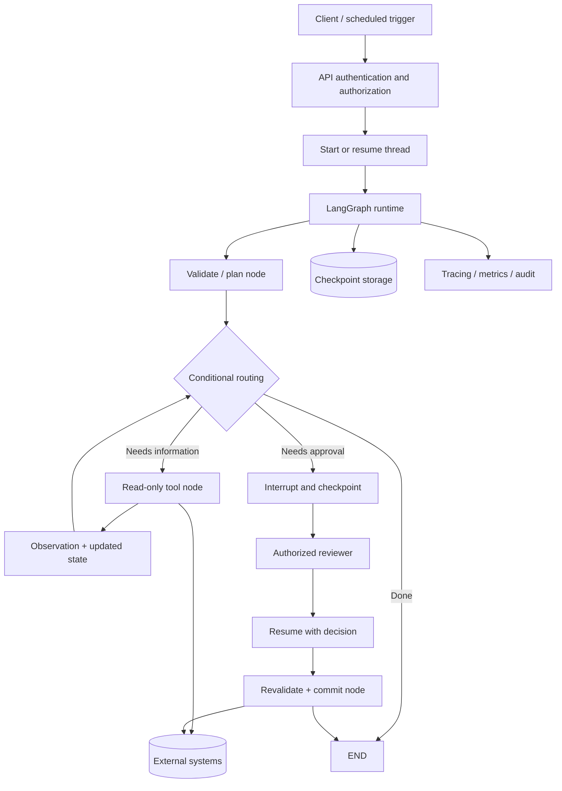
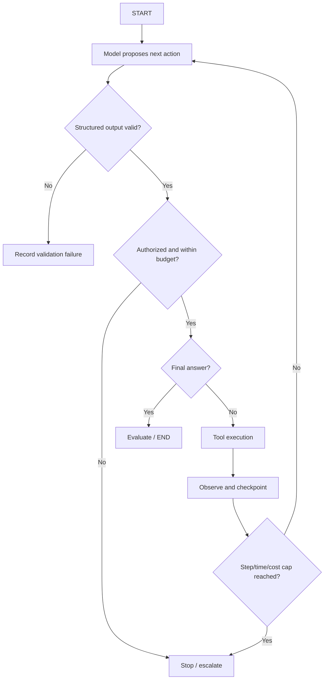
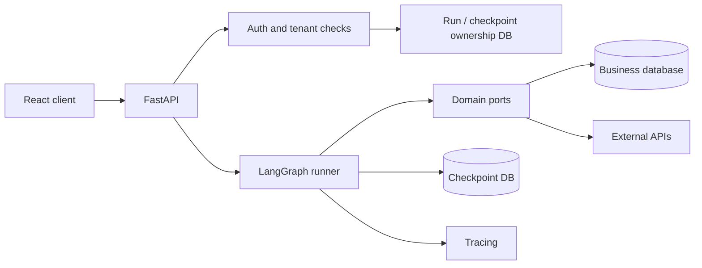
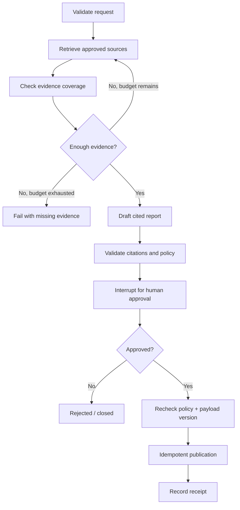
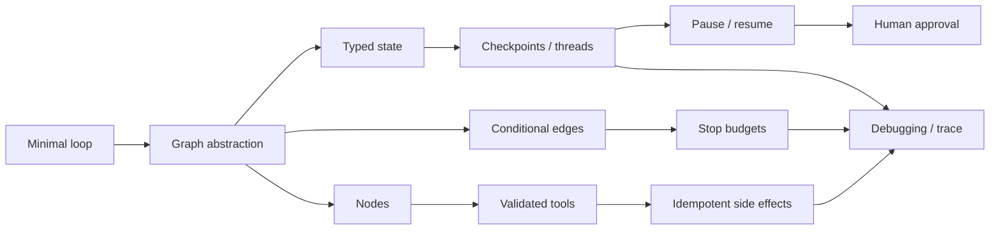

# M10.1 — Framework Selection and Implementation Depth
## Full Reorganized Study Guide

## Table of Contents

- [Part 0 — Document Metadata & Orientation](#part-0-document-metadata-orientation)
  - [0.1 Path, Depth & Prerequisites](#01-path-depth-prerequisites)
  - [0.2 Purpose & Completion Evidence](#02-purpose-completion-evidence)
  - [0.3 Memory Aid](#03-memory-aid)
  - [0.4 How This Guide Is Organized](#04-how-this-guide-is-organized)
- [Part 1 — M10.1.1 What to Learn Deeply](#part-1-m1011-what-to-learn-deeply)
  - [1.1 Why Pick One Primary Framework?](#11-why-pick-one-primary-framework)
    - [1.1.1 Why LangGraph for This Roadmap?](#111-why-langgraph-for-this-roadmap)
    - [1.1.2 Learn These Concepts to L3](#112-learn-these-concepts-to-l3)
    - [1.1.3 What Not to Learn Yet](#113-what-not-to-learn-yet)
  - [1.2 Begin with a Minimal Loop from M09](#12-begin-with-a-minimal-loop-from-m09)
- [Part 2 — LangGraph Mental Model and Architecture](#part-2-langgraph-mental-model-and-architecture)
  - [2.1 Graph Components](#21-graph-components)
    - [2.1.1 State](#211-state)
    - [2.1.2 Nodes](#212-nodes)
    - [2.1.3 Edges](#213-edges)
    - [2.1.4 Graph Compilation and Runtime](#214-graph-compilation-and-runtime)
    - [2.1.5 Checkpointers vs Stores](#215-checkpointers-vs-stores)
  - [2.2 Execution Architecture Diagram](#22-execution-architecture-diagram)
  - [2.3 Shared State Design](#23-shared-state-design)
    - [2.3.1 Avoid Oversized State](#231-avoid-oversized-state)
    - [2.3.2 Thread Identity](#232-thread-identity)
  - [2.4 Reducers, Fan-Out and Conflicts](#24-reducers-fan-out-and-conflicts)
- [Part 3 — First LangGraph Implementation: Deterministic Workflow](#part-3-first-langgraph-implementation-deterministic-workflow)
  - [3.1 Setup and Versions](#31-setup-and-versions)
  - [3.2 Runnable Example: Bounded Evidence Review](#32-runnable-example-bounded-evidence-review)
  - [3.3 Execution Trace](#33-execution-trace)
  - [3.4 Replace the Stub with a Real Tool](#34-replace-the-stub-with-a-real-tool)
- [Part 4 — Add an Agent Decision Loop Safely](#part-4-add-an-agent-decision-loop-safely)
  - [4.1 Explicit ReAct-Style Graph](#41-explicit-react-style-graph)
  - [4.2 Bounded Stop Contract](#42-bounded-stop-contract)
  - [4.3 Model and Tool Portability](#43-model-and-tool-portability)
- [Part 5 — Checkpoints, Interrupts, Approval and Resume](#part-5-checkpoints-interrupts-approval-and-resume)
  - [5.1 Why Persistence Is More than Conversation Memory](#51-why-persistence-is-more-than-conversation-memory)
  - [5.2 Interrupt for Human Approval](#52-interrupt-for-human-approval)
    - [5.2.1 Critical Interrupt Rule](#521-critical-interrupt-rule)
    - [5.2.2 Approval State Machine](#522-approval-state-machine)
  - [5.3 In-Memory vs Durable Checkpointers](#53-in-memory-vs-durable-checkpointers)
  - [5.4 Crash Recovery Sequence](#54-crash-recovery-sequence)
- [Part 6 — Retries, Timeouts, Debugging and Observability](#part-6-retries-timeouts-debugging-and-observability)
  - [6.1 Framework Retry Policy vs Business Retry Policy](#61-framework-retry-policy-vs-business-retry-policy)
  - [6.2 The Unknown-Commit Trap](#62-the-unknown-commit-trap)
  - [6.3 Observability Layers](#63-observability-layers)
  - [6.4 Debug a Run Step by Step](#64-debug-a-run-step-by-step)
  - [6.5 Streaming and Progress](#65-streaming-and-progress)
- [Part 7 — FastAPI Integration Pattern](#part-7-fastapi-integration-pattern)
  - [7.1 Responsibility Split](#71-responsibility-split)
  - [7.2 Minimal HTTP Adapter (Demonstration)](#72-minimal-http-adapter-demonstration)
  - [7.3 Recommended Production Endpoints](#73-recommended-production-endpoints)
- [Part 8 — L3 Project: Evidence-Grounded Monitoring Workflow](#part-8-l3-project-evidence-grounded-monitoring-workflow)
  - [8.1 Project Brief](#81-project-brief)
  - [8.2 Recommended Graph](#82-recommended-graph)
  - [8.3 Milestones and Acceptance Criteria](#83-milestones-and-acceptance-criteria)
  - [8.4 Required Failure Injection Tests](#84-required-failure-injection-tests)
  - [8.5 Suggested Repository Structure](#85-suggested-repository-structure)
- [Part 9 — Concept Map and Revision](#part-9-concept-map-and-revision)
  - [9.1 Concept Map](#91-concept-map)
  - [9.2 Glossary](#92-glossary)
  - [9.3 Ten Revision Rules](#93-ten-revision-rules)
- [Part 10 — Practice and Interview Questions](#part-10-practice-and-interview-questions)
  - [10.1 Quick Recall with Answers](#101-quick-recall-with-answers)
    - [Q1 — What is LangGraph?](#q1-what-is-langgraph)
    - [Q2 — What is a node?](#q2-what-is-a-node)
    - [Q3 — What is the difference between a normal edge and a conditional edge?](#q3-what-is-the-difference-between-a-normal-edge-and-a-conditional-edge)
    - [Q4 — Why do we need a checkpointer?](#q4-why-do-we-need-a-checkpointer)
    - [Q5 — What is the difference between a checkpointer and a store?](#q5-what-is-the-difference-between-a-checkpointer-and-a-store)
    - [Q6 — Does reaching END mean success?](#q6-does-reaching-end-mean-success)
    - [Q7 — What does interrupt() do?](#q7-what-does-interrupt-do)
    - [Q8 — Does checkpointing prevent duplicate emails?](#q8-does-checkpointing-prevent-duplicate-emails)
    - [Q9 — Why use typed state?](#q9-why-use-typed-state)
    - [Q10 — What demonstrates L3 proficiency?](#q10-what-demonstrates-l3-proficiency)
  - [10.2 Multiple-Choice Questions](#102-multiple-choice-questions)
    - [Q11 — Which feature preserves graph continuity across process restarts?](#q11-which-feature-preserves-graph-continuity-across-process-restarts)
    - [Q12 — A graph reaches END with status="failed". What is true?](#q12-a-graph-reaches-end-with-statusfailed-what-is-true)
    - [Q13 — A reviewer approves document version 2 but the document changed to version 3. Safest choice?](#q13-a-reviewer-approves-document-version-2-but-the-document-changed-to-version-3-safest-choice)
    - [Q14 — A write times out after the remote service may have committed. What should the node do?](#q14-a-write-times-out-after-the-remote-service-may-have-committed-what-should-the-node-do)
    - [Q15 — Two parallel branches update the same list. What must be considered?](#q15-two-parallel-branches-update-the-same-list-what-must-be-considered)
  - [10.3 Interview Questions with Model Answers](#103-interview-questions-with-model-answers)
    - [Q16 — How would you explain LangGraph to an interviewer?](#q16-how-would-you-explain-langgraph-to-an-interviewer)
    - [Q17 — How do you handle state and persistence in LangGraph?](#q17-how-do-you-handle-state-and-persistence-in-langgraph)
    - [Q18 — How would you add human approval safely?](#q18-how-would-you-add-human-approval-safely)
    - [Q19 — How would you debug a failed graph?](#q19-how-would-you-debug-a-failed-graph)
    - [Q20 — How would you integrate LangGraph with a React application?](#q20-how-would-you-integrate-langgraph-with-a-react-application)
- [Part 11 — Senior/Staff-Level Production Scenarios](#part-11-seniorstaff-level-production-scenarios)
  - [11.1 Scenario — Duplicate Publication after Worker Crash](#111-scenario-duplicate-publication-after-worker-crash)
  - [11.2 Scenario — Tenant A Can Resume Tenant B's Thread](#112-scenario-tenant-a-can-resume-tenant-bs-thread)
  - [11.3 Scenario — Upgrade Breaks Paused Threads](#113-scenario-upgrade-breaks-paused-threads)
  - [11.4 Scenario — Parallel Retrieval Produces Repeated Citations](#114-scenario-parallel-retrieval-produces-repeated-citations)
- [Part 12 — References and Advanced Extensions](#part-12-references-and-advanced-extensions)
  - [12.1 Official Sources and Further Reading](#121-official-sources-and-further-reading)
  - [12.2 Extensions (Only after One L3 Workflow)](#122-extensions-only-after-one-l3-workflow)
  - [12.3 Section Navigation](#123-section-navigation)

---

# Part 0 — Document Metadata & Orientation

## 0.1 Path, Depth & Prerequisites

- **Path:** Core · **Module:** M10 Agent Frameworks & Orchestration · **Section:** M10.1.
- **Depth:** L2 foundation; L3 by building, testing, and explaining a deployed workflow.
- **Prerequisites:** M09 (bounded agent loop, state, human control, failures) and M11 (tool/API integration and contracts). The syllabus does not specify their full content here.
- **Primary framework:** **LangGraph (Python)**. Learn provider-native agent SDK concepts sufficiently to compare tradeoffs, not as a second compulsory deep specialization.
- **Documentation check:** November 2026. Framework APIs evolve; pin versions and consult the linked official documentation before upgrading.

## 0.2 Purpose & Completion Evidence

**Purpose:** Select the correct orchestration abstraction without losing understanding of the underlying agent loop, and develop practical proficiency in LangGraph's state, control flow, persistence, human interrupts, retries, and testing.

**Completion evidence:** Explain why a graph is appropriate, draw the state machine, implement a working graph, demonstrate a checkpoint and resume, show a retry failure, compare against a minimal loop and provider-native SDK, and produce evidence from an execution trace.

## 0.3 Memory Aid

> **Architecture first → graph second → state explicit → side effects controlled → failures observable.**

## 0.4 How This Guide Is Organized

Mental model → learning policy → LangGraph anatomy → graph construction → full bounded workflow → persistence and HITL → reliability → FastAPI → testing and project evidence → revision and interviews.

---

# Part 1 — M10.1.1 What to Learn Deeply

## 1.1 Why Pick One Primary Framework?

An agent framework packages primitives that you would otherwise build: execution scheduling, state propagation, tool invocation, pause/resume, streaming, and tracing. Learning five surface APIs at once often produces familiarity with vocabulary without competence in **failure semantics**. The skill you need is to answer what happens after a tool partially succeeds, a process dies, or an approval is delayed.

**L1 awareness** means you can explain a framework's purpose and distinguish it from others. **L2 foundation** means you can design a small solution, evaluate the costs and limits, and read its code. **L3 demonstrated work** means you have an implementation, tests, traces, deployment considerations, and evidence of failure recovery. L3 is not achieved by copying a tutorial.

### 1.1.1 Why LangGraph for This Roadmap?

LangGraph lets you express a workflow as **nodes** connected by **edges** over a shared **state**. Conditional edges provide explicit decisions; cycles allow bounded retries or ReAct-style agent loops; checkpointers persist intermediate state; interrupts support human review. That makes it a useful primary choice for studying orchestration rather than merely prompting. [Official: LangGraph Graph API](https://docs.langchain.com/oss/python/langgraph/graph-api).

It is **not** always the best way to implement a two-step function or an ordinary CRUD endpoint. More orchestration creates more moving parts, schemas and operational concerns.

### 1.1.2 Learn These Concepts to L3

| Capability | What you should build | Evidence of understanding |
|---|---|---|
| Graph structure | START, named nodes, branches, END | Explain every transition and stop path |
| Typed state | TypedDict state, overwrite and reducers | Show exactly how state changes |
| Tool boundary | Validated request, authorization, tool result | Reject invalid or unauthorized call |
| Bounded execution | Step cap, deadline, cancellation | Show a stopped loop in trace |
| Checkpointing | Checkpointer + thread identifier | Resume the same thread after a pause |
| HITL | `interrupt()` + `Command(resume=...)` | Approval/rejection paths demonstrably differ |
| Reliability | Retry classification, idempotency key | Repeated attempt does not duplicate a write |
| Debugging | Node-level trace, snapshot/history | Explain a failure from actual state |
| API integration | FastAPI boundary + identity & tenancy | Prevent clients from resuming other users' runs |
| Tests | Node, path, crash/retry and interrupt tests | Produce repeatable passing evidence |

### 1.1.3 What Not to Learn Yet

Do not start with advanced multi-agent routing, dozens of external integrations, custom distributed runners, or elaborate memory systems. They are optional extensions after one safe single-agent graph works. **Complexity does not equal mastery.**

## 1.2 Begin with a Minimal Loop from M09

A minimal framework-free agent loop is:

```text
request → model/decision → validate → authorize → execute
        → observe → update state → stop or next bounded step
```

Graph orchestration retains these responsibilities and reorganizes them into nodes. It does not eliminate validation, authorization, state ownership or stop criteria. Compare the responsibilities directly:

| Framework-free responsibility | LangGraph implementation choice |
|---|---|
| Current task and accumulated observations | State schema and checkpoints |
| Decide next action | Planning/router node + conditional edge |
| Execute authorized tool | Explicit tool node calling controlled service |
| Check stop condition | Router to `END` and external run limits |
| Record progress | State updates, logs and tracing |
| Pause for human | `interrupt()` with checkpointer |
| Resume after restart | Durable saver, thread identity and recovery job |

This mapping matters during migration: business semantics should survive swapping the orchestration engine.

---

# Part 2 — LangGraph Mental Model and Architecture

## 2.1 Graph Components

### 2.1.1 State

**State** is the typed data shared by graph nodes. Examples: request text, task phase, evidence references, proposed action, approval decision, attempt count, error, and output. A node normally receives current state and **returns updates** instead of directly mutating the shared object. Define which fields overwrite and which accumulate using reducers.

### 2.1.2 Nodes

A **node** is a callable that performs one logical unit: validate task, fetch source, draft a result, request approval, or record completion. Prefer a node that has a clear success/failure contract rather than a single giant function that fetches, writes, approves and notifies.

### 2.1.3 Edges

**Edges** define allowed transitions. A normal edge always goes to its successor; a conditional edge uses a router function to choose the next node based on state. **START** marks entry and **END** marks a terminal point. The router must not treat model-supplied text as an unrestricted node name.

### 2.1.4 Graph Compilation and Runtime

`StateGraph` is a builder, and `.compile()` creates a runnable graph. Invoke a graph with `.invoke()` or use async/stream variants when appropriate. A compiled graph is not a background job processor by itself: you still choose how to host it, schedule work, identify runs and enforce resource limits.

### 2.1.5 Checkpointers vs Stores

A **checkpointer** saves thread-scoped graph execution state so a thread can continue. A **store** holds application-defined cross-thread information, such as durable user preferences. Neither should be confused with your **business database**, which is authoritative for actual shipments, emails, assessments, orders or approvals. [Official: Persistence](https://docs.langchain.com/oss/python/langgraph/persistence).

## 2.2 Execution Architecture Diagram



A graph is a **control-flow representation**, not a guarantee of safe execution. For example, a diagram containing `approve → publish` still needs verification of reviewer authority, resource version, and idempotency.

## 2.3 Shared State Design

```python
from typing import Annotated, Literal
from typing_extensions import TypedDict
import operator

class ResearchState(TypedDict, total=False):
    request: str
    phase: Literal["new", "researching", "review", "done", "failed"]
    steps: int
    max_steps: int
    findings: Annotated[list[str], operator.add]
    report: str
    error: str | None
```

`request` and `phase` normally overwrite on update. `findings` has an append reducer; a node returning `{"findings": ["Source A"]}` appends to the existing list. **Gotcha:** A resume or replay can re-execute a node, so an append reducer does not prevent duplicates. Make additions identifiable and deduplicate at the appropriate boundary.

### 2.3.1 Avoid Oversized State

Store source IDs, chunk references and short notes in checkpoints; keep large documents and secrets in controlled data stores. Checkpoints may contain sensitive content and must be encrypted or otherwise protected according to your environment, with retention, tenant boundaries and access control. A state snapshot is not a safe place for API keys.

### 2.3.2 Thread Identity

A LangGraph `thread_id` identifies a continuity scope for checkpoints. It is **not** authentication or authorization. In a multi-tenant API, your app must verify the authenticated principal owns or can access the requested thread before reading state or resuming it.

## 2.4 Reducers, Fan-Out and Conflicts

Parallel branches can write the same state key. If two nodes both produce `findings`, define a merge rule; otherwise concurrent updates can fail or overwrite unexpectedly depending on the schema. An append reducer solves only merging, not ordering, de-duplication, authorization or consistency.

For a first project, prefer a sequential graph. Add parallel source fetching only when latency measurements justify it, and define deterministic aggregation of results.

---

# Part 3 — First LangGraph Implementation: Deterministic Workflow

## 3.1 Setup and Versions

```bash
python -m venv .venv
# Activate it for your operating system.
python -m pip install "langgraph>=1.0,<2.0" pytest
```

This range is a starting example, **not** a reproducible lock. After selecting and testing exact compatible releases, freeze a lockfile. The following uses the graph API documented in current LangGraph Python docs. [Official quickstart](https://docs.langchain.com/oss/python/langgraph/quickstart).

## 3.2 Runnable Example: Bounded Evidence Review

This is intentionally **deterministic and offline**: no model key required. It demonstrates the same graph concepts a tool-using agent uses, but is easier to debug. Save as `m10_langgraph_demo.py`.

```python
from __future__ import annotations
from typing import Literal
from typing_extensions import TypedDict
from langgraph.graph import StateGraph, START, END
from langgraph.checkpoint.memory import InMemorySaver

class State(TypedDict, total=False):
    question: str
    steps: int
    max_steps: int
    evidence: str
    answer: str
    status: Literal["working", "completed", "failed"]
    error: str | None

# This stands in for a validated read-only search tool.
def retrieve(state: State) -> dict:
    question = state["question"].strip()
    if not question:
        return {"status": "failed", "error": "Empty question"}
    return {"evidence": f"Approved source for: {question}",
            "steps": state.get("steps", 0) + 1,
            "status": "working"}

def route_after_retrieve(state: State) -> Literal["finish", "fail"]:
    if state.get("status") == "failed":
        return "fail"
    if state.get("steps", 0) >= state.get("max_steps", 2):
        # In this demo, one read is enough; this protects against runaway work.
        return "finish" if state.get("evidence") else "fail"
    return "finish" if state.get("evidence") else "fail"

def finish(state: State) -> dict:
    return {"answer": f"Answer based on {state['evidence']}",
            "status": "completed"}

def fail(state: State) -> dict:
    return {"status": "failed", "error": state.get("error") or "No evidence"}

builder = StateGraph(State)
builder.add_node("retrieve", retrieve)
builder.add_node("finish", finish)
builder.add_node("fail", fail)
builder.add_edge(START, "retrieve")
builder.add_conditional_edges("retrieve", route_after_retrieve,
                              {"finish": "finish", "fail": "fail"})
builder.add_edge("finish", END)
builder.add_edge("fail", END)
graph = builder.compile(checkpointer=InMemorySaver())

config = {"configurable": {"thread_id": "study-demo-001"}}
result = graph.invoke({"question": "What is a checkpoint?",
                       "steps": 0, "max_steps": 2,
                       "status": "working"}, config)
assert result["status"] == "completed"
assert result["steps"] == 1
print(result["answer"])
print("Saved state:", graph.get_state(config).values["status"])
```

**What this actually demonstrates:** a schema, named nodes, conditional routing, bounded work, terminal states, thread-scoped in-process checkpointing and state inspection. It does **not** demonstrate a real LLM, a persistent database, or crash recovery across processes. `InMemorySaver` disappears when the process exits.

## 3.3 Execution Trace

| Step | Node | Input | Update | Next |
|---|---|---|---|---|
| 0 | START | Question, step cap | Initial state | retrieve |
| 1 | retrieve | `question` | `evidence`, `steps=1` | route |
| 2 | route | status/steps/evidence | Control decision only | finish |
| 3 | finish | evidence | `answer`, `status=completed` | END |

Try an empty question: `retrieve` sets a failure; routing goes to `fail`, and the terminal status is `failed`. Do not report `completed` merely because the graph reached `END`; distinguish **terminal completion from successful completion**.

## 3.4 Replace the Stub with a Real Tool

Replace the f-string lookup with an adapter implementing a typed request and response, which validates input and enforces tenant and document authorization **at the service boundary**. Keep external SDK exceptions out of your domain state where possible; map them to stable classes such as `temporary_failure`, `permission_denied`, `invalid_request`, and `unknown_commit`.

```python
from dataclasses import dataclass

@dataclass(frozen=True)
class SearchRequest:
    tenant_id: str
    query: str
    limit: int = 5

@dataclass(frozen=True)
class SearchResult:
    source_ids: tuple[str, ...]
    snippets: tuple[str, ...]

# Implement this port against your approved retrieval service.
def search_authorized_docs(req: SearchRequest, actor_id: str) -> SearchResult:
    raise NotImplementedError("Inject an authorized search adapter")
```

**Important:** The model may request a tenant name or document ID, but the backend must derive actual permissions from the authenticated actor and enforce them independently.

---

# Part 4 — Add an Agent Decision Loop Safely

## 4.1 Explicit ReAct-Style Graph

A model-driven graph typically contains `model` (propose next tool or final answer), `validate` (schema and permission checks), `tool` (execute), and `observe` (persist result). Repeat only under a bounded stop policy.



The model output is a **proposal**, not permission. Validate tool name against an allowlist, arguments against a schema, resource ownership against authoritative data, and action risk against policy.

## 4.2 Bounded Stop Contract

A production loop should stop for at least: achieved terminal result, step cap, token/cost budget, wall-clock deadline, cancellation, repeated no-progress, policy denial, and an unrecoverable error. A graph recursion limit can provide an additional runtime guard; it is not a substitute for a business-defined cap or deadline.

A sample decision table:

| Condition | Result | Why |
|---|---|---|
| Valid final answer with evidence | `COMPLETED` | Success criteria met |
| Tool emits temporary `503` within retry budget | `RETRYING` | Recoverable failure |
| Model keeps proposing the same failing call | `FAILED_NO_PROGRESS` | Prevent infinite loop |
| Write tool requires approval | `WAITING_APPROVAL` | Pause before commit |
| User cancels | `CANCELLED` | Respect external control |
| Max cost reached | `FAILED_BUDGET` | Bound spending |

## 4.3 Model and Tool Portability

Keep framework-specific imports out of **core domain services**. Business functions should accept ordinary typed Python objects and return typed domain results. A thin node adapter translates between graph state and business services. That allows you to test or migrate services independently of LangGraph.

---

# Part 5 — Checkpoints, Interrupts, Approval and Resume

## 5.1 Why Persistence Is More than Conversation Memory

A conversation transcript remembers what was said. A graph checkpoint additionally carries where execution is paused, the state at that point, and enough runtime metadata to resume according to the framework's semantics. In LangGraph, checkpoints are organized into threads and super-steps. See [Checkpointers](https://docs.langchain.com/oss/python/langgraph/checkpointers).

**Do not assume exactly-once external execution.** Replaying or retrying may re-run code that performs side effects; the database/external service must support deduplication and reconciliation.

## 5.2 Interrupt for Human Approval

The following demonstrates the essential API shape. A reviewer decision is **still subject to authentication and resource revalidation in the API/service layer**.

```python
from typing_extensions import TypedDict
from langgraph.graph import StateGraph, START, END
from langgraph.checkpoint.memory import InMemorySaver
from langgraph.types import Command, interrupt

class ApprovalState(TypedDict, total=False):
    document_id: str
    approved: bool
    status: str

def review(state: ApprovalState) -> dict:
    decision = interrupt({
        "operation": "publish",
        "document_id": state["document_id"],
        "message": "Review this document before publishing"
    })
    return {"approved": bool(decision.get("approved", False)),
            "status": "approved" if decision.get("approved") else "rejected"}

builder = StateGraph(ApprovalState)
builder.add_node("review", review)
builder.add_edge(START, "review")
builder.add_edge("review", END)
app = builder.compile(checkpointer=InMemorySaver())
config = {"configurable": {"thread_id": "review-001"}}

paused = app.invoke({"document_id": "doc-104"}, config)
# Inspect paused.get("__interrupt__") for the pending request.
resumed = app.invoke(Command(resume={"approved": True}), config)
assert resumed["status"] == "approved"
```

The example records a decision; it deliberately does **not** publish anything. For a real publish path, add a separate node after approval that rechecks actor identity, approval expiry, document version, current permission and an idempotency key before making a side effect. [Official: Interrupts](https://docs.langchain.com/oss/python/langgraph/interrupts).

### 5.2.1 Critical Interrupt Rule

A node containing `interrupt()` may execute its **pre-interrupt code again on resume**. Do not place irreversible work before the interrupt unless idempotent. Do not treat `interrupt` as an ordinary exception to swallow in a broad try/except. Prefer a separate prepare node, a review node, and a commit node.

### 5.2.2 Approval State Machine

```text
PREPARED → WAITING_APPROVAL → APPROVED → COMMITTING → COMMITTED
                            ↘ REJECTED
                            ↘ EXPIRED
                            ↘ CANCELLED
```

Decisions should be linked to the exact action payload hash and resource version. A decision authorizing `publish doc-104 version 3` must not silently authorize `publish doc-104 version 4`.

## 5.3 In-Memory vs Durable Checkpointers

| Option | Suitable for | Not suitable for |
|---|---|---|
| `InMemorySaver` | Learning, unit tests, process-local experiments | Surviving restart, multi-process production |
| SQLite saver | Small/local durable examples where supported | High-concurrency production by default |
| PostgreSQL saver | Persistent multi-process workloads with proper setup | Automatic business idempotency/authorization |
| Managed agent service | Operations supported by that service | Assuming unlimited control or zero lock-in |

For a PostgreSQL-based deployment, consult the installed matching `langgraph-checkpoint-postgres` version; initialize saver tables with `.setup()` as documented, protect checkpoint access, and plan database backups/retention. [Official Postgres reference](https://reference.langchain.com/python/langgraph.checkpoint.postgres/PostgresSaver).

## 5.4 Crash Recovery Sequence

1. The API stores an authorized run/thread reference.
2. The worker executes graph nodes using a durable checkpointer.
3. On a crash, the orchestrator/worker scheduler detects the unfinished run.
4. A recovery process loads the existing thread; it must not blindly submit a fresh independent run.
5. Completed side effects are reconciled using operation keys and external receipts.
6. Execution continues or is parked for manual intervention.

The checkpointer solves only part of this problem. Scheduling/recovery, idempotency, business transactions and alerts remain your application's responsibility.

---

# Part 6 — Retries, Timeouts, Debugging and Observability

## 6.1 Framework Retry Policy vs Business Retry Policy

LangGraph supports configuring retry behavior for nodes, including retry policies and timeouts in supported versions. **Defaults and their exact behavior are version-sensitive**; check the current [Fault tolerance reference](https://docs.langchain.com/oss/python/langgraph/fault-tolerance), and pin your chosen versions. Don't state “LangGraph retries everything” or “all nodes retry zero times” as a universal fact.

| Failure | Retry? | Action |
|---|---|---|
| Temporary HTTP `503` on idempotent read | Usually yes | Bounded backoff + jitter |
| Validation error in tool arguments | Usually no | Return typed error to planning step |
| Authorization denied | No | Stop and audit |
| Known business rejection | No | Respect user/business rule |
| Timeout during a write | Reconcile first | Completion status may be unknown |
| Rate limit | Maybe | Honor retry-after and budget |

## 6.2 The Unknown-Commit Trap

An external API may process `send_invoice` but time out before the acknowledgment reaches your node. Re-running the node could send two invoices. Use:

```text
operation_key = hash(tenant_id, request_id, logical_action, payload_version)
```

Persist an operation record with `PENDING`, `COMMITTED`, or `UNKNOWN`. Reconcile on `UNKNOWN` by querying the external resource, or use its idempotency-key contract if supported. **A checkpoint alone cannot make two independent systems commit atomically.**

## 6.3 Observability Layers

- **Business audit:** Who approved what? Which external action actually committed?
- **Graph trace:** Which node ran, with which transition, on which thread?
- **Tool telemetry:** Endpoint, latency, retries, response class, resource IDs.
- **Model telemetry:** Model revision, prompt template ID, token usage, reason for proposed action.
- **Reliability metrics:** Completion rate, retry rate, stuck runs, time-to-approval, duplicate-action count, cost per successful task.

Record stable identifiers such as `run_id`, `thread_id`, `tenant_id`, `node`, `attempt`, `tool_name`, `operation_key`, and `trace_id`. Redact confidential prompts, tokens and source contents according to policy. Logging every sensitive document body is not a substitute for observability.

## 6.4 Debug a Run Step by Step

1. Confirm request authentication and tenant scope.
2. Locate the graph thread and its latest checkpoint.
3. Check the last successful node and the exact failed node.
4. Inspect state updates, branch routing and error categories.
5. Correlate with tool logs and authoritative external receipts.
6. Reproduce locally using a frozen input and mock adapters.
7. Add a regression test before restoring a production run.

LangGraph exposes `graph.get_state(config)` and state-history functionality through its checkpointer interface; see [Checkpointers](https://docs.langchain.com/oss/python/langgraph/checkpointers). Treat replay as a **debugging tool with side-effect risks**, not an automatic safe rollback.

## 6.5 Streaming and Progress

For a UI, expose meaningful updates such as `RETRIEVING`, `WAITING_APPROVAL`, `RESUMED`, `COMPLETED`, and `FAILED`. LangGraph has stream-mode APIs and, in newer versions, a typed event-streaming interface. Prefer a documented and pinned interface rather than mixing tutorial code from incompatible versions. [Official streaming](https://docs.langchain.com/oss/python/langgraph/streaming).

---

# Part 7 — FastAPI Integration Pattern

## 7.1 Responsibility Split

**FastAPI** handles HTTP schemas, authentication, authorization, request IDs, status codes, and transport concerns. **LangGraph** handles graph state and orchestration. **Domain services** handle actual business rules and external effects. This separation also supports swapping your API framework or orchestration framework later.



## 7.2 Minimal HTTP Adapter (Demonstration)

The following mounts the **deterministic graph** from Part 3. It is for local testing only. In production, use real session auth, a thread ownership table, request quotas, controlled concurrency, and durable persistence.

```python
# api.py — demo only
from uuid import uuid4
from fastapi import FastAPI
from pydantic import BaseModel, Field
from m10_langgraph_demo import graph

app = FastAPI(title="M10 Agent Study Demo")

class RunRequest(BaseModel):
    question: str = Field(min_length=1, max_length=500)

@app.post("/runs")
def create_run(request: RunRequest):
    thread_id = str(uuid4())
    config = {"configurable": {"thread_id": thread_id}}
    final = graph.invoke({
        "question": request.question,
        "steps": 0,
        "max_steps": 2,
        "status": "working"
    }, config)
    return {"thread_id": thread_id,
            "status": final["status"],
            "answer": final.get("answer"),
            "error": final.get("error")}
```

For slow workflows, return `202 Accepted` and run work via a durable queue/worker. Do not rely on a request thread staying alive for hours or on a process-local `BackgroundTasks` object as durable execution. A multi-worker deployment also cannot share `InMemorySaver` state. [FastAPI docs](https://fastapi.tiangolo.com/).

## 7.3 Recommended Production Endpoints

| Route | Purpose | Security invariant |
|---|---|---|
| `POST /agent-runs` | Create a run | Authenticated request, tenant scope, quota |
| `GET /agent-runs/{id}` | Status and safe progress | Owner/role authorization |
| `GET /agent-runs/{id}/events` | SSE or event stream | Redaction and scoped access |
| `POST /agent-runs/{id}/approve` | Submit review decision | Approved reviewer role, payload/version check |
| `POST /agent-runs/{id}/cancel` | Request cancellation | Verify permission; stop future work |
| `GET /agent-runs/{id}/trace` | Debug view | Restricted operator permissions |

Treat `run_id` (business operation) and `thread_id` (orchestration continuity) as separate concepts. Never let a client supply an arbitrary thread ID and immediately resume it without ownership verification.

---

# Part 8 — L3 Project: Evidence-Grounded Monitoring Workflow

## 8.1 Project Brief

Build a **single-agent evidence-monitoring workflow** (not a multi-agent system) that accepts a research request, fetches approved sources, checks evidence, drafts a cited result, pauses before external publication, and records a receipt. Keep the model optional during early tests; a deterministic fake model is enough to test transitions.

## 8.2 Recommended Graph



## 8.3 Milestones and Acceptance Criteria

| Milestone | Deliverable | Pass condition |
|---|---|---|
| 1 | Architecture diagram + typed state | Every state field has ownership and scope |
| 2 | Working graph | Both successful and failed terminal paths reach END |
| 3 | Tool adapter | Invalid/unauthorized requests cannot execute |
| 4 | Persistence | Run resumes after deliberate process restart |
| 5 | HITL | No publication before authorized approval |
| 6 | Retry | Temporary read failure eventually succeeds or fails within budget |
| 7 | Exactly-once **effect** simulation | Duplicate delivery causes one authoritative publication |
| 8 | Observability | Trace exposes route, node, error and operation key |
| 9 | Evaluation | A small labeled test set measures source/citation correctness |

“Exactly-once effect” here means an **idempotent application outcome**, not a general exactly-once guarantee from LangGraph.

## 8.4 Required Failure Injection Tests

- Process termination after checkpoint but before next node.
- Process termination during a potentially committed write.
- Duplicate approval submission.
- Approval for stale document version.
- Missing source citations.
- Tool `503` and tool timeout.
- Graph loop reaching step cap.
- Wrong-tenant attempt to resume a thread.
- Framework version upgrade while a thread remains paused.

For each test, record input, expected transition, actual transition, side-effect count, and trace evidence.

## 8.5 Suggested Repository Structure

```text
m10-agent-workflow/
├── app/
│   ├── api.py                 # HTTP contract, auth and run ownership
│   ├── graph.py               # LangGraph nodes, edges and compile
│   ├── state.py               # Typed state and status taxonomy
│   ├── policy.py              # Explicit action authorization
│   ├── services/              # Domain contracts and adapters
│   │   ├── research.py
│   │   ├── publication.py
│   │   └── audit.py
│   ├── persistence.py         # Checkpoint and operation storage
│   └── observability.py
├── tests/
│   ├── test_graph_paths.py
│   ├── test_interrupt_resume.py
│   ├── test_duplicate_effects.py
│   └── test_authorization.py
├── docs/
│   ├── architecture.md
│   ├── runbook.md
│   └── upgrade-test-report.md
└── requirements.lock         # Generated from tested environment
```

---

# Part 9 — Concept Map and Revision

## 9.1 Concept Map



## 9.2 Glossary

| Term | Plain-English meaning |
|---|---|
| `StateGraph` | Builder describing nodes and state transitions |
| Node | One logical unit of work |
| Edge | Allowed transition between nodes |
| Conditional edge | Runtime choice of next node |
| State | Shared data passed through the graph |
| Reducer | Rule for merging state updates |
| Thread | Checkpoint continuity scope identified by `thread_id` |
| Checkpoint | Saved graph execution state |
| Store | Separate cross-thread application data facility |
| Interrupt | Pause requesting external input |
| `Command(resume=...)` | External input used to continue an interrupted graph |
| Idempotency key | Stable identity of one logical side effect |
| Trace | Structured record of execution events |
| Domain port | Framework-independent interface to a business service |
| Terminal state | Run is finished, though it may be succeeded, failed or cancelled |

## 9.3 Ten Revision Rules

1. Start with a minimal bounded loop before choosing a graph.
2. Keep core business services independent of graph classes.
3. State values do not replace authoritative business records.
4. A thread identifier is not a permission grant.
5. Persist with a durable saver for restart recovery.
6. `interrupt()` should occur before risky side effects.
7. Re-check policy and payload version after approval.
8. A retry can repeat a side effect; ensure idempotency.
9. Keep multiple terminal statuses rather than one generic END.
10. Measure graph behavior with traces and failure-injection tests.

---

# Part 10 — Practice and Interview Questions

## 10.1 Quick Recall with Answers

### Q1 — What is LangGraph?

**Answer:** A graph-based orchestration framework where nodes perform work and edges route execution over shared state. It supports explicit branching, loops and persistence.

### Q2 — What is a node?

**Answer:** A function representing one logical step, such as retrieval or validation, that reads state and returns updates.

### Q3 — What is the difference between a normal edge and a conditional edge?

**Answer:** A normal edge always selects the same successor; a conditional edge uses current state to decide the next step.

### Q4 — Why do we need a checkpointer?

**Answer:** To save thread execution state for continuity, inspection, recovery and human-interrupt workflows.

### Q5 — What is the difference between a checkpointer and a store?

**Answer:** A checkpointer tracks graph state for a thread; a store holds application-defined information, often across threads.

### Q6 — Does reaching END mean success?

**Answer:** No. A run may terminate as completed, failed, rejected, cancelled or timed out. Track an explicit outcome.

### Q7 — What does `interrupt()` do?

**Answer:** It pauses the graph, surfaces a request for external input and can be resumed later through a command when persistence is configured.

### Q8 — Does checkpointing prevent duplicate emails?

**Answer:** No. Tool effects need idempotency keys or external reconciliation, especially after timeouts and replays.

### Q9 — Why use typed state?

**Answer:** To define expected data and communicate the contract between nodes, improving validation and maintainability.

### Q10 — What demonstrates L3 proficiency?

**Answer:** A tested workflow with state, retries, checkpoint recovery, approval, trace evidence, and a reasoned architecture decision.

## 10.2 Multiple-Choice Questions

### Q11 — Which feature preserves graph continuity across process restarts?

A. An in-memory checkpointer.  
B. A durable checkpointer plus an appropriate recovery process.  
C. A larger prompt.  
D. More graph nodes.

**Correct: B.** In-memory state is lost on restart. A durable saver is necessary but still needs execution recovery.

### Q12 — A graph reaches END with `status="failed"`. What is true?

A. The task succeeded.  
B. The run is terminal, but unsuccessful.  
C. It must retry forever.  
D. The node cannot be observed.

**Correct: B.** Completion of orchestration and successful business outcome are different.

### Q13 — A reviewer approves document version 2 but the document changed to version 3. Safest choice?

A. Publish version 3 automatically.  
B. Ignore version numbers.  
C. Reject stale approval and require a fresh review.  
D. Turn off checkpointing.

**Correct: C.** Authorization must bind to the exact reviewed action/version.

### Q14 — A write times out after the remote service may have committed. What should the node do?

A. Blindly repeat.  
B. Reconcile the operation or use an external idempotency contract.  
C. Mark it failed with certainty.  
D. Increase LLM temperature.

**Correct: B.** The effect is unknown until reconciled.

### Q15 — Two parallel branches update the same list. What must be considered?

A. Nothing; lists always merge.  
B. Reducer semantics, ordering and duplicate handling.  
C. Only token count.  
D. Model provider name.

**Correct: B.** Parallel state updates need a defined merge strategy.

## 10.3 Interview Questions with Model Answers

### Q16 — How would you explain LangGraph to an interviewer?

**Suggested answer:** “LangGraph models an agent or workflow as stateful nodes connected by edges. The nodes perform steps like retrieving, validating or executing tools, while the edges control what happens next. I would use it when I need explicit branching, persistence, human approval or reliable multi-step execution.”

**Follow-up 1:** Why not use plain Python functions? **Answer:** For short deterministic flows, plain functions may be simpler. A graph becomes useful when state transitions, pause/resume and debugging need to be explicit.

**Follow-up 2:** Is it inherently multi-agent? **Answer:** No. A single bounded agent is a valid and often preferable graph.

### Q17 — How do you handle state and persistence in LangGraph?

**Suggested answer:** “I define a typed state schema and update it from graph nodes. For long-running work, I compile the graph with a durable checkpointer and use a stable thread ID. I keep authoritative business data separately and enforce access controls before exposing or resuming a thread.”

**Follow-up 1:** Can in-memory persistence survive a restart? **Answer:** No.

**Follow-up 2:** Is thread ID enough to authorize a request? **Answer:** No; the API must verify ownership or role.

### Q18 — How would you add human approval safely?

**Suggested answer:** “I prepare the exact action, pause with `interrupt()`, and resume with the reviewer’s decision. Before committing I verify the reviewer, action payload, resource version and current policy. Then I execute with an idempotency key and record the actual receipt.”

**Follow-up 1:** Why keep the interrupt before the write? **Answer:** So the write cannot occur before approval.

**Follow-up 2:** Why revalidate after approval? **Answer:** The resource or permission could change while the run is paused.

### Q19 — How would you debug a failed graph?

**Suggested answer:** “I locate the run and thread, inspect the latest checkpoint and trace, find the node that failed, review the state transition and tool response, then reproduce it with mocked dependencies. I correlate external receipts before retrying any write.”

**Follow-up 1:** What if the graph is stuck looping? **Answer:** Enforce step and budget limits and inspect repeated transitions.

**Follow-up 2:** Can time-travel replay safely undo external effects? **Answer:** No; replaying state does not roll back outside systems.

### Q20 — How would you integrate LangGraph with a React application?

**Suggested answer:** “I would expose runs through an authenticated FastAPI backend. React creates a run, reads or streams progress, and submits reviewer actions. The backend owns thread mapping, authorization, graph execution and persistence; React never receives unchecked access to internal tools.”

**Follow-up 1:** What if a task takes hours? **Answer:** Use a durable queue/worker and persisted status, not a long-held HTTP request.

**Follow-up 2:** What should the UI show during approval? **Answer:** The exact pending action, impact, source evidence and accept/reject controls.

---

# Part 11 — Senior/Staff-Level Production Scenarios

## 11.1 Scenario — Duplicate Publication after Worker Crash

**Situation:** A worker publishes a report but crashes before checkpointing the success update. The next worker resumes and republishes.

**Diagnosis:** A checkpoint controls workflow progress but cannot atomically commit the external publication. There is an **unknown-commit window**.

**Solution:** Create a stable logical operation ID before calling the external service; use its idempotency mechanism or an outbox/operation ledger. On restart, check the external receipt before retrying. Monitor duplicates and audit reconciliation decisions.

## 11.2 Scenario — Tenant A Can Resume Tenant B's Thread

**Situation:** An endpoint directly accepts `thread_id` and passes it to LangGraph, permitting cross-tenant access.

**Diagnosis:** Orchestration identity was confused with access-control identity.

**Solution:** Map run → tenant/owner in an authoritative database; enforce permissions on start, state reads, streaming, approval and resume. Use non-guessable IDs but never rely on secrecy alone.

## 11.3 Scenario — Upgrade Breaks Paused Threads

**Situation:** A new graph renames nodes or changes state fields while many threads are waiting for approval.

**Diagnosis:** Durable persistence introduces schema and workflow-version compatibility obligations.

**Solution:** Pin an executable graph version per run where possible, run migration compatibility tests, drain or migrate paused threads deliberately, and retain rollback. Never promise upgrades are harmless because Python imports still succeed.

## 11.4 Scenario — Parallel Retrieval Produces Repeated Citations

**Situation:** Parallel branches append sources with a list reducer, and retry causes duplicates.

**Diagnosis:** Merge strategy solves concurrent writes but not idempotent result identity.

**Solution:** Attach stable `source_id` and retrieval attempt IDs; deduplicate before answer assembly and maintain a deterministic relevance order.

---

# Part 12 — References and Advanced Extensions

## 12.1 Official Sources and Further Reading

- [LangGraph Python quickstart](https://docs.langchain.com/oss/python/langgraph/quickstart)
- [LangGraph Graph API](https://docs.langchain.com/oss/python/langgraph/graph-api)
- [LangGraph persistence](https://docs.langchain.com/oss/python/langgraph/persistence)
- [LangGraph checkpointers](https://docs.langchain.com/oss/python/langgraph/checkpointers)
- [LangGraph interrupts](https://docs.langchain.com/oss/python/langgraph/interrupts)
- [LangGraph fault tolerance](https://docs.langchain.com/oss/python/langgraph/fault-tolerance)
- [LangGraph test guide](https://docs.langchain.com/oss/python/langgraph/test)
- [LangGraph streaming](https://docs.langchain.com/oss/python/langgraph/streaming)
- [FastAPI official documentation](https://fastapi.tiangolo.com/)

## 12.2 Extensions (Only after One L3 Workflow)

Explore custom reducer invariants, subgraphs, controlled parallel fan-out, checkpoint compaction and retention, managed deployment, cross-thread memory stores, and graph-version migration. Each should be justified by a measured need and tested for failure handling.

## 12.3 Section Navigation

Continue to [M10.2 — Framework Landscape and Tradeoffs](M10.2_Framework_Landscape_and_Tradeoffs.md) for the comparison rubric. Then read [M10.3 — Framework Learning Policy](M10.3_Framework_Learning_Policy.md) and [M10.4 — Adoption Decision](M10.4_Adoption_Decision.md).
