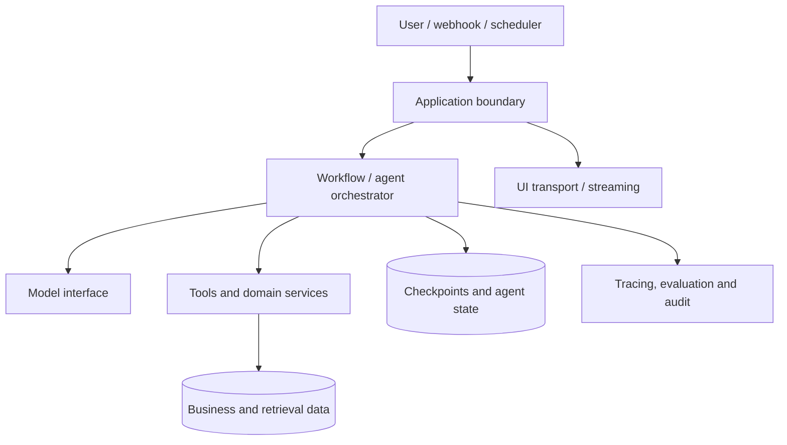
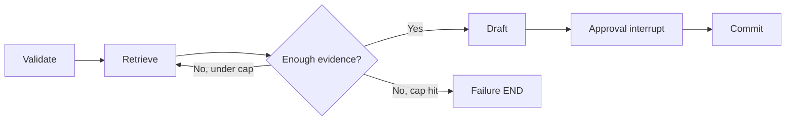
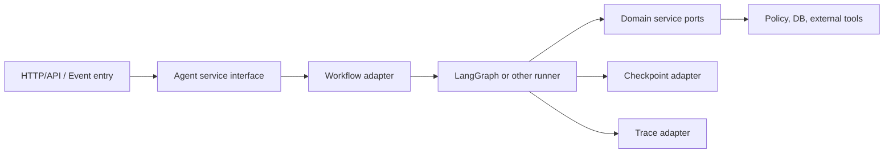
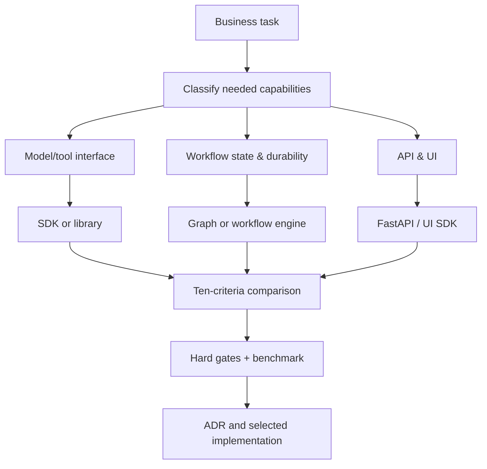

# M10.2 — Framework Landscape and Tradeoffs
## Full Reorganized Study Guide

## Table of Contents

- [Part 0 — Document Metadata & Orientation](#part-0-document-metadata-orientation)
  - [0.1 Path, Depth & Prerequisites](#01-path-depth-prerequisites)
  - [0.2 Purpose & Completion Evidence](#02-purpose-completion-evidence)
  - [0.3 Memory Aid](#03-memory-aid)
  - [0.4 Organization](#04-organization)
- [Part 1 — First, Classify the Tool You Are Comparing](#part-1-first-classify-the-tool-you-are-comparing)
  - [1.1 Why Framework Comparisons Often Go Wrong](#11-why-framework-comparisons-often-go-wrong)
  - [1.2 Four Architectural Layers](#12-four-architectural-layers)
  - [1.3 Framework vs Library vs Runtime vs Managed Platform](#13-framework-vs-library-vs-runtime-vs-managed-platform)
- [Part 2 — M10.2.1.1 Primary Implementation Options](#part-2-m10211-primary-implementation-options)
  - [2.1 LangGraph — Primary Deep Implementation](#21-langgraph-primary-deep-implementation)
    - [2.1.1 What a LangGraph Diagram Communicates](#211-what-a-langgraph-diagram-communicates)
  - [2.2 Provider-Native Agent APIs and SDKs — Learn at L2](#22-provider-native-agent-apis-and-sdks-learn-at-l2)
    - [2.2.1 Illustrative Provider-Native Runner](#221-illustrative-provider-native-runner)
    - [2.2.2 SDK Sessions vs Graph Checkpoints](#222-sdk-sessions-vs-graph-checkpoints)
    - [2.2.3 Agent SDK Guardrail Subtleties](#223-agent-sdk-guardrail-subtleties)
  - [2.3 FastAPI Integration Patterns — Application Delivery, Not Agent Reasoning](#23-fastapi-integration-patterns-application-delivery-not-agent-reasoning)
    - [2.3.1 Three Common Deployment Modes](#231-three-common-deployment-modes)
    - [2.3.2 Recommended Separation of Concerns](#232-recommended-separation-of-concerns)
  - [2.4 Choose One Primary Implementation](#24-choose-one-primary-implementation)
- [Part 3 — M10.2.1.2 Other Frameworks (L1 Awareness)](#part-3-m10212-other-frameworks-l1-awareness)
  - [3.1 LangChain](#31-langchain)
  - [3.2 LlamaIndex](#32-llamaindex)
  - [3.3 Google Agent Development Kit (ADK)](#33-google-agent-development-kit-adk)
  - [3.4 Semantic Kernel / Microsoft Agent Framework](#34-semantic-kernel-microsoft-agent-framework)
  - [3.5 CrewAI](#35-crewai)
  - [3.6 AG2 / AutoGen Family](#36-ag2-autogen-family)
  - [3.7 Vercel AI SDK Concepts](#37-vercel-ai-sdk-concepts)
  - [3.8 Summary — Different Strengths, Overlapping Feature Sets](#38-summary-different-strengths-overlapping-feature-sets)
- [Part 4 — M10.2.1.3 Ten Comparison Criteria](#part-4-m10213-ten-comparison-criteria)
  - [4.1 Control](#41-control)
  - [4.2 State Management](#42-state-management)
  - [4.3 Debuggability](#43-debuggability)
  - [4.4 Durable Execution](#44-durable-execution)
  - [4.5 Tool Ecosystem](#45-tool-ecosystem)
  - [4.6 Deployment Model](#46-deployment-model)
  - [4.7 Lock-In](#47-lock-in)
  - [4.8 Observability](#48-observability)
  - [4.9 Performance](#49-performance)
  - [4.10 Community and Maintenance](#410-community-and-maintenance)
- [Part 5 — Structured Framework Comparison Matrix](#part-5-structured-framework-comparison-matrix)
  - [5.1 Comparison Matrix (Qualitative, Not Scores)](#51-comparison-matrix-qualitative-not-scores)
  - [5.2 Weighted Scorecard Method](#52-weighted-scorecard-method)
  - [5.3 Worked Comparison Without Fabricated Benchmarks](#53-worked-comparison-without-fabricated-benchmarks)
- [Part 6 — Scenario-Based Architecture Choices](#part-6-scenario-based-architecture-choices)
  - [6.1 Scenario A — FAQ with One Retrieval Step](#61-scenario-a-faq-with-one-retrieval-step)
  - [6.2 Scenario B — Multi-Step Research + Approval](#62-scenario-b-multi-step-research-approval)
  - [6.3 Scenario C — Provider-Optimized Customer Support Agent](#63-scenario-c-provider-optimized-customer-support-agent)
  - [6.4 Scenario D — Heavy Document Indexing and RAG](#64-scenario-d-heavy-document-indexing-and-rag)
  - [6.5 Scenario E — Rich React Streaming Experience](#65-scenario-e-rich-react-streaming-experience)
  - [6.6 Scenario F — Multiple Specialized Research Agents](#66-scenario-f-multiple-specialized-research-agents)
- [Part 7 — M10.2.1.4 Frameworks Are Replaceable](#part-7-m10214-frameworks-are-replaceable)
  - [7.1 The Durable Skills](#71-the-durable-skills)
    - [7.1.1 Portable Architecture Diagram](#711-portable-architecture-diagram)
  - [7.2 Provider Adapter Contract](#72-provider-adapter-contract)
  - [7.3 Portability Has Degrees](#73-portability-has-degrees)
- [Part 8 — Practical Exercises and Evaluation](#part-8-practical-exercises-and-evaluation)
  - [8.1 Exercise 1 — Classify Components](#81-exercise-1-classify-components)
  - [8.2 Exercise 2 — Build an ADR Comparison](#82-exercise-2-build-an-adr-comparison)
  - [8.3 Exercise 3 — Failure Injection](#83-exercise-3-failure-injection)
  - [8.4 Exercise 4 — Learning Boundaries](#84-exercise-4-learning-boundaries)
- [Part 9 — Concept Map, Glossary and Revision](#part-9-concept-map-glossary-and-revision)
  - [9.1 Concept Map](#91-concept-map)
  - [9.2 Glossary](#92-glossary)
  - [9.3 Ten Revision Rules](#93-ten-revision-rules)
- [Part 10 — Practice and Interview Questions](#part-10-practice-and-interview-questions)
  - [10.1 Quick Recall Questions](#101-quick-recall-questions)
    - [Q1 — Is FastAPI a LangGraph alternative?](#q1-is-fastapi-a-langgraph-alternative)
    - [Q2 — What is the biggest difference between an SDK session and a graph checkpoint?](#q2-what-is-the-biggest-difference-between-an-sdk-session-and-a-graph-checkpoint)
    - [Q3 — Why might someone prefer a provider-native SDK?](#q3-why-might-someone-prefer-a-provider-native-sdk)
    - [Q4 — When would LlamaIndex be worth evaluating?](#q4-when-would-llamaindex-be-worth-evaluating)
    - [Q5 — Which framework is mandatory for multi-agent systems?](#q5-which-framework-is-mandatory-for-multi-agent-systems)
    - [Q6 — What is lock-in?](#q6-what-is-lock-in)
    - [Q7 — What is durable execution?](#q7-what-is-durable-execution)
    - [Q8 — Does automatic tracing prove tool actions succeeded?](#q8-does-automatic-tracing-prove-tool-actions-succeeded)
    - [Q9 — Why use weighted criteria?](#q9-why-use-weighted-criteria)
    - [Q10 — Why is framework replaceability important?](#q10-why-is-framework-replaceability-important)
  - [10.2 Multiple-Choice Questions](#102-multiple-choice-questions)
    - [Q11 — A basic two-step deterministic API needs no pause or agent choice. Best first option?](#q11-a-basic-two-step-deterministic-api-needs-no-pause-or-agent-choice-best-first-option)
    - [Q12 — Your primary challenge is rich React AI streaming. What should you examine?](#q12-your-primary-challenge-is-rich-react-ai-streaming-what-should-you-examine)
    - [Q13 — A framework advertises “memory.” What must be checked?](#q13-a-framework-advertises-memory-what-must-be-checked)
    - [Q14 — Which test most directly evaluates durable execution?](#q14-which-test-most-directly-evaluates-durable-execution)
    - [Q15 — What is the safest use of a framework scorecard?](#q15-what-is-the-safest-use-of-a-framework-scorecard)
  - [10.3 Interview Questions with Model Answers](#103-interview-questions-with-model-answers)
    - [Q16 — How would you choose between LangGraph and an Agents SDK?](#q16-how-would-you-choose-between-langgraph-and-an-agents-sdk)
    - [Q17 — What are the main criteria for comparing agent frameworks?](#q17-what-are-the-main-criteria-for-comparing-agent-frameworks)
    - [Q18 — How do LangChain, LangGraph and LlamaIndex differ?](#q18-how-do-langchain-langgraph-and-llamaindex-differ)
    - [Q19 — How would you integrate an agent into a React + FastAPI application?](#q19-how-would-you-integrate-an-agent-into-a-react-fastapi-application)
    - [Q20 — How do you avoid framework lock-in?](#q20-how-do-you-avoid-framework-lock-in)
- [Part 11 — Senior/Staff-Level Production Scenarios](#part-11-seniorstaff-level-production-scenarios)
  - [11.1 Scenario — Framework Selection by Popularity Creates Reliability Gaps](#111-scenario-framework-selection-by-popularity-creates-reliability-gaps)
  - [11.2 Scenario — Guardrails Exist but Dangerous Tool Still Runs](#112-scenario-guardrails-exist-but-dangerous-tool-still-runs)
  - [11.3 Scenario — UI Streaming SDK Used as Long-Running Job Queue](#113-scenario-ui-streaming-sdk-used-as-long-running-job-queue)
  - [11.4 Scenario — Agent-to-Agent Handoffs Multiply Cost](#114-scenario-agent-to-agent-handoffs-multiply-cost)
  - [11.5 Scenario — Framework Upgrade Silently Alters Retry Defaults](#115-scenario-framework-upgrade-silently-alters-retry-defaults)
- [Part 12 — References and Advanced Extensions](#part-12-references-and-advanced-extensions)
  - [12.1 Official Documentation](#121-official-documentation)
  - [12.2 Extensions](#122-extensions)
  - [12.3 Section Navigation](#123-section-navigation)

---

# Part 0 — Document Metadata & Orientation

## 0.1 Path, Depth & Prerequisites

- **Path:** Core · **Module:** M10 Agent Frameworks & Orchestration · **Section:** M10.2.
- **Depth:** L2 comparison and architecture reasoning; L1 practical awareness for non-selected frameworks.
- **Prerequisites:** M09, M11, and the LangGraph fundamentals in M10.1.
- **Syllabus:** M10.2.1 Frameworks to know; M10.2.1.1 primary options; M10.2.1.2 awareness options; M10.2.1.3 ten comparison criteria; M10.2.1.4 replaceability principle.
- **Reference date:** November 2026. Framework families, API names, support and deployment products change rapidly. All comparisons here are architectural tendencies, not timeless rankings.

## 0.2 Purpose & Completion Evidence

**Purpose:** Know what major agent toolkits are for, compare their real operational tradeoffs, and decide what to adopt based on state, correctness, observability and deployment requirements instead of popularity.

**Completion evidence:** Explain the differences between an agent SDK, an orchestration graph, a RAG-oriented library and an HTTP framework; score a concrete use case with ten criteria; defend a LangGraph choice and describe a viable alternative and migration boundary.

## 0.3 Memory Aid

> **Different frameworks package different responsibilities. Compare the missing guarantees, not the marketing labels.**

## 0.4 Organization

Taxonomy → primary implementation choices → L1 framework overview → ten-dimensional rubric → scenario comparisons → portability → practice and interviews.

---

# Part 1 — First, Classify the Tool You Are Comparing

## 1.1 Why Framework Comparisons Often Go Wrong

A popular comparison chart may put **LangGraph**, **FastAPI**, **OpenAI Agents SDK**, **LlamaIndex**, and **Vercel AI SDK** in one column as though they perform the same job. They do not. They may be combined within one application. One defines the orchestration graph, another exposes HTTP routes, another wraps model/tool execution, and another specializes in data indexing or UI streaming.

A useful decomposition is:



The arrows show **roles**. One product may provide several roles. For example, an agent SDK may have tools, sessions, guardrails, traces and a runner; a graph framework may wrap a provider model client and expose streaming. The existence of a feature does not establish its fault-tolerance guarantees.

## 1.2 Four Architectural Layers

| Layer | Core question | Typical examples |
|---|---|---|
| Model / provider API | How do I invoke a model and receive structured/tool output? | Provider Responses / generation API |
| Agent runtime / SDK | How does model-tool iteration, handoff and guardrail execution work? | Provider-native Agents SDK |
| Workflow orchestration | What executes next, how is state checkpointed, when may execution pause? | LangGraph, workflow/agent engines |
| Application/API delivery | How do clients authenticate, start work and receive events? | FastAPI, web backend, serverless handlers |

Some tools span layers. Use this table to identify the **primary architectural responsibility**, not to draw rigid boundaries.

## 1.3 Framework vs Library vs Runtime vs Managed Platform

- A **library** exposes reusable functions and components inside your application process.
- A **framework** provides conventions and abstractions for building the application.
- A **runtime** executes the graph/agents, manages their lifecycle or dispatch.
- A **managed platform** provides hosted infrastructure, persistence, logs, deployment or billing.

Confusing these leads to overestimated reliability. A Python package that provides `run()` does not necessarily provide durable workers, database checkpoints, backups, per-tenant authorization or disaster recovery by default.

---

# Part 2 — M10.2.1.1 Primary Implementation Options

## 2.1 LangGraph — Primary Deep Implementation

**Core idea:** Explicit stateful graphs with nodes, edges, transitions and persistence. **Best fit to evaluate:** complex single-agent flows, approval cycles, inspectable branching, checkpoints and resumption.

**Strengths:** Graph structure makes control flow visible; typed state; support for branches and cycles; checkpointers; interrupt/resume; integration with model and tool ecosystems. Debugging can reason about the last node and state update rather than a long opaque loop. [Official Graph API](https://docs.langchain.com/oss/python/langgraph/graph-api).

**Costs:** Learning state reducers and scheduling semantics; schema migrations; operational checkpoint storage; replay/side-effect discipline; more code and abstractions than a small Python function. Inference cost is often dominated by model calls rather than framework overhead, but end-to-end performance still needs measurement.

**Appropriate:** A report-generation workflow that retrieves evidence, conditionally retries, pauses for approval and resumes after a restart.

**Inappropriate by default:** An endpoint that validates a form and writes one record deterministically. Use ordinary application code.

### 2.1.1 What a LangGraph Diagram Communicates



Every branch can be attached to a typed status and a test. The diagram alone does not implement auth or business durability; those remain explicit responsibilities.

## 2.2 Provider-Native Agent APIs and SDKs — Learn at L2

**Core idea:** An SDK tied to a model-provider ecosystem often supplies a higher-level `Agent` or `Runner`, tool binding, handoffs, sessions, guardrails, and traces. It can remove much orchestration boilerplate for tool-oriented agents.

Using the **OpenAI Agents SDK** as a concrete example, the documented `Agent` and `Runner` manage model invocations and tool/handoff turns; sessions and tracing support continuity and debugging. Compare this to a provider's lower-level model/Responses API, where your application can own the loop itself. [Official Agents SDK concepts](https://openai.github.io/openai-agents-python/agents/) and [Runner reference](https://openai.github.io/openai-agents-python/ref/run/).

**Strengths:** Direct path to provider features, idiomatic tools/guardrails, less setup for straightforward agent loops, and integrated telemetry depending on SDK.

**Costs:** Provider/ecosystem coupling; API/version churn; session semantics may not equal durable business workflow semantics; guardrails and handoffs have defined scopes that need verification. SDKs may support multiple model providers or custom integrations, so “native” does not universally imply “single model only.”

### 2.2.1 Illustrative Provider-Native Runner

```python
# Illustrative OpenAI Agents SDK interface; requires package and credentials.
from agents import Agent, Runner

agent = Agent(
    name="SafeResearchAssistant",
    instructions="Answer using approved sources. Do not claim external actions happened."
)

# Async context (or call Runner.run_sync from a regular script).
async def handle(message: str):
    result = await Runner.run(agent, message, max_turns=5)
    return result.final_output
```

This shows **runner delegation**, not a complete application. It does not authenticate users, enforce document authorization, safely execute domain writes or store business receipts. SDK tracing can include sensitive data; understand its export and retention controls. [Official SDK quickstart](https://openai.github.io/openai-agents-python/quickstart/), [tracing](https://openai.github.io/openai-agents-python/tracing/).

### 2.2.2 SDK Sessions vs Graph Checkpoints

| Concept | Conversation/session facility | Graph checkpointer |
|---|---|---|
| Main purpose | Preserve interaction context across turns | Preserve workflow execution state across steps |
| Can remember prior user messages? | Often yes | Yes if state contains them |
| Can represent a pending approval? | Only if explicitly modeled/supported | Interrupt/checkpoint is a first-class pattern in LangGraph |
| Does it guarantee business exactly-once writes? | No | No |
| Does it enforce tenant ACLs? | Not automatically | Not automatically |
| Does it survive process death? | Depends on configured persistence | Depends on configured saver and recovery |

**Key distinction:** Don't equate the presence of a “session” API with durable execution after arbitrary failures. Investigate the actual semantics of the specific SDK and deployment.

### 2.2.3 Agent SDK Guardrail Subtleties

“Has guardrails” is a feature statement, not an end-to-end security proof. A guardrail may execute on the initial input, a final output or certain tool calls, but not necessarily every intermediate handoff. In the OpenAI Agents SDK, the guardrail documentation specifies scopes and exceptions, including differences between function tools, handoffs and hosted tools. Inspect these before relying on a guardrail for a high-risk invariant. [Official guardrails](https://openai.github.io/openai-agents-python/guardrails/).

**Rule:** Policy and authorization of external actions belong in the application/runtime boundary and cannot be delegated solely to model instructions.

## 2.3 FastAPI Integration Patterns — Application Delivery, Not Agent Reasoning

**Core idea:** FastAPI is an ASGI Python web framework for APIs; it handles request validation, authentication integration, dependency injection, async routes, and responses. It does **not** define an agent planner or make state persistent. Use it to expose a LangGraph or SDK workflow. [FastAPI docs](https://fastapi.tiangolo.com/).

### 2.3.1 Three Common Deployment Modes

| Mode | Flow | Appropriate use | Main risk |
|---|---|---|---|
| Synchronous HTTP | Request → invoke → response | Small predictable tasks | Timeout / blocking |
| Async streaming | Request → task/stream → events | UI progress and token streaming | Client disconnect vs run lifecycle |
| Queue and worker | POST → durable job → worker → persisted status | Long tasks, approval, retries | Need reliable job ownership and reconciliation |

A React frontend can submit a request, receive a `run_id`, and poll `GET /runs/{id}` or subscribe to SSE/WebSocket events. The Python service handles token secrecy and business authorization. Avoid sending confidential credentials or raw tool permissions to the browser.

### 2.3.2 Recommended Separation of Concerns

```text
React / UI
    ↓ HTTP/SSE
FastAPI  [auth, schema, rate limits, request IDs]
    ↓
Job orchestration / durable worker
    ↓
LangGraph or SDK runtime  [control flow + checkpoints]
    ↓
Domain services  [policy, idempotency, business transactions]
    ↓
Approved external systems
```

This is a **composable architecture**: FastAPI and LangGraph are not competing choices.

## 2.4 Choose One Primary Implementation

For this syllabus, choose **LangGraph** as the L3 primary. Provider-native SDKs deserve an architecture-level comparison, and FastAPI should be understood as the API delivery pattern. Avoid implementing the same project in every framework during your initial learning phase.

---

# Part 3 — M10.2.1.2 Other Frameworks (L1 Awareness)

## 3.1 LangChain

**What it is:** An ecosystem of model interfaces, tools, agents, retrieval and other building blocks. In its modern architecture, high-level agents and LangGraph work closely, but they are not interchangeable labels. LangChain can simplify components; LangGraph explicitly models stateful orchestration. [Docs](https://docs.langchain.com/oss/python/langchain/overview).

**Good awareness question:** Can I use model/tool integration components without delegating all workflow control to a black-box chain? **Answer:** Often yes; distinguish integration utilities from orchestration requirements.

**Tradeoff:** Broad ecosystem reduces adapter work but introduces dependencies and integration-version management. Don't assume every connector is maintained at the same maturity.

## 3.2 LlamaIndex

**What it is:** A data- and retrieval-oriented framework with ingestion, indexing, query, agent and workflow facilities. It can provide agents too, so describing it as “only RAG” is incorrect. Its strength is often felt when document/data connectors and retrieval architectures dominate the problem. [Official developer docs](https://developers.llamaindex.ai/python/framework/).

**When to evaluate:** A knowledge assistant relying on mixed document formats, complex indexing and retrieval workflows. **Watch:** Retrieval accuracy, data provenance, connector maintenance, data security and orchestration durability.

## 3.3 Google Agent Development Kit (ADK)

**What it is:** An agent development kit that offers agents, sessions, tools, workflow patterns and deployment options, with strong links to the Google ecosystem but documented support for a range of model integrations. As of current docs, there are sequential, parallel, loop and graph workflow concepts. [ADK docs](https://adk.dev/).

**When to evaluate:** Teams integrated with Google model/platform services or needing an SDK-oriented agent system. **Watch:** Session/store contracts, deployment target, version transitions and operational responsibility.

## 3.4 Semantic Kernel / Microsoft Agent Framework

**What it is:** Semantic Kernel is an important Microsoft-origin framework for model/tool integration and agentic patterns. As of 2026, **Microsoft Agent Framework** presents agents, workflow building, integrations and state/session patterns in Microsoft's newer documentation. Treat **Semantic Kernel** and **Agent Framework** as related ecosystem developments, not interchangeable package names. [Microsoft Agent Framework overview](https://learn.microsoft.com/en-us/agent-framework/overview/).

**When to evaluate:** Enterprise stacks centered on Microsoft/Azure, C#/.NET and existing Microsoft integrations. **Watch:** Product transition, version support, Azure dependencies and runtime compatibility. Do not silently import a Semantic Kernel example into Agent Framework and assume it works.

## 3.5 CrewAI

**What it is:** Framework emphasizing agent roles, tasks and collaborative “crews,” alongside “flows” and growing production facilities. Useful for understanding task delegation and higher-level multi-agent patterns. [CrewAI docs](https://docs.crewai.com/en/introduction).

**When to evaluate:** Workflows where multiple specialized roles genuinely provide value. **Watch:** Orchestration overhead, cost multiplication, debugging handoffs, shared state and verifiable evaluation. Multi-agent design is not a mandatory evolution stage.

## 3.6 AG2 / AutoGen Family

**What it is:** A family historically associated with conversational multi-agent collaboration. **Important 2026 naming note:** Modern AG2 and **AG2 Classic** are not identical APIs; older `autogen` / `ConversableAgent` / `GroupChat` examples belong to classic interfaces rather than assuming they describe the current AG2 package. Distinguish the AG2 lineage from Microsoft's evolving AutoGen/Agent Framework ecosystem. [AG2 overview](https://www.ag2.ai/developers), [AG2 Classic quickstart](https://classic.docs.ag2.ai/latest/docs/home/quickstart/).

**When to evaluate:** Research prototypes involving multi-agent conversation patterns. **Watch:** API lineage, upgrade paths, termination and control of agent-to-agent message loops.

## 3.7 Vercel AI SDK Concepts

**What it is:** A TypeScript toolkit for integrating model providers and building AI-enabled apps with UI streaming and agent capabilities, particularly familiar to React/Next.js developers. **It is not equivalent to a durable workflow engine by itself.** Evaluate it for frontend/backend model interaction, streaming protocol and UI integration. [AI SDK docs](https://ai-sdk.dev/docs/introduction).

**When to evaluate:** TypeScript frontend-rich AI applications and server-side model operations. **Watch:** Hosting constraints, serverless request durations, durable workflow integration and client/server separation.

## 3.8 Summary — Different Strengths, Overlapping Feature Sets

| Framework/family | Primary mental model | Why learn it | L1 caution |
|---|---|---|---|
| LangChain | Model/tool and agent building blocks | Integrations and reusable components | Not every chain implies durable execution |
| LlamaIndex | Retrieval/data and agent workflows | Data connectors, indexing and RAG | Retrieval quality isn't authorization |
| Google ADK | Agents, tools, sessions and workflows | Google-adjacent and cross-model patterns | Verify state/persistence in deployment |
| Semantic Kernel / Microsoft Agent Framework | Enterprise agent/workflow SDKs | Microsoft ecosystem | Track product/version transitions |
| CrewAI | Agent roles, crews, flows | Coordination concepts | Extra roles add cost/complexity |
| AG2 / AutoGen family | Multi-agent conversational orchestration | Dialogue/handoff patterns | API lineage and stop conditions matter |
| Vercel AI SDK | TypeScript model and UI integration | React/Next streaming | UI SDK != durable orchestrator |

These descriptions are **not benchmark results**. A real comparison must test the specific version, deployment, tools and workload.

---

# Part 4 — M10.2.1.3 Ten Comparison Criteria

## 4.1 Control

**Question:** Can application code explicitly decide next steps, enforce bounds and intercept tool calls? Prefer clear control for regulated or high-risk workflows. A high-level `Agent.run()` may be convenient but still needs external stop/risk checks.

**Evidence:** Draw every possible transition for a sample task; identify which parts are model-driven vs deterministic.

## 4.2 State Management

**Question:** What is stored, where, and for how long? Distinguish prompt history, graph state, cross-session memory, business data and operation receipts.

**Evidence:** Inspect a saved state and prove a failed operation can be diagnosed without reconstructing it from chat logs.

## 4.3 Debuggability

**Question:** Can you identify the exact failing node, input contract, model call, tool arguments, external receipt and branch decision? A nice trace dashboard can help but only if it exposes the necessary facts and handles secrets safely.

**Evidence:** Inject one failure and find root cause using a trace rather than guesswork.

## 4.4 Durable Execution

**Question:** What happens if the worker dies? Does checkpointing cover all steps? How is a run rescheduled? What is replayed? Who reconciles an unknown external commit?

**Evidence:** Kill the process between graph steps and during a write; restore it and verify one business effect.

## 4.5 Tool Ecosystem

**Question:** Are the connectors you need available, maintained, typed and secure? Can you write an adapter for a proprietary internal API? MCP support may reduce wiring but does not automatically make all tools safe to execute.

**Evidence:** Integrate one mock service and one authenticated real service behind the same typed port.

## 4.6 Deployment Model

**Question:** Can it run in your chosen infrastructure (container, managed agent service, on-prem, VPC, serverless, cluster)? Does it need a shared checkpointer or specific queue? Does the hosting choice affect data residency and operational ownership?

**Evidence:** Produce a topology diagram and failure/restart runbook.

## 4.7 Lock-In

**Question:** How many domain rules, persisted objects and tool contracts would need rewriting if you changed provider/framework? Look beyond SDK syntax—data migration and operational behavior are bigger sources of lock-in.

**Evidence:** Replace one model adapter or orchestration wrapper without rewriting the core business service.

## 4.8 Observability

**Question:** Does it expose structured events, spans, request IDs, usage, cost, guardrail outcomes and side-effect receipts? Can you export traces to an approved backend? Are audit events tamper-resistant?

**Evidence:** Produce a trace correlating request → graph node → tool → external receipt.

## 4.9 Performance

**Question:** What is end-to-end p50/p95 latency, throughput and resource use under load? Does graph checkpointing, serialized state or extra model turns dominate? Measure model/network time separately from orchestration overhead.

**Evidence:** Benchmark the same task, model, source corpus, concurrency and output quality under candidate approaches.

## 4.10 Community and Maintenance

**Question:** Does the chosen version have maintained docs, release notes, migration guides, issue response, supported platforms and a sustainable ecosystem? Popularity is only one signal.

**Evidence:** Record release cadence, major breaking changes, known bugs relevant to the project, and team familiarity.

---

# Part 5 — Structured Framework Comparison Matrix

## 5.1 Comparison Matrix (Qualitative, Not Scores)

The right column is deliberately phrased as a question rather than a permanent “winner.”

| Criterion | LangGraph | Provider-native SDK | Minimal loop + FastAPI |
|---|---|---|---|
| Control | Explicit graph routes/state | SDK-runner abstraction with configurable hooks/features | Maximum direct code control |
| State | Typed state + pluggable checkpoints/stores | Varies: session/run state facilities | Entirely application-owned |
| Debugging | Node traces, checkpoints, replay tools | Runner traces/spans, vendor tools | Custom logs/traces required |
| Durable execution | Supported with saver/recovery design | Check specific SDK and deployment | Build or integrate engine yourself |
| Tools | Broad ecosystem and custom adapters | Provider and ecosystem tools | All manually integrated |
| Deployment | Self-host or supported platforms | SDK-specific/self-host/platform | Existing backend infrastructure |
| Lock-in | Graph APIs and serialized state | SDK/provider run models | Less framework-specific, more custom logic |
| Observability | Rich integrations; needs configuration | Often built-in tracing | Must instrument explicitly |
| Performance | Additional orchestration/checkpoint overhead | Usually less graph scaffolding | Potentially minimal overhead |
| Community | Large evolving ecosystem | Depends on provider/SDK | General Python/FastAPI ecosystem |

**Important:** There are no universal “high/medium/low” performance claims here because actual behavior depends on workload, API version, infrastructure and how many model/tool calls the application makes.

## 5.2 Weighted Scorecard Method

Score each candidate 1–5 on **verified evidence**; multiply by importance weights. Do not invent scores without running tests. The weights below are an **example for a high-risk approval workflow**, not a global standard.

| Criterion | Example weight (%) | Test to gather evidence |
|---|---:|---|
| Control | 15 | Branch / stop behavior |
| State | 15 | Inspect and resume state |
| Debuggability | 12 | Failure reproduction |
| Durable execution | 20 | Crash/restart test |
| Tool ecosystem | 8 | Integrate target API |
| Deployment | 10 | Run in target VPC |
| Lock-in | 6 | Replace one adapter |
| Observability | 8 | Correlate traces/receipts |
| Performance | 4 | Representative p95 load test |
| Community | 2 | Maintenance review |
| **Total** | **100** | |

**Scoring formula:** `weighted_score = sum(weight_i * score_i / 5)` expressed as 0–100. A scorecard makes the decision reviewable; a hard security or residency requirement should still operate as a **pass/fail gate** rather than being averaged away.

## 5.3 Worked Comparison Without Fabricated Benchmarks

**Scenario:** A safety-report monitoring application needs source citations, manual approval, a durable pause lasting days, and safe publication after review.

- **Hard gate 1:** Persist and resume a waiting task across process restart.
- **Hard gate 2:** Authorize the reviewer and bind approval to document version.
- **Hard gate 3:** Repeated publish attempts must produce one business publication.
- **Hard gate 4:** Trace every state transition and external receipt.

**Preliminary architecture choice:** LangGraph is a strong fit for explicit branches, checkpoints and interrupts. However, its application still needs an authenticated API, durable worker/saver, domain-ledger idempotency and audit system. A provider-native SDK plus a durable workflow engine could also satisfy the requirements with more custom orchestration. Compare **implemented** behavior, not nominal feature labels.

---

# Part 6 — Scenario-Based Architecture Choices

## 6.1 Scenario A — FAQ with One Retrieval Step

**Requirements:** Accept a question, retrieve authorized documents, return a short cited answer. No long-running background work or approval.

**Potential design:** Ordinary FastAPI service with a retrieval library and a model client; add a simple agent only if tool choice genuinely varies. LangGraph is optional. **Why:** Few state transitions and no reason to maintain durable graph threads.

## 6.2 Scenario B — Multi-Step Research + Approval

**Requirements:** Search, compare evidence, revise until coverage threshold, pause for approval, resume days later, publish at most once.

**Potential design:** LangGraph for branching/state/HITL; PostgreSQL checkpoints and business operation ledger; FastAPI for run/approval endpoints; worker queue for lifecycle management. **Why:** Orchestration is central, so explicit graph state has value.

## 6.3 Scenario C — Provider-Optimized Customer Support Agent

**Requirements:** Few tools, short interactions, provider-integrated tracing and guardrails, no durable multi-day steps.

**Potential design:** Provider-native Agents SDK plus normal application-level auth and tools. **Why:** The runner provides a straightforward loop; a graph may add little initially.

**Caution:** A convenient SDK cannot substitute for permission checks or a business audit log. Verify session semantics before assuming recovery behavior.

## 6.4 Scenario D — Heavy Document Indexing and RAG

**Requirements:** PDFs, multi-format ingestion, provenance, hybrid retrieval and evaluations; simple deterministic final workflow.

**Potential design:** LlamaIndex or other retrieval tooling plus a regular backend; add orchestration only for tasks that need it. **Why:** Retrieval/data processing complexity dominates agent orchestration complexity.

## 6.5 Scenario E — Rich React Streaming Experience

**Requirements:** TypeScript frontend, streaming answers, tool-status events, optimistic UI, short web interactions.

**Potential design:** Vercel AI SDK for UI/model transport where it fits, with a backend orchestrator chosen separately for durability. **Why:** Frontend streaming and durable job orchestration are distinct responsibilities.

## 6.6 Scenario F — Multiple Specialized Research Agents

**Requirements:** Search, verification, synthesis and reviewer agents proposed by stakeholder.

**First question:** Does each role truly require a separate decision loop, permissions or model context? Could four **deterministic graph nodes** plus one model do the job more reliably? Test the simple baseline first. CrewAI, AG2/AutoGen, ADK or graph subagents may become appropriate later, but “multiple roles” alone is not justification.

---

# Part 7 — M10.2.1.4 Frameworks Are Replaceable

## 7.1 The Durable Skills

A developer who understands **typed tool contracts, authorization, state transitions, bounded execution, idempotency, retries, evaluation, human approval and tracing** can transfer those concepts between frameworks. A developer who remembers only a framework constructor signature must relearn the system after an upgrade.

### 7.1.1 Portable Architecture Diagram



The **domain ports** remain fixed while orchestration-specific code is swapped or upgraded. Do not leak framework state objects into database models or API responses unless they are explicitly versioned and constrained.

## 7.2 Provider Adapter Contract

```python
from dataclasses import dataclass
from typing import Protocol

@dataclass(frozen=True)
class ToolIntent:
    tool: str
    args: dict[str, object]

@dataclass(frozen=True)
class ModelDecision:
    final_text: str | None
    tool_intent: ToolIntent | None

class DecisionModel(Protocol):
    async def propose(self, task: str, observations: list[str]) -> ModelDecision: ...

class AuditWriter(Protocol):
    async def record(self, run_id: str, event: dict[str, object]) -> None: ...
```

These interfaces represent application behavior rather than one provider's response shape. Different model SDKs can implement them. The adapter must still preserve relevant semantics such as multiple tool calls, structured responses and cancellation; do not throw away needed behavior just to make every API look identical.

## 7.3 Portability Has Degrees

- **Model portability:** Replace the provider while preserving tool schema and task outcomes.
- **Tool portability:** Swap one API client without changing agent-state contracts.
- **Orchestrator portability:** Rewrite the graph/runner while retaining business services.
- **State portability:** Migrate saved threads, pauses and checkpoints; often the hardest part.
- **Operational portability:** Keep run ownership, observability, audit, deployment and failure recovery stable.

“Supports multiple providers” is not the same as “fully portable.” Test a migration with a real paused thread and a real tool failure.

---

# Part 8 — Practical Exercises and Evaluation

## 8.1 Exercise 1 — Classify Components

For the following, label the layer: `FastAPI dependency`, `LangGraph conditional edge`, `model response`, `PostgreSQL operation ledger`, `Vercel chat UI stream`, `LlamaIndex retriever`.

**Answer:** Application boundary; orchestration; model API; authoritative business state; UI/transport; data retrieval. Note that the database ledger is **not** an agent framework—it protects business effects.

## 8.2 Exercise 2 — Build an ADR Comparison

Write a one-page architecture decision record (ADR): state the task, hard constraints, three options, five tests, measured results, selected design and reversal condition. Include a rule for when the team should reconsider the decision (e.g., a new long-running approval requirement).

## 8.3 Exercise 3 — Failure Injection

Implement the **same logical operation** as (a) a minimal loop and (b) LangGraph. Force a `503` and an unknown-commit write in both. Record where state lives, how many retries occur, whether effects duplicate, and how to debug each. The purpose is to compare **operational semantics**, not to declare a winner from line count.

## 8.4 Exercise 4 — Learning Boundaries

Create a one-page cheat sheet of what each non-primary framework is for, two situations where you would consider it, and one risk. Do not spend days installing all of them; most of this module is comparative knowledge.

---

# Part 9 — Concept Map, Glossary and Revision

## 9.1 Concept Map



## 9.2 Glossary

| Term | Meaning |
|---|---|
| Orchestration | Coordinating execution order, branching and lifecycle |
| Agent SDK | Higher-level agent/model/tool execution utilities |
| Provider-native | Closely associated with a model-provider ecosystem |
| API layer | HTTP/web boundary, not necessarily the agent engine |
| Checkpoint | Persisted execution-state snapshot |
| Session | Context or state scope defined by a specific SDK |
| Durable execution | Ability to continue work after interruption per defined guarantees |
| Observability | Traces, logs and metrics explaining behavior |
| Tool ecosystem | Available connectors, adapters and tool abstractions |
| Lock-in | Cost of changing framework/provider/platform |
| Port | Framework-independent interface to a service |
| ADR | Architecture Decision Record: context, options and rationale |
| Hard gate | Must-pass constraint that cannot be compensated by other scores |
| p95 | Latency at or below which 95% of observed operations fall |
| Failure injection | Deliberately causing controlled errors to test recovery |

## 9.3 Ten Revision Rules

1. Compare equivalent **roles** before comparing framework names.
2. FastAPI serves APIs; it is not an agent orchestrator.
3. Graph frameworks and provider SDKs overlap but make different tradeoffs.
4. A session is not proof of durable execution.
5. Retries require explicit idempotency/reconciliation for external writes.
6. Check documented guardrail scope; never assume universal coverage.
7. Multi-agent is optional and must justify its overhead.
8. Weigh hard constraints before scoring convenience features.
9. Measure latency and reliability on your workload.
10. Frameworks change; state, security and failure contracts remain valuable skills.

---

# Part 10 — Practice and Interview Questions

## 10.1 Quick Recall Questions

### Q1 — Is FastAPI a LangGraph alternative?

**Answer:** No. FastAPI is typically the API layer, while LangGraph orchestrates stateful steps. They often work together.

### Q2 — What is the biggest difference between an SDK session and a graph checkpoint?

**Answer:** A session commonly manages interaction context; a graph checkpoint records workflow execution state. Actual guarantees depend on implementation.

### Q3 — Why might someone prefer a provider-native SDK?

**Answer:** It may offer a simpler tool/agent loop, integrated provider features and tracing, reducing setup for short workflows.

### Q4 — When would LlamaIndex be worth evaluating?

**Answer:** When document ingestion, indexing, retrieval and RAG capabilities dominate the project.

### Q5 — Which framework is mandatory for multi-agent systems?

**Answer:** None. Multi-agent systems are an architectural choice and can be implemented in several frameworks—or avoided.

### Q6 — What is lock-in?

**Answer:** The effort and risk of migrating code, state, integration behavior and operations to another solution.

### Q7 — What is durable execution?

**Answer:** Continued or recoverable workflow progress after interruptions under documented state and replay semantics.

### Q8 — Does automatic tracing prove tool actions succeeded?

**Answer:** No. Trace events must be correlated with authoritative external receipts and business state.

### Q9 — Why use weighted criteria?

**Answer:** To make tradeoffs explicit and reviewable while preserving must-pass security and deployment constraints.

### Q10 — Why is framework replaceability important?

**Answer:** Frameworks and APIs evolve; domain logic and correctness rules should survive migration.

## 10.2 Multiple-Choice Questions

### Q11 — A basic two-step deterministic API needs no pause or agent choice. Best first option?

A. Ten coordinated agents.  
B. Plain application code.  
C. Permanent graph checkpoints for every field.  
D. A multi-agent debate framework.

**Correct: B.** Use the simplest architecture that meets requirements.

### Q12 — Your primary challenge is rich React AI streaming. What should you examine?

A. Vercel AI SDK concepts.  
B. A database migration tool only.  
C. A PDF printer.  
D. A prompt template as a web server.

**Correct: A.** UI and model streaming are central use cases for the TypeScript AI SDK.

### Q13 — A framework advertises “memory.” What must be checked?

A. Whether it has a logo.  
B. Its exact persistence, scope, retention and restart semantics.  
C. Its tutorial word count.  
D. The language of marketing videos.

**Correct: B.** “Memory” is ambiguous without a contract.

### Q14 — Which test most directly evaluates durable execution?

A. Counting nodes.  
B. Killing and restarting workers with pending state and side effects.  
C. Increasing output temperature.  
D. Adding a new prompt role.

**Correct: B.** Recovery needs demonstrated behavior.

### Q15 — What is the safest use of a framework scorecard?

A. Guess every score and pick the most popular.  
B. Measure representative tasks, apply hard gates, document uncertainty.  
C. Ignore security if the total score is high.  
D. Assume all APIs are stable.

**Correct: B.** Evidence, constraints and explicit tradeoffs are essential.

## 10.3 Interview Questions with Model Answers

### Q16 — How would you choose between LangGraph and an Agents SDK?

**Suggested answer:** “I would examine the workflow's state and durability needs. If I have explicit branching, multi-day approval, checkpoint inspection and recovery, LangGraph is a strong candidate. If I mainly need a short model-tool loop, a provider-native SDK may be simpler. I would test failures, verify persistence and measure end-to-end behavior before deciding.”

**Counter-question 1:** Does a provider SDK always lock you to one model? **Answer:** Not necessarily; many SDKs expose integrations, but provider features and state models can still create coupling.

**Counter-question 2:** Does LangGraph guarantee exactly-once writes? **Answer:** No; the application needs idempotent effects.

### Q17 — What are the main criteria for comparing agent frameworks?

**Suggested answer:** “I compare control, state management, debugging, durability, tool integrations, deployment, lock-in, observability, performance and maintenance/community support. I turn the most important requirements into must-pass tests, such as surviving a crash and preventing duplicate side effects.”

**Counter-question 1:** Why not pick the fastest framework from a blog benchmark? **Answer:** Workloads, model calls and environments differ; benchmark locally.

**Counter-question 2:** Which criterion is most important? **Answer:** It depends on the task and hard constraints; no universal ranking.

### Q18 — How do LangChain, LangGraph and LlamaIndex differ?

**Suggested answer:** “LangChain provides broad model, tool and agent building blocks; LangGraph focuses on explicit stateful orchestration; LlamaIndex is strong in data ingestion, indexing and retrieval as well as agent workflows. They overlap and can be combined, so I choose according to the application's dominant problem.”

**Counter-question 1:** Can LangGraph use retrieval components? **Answer:** Yes, via ordinary tools/services or ecosystem integrations.

**Counter-question 2:** Is LlamaIndex only for RAG? **Answer:** No; it also includes agents and workflows.

### Q19 — How would you integrate an agent into a React + FastAPI application?

**Suggested answer:** “React calls authenticated FastAPI routes to create runs and receives status or streamed events. The backend executes the agent/orchestration layer, owns credentials and state, and enforces tenancy and idempotency. For long tasks I would use a durable worker and persistent run records.”

**Counter-question 1:** Should the browser control tool credentials? **Answer:** No; credentials and policy checks belong server-side.

**Counter-question 2:** Is a FastAPI background task always durable? **Answer:** No; use durable execution infrastructure where needed.

### Q20 — How do you avoid framework lock-in?

**Suggested answer:** “I isolate domain services and tool contracts behind typed interfaces, keep business records separate from framework checkpoints, and version the workflow schema. Before upgrading or migrating, I test paused runs, retry behavior and external effects so the architecture—not just the syntax—remains correct.”

**Counter-question 1:** What part is hardest to migrate? **Answer:** Often in-flight persisted state and operational behavior.

**Counter-question 2:** Does using interfaces remove all lock-in? **Answer:** No; storage and runtime semantics can remain coupled.

---

# Part 11 — Senior/Staff-Level Production Scenarios

## 11.1 Scenario — Framework Selection by Popularity Creates Reliability Gaps

**Problem:** A team picks a multi-agent framework because demos look impressive but never verifies restart behavior. The first worker crash loses approval state.

**Correct diagnosis:** The team selected features, not reliability contracts. **Remedy:** Create a requirements matrix, test durable state and replay, add business-level operation tracking, and replace or supplement the framework if needed.

## 11.2 Scenario — Guardrails Exist but Dangerous Tool Still Runs

**Problem:** An input/output guardrail passes, but an intermediate hosted tool performs an unauthorized operation.

**Correct diagnosis:** Guardrail scopes and tool authorization were conflated. **Remedy:** Put authorization at tool execution, verify per-tool scope, add audit and high-risk approval boundaries; test every execution path.

## 11.3 Scenario — UI Streaming SDK Used as Long-Running Job Queue

**Problem:** A serverless request that streams progress is expected to continue for hours after the browser disconnects.

**Correct diagnosis:** UI transport was confused with durable job scheduling. **Remedy:** Create persistent runs in a worker queue, expose status and replayable events via an API, and let the UI reconnect.

## 11.4 Scenario — Agent-to-Agent Handoffs Multiply Cost

**Problem:** A four-agent “debate” repeatedly passes messages, increasing latency and token usage without improving accuracy.

**Correct diagnosis:** Coordination is not tied to measurable value. **Remedy:** Compare against a one-agent/deterministic-node baseline; define an evaluation set and cost ceiling; remove roles that do not improve results.

## 11.5 Scenario — Framework Upgrade Silently Alters Retry Defaults

**Problem:** After upgrading, a failing node repeats more often than expected and increases cost.

**Correct diagnosis:** The application relied on implicit framework defaults. **Remedy:** Pin dependencies, explicitly configure retry policies, run fault-injection tests in staging, and inspect change logs before rollout.

---

# Part 12 — References and Advanced Extensions

## 12.1 Official Documentation

- [LangGraph Graph API](https://docs.langchain.com/oss/python/langgraph/graph-api)
- [LangGraph persistence and fault tolerance](https://docs.langchain.com/oss/python/langgraph/persistence)
- [OpenAI Agents SDK agents](https://openai.github.io/openai-agents-python/agents/)
- [OpenAI Agents SDK running agents](https://openai.github.io/openai-agents-python/running_agents/)
- [OpenAI Agents SDK guardrails](https://openai.github.io/openai-agents-python/guardrails/)
- [FastAPI docs](https://fastapi.tiangolo.com/)
- [LangChain Python](https://docs.langchain.com/oss/python/langchain/overview)
- [LlamaIndex framework](https://developers.llamaindex.ai/python/framework/)
- [Google ADK](https://adk.dev/)
- [Microsoft Agent Framework](https://learn.microsoft.com/en-us/agent-framework/overview/)
- [CrewAI](https://docs.crewai.com/en/introduction)
- [AG2 and AG2 Classic](https://www.ag2.ai/developers)
- [Vercel AI SDK](https://ai-sdk.dev/docs/introduction)

## 12.2 Extensions

Review durable workflow engines (Temporal/Restate-type concepts), A2A and MCP integration boundaries, OpenTelemetry trace export, graph migration tooling and platform data-residency constraints. They are related architecture choices, not additional compulsory deep frameworks in M10.

## 12.3 Section Navigation

Review [M10.1 — LangGraph Implementation Depth](M10.1_Framework_Selection_and_Implementation_Depth.md). Next: [M10.3 — Framework Learning Policy](M10.3_Framework_Learning_Policy.md) and [M10.4 — Adoption Decision](M10.4_Adoption_Decision.md).
