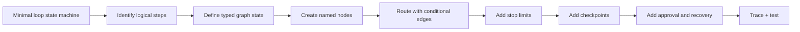
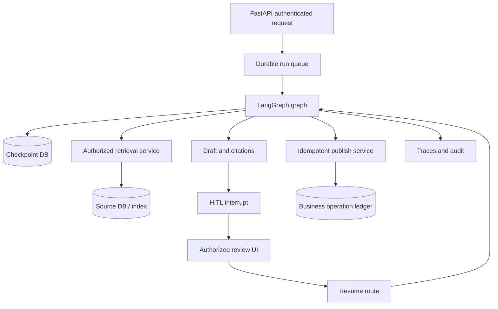
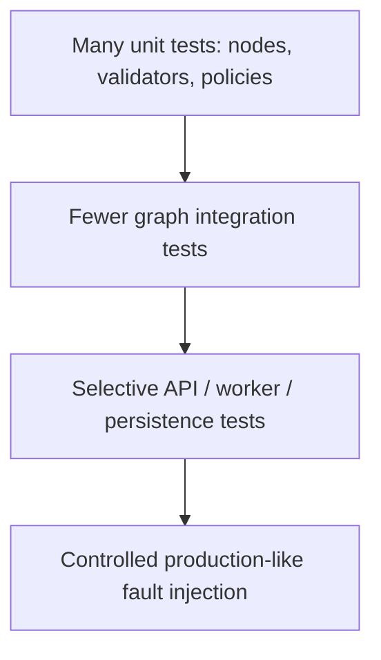
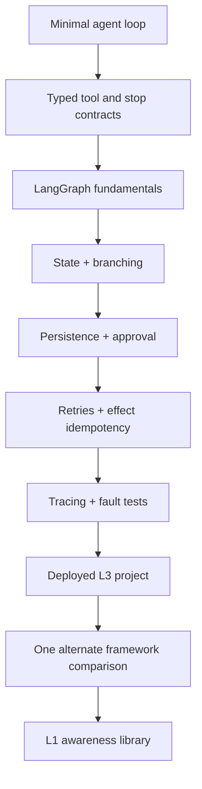

# M10.3 — Framework Learning Policy
## Full Reorganized Study Guide

## Table of Contents

- [Part 0 — Document Metadata & Orientation](#part-0-document-metadata-orientation)
  - [0.1 Path, Depth & Prerequisites](#01-path-depth-prerequisites)
  - [0.2 Purpose & Completion Evidence](#02-purpose-completion-evidence)
  - [0.3 Memory Aid](#03-memory-aid)
  - [0.4 Guide Structure](#04-guide-structure)
- [Part 1 — M10.3.1 One Deep Implementation: Why This Policy Exists](#part-1-m1031-one-deep-implementation-why-this-policy-exists)
  - [1.1 Framework Hopping vs Engineering Competence](#11-framework-hopping-vs-engineering-competence)
  - [1.2 L1, L2 and L3 Learning Levels](#12-l1-l2-and-l3-learning-levels)
  - [1.3 Deep vs Shallow Topics](#13-deep-vs-shallow-topics)
- [Part 2 — Step 1: Implement the Minimal Agent Loop Before a Framework](#part-2-step-1-implement-the-minimal-agent-loop-before-a-framework)
  - [2.1 Eight Responsibilities from M09.6](#21-eight-responsibilities-from-m096)
  - [2.2 Minimal Loop Pseudocode](#22-minimal-loop-pseudocode)
  - [2.3 First Unit Tests](#23-first-unit-tests)
  - [2.4 Exit Criteria for Step 1](#24-exit-criteria-for-step-1)
- [Part 3 — Step 2: Transfer the Loop to LangGraph](#part-3-step-2-transfer-the-loop-to-langgraph)
  - [3.1 Preserve Logic, Change Orchestration](#31-preserve-logic-change-orchestration)
  - [3.2 Define the Same Business Contract](#32-define-the-same-business-contract)
  - [3.3 Represent a State Contract](#33-represent-a-state-contract)
  - [3.4 Identify Node Boundaries](#34-identify-node-boundaries)
  - [3.5 Graph Exit Contract](#35-graph-exit-contract)
- [Part 4 — Step 3: Learn LangGraph in an Ordered Sequence](#part-4-step-3-learn-langgraph-in-an-ordered-sequence)
  - [4.1 Stage A — Graph Structure (Foundation)](#41-stage-a-graph-structure-foundation)
  - [4.2 Stage B — State and Reducers](#42-stage-b-state-and-reducers)
  - [4.3 Stage C — Typed Tool Nodes](#43-stage-c-typed-tool-nodes)
  - [4.4 Stage D — Conditional Loops and Budgets](#44-stage-d-conditional-loops-and-budgets)
  - [4.5 Stage E — Checkpointing and Thread State](#45-stage-e-checkpointing-and-thread-state)
  - [4.6 Stage F — Human Interrupts](#46-stage-f-human-interrupts)
  - [4.7 Stage G — Retries, Timeouts and Idempotency](#47-stage-g-retries-timeouts-and-idempotency)
  - [4.8 Stage H — Streaming and Observability](#48-stage-h-streaming-and-observability)
  - [4.9 Stage I — Deployment and Upgrade Safety](#49-stage-i-deployment-and-upgrade-safety)
- [Part 5 — One Complete Project Roadmap](#part-5-one-complete-project-roadmap)
  - [5.1 Reference Project: Evidence Review and Publication](#51-reference-project-evidence-review-and-publication)
    - [5.1.1 Architecture Diagram](#511-architecture-diagram)
    - [5.1.2 Representative State Transitions](#512-representative-state-transitions)
  - [5.2 Milestones, Artifacts and Proof](#52-milestones-artifacts-and-proof)
  - [5.3 Scope Boundaries](#53-scope-boundaries)
  - [5.4 Suggested Repository Milestones](#54-suggested-repository-milestones)
- [Part 6 — Testing and Evaluation Policy](#part-6-testing-and-evaluation-policy)
  - [6.1 Test Pyramid for Agent Orchestration](#61-test-pyramid-for-agent-orchestration)
  - [6.2 Required Test Set](#62-required-test-set)
  - [6.3 Evaluation Metrics](#63-evaluation-metrics)
  - [6.4 Keep an Evaluation Corpus](#64-keep-an-evaluation-corpus)
- [Part 7 — Step 4: Compare One Alternative Only When Needed](#part-7-step-4-compare-one-alternative-only-when-needed)
  - [7.1 Select a Concrete Alternative](#71-select-a-concrete-alternative)
  - [7.2 Keep the Test Fair](#72-keep-the-test-fair)
  - [7.3 What to Compare](#73-what-to-compare)
  - [7.4 When Another Comparison Is Justified](#74-when-another-comparison-is-justified)
- [Part 8 — Step 5: Maintain L1 Awareness of Everything Else](#part-8-step-5-maintain-l1-awareness-of-everything-else)
  - [8.1 Minimal Framework Awareness Card](#81-minimal-framework-awareness-card)
  - [8.2 Suggested Awareness Cards](#82-suggested-awareness-cards)
- [Part 9 — Common Learning Mistakes and Corrections](#part-9-common-learning-mistakes-and-corrections)
  - [9.1 Tutorial Success Mistaken for L3](#91-tutorial-success-mistaken-for-l3)
  - [9.2 Study by API Memorization](#92-study-by-api-memorization)
  - [9.3 Add Multi-Agent Complexity Too Early](#93-add-multi-agent-complexity-too-early)
  - [9.4 Ignore Business Persistence](#94-ignore-business-persistence)
  - [9.5 Ignore Version Pinning](#95-ignore-version-pinning)
  - [9.6 Compare Frameworks on Different Tasks](#96-compare-frameworks-on-different-tasks)
  - [9.7 Confuse Human Approval with UI Click](#97-confuse-human-approval-with-ui-click)
  - [9.8 No Exit Condition for Learning](#98-no-exit-condition-for-learning)
- [Part 10 — M10 Completion Checklist and Self-Assessment](#part-10-m10-completion-checklist-and-self-assessment)
  - [10.1 Checklist](#101-checklist)
  - [10.2 L3 Evidence Scorecard](#102-l3-evidence-scorecard)
  - [10.3 What to Put in Your Portfolio](#103-what-to-put-in-your-portfolio)
- [Part 11 — Concept Map, Glossary and Revision](#part-11-concept-map-glossary-and-revision)
  - [11.1 Concept Map](#111-concept-map)
  - [11.2 Glossary](#112-glossary)
  - [11.3 Ten Revision Rules](#113-ten-revision-rules)
- [Part 12 — Practice and Interview Questions](#part-12-practice-and-interview-questions)
  - [12.1 Quick Recall](#121-quick-recall)
    - [Q1 — Why implement a minimal loop before LangGraph?](#q1-why-implement-a-minimal-loop-before-langgraph)
    - [Q2 — What does L3 mean in this roadmap?](#q2-what-does-l3-mean-in-this-roadmap)
    - [Q3 — How many primary frameworks should be studied deeply?](#q3-how-many-primary-frameworks-should-be-studied-deeply)
    - [Q4 — When should you compare another framework?](#q4-when-should-you-compare-another-framework)
    - [Q5 — What is a fair comparison?](#q5-what-is-a-fair-comparison)
    - [Q6 — What is an acceptance invariant?](#q6-what-is-an-acceptance-invariant)
    - [Q7 — Why is an in-memory demo insufficient for durability?](#q7-why-is-an-in-memory-demo-insufficient-for-durability)
    - [Q8 — Why test unknown-commit writes?](#q8-why-test-unknown-commit-writes)
    - [Q9 — Why keep other frameworks at L1?](#q9-why-keep-other-frameworks-at-l1)
    - [Q10 — When should the learning phase end?](#q10-when-should-the-learning-phase-end)
  - [12.2 Multiple-Choice Questions](#122-multiple-choice-questions)
    - [Q11 — Which is evidence of L3 ability?](#q11-which-is-evidence-of-l3-ability)
    - [Q12 — How do you transfer a minimal loop to LangGraph safely?](#q12-how-do-you-transfer-a-minimal-loop-to-langgraph-safely)
    - [Q13 — An agent repeatedly fetches the same empty page. What's missing?](#q13-an-agent-repeatedly-fetches-the-same-empty-page-whats-missing)
    - [Q14 — Which project demonstration best proves HITL?](#q14-which-project-demonstration-best-proves-hitl)
    - [Q15 — Which learning strategy fits this roadmap?](#q15-which-learning-strategy-fits-this-roadmap)
  - [12.3 Interview Questions with Model Answers](#123-interview-questions-with-model-answers)
    - [Q16 — How would you learn an agent framework efficiently?](#q16-how-would-you-learn-an-agent-framework-efficiently)
    - [Q17 — How would you prove you understand LangGraph beyond the tutorial?](#q17-how-would-you-prove-you-understand-langgraph-beyond-the-tutorial)
    - [Q18 — How do you structure an agent project for testing?](#q18-how-do-you-structure-an-agent-project-for-testing)
    - [Q19 — Why compare a provider-native SDK after LangGraph?](#q19-why-compare-a-provider-native-sdk-after-langgraph)
    - [Q20 — When would you stop adding features and declare this module complete?](#q20-when-would-you-stop-adding-features-and-declare-this-module-complete)
- [Part 13 — Senior/Staff-Level Production Scenarios](#part-13-seniorstaff-level-production-scenarios)
  - [13.1 Scenario — Developer Knows APIs but Cannot Explain a Retry](#131-scenario-developer-knows-apis-but-cannot-explain-a-retry)
  - [13.2 Scenario — Learning Project Becomes a Multi-Agent Platform](#132-scenario-learning-project-becomes-a-multi-agent-platform)
  - [13.3 Scenario — Model Evaluation Improves but Safety Regresses](#133-scenario-model-evaluation-improves-but-safety-regresses)
  - [13.4 Scenario — Team Compares SDKs with Different Prompts and Tools](#134-scenario-team-compares-sdks-with-different-prompts-and-tools)
- [Part 14 — References and Further Study](#part-14-references-and-further-study)
  - [14.1 Official Sources](#141-official-sources)
  - [14.2 Advanced Topics Not Needed Initially](#142-advanced-topics-not-needed-initially)
  - [14.3 Section Navigation](#143-section-navigation)

---

# Part 0 — Document Metadata & Orientation

## 0.1 Path, Depth & Prerequisites

- **Path:** Core · **Module:** M10 Agent Frameworks & Orchestration · **Section:** M10.3.
- **Depth:** L2 learning policy; L3 for one implementation with demonstrated project evidence.
- **Prerequisites:** M09, M11, M10.1 foundations and M10.2 landscape.
- **Syllabus:** M10.3.1 One deep implementation — minimal loop first; one orchestration framework to L3; compare one alternative if needed; other named frameworks L1 only.

## 0.2 Purpose & Completion Evidence

**Purpose:** Turn a potentially overwhelming framework ecosystem into a practical sequence that produces transferrable engineering skill rather than a portfolio of shallow tutorials.

**Completion evidence:** A minimal bounded loop, one LangGraph implementation with failure tests and trace documentation, one meaningful alternative comparison, and a short summary of other frameworks at awareness level.

## 0.3 Memory Aid

> **Understand the loop → master one graph → verify it under failure → compare one alternative → keep the rest at awareness.**

## 0.4 Guide Structure

Learning-depth model → prerequisite loop → staged LangGraph curriculum → project and testing sequence → evidence rubric → alternative comparison → anti-patterns → interview practice.

---

# Part 1 — M10.3.1 One Deep Implementation: Why This Policy Exists

## 1.1 Framework Hopping vs Engineering Competence

Imagine building a to-do agent in five frameworks. Each demo looks successful, but none survives a worker crash, prevents a duplicate write, or resumes a pending approval. You have learned five SDK entry points but not how to engineer a reliable agent.

A better approach is to choose **one representative task** and progressively harden it. The same workflow should evolve from a simple function into a bounded agent loop, then a graph, then a durable/observable service. Hold business requirements constant so architectural improvements are measurable.

**The rule:** Depth means the ability to predict and demonstrate actual execution semantics under adverse conditions—not the number of imported libraries.

## 1.2 L1, L2 and L3 Learning Levels

| Level | Expected capability | Evidence | Not sufficient |
|---|---|---|---|
| L1 awareness | Explain purpose and key tradeoffs | Short comparison and architecture fit | Reading marketing pages only |
| L2 foundation | Design solution, explain state/retry, write small example | Diagram, sample code, reasoned decision | Memorizing API names |
| L3 demonstrated work | Implement, test, debug, recover and operate | Git repo, passing tests, traces, incident simulation, deployment notes | A tutorial that succeeds only in a happy path |

The requested roadmap specifies **L2 foundation; L3 through project work**. So comprehensive notes are a foundation, and practical tests supply the evidence.

## 1.3 Deep vs Shallow Topics

**Deep (LangGraph):** State schema, node/edge semantics, conditional routing, reducers, checkpoint persistence, interrupts, bounded loops, tool adapters, retry classification, fault injection, state migration and trace inspection.

**Architectural working knowledge (provider SDK):** Agent/Runner, tools, handoffs, session/state, guardrail coverage, tracing, provider dependence and application-side safety.

**Awareness (other frameworks):** Primary purpose, strengths, one or two suitable use cases, one notable limit, official docs, and the trigger that would justify deeper evaluation.

Avoid distributing your study hours equally. The syllabus intentionally assigns different depths.

---

# Part 2 — Step 1: Implement the Minimal Agent Loop Before a Framework

## 2.1 Eight Responsibilities from M09.6

Before LangGraph, implement and explain each step:

1. Receive a model request in the context of an authenticated task.
2. Parse a structured/typed tool intent.
3. Validate the tool name and arguments.
4. Authorize the action with current business policy.
5. Execute through a controlled tool adapter.
6. Record the real tool observation and result status.
7. Persist updated state (and external receipts when applicable).
8. Stop on success, denial, no progress, timeout or budget exhaustion.

The order matters: a model should not be able to run a tool before the runtime validates and authorizes it.

## 2.2 Minimal Loop Pseudocode

```python
# Conceptual algorithm: framework-independent.
async def bounded_agent(task, model, tools, policy, store):
    state = await store.create(task)
    for step in range(task.max_steps):
        if state.cancelled or state.expired or state.cost >= task.max_cost:
            return await store.stop(state, "LIMIT_REACHED")

        intent = await model.propose(state.safe_context())
        if intent.is_final:
            return await store.complete(state, intent.final_answer)

        request = tools.validate(intent.tool_name, intent.arguments)
        policy.authorize(state.actor, request)
        observation = await tools.execute(request, state.operation_id(step))
        state = await store.record_observation(state, observation)

        if observation.is_terminal_failure:
            return await store.stop(state, "FAILED")
    return await store.stop(state, "MAX_STEPS")
```

This is an illustrative interface, not a drop-in runnable program. The important part is visibility of the contract: **the model proposes; the application enforces**.

## 2.3 First Unit Tests

| Test | Input | Expected behavior |
|---|---|---|
| Final immediately | Model returns final | No tool executed |
| Valid read tool | Allowed args | One tool call, one observation |
| Wrong tool name | Unknown name | Validation error, zero calls |
| Wrong arguments | Invalid shape | Validation error, zero calls |
| Unauthorized resource | Other tenant's document | Denial, zero calls |
| Repeated same call | Same proposal repeatedly | Stop under no-progress policy |
| Temporary failure | Simulated `503` | Bounded retries if configured |
| Side-effect timeout | Unknown success | Reconcile; do not blindly repeat |
| User cancellation | Cancel before next step | Terminal cancelled result |
| Step cap reached | Never-ending model | Terminal budget result |

If these cases cannot be explained without a framework, a graph will conceal the gaps rather than solve them.

## 2.4 Exit Criteria for Step 1

You can move on when you can explain the trace of a successful run, a denied tool, a failed tool and a step-limit exit. You must know **where state is saved, how an operation is identified, and who owns authorization**.

---

# Part 3 — Step 2: Transfer the Loop to LangGraph

## 3.1 Preserve Logic, Change Orchestration

**Do not rewrite business policy just because you chose LangGraph.** Move the existing functions into graph nodes or adapters; retain typed domain interfaces and test fixtures. This makes the comparison against the minimal loop fair and keeps the architecture portable.



## 3.2 Define the Same Business Contract

Use one bounded **Evidence Review Agent** throughout the module:

**Input:** task ID, authorized source scope, question, deadline and maximum allowed steps. **Output:** evidence-backed report or a terminal error class. **Optional action:** publish a report after explicit human approval.

**Acceptance invariants:**

- No cross-tenant source access.
- No unapproved external publication.
- No duplicate publication from retries.
- Every report statement requiring external evidence references an eligible source.
- Every run stops with a meaningful status.
- A paused run can be inspected and resumed using durable storage.

## 3.3 Represent a State Contract

```python
from typing import Annotated, Literal
from typing_extensions import TypedDict
import operator

class AgentState(TypedDict, total=False):
    task_id: str
    request: str
    source_scope_id: str
    phase: Literal["new", "retrieving", "drafting", "waiting", "done", "failed"]
    steps: int
    max_steps: int
    evidence_ids: Annotated[list[str], operator.add]
    report: str
    proposal_id: str
    error_code: str | None
```

**Design note:** `source_scope_id` is an identifier for approved scope, not a self-authenticating permission token. Resolve actual scope in the service layer. `evidence_ids` uses list concatenation; implement duplicate filtering when source identity matters.

## 3.4 Identify Node Boundaries

| Node | Responsibility | Avoid |
|---|---|---|
| `validate_task` | Input and run budget checks | Model-based security decisions |
| `retrieve` | Call authorized read adapter | Side-effecting writes |
| `evaluate_evidence` | Decide if sufficient evidence exists | Unbounded loops |
| `draft` | Produce report draft | Publishing without approval |
| `review` | Pause with `interrupt()` | Irreversible pre-interrupt work |
| `publish` | Validate and idempotently commit | Blind retries on unknown commit |
| `finish` | Store explicit outcome | Treating END as universal success |

Make nodes small enough that failure and retry scope are understandable. Do not fragment into dozens of trivial nodes solely for aesthetic diagrams.

## 3.5 Graph Exit Contract

```text
COMPLETED
FAILED_VALIDATION
FAILED_TOOL
FAILED_NO_EVIDENCE
FAILED_BUDGET
WAITING_APPROVAL (not a terminal outcome)
REJECTED
CANCELLED
UNKNOWN_COMMIT (requires reconciliation)
```

A status taxonomy makes runbooks and dashboards possible. A generic `error=True` provides too little information for reliable operations.

---

# Part 4 — Step 3: Learn LangGraph in an Ordered Sequence

## 4.1 Stage A — Graph Structure (Foundation)

Learn `StateGraph`, START/END, nodes, normal edges, conditional edges and `.compile()`. Implement `validate → retrieve → answer` with a failure branch. Verify each transition with unit tests. Do not introduce a model until the deterministic graph behaves correctly.

**Exercise:** Create an invalid task; confirm the `retrieve` node is never called. **Learning signal:** You can explain routing independently of prompt behavior.

## 4.2 Stage B — State and Reducers

Learn state schema, partial updates, overwrite and aggregate reducers, and the difference between in-memory state and persisted state. Demonstrate a list aggregation and a duplicate-result bug. State merges should be deterministic where practical.

**Exercise:** Two sources return the same document ID. Show why `operator.add` alone yields duplicates; add a canonical dedupe stage and test.

## 4.3 Stage C — Typed Tool Nodes

Convert a mock source API to an authorized adapter. Validate argument shapes with Pydantic, dataclasses or equivalent typed schemas; check tenant and actor permissions using your actual domain services.

**Exercise:** Attempt retrieval with another tenant's `document_id`; expect a `permission_denied` outcome and zero data leakage. Never rely on the model politely refusing.

## 4.4 Stage D — Conditional Loops and Budgets

Add a “not enough evidence” branch back to retrieval, with a strict `max_steps`, deadline and no-progress check. Distinguish a retry of a **tool error** from intentional next-step **planning**.

**Exercise:** Make the tool return no new sources forever. Verify the run terminates under the budget; do not rely only on a graph recursion limit.

## 4.5 Stage E — Checkpointing and Thread State

Compile with `InMemorySaver` for tests, then move to a persistent saver suitable for the target environment. Inspect state by thread ID and verify state survives an application restart when using durable persistence.

**Exercise:** Pause after a read, restart the worker, load the same thread, and compare state/receipt identifiers.

**Caution:** Persistence has **durability modes and backend-specific contracts**. Read the [current checkpointer docs](https://docs.langchain.com/oss/python/langgraph/checkpointers). A saver being “durable” does not automatically schedule a crashed worker to resume.

## 4.6 Stage F — Human Interrupts

Add a `review` node using LangGraph `interrupt()` and external `Command(resume=...)`. Separate preparation from execution. Recheck reviewer authority, resource version, and approval expiry before publication.

**Exercise:** Approve once and reject once; prove the rejected case produced no publication. Then submit approval for a stale version and verify it cannot commit.

## 4.7 Stage G — Retries, Timeouts and Idempotency

Configure bounded retries only where appropriate. Tool errors should be classified as **transient**, **permanent**, or **unknown commit**. For writes, use an operation key and ledger. If a network request times out, do not assume the remote action failed.

**Exercise:** Simulate “remote write succeeded but acknowledgment lost.” Resume/retry the graph and verify one publication in authoritative state.

## 4.8 Stage H — Streaming and Observability

Emit useful progress events and correlate them with structured logs and trace IDs. Include the run, node, attempt, tool, operation key and status. Avoid exporting raw PII or confidential document content without explicit controls.

**Exercise:** Reconstruct a failed run from traces, not by printing the whole state to the console.

## 4.9 Stage I — Deployment and Upgrade Safety

Add a basic FastAPI adapter, durable worker, run ownership store, checkpoint backup plan and runbook. Pin dependency versions. Test upgrading while a thread is paused; note incompatibilities before rollout.

**Exercise:** Stage a graph change that renames a node or state key. Document which persisted threads can resume, which need migration and which need old-version execution.

---

# Part 5 — One Complete Project Roadmap

## 5.1 Reference Project: Evidence Review and Publication

The project should use **one graph**, not multiple specialized LLM agents. Add complexity only when evaluation demonstrates need. A single-agent model may perform retrieval planning and drafting, while deterministic nodes validate evidence and enforce side-effect policy.

### 5.1.1 Architecture Diagram



### 5.1.2 Representative State Transitions

```text
NEW → VALIDATING → RETRIEVING → DRAFTING → WAITING_APPROVAL
  ↘ FAILED_VALIDATION                ↘ FAILED_NO_EVIDENCE
WAITING_APPROVAL → APPROVED → COMMITTING → COMPLETED
                ↘ REJECTED
                ↘ CANCELLED
COMMITTING → UNKNOWN_COMMIT → RECONCILING → COMPLETED / FAILED
```

The statuses are business/application statuses, not a claim that LangGraph automatically supplies a matching enum.

## 5.2 Milestones, Artifacts and Proof

| Milestone | What you implement | Proof to save |
|---|---|---|
| 1 — Baseline | Minimal loop, scripted model and typed tool | Unit tests and trace |
| 2 — Graph | State, nodes, edges, stop paths | Graph diagram and routing tests |
| 3 — Tools | Authorized source retrieval | Tenant rejection test |
| 4 — Evidence | Citations and source eligibility | Accuracy evaluation set |
| 5 — Persistence | Durable checkpoint storage | Restart/resume log |
| 6 — Review | Pause/reject/approve | Screenshots or events with timestamps |
| 7 — Effects | Idempotent publication | Duplicate-delivery test |
| 8 — Observability | Structured run and node traces | Incident reproduction report |
| 9 — API | Authenticated run/status/review routes | Contract tests |
| 10 — Upgrade | Dependency freeze and migration plan | Upgrade regression report |

## 5.3 Scope Boundaries

Keep the first deliverable focused: one data source type, one retrieval tool, one approval action and one simple publishing adapter. Adding five external connectors before verifying one idempotent action makes it difficult to isolate failures.

**Do not build an unsafe “unrestricted tools” agent** just to claim production readiness. The acceptance criteria reward bounded behavior and evidence.

## 5.4 Suggested Repository Milestones

```text
01_minimal_loop/             # Framework-free reference
02_langgraph_basics/         # State, nodes, branch
03_tool_integrations/        # Typed read adapter and policy
04_durable_workflow/         # Persistence, retry, interrupt
05_api_service/              # Authenticated FastAPI integration
06_tests_and_evidence/       # Fault injection + evaluation
07_operations/               # Runbook, metrics, rollback plan
```

These may be stages in one Git repository rather than seven deployed services. Prefer one organized app with meaningful commits over seven disconnected tutorial repositories.

---

# Part 6 — Testing and Evaluation Policy

## 6.1 Test Pyramid for Agent Orchestration



**Unit tests** verify deterministic control and data contracts; **integration tests** verify graph transitions/checkpoints; **evaluation tests** verify evidence and answer quality; **reliability tests** verify restart, idempotency and observability.

## 6.2 Required Test Set

| Class | Test | Expected outcome |
|---|---|---|
| Graph | Successful research | `COMPLETED`, cited report |
| Graph | No evidence | `FAILED_NO_EVIDENCE`, no hallucinated citation |
| Graph | Repeated retrieval | Bounded stop |
| Tool | Wrong arguments | No execution |
| Policy | Cross-tenant access | Denied, audited |
| HITL | Rejection | No external write |
| HITL | Stale approval | Revalidation failure |
| Persistence | Restart while waiting | Pending review remains recoverable |
| Retry | Temporary read failure | Limited retry then success/failure |
| Commit | Write acknowledged | One ledger receipt |
| Commit | Timeout after write | Reconcile, no duplicate |
| Concurrency | Duplicate approval requests | One accepted transition |
| Upgrade | Old paused thread | Supported migration or explicit refusal |

## 6.3 Evaluation Metrics

**Correctness:** citation support rate, tool call validity, authorization-denial coverage, duplicate-effect count.

**Reliability:** completion rate, stuck-run count, recovery success, p95 time-to-completion, approval latency.

**Cost:** model tokens and price per successful run, tool requests per run, total retries, checkpoint storage growth.

**Observability:** percentage of runs with complete correlation IDs, percentage of failures assigned an error class, time to reproduce a failed run.

Avoid a single vanity metric like “agent answered 9 out of 10 prompts” when the workflow can also execute real actions.

## 6.4 Keep an Evaluation Corpus

Record task ID, expected result, authorized source IDs, tricky negative examples, expected tool behavior, max steps and expected terminal status. Freeze versions for each test run so comparisons are meaningful.

```json
{
  "task_id": "review-014",
  "query": "Summarize current inspection guidance",
  "allowed_source_ids": ["manual-v4-section-2"],
  "excluded_source_ids": ["manual-v2-section-2"],
  "expected_status": "WAITING_APPROVAL",
  "max_steps": 4,
  "expected_publications_before_approval": 0
}
```

This is a **toy test fixture**, not a real safety finding or an API standard.

---

# Part 7 — Step 4: Compare One Alternative Only When Needed

## 7.1 Select a Concrete Alternative

For this roadmap, a reasonable comparison is **LangGraph vs OpenAI Agents SDK** for the same short research/tool workflow. The goal is to learn how a higher-level runner differs from graph-directed state, not to migrate everything permanently.

## 7.2 Keep the Test Fair

Use the same model version if supported, same tool adapter, same tool latency, same source dataset, same prompts/evaluation criteria and same cost limits. Separate end-to-end latency from orchestration overhead. Also test **without** model calls using scripted decisions so framework/runtime behavior can be isolated.

## 7.3 What to Compare

| Question | LangGraph investigation | Provider SDK investigation |
|---|---|---|
| Who decides next step? | Edge/router or model node | Runner loop/handoff behavior |
| What is persisted? | Graph checkpoints, optional stores | SDK sessions/run state; inspect exact contract |
| Where is human approval? | Interrupt and resume flow | SDK controls or application-managed approval |
| What retries automatically? | Configured nodes/engine semantics | Runner and tool retry semantics |
| How do tools become authorized? | Domain service/policy boundary | Domain service/policy boundary |
| How are tool events traced? | Graph node/tool spans | SDK-generated trace and spans |
| What if worker dies? | Saver + recovery workflow | Verify SDK/session/durable integration |
| What breaks during upgrade? | Graph/state schema and APIs | Runner/session/tool API semantics |

**Main result:** A concise document listing which design is better for your one use case, what needs extra infrastructure, and what evidence supported the choice.

## 7.4 When Another Comparison Is Justified

If the task becomes primarily complex document ingestion, consider LlamaIndex. If the deployment moves to a Google-centric platform, inspect ADK. If TypeScript streaming is the dominant issue, inspect Vercel AI SDK. If enterprise .NET requirements dominate, inspect Microsoft Agent Framework. Do not trigger every comparison merely because the framework exists.

---

# Part 8 — Step 5: Maintain L1 Awareness of Everything Else

## 8.1 Minimal Framework Awareness Card

For every non-primary framework, capture just five facts:

1. **Purpose:** What problem is it designed to simplify?
2. **Abstraction:** Agent runner, graph, data framework, workflow, or UI SDK?
3. **Fit:** One application where it may outperform the default approach.
4. **Risk:** One thing to verify before adoption.
5. **Official docs:** Stable documentation entry point.

Do not study deprecated API examples as if they were current. For example, AG2 and AG2 Classic have different active entry points; Microsoft Semantic Kernel and the newer Agent Framework documentation should not be conflated.

## 8.2 Suggested Awareness Cards

| Framework | Purpose | Fit | Verify before adoption |
|---|---|---|---|
| LangChain | Model/tool/retrieval components | Broad integrations | Package/version compatibility |
| LlamaIndex | Data ingestion, RAG and agents | Retrieval-heavy app | Index quality and source permissions |
| Google ADK | Agent and workflow development | Google platform context | Session/deployment contracts |
| Semantic Kernel / Microsoft Agent Framework | Enterprise agent workflows | .NET/Azure contexts | Product/version transition |
| CrewAI | Crews, agents, task flows | Specialized team coordination | Coordination value vs overhead |
| AG2 / AutoGen family | Agent conversation patterns | Multi-agent research experiments | Which API lineage is used |
| Vercel AI SDK | TypeScript model and AI UI | React/Next frontend integration | Durable-worker separation |

This is enough for **L1**. Deeper study is justified by concrete requirements, not by fear of missing new frameworks.

---

# Part 9 — Common Learning Mistakes and Corrections

## 9.1 Tutorial Success Mistaken for L3

A graph that prints “hello” or calls a calculator only proves happy-path execution. **Correction:** Add a denied tool, process restart, approval rejection and unknown-commit test.

## 9.2 Study by API Memorization

Memorizing `add_node` or `invoke` does not teach retries, cost or policy. **Correction:** For every API, ask what state changes, what persists, what retries and what can execute twice.

## 9.3 Add Multi-Agent Complexity Too Early

Multiple agents increase prompt, state and coordination work. **Correction:** Build the single-agent baseline and measure the value of additional roles.

## 9.4 Ignore Business Persistence

The framework remembers that a node ran but the database owns the actual purchase/publication. **Correction:** Build an operation ledger and external receipt check.

## 9.5 Ignore Version Pinning

An API change alters defaults or serialized-state compatibility. **Correction:** Use a lockfile, record tested versions and test a paused thread during an upgrade.

## 9.6 Compare Frameworks on Different Tasks

One tool runs a simple FAQ while another performs five retrieval steps; latency results are meaningless. **Correction:** Hold data, prompts, model and conditions constant.

## 9.7 Confuse Human Approval with UI Click

An “Approve” button alone may not enforce policy if the resumed graph trusts the payload. **Correction:** Authenticate, authorize and bind approvals to immutable action versions.

## 9.8 No Exit Condition for Learning

Months of reading docs can replace building. **Correction:** Define an explicit **M10 completion checklist** and stop exploring more libraries once evidence is complete.

---

# Part 10 — M10 Completion Checklist and Self-Assessment

## 10.1 Checklist

- [ ] I can explain the framework-free agent loop from M09.
- [ ] I implemented and tested typed tool validation and authorization.
- [ ] I can build and explain a LangGraph state schema, nodes and edges.
- [ ] I implemented branching, success, failure and bounded termination.
- [ ] I inspected checkpoints and resumed a durable thread after restart.
- [ ] I implemented an interrupt with approval/rejection paths.
- [ ] I proved repeated side-effect attempts do not duplicate the effect.
- [ ] I can find a failure from a trace and state snapshot.
- [ ] I exposed runs through an authenticated service API.
- [ ] I documented deployment and framework upgrade constraints.
- [ ] I compared one alternative fairly.
- [ ] I can explain the other frameworks at L1 without guessing APIs.

## 10.2 L3 Evidence Scorecard

| Category | 0 — Missing | 1 — Partial | 2 — Demonstrated |
|---|---|---|---|
| Architecture | No diagram | Diagram only | Rationale, transitions and constraints |
| Correctness | Happy path only | Some errors | Validated outputs and negative tests |
| State | In-memory only | Saver configured | Crash/restart evidence |
| Human control | None | Approval UI only | Durable pause, role check, stale review test |
| Reliability | Blind retries | Retry cap | Unknown-commit reconciliation + idempotency |
| Observability | Print statements | Partial logs | Correlated trace and receipts |
| Deployment | Local script | Running API | Secure operations and recovery runbook |
| Alternatives | Named tools | Opinion matrix | Controlled, evidence-based comparison |

**Interpretation:** Use this as a study rubric, not a standardized industry certification. L3 means the major categories are demonstrably complete, not simply that a numerical total looks good.

## 10.3 What to Put in Your Portfolio

Show a small architecture diagram, setup instructions, an anonymized trace of a successful run, an approval rejection path, a failure-injection test result, and a short design decision document. Reviewers learn more from your explanation of an unknown-commit recovery than from a screenshot of four animated agent avatars.

---

# Part 11 — Concept Map, Glossary and Revision

## 11.1 Concept Map



## 11.2 Glossary

| Term | Definition |
|---|---|
| Mastery depth | Level of practical explanation and implementation expected |
| L1 awareness | Can identify use cases and high-level tradeoffs |
| L2 foundation | Can design and explain a workable solution |
| L3 project evidence | Can demonstrate tested execution, failure recovery and reasoning |
| Baseline | Simple reference implementation used for comparison |
| Portability | Ability to replace components without breaking business semantics |
| Acceptance criterion | Explicit testable statement defining success |
| Fault injection | Controlled failure to verify recovery |
| Operation ledger | Authoritative record of external action identities and receipts |
| Checkpointer | Storage of graph execution snapshots |
| Runner | Component controlling model/tool execution cycles |
| Invariant | Condition that must remain true across all transitions |
| No-progress rule | Stops repeated actions that produce no useful change |
| Evaluation corpus | Fixed labeled tasks used to measure quality |
| Reproducible setup | Version-pinned environment with deterministic tests |

## 11.3 Ten Revision Rules

1. Do not learn every framework to the same depth.
2. Build the minimal loop before a graph.
3. Preserve business contracts when switching orchestrators.
4. Test failure paths before adding more tools.
5. Keep LangGraph as the one L3 primary for this roadmap.
6. Treat sessions, checkpoints and business databases as distinct.
7. Show approval and recovery with evidence, not claims.
8. Compare an alternative on the same workload.
9. Keep other tools at L1 until a requirement demands more.
10. Stop studying M10 when project completion evidence is demonstrable.

---

# Part 12 — Practice and Interview Questions

## 12.1 Quick Recall

### Q1 — Why implement a minimal loop before LangGraph?

**Answer:** It exposes tool validation, authorization, state updates, observations and stop rules that a framework otherwise hides behind convenient APIs.

### Q2 — What does L3 mean in this roadmap?

**Answer:** Demonstrated ability to build, test, debug and recover a working workflow, not merely explain documentation.

### Q3 — How many primary frameworks should be studied deeply?

**Answer:** One—LangGraph for this roadmap.

### Q4 — When should you compare another framework?

**Answer:** When a concrete requirement or tradeoff justifies it, or to validate the chosen architecture against one alternative.

### Q5 — What is a fair comparison?

**Answer:** Same workload, model, source data, budgets, tool behavior and evaluation criteria as far as the candidates support them.

### Q6 — What is an acceptance invariant?

**Answer:** A behavior that must always hold, such as “No publication without approval” or “No cross-tenant data access.”

### Q7 — Why is an in-memory demo insufficient for durability?

**Answer:** It loses state on process exit and does not demonstrate crash recovery.

### Q8 — Why test unknown-commit writes?

**Answer:** A timeout may hide an already committed effect; retrying without reconciliation can duplicate it.

### Q9 — Why keep other frameworks at L1?

**Answer:** Because deep study is costly and should be driven by project requirements. Awareness is enough to recognize when another tool is worth evaluating.

### Q10 — When should the learning phase end?

**Answer:** When the defined project and acceptance tests demonstrate the completion evidence, not when every framework tutorial has been read.

## 12.2 Multiple-Choice Questions

### Q11 — Which is evidence of L3 ability?

A. Naming ten frameworks.  
B. Screenshot of an agent hello-world.  
C. Tested crash/restart, HITL and retry behavior.  
D. A long dependency list.

**Correct: C.** L3 is demonstrated engineering behavior.

### Q12 — How do you transfer a minimal loop to LangGraph safely?

A. Rewrite the business policy from prompts.  
B. Keep domain services, map steps to nodes, define state.  
C. Remove authorization.  
D. Allow infinite graph cycles.

**Correct: B.** Separating domain rules from orchestration preserves correctness.

### Q13 — An agent repeatedly fetches the same empty page. What's missing?

A. A stop/no-progress rule.  
B. A prettier prompt.  
C. More agents.  
D. A larger UI font.

**Correct: A.** Bounded execution must detect no progress.

### Q14 — Which project demonstration best proves HITL?

A. A button labeled Approve.  
B. A saved interrupt, authorized resume, rejection and stale approval tests.  
C. A chatbot saying “approved.”  
D. A print statement.

**Correct: B.** Human control is a durable and authorized state transition.

### Q15 — Which learning strategy fits this roadmap?

A. Study seven frameworks to L3 simultaneously.  
B. LangGraph L3, one alternative compared if needed, others L1.  
C. Ignore agent fundamentals.  
D. Memorize API names only.

**Correct: B.** Matches the stated learning policy.

## 12.3 Interview Questions with Model Answers

### Q16 — How would you learn an agent framework efficiently?

**Suggested answer:** “I would first implement the agent loop without a framework so I understand tools, authorization, state and termination. Then I would implement the same bounded workflow in one framework—LangGraph—adding checkpoints, approval, retries, tests and tracing. Finally, I would compare one alternative on the same requirements.”

**Counter-question 1:** Why not study all frameworks deeply? **Answer:** It dilutes time without proving reliable execution.

**Counter-question 2:** What proves progress? **Answer:** Working tests and traces for both success and failure.

### Q17 — How would you prove you understand LangGraph beyond the tutorial?

**Suggested answer:** “I would show a graph with typed state, conditional branches and stop criteria, then demonstrate a resumed checkpoint, approval/rejection and recovery from a timeout without duplicate side effects. I would explain every node's inputs, outputs and retry scope.”

**Counter-question 1:** Does a checkpoint alone prevent duplicates? **Answer:** No.

**Counter-question 2:** What if a worker crashes while waiting for approval? **Answer:** Recover the durable thread and keep the approval pending.

### Q18 — How do you structure an agent project for testing?

**Suggested answer:** “I keep policy and business services separate from graph nodes. I test deterministic nodes with mocks, graph transitions with a test checkpointer, and side-effect behavior through an operation ledger. I use fault injection for timeouts, repeated delivery, stale approval and process restart.”

**Counter-question 1:** Why mock a model? **Answer:** To isolate control-flow bugs from model randomness.

**Counter-question 2:** Why still evaluate real model answers? **Answer:** Routing tests do not prove semantic accuracy or citation quality.

### Q19 — Why compare a provider-native SDK after LangGraph?

**Suggested answer:** “It helps me identify whether a high-level runner could simplify a short tool-using workflow, and where graph-based state, interrupts or execution control add value. I compare the same task under the same model and tool conditions and focus on behavior, not only lines of code.”

**Counter-question 1:** Are session APIs equivalent to graph checkpoints? **Answer:** Not necessarily; inspect actual persistence semantics.

**Counter-question 2:** Is less code automatically better? **Answer:** Only if correctness and operational needs remain satisfied.

### Q20 — When would you stop adding features and declare this module complete?

**Suggested answer:** “When I can demonstrate one reliable workflow with clear state, bounded execution, authorization, approval, retries, durable recovery, tracing and tests. I would also document why LangGraph was selected and when I would reconsider it.”

**Counter-question 1:** What if code works but crash recovery is untested? **Answer:** It is not L3 evidence for durability.

**Counter-question 2:** What if a new framework trends next week? **Answer:** Note it at L1; evaluate only against a concrete unmet requirement.

---

# Part 13 — Senior/Staff-Level Production Scenarios

## 13.1 Scenario — Developer Knows APIs but Cannot Explain a Retry

**Situation:** A developer demonstrates a LangGraph app but cannot say whether a payment step may rerun after a timeout.

**Root issue:** Tutorial-level knowledge without a failure model. **Correct action:** Identify the state transition and write boundary, run an unknown-commit test, add a stable operation key and reconciliation, and document the observed semantics before claiming L3.

## 13.2 Scenario — Learning Project Becomes a Multi-Agent Platform

**Situation:** The original brief asked for one approval workflow. The project now has eight agents, separate vector stores and three hosting platforms; no tests pass reliably.

**Root issue:** Scope explosion. **Correct action:** Restore the single-agent baseline, identify measurable functional gaps, and justify additions one at a time with acceptance tests.

## 13.3 Scenario — Model Evaluation Improves but Safety Regresses

**Situation:** A model upgrade increases answer accuracy while also increasing unauthorized tool proposal rates.

**Root issue:** Semantic quality was evaluated without control-layer invariants. **Correct action:** Run separate accuracy and policy test suites; reject the upgrade until authorized execution behavior is protected by runtime controls.

## 13.4 Scenario — Team Compares SDKs with Different Prompts and Tools

**Situation:** An SDK is declared faster because its demo uses one search result while the graph demo uses five.

**Root issue:** Confounded evaluation. **Correct action:** Normalize tool setup, model configuration, task corpus and output constraints; report model/network time separately from orchestration overhead.

---

# Part 14 — References and Further Study

## 14.1 Official Sources

- [LangGraph quickstart](https://docs.langchain.com/oss/python/langgraph/quickstart)
- [LangGraph Graph API](https://docs.langchain.com/oss/python/langgraph/graph-api)
- [LangGraph persistence](https://docs.langchain.com/oss/python/langgraph/persistence)
- [LangGraph interrupts](https://docs.langchain.com/oss/python/langgraph/interrupts)
- [LangGraph fault tolerance](https://docs.langchain.com/oss/python/langgraph/fault-tolerance)
- [LangGraph tests](https://docs.langchain.com/oss/python/langgraph/test)
- [OpenAI Agents SDK quickstart](https://openai.github.io/openai-agents-python/quickstart/)
- [FastAPI](https://fastapi.tiangolo.com/)

## 14.2 Advanced Topics Not Needed Initially

Custom checkpointers, distributed checkpoint storage compaction, multi-agent subgraphs, agent-to-agent protocols, coordinated worker leases and complex data lineage. Treat them as advanced project extensions rather than prerequisites for the first L3 demonstration.

## 14.3 Section Navigation

Read [M10.1 — Framework Selection and Implementation Depth](M10.1_Framework_Selection_and_Implementation_Depth.md), [M10.2 — Framework Landscape and Tradeoffs](M10.2_Framework_Landscape_and_Tradeoffs.md), and finish with [M10.4 — Adoption Decision](M10.4_Adoption_Decision.md).
