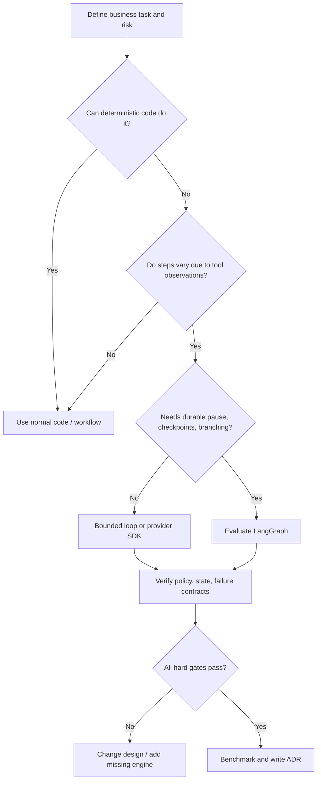
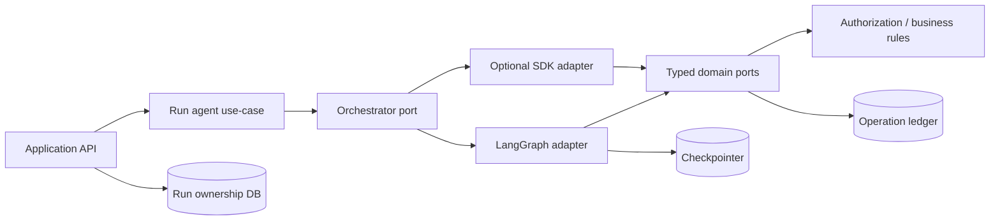
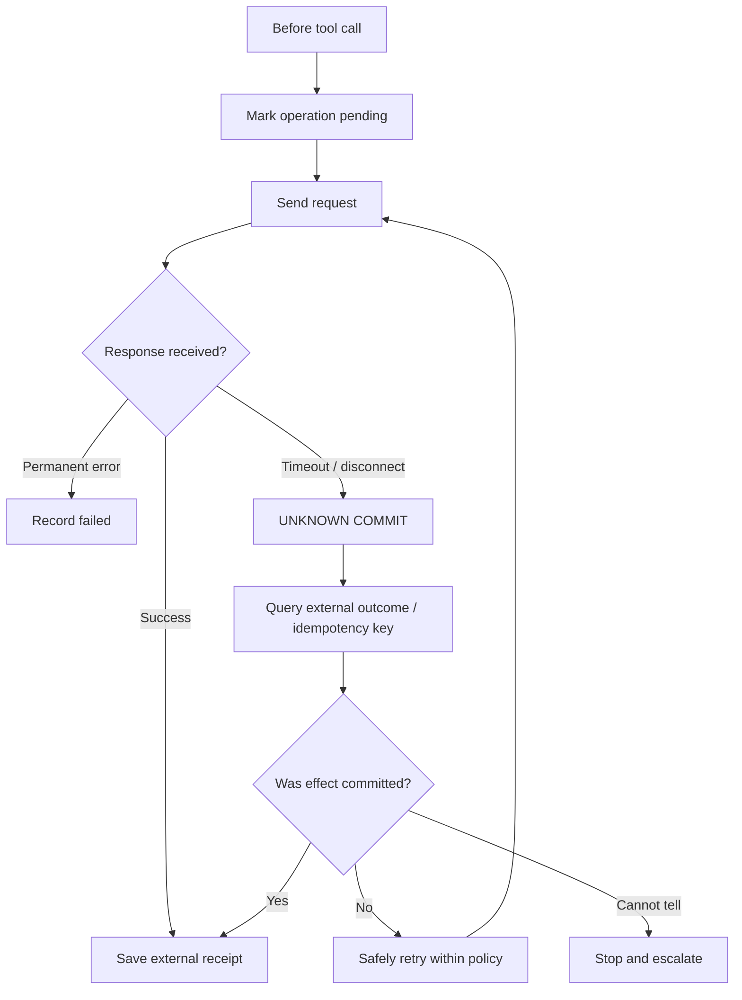
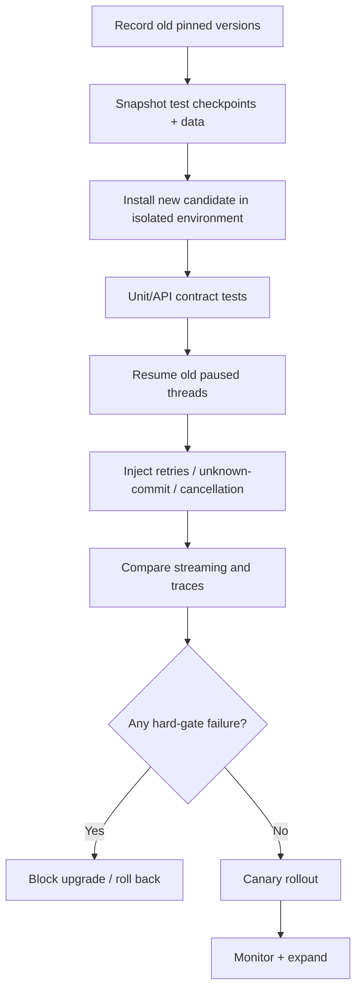
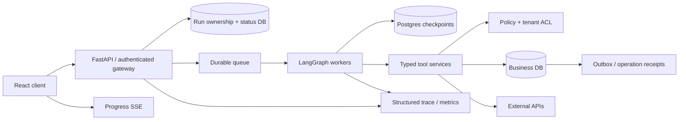
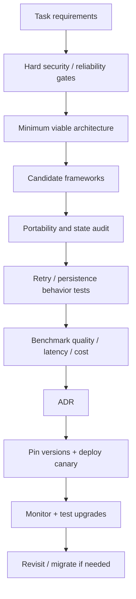

# M10.4 — Adoption Decision
## Full Reorganized Study Guide

## Table of Contents

- [Part 0 — Document Metadata & Orientation](#part-0-document-metadata-orientation)
  - [0.1 Path, Depth & Prerequisites](#01-path-depth-prerequisites)
  - [0.2 Purpose & Completion Evidence](#02-purpose-completion-evidence)
  - [0.3 Memory Aid](#03-memory-aid)
  - [0.4 How This Guide Is Organized](#04-how-this-guide-is-organized)
- [Part 1 — M10.4.1 Architecture Before Dependencies](#part-1-m1041-architecture-before-dependencies)
  - [1.1 The Decision You Are Actually Making](#11-the-decision-you-are-actually-making)
  - [1.2 Four Candidate Architectures](#12-four-candidate-architectures)
  - [1.3 Adoption Decision Tree](#13-adoption-decision-tree)
  - [1.4 Identify Hard Constraints Before Scoring](#14-identify-hard-constraints-before-scoring)
- [Part 2 — Measure Portability, Not Just Claim It](#part-2-measure-portability-not-just-claim-it)
  - [2.1 Five Dimensions of Portability](#21-five-dimensions-of-portability)
  - [2.2 The Portability Drill](#22-the-portability-drill)
  - [2.3 Adapter Architecture](#23-adapter-architecture)
    - [2.3.1 Example Domain Contract](#231-example-domain-contract)
  - [2.4 When an Adapter Is Too Thin](#24-when-an-adapter-is-too-thin)
  - [2.5 Migration Cost Equation](#25-migration-cost-equation)
- [Part 3 — Inspect State and Failure Semantics](#part-3-inspect-state-and-failure-semantics)
  - [3.1 State Is Not One Thing](#31-state-is-not-one-thing)
  - [3.2 Failure Windows](#32-failure-windows)
  - [3.3 Failure Classification](#33-failure-classification)
  - [3.4 State Lifecycle Contracts](#34-state-lifecycle-contracts)
  - [3.5 The Parallel-Node Caveat](#35-the-parallel-node-caveat)
  - [3.6 Exactly-Once vs At-Least-Once](#36-exactly-once-vs-at-least-once)
- [Part 4 — Understand Default Retries and Persistence](#part-4-understand-default-retries-and-persistence)
  - [4.1 Why Defaults Are Dangerous](#41-why-defaults-are-dangerous)
  - [4.2 Retry Configuration Audit](#42-retry-configuration-audit)
  - [4.3 Illustrative Explicit Retry Policy](#43-illustrative-explicit-retry-policy)
  - [4.4 Persistence Audit](#44-persistence-audit)
  - [4.5 Simulate a Restart Correctly](#45-simulate-a-restart-correctly)
  - [4.6 Checkpoint Durability vs Business Durability](#46-checkpoint-durability-vs-business-durability)
- [Part 5 — Test Framework Upgrades](#part-5-test-framework-upgrades)
  - [5.1 What Can Break?](#51-what-can-break)
  - [5.2 Upgrade Test Plan](#52-upgrade-test-plan)
  - [5.3 Compatibility Matrix](#53-compatibility-matrix)
  - [5.4 Version Pinning](#54-version-pinning)
  - [5.5 Deployment Strategies](#55-deployment-strategies)
  - [5.6 Deployment Gate Checklist](#56-deployment-gate-checklist)
- [Part 6 — Worked Architecture Decision Record (ADR)](#part-6-worked-architecture-decision-record-adr)
  - [6.1 Problem Statement](#61-problem-statement)
  - [6.2 Quality Attributes and Constraints](#62-quality-attributes-and-constraints)
  - [6.3 Options Considered](#63-options-considered)
  - [6.4 Decision](#64-decision)
  - [6.5 Consequences](#65-consequences)
  - [6.6 Revisit Triggers](#66-revisit-triggers)
  - [6.7 ADR Template](#67-adr-template)
- [Part 7 — Operational Reference Architecture](#part-7-operational-reference-architecture)
  - [7.1 A Production-Oriented Layout](#71-a-production-oriented-layout)
  - [7.2 API-to-Graph Handoff](#72-api-to-graph-handoff)
  - [7.3 Reliability Boundaries](#73-reliability-boundaries)
  - [7.4 Minimal Observability Contract](#74-minimal-observability-contract)
  - [7.5 Monitoring and Alerts](#75-monitoring-and-alerts)
- [Part 8 — Performance and Cost Evaluation](#part-8-performance-and-cost-evaluation)
  - [8.1 Decompose End-to-End Latency](#81-decompose-end-to-end-latency)
  - [8.2 Useful Measures](#82-useful-measures)
  - [8.3 Cost-Aware Stop Criteria](#83-cost-aware-stop-criteria)
  - [8.4 Compare Baseline Against LangGraph](#84-compare-baseline-against-langgraph)
- [Part 9 — Verification Exercises](#part-9-verification-exercises)
  - [9.1 Exercise 1 — Architecture Decision](#91-exercise-1-architecture-decision)
  - [9.2 Exercise 2 — Portability Audit](#92-exercise-2-portability-audit)
  - [9.3 Exercise 3 — Unknown Commit](#93-exercise-3-unknown-commit)
  - [9.4 Exercise 4 — Durable Resume](#94-exercise-4-durable-resume)
  - [9.5 Exercise 5 — Framework Upgrade](#95-exercise-5-framework-upgrade)
  - [9.6 Exercise 6 — Scorecard and ADR](#96-exercise-6-scorecard-and-adr)
- [Part 10 — Diagnostics and Anti-Patterns](#part-10-diagnostics-and-anti-patterns)
  - [10.1 Diagnostic Table](#101-diagnostic-table)
  - [10.2 Five Dangerous Assumptions](#102-five-dangerous-assumptions)
    - [10.2.1 “It Has Memory, So It Can Resume”](#1021-it-has-memory-so-it-can-resume)
    - [10.2.2 “It Has Retries, So It Is Reliable”](#1022-it-has-retries-so-it-is-reliable)
    - [10.2.3 “It Has Guardrails, So Tools Are Authorized”](#1023-it-has-guardrails-so-tools-are-authorized)
    - [10.2.4 “It Passed Tests, So Upgrade Is Safe”](#1024-it-passed-tests-so-upgrade-is-safe)
    - [10.2.5 “Using an Open-Source Framework Removes Lock-In”](#1025-using-an-open-source-framework-removes-lock-in)
- [Part 11 — Concept Map and Revision](#part-11-concept-map-and-revision)
  - [11.1 Concept Map](#111-concept-map)
  - [11.2 Glossary](#112-glossary)
  - [11.3 Ten Revision Rules](#113-ten-revision-rules)
- [Part 12 — Practice and Interview Questions](#part-12-practice-and-interview-questions)
  - [12.1 Quick Recall](#121-quick-recall)
    - [Q1 — What does “architecture before dependencies” mean?](#q1-what-does-architecture-before-dependencies-mean)
    - [Q2 — What are hard adoption gates?](#q2-what-are-hard-adoption-gates)
    - [Q3 — What is a portability drill?](#q3-what-is-a-portability-drill)
    - [Q4 — What is the unknown-commit problem?](#q4-what-is-the-unknown-commit-problem)
    - [Q5 — Does a graph checkpoint guarantee exactly-once external execution?](#q5-does-a-graph-checkpoint-guarantee-exactly-once-external-execution)
    - [Q6 — Why should retries be explicit?](#q6-why-should-retries-be-explicit)
    - [Q7 — What does a durable saver not automatically provide?](#q7-what-does-a-durable-saver-not-automatically-provide)
    - [Q8 — Why test old paused threads during an upgrade?](#q8-why-test-old-paused-threads-during-an-upgrade)
    - [Q9 — What should an ADR contain?](#q9-what-should-an-adr-contain)
    - [Q10 — What is the best metric for an agent system?](#q10-what-is-the-best-metric-for-an-agent-system)
  - [12.2 Multiple-Choice Questions](#122-multiple-choice-questions)
    - [Q11 — Your workflow is fixed and deterministic. What's the simplest acceptable choice?](#q11-your-workflow-is-fixed-and-deterministic-whats-the-simplest-acceptable-choice)
    - [Q12 — A write times out after the remote endpoint may have committed. What is safe?](#q12-a-write-times-out-after-the-remote-endpoint-may-have-committed-what-is-safe)
    - [Q13 — What best measures framework lock-in?](#q13-what-best-measures-framework-lock-in)
    - [Q14 — What proves persistence after process death?](#q14-what-proves-persistence-after-process-death)
    - [Q15 — What should happen if an upgrade breaks paused threads?](#q15-what-should-happen-if-an-upgrade-breaks-paused-threads)
  - [12.3 Interview Questions with Model Answers](#123-interview-questions-with-model-answers)
    - [Q16 — How would you decide whether to adopt LangGraph?](#q16-how-would-you-decide-whether-to-adopt-langgraph)
    - [Q17 — What does framework portability mean in practice?](#q17-what-does-framework-portability-mean-in-practice)
    - [Q18 — How do you handle retries and persistence safely?](#q18-how-do-you-handle-retries-and-persistence-safely)
    - [Q19 — How would you upgrade a production agent framework?](#q19-how-would-you-upgrade-a-production-agent-framework)
    - [Q20 — How do you justify a framework choice to your team?](#q20-how-do-you-justify-a-framework-choice-to-your-team)
- [Part 13 — Senior/Staff-Level Production Scenarios](#part-13-seniorstaff-level-production-scenarios)
  - [13.1 Scenario — Thousands of Approval Threads Waiting During Upgrade](#131-scenario-thousands-of-approval-threads-waiting-during-upgrade)
  - [13.2 Scenario — Retry Default Change Triggers Duplicate Billing](#132-scenario-retry-default-change-triggers-duplicate-billing)
  - [13.3 Scenario — Vendor Exit Looks Easy Until State Migration](#133-scenario-vendor-exit-looks-easy-until-state-migration)
  - [13.4 Scenario — Post-Approval Policy Change](#134-scenario-post-approval-policy-change)
  - [13.5 Scenario — Business System Succeeded but Graph Reports Failure](#135-scenario-business-system-succeeded-but-graph-reports-failure)
- [Part 14 — References, Further Reading and Navigation](#part-14-references-further-reading-and-navigation)
  - [14.1 Official Sources](#141-official-sources)
  - [14.2 Advanced Extensions](#142-advanced-extensions)
  - [14.3 Final Completion Evidence for M10](#143-final-completion-evidence-for-m10)
  - [14.4 Section Navigation](#144-section-navigation)

---

# Part 0 — Document Metadata & Orientation

## 0.1 Path, Depth & Prerequisites

- **Path:** Core · **Module:** M10 Agent Frameworks & Orchestration · **Section:** M10.4.
- **Depth:** L2 architecture assessment; L3 through a measured, documented adoption and upgrade exercise.
- **Prerequisites:** M09, M11 and M10.1–M10.3.
- **Syllabus:** M10.4.1 Architecture before dependencies — measure portability; inspect state and failure semantics; understand default retries and persistence; test framework upgrades.
- **Reference date:** November 2026. Examples distinguish stable principles from version-dependent APIs and defaults.

## 0.2 Purpose & Completion Evidence

**Purpose:** Adopt a framework only when its value outweighs complexity and when the team understands the state, retry, recovery, debugging and migration obligations. Avoid dependency-driven architecture.

**Completion evidence:** Write an Architecture Decision Record (ADR), compare a minimal baseline against LangGraph, run a failure/persistence test matrix, freeze known versions, evaluate one upgrade and document rollback criteria.

## 0.3 Memory Aid

> **Define requirements → expose the failure model → measure tradeoffs → pin versions → test upgrade and rollback.**

## 0.4 How This Guide Is Organized

Adoption triggers → portability measurement → state/failure contracts → retry/persistence audit → upgrade testing → decision record → reference architectures → drills and interview answers.

---

# Part 1 — M10.4.1 Architecture Before Dependencies

## 1.1 The Decision You Are Actually Making

The question is not “Which agent framework is best?” It is **“What execution and operational responsibilities does our application need, and which set of components meets those responsibilities at acceptable cost and risk?”** A framework is one component in the resulting architecture.

A small deterministic task may need no agent. A short variable tool loop may need a minimal executor or provider SDK. A multi-stage process requiring durable state, conditional revisiting, human intervention and inspection may justify a graph orchestrator. A multi-agent architecture is not a mandatory final level.

## 1.2 Four Candidate Architectures

| Candidate | Main idea | Suitable when | Typical new obligation |
|---|---|---|---|
| Deterministic code | Fixed functions, explicit if/else | Work is known and predictable | Ordinary error handling |
| Minimal tool-using loop | Model proposes, runtime validates/tools execute | Few tools and short sessions | Budget, schema, authorization |
| Provider-native runner/SDK | SDK manages model/tool turns | Standard short agents, SDK features useful | Session, SDK guardrail and tool semantics |
| LangGraph orchestrator | Explicit stateful nodes, branches, checkpoints | Stateful, paused, retrying and inspectable workflows | Schema/version and checkpoint operations |

**Rule:** Pick the least complex candidate that satisfies hard constraints. Don't grant an agent power because you imported an agent package.

## 1.3 Adoption Decision Tree



This is a heuristic, not a law. A deterministic workflow can itself be durable through a workflow engine, and a provider SDK can be composed with an external durable runtime. The key is assigning responsibilities intentionally.

## 1.4 Identify Hard Constraints Before Scoring

Define requirements that **cannot** be averaged away by convenience:

- **Security:** Every tool and resource is authorized under an actual identity.
- **Data boundaries:** Tenant isolation, data residency, retention and encryption satisfy policy.
- **Durability:** Tasks survive relevant crashes and pauses under a documented SLA.
- **Side-effect safety:** Writes are idempotent or reconciled after ambiguous failures.
- **Auditability:** Critical decisions and external effects are attributable and retained appropriately.
- **Governance:** Humans can approve, reject, cancel, or take over high-risk actions.
- **Run limits:** Steps, time, costs and concurrency have enforced bounds.

Only compare developer ergonomics, performance and ecosystem size after candidates can meet these gates.

---

# Part 2 — Measure Portability, Not Just Claim It

## 2.1 Five Dimensions of Portability

“Framework-agnostic” often means only that you can swap one class import. Real portability has multiple layers:

| Dimension | What must remain stable | What may change |
|---|---|---|
| Model | Tool intent and required result semantics | Provider request/response shape |
| Tools | Validated arguments, authorization and receipts | SDK adapter/client |
| Orchestrator | Business state machine and terminal outcomes | Graph/runner execution API |
| State | Persisted identity, status, schema evolution | Checkpoint format and saver |
| Operations | Logs, ownership, alarms and rollback | Hosting control plane or trace vendor |

A provider-neutral model client does **not** automatically solve orchestrator/checkpoint portability.

## 2.2 The Portability Drill

Choose an actual run with a retrieve → draft → approve → publish path. Ask:

1. Can I replace the model provider while keeping the same tools and policy?
2. Can I replace the graph executor without modifying the publication service?
3. Can a paused old-version run continue after a framework upgrade?
4. Can state be exported or migrated without losing its meaning?
5. Can operations reproduce the final side effect from authoritative receipts?

Document **Yes**, **No**, or **Untested** with evidence, and avoid calling “Untested” a success.

## 2.3 Adapter Architecture



**What you protect:** Run identity, tool schema, policy, external effect ledger, business statuses and audit. **What you allow to change:** Framework node names, SDK response classes, tracing library and internal graph metadata.

### 2.3.1 Example Domain Contract

```python
from dataclasses import dataclass
from enum import Enum
from typing import Protocol

class Outcome(str, Enum):
    COMPLETED = "completed"
    WAITING_APPROVAL = "waiting_approval"
    FAILED = "failed"
    CANCELLED = "cancelled"
    UNKNOWN_COMMIT = "unknown_commit"

@dataclass(frozen=True)
class RunRequest:
    run_id: str
    tenant_id: str
    actor_id: str
    instruction: str
    max_steps: int

@dataclass(frozen=True)
class PublishRequest:
    operation_key: str
    document_id: str
    document_version: int
    approved_by: str

class Publisher(Protocol):
    def publish(self, req: PublishRequest) -> str: ...  # returns receipt ID
```

A LangGraph node may call `Publisher.publish`, but the domain service must verify that `approved_by` is a genuine, authorized principal and that the operation version/approval record is valid. Do not trust a string merely because it came from graph state.

## 2.4 When an Adapter Is Too Thin

You should not flatten away meaningful capabilities just to force all frameworks through a “one string in, one string out” interface. Human pauses, multi-tool parallel calls, graph checkpoints, event streams and error categories may require a richer port. **Portability must preserve semantics**, not merely compile after replacement.

## 2.5 Migration Cost Equation

An informal total migration cost model:

\[
C_{\text{migration}} = C_{\text{code}} + C_{\text{state}} + C_{\text{integration}} + C_{\text{testing}} + C_{\text{operations}} + C_{\text{risk}}.
\]

This is an engineering decision model, not a measured financial law. `C_state` and `C_risk` can dominate when thousands of approval workflows remain paused. Do not measure lock-in by counting imports alone.

---

# Part 3 — Inspect State and Failure Semantics

## 3.1 State Is Not One Thing

Distinguish:

| State | Example | Authoritative location |
|---|---|---|
| Conversation state | Recent messages and tool observations | SDK session / graph state, per contract |
| Graph/task state | Current node, evidence IDs, pending approval | Checkpointer and run metadata |
| Tool state | Request arguments, tool attempt, last result | Execution trace/operation record |
| External/business state | Whether report was actually published | Business service and database |
| Durable user memory | Preferences or reusable facts | Dedicated store, permission-scoped |

A restored graph state may say `publish_pending` while the external publication already succeeded. **Only the authoritative external system can resolve this inconsistency.**

## 3.2 Failure Windows



A retry boundary determines whether executing the same node repeats an external effect. A state checkpoint is not a distributed atomic transaction; business effect ledgers and reconciliation matter.

## 3.3 Failure Classification

| Error class | Examples | Expected response |
|---|---|---|
| Validation | Missing required field, invalid enum | Reject without tool call |
| Authorization | Wrong tenant, insufficient role | Deny and audit |
| Transient transport | Network reset, rate limit, service unavailable | Bounded retry/backoff if safe |
| Permanent dependency | Unsupported operation, invalid API contract | Fail with actionable diagnostics |
| Unknown commit | Timeout after write request | Reconcile before retry |
| Policy escalation | High-risk action without approval | Pause for human or reject |
| State conflict | Stale approval, version mismatch | Reject old decision, re-evaluate |
| Resource exhaustion | Step/token/time/cost ceiling | Stop and record budget status |
| Schema mismatch | Checkpoint cannot decode after upgrade | Versioned migration or old runtime |

These error classes are **application-level taxonomy**, not necessarily LangGraph or SDK built-in classes.

## 3.4 State Lifecycle Contracts

For each workflow define:

- **Creation:** Which ID is generated and which principal owns it?
- **Update:** Who writes and merges state? What is atomic?
- **Persistence:** When is a checkpoint durable? What is the storage SLA?
- **Resume:** How does a worker locate it? Can two workers race?
- **Expiration:** What happens to paused approvals after a deadline?
- **Cancellation:** How does the system prevent further effects?
- **Deletion:** How are checkpoints, caches, traces and sensitive data retired?
- **Migration:** Which graph/schema versions can read which saved states?

If you cannot answer these, the framework has not been adopted safely, even if the first example returns a good response.

## 3.5 The Parallel-Node Caveat

Concurrent nodes may produce updates in a super-step. Checkpoint semantics, reducers and replay behavior must be examined for your version. A partially completed parallel step can have different recovery behavior from sequential steps; protect each external side effect regardless. Don't assume `append list` is safe simply because a reducer exists.

## 3.6 Exactly-Once vs At-Least-Once

Distributed execution often exhibits **at-least-once attempts** after recovery or retries. “Exactly-once execution” across a graph, HTTP tool and external SaaS is not generally guaranteed. Aim instead for **effectively-once business outcomes** using idempotency keys, unique constraints, transactional outbox patterns or receipt-based reconciliation as appropriate.

For a research system, repeated reads may be acceptable; repeated `publish`, `charge`, `delete` or `send` actions are not. This distinction should drive node decomposition and retry policies.

---

# Part 4 — Understand Default Retries and Persistence

## 4.1 Why Defaults Are Dangerous

Framework defaults may change across versions and deployments. Do not write a design document asserting a retry count, timeout or durability level just because an old tutorial implied it. Instead build a **versioned behavior table** using installed package versions and current docs.

## 4.2 Retry Configuration Audit

For every node/tool, record:

| Field | Example question |
|---|---|
| Retry enabled? | Is automatic retry configured or implicit? |
| Retryable errors? | Does it include connection reset, timeout, rate limit? |
| Max attempts? | Is it a finite number? |
| Backoff? | Is exponential backoff and jitter used? |
| Deadline? | Can retries outlive the user's task? |
| Tool idempotent? | What if a write already committed? |
| Error handler? | Does it run after retries are exhausted? |
| Observability? | Can each attempt be counted and traced? |

LangGraph's current fault-tolerance documentation describes per-node retry, timeout, and error-handler facilities in supported versions. The **specific behavior must be verified against the exact installed version**. [Official fault tolerance](https://docs.langchain.com/oss/python/langgraph/fault-tolerance).

## 4.3 Illustrative Explicit Retry Policy

```python
# API shape to verify against your pinned LangGraph version.
from langgraph.graph import StateGraph
from langgraph.types import RetryPolicy

builder = StateGraph(MyState)  # MyState is your application state schema.
builder.add_node("fetch", fetch_node,
                 retry_policy=RetryPolicy(max_attempts=3))
```

This is a **partial snippet**: define `MyState`, `fetch_node`, edges and compilation elsewhere. The important point is to configure a finite policy for a **read operation** rather than relying on assumed defaults. Apply additional deadline and backoff policies as appropriate. Never blindly retry a non-idempotent write node.

## 4.4 Persistence Audit

| Question | In-memory demo | Durable production target |
|---|---|---|
| Survives process restart? | No | Verify with restart test |
| Multi-process visible state? | No | Shared checkpoint backend |
| Pending approvals retained? | Only while process lives | Persisted until decided/expired |
| Backups available? | Not applicable | Backup and restore plan |
| Schema migration supported? | Usually trivial to discard | Explicit compatibility policy |
| Security boundaries? | Application code | Authentication, ACL, encryption and retention |
| Worker rescheduling? | Not built into saver | Durable queue/recovery process |
| Effect idempotency? | Not solved | Business ledger/external idempotency |

Read [LangGraph persistence](https://docs.langchain.com/oss/python/langgraph/persistence) and [checkpointers](https://docs.langchain.com/oss/python/langgraph/checkpointers) for actual thread/checkpoint behavior and saver options.

## 4.5 Simulate a Restart Correctly

1. Run the graph with a **durable saver**, not `InMemorySaver`.
2. Use a known authorized `run_id` mapped to `thread_id`.
3. Drive the graph to a checkpoint or interrupt.
4. Stop the process completely, and start a new process.
5. Recreate graph code at the correct compatible version.
6. Load the same saved thread, and inspect its pending state.
7. Resume through the documented API.
8. Compare external write ledger before and after recovery.

Restarting a new graph instance in the same Python process while retaining the same in-memory saver object does **not** demonstrate persistence after process death.

## 4.6 Checkpoint Durability vs Business Durability

A checkpointer may record `status="published"`, but the authoritative record of a published document must come from the publication service or business database. Conversely, an external write may commit while the checkpoint update is delayed or lost. Plan reconciliation in both directions.

---

# Part 5 — Test Framework Upgrades

## 5.1 What Can Break?

- Function names and imports change.
- State serialization/deserialization changes.
- Node names or routing labels change.
- Reducers or parallel execution behavior changes.
- Retry, timeout or error-handling defaults change.
- Streaming output formats change.
- Tool adapter dependencies update independently.
- Checkpointer database schema requires migration.
- Old paused threads cannot resume under new graph code.
- Observability data/trace fields change.

An upgrade that passes a hello-world test can still break production waiting threads.

## 5.2 Upgrade Test Plan



Never test schema migration directly against your only production checkpoint database. Snapshot and validate recoverability first.

## 5.3 Compatibility Matrix

| Old run state | New framework version | Expected result |
|---|---|---|
| New run, empty state | New version | Normal execution |
| Completed old run | New version | Read-only inspection succeeds or documented migration |
| Paused before approval | New version | Resume safely or explicitly route to old runtime |
| Mid-retry old run | New version | No extra unapproved/duplicate side effects |
| Unknown-commit state | New version | Reconcile before any repeated write |
| Old trace schema | New dashboards | Operators can still diagnose it |

This matrix should include your graph schema version and domain operation schema, not just `pip freeze`.

## 5.4 Version Pinning

Store an environment lockfile and record:

```text
python_version
langgraph_version
checkpoint_backend_package_version
checkpoint_schema_version
model_sdk_version
application_graph_version
state_schema_version
tool_contract_version
prompt_template_version
```

Version values must be read from the actual tested build, not copied from a note. Use dependency scanning and security updates, but roll forward through tested migration steps rather than arbitrary upgrades on production runs.

## 5.5 Deployment Strategies

- **Blue/green:** Keep old and new runtime available; route compatible runs to the appropriate version.
- **Canary:** Move a small share of new runs to the candidate while keeping recovery controls.
- **Drain:** Stop assigning old-version new work; allow existing threads to finish when practical.
- **Migrate:** Convert persisted state through an explicit tested transformation.
- **Rollback:** Restore previous code and compatible checkpoint schema; beware irreversible database migrations.

**Important:** Rollback of framework code does not reverse external emails, purchases or publications. Business effects require independent compensation or manual remediation.

## 5.6 Deployment Gate Checklist

- [ ] Exact dependency versions recorded.
- [ ] Current docs and changelogs reviewed.
- [ ] State serialization compatibility tested.
- [ ] Pending approvals resumed correctly.
- [ ] Retry count/backoff and error classification verified.
- [ ] External effect duplicates prevented in fault tests.
- [ ] Trace/metrics schema remains usable.
- [ ] Backups and rollback rehearsed.
- [ ] Security and tenant isolation tests pass.
- [ ] Canary monitors and abort thresholds defined.

---

# Part 6 — Worked Architecture Decision Record (ADR)

## 6.1 Problem Statement

**Scenario:** Build an evidence-monitoring agent that searches approved sources, drafts a report, and publishes it only after authorized review. Research may need several retrieval passes; approval may take days. The task must survive a worker restart, preserve auditability and avoid duplicate publication.

## 6.2 Quality Attributes and Constraints

| Requirement | Priority | Acceptance test |
|---|---|---|
| Authorized sources only | Mandatory | Wrong tenant denied |
| Durable approval pause | Mandatory | Restart after interrupt |
| Exactly-once business publication effect | Mandatory | Duplicate submit + timeout scenario |
| Explainable routing | High | Inspect trace and checkpoint |
| Bounded cost | High | Max steps/tokens/time enforced |
| UI integration | Medium | Authenticated status + review API |
| Developer setup time | Medium | Reproducible install and tests |
| Framework portability | Medium | Replace model/tool adapter |

## 6.3 Options Considered

**A. Minimal Python loop + durable engine:** Maximum control, but requires custom graph state, approval lifecycle, checkpoint integration and debugging tooling.

**B. Provider-native Agents SDK + external durable workflow:** Convenient model/tool runner, potentially less orchestration boilerplate, but still needs external state/approval execution coordination and a careful runner/session contract.

**C. LangGraph + FastAPI + durable saver/worker:** Explicit branches, checkpoints and interrupts align with the requirements. More graph-specific schemas and upgrade obligations; external effect safety remains application-owned.

## 6.4 Decision

**Provisional selection: C — LangGraph**, conditioned on tests for persistent resume, approval scope, authorization and idempotent publication. “Provisional” matters because no measured benchmark or staging run is included in the conceptual ADR; the tests must validate it.

**Supporting argument:** This task's complexity lies in **stateful orchestration and human pausing**, not primarily UI streaming or document ingestion. LangGraph makes those transitions explicit and observable. FastAPI serves authenticated clients; the business database stores authoritative publication effects.

## 6.5 Consequences

**Benefits:** Explicit state machine and named transitions; clear pause/resume; node-level debugging; easier expression of bounded loops.

**Costs:** Checkpointer database operation, versioned graph/state schemas, run ownership mapping, worker recovery design, dependency updates and integration tests.

**Residual risks:** Unknown-commit writes, reviewer authorization drift, checkpoint disclosure, cost spikes from loops, and upgrade compatibility. Each needs an application-side control and test.

## 6.6 Revisit Triggers

Reconsider the choice if: workflows become fixed and short; checkpointing overhead becomes disproportionate; product moves to an environment with an existing reliable workflow engine; provider SDK can satisfy the same tests with lower operational cost; or major framework upgrades create unacceptable state-migration risk.

## 6.7 ADR Template

```markdown
# ADR-XXX — [Decision Name]
Status: Proposed | Accepted | Deprecated | Superseded
Date: YYYY-MM-DD

## Context
Describe the task, actors, systems, failure risks.

## Hard Requirements
List security, durability, audit, cost and data boundaries.

## Options
A. ...
B. ...
C. ...

## Evaluation Evidence
Test case | Measured behavior | Result | Trace/receipt link

## Decision
Select one and state why, including untested assumptions.

## Consequences
Benefits, cost, lock-in, failure/upgrade obligations.

## Revisit and Rollback
Define measurable triggers and safe downgrade path.
```

An ADR is most useful when it can be revisited after an incident or product change. Avoid writing “we chose it because everyone uses it.”

---

# Part 7 — Operational Reference Architecture

## 7.1 A Production-Oriented Layout



The diagram is a **reference design**, not a claim that LangGraph automatically provisions a job queue, PostgreSQL, API gateway or an outbox.

## 7.2 API-to-Graph Handoff

At run creation, authenticate the user, validate request size/scope, allocate `run_id`, associate tenant/owner, create a job and return a safe status URL. The worker initializes or resumes the correct graph thread. On approval submission, check reviewer rights against the authoritative business record, bind the decision to the proposed action version, and resume only the matching thread.

## 7.3 Reliability Boundaries

**Boundary 1 — Client to API:** Authentication, input validation, quotas, request idempotency.

**Boundary 2 — API to worker:** Durable job delivery, scheduling, leasing and cancellation.

**Boundary 3 — Worker to checkpointer:** Consistent thread identity, state serialization, backup, retention.

**Boundary 4 — Worker to tool:** Typed schema, current authorization, bounded timeouts and retries.

**Boundary 5 — Tool to business system:** Atomic writes where possible, operation ledger, reconciliation and audit.

A framework may address part of Boundary 3 and graph control, but it does not remove the other four.

## 7.4 Minimal Observability Contract

Every run should expose:

```json
{
  "run_id": "run-illustrative-004",
  "thread_id": "thread-illustrative-004",
  "tenant_id": "tenant-demo",
  "workflow_version": "m10-v1",
  "phase": "waiting_approval",
  "last_node": "review",
  "attempt_count": 1,
  "action_id": "publish-document-104-v3",
  "terminal": false,
  "last_error_code": null
}
```

This is an **illustrative operational event**, not a LangGraph-generated default payload. Protect these fields with API-level authorization and ensure sensitive values are redacted in logs.

## 7.5 Monitoring and Alerts

| Signal | Meaning | Response |
|---|---|---|
| High `WAITING_APPROVAL` age | Human backlog or lost notification | Re-notify safely, escalate by policy |
| Increasing unknown-commit cases | External tool instability | Pause write retries, reconcile receipts |
| Rising retry volume | Dependency failure or changed defaults | Inspect attempts and recent deploy |
| Cross-tenant denial spikes | Security probing or bug | Alert security, investigate scopes |
| Stuck in one node | Timeout/cancellation issue | Inspect trace and runtime behavior |
| Checkpoint DB storage growth | Retention/compaction need | Apply approved retention policy |
| Model cost per successful run rising | More turns/retrieval work | Inspect route/no-progress logic |
| Upgrade resume failures | State/version incompatibility | Abort canary, route old threads safely |

Use metrics to discover behavior that passing unit tests may miss, but do not let an incident mitigation silently execute a high-risk action without review.

---

# Part 8 — Performance and Cost Evaluation

## 8.1 Decompose End-to-End Latency

A useful approximate engineering model is:

\[
T_{\text{total}} \approx T_{\text{queue}} + \sum T_{\text{model}} + \sum T_{\text{tool}} + T_{\text{checkpoint}} + T_{\text{runtime}} + T_{\text{network}}.
\]

This approximation ignores overlapping parallel steps, caching effects and tail behavior; use actual traces for measurement. A framework benchmark that subtracts model calls may show tiny runtime overhead while the real product's latency is dominated by inference and external APIs.

## 8.2 Useful Measures

- Median and p95 end-to-end time for comparable requests.
- Time spent waiting in queue vs executing.
- Tool requests and model turns per successful task.
- Checkpoint write overhead, size and frequency.
- Failure recovery time under expected load.
- Cost per **successful and authorized** task, not just per generated answer.
- Duplicate effects per thousand attempts (target zero for protected actions).

## 8.3 Cost-Aware Stop Criteria

Define hard maximums for tool calls, model turns, elapsed time, parallel fan-out and spend. Detect duplicate/no-progress actions. A framework graph that can loop is not safe merely because it has a configurable recursion limit; application-level stop rules must express the actual task budget.

## 8.4 Compare Baseline Against LangGraph

Run the same deterministic/mock model workload to measure orchestration alone, then repeat with a real model and approved tools to measure end-to-end behavior. Report any difference in quality and reliability alongside speed. **Do not trade away authorization or idempotency to improve benchmark numbers.**

---

# Part 9 — Verification Exercises

## 9.1 Exercise 1 — Architecture Decision

Given a five-minute content summarizer with no tools, decide whether LangGraph is necessary. **Expected reasoning:** A direct model call or deterministic workflow may be sufficient; graph adoption requires additional requirements such as complex branching, recovery or approval.

## 9.2 Exercise 2 — Portability Audit

Change the model provider in an architecture diagram and list every class, state, tool schema and test that must change. Repeat by replacing LangGraph with a runner. **Expected insight:** Orchestration migration often involves far more than model API swaps.

## 9.3 Exercise 3 — Unknown Commit

Mock a `publish` endpoint that writes successfully but drops the connection. Let the graph retry. **Passing result:** One logical publication, one stable operation key, and a reconciled receipt.

## 9.4 Exercise 4 — Durable Resume

Persist a run in the approval state, kill the worker process and start a fresh process with the same durable saver. **Passing result:** The pending action remains visible and can be resumed only by an authorized reviewer.

## 9.5 Exercise 5 — Framework Upgrade

Run old and new framework versions against a frozen test suite; include paused threads, retries, streaming and corrupted-checkpoint handling. **Passing result:** Compatibility verified, or an explicit migration/rollback path without unapproved effects.

## 9.6 Exercise 6 — Scorecard and ADR

Use the ten criteria from M10.2, but score only verified features. Create an ADR with at least two alternatives, hard gates, a measured task, an upgrade plan and a revisit trigger.

---

# Part 10 — Diagnostics and Anti-Patterns

## 10.1 Diagnostic Table

| Symptom | First likely cause | First safe action |
|---|---|---|
| Duplicate publication after retry | Non-idempotent write, lost acknowledgment | Stop retries and reconcile external receipts |
| Approval resumes wrong task | Unverified `thread_id` or run mapping | Enforce run ownership and action version |
| Paused threads vanish on restart | Process-local saver | Switch to durable saver; retest recovery |
| Graph never stops | Missing business stop policy | Add step, cost, deadline and no-progress caps |
| New release breaks old runs | State/schema incompatibility | Roll back and version-migrate deliberately |
| Runs fail only under concurrency | State merge/race or worker claim conflict | Inspect reducers, leases and unique constraints |
| High cost after framework update | Retry default / routing behavior changed | Compare versions and attempt traces |
| Traces show “sent” but not delivery | Logs confused with external receipt | Query authoritative service and store receipt |
| Cross-tenant trace visibility | API/trace ACL missing | Contain exposure, review scope, audit access |
| Long requests time out | HTTP lifetime used as job lifecycle | Use durable worker and pollable status |

## 10.2 Five Dangerous Assumptions

### 10.2.1 “It Has Memory, So It Can Resume”

Memory may mean messages, embeddings or runtime state. Verify checkpoint format, backend and recovery mechanism.

### 10.2.2 “It Has Retries, So It Is Reliable”

Retries can increase duplicate effects or cost. Reliability requires correct retry classification, bounded attempts, idempotency and reconciliation.

### 10.2.3 “It Has Guardrails, So Tools Are Authorized”

Guardrails may cover only certain stages. Enforce current authorization at tool execution regardless of model or framework.

### 10.2.4 “It Passed Tests, So Upgrade Is Safe”

Happy-path tests rarely cover paused threads, schema migrations, unknown commits and replay. Keep an upgrade matrix.

### 10.2.5 “Using an Open-Source Framework Removes Lock-In”

Self-hosted code may be portable while persisted state and operational integrations remain tied to framework semantics. Measure migration cost explicitly.

---

# Part 11 — Concept Map and Revision

## 11.1 Concept Map



## 11.2 Glossary

| Term | Meaning |
|---|---|
| Adoption gate | Requirement a candidate must satisfy to be eligible |
| ADR | Documented architecture decision with evidence and consequences |
| State compatibility | Ability of new runtime/code to interpret saved run state |
| Unknown commit | External action may have succeeded though acknowledgment was lost |
| Idempotent effect | Repeating the logical action has no additional effect |
| Outbox | Transactional record for reliable later dispatch |
| Reconciliation | Compare local expectation with authoritative external outcome |
| Checkpoint durability | Persistence guarantee for graph snapshots |
| Worker recovery | Detecting and rescheduling unfinished work |
| Lock-in | Migration cost from code, data, state and operational dependencies |
| Canary rollout | Limited deployment to detect regressions before wider release |
| Blue/green | Running old/new environments for controlled cutover |
| Drain | Let old workloads finish while new work moves elsewhere |
| Rollback | Return to a previously compatible implementation |
| Runbook | Operational steps for diagnosing and resolving incidents |
| Hard stop | Mandatory termination based on policy or budget |

## 11.3 Ten Revision Rules

1. Choose architecture before importing dependencies.
2. Treat security and durability as pass/fail gates.
3. Measure portability beyond changing a model API.
4. Separate business state from graph checkpoints.
5. Inspect failure windows before enabling retries.
6. Retry read operations differently from writes.
7. Assume ambiguous tool timeouts may hide a commit.
8. Test actual process restart with durable state.
9. Pin versions and test paused threads during upgrades.
10. Keep a written ADR, rollback path and observability contract.

---

# Part 12 — Practice and Interview Questions

## 12.1 Quick Recall

### Q1 — What does “architecture before dependencies” mean?

**Answer:** Identify task requirements, business and failure contracts first, then choose the lightest implementation that satisfies them.

### Q2 — What are hard adoption gates?

**Answer:** Must-pass requirements such as authorization, durability, auditability and safe side effects.

### Q3 — What is a portability drill?

**Answer:** An exercise that tries swapping a provider/orchestrator while preserving business semantics and tests.

### Q4 — What is the unknown-commit problem?

**Answer:** The remote service may have completed a write even though the caller saw a timeout or lost response.

### Q5 — Does a graph checkpoint guarantee exactly-once external execution?

**Answer:** No; external operations need idempotency/reconciliation.

### Q6 — Why should retries be explicit?

**Answer:** Defaults vary and repeating writes can create duplicates or hidden cost.

### Q7 — What does a durable saver not automatically provide?

**Answer:** Worker rescheduling, business authorization, effect idempotency or complete operational recovery.

### Q8 — Why test old paused threads during an upgrade?

**Answer:** New node/state schemas or persistence formats may no longer resume them safely.

### Q9 — What should an ADR contain?

**Answer:** Context, constraints, options, evidence, decision, consequences, revisit trigger and rollback plan.

### Q10 — What is the best metric for an agent system?

**Answer:** No single metric; evaluate quality, safety, reliability, cost and latency against task-specific requirements.

## 12.2 Multiple-Choice Questions

### Q11 — Your workflow is fixed and deterministic. What's the simplest acceptable choice?

A. Multi-agent crew by default.  
B. Ordinary application code or structured workflow.  
C. A looping agent with no budget.  
D. A graph solely for visual appeal.

**Correct: B.** Requirements—not novelty—drive architecture.

### Q12 — A write times out after the remote endpoint may have committed. What is safe?

A. Retry blindly.  
B. Mark success without evidence.  
C. Check external status/idempotency record, then decide.  
D. Increase temperature.

**Correct: C.** Ambiguous effects require reconciliation.

### Q13 — What best measures framework lock-in?

A. Number of imports alone.  
B. Code, state, integration, testing, operations and migration risk.  
C. Logo appearance.  
D. Number of tutorials.

**Correct: B.** Migration cost is multi-dimensional.

### Q14 — What proves persistence after process death?

A. Restarting graph in same process with same memory saver.  
B. Running a fresh process with a durable saver and resuming saved state.  
C. Having a session variable.  
D. Adding an LLM memory prompt.

**Correct: B.** Actual restart testing validates durability.

### Q15 — What should happen if an upgrade breaks paused threads?

A. Auto-publish to unblock them.  
B. Block/canary rollback or perform an explicitly tested migration.  
C. Drop all state silently.  
D. Ignore until next month.

**Correct: B.** Protect pending work and external effects.

## 12.3 Interview Questions with Model Answers

### Q16 — How would you decide whether to adopt LangGraph?

**Suggested answer:** “I would start with the task's state and reliability requirements. If it has conditional multi-step execution, approval pauses, checkpoint recovery and debugging needs, LangGraph is a good candidate. I would still compare against a simpler workflow, test failures and define the infrastructure needed for authorization, idempotency and workers.”

**Counter-question 1:** When is LangGraph overkill? **Answer:** A short deterministic function or simple API without stateful orchestration.

**Counter-question 2:** Does it replace FastAPI? **Answer:** No; API delivery is a separate responsibility.

### Q17 — What does framework portability mean in practice?

**Suggested answer:** “I keep business services, tool authorization, run statuses and operation receipts independent of the framework. Then I check whether the model adapter, orchestrator, saved state and operations can be migrated without changing business outcomes. I test an actual replacement rather than only counting imports.”

**Counter-question 1:** What is often hardest to migrate? **Answer:** In-flight checkpointed state and recovery semantics.

**Counter-question 2:** Can adapters remove every dependency? **Answer:** No; some runtime features and storage formats remain coupled.

### Q18 — How do you handle retries and persistence safely?

**Suggested answer:** “I inspect the exact version's retry defaults, explicitly classify retryable failures, cap attempts and use durable checkpoints for workflow state. For write tools I use an idempotency key and reconcile timeouts against the external system because checkpointing cannot guarantee a single business effect.”

**Counter-question 1:** Why not retry every error? **Answer:** Validation and authorization failures are not transient; writes may duplicate.

**Counter-question 2:** What if a worker crashes? **Answer:** Resume a persisted run via a recovery process and reconcile any pending effects.

### Q19 — How would you upgrade a production agent framework?

**Suggested answer:** “I would pin the old version, read the migration notes, test the new version in isolation against old checkpoints and pending approvals, inject retry and write failures, then roll out gradually with metrics and a rollback path. I would protect paused runs by migrating them or routing them to a compatible runtime.”

**Counter-question 1:** What tests matter beyond normal unit tests? **Answer:** Old-thread resume, state migration, timeout/retry and side-effect reconciliation.

**Counter-question 2:** Does code rollback undo external actions? **Answer:** No; effects may need compensation or manual handling.

### Q20 — How do you justify a framework choice to your team?

**Suggested answer:** “I would write an ADR listing hard constraints, alternatives, comparison criteria, failure tests, measured quality and cost, expected operations and a revisit trigger. I would explicitly document assumptions we have not yet tested. The choice should be reversible where practical.”

**Counter-question 1:** What if a candidate is popular but fails durability tests? **Answer:** Reject it or supply additional infrastructure and retest.

**Counter-question 2:** Why add a revisit trigger? **Answer:** Requirements and framework capabilities change; decisions should be reassessed with evidence.

---

# Part 13 — Senior/Staff-Level Production Scenarios

## 13.1 Scenario — Thousands of Approval Threads Waiting During Upgrade

**Problem:** A new graph renames `review` to `approval`, changes state schema, and some checkpoints become unreadable.

**Analysis:** Framework upgrade changed the executable workflow contract. Paused threads are part of the production workload even when no worker is currently running.

**Action:** Freeze intake for affected version, retain old runtime, back up checkpoints, test conversion on copies, route old threads to old runtime or run a controlled migration, and canary new run creation. Measure success and reject incompatible upgrades.

## 13.2 Scenario — Retry Default Change Triggers Duplicate Billing

**Problem:** Upgraded dependency retries timeout errors more aggressively; one invoice/payment step lacks idempotency keys.

**Analysis:** Implicit retry policy on an unsafe write; business correctness was coupled to prior default behavior.

**Action:** Contain repeat writes, reconcile all ambiguous operations, enforce unique logical operation keys, configure explicit per-node retries, and add fault tests to release gates.

## 13.3 Scenario — Vendor Exit Looks Easy Until State Migration

**Problem:** Teams can replace the model client but cannot migrate stored graph checkpoints with 20,000 in-flight runs.

**Analysis:** Portability assessment considered source code but not persisted runtime state and operational lifecycle.

**Action:** Plan drain/coexistence, state mapping, old-runtime support, dual-read tests if safe and tenant-aware data export. Update ADR with realistic exit costs.

## 13.4 Scenario — Post-Approval Policy Change

**Problem:** A report was approved at 09:00. At 09:05 the document was revoked. At 09:10 the graph resumes publication.

**Analysis:** Approval is not permanent authorization. Source status/version and reviewer authority may become stale.

**Action:** Re-check current resource state and policy immediately before commit, reject stale approval, record the reason, and require a new review when appropriate.

## 13.5 Scenario — Business System Succeeded but Graph Reports Failure

**Problem:** Graph node timed out during external publication; trace says `FAILED_TOOL`, yet external record exists.

**Analysis:** The caller observed a network failure, not necessarily an external business failure.

**Action:** Move to `UNKNOWN_COMMIT`, inspect operation receipt/idempotency key, reconcile graph state to actual business outcome and correct monitoring/reporting. Do not trust trace status as the final source of truth.

---

# Part 14 — References, Further Reading and Navigation

## 14.1 Official Sources

- [LangGraph Graph API](https://docs.langchain.com/oss/python/langgraph/graph-api)
- [LangGraph persistence](https://docs.langchain.com/oss/python/langgraph/persistence)
- [LangGraph checkpointers](https://docs.langchain.com/oss/python/langgraph/checkpointers)
- [LangGraph interrupts](https://docs.langchain.com/oss/python/langgraph/interrupts)
- [LangGraph fault tolerance](https://docs.langchain.com/oss/python/langgraph/fault-tolerance)
- [LangGraph test guide](https://docs.langchain.com/oss/python/langgraph/test)
- [OpenAI Agents SDK Runner reference](https://openai.github.io/openai-agents-python/ref/run/)
- [FastAPI official documentation](https://fastapi.tiangolo.com/)
- [PostgreSQL saver reference](https://reference.langchain.com/python/langgraph.checkpoint.postgres/PostgresSaver)

## 14.2 Advanced Extensions

Consider transactional outbox, durable worker lease protocols, schema migration systems, disaster recovery, cross-region data handling, compensating workflows and third-party trace correlation. These extend the adoption model; they are not a reason to choose a complex framework before the first project works.

## 14.3 Final Completion Evidence for M10

Provide one code repository with a workflow, one annotated graph/state diagram, an ADR, a failure-injection test report, a paused-thread recovery demonstration, and a short framework-alternative comparison. Explain the cost and tradeoffs clearly enough that another engineer could maintain or replace the implementation.

## 14.4 Section Navigation

Revisit [M10.1 — Framework Selection and Implementation Depth](M10.1_Framework_Selection_and_Implementation_Depth.md), [M10.2 — Framework Landscape and Tradeoffs](M10.2_Framework_Landscape_and_Tradeoffs.md), and [M10.3 — Framework Learning Policy](M10.3_Framework_Learning_Policy.md).
