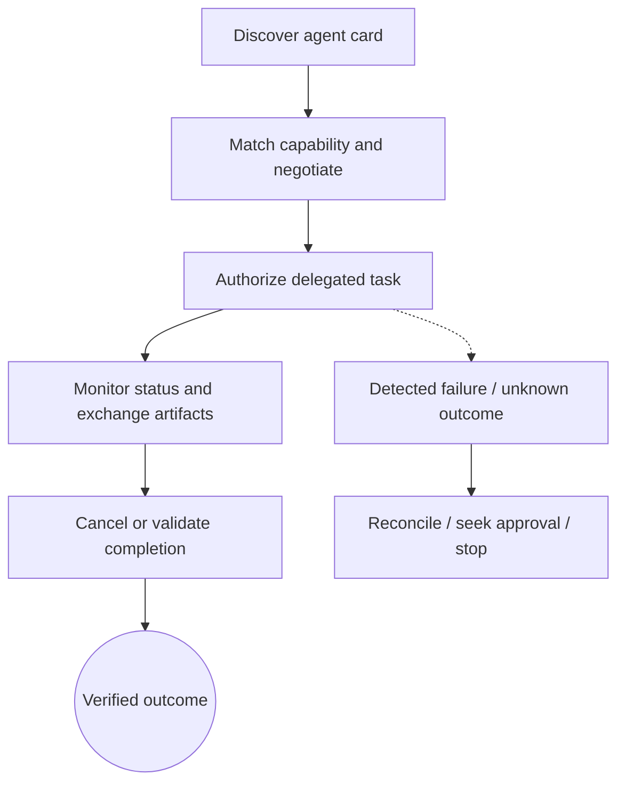
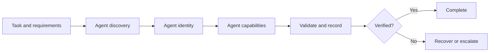

# M17.2 — Discovery, messages and tasks
## Full Reorganized Study Guide

## Table of Contents

- [Part 0 — Document Metadata & Orientation](#part-0-document-metadata-orientation)
  - [0.1 Path, Depth and Prerequisites](#01-path-depth-and-prerequisites)
  - [0.2 Purpose and Completion Evidence](#02-purpose-and-completion-evidence)
  - [0.3 Memory Aid](#03-memory-aid)
  - [0.4 Reading Strategy](#04-reading-strategy)
- [Part 1 — Core Concepts and Syllabus Coverage](#part-1-core-concepts-and-syllabus-coverage)
  - [1.2 Original roadmap subsection hierarchy](#12-original-roadmap-subsection-hierarchy)
    - [M17.2.1 — Lifecycle concepts](#m1721-lifecycle-concepts)
- [Part 2 — Architecture, Boundaries and Decision Model](#part-2-architecture-boundaries-and-decision-model)
  - [2.1 What is this section really solving?](#21-what-is-this-section-really-solving)
  - [2.2 Reference Architecture and Lifecycle](#22-reference-architecture-and-lifecycle)
  - [2.3 Input, State, Control and Evidence](#23-input-state-control-and-evidence)
  - [2.4 Architecture Choices and Tradeoffs](#24-architecture-choices-and-tradeoffs)
  - [2.5 Explicit Decision Contract](#25-explicit-decision-contract)
- [Part 3 — End-to-End Worked Example](#part-3-end-to-end-worked-example)
  - [3.1 Scenario, assumptions and scope](#31-scenario-assumptions-and-scope)
  - [3.2 Lifecycle stages and handoffs](#32-lifecycle-stages-and-handoffs)
  - [3.3 Minimal domain-neutral state record](#33-minimal-domain-neutral-state-record)
  - [3.4 Expected outcomes and acceptance criteria](#34-expected-outcomes-and-acceptance-criteria)
- [Part 4 — Engineering Implementation and Code](#part-4-engineering-implementation-and-code)
  - [4.1 Implementation sketch](#41-implementation-sketch)
  - [4.2 Apply the sketch to this section](#42-apply-the-sketch-to-this-section)
  - [4.3 Component contracts and ownership](#43-component-contracts-and-ownership)
  - [4.4 Production checklist for the implementation](#44-production-checklist-for-the-implementation)
- [Part 5 — Failure Modes and Troubleshooting](#part-5-failure-modes-and-troubleshooting)
  - [5.1 Failure taxonomy](#51-failure-taxonomy)
  - [5.2 Failure exercise A — Unknown outcome after timeout](#52-failure-exercise-a-unknown-outcome-after-timeout)
  - [5.3 Failure exercise B — Stale or poisoned context](#53-failure-exercise-b-stale-or-poisoned-context)
  - [5.4 Failure exercise C — Unbounded resource use](#54-failure-exercise-c-unbounded-resource-use)
  - [5.5 Failure exercise D — Misleading success report](#55-failure-exercise-d-misleading-success-report)
- [Part 6 — Evaluation and Completion Evidence](#part-6-evaluation-and-completion-evidence)
  - [6.1 Evaluation design](#61-evaluation-design)
  - [6.2 Section-specific test matrix](#62-section-specific-test-matrix)
  - [6.3 What qualifies as L2 vs L3 evidence?](#63-what-qualifies-as-l2-vs-l3-evidence)
  - [6.4 Mini-project extension](#64-mini-project-extension)
- [Part 7 — Concept Map, Glossary and Revision Notes](#part-7-concept-map-glossary-and-revision-notes)
  - [7.1 Concept map](#71-concept-map)
  - [7.2 Glossary: foundational terms](#72-glossary-foundational-terms)
  - [7.3 Ten revision rules](#73-ten-revision-rules)
  - [7.4 One-minute revision summary](#74-one-minute-revision-summary)
- [Part 8 — Quick Recall: 10 Questions and Answers](#part-8-quick-recall-10-questions-and-answers)
    - [Q1 — What problem does discovery, messages and tasks solve?](#q1-what-problem-does-discovery-messages-and-tasks-solve)
    - [Q2 — What is Agent discovery?](#q2-what-is-agent-discovery)
    - [Q3 — Where does Agent identity belong in the architecture?](#q3-where-does-agent-identity-belong-in-the-architecture)
    - [Q4 — How would you implement Agent capabilities?](#q4-how-would-you-implement-agent-capabilities)
    - [Q5 — What breaks when Agent cards / capability descriptions is misconfigured?](#q5-what-breaks-when-agent-cards-capability-descriptions-is-misconfigured)
    - [Q6 — What is the difference between model output and task success?](#q6-what-is-the-difference-between-model-output-and-task-success)
    - [Q7 — Why are checkpoints and idempotency different?](#q7-why-are-checkpoints-and-idempotency-different)
    - [Q8 — When should a human approve or take over?](#q8-when-should-a-human-approve-or-take-over)
    - [Q9 — Which metric matters most for this topic?](#q9-which-metric-matters-most-for-this-topic)
    - [Q10 — What evidence proves practical skill beyond a tutorial?](#q10-what-evidence-proves-practical-skill-beyond-a-tutorial)
- [Part 9 — Multiple-Choice Questions with Explanations](#part-9-multiple-choice-questions-with-explanations)
    - [Q11 — Which outcome is strongest evidence that discovery, messages and tasks works?](#q11-which-outcome-is-strongest-evidence-that-discovery-messages-and-tasks-works)
    - [Q12 — Where should authorization for Agent discovery be enforced?](#q12-where-should-authorization-for-agent-discovery-be-enforced)
    - [Q13 — What should a workflow do after a timeout with an unknown external write outcome?](#q13-what-should-a-workflow-do-after-a-timeout-with-an-unknown-external-write-outcome)
    - [Q14 — What is a safe strategy for testing Agent identity?](#q14-what-is-a-safe-strategy-for-testing-agent-identity)
    - [Q15 — How do we avoid context or tenant leakage?](#q15-how-do-we-avoid-context-or-tenant-leakage)
    - [Q16 — What is the simplest appropriate architecture for stable rules around Agent capabilities?](#q16-what-is-the-simplest-appropriate-architecture-for-stable-rules-around-agent-capabilities)
- [Part 10 — Interview Questions with Simple Model Answers](#part-10-interview-questions-with-simple-model-answers)
    - [Q17 — Explain discovery, messages and tasks to an interviewer.](#q17-explain-discovery-messages-and-tasks-to-an-interviewer)
    - [Q18 — How would you design Agent discovery from scratch?](#q18-how-would-you-design-agent-discovery-from-scratch)
    - [Q19 — How do Agent identity and Agent capabilities interact?](#q19-how-do-agent-identity-and-agent-capabilities-interact)
    - [Q20 — What would you do if Agent cards / capability descriptions fails in production?](#q20-what-would-you-do-if-agent-cards-capability-descriptions-fails-in-production)
    - [Q21 — When would you avoid a framework or model for discovery, messages and tasks?](#q21-when-would-you-avoid-a-framework-or-model-for-discovery-messages-and-tasks)
    - [Q22 — How would you demonstrate L3 production readiness for M17.2?](#q22-how-would-you-demonstrate-l3-production-readiness-for-m172)
- [Part 11 — Senior / Staff-Level Production Scenarios](#part-11-senior-staff-level-production-scenarios)
  - [11.1 Scenario — Stale decision during a policy change](#111-scenario-stale-decision-during-a-policy-change)
  - [11.2 Scenario — Crash immediately after a side effect](#112-scenario-crash-immediately-after-a-side-effect)
  - [11.3 Scenario — A new version passes tests but degrades one tenant](#113-scenario-a-new-version-passes-tests-but-degrades-one-tenant)
  - [11.4 Scenario — Leadership asks for full automation tomorrow](#114-scenario-leadership-asks-for-full-automation-tomorrow)
- [Part 12 — References and Advanced Extensions](#part-12-references-and-advanced-extensions)
  - [12.1 Primary syllabus and scope](#121-primary-syllabus-and-scope)
  - [12.2 Official documentation and further reading](#122-official-documentation-and-further-reading)
  - [12.3 Advanced topics and next steps](#123-advanced-topics-and-next-steps)
  - [12.4 Final self-assessment](#124-final-self-assessment)


---

# Part 0 — Document Metadata & Orientation

## 0.1 Path, Depth and Prerequisites

- **Module:** M17 — A2A: Agent-to-Agent Interoperability
- **Section:** M17.2 — Discovery, messages and tasks
- **Path:** Specialization
- **Depth:** L1 awareness; L2–L3 in the selected track
- **Prerequisites:** M09, M14, M16
- **Source:** User-provided M11–M46 roadmap. The syllabus's words and numbering are retained in Part 1.
- **Research note:** Official links in Part 12 are further reading. Protocols, SDKs, and cloud interfaces change; validate the pinned version before a production implementation.

## 0.2 Purpose and Completion Evidence

**Roadmap module purpose:** Federated task demo.

**Roadmap completion evidence:** Delegate a task across independent agents with cancellation and artifact verification.

**This section's objective:** Learn **discovery, messages and tasks** well enough to explain the role of Agent discovery, Agent identity and Agent capabilities, choose the simplest design, implement a controlled exercise and show auditable evidence of its outcome.

## 0.3 Memory Aid

> **Delegate tasks across independent agents with verifiable outputs. An A2A-style API is not automatically compliant with a specific A2A version.**

## 0.4 Reading Strategy

Read Part 1 for the roadmap concepts, Part 2 for architecture, Parts 3–5 for implementation and failure handling, Part 6 for proof, and Parts 7–11 for revision and interview practice. The examples are teaching designs, not automatically production-ready deployments.

---

# Part 1 — Core Concepts and Syllabus Coverage


The headings and keywords in this part follow the uploaded roadmap. The operational interpretation and examples are additional teaching guidance; they should be checked against current vendor documentation before deployment.

## 1.2 Original roadmap subsection hierarchy

### M17.2.1 — Lifecycle concepts

This topic provides the organizational boundary for the following concepts in **M17.2**. Its practical objective is to delegate tasks across independent agents with verifiable outputs; use the verification and failure-handling sections below to test it.

#### M17.2.1.1 — Discovery and identity

**1. Concept focus — Agent discovery**

**Agent discovery.** Find remote agent endpoints and declared capabilities through registries or agent cards; separately validate authenticity and trust.

- **Practical use:** At the **discover agent card** stage, specify how agent discovery changes the allowed input, output or decision. For the running case (a coordinator asks a remote research agent for sources and a coding agent for tests), write an observable acceptance check specifically for this responsibility, not just a model-generated description.
- **Failure to test:** remote agent claims completion but returns an unauthorized or empty artifact; task identity, cross-agent authorization, postconditions and artifact validation.
- **Evidence:** Record the relevant input and rule version, then capture an observed postcondition for **agent discovery**. Where applicable, add a negative test that proves the boundary still holds under retries, stale data or unauthorized access.


**2. Concept focus — Agent identity**

**Agent identity.** Principal representing a remote agent service, tied to credentials and operator accountability.

- **Practical use:** At the **match capability and negotiate** stage, specify how agent identity changes the allowed input, output or decision. For the running case (a coordinator asks a remote research agent for sources and a coding agent for tests), write an observable acceptance check specifically for this responsibility, not just a model-generated description.
- **Failure to test:** a user or worker is accepted merely because a model says it has permission; require an independent authorization decision at the resource boundary.
- **Evidence:** Record the relevant input and rule version, then capture an observed postcondition for **agent identity**. Where applicable, add a negative test that proves the boundary still holds under retries, stale data or unauthorized access.


**3. Concept focus — Agent capabilities**

**Agent capabilities.** Declared skills, endpoints and protocols an agent supports; match to task and verify with behavior tests.

- **Practical use:** At the **authorize delegated task** stage, specify how agent capabilities changes the allowed input, output or decision. For the running case (a coordinator asks a remote research agent for sources and a coding agent for tests), write an observable acceptance check specifically for this responsibility, not just a model-generated description.
- **Failure to test:** remote agent claims completion but returns an unauthorized or empty artifact; task identity, cross-agent authorization, postconditions and artifact validation.
- **Evidence:** Record the relevant input and rule version, then capture an observed postcondition for **agent capabilities**. Where applicable, add a negative test that proves the boundary still holds under retries, stale data or unauthorized access.


**4. Concept focus — Agent cards / capability descriptions**

**Agent cards / capability descriptions.** Structured metadata indicating how a remote A2A agent can be discovered, contacted and authenticated.

- **Practical use:** At the **monitor status and exchange artifacts** stage, specify how agent cards / capability descriptions changes the allowed input, output or decision. For the running case (a coordinator asks a remote research agent for sources and a coding agent for tests), write an observable acceptance check specifically for this responsibility, not just a model-generated description.
- **Failure to test:** remote agent claims completion but returns an unauthorized or empty artifact; task identity, cross-agent authorization, postconditions and artifact validation.
- **Evidence:** Record the relevant input and rule version, then capture an observed postcondition for **agent cards / capability descriptions**. Where applicable, add a negative test that proves the boundary still holds under retries, stale data or unauthorized access.


#### M17.2.1.2 — Task exchange

**5. Concept focus — Tasks**

**Tasks.** Long-running units of work with IDs, states, input and output artifacts; unlike one-shot messages, they can be polled and canceled.

- **Practical use:** At the **cancel or validate completion** stage, specify how tasks changes the allowed input, output or decision. For the running case (a coordinator asks a remote research agent for sources and a coding agent for tests), write an observable acceptance check specifically for this responsibility, not just a model-generated description.
- **Failure to test:** remote agent claims completion but returns an unauthorized or empty artifact; task identity, cross-agent authorization, postconditions and artifact validation.
- **Evidence:** Record the relevant input and rule version, then capture an observed postcondition for **tasks**. Where applicable, add a negative test that proves the boundary still holds under retries, stale data or unauthorized access.


**6. Concept focus — Messages**

**Messages.** Structured communication containing parts and context that transfers requests or responses between agents.

- **Practical use:** At the **discover agent card** stage, specify how messages changes the allowed input, output or decision. For the running case (a coordinator asks a remote research agent for sources and a coding agent for tests), write an observable acceptance check specifically for this responsibility, not just a model-generated description.
- **Failure to test:** remote agent claims completion but returns an unauthorized or empty artifact; task identity, cross-agent authorization, postconditions and artifact validation.
- **Evidence:** Record the relevant input and rule version, then capture an observed postcondition for **messages**. Where applicable, add a negative test that proves the boundary still holds under retries, stale data or unauthorized access.


**7. Concept focus — Artifacts**

**Artifacts.** Verifiable task outputs such as files, text or structured data. Track their provenance, type, checksum and access rights.

- **Practical use:** At the **match capability and negotiate** stage, specify how artifacts changes the allowed input, output or decision. For the running case (a coordinator asks a remote research agent for sources and a coding agent for tests), write an observable acceptance check specifically for this responsibility, not just a model-generated description.
- **Failure to test:** remote agent claims completion but returns an unauthorized or empty artifact; task identity, cross-agent authorization, postconditions and artifact validation.
- **Evidence:** Record the relevant input and rule version, then capture an observed postcondition for **artifacts**. Where applicable, add a negative test that proves the boundary still holds under retries, stale data or unauthorized access.


**8. Concept focus — Long-running agent interactions**

**Long-running agent interactions.** Delegations where work takes longer than a single request; support task state, resume, notifications and cancellation.

- **Practical use:** At the **authorize delegated task** stage, specify how long-running agent interactions changes the allowed input, output or decision. For the running case (a coordinator asks a remote research agent for sources and a coding agent for tests), write an observable acceptance check specifically for this responsibility, not just a model-generated description.
- **Failure to test:** an external action commits before the worker records it; reconcile receipts and rerun the same task key.
- **Evidence:** Record the relevant input and rule version, then capture an observed postcondition for **long-running agent interactions**. Where applicable, add a negative test that proves the boundary still holds under retries, stale data or unauthorized access.


**9. Concept focus — Remote agents**

**Remote agents.** Independently operated services that may use different frameworks and trust domains; treat outputs as untrusted until validated.

- **Practical use:** At the **monitor status and exchange artifacts** stage, specify how remote agents changes the allowed input, output or decision. For the running case (a coordinator asks a remote research agent for sources and a coding agent for tests), write an observable acceptance check specifically for this responsibility, not just a model-generated description.
- **Failure to test:** remote agent claims completion but returns an unauthorized or empty artifact; task identity, cross-agent authorization, postconditions and artifact validation.
- **Evidence:** Record the relevant input and rule version, then capture an observed postcondition for **remote agents**. Where applicable, add a negative test that proves the boundary still holds under retries, stale data or unauthorized access.


#### M17.2.1.3 — Trust and compatibility

**10. Concept focus — Authentication**

**Authentication.** Verify the identity of a caller, client or workload using an accepted credential and protocol.

- **Practical use:** At the **cancel or validate completion** stage, specify how authentication changes the allowed input, output or decision. For the running case (a coordinator asks a remote research agent for sources and a coding agent for tests), write an observable acceptance check specifically for this responsibility, not just a model-generated description.
- **Failure to test:** a user or worker is accepted merely because a model says it has permission; require an independent authorization decision at the resource boundary.
- **Evidence:** Record the relevant input and rule version, then capture an observed postcondition for **authentication**. Where applicable, add a negative test that proves the boundary still holds under retries, stale data or unauthorized access.


**11. Concept focus — Authorization**

**Authorization.** Decide which authenticated principal may perform a specific action on a specific resource under current policy.

- **Practical use:** At the **discover agent card** stage, specify how authorization changes the allowed input, output or decision. For the running case (a coordinator asks a remote research agent for sources and a coding agent for tests), write an observable acceptance check specifically for this responsibility, not just a model-generated description.
- **Failure to test:** a user or worker is accepted merely because a model says it has permission; require an independent authorization decision at the resource boundary.
- **Evidence:** Record the relevant input and rule version, then capture an observed postcondition for **authorization**. Where applicable, add a negative test that proves the boundary still holds under retries, stale data or unauthorized access.


**12. Concept focus — Version negotiation**

**Version negotiation.** Select mutually supported protocol behavior and schema formats, rejecting unsupported or incompatible features safely.

- **Practical use:** At the **match capability and negotiate** stage, specify how version negotiation changes the allowed input, output or decision. For the running case (a coordinator asks a remote research agent for sources and a coding agent for tests), write an observable acceptance check specifically for this responsibility, not just a model-generated description.
- **Failure to test:** a stale or cross-tenant copy is used; test source-version checks, access scope and cache invalidation.
- **Evidence:** Record the relevant input and rule version, then capture an observed postcondition for **version negotiation**. Where applicable, add a negative test that proves the boundary still holds under retries, stale data or unauthorized access.


**13. Concept focus — Cross-vendor interoperability**

**Cross-vendor interoperability.** Connect independently implemented agents through stable protocol semantics, rather than depending on one library’s internal objects.

- **Practical use:** At the **authorize delegated task** stage, specify how cross-vendor interoperability changes the allowed input, output or decision. For the running case (a coordinator asks a remote research agent for sources and a coding agent for tests), write an observable acceptance check specifically for this responsibility, not just a model-generated description.
- **Failure to test:** remote agent claims completion but returns an unauthorized or empty artifact; task identity, cross-agent authorization, postconditions and artifact validation.
- **Evidence:** Record the relevant input and rule version, then capture an observed postcondition for **cross-vendor interoperability**. Where applicable, add a negative test that proves the boundary still holds under retries, stale data or unauthorized access.


---

# Part 2 — Architecture, Boundaries and Decision Model

## 2.1 What is this section really solving?

**Problem:** In a federated research, coding and audit agent network, it is not enough to say that a model or framework supports **discovery, messages and tasks**. Engineers must show which data it consumes, which state it changes, which actor authorizes it, how failure is represented and which result counts as success.

**Intended outcome:** Delegate tasks across independent agents with verifiable outputs. The required deliverable is a **delegation trace and signed or hashed artifact inventory**. Its quality is measured with **successful delegated task rate with cancellation propagation**, not just a fluent model answer.

**Example:** A coordinator asks a remote research agent for sources and a coding agent for tests. To solve this properly, first identify the trustworthy source of the task, then establish the constraint on agent discovery, and finally verify agent identity at a concrete output boundary.

A useful mental model has five independent layers: (1) intent and constraints, (2) trusted and untrusted inputs, (3) application-owned state, (4) actions or computations, and (5) verified evidence. A language model may participate in some layers but should not silently become the owner of identity, payments, tenancy, or other privileged controls.

## 2.2 Reference Architecture and Lifecycle



**How to read the diagram:** Every arrow represents a deliberate state transition. A failed node does not automatically return to the previous node: decide whether the outcome is known, whether the operation can be repeated safely, and whether a human decision is required. The terminal "verified outcome" means the application checked the intended postcondition; generating the answer or sending a request alone is insufficient.

## 2.3 Input, State, Control and Evidence

| Layer | Example in this section | Engineering rule |
|---|---|---|
| Input | Agent discovery and the current request | Validate its format, scope, age and source |
| Application state | Task ID, tenant, stage, version, previous receipts | Persist what is needed to continue correctly |
| Computation / tools | Agent identity in a bounded execution path | Use typed contracts and explicit error handling |
| Authority | User permissions, policy checks, approval status | Enforce independently of retrieved text or model output |
| Result | delegation trace and signed or hashed artifact inventory | Verify the resulting state before reporting completion |
| Measurement | successful delegated task rate with cancellation propagation | Define a repeatable denominator and test dataset |

For **discovery, messages and tasks**, avoid conflating data that the model reads with state that the service must remember. If a source, agent or API changes its mind, the application should reconcile the conflict explicitly. The safest design makes state transitions observable and reproducible.

## 2.4 Architecture Choices and Tradeoffs

| Approach | When appropriate | Benefits | Limitations |
|---|---|---|---|
| Deterministic code | Rules for agent discovery are stable and testable | Cheap, inspectable, fast | Cannot resolve poorly structured ambiguity alone |
| Typed workflow | Several steps with clear dependencies and failure paths | Explicit transitions and checkpoints | Adds orchestration and state management |
| Single agent with tools | Inputs vary and tool choice needs model interpretation | Flexible reasoning under limits | More evaluation, cost and authorization risk |
| Multiple agents / external services | Independent specialties show measured benefit | Parallel expertise and independent scaling | Handoffs, duplicated work, trust and coordination overhead |

**Recommended default:** Start with deterministic checks and a typed workflow. Introduce a model for the genuinely ambiguous parts only after establishing a baseline. This principle applies even when the roadmap discusses specialized agent frameworks, multimodal interfaces or new protocols.

## 2.5 Explicit Decision Contract

Before choosing an implementation, write the following decisions down:

1. **Task boundary:** What does "done" mean for discovery, messages and tasks? Which operations are explicitly excluded?
2. **Inputs and provenance:** Which fields support Agent discovery and Agent identity? Who supplied them and when?
3. **Authority:** Who is permitted to start, approve, inspect, cancel or replay the operation?
4. **State ownership:** Which fields must survive a restart? Which data should expire?
5. **Limits:** What are the maximum time, attempts, spend, token count or other resource ceilings?
6. **Verification:** Which independent test proves the output or side effect occurred?
7. **Recovery:** What happens if the process fails after the external operation completes?

---

# Part 3 — End-to-End Worked Example

## 3.1 Scenario, assumptions and scope

**Scenario:** A coordinator asks a remote research agent for sources and a coding agent for tests.

Assume a single authorized company, a fixed development test dataset and one operator who can review uncertain outcomes. Use fake or sandbox accounts for destructive or financial actions; do not assume screenshots, model scores or network acknowledgements are the same as final state.

**Inputs:** A task ID, authenticated tenant/user, a goal, relevant source references, resource budget, policy version and any human approvals. **Outputs:** A result artifact, a trace of meaningful decisions, a terminal status and a list of unresolved facts. **Failure state:** Errors and unknown external outcomes are stored explicitly instead of being hidden behind "success".

## 3.2 Lifecycle stages and handoffs

| Stage | Task-specific question | Evidence / postcondition |
|---|---|---|
| 1. Discover agent card | How does **Agent discovery** affect this stage? | Log stage outcome, resource scope and delegation trace and signed or hashed artifact inventory. |
| 2. Match capability and negotiate | How does **Agent identity** affect this stage? | Log stage outcome, resource scope and delegation trace and signed or hashed artifact inventory. |
| 3. Authorize delegated task | How does **Agent capabilities** affect this stage? | Log stage outcome, resource scope and delegation trace and signed or hashed artifact inventory. |
| 4. Monitor status and exchange artifacts | How does **Agent cards / capability descriptions** affect this stage? | Log stage outcome, resource scope and delegation trace and signed or hashed artifact inventory. |
| 5. Cancel or validate completion | How does **Tasks** affect this stage? | Log stage outcome, resource scope and delegation trace and signed or hashed artifact inventory. |

The stage handoff should be a typed record rather than free-form prose alone. For example, a retrieval stage might emit source IDs, scores and ACL checks; an execution stage should return the operation ID, external receipt and confirmed status. This makes it possible to replay, resume, debug and inspect exactly which stage produced the bad result.

## 3.3 Minimal domain-neutral state record

```json
{
  "task_id": "demo-task-001",
  "tenant_id": "demo-tenant",
  "section": "M17.2",
  "status": "running",
  "policy_version": "policy-v1",
  "state_version": 1,
  "attempt_count": 1,
  "source_ids": ["source-example-1"],
  "approval_status": "not_required",
  "external_action_id": null,
  "verified": false
}
```

The example deliberately omits passwords, API keys, private records and full prompt content. Your real schema should include only necessary fields. Store large artifacts in controlled object storage and keep stable references in the task record, rather than placing unlimited blobs in state or model context.

## 3.4 Expected outcomes and acceptance criteria

A credible demonstration for **M17.2** shows that **Agent discovery** and **Agent identity** are implemented with visible state boundaries. The successful path creates delegation trace and signed or hashed artifact inventory. The negative path rejects unauthorized, malformed or stale input. The recovery path stops or resumes without duplicating a business operation.

**Measurable success:** Successful delegated task rate with cancellation propagation. Capture the baseline first, then compare the improved design using the same fixtures and denominators. When results depend on model sampling, repeat cases and inspect important slices rather than reporting a single average.

---

# Part 4 — Engineering Implementation and Code

## 4.1 Implementation sketch

The following example illustrates one boundary from the wider **M17** module. It is not a turnkey production implementation of every concept in **M17.2**; adapt its types, tests and runtime to the selected task.

```python
from dataclasses import dataclass
@dataclass(frozen=True)
class Delegation:
    task_id: str
    target_agent: str
    required_capability: str
    deadline_epoch: int

def accept_delegation(request: Delegation, card, allowlist):
    if request.target_agent not in allowlist:
        raise PermissionError("Untrusted remote agent")
    if request.required_capability not in card.capabilities:
        raise ValueError("Capability mismatch")
    return {"task_id": request.task_id, "status": "accepted"}

# A2A conformance additionally requires a real versioned SDK/transport.
```

## 4.2 Apply the sketch to this section

For **M17.2**, extend the sketch to cover these concrete capabilities:

- **Agent discovery:** Specify valid/invalid inputs and which component owns the decision. Add a negative test that intentionally violates the rule.
- **Agent identity:** Record a receipt, source reference or measurable state transition, depending on whether the feature is data processing or an external action.
- **Agent capabilities:** Apply a permission boundary and add a test that tries to cross it.
- **Agent cards / capability descriptions:** Handle cancellation, retry and timeout without hiding partial completion.
- **Tasks:** Produce a trace that links this stage's result to the overall task and schema version.

The minimal implementation should remain easy to inspect. A file that only calls an LLM API without validating inputs, recording state or checking the result is an API demo—not completion evidence for a production engineering module.

## 4.3 Component contracts and ownership

| Component | Responsibility | Must not assume |
|---|---|---|
| Request adapter | Authenticate, parse and bind tenant | Caller-provided tenant IDs are trustworthy |
| Coordinator | Own workflow state and status | A model response equals task completion |
| Tool/data adapter | Enforce resource permissions and typed schema | The model may authorize itself |
| Policy/approval service | Allow, deny or request approval with reason | Natural-language permission is sufficient |
| Artifact store | Save versioned output and provenance | Temporary files are durable |
| Evaluation harness | Test outputs and final external state | A single successful run proves reliability |

## 4.4 Production checklist for the implementation

**Before deployment:** Define threat boundaries, pin external dependencies, keep credentials out of model context, select an owner, establish retention, and create a known-good rollback. For discovery, messages and tasks, specifically verify the interactions between **Agent discovery**, **Agent capabilities** and **Tasks**. Also define the response when a downstream service reports an unknown commit.

**During execution:** Record correlation IDs, bounded counts and reasons for tool selection or branching. Enforce timeouts and keep independent verification for important actions. **After execution:** Persist approved output, clean up temporary workspaces, and measure successful delegated task rate with cancellation propagation.

---

# Part 5 — Failure Modes and Troubleshooting

## 5.1 Failure taxonomy

**Primary risk for this module:** Remote agent claims completion but returns an unauthorized or empty artifact. A recommended baseline defense is to task identity, cross-agent authorization, postconditions and artifact validation. This is not the only possible failure: even a well-designed policy gate can fail when state, source versions, external receipts or tool permissions are inconsistent.

| Symptom | Likely cause | First diagnostic check | Safer response |
|---|---|---|---|
| Agent discovery gives inconsistent results | Stale input, weak contract or hidden default | Compare source and schema versions | Reject, refresh or reconcile before continuing |
| Agent identity fails after partial work | Timeout or unknown external commit | Inspect action ID and external receipt | Avoid blind retries; use idempotency/reconciliation |
| Agent capabilities crosses an access boundary | Missing resource-level policy check | Trace actor, tenant, action and resource | Contain access, revoke credentials, add regression |
| Agent cards / capability descriptions becomes too costly | Unbounded loops, fan-out or expensive model | Check per-task attempts, tokens and spend | Stop at budget and escalate or degrade |
| Tasks looks correct but is wrong | No independent postcondition verification | Review real state and source evidence | Mark uncertain, repair test and avoid false success |
| A new release breaks old tasks | Incompatible state or interface version | Compare manifests and release revisions | Roll back or migrate with compatibility tests |
| A monitoring dashboard says 'green' but users complain | Metric measures response, not outcome | Compare SLI to user-visible postcondition | Add outcome-based signal and failure slice |

## 5.2 Failure exercise A — Unknown outcome after timeout

An operation involved in **Agent identity** returns a timeout. The request may have reached the external provider. If the workflow immediately retries with a new identifier, it could create a duplicate write or charge. A safer sequence is: preserve the task/action ID, classify the outcome as unknown, query the external system for a receipt, replay only using a supported idempotency key, and request human review when reconciliation is impossible.

**Expected evidence:** two runs with the same business-action identifier produce at most one accepted business effect, and both runs have a clear recorded outcome. For read-only operations, demonstrate bounded retry and consistent source-version handling instead.

## 5.3 Failure exercise B — Stale or poisoned context

A retrieved source or old checkpoint contains an instruction contradicting the active rules. Test whether the application treats source text as untrusted and obtains policy decisions from the correct component. **Agent capabilities** should be handled as data only where its source is not authorized to instruct the agent.

**Expected evidence:** the system retains current constraints, records the untrusted source ID and either answers from verified evidence or abstains. No tool permission should be inferred from the content of a document or message.

## 5.4 Failure exercise C — Unbounded resource use

A task repeatedly invokes **Agent cards / capability descriptions** but makes no measurable progress. The runtime must count failed attempts and retries in its global budget. Separate transient errors from permanent invalid inputs; use exponential backoff only for safe retries, and stop with an actionable error when the limit is reached.

**Expected evidence:** bounded step count, cost and duration; recorded reason for termination; and no orphaned privileged workers after cancellation.

## 5.5 Failure exercise D — Misleading success report

The model writes "completed", but the application has not verified **Tasks** or the final artifact. Require the independent postcondition before setting a terminal success state. For human approvals, verify that approval applies to the same resource version and action payload that will actually execute.

**Expected evidence:** a simulated false-success message remains `failed`, `pending`, or `unknown` until the relevant state check passes.

---

# Part 6 — Evaluation and Completion Evidence

## 6.1 Evaluation design

Create a small, versioned test set with ordinary inputs, invalid inputs, adversarial sources and external failures. A useful first dataset has at least one success, one authorization denial, one timeout/unknown outcome, one stale-input case and one cancellation scenario. For probabilistic tasks add repeated attempts and known hard cases.

**Key metric:** Successful delegated task rate with cancellation propagation. Define the numerator and denominator before running the tests. For example, "accepted outcomes / all eligible attempted tasks" is more meaningful than "responses returned / calls made". Measure spend and latency separately so quality improvements are not confused with operating efficiency.

## 6.2 Section-specific test matrix

| Test ID | Input / fault | Expected evidence |
|---|---|---|
| T01 | Valid agent discovery | Correct state transition and verifiable output |
| T02 | Missing required field for agent identity | Explicit schema error, no unapproved side effect |
| T03 | Unauthorized resource used with agent capabilities | Deny and audit without data exposure |
| T04 | Stale version affects agent cards / capability descriptions | Reconcile or reject; do not silently reuse |
| T05 | Timeout during tasks | Preserve unknown outcome and receipt lookup |
| T06 | Cancel task during execution | Stop permitted work; record any committed side effects |
| T07 | Retry identical request | No duplicate accepted external action |
| T08 | Parallel requests by two tenants | No cross-tenant mixing of state, cache or artifacts |
| T09 | Corrupted tool/model output | Validate structure and abstain/repair within budget |
| T10 | Upgrade with waiting task | Compatible resume or explicit migration/rollback |

## 6.3 What qualifies as L2 vs L3 evidence?

**L1 awareness:** Describe the term, recognize when it is applicable, and name a common failure. **L2 foundation:** Draw a workflow, choose an implementation, explain data and trust boundaries, and demonstrate basic tests. **L3 project evidence:** Produce a repository, reproducible configuration, typed interfaces, real failure injection, a trace, observed task outcomes, and a concise architecture decision record. The roadmap's own depth rating governs whether L3 is required now or later.

**Acceptance artifact for this section:** Submit delegation trace and signed or hashed artifact inventory with a record demonstrating **successful delegated task rate with cancellation propagation** and at least three failure tests. Store assumptions and limitations beside the outcome; a successful mock without real integration evidence should be labeled a mock.

## 6.4 Mini-project extension

**Project brief:** Federated two-agent protocol demo with cancellation and version tests. Start with a deliberately small dataset and sandbox environment. Add one feature from **Agent discovery**, one persistence or observability feature from **Agent identity**, and one adversarial or failure test related to **Agent capabilities**. Do not add extra agents or frameworks unless the baseline exposes a clear need.

**Recommended delivery artifacts:** README with scope, architecture diagram, sample configuration without secrets, state contract, failure matrix, tests, output samples, cost/latency measurements and a statement of known limitations.

---

# Part 7 — Concept Map, Glossary and Revision Notes

## 7.1 Concept map



## 7.2 Glossary: foundational terms


1. **Agent discovery:** Find remote agent endpoints and declared capabilities through registries or agent cards; separately validate authenticity and trust.

2. **Agent identity:** Principal representing a remote agent service, tied to credentials and operator accountability.

3. **Agent capabilities:** Declared skills, endpoints and protocols an agent supports; match to task and verify with behavior tests.

4. **Agent cards / capability descriptions:** Structured metadata indicating how a remote A2A agent can be discovered, contacted and authenticated.

5. **Tasks:** Long-running units of work with IDs, states, input and output artifacts; unlike one-shot messages, they can be polled and canceled.

6. **Messages:** Structured communication containing parts and context that transfers requests or responses between agents.

7. **Artifacts:** Verifiable task outputs such as files, text or structured data.

8. **Long-running agent interactions:** Delegations where work takes longer than a single request; support task state, resume, notifications and cancellation.

9. **Remote agents:** Independently operated services that may use different frameworks and trust domains; treat outputs as untrusted until validated.

10. **Authentication:** Verify the identity of a caller, client or workload using an accepted credential and protocol.

11. **Authorization:** Decide which authenticated principal may perform a specific action on a specific resource under current policy.

12. **Version negotiation:** Select mutually supported protocol behavior and schema formats, rejecting unsupported or incompatible features safely.


## 7.3 Ten revision rules

1. Start by stating the user task and the actual acceptance criterion for **discovery, messages and tasks**.
2. Separate the model's context from application-owned durable state.
3. Assign clear ownership to **Agent discovery**.
4. Treat **Agent identity** as a contract that requires validation.
5. Keep authorization decisions independent of untrusted model input.
6. Record the provenance and version of source facts and artifacts.
7. Bound steps, time, spending and retries.
8. Use unique action identifiers and receipts for external writes.
9. Prove completion by checking the environment or accepted output.
10. Turn every reproducible production failure into a regression case.

## 7.4 One-minute revision summary

If asked what **M17.2** teaches, say: **"Discovery, messages and tasks is about delegate tasks across independent agents with verifiable outputs. In practice I would build a small explicit workflow, specify Agent discovery and Agent identity, protect the authority boundary, persist the necessary state, and verify successful delegated task rate with cancellation propagation."**

---

# Part 8 — Quick Recall: 10 Questions and Answers


### Q1 — What problem does discovery, messages and tasks solve?

**Answer:** It helps delegate tasks across independent agents with verifiable outputs in a federated research, coding and audit agent network. A complete solution also defines the state, the user-visible result and how to verify it.

### Q2 — What is Agent discovery?

**Answer:** Find remote agent endpoints and declared capabilities through registries or agent cards; separately validate authenticity and trust.

### Q3 — Where does Agent identity belong in the architecture?

**Answer:** Principal representing a remote agent service, tied to credentials and operator accountability. Put it at the stage with clear inputs, outputs and ownership; do not bury it in an opaque prompt.

### Q4 — How would you implement Agent capabilities?

**Answer:** Define its schema, source of authority, version and postcondition. Demonstrate it in the controlled scenario: A coordinator asks a remote research agent for sources and a coding agent for tests.

### Q5 — What breaks when Agent cards / capability descriptions is misconfigured?

**Answer:** A typical risk is remote agent claims completion but returns an unauthorized or empty artifact; task identity, cross-agent authorization, postconditions and artifact validation. Record a negative regression case.

### Q6 — What is the difference between model output and task success?

**Answer:** A model output is an observation or proposed answer. Task success is a verified business or environment postcondition, with a receipt or accepted artifact where relevant.

### Q7 — Why are checkpoints and idempotency different?

**Answer:** A checkpoint remembers workflow progress; an idempotency key prevents a repeated external business operation. A crash between an external write and a checkpoint still needs receipt reconciliation.

### Q8 — When should a human approve or take over?

**Answer:** When the action exceeds delegated authority, has high business risk, produces an ambiguous external outcome, or lacks sufficient evidence for safe automation.

### Q9 — Which metric matters most for this topic?

**Answer:** Successful delegated task rate with cancellation propagation. Define its numerator, denominator, slices and sample size so repeated comparisons are meaningful.

### Q10 — What evidence proves practical skill beyond a tutorial?

**Answer:** A reproducible demonstration of delegation trace and signed or hashed artifact inventory, plus failure injection, authorization tests, measured outcomes and an explanation of architecture tradeoffs.


---

# Part 9 — Multiple-Choice Questions with Explanations


### Q11 — Which outcome is strongest evidence that discovery, messages and tasks works?


A. The model says "done"

B. The API returned HTTP 200

C. The required postcondition and successful delegated task rate with cancellation propagation are verified

D. The diagram looks complete


**Correct answer: C.** Verification must examine the actual intended result, not the confidence or fluency of an intermediate response.

### Q12 — Where should authorization for Agent discovery be enforced?


A. At the tool/API or resource boundary

B. Only in a prompt

C. Only in React button visibility

D. Inside a retrieved document


**Correct answer: A.** A model can help explain policy, but enforcement belongs in the trusted execution path.

### Q13 — What should a workflow do after a timeout with an unknown external write outcome?


A. Always repeat with a new key

B. Assume failure and erase state

C. Tell the user it succeeded

D. Check external receipt and retry only idempotently


**Correct answer: D.** Unknown-commit ambiguity is resolved through receipts, stable action identifiers and supported idempotency.

### Q14 — What is a safe strategy for testing Agent identity?


A. Use only one happy-path example

B. Use versioned normal, negative and failure cases

C. Skip all tests if an SDK is popular

D. Use a benchmark score as proof of permissions


**Correct answer: B.** Quality, reliability and access semantics need representative and adversarial tests.

### Q15 — How do we avoid context or tenant leakage?


A. Use more prompt instructions

B. Trust the first relevant search result

C. Filter by current scope and verify on output

D. Store all tenant history in one shared context


**Correct answer: C.** Authorization is required before retrieval and before sensitive content is served.

### Q16 — What is the simplest appropriate architecture for stable rules around Agent capabilities?


A. Deterministic code or typed workflow

B. A ten-agent swarm

C. A fully autonomous tool agent

D. An unbounded conversation


**Correct answer: A.** Start with the simplest testable architecture and introduce model autonomy only if measured evidence justifies it.


---

# Part 10 — Interview Questions with Simple Model Answers


### Q17 — Explain discovery, messages and tasks to an interviewer.

**Interview answer:** Discovery, messages and tasks addresses the need to delegate tasks across independent agents with verifiable outputs. I would begin with a bounded design for a federated research, coding and audit agent network, then specify contracts for Agent discovery and Agent identity. I would measure successful delegated task rate with cancellation propagation, verify the actual outcome and demonstrate handling of the primary failure: remote agent claims completion but returns an unauthorized or empty artifact.

**Follow-up 1 — What would you test first?** A negative case involving agent identity and a normal task with a verified outcome.

**Follow-up 2 — What tradeoff would you state?** Reliability, latency, privacy and cost must be compared against a simpler baseline; explain which evidence justified the added complexity.

### Q18 — How would you design Agent discovery from scratch?

**Interview answer:** I would identify the trusted input source, decide which component owns the operation, define typed fields, and specify success and failure states. Find remote agent endpoints and declared capabilities through registries or agent cards; separately validate authenticity and trust. Then I would create at least a happy-path and an unauthorized/invalid-input test.

**Follow-up 1 — What would you test first?** A negative case involving agent capabilities and a normal task with a verified outcome.

**Follow-up 2 — What tradeoff would you state?** Reliability, latency, privacy and cost must be compared against a simpler baseline; explain which evidence justified the added complexity.

### Q19 — How do Agent identity and Agent capabilities interact?

**Interview answer:** First define their separate responsibilities. Principal representing a remote agent service, tied to credentials and operator accountability. Declared skills, endpoints and protocols an agent supports; match to task and verify with behavior tests. I would connect them only through a typed handoff with provenance and an explicit postcondition, rather than allowing hidden state coupling.

**Follow-up 1 — What would you test first?** A negative case involving agent cards / capability descriptions and a normal task with a verified outcome.

**Follow-up 2 — What tradeoff would you state?** Reliability, latency, privacy and cost must be compared against a simpler baseline; explain which evidence justified the added complexity.

### Q20 — What would you do if Agent cards / capability descriptions fails in production?

**Interview answer:** I would contain the impact, check trace IDs, state and external receipts, then classify the failure as transient, permanent or unknown outcome. I would not blindly repeat a write. After fixing the cause, I would add the incident as a versioned regression case and measure successful delegated task rate with cancellation propagation.

**Follow-up 1 — What would you test first?** A negative case involving tasks and a normal task with a verified outcome.

**Follow-up 2 — What tradeoff would you state?** Reliability, latency, privacy and cost must be compared against a simpler baseline; explain which evidence justified the added complexity.

### Q21 — When would you avoid a framework or model for discovery, messages and tasks?

**Interview answer:** When the rules and data contracts are deterministic, a small application service or workflow is usually easier to test and operate. I add an agent or new framework only when variable inputs and evidence show a measurable improvement that offsets extra coordination, cost and risk.

**Follow-up 1 — What would you test first?** A negative case involving messages and a normal task with a verified outcome.

**Follow-up 2 — What tradeoff would you state?** Reliability, latency, privacy and cost must be compared against a simpler baseline; explain which evidence justified the added complexity.

### Q22 — How would you demonstrate L3 production readiness for M17.2?

**Interview answer:** I would present a working repository, a state and permission diagram, the delegation trace and signed or hashed artifact inventory, known limitations, representative evaluation fixtures, failure-injection results and tracing. I would also show restart behavior and an operator takeover path where needed.

**Follow-up 1 — What would you test first?** A negative case involving artifacts and a normal task with a verified outcome.

**Follow-up 2 — What tradeoff would you state?** Reliability, latency, privacy and cost must be compared against a simpler baseline; explain which evidence justified the added complexity.


---

# Part 11 — Senior / Staff-Level Production Scenarios

## 11.1 Scenario — Stale decision during a policy change

**Situation:** A workflow dealing with **Agent discovery** began under an older policy. During execution the governing rule or permitted resource scope changes. The model still sees the previous description and proposes to continue.

**Expected diagnosis:** Inspect policy versions, who initiated the task, which evidence was cached and where authorization is actually checked. **Containment:** prevent privileged actions from proceeding on a stale approval. **Recovery:** re-evaluate current policy, invalidate stale context or state references, obtain new approval where necessary and record the decision. **Regression:** repeat the test with the policy updated between planning and execution.

**Interview takeaway:** Approvals and permissions must be bound to the exact actor, target, action payload and version; prompt summaries do not supersede active policy.

## 11.2 Scenario — Crash immediately after a side effect

**Situation:** An action related to **Agent identity** commits in a downstream system. The worker crashes before recording a success checkpoint. On restart, the workflow appears unfinished.

**Expected diagnosis:** Look for a business action ID, idempotency key and provider receipt. **Containment:** do not send a second non-idempotent action. **Recovery:** query external state, persist the confirmed receipt or unknown status and resume from a safe boundary. **Regression:** kill the worker between action and checkpoint, rerun the same task ID and assert one business effect.

**Interview takeaway:** Checkpointing and exactly-once effects are separate contracts. Recovery must reconcile the external world, not only replay local steps.

## 11.3 Scenario — A new version passes tests but degrades one tenant

**Situation:** After an upgrade, aggregate success remains stable, but a subset of users sees failures involving **Agent capabilities** and **Agent cards / capability descriptions**. The new implementation uses a different cache key, contract or evaluation distribution.

**Expected diagnosis:** Compare request traces across versions and tenants; inspect data scope, schema changes, cache invalidation and per-slice metrics. **Containment:** revert or disable the affected route. **Recovery:** update migration and compatibility tests and recalibrate any thresholds on a fixed dataset. **Regression:** preserve affected tenant-safe fixtures without exporting private data.

**Interview takeaway:** A single global score hides critical slices. Track versions and accepted outcomes, not only latency and error-free transport.

## 11.4 Scenario — Leadership asks for full automation tomorrow

**Situation:** Stakeholders want the feature in **discovery, messages and tasks** to operate without human review. They have only a successful demo and no evidence for authorization, failure recovery or spend control.

**Recommended response:** Identify which actions are read-only and which affect external state. Propose graduated autonomy: deterministic validation first, supervised tool actions next, and narrowly scoped autonomy only after measured success. Define an approval matrix, a kill switch, an operations owner, and a controlled rollout with a rollback path. Show a test report covering successful delegated task rate with cancellation propagation and the top risks before increasing privileges.

**Interview takeaway:** Autonomy is an engineering decision supported by testable boundaries and business evidence, not a default requirement of an agent project.

---

# Part 12 — References and Advanced Extensions

## 12.1 Primary syllabus and scope

- **Source of section coverage:** The provided roadmap, **M17 — A2A: Agent-to-Agent Interoperability**, specifically **M17.2 — Discovery, messages and tasks** and its nested headings.
- **Coverage policy:** Every named syllabus topic is retained in Part 1. Additional patterns, examples, exercises and questions are instructional expansions and not direct quotes from the roadmap.
- **Depth discipline:** L1 awareness; L2–L3 in the selected track. Use the roadmap's own learning depth before committing to deep implementation work.

## 12.2 Official documentation and further reading


- [A2A protocol specification](https://a2a-protocol.org/latest/specification/) — Read the versioned specification or official instructions before reproducing a production implementation.

- [A2A Agent Card](https://a2a-protocol.org/latest/specification/agent-card/) — Read the versioned specification or official instructions before reproducing a production implementation.


## 12.3 Advanced topics and next steps

Once the basic implementation works, evaluate its behavior under increased concurrency, distributed recovery, tenant boundaries and framework upgrades. For **M17.2**, prioritize the related concepts **Agent discovery**, **Agent identity**, and **Agent capabilities** rather than adding unrelated features. Compare your measured baseline against the new design and document assumptions, residual risks and operational ownership.

## 12.4 Final self-assessment

- [ ] I can explain every original roadmap subsection without reading a definition.
- [ ] I can draw the architecture and describe the state, source and trust boundaries.
- [ ] I can implement or simulate the core interface with typed inputs and outputs.
- [ ] I can demonstrate a negative case and a failure-recovery case.
- [ ] I know exactly what evidence would prove **successful delegated task rate with cancellation propagation**.
- [ ] I can answer the interview questions in concise, practical language.

**Closing rule:** An A2A-style API is not automatically compliant with a specific A2A version.
