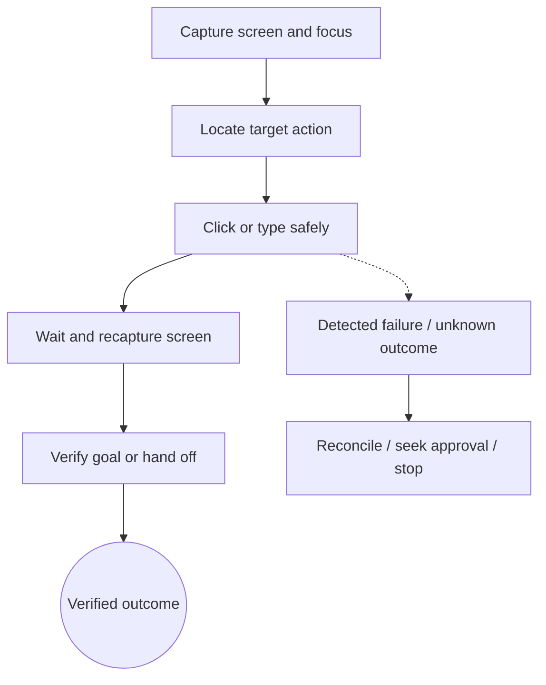
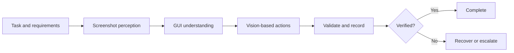

# M21.1 — Perception, actions and state
## Full Reorganized Study Guide

## Table of Contents

- [Part 0 — Document Metadata & Orientation](#part-0-document-metadata-orientation)
  - [0.1 Path, Depth and Prerequisites](#01-path-depth-and-prerequisites)
  - [0.2 Purpose and Completion Evidence](#02-purpose-and-completion-evidence)
  - [0.3 Memory Aid](#03-memory-aid)
  - [0.4 Reading Strategy](#04-reading-strategy)
- [Part 1 — Core Concepts and Syllabus Coverage](#part-1-core-concepts-and-syllabus-coverage)
  - [1.2 Original roadmap subsection hierarchy](#12-original-roadmap-subsection-hierarchy)
    - [M21.1.1 — Lifecycle concepts](#m2111-lifecycle-concepts)
- [Part 2 — Architecture, Boundaries and Decision Model](#part-2-architecture-boundaries-and-decision-model)
  - [2.1 What is this section really solving?](#21-what-is-this-section-really-solving)
  - [2.2 Reference Architecture and Lifecycle](#22-reference-architecture-and-lifecycle)
  - [2.3 Input, State, Control and Evidence](#23-input-state-control-and-evidence)
  - [2.4 Architecture Choices and Tradeoffs](#24-architecture-choices-and-tradeoffs)
  - [2.5 Explicit Decision Contract](#25-explicit-decision-contract)
- [Part 3 — End-to-End Worked Example](#part-3-end-to-end-worked-example)
  - [3.1 Scenario, assumptions and scope](#31-scenario-assumptions-and-scope)
  - [3.2 Lifecycle stages and handoffs](#32-lifecycle-stages-and-handoffs)
  - [3.3 Minimal domain-neutral state record](#33-minimal-domain-neutral-state-record)
  - [3.4 Expected outcomes and acceptance criteria](#34-expected-outcomes-and-acceptance-criteria)
- [Part 4 — Engineering Implementation and Code](#part-4-engineering-implementation-and-code)
  - [4.1 Implementation sketch](#41-implementation-sketch)
  - [4.2 Apply the sketch to this section](#42-apply-the-sketch-to-this-section)
  - [4.3 Component contracts and ownership](#43-component-contracts-and-ownership)
  - [4.4 Production checklist for the implementation](#44-production-checklist-for-the-implementation)
- [Part 5 — Failure Modes and Troubleshooting](#part-5-failure-modes-and-troubleshooting)
  - [5.1 Failure taxonomy](#51-failure-taxonomy)
  - [5.2 Failure exercise A — Unknown outcome after timeout](#52-failure-exercise-a-unknown-outcome-after-timeout)
  - [5.3 Failure exercise B — Stale or poisoned context](#53-failure-exercise-b-stale-or-poisoned-context)
  - [5.4 Failure exercise C — Unbounded resource use](#54-failure-exercise-c-unbounded-resource-use)
  - [5.5 Failure exercise D — Misleading success report](#55-failure-exercise-d-misleading-success-report)
- [Part 6 — Evaluation and Completion Evidence](#part-6-evaluation-and-completion-evidence)
  - [6.1 Evaluation design](#61-evaluation-design)
  - [6.2 Section-specific test matrix](#62-section-specific-test-matrix)
  - [6.3 What qualifies as L2 vs L3 evidence?](#63-what-qualifies-as-l2-vs-l3-evidence)
  - [6.4 Mini-project extension](#64-mini-project-extension)
- [Part 7 — Concept Map, Glossary and Revision Notes](#part-7-concept-map-glossary-and-revision-notes)
  - [7.1 Concept map](#71-concept-map)
  - [7.2 Glossary: foundational terms](#72-glossary-foundational-terms)
  - [7.3 Ten revision rules](#73-ten-revision-rules)
  - [7.4 One-minute revision summary](#74-one-minute-revision-summary)
- [Part 8 — Quick Recall: 10 Questions and Answers](#part-8-quick-recall-10-questions-and-answers)
    - [Q1 — What problem does perception, actions and state solve?](#q1-what-problem-does-perception-actions-and-state-solve)
    - [Q2 — What is Screenshot perception?](#q2-what-is-screenshot-perception)
    - [Q3 — Where does GUI understanding belong in the architecture?](#q3-where-does-gui-understanding-belong-in-the-architecture)
    - [Q4 — How would you implement Vision-based actions?](#q4-how-would-you-implement-vision-based-actions)
    - [Q5 — What breaks when Coordinate grounding is misconfigured?](#q5-what-breaks-when-coordinate-grounding-is-misconfigured)
    - [Q6 — What is the difference between model output and task success?](#q6-what-is-the-difference-between-model-output-and-task-success)
    - [Q7 — Why are checkpoints and idempotency different?](#q7-why-are-checkpoints-and-idempotency-different)
    - [Q8 — When should a human approve or take over?](#q8-when-should-a-human-approve-or-take-over)
    - [Q9 — Which metric matters most for this topic?](#q9-which-metric-matters-most-for-this-topic)
    - [Q10 — What evidence proves practical skill beyond a tutorial?](#q10-what-evidence-proves-practical-skill-beyond-a-tutorial)
- [Part 9 — Multiple-Choice Questions with Explanations](#part-9-multiple-choice-questions-with-explanations)
    - [Q11 — Which outcome is strongest evidence that perception, actions and state works?](#q11-which-outcome-is-strongest-evidence-that-perception-actions-and-state-works)
    - [Q12 — Where should authorization for Screenshot perception be enforced?](#q12-where-should-authorization-for-screenshot-perception-be-enforced)
    - [Q13 — What should a workflow do after a timeout with an unknown external write outcome?](#q13-what-should-a-workflow-do-after-a-timeout-with-an-unknown-external-write-outcome)
    - [Q14 — What is a safe strategy for testing GUI understanding?](#q14-what-is-a-safe-strategy-for-testing-gui-understanding)
    - [Q15 — How do we avoid context or tenant leakage?](#q15-how-do-we-avoid-context-or-tenant-leakage)
    - [Q16 — What is the simplest appropriate architecture for stable rules around Vision-based actions?](#q16-what-is-the-simplest-appropriate-architecture-for-stable-rules-around-vision-based-actions)
- [Part 10 — Interview Questions with Simple Model Answers](#part-10-interview-questions-with-simple-model-answers)
    - [Q17 — Explain perception, actions and state to an interviewer.](#q17-explain-perception-actions-and-state-to-an-interviewer)
    - [Q18 — How would you design Screenshot perception from scratch?](#q18-how-would-you-design-screenshot-perception-from-scratch)
    - [Q19 — How do GUI understanding and Vision-based actions interact?](#q19-how-do-gui-understanding-and-vision-based-actions-interact)
    - [Q20 — What would you do if Coordinate grounding fails in production?](#q20-what-would-you-do-if-coordinate-grounding-fails-in-production)
    - [Q21 — When would you avoid a framework or model for perception, actions and state?](#q21-when-would-you-avoid-a-framework-or-model-for-perception-actions-and-state)
    - [Q22 — How would you demonstrate L3 production readiness for M21.1?](#q22-how-would-you-demonstrate-l3-production-readiness-for-m211)
- [Part 11 — Senior / Staff-Level Production Scenarios](#part-11-senior-staff-level-production-scenarios)
  - [11.1 Scenario — Stale decision during a policy change](#111-scenario-stale-decision-during-a-policy-change)
  - [11.2 Scenario — Crash immediately after a side effect](#112-scenario-crash-immediately-after-a-side-effect)
  - [11.3 Scenario — A new version passes tests but degrades one tenant](#113-scenario-a-new-version-passes-tests-but-degrades-one-tenant)
  - [11.4 Scenario — Leadership asks for full automation tomorrow](#114-scenario-leadership-asks-for-full-automation-tomorrow)
- [Part 12 — References and Advanced Extensions](#part-12-references-and-advanced-extensions)
  - [12.1 Primary syllabus and scope](#121-primary-syllabus-and-scope)
  - [12.2 Official documentation and further reading](#122-official-documentation-and-further-reading)
  - [12.3 Advanced topics and next steps](#123-advanced-topics-and-next-steps)
  - [12.4 Final self-assessment](#124-final-self-assessment)


---

# Part 0 — Document Metadata & Orientation

## 0.1 Path, Depth and Prerequisites

- **Module:** M21 — Computer-Use Agents
- **Section:** M21.1 — Perception, actions and state
- **Path:** Specialization
- **Depth:** L1 awareness; L2–L3 in the selected track
- **Prerequisites:** M13, M20, M23
- **Source:** User-provided M11–M46 roadmap. The syllabus's words and numbering are retained in Part 1.
- **Research note:** Official links in Part 12 are further reading. Protocols, SDKs, and cloud interfaces change; validate the pinned version before a production implementation.

## 0.2 Purpose and Completion Evidence

**Roadmap module purpose:** Desktop task sandbox.

**Roadmap completion evidence:** Verify application state and demonstrate interruption and human takeover.

**This section's objective:** Learn **perception, actions and state** well enough to explain the role of Screenshot perception, GUI understanding and Vision-based actions, choose the simplest design, implement a controlled exercise and show auditable evidence of its outcome.

## 0.3 Memory Aid

> **Ground screenshot actions in verified application state. A screenshot guess is not proof that the underlying operation completed.**

## 0.4 Reading Strategy

Read Part 1 for the roadmap concepts, Part 2 for architecture, Parts 3–5 for implementation and failure handling, Part 6 for proof, and Parts 7–11 for revision and interview practice. The examples are teaching designs, not automatically production-ready deployments.

---

# Part 1 — Core Concepts and Syllabus Coverage


The headings and keywords in this part follow the uploaded roadmap. The operational interpretation and examples are additional teaching guidance; they should be checked against current vendor documentation before deployment.

## 1.2 Original roadmap subsection hierarchy

### M21.1.1 — Lifecycle concepts

This topic provides the organizational boundary for the following concepts in **M21.1**. Its practical objective is to ground screenshot actions in verified application state; use the verification and failure-handling sections below to test it.

#### M21.1.1.1 — Perception and grounding

**1. Concept focus — Screenshot perception**

**Screenshot perception.** Ground the operation in the current observable source and define how to verify it. Treat recognized or generated content as uncertain until checked against concrete evidence.

- **Practical use:** At the **capture screen and focus** stage, specify how screenshot perception changes the allowed input, output or decision. For the running case (a desktop agent exports an approved PDF report from a local application), write an observable acceptance check specifically for this responsibility, not just a model-generated description.
- **Failure to test:** screen scaling changes and the agent clicks outside the intended control; coordinate re-grounding, application focus checks and action budgets.
- **Evidence:** Record the relevant input and rule version, then capture an observed postcondition for **screenshot perception**. Where applicable, add a negative test that proves the boundary still holds under retries, stale data or unauthorized access.


**2. Concept focus — GUI understanding**

**GUI understanding.** Ground the operation in the current observable source and define how to verify it. Treat recognized or generated content as uncertain until checked against concrete evidence.

- **Practical use:** At the **locate target action** stage, specify how gui understanding changes the allowed input, output or decision. For the running case (a desktop agent exports an approved PDF report from a local application), write an observable acceptance check specifically for this responsibility, not just a model-generated description.
- **Failure to test:** screen scaling changes and the agent clicks outside the intended control; coordinate re-grounding, application focus checks and action budgets.
- **Evidence:** Record the relevant input and rule version, then capture an observed postcondition for **gui understanding**. Where applicable, add a negative test that proves the boundary still holds under retries, stale data or unauthorized access.


**3. Concept focus — Vision-based actions**

**Vision-based actions.** Choose mouse or keyboard actions from screen understanding where DOM access is unavailable; constrain coordinates and verify every critical transition.

- **Practical use:** At the **click or type safely** stage, specify how vision-based actions changes the allowed input, output or decision. For the running case (a desktop agent exports an approved PDF report from a local application), write an observable acceptance check specifically for this responsibility, not just a model-generated description.
- **Failure to test:** a plausible interpretation is mistaken for verified source content; retain the original and assess an explicit evidence sample.
- **Evidence:** Record the relevant input and rule version, then capture an observed postcondition for **vision-based actions**. Where applicable, add a negative test that proves the boundary still holds under retries, stale data or unauthorized access.


**4. Concept focus — Coordinate grounding**

**Coordinate grounding.** Translate a visual target into a screen location taking scaling, scroll position and window focus into account; recheck after layout changes.

- **Practical use:** At the **wait and recapture screen** stage, specify how coordinate grounding changes the allowed input, output or decision. For the running case (a desktop agent exports an approved PDF report from a local application), write an observable acceptance check specifically for this responsibility, not just a model-generated description.
- **Failure to test:** screen scaling changes and the agent clicks outside the intended control; coordinate re-grounding, application focus checks and action budgets.
- **Evidence:** Record the relevant input and rule version, then capture an observed postcondition for **coordinate grounding**. Where applicable, add a negative test that proves the boundary still holds under retries, stale data or unauthorized access.


**5. Concept focus — DOM vs screenshot reasoning**

**DOM vs screenshot reasoning.** Ground the operation in the current observable source and define how to verify it. Treat recognized or generated content as uncertain until checked against concrete evidence.

- **Practical use:** At the **verify goal or hand off** stage, specify how dom vs screenshot reasoning changes the allowed input, output or decision. For the running case (a desktop agent exports an approved PDF report from a local application), write an observable acceptance check specifically for this responsibility, not just a model-generated description.
- **Failure to test:** screen scaling changes and the agent clicks outside the intended control; coordinate re-grounding, application focus checks and action budgets.
- **Evidence:** Record the relevant input and rule version, then capture an observed postcondition for **dom vs screenshot reasoning**. Where applicable, add a negative test that proves the boundary still holds under retries, stale data or unauthorized access.


#### M21.1.1.2 — Actions and verification

**6. Concept focus — Mouse/keyboard control**

**Mouse/keyboard control.** In this part of a sandboxed desktop computer-use assistant, **Mouse/keyboard control** is an explicit design concern. Define its inputs, owner, observable result and failure handling before implementing it. Its purpose must be linked to the overall goal: ground screenshot actions in verified application state.

- **Practical use:** At the **capture screen and focus** stage, specify how mouse/keyboard control changes the allowed input, output or decision. For the running case (a desktop agent exports an approved PDF report from a local application), write an observable acceptance check specifically for this responsibility, not just a model-generated description.
- **Failure to test:** screen scaling changes and the agent clicks outside the intended control; coordinate re-grounding, application focus checks and action budgets.
- **Evidence:** Record the relevant input and rule version, then capture an observed postcondition for **mouse/keyboard control**. Where applicable, add a negative test that proves the boundary still holds under retries, stale data or unauthorized access.


**7. Concept focus — Window/application state**

**Window/application state.** Identify who owns this information, where it lives, and when it changes. Keep transient model context distinct from durable application state and enforce scope on every read and write.

- **Practical use:** At the **locate target action** stage, specify how window/application state changes the allowed input, output or decision. For the running case (a desktop agent exports an approved PDF report from a local application), write an observable acceptance check specifically for this responsibility, not just a model-generated description.
- **Failure to test:** a stale or cross-tenant copy is used; test source-version checks, access scope and cache invalidation.
- **Evidence:** Record the relevant input and rule version, then capture an observed postcondition for **window/application state**. Where applicable, add a negative test that proves the boundary still holds under retries, stale data or unauthorized access.


**8. Concept focus — Action planning**

**Action planning.** In this part of a sandboxed desktop computer-use assistant, **Action planning** is an explicit design concern. Define its inputs, owner, observable result and failure handling before implementing it. Its purpose must be linked to the overall goal: ground screenshot actions in verified application state.

- **Practical use:** At the **click or type safely** stage, specify how action planning changes the allowed input, output or decision. For the running case (a desktop agent exports an approved PDF report from a local application), write an observable acceptance check specifically for this responsibility, not just a model-generated description.
- **Failure to test:** an external action commits before the worker records it; reconcile receipts and rerun the same task key.
- **Evidence:** Record the relevant input and rule version, then capture an observed postcondition for **action planning**. Where applicable, add a negative test that proves the boundary still holds under retries, stale data or unauthorized access.


**9. Concept focus — Post-action verification**

**Post-action verification.** Observe a trustworthy result after acting: state change, receipt, saved record or expected UI state. An attempted action is not a confirmed result.

- **Practical use:** At the **wait and recapture screen** stage, specify how post-action verification changes the allowed input, output or decision. For the running case (a desktop agent exports an approved PDF report from a local application), write an observable acceptance check specifically for this responsibility, not just a model-generated description.
- **Failure to test:** an external action commits before the worker records it; reconcile receipts and rerun the same task key.
- **Evidence:** Record the relevant input and rule version, then capture an observed postcondition for **post-action verification**. Where applicable, add a negative test that proves the boundary still holds under retries, stale data or unauthorized access.


---

# Part 2 — Architecture, Boundaries and Decision Model

## 2.1 What is this section really solving?

**Problem:** In a sandboxed desktop computer-use assistant, it is not enough to say that a model or framework supports **perception, actions and state**. Engineers must show which data it consumes, which state it changes, which actor authorizes it, how failure is represented and which result counts as success.

**Intended outcome:** Ground screenshot actions in verified application state. The required deliverable is a **GUI action trace with before/after screenshots and human takeover log**. Its quality is measured with **verified GUI goal completion under environmental changes**, not just a fluent model answer.

**Example:** A desktop agent exports an approved PDF report from a local application. To solve this properly, first identify the trustworthy source of the task, then establish the constraint on screenshot perception, and finally verify gui understanding at a concrete output boundary.

A useful mental model has five independent layers: (1) intent and constraints, (2) trusted and untrusted inputs, (3) application-owned state, (4) actions or computations, and (5) verified evidence. A language model may participate in some layers but should not silently become the owner of identity, payments, tenancy, or other privileged controls.

## 2.2 Reference Architecture and Lifecycle



**How to read the diagram:** Every arrow represents a deliberate state transition. A failed node does not automatically return to the previous node: decide whether the outcome is known, whether the operation can be repeated safely, and whether a human decision is required. The terminal "verified outcome" means the application checked the intended postcondition; generating the answer or sending a request alone is insufficient.

## 2.3 Input, State, Control and Evidence

| Layer | Example in this section | Engineering rule |
|---|---|---|
| Input | Screenshot perception and the current request | Validate its format, scope, age and source |
| Application state | Task ID, tenant, stage, version, previous receipts | Persist what is needed to continue correctly |
| Computation / tools | GUI understanding in a bounded execution path | Use typed contracts and explicit error handling |
| Authority | User permissions, policy checks, approval status | Enforce independently of retrieved text or model output |
| Result | GUI action trace with before/after screenshots and human takeover log | Verify the resulting state before reporting completion |
| Measurement | verified GUI goal completion under environmental changes | Define a repeatable denominator and test dataset |

For **perception, actions and state**, avoid conflating data that the model reads with state that the service must remember. If a source, agent or API changes its mind, the application should reconcile the conflict explicitly. The safest design makes state transitions observable and reproducible.

## 2.4 Architecture Choices and Tradeoffs

| Approach | When appropriate | Benefits | Limitations |
|---|---|---|---|
| Deterministic code | Rules for screenshot perception are stable and testable | Cheap, inspectable, fast | Cannot resolve poorly structured ambiguity alone |
| Typed workflow | Several steps with clear dependencies and failure paths | Explicit transitions and checkpoints | Adds orchestration and state management |
| Single agent with tools | Inputs vary and tool choice needs model interpretation | Flexible reasoning under limits | More evaluation, cost and authorization risk |
| Multiple agents / external services | Independent specialties show measured benefit | Parallel expertise and independent scaling | Handoffs, duplicated work, trust and coordination overhead |

**Recommended default:** Start with deterministic checks and a typed workflow. Introduce a model for the genuinely ambiguous parts only after establishing a baseline. This principle applies even when the roadmap discusses specialized agent frameworks, multimodal interfaces or new protocols.

## 2.5 Explicit Decision Contract

Before choosing an implementation, write the following decisions down:

1. **Task boundary:** What does "done" mean for perception, actions and state? Which operations are explicitly excluded?
2. **Inputs and provenance:** Which fields support Screenshot perception and GUI understanding? Who supplied them and when?
3. **Authority:** Who is permitted to start, approve, inspect, cancel or replay the operation?
4. **State ownership:** Which fields must survive a restart? Which data should expire?
5. **Limits:** What are the maximum time, attempts, spend, token count or other resource ceilings?
6. **Verification:** Which independent test proves the output or side effect occurred?
7. **Recovery:** What happens if the process fails after the external operation completes?

---

# Part 3 — End-to-End Worked Example

## 3.1 Scenario, assumptions and scope

**Scenario:** A desktop agent exports an approved PDF report from a local application.

Assume a single authorized company, a fixed development test dataset and one operator who can review uncertain outcomes. Use fake or sandbox accounts for destructive or financial actions; do not assume screenshots, model scores or network acknowledgements are the same as final state.

**Inputs:** A task ID, authenticated tenant/user, a goal, relevant source references, resource budget, policy version and any human approvals. **Outputs:** A result artifact, a trace of meaningful decisions, a terminal status and a list of unresolved facts. **Failure state:** Errors and unknown external outcomes are stored explicitly instead of being hidden behind "success".

## 3.2 Lifecycle stages and handoffs

| Stage | Task-specific question | Evidence / postcondition |
|---|---|---|
| 1. Capture screen and focus | How does **Screenshot perception** affect this stage? | Log stage outcome, resource scope and GUI action trace with before/after screenshots and human takeover log. |
| 2. Locate target action | How does **GUI understanding** affect this stage? | Log stage outcome, resource scope and GUI action trace with before/after screenshots and human takeover log. |
| 3. Click or type safely | How does **Vision-based actions** affect this stage? | Log stage outcome, resource scope and GUI action trace with before/after screenshots and human takeover log. |
| 4. Wait and recapture screen | How does **Coordinate grounding** affect this stage? | Log stage outcome, resource scope and GUI action trace with before/after screenshots and human takeover log. |
| 5. Verify goal or hand off | How does **DOM vs screenshot reasoning** affect this stage? | Log stage outcome, resource scope and GUI action trace with before/after screenshots and human takeover log. |

The stage handoff should be a typed record rather than free-form prose alone. For example, a retrieval stage might emit source IDs, scores and ACL checks; an execution stage should return the operation ID, external receipt and confirmed status. This makes it possible to replay, resume, debug and inspect exactly which stage produced the bad result.

## 3.3 Minimal domain-neutral state record

```json
{
  "task_id": "demo-task-001",
  "tenant_id": "demo-tenant",
  "section": "M21.1",
  "status": "running",
  "policy_version": "policy-v1",
  "state_version": 1,
  "attempt_count": 1,
  "source_ids": ["source-example-1"],
  "approval_status": "not_required",
  "external_action_id": null,
  "verified": false
}
```

The example deliberately omits passwords, API keys, private records and full prompt content. Your real schema should include only necessary fields. Store large artifacts in controlled object storage and keep stable references in the task record, rather than placing unlimited blobs in state or model context.

## 3.4 Expected outcomes and acceptance criteria

A credible demonstration for **M21.1** shows that **Screenshot perception** and **GUI understanding** are implemented with visible state boundaries. The successful path creates GUI action trace with before/after screenshots and human takeover log. The negative path rejects unauthorized, malformed or stale input. The recovery path stops or resumes without duplicating a business operation.

**Measurable success:** Verified gui goal completion under environmental changes. Capture the baseline first, then compare the improved design using the same fixtures and denominators. When results depend on model sampling, repeat cases and inspect important slices rather than reporting a single average.

---

# Part 4 — Engineering Implementation and Code

## 4.1 Implementation sketch

The following example illustrates one boundary from the wider **M21** module. It is not a turnkey production implementation of every concept in **M21.1**; adapt its types, tests and runtime to the selected task.

```python
from dataclasses import dataclass
@dataclass
class UIAction:
    window_id: str
    target_description: str
    x: int
    y: int
    screenshot_hash: str

def permit_click(action: UIAction, current_window: str,
                 current_screenshot_hash: str) -> bool:
    return (action.window_id == current_window
            and action.screenshot_hash == current_screenshot_hash)

# Real agents re-ground targets from fresh observations, and verify results.
```

## 4.2 Apply the sketch to this section

For **M21.1**, extend the sketch to cover these concrete capabilities:

- **Screenshot perception:** Specify valid/invalid inputs and which component owns the decision. Add a negative test that intentionally violates the rule.
- **GUI understanding:** Record a receipt, source reference or measurable state transition, depending on whether the feature is data processing or an external action.
- **Vision-based actions:** Apply a permission boundary and add a test that tries to cross it.
- **Coordinate grounding:** Handle cancellation, retry and timeout without hiding partial completion.
- **DOM vs screenshot reasoning:** Produce a trace that links this stage's result to the overall task and schema version.

The minimal implementation should remain easy to inspect. A file that only calls an LLM API without validating inputs, recording state or checking the result is an API demo—not completion evidence for a production engineering module.

## 4.3 Component contracts and ownership

| Component | Responsibility | Must not assume |
|---|---|---|
| Request adapter | Authenticate, parse and bind tenant | Caller-provided tenant IDs are trustworthy |
| Coordinator | Own workflow state and status | A model response equals task completion |
| Tool/data adapter | Enforce resource permissions and typed schema | The model may authorize itself |
| Policy/approval service | Allow, deny or request approval with reason | Natural-language permission is sufficient |
| Artifact store | Save versioned output and provenance | Temporary files are durable |
| Evaluation harness | Test outputs and final external state | A single successful run proves reliability |

## 4.4 Production checklist for the implementation

**Before deployment:** Define threat boundaries, pin external dependencies, keep credentials out of model context, select an owner, establish retention, and create a known-good rollback. For perception, actions and state, specifically verify the interactions between **Screenshot perception**, **Vision-based actions** and **DOM vs screenshot reasoning**. Also define the response when a downstream service reports an unknown commit.

**During execution:** Record correlation IDs, bounded counts and reasons for tool selection or branching. Enforce timeouts and keep independent verification for important actions. **After execution:** Persist approved output, clean up temporary workspaces, and measure verified GUI goal completion under environmental changes.

---

# Part 5 — Failure Modes and Troubleshooting

## 5.1 Failure taxonomy

**Primary risk for this module:** Screen scaling changes and the agent clicks outside the intended control. A recommended baseline defense is to coordinate re-grounding, application focus checks and action budgets. This is not the only possible failure: even a well-designed policy gate can fail when state, source versions, external receipts or tool permissions are inconsistent.

| Symptom | Likely cause | First diagnostic check | Safer response |
|---|---|---|---|
| Screenshot perception gives inconsistent results | Stale input, weak contract or hidden default | Compare source and schema versions | Reject, refresh or reconcile before continuing |
| GUI understanding fails after partial work | Timeout or unknown external commit | Inspect action ID and external receipt | Avoid blind retries; use idempotency/reconciliation |
| Vision-based actions crosses an access boundary | Missing resource-level policy check | Trace actor, tenant, action and resource | Contain access, revoke credentials, add regression |
| Coordinate grounding becomes too costly | Unbounded loops, fan-out or expensive model | Check per-task attempts, tokens and spend | Stop at budget and escalate or degrade |
| DOM vs screenshot reasoning looks correct but is wrong | No independent postcondition verification | Review real state and source evidence | Mark uncertain, repair test and avoid false success |
| A new release breaks old tasks | Incompatible state or interface version | Compare manifests and release revisions | Roll back or migrate with compatibility tests |
| A monitoring dashboard says 'green' but users complain | Metric measures response, not outcome | Compare SLI to user-visible postcondition | Add outcome-based signal and failure slice |

## 5.2 Failure exercise A — Unknown outcome after timeout

An operation involved in **GUI understanding** returns a timeout. The request may have reached the external provider. If the workflow immediately retries with a new identifier, it could create a duplicate write or charge. A safer sequence is: preserve the task/action ID, classify the outcome as unknown, query the external system for a receipt, replay only using a supported idempotency key, and request human review when reconciliation is impossible.

**Expected evidence:** two runs with the same business-action identifier produce at most one accepted business effect, and both runs have a clear recorded outcome. For read-only operations, demonstrate bounded retry and consistent source-version handling instead.

## 5.3 Failure exercise B — Stale or poisoned context

A retrieved source or old checkpoint contains an instruction contradicting the active rules. Test whether the application treats source text as untrusted and obtains policy decisions from the correct component. **Vision-based actions** should be handled as data only where its source is not authorized to instruct the agent.

**Expected evidence:** the system retains current constraints, records the untrusted source ID and either answers from verified evidence or abstains. No tool permission should be inferred from the content of a document or message.

## 5.4 Failure exercise C — Unbounded resource use

A task repeatedly invokes **Coordinate grounding** but makes no measurable progress. The runtime must count failed attempts and retries in its global budget. Separate transient errors from permanent invalid inputs; use exponential backoff only for safe retries, and stop with an actionable error when the limit is reached.

**Expected evidence:** bounded step count, cost and duration; recorded reason for termination; and no orphaned privileged workers after cancellation.

## 5.5 Failure exercise D — Misleading success report

The model writes "completed", but the application has not verified **DOM vs screenshot reasoning** or the final artifact. Require the independent postcondition before setting a terminal success state. For human approvals, verify that approval applies to the same resource version and action payload that will actually execute.

**Expected evidence:** a simulated false-success message remains `failed`, `pending`, or `unknown` until the relevant state check passes.

---

# Part 6 — Evaluation and Completion Evidence

## 6.1 Evaluation design

Create a small, versioned test set with ordinary inputs, invalid inputs, adversarial sources and external failures. A useful first dataset has at least one success, one authorization denial, one timeout/unknown outcome, one stale-input case and one cancellation scenario. For probabilistic tasks add repeated attempts and known hard cases.

**Key metric:** Verified gui goal completion under environmental changes. Define the numerator and denominator before running the tests. For example, "accepted outcomes / all eligible attempted tasks" is more meaningful than "responses returned / calls made". Measure spend and latency separately so quality improvements are not confused with operating efficiency.

## 6.2 Section-specific test matrix

| Test ID | Input / fault | Expected evidence |
|---|---|---|
| T01 | Valid screenshot perception | Correct state transition and verifiable output |
| T02 | Missing required field for gui understanding | Explicit schema error, no unapproved side effect |
| T03 | Unauthorized resource used with vision-based actions | Deny and audit without data exposure |
| T04 | Stale version affects coordinate grounding | Reconcile or reject; do not silently reuse |
| T05 | Timeout during dom vs screenshot reasoning | Preserve unknown outcome and receipt lookup |
| T06 | Cancel task during execution | Stop permitted work; record any committed side effects |
| T07 | Retry identical request | No duplicate accepted external action |
| T08 | Parallel requests by two tenants | No cross-tenant mixing of state, cache or artifacts |
| T09 | Corrupted tool/model output | Validate structure and abstain/repair within budget |
| T10 | Upgrade with waiting task | Compatible resume or explicit migration/rollback |

## 6.3 What qualifies as L2 vs L3 evidence?

**L1 awareness:** Describe the term, recognize when it is applicable, and name a common failure. **L2 foundation:** Draw a workflow, choose an implementation, explain data and trust boundaries, and demonstrate basic tests. **L3 project evidence:** Produce a repository, reproducible configuration, typed interfaces, real failure injection, a trace, observed task outcomes, and a concise architecture decision record. The roadmap's own depth rating governs whether L3 is required now or later.

**Acceptance artifact for this section:** Submit GUI action trace with before/after screenshots and human takeover log with a record demonstrating **verified GUI goal completion under environmental changes** and at least three failure tests. Store assumptions and limitations beside the outcome; a successful mock without real integration evidence should be labeled a mock.

## 6.4 Mini-project extension

**Project brief:** Desktop sandbox with resolution changes, unexpected dialogs and interrupt tests. Start with a deliberately small dataset and sandbox environment. Add one feature from **Screenshot perception**, one persistence or observability feature from **GUI understanding**, and one adversarial or failure test related to **Vision-based actions**. Do not add extra agents or frameworks unless the baseline exposes a clear need.

**Recommended delivery artifacts:** README with scope, architecture diagram, sample configuration without secrets, state contract, failure matrix, tests, output samples, cost/latency measurements and a statement of known limitations.

---

# Part 7 — Concept Map, Glossary and Revision Notes

## 7.1 Concept map



## 7.2 Glossary: foundational terms


1. **Screenshot perception:** Ground the operation in the current observable source and define how to verify it.

2. **GUI understanding:** Ground the operation in the current observable source and define how to verify it.

3. **Vision-based actions:** Choose mouse or keyboard actions from screen understanding where DOM access is unavailable; constrain coordinates and verify every critical transition.

4. **Coordinate grounding:** Translate a visual target into a screen location taking scaling, scroll position and window focus into account; recheck after layout changes.

5. **DOM vs screenshot reasoning:** Ground the operation in the current observable source and define how to verify it.

6. **Mouse/keyboard control:** In this part of a sandboxed desktop computer-use assistant, **Mouse/keyboard control** is an explicit design concern.

7. **Window/application state:** Identify who owns this information, where it lives, and when it changes.

8. **Action planning:** In this part of a sandboxed desktop computer-use assistant, **Action planning** is an explicit design concern.

9. **Post-action verification:** Observe a trustworthy result after acting: state change, receipt, saved record or expected UI state.

10. **Lifecycle concepts:** In this part of a sandboxed desktop computer-use assistant, **Lifecycle concepts** is an explicit design concern.

11. **Perception and grounding:** In this part of a sandboxed desktop computer-use assistant, **Perception and grounding** is an explicit design concern.

12. **Actions and verification:** Define an expected outcome on representative fixtures.


## 7.3 Ten revision rules

1. Start by stating the user task and the actual acceptance criterion for **perception, actions and state**.
2. Separate the model's context from application-owned durable state.
3. Assign clear ownership to **Screenshot perception**.
4. Treat **GUI understanding** as a contract that requires validation.
5. Keep authorization decisions independent of untrusted model input.
6. Record the provenance and version of source facts and artifacts.
7. Bound steps, time, spending and retries.
8. Use unique action identifiers and receipts for external writes.
9. Prove completion by checking the environment or accepted output.
10. Turn every reproducible production failure into a regression case.

## 7.4 One-minute revision summary

If asked what **M21.1** teaches, say: **"Perception, actions and state is about ground screenshot actions in verified application state. In practice I would build a small explicit workflow, specify Screenshot perception and GUI understanding, protect the authority boundary, persist the necessary state, and verify verified GUI goal completion under environmental changes."**

---

# Part 8 — Quick Recall: 10 Questions and Answers


### Q1 — What problem does perception, actions and state solve?

**Answer:** It helps ground screenshot actions in verified application state in a sandboxed desktop computer-use assistant. A complete solution also defines the state, the user-visible result and how to verify it.

### Q2 — What is Screenshot perception?

**Answer:** Ground the operation in the current observable source and define how to verify it. Treat recognized or generated content as uncertain until checked against concrete evidence.

### Q3 — Where does GUI understanding belong in the architecture?

**Answer:** Ground the operation in the current observable source and define how to verify it. Treat recognized or generated content as uncertain until checked against concrete evidence. Put it at the stage with clear inputs, outputs and ownership; do not bury it in an opaque prompt.

### Q4 — How would you implement Vision-based actions?

**Answer:** Define its schema, source of authority, version and postcondition. Demonstrate it in the controlled scenario: A desktop agent exports an approved PDF report from a local application.

### Q5 — What breaks when Coordinate grounding is misconfigured?

**Answer:** A typical risk is screen scaling changes and the agent clicks outside the intended control; coordinate re-grounding, application focus checks and action budgets. Record a negative regression case.

### Q6 — What is the difference between model output and task success?

**Answer:** A model output is an observation or proposed answer. Task success is a verified business or environment postcondition, with a receipt or accepted artifact where relevant.

### Q7 — Why are checkpoints and idempotency different?

**Answer:** A checkpoint remembers workflow progress; an idempotency key prevents a repeated external business operation. A crash between an external write and a checkpoint still needs receipt reconciliation.

### Q8 — When should a human approve or take over?

**Answer:** When the action exceeds delegated authority, has high business risk, produces an ambiguous external outcome, or lacks sufficient evidence for safe automation.

### Q9 — Which metric matters most for this topic?

**Answer:** Verified gui goal completion under environmental changes. Define its numerator, denominator, slices and sample size so repeated comparisons are meaningful.

### Q10 — What evidence proves practical skill beyond a tutorial?

**Answer:** A reproducible demonstration of GUI action trace with before/after screenshots and human takeover log, plus failure injection, authorization tests, measured outcomes and an explanation of architecture tradeoffs.


---

# Part 9 — Multiple-Choice Questions with Explanations


### Q11 — Which outcome is strongest evidence that perception, actions and state works?


A. The model says "done"

B. The API returned HTTP 200

C. The required postcondition and verified GUI goal completion under environmental changes are verified

D. The diagram looks complete


**Correct answer: C.** Verification must examine the actual intended result, not the confidence or fluency of an intermediate response.

### Q12 — Where should authorization for Screenshot perception be enforced?


A. At the tool/API or resource boundary

B. Only in a prompt

C. Only in React button visibility

D. Inside a retrieved document


**Correct answer: A.** A model can help explain policy, but enforcement belongs in the trusted execution path.

### Q13 — What should a workflow do after a timeout with an unknown external write outcome?


A. Always repeat with a new key

B. Assume failure and erase state

C. Tell the user it succeeded

D. Check external receipt and retry only idempotently


**Correct answer: D.** Unknown-commit ambiguity is resolved through receipts, stable action identifiers and supported idempotency.

### Q14 — What is a safe strategy for testing GUI understanding?


A. Use only one happy-path example

B. Use versioned normal, negative and failure cases

C. Skip all tests if an SDK is popular

D. Use a benchmark score as proof of permissions


**Correct answer: B.** Quality, reliability and access semantics need representative and adversarial tests.

### Q15 — How do we avoid context or tenant leakage?


A. Use more prompt instructions

B. Trust the first relevant search result

C. Filter by current scope and verify on output

D. Store all tenant history in one shared context


**Correct answer: C.** Authorization is required before retrieval and before sensitive content is served.

### Q16 — What is the simplest appropriate architecture for stable rules around Vision-based actions?


A. Deterministic code or typed workflow

B. A ten-agent swarm

C. A fully autonomous tool agent

D. An unbounded conversation


**Correct answer: A.** Start with the simplest testable architecture and introduce model autonomy only if measured evidence justifies it.


---

# Part 10 — Interview Questions with Simple Model Answers


### Q17 — Explain perception, actions and state to an interviewer.

**Interview answer:** Perception, actions and state addresses the need to ground screenshot actions in verified application state. I would begin with a bounded design for a sandboxed desktop computer-use assistant, then specify contracts for Screenshot perception and GUI understanding. I would measure verified GUI goal completion under environmental changes, verify the actual outcome and demonstrate handling of the primary failure: screen scaling changes and the agent clicks outside the intended control.

**Follow-up 1 — What would you test first?** A negative case involving window/application state and a normal task with a verified outcome.

**Follow-up 2 — What tradeoff would you state?** Reliability, latency, privacy and cost must be compared against a simpler baseline; explain which evidence justified the added complexity.

### Q18 — How would you design Screenshot perception from scratch?

**Interview answer:** I would identify the trusted input source, decide which component owns the operation, define typed fields, and specify success and failure states. Ground the operation in the current observable source and define how to verify it. Treat recognized or generated content as uncertain until checked against concrete evidence. Then I would create at least a happy-path and an unauthorized/invalid-input test.

**Follow-up 1 — What would you test first?** A negative case involving action planning and a normal task with a verified outcome.

**Follow-up 2 — What tradeoff would you state?** Reliability, latency, privacy and cost must be compared against a simpler baseline; explain which evidence justified the added complexity.

### Q19 — How do GUI understanding and Vision-based actions interact?

**Interview answer:** First define their separate responsibilities. Ground the operation in the current observable source and define how to verify it. Treat recognized or generated content as uncertain until checked against concrete evidence. Choose mouse or keyboard actions from screen understanding where DOM access is unavailable; constrain coordinates and verify every critical transition. I would connect them only through a typed handoff with provenance and an explicit postcondition, rather than allowing hidden state coupling.

**Follow-up 1 — What would you test first?** A negative case involving post-action verification and a normal task with a verified outcome.

**Follow-up 2 — What tradeoff would you state?** Reliability, latency, privacy and cost must be compared against a simpler baseline; explain which evidence justified the added complexity.

### Q20 — What would you do if Coordinate grounding fails in production?

**Interview answer:** I would contain the impact, check trace IDs, state and external receipts, then classify the failure as transient, permanent or unknown outcome. I would not blindly repeat a write. After fixing the cause, I would add the incident as a versioned regression case and measure verified GUI goal completion under environmental changes.

**Follow-up 1 — What would you test first?** A negative case involving lifecycle concepts and a normal task with a verified outcome.

**Follow-up 2 — What tradeoff would you state?** Reliability, latency, privacy and cost must be compared against a simpler baseline; explain which evidence justified the added complexity.

### Q21 — When would you avoid a framework or model for perception, actions and state?

**Interview answer:** When the rules and data contracts are deterministic, a small application service or workflow is usually easier to test and operate. I add an agent or new framework only when variable inputs and evidence show a measurable improvement that offsets extra coordination, cost and risk.

**Follow-up 1 — What would you test first?** A negative case involving perception and grounding and a normal task with a verified outcome.

**Follow-up 2 — What tradeoff would you state?** Reliability, latency, privacy and cost must be compared against a simpler baseline; explain which evidence justified the added complexity.

### Q22 — How would you demonstrate L3 production readiness for M21.1?

**Interview answer:** I would present a working repository, a state and permission diagram, the GUI action trace with before/after screenshots and human takeover log, known limitations, representative evaluation fixtures, failure-injection results and tracing. I would also show restart behavior and an operator takeover path where needed.

**Follow-up 1 — What would you test first?** A negative case involving actions and verification and a normal task with a verified outcome.

**Follow-up 2 — What tradeoff would you state?** Reliability, latency, privacy and cost must be compared against a simpler baseline; explain which evidence justified the added complexity.


---

# Part 11 — Senior / Staff-Level Production Scenarios

## 11.1 Scenario — Stale decision during a policy change

**Situation:** A workflow dealing with **Screenshot perception** began under an older policy. During execution the governing rule or permitted resource scope changes. The model still sees the previous description and proposes to continue.

**Expected diagnosis:** Inspect policy versions, who initiated the task, which evidence was cached and where authorization is actually checked. **Containment:** prevent privileged actions from proceeding on a stale approval. **Recovery:** re-evaluate current policy, invalidate stale context or state references, obtain new approval where necessary and record the decision. **Regression:** repeat the test with the policy updated between planning and execution.

**Interview takeaway:** Approvals and permissions must be bound to the exact actor, target, action payload and version; prompt summaries do not supersede active policy.

## 11.2 Scenario — Crash immediately after a side effect

**Situation:** An action related to **GUI understanding** commits in a downstream system. The worker crashes before recording a success checkpoint. On restart, the workflow appears unfinished.

**Expected diagnosis:** Look for a business action ID, idempotency key and provider receipt. **Containment:** do not send a second non-idempotent action. **Recovery:** query external state, persist the confirmed receipt or unknown status and resume from a safe boundary. **Regression:** kill the worker between action and checkpoint, rerun the same task ID and assert one business effect.

**Interview takeaway:** Checkpointing and exactly-once effects are separate contracts. Recovery must reconcile the external world, not only replay local steps.

## 11.3 Scenario — A new version passes tests but degrades one tenant

**Situation:** After an upgrade, aggregate success remains stable, but a subset of users sees failures involving **Vision-based actions** and **Coordinate grounding**. The new implementation uses a different cache key, contract or evaluation distribution.

**Expected diagnosis:** Compare request traces across versions and tenants; inspect data scope, schema changes, cache invalidation and per-slice metrics. **Containment:** revert or disable the affected route. **Recovery:** update migration and compatibility tests and recalibrate any thresholds on a fixed dataset. **Regression:** preserve affected tenant-safe fixtures without exporting private data.

**Interview takeaway:** A single global score hides critical slices. Track versions and accepted outcomes, not only latency and error-free transport.

## 11.4 Scenario — Leadership asks for full automation tomorrow

**Situation:** Stakeholders want the feature in **perception, actions and state** to operate without human review. They have only a successful demo and no evidence for authorization, failure recovery or spend control.

**Recommended response:** Identify which actions are read-only and which affect external state. Propose graduated autonomy: deterministic validation first, supervised tool actions next, and narrowly scoped autonomy only after measured success. Define an approval matrix, a kill switch, an operations owner, and a controlled rollout with a rollback path. Show a test report covering verified GUI goal completion under environmental changes and the top risks before increasing privileges.

**Interview takeaway:** Autonomy is an engineering decision supported by testable boundaries and business evidence, not a default requirement of an agent project.

---

# Part 12 — References and Advanced Extensions

## 12.1 Primary syllabus and scope

- **Source of section coverage:** The provided roadmap, **M21 — Computer-Use Agents**, specifically **M21.1 — Perception, actions and state** and its nested headings.
- **Coverage policy:** Every named syllabus topic is retained in Part 1. Additional patterns, examples, exercises and questions are instructional expansions and not direct quotes from the roadmap.
- **Depth discipline:** L1 awareness; L2–L3 in the selected track. Use the roadmap's own learning depth before committing to deep implementation work.

## 12.2 Official documentation and further reading


- [OSWorld](https://os-world.github.io/) — Read the versioned specification or official instructions before reproducing a production implementation.

- [Playwright documentation](https://playwright.dev/docs/intro) — Read the versioned specification or official instructions before reproducing a production implementation.


## 12.3 Advanced topics and next steps

Once the basic implementation works, evaluate its behavior under increased concurrency, distributed recovery, tenant boundaries and framework upgrades. For **M21.1**, prioritize the related concepts **Screenshot perception**, **GUI understanding**, and **Vision-based actions** rather than adding unrelated features. Compare your measured baseline against the new design and document assumptions, residual risks and operational ownership.

## 12.4 Final self-assessment

- [ ] I can explain every original roadmap subsection without reading a definition.
- [ ] I can draw the architecture and describe the state, source and trust boundaries.
- [ ] I can implement or simulate the core interface with typed inputs and outputs.
- [ ] I can demonstrate a negative case and a failure-recovery case.
- [ ] I know exactly what evidence would prove **verified GUI goal completion under environmental changes**.
- [ ] I can answer the interview questions in concise, practical language.

**Closing rule:** A screenshot guess is not proof that the underlying operation completed.
